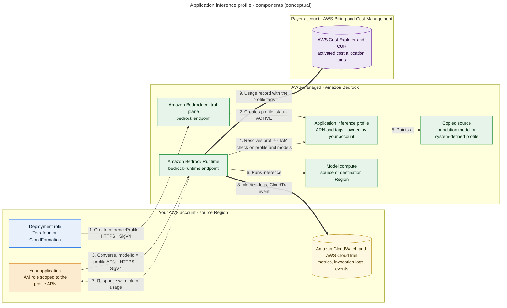
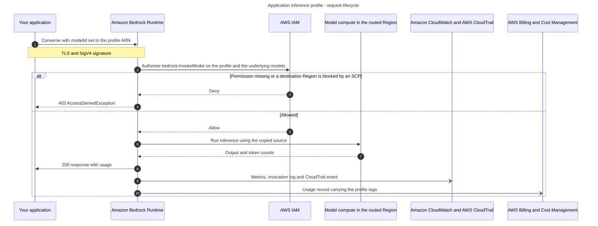

# Application inference profiles

> **Level:** Intermediate · **Verified:** 2026-11-15 · **Feature status:** GA · **Time:** ~20 min

An application inference profile is an inference profile that **you** create: a named, taggable
resource that points at one model — or at one system-defined cross-Region profile — and that you
invoke in place of the model ID. It sits between your application and the model as a **cost and
usage label**. It adds no capacity and changes no routing.

> [!IMPORTANT]
> **Status** — GA. Application inference profiles can be created in the 35 Regions listed in the
> documentation, including both AWS GovCloud (US) Regions. They are **rejected by the
> OpenAI-compatible Responses API** (HTTP 400) and cannot be combined with Provisioned Throughput.
> Sources: [Supported Regions and models for inference profiles](https://docs.aws.amazon.com/bedrock/latest/userguide/inference-profiles-support.html),
> [Responses API](https://docs.aws.amazon.com/bedrock/latest/userguide/inference-responses-api.html),
> [Cross-Region inference](https://docs.aws.amazon.com/bedrock/latest/userguide/cross-region-inference.html)

## Learning objectives

- Explain what an application inference profile is and how it differs from a system-defined profile.
- Create one from a foundation model or from a cross-Region profile, with cost allocation tags.
- Invoke a model through the profile and write the IAM policy that forces callers to use it.
- List the APIs that do not accept application inference profiles and name the alternative for each.
- Read the resulting cost data and state its granularity.

## Prerequisites

- [Cross-Region inference: Geo and Global profiles](04-cross-region-inference.md)
- [The Converse API](01-converse-api.md)
- [IAM fundamentals: principals, policies and evaluation](../../00-foundations/security/01-iam-fundamentals.md)
- [Pricing model and cost drivers](../../08-cost-performance-and-reliability/01-pricing-model-and-cost-drivers.md)

## 1. What it is

**Plain language.** Two teams call the same model from the same account, and the bill shows one
line. An application inference profile is a named meter you put in front of the model: each team
calls its own profile, and each profile's tags travel with the charge.

**Precisely.** It is an Amazon Bedrock resource of type `APPLICATION`, created with
`CreateInferenceProfile`. Its `modelSource.copyFrom` field holds the ARN of either a foundation
model in one Region (a single-Region profile) or a system-defined inference profile (the new
profile inherits that profile's Regions). You pass the returned ARN as `modelId`.

| Item | Value |
|:--|:--|
| Service namespace / endpoint | Created on `bedrock` (control plane); invoked on `bedrock-runtime` |
| Control-plane operations | `CreateInferenceProfile`, `GetInferenceProfile`, `ListInferenceProfiles`, `DeleteInferenceProfile`, `TagResource`, `UntagResource`, `ListTagsForResource` |
| Data-plane operations | `Converse`, `ConverseStream`, `InvokeModel`, `InvokeModelWithResponseStream` with `modelId` = profile ARN |
| IAM action prefix | `bedrock:` |
| ARN | `arn:aws:bedrock:<region>:<account-id>:application-inference-profile/<id>` |

Sources: [CreateInferenceProfile](https://docs.aws.amazon.com/bedrock/latest/APIReference/API_CreateInferenceProfile.html),
[Prerequisites for inference profiles](https://docs.aws.amazon.com/bedrock/latest/userguide/inference-profiles-prereq.html).
Operation and field names are checked against [the API operations reference](../../references/bedrock-api-operations.md).

### Application versus system-defined profiles

| | System-defined (cross-Region) profile | Application inference profile |
|:--|:--|:--|
| Created by | AWS — predefined per model | You |
| Purpose | Route requests across Regions (Geo or Global) | Track cost and usage; routing is inherited from the source |
| ARN resource type | `inference-profile/` | `application-inference-profile/` |
| Referenced by | Profile ID or ARN | ARN |
| Tags | Not applicable (AWS-defined) | Yes — the basis of cost allocation |
| Responses API on `bedrock-runtime` | Accepted | Rejected with 400 |

Source: [Use an inference profile in model invocation](https://docs.aws.amazon.com/bedrock/latest/userguide/inference-profiles-use.html)

## 2. Why it exists

On-demand inference is billed per model and usage type. Without a profile, everything an account
sends to one model is one undifferentiated charge. To split it you would need one AWS account per
workload, or you would rebuild cost from invocation logs and a price list. A profile lets a
**resource tag ride on the billing record** of every request made through it.

## 3. When to use it

- You need per-application or per-workload dollars for `Converse` / `InvokeModel` traffic.
- Several teams share one platform account and one model.
- You use a feature that takes a model ARN and want its spend separated: knowledge base response
  generation and parsing, model evaluation jobs, Prompt management, Flows prompt nodes, batch
  inference, and (since 2026-10-20) Advanced Prompt Optimization.
- Finance needs tags in AWS Cost Explorer and the AWS Cost and Usage Report (CUR), not log queries.

## 4. When not to use it

- **OpenAI-compatible APIs.** Use IAM principal attribution or per-request metadata, or Projects on
  `bedrock-mantle` — see [OpenAI- and Anthropic-compatible APIs](03-openai-and-anthropic-compatible-apis.md)
  and [Projects, Workspaces and the Web Search tool](../overview/04-projects-workspaces-and-web-search.md).
- **Per-user or per-prompt cost.** Profiles report aggregated dollars. Use IAM principal attribution
  or invocation logs — see [Cost optimization and token budgeting](../../08-cost-performance-and-reliability/02-cost-optimization-and-token-budgeting.md).
- **More throughput or different routing.** A profile gives neither — see
  [Cross-Region inference](04-cross-region-inference.md) and [Service tiers](06-service-tiers.md).
- **Dedicated capacity.** Inference profiles do not support
  [Provisioned Throughput](07-provisioned-throughput.md); tag the Provisioned Throughput instead.
- **Many models times many teams.** Each profile is tied to one model, so the count multiplies.

> [!WARNING]
> **Common mistake** — assuming Chat Completions works. The cost-attribution page says profiles
> "aren't supported by the Responses and Chat Completions APIs, on either endpoint"; the comparison
> table on *Track usage and costs* lists Chat Completions as supported. The pages disagree, so treat
> it as unsupported until you have tested it. Whether the Anthropic Messages route on
> `bedrock-runtime` accepts a profile is **UNVERIFIED — REQUIRES DOCUMENTATION REVIEW** (no page read
> says either way).
> Sources: [Application inference profiles (cost attribution)](https://docs.aws.amazon.com/bedrock/latest/userguide/cost-mgmt-application-inference-profiles.html),
> [Track usage and costs](https://docs.aws.amazon.com/bedrock/latest/userguide/cost-management.html)

## 5. Internal architecture

AWS documents the resource, its API and where the cost data lands. How Bedrock resolves a profile
internally is not documented; the diagram is a conceptual model of the customer-visible parts.



| Legend | Meaning |
|:--|:--|
| Solid arrow | Request |
| Dashed arrow | Response |
| Thick arrow | Asynchronous telemetry or metering |
| Blue / orange / green / purple / yellow | Caller / your compute / Bedrock / data store / observability |

**What this shows** — the profile is a control-plane resource consulted on each call. The model
runs wherever the copied source would have run it; only the attribution changes.

1. A deployment role calls `CreateInferenceProfile` with a name, the source ARN and tags.
2. Bedrock returns the profile ARN with status `ACTIVE`.
3. The application sends `Converse` with the profile ARN as `modelId`.
4. The caller needs `bedrock:InvokeModel` on the profile **and** on the foundation model in every
   Region the profile can route to.
5. The profile points at the source it was copied from.
6. Inference runs in the source Region, or in a destination Region for a cross-Region source.
7. The response carries the usual token usage.
8. Metrics and logs go to CloudWatch; CloudTrail records the call.
9. Billing receives the usage with the profile's tags.

**Variations** — a profile copied from a foundation model stays in one Region. One copied from a
Geo or Global profile routes like that profile, so data residency is the source's; see
[Cross-Region considerations and data residency](../../09-advanced-topics/11-cross-region-and-data-residency.md).
The full inference path is in [diagram set 3](../../diagrams/mermaid/03-model-inference-lifecycle.md).

## 6. Request and response lifecycle



- **Steps 1–2** — only `modelId` changes in your code. Bedrock authorises the profile and each
  foundation model behind it.
- **Steps 3–4** — a missing statement, or a service control policy (SCP) that blocks one
  destination Region, returns **403**.
- **Steps 5–8** — inference and the response are the same as for a direct model call.
- **Steps 9–10** — telemetry and billing are asynchronous. Tags appear up to 24 hours after
  activation and are not retroactive.

Other error paths: **400** when the ARN is sent to the Responses API; **404
`ResourceNotFoundException`** for a deleted profile. **Our reading:** throttling (**429**) follows the
underlying model's quotas, because the documentation gives the profile no capacity of its own.

## 7. Dependencies

| Depends on | Why | Required or optional |
|:--|:--|:-:|
| A foundation model or system-defined profile | The `copyFrom` source | Required |
| Access to the underlying model | The profile does not grant model access | Required |
| IAM permissions on the profile and the models | Authorisation of each call | Required |
| Tag activation in Billing and Cost Management | Tags are invisible in cost tools until activated | Required for cost reports |
| SCPs that allow every destination Region | Only for profiles copied from a cross-Region profile | Required where SCPs restrict Regions |
| Model invocation logging | Per-request token detail | Optional |

## 8. Security considerations

The documented policy pattern grants the profile and the models, then pins the models to the
profile with the `bedrock:InferenceProfileArn` condition key so that nobody can bypass the meter.

> **Code status:** illustrative · **never deployed**

```json
{
  "Version": "2012-10-17",
  "Statement": [
    {
      "Sid": "InvokeTheProfile",
      "Effect": "Allow",
      "Action": "bedrock:InvokeModel*",
      "Resource": "arn:aws:bedrock:us-east-1:111122223333:application-inference-profile/<profile-id>"
    },
    {
      "Sid": "ModelsOnlyThroughTheProfile",
      "Effect": "Allow",
      "Action": "bedrock:InvokeModel*",
      "Resource": "arn:aws:bedrock:us-east-1::foundation-model/<model-id>",
      "Condition": {
        "StringLike": {
          "bedrock:InferenceProfileArn": "arn:aws:bedrock:us-east-1:111122223333:application-inference-profile/<profile-id>"
        }
      }
    }
  ]
}
```

- "When you specify an inference profile in the `Resource` field … you must also specify the
  foundation model in each Region associated with it." Add one model ARN per Region.
- Separate who may create, delete or tag profiles from who may invoke them: whoever can retag a
  profile can move cost between cost centres.
- The profile holds a name, a description, a source ARN and tags. Its API has no encryption setting.
- For cross-Region sources, CloudTrail logs the request in the source Region and records the
  processing Region in `additionalEventData.inferenceRegion`.

Source: [Prerequisites for inference profiles](https://docs.aws.amazon.com/bedrock/latest/userguide/inference-profiles-prereq.html).
Wider guidance: [Identity, least privilege and IAM isolation for agents](../../06-security-governance/02-identity-and-least-privilege.md).

## 9. Networking requirements

Nothing beyond normal inference. Private callers need interface endpoints for
`com.amazonaws.<region>.bedrock` (to manage profiles) and `com.amazonaws.<region>.bedrock-runtime`
(to invoke). With a cross-Region source, Bedrock carries the request to the destination Region on
the AWS network. See [Private connectivity for Bedrock](../../02-related-aws-services/networking/01-private-connectivity-for-bedrock.md).

## 10. Pricing dimensions

| Dimension | Unit | Notes |
|:--|:--|:--|
| Inference through the profile | Tokens, at the model's rate | "Calculated based on the price of the model in the Region from which you call the inference profile" |
| The profile resource | — | No separate charge is listed on the pricing page (searched for one; none found) |

Cost data is **aggregated per usage type per day**, in Cost Explorer and in both classic CUR and
CUR 2.0. There is no per-request row. Sources: [Inference profiles](https://docs.aws.amazon.com/bedrock/latest/userguide/inference-profiles.html),
[Amazon Bedrock pricing](https://aws.amazon.com/bedrock/pricing/).

## 11. Scaling considerations

- **Profile sprawl.** "You need a separate profile for every unique combination of model, team, and
  tag set." Tag at team or cost-centre level, not per user.
- **Quota.** Custom inference profiles have their own quota, separate from the per-model token
  quotas. Read the value for your account in Service Quotas; none is quoted here.
- **Tag limits.** The API accepts up to 200 tags in a request but a resource holds at most 50.
- **Model upgrades.** A new model version needs a new profile, so keep the ARN in configuration.

Sources: [Application inference profiles (cost attribution)](https://docs.aws.amazon.com/bedrock/latest/userguide/cost-mgmt-application-inference-profiles.html),
[Quotas for the bedrock-runtime endpoint](https://docs.aws.amazon.com/bedrock/latest/userguide/quotas-runtime.html)

## 12. IaC support

| Tool | Support | Resource / construct | Notes |
|:--|:-:|:--|:--|
| Terraform (`hashicorp/aws` 6.73.0) | ✅ | `aws_bedrock_inference_profile` | Data sources `aws_bedrock_inference_profile` and `aws_bedrock_inference_profiles` read existing profiles |
| CloudFormation | ✅ | `AWS::Bedrock::ApplicationInferenceProfile` | |
| AWS CDK (`aws-cdk-lib` 2.277.0) | L1 · alpha L2 | `aws_bedrock.CfnApplicationInferenceProfile`; `ApplicationInferenceProfile` in `@aws-cdk/aws-bedrock-alpha` | The alpha package is experimental |

Checked against [the Terraform reference](../../references/terraform-aws-provider-bedrock.md) and
[the CDK and CloudFormation reference](../../references/cdk-and-cloudformation-bedrock.md). See also
[Terraform coverage for Amazon Bedrock](../../04-infrastructure-as-code/terraform/10-terraform-for-bedrock.md).

## 13. Working example

> **Code status:** validated with `terraform validate` (provider 6.73.0, together with a `versions.tf` that sets `required_version = ">= 1.11.0"` and `hashicorp/aws ~> 6.73`) · **never planned or applied against AWS**

```hcl
provider "aws" {
  region = var.region

  default_tags {
    tags = var.tags
  }
}

variable "region" {
  description = "Region in which the application inference profile is created and called."
  type        = string
  default     = "us-east-1"
}

variable "source_inference_profile_id" {
  description = "ID of the system-defined (cross-Region) inference profile to copy from. Take the current ID from the model card; do not hard-code one."
  type        = string
}

variable "application" {
  description = "Application name. Used in the profile name and as a cost allocation tag value."
  type        = string
}

variable "cost_center" {
  description = "Cost centre that pays for this application's inference."
  type        = string
}

variable "tags" {
  description = "Tags applied to every resource through the provider's default_tags."
  type        = map(string)
  default     = {}
}

# Look the source profile up instead of building its ARN by hand.
data "aws_bedrock_inference_profile" "source" {
  inference_profile_id = var.source_inference_profile_id
}

resource "aws_bedrock_inference_profile" "app" {
  name        = "${var.application}-profile"
  description = "Cost and usage tracking for ${var.application}"

  model_source {
    copy_from = data.aws_bedrock_inference_profile.source.inference_profile_arn
  }

  # These become cost allocation tags once activated in Billing and Cost Management.
  tags = {
    Application = var.application
    CostCenter  = var.cost_center
  }
}

# Identity policy for the application role: call the model only through this profile.
data "aws_iam_policy_document" "invoke_through_profile" {
  statement {
    sid       = "InvokeApplicationInferenceProfile"
    actions   = ["bedrock:InvokeModel", "bedrock:InvokeModelWithResponseStream"]
    resources = [aws_bedrock_inference_profile.app.arn]
  }

  statement {
    sid       = "UnderlyingModelsOnlyThroughTheProfile"
    actions   = ["bedrock:InvokeModel", "bedrock:InvokeModelWithResponseStream"]
    resources = [for m in aws_bedrock_inference_profile.app.models : m.model_arn]

    condition {
      test     = "StringLike"
      variable = "bedrock:InferenceProfileArn"
      values   = [aws_bedrock_inference_profile.app.arn]
    }
  }
}

output "application_inference_profile_arn" {
  description = "Pass this ARN as modelId to Converse or InvokeModel."
  value       = aws_bedrock_inference_profile.app.arn
}

output "invoke_policy_json" {
  description = "Attach to the application's IAM role."
  value       = data.aws_iam_policy_document.invoke_through_profile.json
}
```

To copy from a single-Region foundation model, set `copy_from` to that model's ARN. The `models`
attribute lists the model ARN in each Region, which is what the IAM policy needs.

> **Code status:** syntax-checked · **never run against AWS**

```python
import os

import boto3

runtime = boto3.client("bedrock-runtime")

response = runtime.converse(
    # The Terraform output, injected as configuration. Never hard-code a model ID or ARN.
    modelId=os.environ["INFERENCE_PROFILE_ARN"],
    messages=[{"role": "user", "content": [{"text": "Summarise our returns policy in two sentences."}]}],
    inferenceConfig={"maxTokens": 200},
)

print(response["output"]["message"]["content"][0]["text"])
print(response["usage"])
```

> [!TIP]
> **Academy recommendation** — Activate the tag keys in the payer account on the day you create the
> first profile. Activation is not retroactive, so every day you wait is a day of unattributed cost.
> This is our design guidance, not an official AWS reference architecture.

## Common mistakes

| Mistake | Symptom | Fix |
|:--|:--|:--|
| Tags created but never activated | Profiles exist, Cost Explorer shows no tag | Activate them as cost allocation tags; allow up to 24 hours |
| Policy grants the profile only | 403 on every call | Add the foundation model ARN for each Region behind the profile |
| Application still allowed on the bare model ID | Some spend is untagged | Add the `bedrock:InferenceProfileArn` condition |
| Profile ARN sent to the Responses API | 400 | Use a system-defined profile there and attribute by IAM principal |
| Expecting more throughput | Same throttling as before | Use cross-Region inference, a service tier or a quota increase |
| One profile per user | Hundreds of profiles | Tag at team level; use IAM principal attribution for users |

## Knowledge check

1. Your role may invoke an application inference profile, yet every call returns 403. What is most likely missing?
2. Finance activated the `CostCenter` tag today. Will last week's inference appear under it?
3. A team wants the cost of each prompt. Why is a profile the wrong tool, and what is the right one?
4. You copy a profile from a Global cross-Region profile. Where can requests be processed?

<details>
<summary>Answers</summary>

1. Permission on the underlying foundation model in each Region the profile routes to (or an SCP blocks one of those Regions).
2. No. Cost allocation tags are not retroactive; only cost incurred after activation is tagged.
3. Profiles deliver aggregated dollars per usage type per day. Per-prompt detail comes from model invocation logs with per-request metadata.
4. Wherever the Global profile can route — any supported commercial Region. The profile inherits the source's routing.

</details>

## 14. Official documentation

- [Set up a model invocation resource using inference profiles](https://docs.aws.amazon.com/bedrock/latest/userguide/inference-profiles.html) — the two profile types and what each is for.
- [Create an application inference profile](https://docs.aws.amazon.com/bedrock/latest/userguide/inference-profiles-create.html) — required and optional fields.
- [Use an inference profile in model invocation](https://docs.aws.amazon.com/bedrock/latest/userguide/inference-profiles-use.html) — which operations take the ARN, and in which field.
- [Prerequisites for inference profiles](https://docs.aws.amazon.com/bedrock/latest/userguide/inference-profiles-prereq.html) — IAM policies and the `bedrock:InferenceProfileArn` condition key.
- [Supported Regions and models for inference profiles](https://docs.aws.amazon.com/bedrock/latest/userguide/inference-profiles-support.html) — Region list for application profiles.
- [CreateInferenceProfile API reference](https://docs.aws.amazon.com/bedrock/latest/APIReference/API_CreateInferenceProfile.html) — field constraints, ARN pattern, errors.
- [Application inference profiles (cost attribution)](https://docs.aws.amazon.com/bedrock/latest/userguide/cost-mgmt-application-inference-profiles.html) — tag activation, granularity, unsupported APIs.
- [Track usage and costs in Amazon Bedrock](https://docs.aws.amazon.com/bedrock/latest/userguide/cost-management.html) — comparison with IAM principal attribution, Projects and request metadata.
- [Responses API](https://docs.aws.amazon.com/bedrock/latest/userguide/inference-responses-api.html) — the 400 rejection on `bedrock-runtime`.
- [Cross-Region inference](https://docs.aws.amazon.com/bedrock/latest/userguide/cross-region-inference.html) — routing inherited from the source; no Provisioned Throughput.
- [Quotas for the bedrock-runtime endpoint](https://docs.aws.amazon.com/bedrock/latest/userguide/quotas-runtime.html) — separate quota for custom inference profiles.
- [Interface VPC endpoints for Amazon Bedrock](https://docs.aws.amazon.com/bedrock/latest/userguide/vpc-interface-endpoints.html) — endpoint service names.
- [Document history](https://docs.aws.amazon.com/bedrock/latest/userguide/bedrock-ug-doc-history.html) — 2026-10-20 entry on Advanced Prompt Optimization.
- [Terraform `aws_bedrock_inference_profile`](https://raw.githubusercontent.com/hashicorp/terraform-provider-aws/main/website/docs/r/bedrock_inference_profile.html.markdown) — arguments and exported attributes.
- [Feature verification matrix](../../FEATURE-VERIFICATION.md) — the academy's register entry for this feature.
