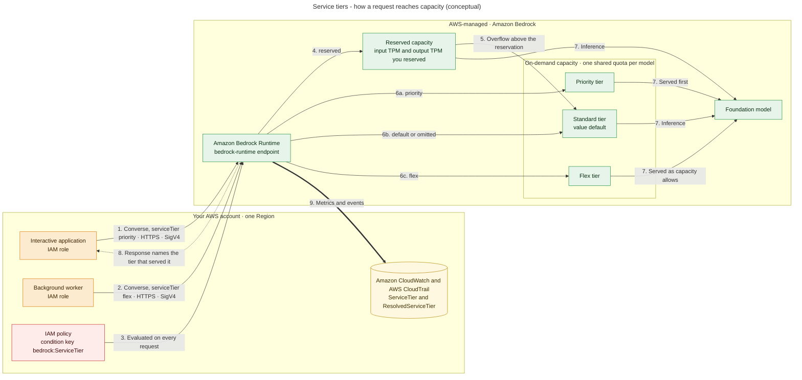
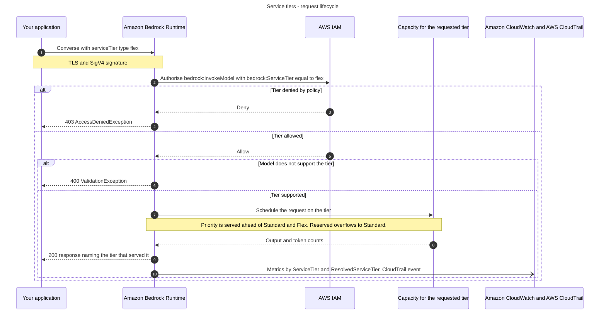

# Service tiers: Reserved, Priority, Standard and Flex

> **Level:** Intermediate · **Verified:** 2026-11-15 · **Feature status:** GA · **Time:** ~20 min

A service tier is a per-request choice of **how** Amazon Bedrock serves an inference request:
faster for a premium (Priority), the normal way (Standard), cheaper but slower (Flex), or from
capacity you reserved in advance (Reserved). The model, the prompt and the API stay the same.

> [!IMPORTANT]
> **Status** — GA. Priority and Flex were added on 2025-11-18 and Reserved on 2025-11-26. Tier
> support is **per model**: check the model's card before you rely on a tier.
> Sources: [Service tiers for optimizing performance and cost](https://docs.aws.amazon.com/bedrock/latest/userguide/service-tiers-inference.html),
> [Document history](https://docs.aws.amazon.com/bedrock/latest/userguide/bedrock-ug-doc-history.html),
> [Models at a glance](https://docs.aws.amazon.com/bedrock/latest/userguide/model-cards.html)

## Learning objectives

- Describe what each of the four tiers trades off.
- Select a tier on a request and read back the tier that actually served it.
- Explain how Reserved capacity is bought, sized and billed.
- Restrict tiers with the `bedrock:ServiceTier` IAM condition key.
- Choose a tier for interactive, agentic, batch-like and evaluation workloads.

## Prerequisites

- [The Converse API](01-converse-api.md) and [InvokeModel and streaming APIs](02-invokemodel-and-streaming.md)
- [Cross-Region inference: Geo and Global profiles](04-cross-region-inference.md)
- [Latency and token economics](../../00-foundations/generative-ai-fundamentals/08-latency-and-token-economics.md)
- [Quotas, rate limits and throttling](../../08-cost-performance-and-reliability/05-quotas-rate-limits-and-throttling.md)

## 1. What it is

**Plain language.** Think of a post office with an express counter, a normal counter and an economy
counter, plus a private counter that a large customer has rented. You pick the counter each time you
hand over a parcel. The parcel is the same; the wait and the price differ.

**Precisely.** A service tier is a request option on `bedrock-runtime` with four values:
`reserved`, `priority`, `default` (the Standard tier) and `flex`. Omitting it means `default`.

| Item | Value |
|:--|:--|
| Service namespace / endpoint | `bedrock-runtime` (request option; nothing to provision for three of the four tiers) |
| Control-plane operations | None for Reserved capacity in the documentation or in the SDK service model — it is arranged with your AWS account team |
| Data-plane operations | `Converse`, `ConverseStream`, `InvokeModel`, `InvokeModelWithResponseStream`, OpenAI-compatible Chat Completions |
| IAM action prefix | `bedrock:` — `bedrock:InvokeModel` with the condition key `bedrock:ServiceTier` |

| Tier | Value | You get | You give up |
|:--|:--|:--|:--|
| Reserved | `reserved` | Prioritised capacity you reserved, sized separately in input and output tokens per minute (TPM); targets 99.5% uptime for model response; overflow goes to Standard automatically | A 1- or 3-month commitment, a fixed monthly bill, and a minimum of 100,000 input TPM and 10,000 output TPM |
| Priority | `priority` | The fastest response times; served ahead of Standard and Flex; no reservation | A price premium |
| Standard | `default` | Consistent performance for everyday work | — (the baseline) |
| Flex | `flex` | A price discount | Longer processing times |

Source: [Service tiers](https://docs.aws.amazon.com/bedrock/latest/userguide/service-tiers-inference.html)

### How a request selects a tier

| API | Request | Tier reported back |
|:--|:--|:--|
| `Converse`, `ConverseStream` | Body field `serviceTier`, an object: `{"type": "flex"}` | `serviceTier` in the `Converse` response |
| `InvokeModel`, `InvokeModelWithResponseStream` | SDK parameter `serviceTier`; on the wire, the HTTP header `X-Amzn-Bedrock-Service-Tier` | `serviceTier` on the response (the same header) |
| OpenAI-compatible Chat Completions | Body parameter `service_tier` (from the launch post; this API is not in the SDK model) | Not confirmed in the pages read |

All four SDK operations carry `serviceTier` in [the API operations reference](../../references/bedrock-api-operations.md);
the header name is shown on the `InvokeModel` page. The value for the Standard tier is `default`,
not `standard`.
Sources: [Converse](https://docs.aws.amazon.com/bedrock/latest/APIReference/API_runtime_Converse.html),
[ServiceTier](https://docs.aws.amazon.com/bedrock/latest/APIReference/API_runtime_ServiceTier.html),
[InvokeModel](https://docs.aws.amazon.com/bedrock/latest/APIReference/API_runtime_InvokeModel.html),
[Launch post](https://aws.amazon.com/blogs/aws/new-amazon-bedrock-service-tiers-help-you-match-ai-workload-performance-with-cost/)

### Which models support which tier

Support is **per model and per tier**, and it changes as models are added. Open the model's card in
[Models at a glance](https://docs.aws.amazon.com/bedrock/latest/userguide/model-cards.html) and read
its service tier entry. As an example, an AWS post dated 2026-11-12 reports that the Amazon Nova 2
Lite and OpenAI gpt-oss-120b cards list Flex as supported, while the Claude Sonnet 5 and Claude
Opus 5 cards list it as not supported.

## 2. Why it exists

Before tiers, on-demand inference had one price and one queue. A customer-facing assistant and a
nightly summarisation job competed equally, and the only alternatives were Provisioned Throughput
(a capacity purchase) or batch inference (a different, file-based API). Tiers let one application
pay more for the calls where latency matters and less for the calls where it does not, by changing
one request field.

## 3. When to use it

- **Priority** — customer-facing paths that are latency-critical but too spiky to justify a
  reservation. AWS states that for most supporting models it gives up to 25% better output tokens
  per second than Standard.
- **Flex** — work nobody is waiting on: evaluations, summarisation, background agent runs.
- **Reserved** — steady, high-volume, mission-critical traffic at or above the minimum reservation.
- **Standard** — everything else, and the right starting point.

### Decision table for workloads

> [!TIP]
> **Academy recommendation** — the table below is our guidance, built on the AWS tier descriptions.
> It is not an official AWS reference architecture. Measure before and after you change a tier.

| Workload | Start with | Move to | Why |
|:--|:--|:--|:--|
| Interactive (chat, live translation) | Standard | Priority if the latency target is missed; Reserved for steady volume that cannot tolerate downtime | A person is waiting on every token |
| Agentic (multi-step tool loops) | Standard for turns a user is watching | Flex for autonomous or background runs | Per-call latency multiplies across the loop; AWS names agentic workflows as a Flex use case |
| Batch-like (bulk summarise, classify, enrich) | Flex | [Batch inference](08-batch-inference.md) if the work can wait hours and fits JSONL in Amazon S3 | Both are discounted; Flex keeps the synchronous API |
| Evaluation (regression suites, LLM-as-judge) | Flex | Batch inference for large offline datasets | Nobody is waiting; never pay Priority for it |

## 4. When not to use it

- **A tier the model does not support.** AWS reports that an unsupported Flex request fails rather
  than running on Standard; assume the same for the other tiers. Check the model card and keep a
  fallback to `default`.
- **Flex for anything with a user-facing deadline.** Use Standard — see
  [Latency optimization](../../08-cost-performance-and-reliability/03-latency-optimization.md).
- **Priority to escape throttling.** Priority, Standard and Flex share one on-demand quota. Ask for
  a quota increase or use [cross-Region inference](04-cross-region-inference.md).
- **Reserved for small or bursty traffic.** Below the minimum, or without a steady baseline, you pay
  for idle capacity. Use Standard or Priority.
- **Very large offline jobs.** Use [batch inference](08-batch-inference.md).
- **Custom models that require dedicated capacity.** Use [Provisioned Throughput](07-provisioned-throughput.md).

## 5. Internal architecture

AWS documents the tiers' behaviour, not the scheduler behind them. The diagram is a conceptual model.



| Legend | Meaning |
|:--|:--|
| Solid arrow | Request or routing decision |
| Dashed arrow | Response |
| Thick arrow | Asynchronous telemetry |
| Orange / green / red / yellow | Your compute / Bedrock / security control / observability |

**What this shows** — one endpoint, four ways in. Three tiers draw on the same on-demand quota and
differ in the order they are served; Reserved is a separate pool with a safety valve into Standard.

1. An interactive application asks for `priority`.
2. A background worker asks for `flex`.
3. IAM evaluates the requested tier through `bedrock:ServiceTier`.
4. A `reserved` request uses your reservation, which is separate from the on-demand quota.
5. Above the reserved tokens per minute, the request overflows to Standard.
6. On-demand requests go to the tier they named; a missing value means Standard.
7. Priority requests are prioritised over Standard and Flex.
8. The response states the tier that served the request.
9. CloudWatch exposes the dimensions `ModelId`, `ServiceTier` and `ResolvedServiceTier`; CloudTrail
   records the tier.

**Variations** — support differs by model. With a cross-Region inference profile the tier is still
set per request. **Our reading:** the ordering inside the on-demand pool is shown as three queues for
clarity; AWS states only that Priority requests "are prioritized over Standard and Flex tier requests".
The full inference path is in [diagram set 3](../../diagrams/mermaid/03-model-inference-lifecycle.md).

## 6. Request and response lifecycle



- **Steps 1–2** — the tier travels with the request and is part of what IAM authorises.
- **Steps 3–4** — a `Deny` on the tier returns **403**.
- **Step 6** — an unsupported tier returns **400 `ValidationException`**. An AWS post reports that a
  Flex request to a model without Flex support "fails with a `ValidationException` instead of
  silently running on Standard". Malformed requests raise the same code, so retry on `default` once,
  not in a loop.
- **Steps 7–9** — the response names the serving tier. For Reserved, compare it with what you asked
  for: a difference means you overflowed.
- **Step 10** — `ResolvedServiceTier` "shows the actual tier that served your requests".

Throttling (**429**) still applies: the on-demand quota is shared by Priority, Standard and Flex.
Source: [Four Amazon Bedrock inference choices that affect cost](https://aws.amazon.com/blogs/machine-learning/four-amazon-bedrock-inference-choices-that-affect-cost/)

## 7. Dependencies

| Depends on | Why | Required or optional |
|:--|:--|:-:|
| A model that supports the tier | Support is per model | Required |
| On-demand quota for the model | Shared by Priority, Standard and Flex | Required |
| An AWS account team | The only documented way to buy or end a Reserved reservation | Required for Reserved |
| An SDK release that includes `serviceTier` | **Our reading:** an SDK older than the feature cannot send the field | Required |
| CloudWatch and CloudTrail | To see the requested and resolved tier | Optional |

## 8. Security considerations

By default every principal with Bedrock inference permissions can use every tier. Restrict tiers
with a `Deny` on the `bedrock:ServiceTier` condition key — for example, to stop development roles
from spending at Priority rates.

> **Code status:** illustrative · **never deployed**

```json
{
  "Version": "2012-10-17",
  "Statement": [
    {
      "Sid": "DenyPremiumTiers",
      "Effect": "Deny",
      "Action": ["bedrock:InvokeModel", "bedrock:InvokeModelWithResponseStream"],
      "Resource": "*",
      "Condition": {
        "StringEquals": {
          "bedrock:ServiceTier": ["priority", "reserved"]
        }
      }
    }
  ]
}
```

The documented example lists only `bedrock:InvokeModel`. **Our reading:** include the streaming
action as well, and test both paths. The same statement works in a service control policy for an
organisation-wide rule — see [Governance at scale](../../06-security-governance/06-governance-at-scale.md).
A tier does not change encryption, data handling or logging.
Source: [Control access to service tiers](https://docs.aws.amazon.com/bedrock/latest/userguide/security_iam_id-based-policy-examples-agent.html)

## 9. Networking requirements

None beyond normal inference: the public `bedrock-runtime` endpoint or the interface endpoint
`com.amazonaws.<region>.bedrock-runtime`. See
[Private connectivity for Bedrock](../../02-related-aws-services/networking/01-private-connectivity-for-bedrock.md).

## 10. Pricing dimensions

| Dimension | Unit | Notes |
|:--|:--|:--|
| Standard | Input and output tokens | The published on-demand rate |
| Priority | Input and output tokens | "Priority tier pricing is at 75% premium to Standard tier pricing" — a footnote on the provider tables that offer it |
| Flex | Input and output tokens | "Flex tier pricing is at 50% discount to Standard tier pricing" — same footnote |
| Reserved | Per 1K tokens-per-minute reserved, billed monthly | Fixed price for a 1- or 3-month term; no figure is quoted here |

The footnotes appear per provider, so confirm the row for your model and Region. "Billing continues
until you delete the Reserved Tier reservation with the help of your AWS account manager."
Source: [Amazon Bedrock pricing](https://aws.amazon.com/bedrock/pricing/)

> [!CAUTION]
> **Cost or security hazard** — where the 75% premium applies, Priority on every call raises the
> token bill by three quarters. Set the tier per call path, not as a global default, and alarm on
> Priority token volume.

## 11. Scaling considerations

- **Shared quota.** "Your on-demand quota for a model is shared across the priority, default, and
  flex service tiers." A tier changes the order of service, not your ceiling.
- **Reserved is separate.** The reservation does not count against the on-demand quota, and overflow
  keeps requests flowing.
- **Sizing a reservation.** Tokens-per-minute consumption includes `InputTokenCount` **and**
  `CacheWriteInputTokens`; add both CloudWatch metrics if you use prompt caching.
- **Flex.** Set your own deadline and a fallback; AWS promises a discount, not a latency.

> [!WARNING]
> **Common mistake** — sizing from the *Capacity and Performance* page. It describes Reserved in
> "model units" and prints separate RPM and TPM ranges per tier. The service tiers page sizes
> Reserved in tokens per minute and says the three on-demand tiers share one quota. This chapter
> follows the service tiers page and the API reference.
> Source: [Capacity and Performance](https://docs.aws.amazon.com/bedrock/latest/userguide/capacity-limits-cost-optimization.html)

## 12. IaC support

| Tool | Support | Resource / construct | Notes |
|:--|:-:|:--|:--|
| Terraform (`hashicorp/aws` 6.73.0) | n/a | — | A request option. No resource for Reserved capacity in the provider schema |
| CloudFormation | n/a | — | Same |
| AWS CDK (`aws-cdk-lib` 2.277.0) | n/a | — | Same |

What you **can** manage as code is the IAM or service control policy that uses `bedrock:ServiceTier`,
and the application configuration that maps each call path to a tier.

## 13. Working example

> **Code status:** syntax-checked · **never run against AWS**

```python
import os

import boto3
from botocore.exceptions import ClientError

runtime = boto3.client("bedrock-runtime")
MODEL_ID = os.environ["MODEL_ID"]  # confirm on the model card that the model supports the tier


def converse(prompt: str, tier: str = "default") -> dict:
    """tier is one of: reserved, priority, default, flex."""
    request = {
        "modelId": MODEL_ID,
        "messages": [{"role": "user", "content": [{"text": prompt}]}],
        "inferenceConfig": {"maxTokens": 300},
        "serviceTier": {"type": tier},
    }
    try:
        response = runtime.converse(**request)
    except ClientError as error:
        # An unsupported tier is rejected, not served on Standard. Malformed requests raise the
        # same code, so fall back exactly once and log why.
        if error.response["Error"]["Code"] != "ValidationException" or tier == "default":
            raise
        print(f"tier {tier} rejected: {error.response['Error']['Message']}")
        request["serviceTier"] = {"type": "default"}
        response = runtime.converse(**request)

    # The response reports the tier that actually served the request.
    print("served by:", response.get("serviceTier", {}).get("type"))
    return response


if __name__ == "__main__":
    converse("Summarise yesterday's incident report in three bullets.", tier="flex")
```

## Common mistakes

| Mistake | Symptom | Fix |
|:--|:--|:--|
| Sending `standard` as the value | Validation error | The Standard tier's value is `default` |
| Assuming an unsupported tier falls back | 400 on every call | Check the model card; fall back to `default` in code |
| Priority to fix throttling | Still throttled | The quota is shared; request an increase or use cross-Region inference |
| Sizing Reserved from input tokens only | Constant overflow | Add `CacheWriteInputTokens` to `InputTokenCount` |
| Forgetting a reservation exists | Monthly charge with no traffic | Ending it needs your AWS account manager; track the term |
| Flex on a user-facing path | Slow responses | Keep latency-sensitive traffic on `default` |

## Knowledge check

1. A request omits the service tier. Which tier serves it, and what value would name that tier explicitly?
2. Your application is throttled on Standard. Will switching to Priority raise the limit? Why?
3. What happens to a `reserved` request that arrives when the reservation is fully used?
4. How do you stop a development role from using Priority?

<details>
<summary>Answers</summary>

1. Standard. The explicit value is `default`.
2. No. Priority, Standard and Flex share the model's on-demand quota; Priority changes the order of service, not the quota.
3. It overflows to the Standard tier automatically. The response and `ResolvedServiceTier` show the tier that served it.
4. Attach a `Deny` on `bedrock:InvokeModel` with the condition `bedrock:ServiceTier` equal to `priority`.

</details>

## 14. Official documentation

- [Service tiers for optimizing performance and cost](https://docs.aws.amazon.com/bedrock/latest/userguide/service-tiers-inference.html) — the four tiers, Reserved minimums and terms, shared quota, metrics.
- [Models at a glance](https://docs.aws.amazon.com/bedrock/latest/userguide/model-cards.html) — open a model's card to see which tiers it supports.
- [Converse API reference](https://docs.aws.amazon.com/bedrock/latest/APIReference/API_runtime_Converse.html) — `serviceTier` in the request and the response.
- [ServiceTier data type](https://docs.aws.amazon.com/bedrock/latest/APIReference/API_runtime_ServiceTier.html) — valid values.
- [InvokeModel API reference](https://docs.aws.amazon.com/bedrock/latest/APIReference/API_runtime_InvokeModel.html) — the `X-Amzn-Bedrock-Service-Tier` header.
- [Control access to service tiers](https://docs.aws.amazon.com/bedrock/latest/userguide/security_iam_id-based-policy-examples-agent.html) — the `bedrock:ServiceTier` condition key and a sample policy.
- [Capacity and Performance](https://docs.aws.amazon.com/bedrock/latest/userguide/capacity-limits-cost-optimization.html) — AWS's own comparison of tiers, batch and cross-Region inference.
- [Amazon Bedrock pricing](https://aws.amazon.com/bedrock/pricing/) — per-model rates and the Priority and Flex footnotes.
- [New Amazon Bedrock service tiers (AWS News Blog, 2025-11-18)](https://aws.amazon.com/blogs/aws/new-amazon-bedrock-service-tiers-help-you-match-ai-workload-performance-with-cost/) — launch post, `service_tier` in Chat Completions, the 25% figure.
- [Four Amazon Bedrock inference choices that affect cost (AWS blog, 2026-11-12)](https://aws.amazon.com/blogs/machine-learning/four-amazon-bedrock-inference-choices-that-affect-cost/) — unsupported-tier behaviour and a measured Flex test.
- [Document history](https://docs.aws.amazon.com/bedrock/latest/userguide/bedrock-ug-doc-history.html) — dates the tiers were added.
- [Feature verification matrix](../../FEATURE-VERIFICATION.md) — the academy's register entry for this feature.
