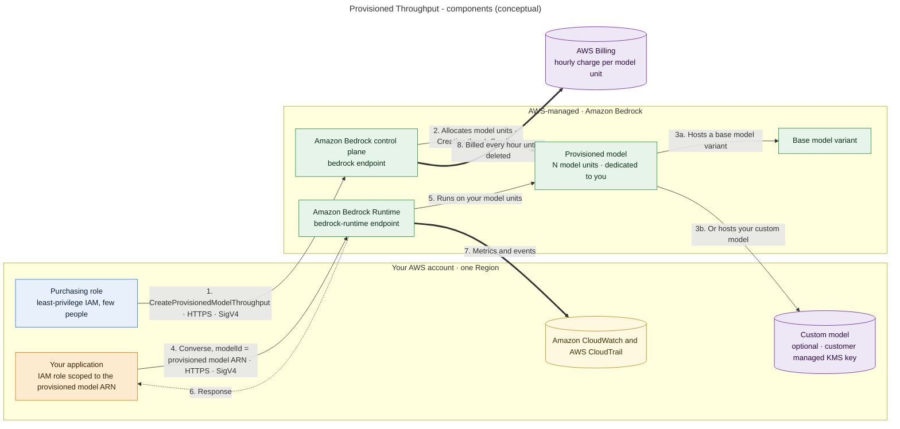
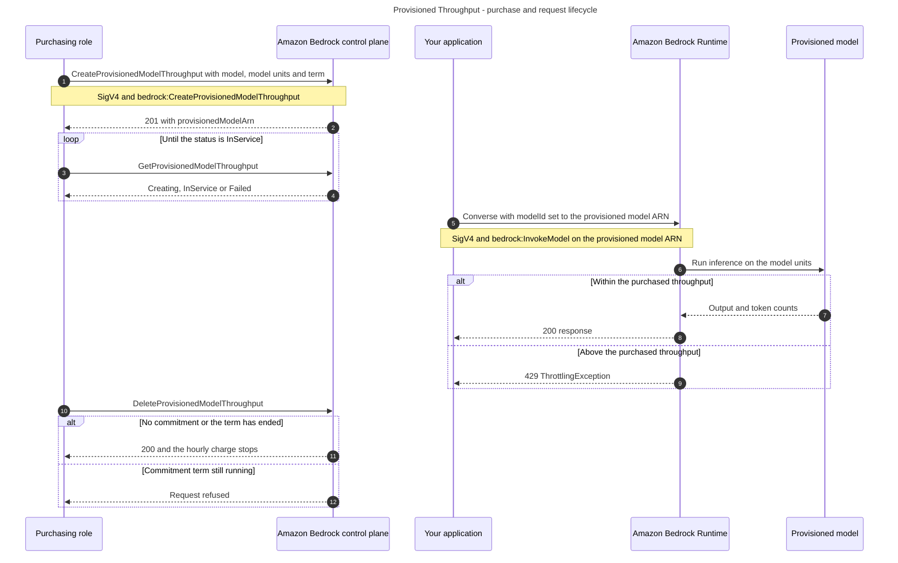

# Provisioned Throughput

> **Level:** Advanced · **Verified:** 2026-11-15 · **Feature status:** GA · **Time:** ~20 min

Provisioned Throughput is dedicated model capacity that you buy **by the hour**, in *model units*,
for one model in one Region. You invoke it through its own ARN instead of the model ID. For some
custom models it is the only way to run inference at all.

> [!IMPORTANT]
> **Status** — GA, for a short list of base models plus custom models. It is not supported with
> inference profiles, cannot be created for models in the Legacy state, and in AWS GovCloud (US-West)
> is limited to custom models with no commitment.
> Sources: [Provisioned Throughput](https://docs.aws.amazon.com/bedrock/latest/userguide/prov-throughput.html),
> [Supported Regions and models](https://docs.aws.amazon.com/bedrock/latest/userguide/prov-thru-supported.html),
> [Cross-Region inference](https://docs.aws.amazon.com/bedrock/latest/userguide/cross-region-inference.html),
> [Model lifecycle](https://docs.aws.amazon.com/bedrock/latest/userguide/model-lifecycle.html)

## Learning objectives

- Define a model unit and explain why you cannot size one from the documentation alone.
- Compare the three commitment terms and state what each prevents you from doing.
- Decide when Provisioned Throughput is required and when it is only an option.
- Distinguish Provisioned Throughput from the Reserved service tier and from inference profiles.
- Purchase, invoke and remove a provisioned model without an unplanned bill.

## Prerequisites

- [Service tiers: Reserved, Priority, Standard and Flex](06-service-tiers.md)
- [Model customization](../foundation-models/03-model-customization.md) and
  [Model lifecycle and selection](../foundation-models/02-model-lifecycle-and-selection.md)
- [Pricing model and cost drivers](../../08-cost-performance-and-reliability/01-pricing-model-and-cost-drivers.md)
- [IAM roles, trust policies and cross-account access](../../00-foundations/security/02-iam-roles-and-trust.md)

## 1. What it is

**Plain language.** On-demand inference is a taxi: you pay per trip and share the fleet.
Provisioned Throughput is a hired car with a driver: it is yours, and it costs the same whether
you ride or not.

**Precisely.** You call `CreateProvisionedModelThroughput` with a model, a number of **model units
(MUs)** and an optional commitment. Bedrock returns a *provisioned model* ARN,
`arn:aws:bedrock:<region>:<account-id>:provisioned-model/<id>`, which you pass as `modelId`.

| Item | Value |
|:--|:--|
| Service namespace / endpoint | Purchased on `bedrock` (control plane); invoked on `bedrock-runtime` |
| Control-plane operations | `CreateProvisionedModelThroughput`, `GetProvisionedModelThroughput`, `ListProvisionedModelThroughputs`, `UpdateProvisionedModelThroughput`, `DeleteProvisionedModelThroughput` |
| Data-plane operations | `InvokeModel`, `InvokeModelWithResponseStream`, `Converse`, `ConverseStream` with `modelId` = provisioned model ARN |
| IAM action prefix | `bedrock:` |

**Model units.** An MU "delivers a specific throughput level for the specified model": a number of
input tokens processed per minute and a number of output tokens generated per minute. AWS does not
publish those numbers — "contact your AWS account manager".

**Commitment terms.**

| Term | API value | What it means |
|:--|:--|:--|
| No commitment | omit `commitmentDuration` | You can delete it at any time. Not offered for every base model |
| 1 month | `OneMonth` | Cheaper per hour; cannot be deleted until the term is over |
| 6 months | `SixMonths` | Cheapest per hour; cannot be deleted until the term is over |

Sources: [Provisioned Throughput](https://docs.aws.amazon.com/bedrock/latest/userguide/prov-throughput.html),
[CreateProvisionedModelThroughput](https://docs.aws.amazon.com/bedrock/latest/APIReference/API_CreateProvisionedModelThroughput.html).
Operation and field names are checked against [the API operations reference](../../references/bedrock-api-operations.md).

> [!NOTE]
> **Documented fact** — the purchase page says there are "two types of Provisioned Throughput - by
> Tokens and by Model Units", and the console asks for a *Provisioning mode*. Only the model-unit
> flow is documented in full. For the by-Tokens mode the pages read say only that you can change its
> input and output tokens per minute and cancel its auto renew. Its purchase API, terms and prices
> are **UNVERIFIED — REQUIRES DOCUMENTATION REVIEW**; the delete page names a `disableAutoRenew`
> parameter that neither the `UpdateProvisionedModelThroughput` reference page nor the SDK service
> model (botocore 1.44.3) lists. This chapter covers model units.
> Sources: [Purchase a Provisioned Throughput](https://docs.aws.amazon.com/bedrock/latest/userguide/prov-thru-purchase.html),
> [Modify a Provisioned Throughput](https://docs.aws.amazon.com/bedrock/latest/userguide/prov-thru-edit.html),
> [Delete a Provisioned Throughput or cancel auto renew](https://docs.aws.amazon.com/bedrock/latest/userguide/prov-thru-delete.html)

## 2. Why it exists

On-demand capacity is shared and governed by quotas, so requests can be throttled. Some workloads
need a floor that is theirs alone, and a customised model has no shared fleet to run on. Provisioned
Throughput answers both.

## 3. When to use it

**Required**

- A fine-tuned or distilled model that cannot be deployed for on-demand inference. On-demand
  custom model deployment exists only for five base models, in US East (N. Virginia) and US West
  (Oregon), for models customised on or after 2025-07-16. Other customised models need
  Provisioned Throughput. Imported models are a separate case — see
  [Custom Model Import and on-demand custom model deployment](../foundation-models/04-custom-model-import.md).

**Optional**

- A base model in the supported table, when you need throughput that shared capacity cannot promise.
- Steady, round-the-clock volume where the hourly price is lower than the tokens you would buy.

> [!WARNING]
> **Common mistake** — treating the overview sentence "If you customized a model, you must purchase
> Provisioned Throughput to be able to use it" as a rule. The customization guide lists on-demand
> deployment as a second option. Both statements are live; check your base model.
> Sources: [Set up inference for a custom model](https://docs.aws.amazon.com/bedrock/latest/userguide/model-customization-use.html),
> [Deploy a custom model for on-demand inference](https://docs.aws.amazon.com/bedrock/latest/userguide/deploy-custom-model-on-demand.html)

## 4. When not to use it

- **Capacity for a model that is not in the supported table.** Ask your account team, or use the
  Reserved tier — see [Service tiers](06-service-tiers.md).
- **Spiky or low traffic.** Idle hours are billed. Use on-demand, with Priority for the critical path.
- **Resilience across Regions.** A provisioned model lives in one Region and inference profiles do
  not support it — see [Cross-Region inference](04-cross-region-inference.md).
- **Offline bulk work.** "Batch inference isn't supported for provisioned models" — see
  [Batch inference](08-batch-inference.md).
- **A custom model that supports on-demand deployment.** Deploy it on demand and pay per token.

### Provisioned Throughput versus the Reserved tier

| | Provisioned Throughput | Reserved service tier |
|:--|:--|:--|
| You buy | Model units for one model | Input and output tokens per minute |
| How | API, console or Terraform, after AWS Support grants model units | Through your AWS account team |
| Terms | None, 1 month, 6 months | 1 month, 3 months |
| Billing | Hourly per model unit | Fixed price per 1K tokens-per-minute, billed monthly |
| You call | The provisioned model ARN | The usual model ID with tier `reserved` |
| Above capacity | No overflow documented | Overflows to Standard |
| Custom models | Yes | Not stated |

## 5. Internal architecture



| Legend | Meaning |
|:--|:--|
| Solid arrow | Request |
| Dashed arrow | Response |
| Thick arrow | Asynchronous telemetry or metering |
| Blue / orange / green / purple / yellow | Purchaser / your compute / Bedrock / data and billing / observability |

**What this shows** — a purchase on the control plane creates a long-lived resource; the runtime
then sends your requests to it instead of the shared pool.

1. A purchasing role calls `CreateProvisionedModelThroughput`.
2. Bedrock allocates the model units; the status goes from `Creating` to `InService` or `Failed`.
3. The provisioned model hosts a base model variant or one of your custom models.
4. The application calls `Converse` with the provisioned model ARN as `modelId`.
5. The runtime runs the request on your model units.
6. The response has the same shape as on-demand.
7. Metrics and API events go to CloudWatch and CloudTrail.
8. The hourly charge runs "until you delete the Provisioned Throughput".

**Variations** — a base model is bought by its context-window variant ID from the supported table,
not the plain model ID. A provisioned model for a custom model can be re-pointed at its base model
or at another custom model from the same base; one for a base model cannot.
**Our reading:** AWS does not publish the hosting design behind "dedicated".

## 6. Request and response lifecycle



- **Steps 1–4** — the purchase returns at once; the capacity is usable only at `InService`.
  **Our reading:** a `ServiceQuotaExceededException` on purchase means the account has not been
  granted enough model units.
- **Steps 5–9** — only `modelId` changes in your code. **Our reading:** above the purchased
  throughput, requests are throttled; no overflow to on-demand is documented, so build your own
  fallback ([Resilience, fallback models and model routing](../../08-cost-performance-and-reliability/06-resilience-fallback-and-model-routing.md)).
- **Steps 10–12** — "You can't delete a Provisioned Throughput by Model Units with commitment before
  the commitment term is complete." It also renews automatically at the end of each term.

## 7. Dependencies

| Depends on | Why | Required or optional |
|:--|:--|:-:|
| Model units granted to the account | Requested through the AWS Support Center before any purchase | Required |
| A supported base model variant, or a custom model | What the capacity serves | Required |
| An Active model | No new Provisioned Throughput for Legacy models | Required |
| Access to the base model | Covers models customised from it | Required |
| AWS KMS key permissions | Only for a custom model encrypted with a customer managed key | Optional |

## 8. Security considerations

- **Purchase is a spending permission.** Grant `bedrock:CreateProvisionedModelThroughput` to a
  small group and deny it elsewhere with a service control policy
  ([Governance at scale](../../06-security-governance/06-governance-at-scale.md)).
- **Scope invocation.** Give applications `bedrock:InvokeModel` and
  `bedrock:InvokeModelWithResponseStream` on the provisioned model ARN only.
- **Custom models.** For a model encrypted with a customer managed key, the purchasing role needs
  permission to decrypt with it.
- **Audit.** Purchases, updates and deletions are control-plane calls recorded by CloudTrail.

Source: [Prerequisites for Provisioned Throughput](https://docs.aws.amazon.com/bedrock/latest/userguide/prov-thru-prereq.html)

## 9. Networking requirements

The same endpoints as on-demand: `bedrock` to purchase and `bedrock-runtime` to invoke, with the
interface endpoints `com.amazonaws.<region>.bedrock` and `com.amazonaws.<region>.bedrock-runtime`
for private access. A provisioned model is used in the Region where it was bought. See
[Private connectivity for Bedrock](../../02-related-aws-services/networking/01-private-connectivity-for-bedrock.md).

## 10. Pricing dimensions

| Dimension | Unit | Notes |
|:--|:--|:--|
| Model units | Per model unit, per hour | Depends on the model; a custom model is priced as its base model |
| Commitment term | None, 1 month, 6 months | "The longer the commitment duration, the more discounted the hourly price" |
| Custom model storage | Per model, per month | Listed separately on the pricing page |

The pricing page lists Provisioned Throughput per provider, and for some providers says only to
contact your account team. As an example of the shape, on the verification date it listed Cohere
Command at $49.50 per hour with no commitment, $39.60 with a 1-month and $23.77 with a 6-month
commitment, per model unit. Source: [Amazon Bedrock pricing](https://aws.amazon.com/bedrock/pricing/)

> [!CAUTION]
> **Cost or security hazard** — the charge is per hour of existence, not per request. **Our
> arithmetic** on the example above: one unit at $49.50 for a 730-hour month is about $36,000, and
> one unit on the 6-month term is about $104,000 that cannot be cancelled. A committed purchase
> renews automatically. `terraform destroy` does not get you out of a commitment.

## 11. Scaling considerations

- **No resize in place.** `UpdateProvisionedModelThroughput` takes a new name or, for custom models,
  a new model — not a new number of model units. To grow, buy another provisioned model.
- **Quotas.** Model units are granted on request; by default an account has none for committed
  purchases. Read the current values in Service Quotas.
- **Unpublished throughput.** Load-test with your own prompt and output sizes.
- **Single Region.** Pair it with an on-demand fallback.

Sources: [UpdateProvisionedModelThroughput](https://docs.aws.amazon.com/bedrock/latest/APIReference/API_UpdateProvisionedModelThroughput.html),
[Quotas for the bedrock-runtime endpoint](https://docs.aws.amazon.com/bedrock/latest/userguide/quotas-runtime.html)

## 12. IaC support

| Tool | Support | Resource / construct | Notes |
|:--|:-:|:--|:--|
| Terraform (`hashicorp/aws` 6.73.0) | ✅ | `aws_bedrock_provisioned_model_throughput` | Arguments: `provisioned_model_name`, `model_arn`, `model_units`, `commitment_duration`, `tags` |
| CloudFormation | ❌ | — | No type in the specification bundled with `aws-cdk-lib` 2.277.0 |
| AWS CDK (`aws-cdk-lib` 2.277.0) | ❌ | — | The register notes that the alpha `ProvisionedModel` only references an existing one |

Without a resource, the alternative is the console or the `CreateProvisionedModelThroughput` API.
Checked against
[the Terraform reference](../../references/terraform-aws-provider-bedrock.md) and the
[feature verification matrix](../../FEATURE-VERIFICATION.md).

## 13. Working example

> **Code status:** validated with `terraform validate` (provider 6.73.0, together with a `versions.tf` that sets `required_version = ">= 1.11.0"` and `hashicorp/aws ~> 6.73`) · **never planned or applied against AWS**

> [!CAUTION]
> **Cost or security hazard** — applying this with `enable_purchase = true` starts an hourly charge
> that can reach tens of thousands of US dollars a month, and a commitment cannot be undone. Never
> apply it from an automated pipeline. Use a sandbox account, no commitment and a budget alarm, and
> delete it the same day.

```hcl
provider "aws" {
  region = var.region

  default_tags {
    tags = var.tags
  }
}

variable "region" {
  description = "Region in which the Provisioned Throughput is purchased. Check the supported-Regions table for the model."
  type        = string
  default     = "us-east-1"
}

variable "enable_purchase" {
  description = "Safety switch. Nothing is purchased unless this is set to true on purpose."
  type        = bool
  default     = false
}

variable "model_arn" {
  description = "ARN of the base model variant or custom model to provision. Confirm the exact ID in the Provisioned Throughput supported-models table."
  type        = string
}

variable "model_units" {
  description = "Number of model units. Each unit is billed for every hour it exists."
  type        = number
  default     = 1

  validation {
    condition     = var.model_units >= 1 && floor(var.model_units) == var.model_units
    error_message = "model_units must be a whole number of at least 1."
  }
}

variable "commitment_duration" {
  description = "null for no commitment (where the model allows it), or OneMonth / SixMonths. A commitment cannot be cancelled early."
  type        = string
  default     = null

  validation {
    condition     = var.commitment_duration == null ? true : contains(["OneMonth", "SixMonths"], var.commitment_duration)
    error_message = "commitment_duration must be null, OneMonth or SixMonths."
  }
}

variable "name" {
  description = "Name of the Provisioned Throughput."
  type        = string
  default     = "academy-example"
}

variable "tags" {
  description = "Tags applied to every resource through the provider's default_tags."
  type        = map(string)
  default     = {}
}

resource "aws_bedrock_provisioned_model_throughput" "this" {
  count = var.enable_purchase ? 1 : 0

  provisioned_model_name = var.name
  model_arn              = var.model_arn
  model_units            = var.model_units
  commitment_duration    = var.commitment_duration

  timeouts {
    create = "30m"
  }
}

output "provisioned_model_arn" {
  description = "Pass this ARN as modelId to Converse or InvokeModel. Null while enable_purchase is false."
  value       = one(aws_bedrock_provisioned_model_throughput.this[*].provisioned_model_arn)
}
```

The application then calls the model exactly as before, with the output as `modelId`:

> **Code status:** syntax-checked · **never run against AWS**

```python
import os

import boto3

runtime = boto3.client("bedrock-runtime")

response = runtime.converse(
    modelId=os.environ["PROVISIONED_MODEL_ARN"],  # the Terraform output, injected as configuration
    messages=[{"role": "user", "content": [{"text": "Classify this ticket: printer is offline."}]}],
    inferenceConfig={"maxTokens": 100},
)
print(response["output"]["message"]["content"][0]["text"])
```

> [!TIP]
> **Academy recommendation** — keep a provisioned model in its own Terraform state, so that a
> routine change to the application stack can never touch it. This is our design guidance, not an
> official AWS reference architecture.

## Common mistakes

| Mistake | Symptom | Fix |
|:--|:--|:--|
| Buying with the plain model ID | Purchase rejected | Use the context-window variant listed in the supported table |
| Buying before model units are granted | Purchase rejected for quota | Request model units through the AWS Support Center first |
| Testing with a 1-month term | A month of charges for an hour of tests | Use no commitment where the model allows it |
| Forgetting to delete after a test | Hourly charges continue | Delete it, then confirm with `ListProvisionedModelThroughputs` |
| Pointing an inference profile at it | Not supported | Call the provisioned model ARN directly |
| Calling the base model ID after purchase | Traffic still on-demand; capacity idle | Pass the provisioned model ARN as `modelId` |
| Planning a new purchase on a Legacy model | Creation refused | Move to an Active model first |

## Knowledge check

1. Why can you not work out from the documentation how many model units a workload needs?
2. You bought a 6-month term by mistake ten minutes ago. What are your options?
3. How does going above capacity differ between Provisioned Throughput and the Reserved tier?

<details>
<summary>Answers</summary>

1. AWS does not publish the tokens per minute that one model unit delivers; you ask your AWS account manager and load-test.
2. None through the API: a committed Provisioned Throughput by Model Units cannot be deleted before the term ends.
3. Reserved overflows to the Standard tier automatically. No overflow is documented for Provisioned Throughput, so the application needs its own fallback.

</details>

## 14. Official documentation

- [Increase model invocation capacity with Provisioned Throughput](https://docs.aws.amazon.com/bedrock/latest/userguide/prov-throughput.html) — model units, commitment levels, hourly billing.
- [Supported Regions and models for Provisioned Throughput](https://docs.aws.amazon.com/bedrock/latest/userguide/prov-thru-supported.html) — the base models, their purchase IDs and Regions.
- [Prerequisites for Provisioned Throughput](https://docs.aws.amazon.com/bedrock/latest/userguide/prov-thru-prereq.html) — IAM actions and KMS permissions.
- [Purchase a Provisioned Throughput](https://docs.aws.amazon.com/bedrock/latest/userguide/prov-thru-purchase.html) — the two provisioning modes, requesting model units, statuses.
- [Use a Provisioned Throughput](https://docs.aws.amazon.com/bedrock/latest/userguide/prov-thru-use.html) — invoking with the provisioned model ARN; agent aliases.
- [Modify a Provisioned Throughput](https://docs.aws.amazon.com/bedrock/latest/userguide/prov-thru-edit.html) — what can be changed in each mode.
- [Delete a Provisioned Throughput or cancel auto renew](https://docs.aws.amazon.com/bedrock/latest/userguide/prov-thru-delete.html) — auto renewal and the deletion rule.
- [CreateProvisionedModelThroughput](https://docs.aws.amazon.com/bedrock/latest/APIReference/API_CreateProvisionedModelThroughput.html), [GetProvisionedModelThroughput](https://docs.aws.amazon.com/bedrock/latest/APIReference/API_GetProvisionedModelThroughput.html), [UpdateProvisionedModelThroughput](https://docs.aws.amazon.com/bedrock/latest/APIReference/API_UpdateProvisionedModelThroughput.html) — fields, statuses, errors.
- [Set up inference for a custom model](https://docs.aws.amazon.com/bedrock/latest/userguide/model-customization-use.html) and [Deploy a custom model for on-demand inference](https://docs.aws.amazon.com/bedrock/latest/userguide/deploy-custom-model-on-demand.html) — the alternative for some custom models.
- [Model lifecycle](https://docs.aws.amazon.com/bedrock/latest/userguide/model-lifecycle.html) — no new Provisioned Throughput for Legacy models.
- [Cross-Region inference](https://docs.aws.amazon.com/bedrock/latest/userguide/cross-region-inference.html) — inference profiles do not support Provisioned Throughput.
- [Service tiers](https://docs.aws.amazon.com/bedrock/latest/userguide/service-tiers-inference.html) — the Reserved tier, for comparison.
- [Amazon Bedrock pricing](https://aws.amazon.com/bedrock/pricing/) — hourly rates per model unit and term.
- [Terraform `aws_bedrock_provisioned_model_throughput`](https://raw.githubusercontent.com/hashicorp/terraform-provider-aws/main/website/docs/r/bedrock_provisioned_model_throughput.html.markdown) — arguments and import.
