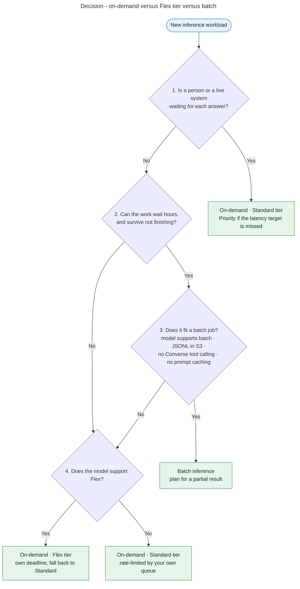
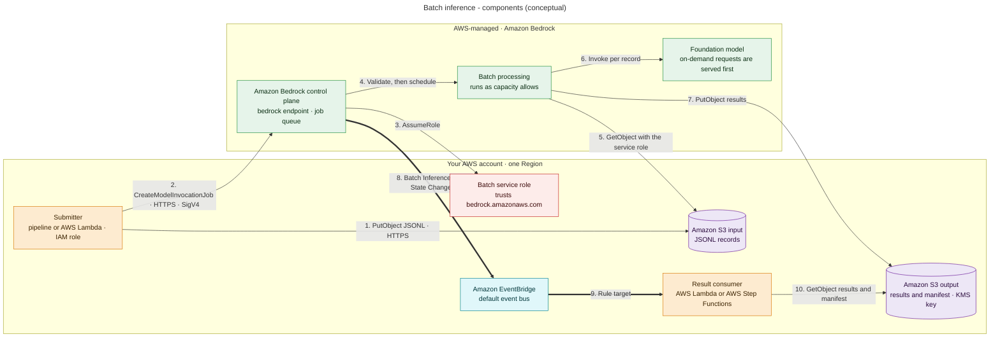
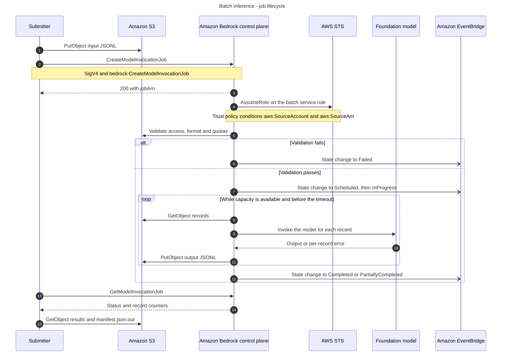

# Batch inference

> **Level:** Intermediate · **Verified:** 2026-11-15 · **Feature status:** GA · **Time:** ~25 min

Batch inference runs many prompts as **one asynchronous job**. You put JSONL files in Amazon S3,
call `CreateModelInvocationJob`, and collect the results from S3 later — at about half the
on-demand price for supported models, and with no promise about when, or whether, the job finishes.

> [!IMPORTANT]
> **Status** — GA; model and Region support is per model. Two changes in 2026: the Converse request
> format became a supported input format (2026-02-27), and AWS clarified that **on-demand requests
> are prioritised over batch jobs and that job completion is not guaranteed**, with a job timeout of
> 24 hours by default and 168 hours at most (2026-10-26).
> Sources: [Document history](https://docs.aws.amazon.com/bedrock/latest/userguide/bedrock-ug-doc-history.html),
> [Capacity and Performance](https://docs.aws.amazon.com/bedrock/latest/userguide/capacity-limits-cost-optimization.html),
> [Supported Regions and models for batch inference](https://docs.aws.amazon.com/bedrock/latest/userguide/batch-inference-supported.html)

## Learning objectives

- Trace a batch job through its states and say which are final.
- Write input records in the `InvokeModel` and `Converse` formats and read the output and manifest.
- Build the service role, its trust policy and its permissions.
- Explain the timeout, the quotas and what "on-demand takes priority" means for planning.
- Choose between on-demand, the Flex tier and batch for a workload.

## Prerequisites

- [The Converse API](01-converse-api.md) and [InvokeModel and streaming APIs](02-invokemodel-and-streaming.md)
- [Service tiers: Reserved, Priority, Standard and Flex](06-service-tiers.md)
- [IAM roles, trust policies and cross-account access](../../00-foundations/security/02-iam-roles-and-trust.md)
- [Amazon S3 and Amazon S3 Vectors](../../02-related-aws-services/storage/01-amazon-s3-and-s3-vectors.md)

## 1. What it is

**Plain language.** On-demand inference is a conversation at a counter. Batch inference is a
drop-off: you leave a box of requests and come back later for a box of answers.

**Precisely.** A *model invocation job* is a control-plane resource. Bedrock assumes a service role
you supply, reads every JSONL record under an S3 location, invokes the model for each, and writes
one output file per input file.

| Item | Value |
|:--|:--|
| Service namespace / endpoint | `bedrock` (control plane). You do not call `bedrock-runtime` |
| Control-plane operations | `CreateModelInvocationJob`, `GetModelInvocationJob`, `ListModelInvocationJobs`, `StopModelInvocationJob` |
| Data-plane operations | None that you call; Bedrock invokes the model for you |
| IAM action prefix | `bedrock:` |

### Job states

| Status | Meaning | Final |
|:--|:--|:-:|
| `Submitted` | Queued for validation | |
| `Validating` | Bedrock checks role access to S3, the JSONL format, and file-size and record quotas | |
| `Scheduled` | Valid; waiting in a queue for its turn | |
| `InProgress` | Running; results start to appear in the output location | |
| `Completed` | Finished | ✅ |
| `PartiallyCompleted` | "Not all of your records could be processed in time" | ✅ |
| `Failed` | See the `message` field | ✅ |
| `Expired` | Scheduled, but did not begin before the timeout. Submit a new job | ✅ |
| `Stopping`, `Stopped` | A user stopped it | `Stopped` ✅ |

Validation "doesn't check if the `modelInput` value matches the request body for the model".
Source: [GetModelInvocationJob](https://docs.aws.amazon.com/bedrock/latest/APIReference/API_GetModelInvocationJob.html).
Operation and field names are checked against [the API operations reference](../../references/bedrock-api-operations.md).

### Input and output formats

Each input file ends in `.jsonl`. Each line is one record. `recordId` is optional; if you omit it,
Bedrock adds one in the output. Output order is not guaranteed to match input order.

> **Code status:** illustrative · **never deployed**

```json
{"recordId": "CALL0000001", "modelInput": {"messages": [{"role": "user", "content": [{"text": "Summarize the following call transcript: ..."}]}], "inferenceConfig": {"maxTokens": 1024}}}
```

| `modelInvocationType` | `modelInput` must be | `modelOutput` is |
|:--|:--|:--|
| `InvokeModel` (default) | The model's native `InvokeModel` request body | The native response body |
| `Converse` | A Converse API request body, as in the line above | A Converse API response body |

Each output line is `{"recordId", "modelInput", "modelOutput"}`; a failed record carries an `error`
object (`errorCode`, `errorMessage`) instead of `modelOutput`. A `manifest.json.out` file holds
`totalRecordCount`, `processedRecordCount`, `successRecordCount`, `errorRecordCount`,
`inputTokenCount` and `outputTokenCount`.
Sources: [Format and upload your batch inference data](https://docs.aws.amazon.com/bedrock/latest/userguide/batch-inference-data.html),
[View the results of a batch inference job](https://docs.aws.amazon.com/bedrock/latest/userguide/batch-inference-results.html)

## 2. Why it exists

Sending a million prompts through a synchronous API means writing a rate limiter, a retry queue and
a progress tracker, while competing with your own interactive traffic for quota. Batch inference
moves that loop into the service and charges less for the wait.

## 3. When to use it

- Offline enrichment: classification, extraction, summarisation or embeddings over a large dataset.
- Large evaluation datasets and backfills where results are needed "by tomorrow".

### On-demand, Flex tier or batch?

> [!TIP]
> **Academy recommendation** — this flowchart is our decision aid, built from the documented
> behaviour of each option. It is not an official AWS reference architecture.



**What this shows** — three ways to buy the same tokens, ordered by how much waiting you accept.

1. If something waits on each answer, stay on-demand at Standard or Priority.
2. Batch needs hours of slack and a plan for an unfinished job.
3. It also needs a model that supports it, JSONL input in S3, and no reliance on Converse-format
   tool calling or on prompt caching.
4. Otherwise Flex gives a similar discount on the synchronous API, where the model supports it.

**Variations** — where a pricing table carries the footnote, Flex and batch are both "at 50%
discount to Standard tier pricing", so the choice is about interface and deadline, not rate. Tool
calling **is** possible in batch with the `InvokeModel` type and the model's native format.

## 4. When not to use it

- **Anything interactive.** Use on-demand — see [The Converse API](01-converse-api.md).
- **A hard deadline.** Completion is not guaranteed. Use [the Flex tier](06-service-tiers.md) or Standard.
- **Tool calling in the Converse format.** Records with `toolConfig` fail with a 400.
- **Prompt caching.** It does not work with batch — see [Prompt caching](../prompt-caching/01-prompt-caching.md).
- **Provisioned models.** "Batch inference isn't supported for provisioned models" — see
  [Provisioned Throughput](07-provisioned-throughput.md).
- **A handful of prompts.** Jobs have a minimum record count.

## 5. Internal architecture



| Legend | Meaning |
|:--|:--|
| Solid arrow | Request |
| Thick arrow | Asynchronous event |
| Teal / orange / green / purple / red | Event entry point / your compute / Bedrock / data store / security control |

**What this shows** — your data stays in S3 and is touched only through a role you control;
Bedrock owns the queue and the loop.

1. The submitter uploads JSONL files.
2. It calls `CreateModelInvocationJob` with the model, the role and the two S3 locations.
3. Bedrock assumes the service role.
4. The job is validated, then scheduled.
5. Records are read with the service role.
6. The model is invoked once per record, when capacity is available.
7. One output file per input file is written, plus the manifest.
8. State changes are published to EventBridge with source `aws.bedrock`.
9. A rule routes the event to your consumer.
10. The consumer reads the results and joins them on `recordId`.

**Variations** — with `vpcConfig`, Bedrock creates network interfaces in your subnets. Buckets in
another account need a bucket policy and the API, not the console. Many current models support
batch only through a cross-Region inference profile, which adds `bedrock:InvokeModel` to the
service role. **Our reading:** AWS does not document the internals of the "batch processing" box.
Consumers are covered in [EventBridge, SQS and SNS with Bedrock](../../02-related-aws-services/messaging/01-eventbridge-sqs-sns.md).

## 6. Request and response lifecycle



- **Steps 1–3** — the call returns a `jobArn` at once; nothing has been checked yet.
- **Steps 4–6** — role or S3 permission errors surface as `Failed`, minutes after submission. A
  missing KMS permission produces a message about S3 `GetObject` or `PutObject`, not about KMS.
- **Steps 7–11** — the job waits in `Scheduled` until capacity is free. If it never starts before
  the timeout it becomes `Expired`; if it starts but runs out of time, `PartiallyCompleted`. A bad
  record does not fail the job: it gets an `error` object.
- **Steps 12–15** — `processedRecordCount / totalRecordCount` gives progress and can lag by a
  minute. Prefer the EventBridge event (best-effort delivery) to polling.

`StopModelInvocationJob` moves a job to `Stopping` then `Stopped`; "you're charged for tokens that
have already been processed". Source: [Monitor batch inference jobs](https://docs.aws.amazon.com/bedrock/latest/userguide/batch-inference-monitor.html)

## 7. Dependencies

| Depends on | Why | Required or optional |
|:--|:--|:-:|
| Amazon S3 input and output locations | Where records are read and results written | Required |
| An IAM service role trusted by `bedrock.amazonaws.com` | Bedrock acts through it | Required |
| A model or inference profile that supports batch in the Region | Support is per model | Required |
| AWS KMS key permissions | Customer managed keys on input or output | Optional |
| Amazon EventBridge | Notification instead of polling | Optional |
| A VPC with subnets and security groups | `vpcConfig`, API only | Optional |

## 8. Security considerations

**Service role trust policy** — as documented, with the confused-deputy conditions:

> **Code status:** illustrative · **never deployed**

```json
{
  "Version": "2012-10-17",
  "Statement": [
    {
      "Effect": "Allow",
      "Principal": { "Service": "bedrock.amazonaws.com" },
      "Action": "sts:AssumeRole",
      "Condition": {
        "StringEquals": { "aws:SourceAccount": "111122223333" },
        "ArnEquals": { "aws:SourceArn": "arn:aws:bedrock:us-east-1:111122223333:model-invocation-job/*" }
      }
    }
  ]
}
```

**Service role permissions**

- Required: `s3:GetObject`, `s3:PutObject` and `s3:ListBucket` on the input and output buckets.
- Customer managed keys: `kms:Decrypt` for encrypted input, `kms:GenerateDataKey` for output written
  with `s3EncryptionKeyId`. The `kms:ViaService` value is Amazon S3, not Amazon Bedrock.
- Inference profiles: `bedrock:InvokeModel` on the profile and on each foundation model behind it.
- `vpcConfig`: the Amazon EC2 network-interface permissions listed on the VPC page.

**Submitter** — `bedrock:CreateModelInvocationJob`, `GetModelInvocationJob`,
`ListModelInvocationJobs`, `StopModelInvocationJob`. **Our reading:** also `iam:PassRole` on the
service role.

> [!WARNING]
> **Common mistake** — an `aws:ResourceOrgID` condition in a policy that covers foundation models.
> Foundation models are owned by AWS, not by your organisation, so the job fails with
> `AccessDeniedException`.

Prompts and outputs sit in your buckets: encryption, retention and access logging are yours to set.
Sources: [Create a custom service role for batch inference](https://docs.aws.amazon.com/bedrock/latest/userguide/batch-iam-sr.html),
[Required permissions for batch inference](https://docs.aws.amazon.com/bedrock/latest/userguide/batch-inference-permissions.html)

## 9. Networking requirements

The submitter reaches the control plane on the public `bedrock` endpoint or the interface endpoint
`com.amazonaws.<region>.bedrock`. To keep the job's S3 traffic private, pass `vpcConfig` (subnets
and security groups) and give the VPC an S3 endpoint; Bedrock creates network interfaces tagged
`BedrockManaged` in your subnets. AWS recommends a subnet in each Availability Zone. Source: [Protect batch inference jobs using a VPC](https://docs.aws.amazon.com/bedrock/latest/userguide/batch-vpc.html).
See [Private connectivity for Bedrock](../../02-related-aws-services/networking/01-private-connectivity-for-bedrock.md).

## 10. Pricing dimensions

| Dimension | Unit | Notes |
|:--|:--|:--|
| Batch inference | Input and output tokens | "Select foundation models … at a 50% lower price compared to on-demand inference pricing"; look for the model's Batch rate |
| Stopped jobs | Tokens already processed | Charged. **Our reading:** the same applies to partially completed jobs |
| Amazon S3 and AWS KMS | Storage, requests, key use | **Our reading:** billed by those services at their own rates |
| EventBridge events from Bedrock | — | "There is no cost to receive AWS events" |

The manifest's `inputTokenCount` and `outputTokenCount` let you reconcile a job with the bill.
Source: [Amazon Bedrock pricing](https://aws.amazon.com/bedrock/pricing/)

## 11. Scaling considerations

- **Quotas.** Per model: minimum records per job, records per input file, records per job, input
  file size and total job size; concurrent jobs have Region-specific quotas. AWS replaced the fixed
  numbers in the guide with a link, so read them in Service Quotas; none is quoted here.
- **Timeout.** `timeoutDurationInHours` accepts 24 to 168 and defaults to 24.
- **Priority.** "On-demand requests are prioritized over batch jobs; jobs run as capacity is
  available."
- **Planning.** Make re-submission of unprocessed records routine, and keep a Flex or Standard
  path for work that becomes urgent.

Sources: [Capacity and Performance](https://docs.aws.amazon.com/bedrock/latest/userguide/capacity-limits-cost-optimization.html),
[Amazon Bedrock endpoints and quotas](https://docs.aws.amazon.com/general/latest/gr/bedrock.html)

## 12. IaC support

| Tool | Support | Resource / construct | Notes |
|:--|:-:|:--|:--|
| Terraform (`hashicorp/aws` 6.73.0) | ✅ | `aws_bedrock_model_invocation_job` | No `tags`. `model_invocation_type` is **read-only**, so the Converse input format cannot be requested from Terraform in this version |
| CloudFormation | ❌ | — | No type in the specification bundled with `aws-cdk-lib` 2.277.0 |
| AWS CDK (`aws-cdk-lib` 2.277.0) | ❌ | — | Call the API from a custom resource, AWS Lambda or AWS Step Functions |

Destroying the Terraform resource **stops** a running job; Bedrock cannot delete a job. Checked
against [the Terraform reference](../../references/terraform-aws-provider-bedrock.md).

> [!TIP]
> **Academy recommendation** — use IaC for what is long-lived (role, buckets, EventBridge rule) and
> submit jobs from a pipeline or a state machine
> ([AWS Step Functions with Bedrock](../../02-related-aws-services/messaging/02-step-functions.md)).
> This is our design guidance, not an official AWS reference architecture.

## 13. Working example

> **Code status:** validated with `terraform validate` (provider 6.73.0, together with a `versions.tf` that sets `required_version = ">= 1.11.0"` and `hashicorp/aws ~> 6.73`) · **never planned or applied against AWS**

> [!CAUTION]
> **Cost or security hazard** — applying this submits a real job that is billed per token processed.
> Run it only in a sandbox account with a small input set, and empty the buckets afterwards.

```hcl
provider "aws" {
  region = var.region

  default_tags {
    tags = var.tags
  }
}

variable "region" {
  description = "Region in which the batch inference job runs."
  type        = string
  default     = "us-east-1"
}

variable "job_name" {
  description = "Name of the batch inference job."
  type        = string
}

variable "model_id" {
  description = "Model ID or inference profile ID that supports batch inference in this Region. Confirm it in the supported-models table."
  type        = string
}

variable "input_bucket" {
  description = "Existing S3 bucket that holds the JSONL input under input/."
  type        = string
}

variable "output_bucket" {
  description = "Existing S3 bucket that receives the results under output/."
  type        = string
}

variable "output_kms_key_arn" {
  description = "Customer managed KMS key for the output objects. Null uses the default encryption."
  type        = string
  default     = null
}

variable "inference_profile_invoke_arns" {
  description = "Only when model_id is an inference profile: the profile ARN plus the foundation model ARN in every Region it can route to."
  type        = list(string)
  default     = []
}

variable "timeout_hours" {
  description = "Hours after which the job is forced to time out."
  type        = number
  default     = 24

  validation {
    condition     = var.timeout_hours >= 24 && var.timeout_hours <= 168
    error_message = "timeout_hours must be between 24 and 168."
  }
}

variable "tags" {
  description = "Tags applied to every taggable resource through the provider's default_tags."
  type        = map(string)
  default     = {}
}

data "aws_caller_identity" "current" {}
data "aws_partition" "current" {}
data "aws_region" "current" {}

locals {
  account_id = data.aws_caller_identity.current.account_id
  partition  = data.aws_partition.current.partition
  region     = data.aws_region.current.region
  buckets    = [var.input_bucket, var.output_bucket]
}

# Trust policy: only Amazon Bedrock, and only for batch jobs of this account in this Region.
data "aws_iam_policy_document" "trust" {
  statement {
    actions = ["sts:AssumeRole"]

    principals {
      type        = "Service"
      identifiers = ["bedrock.amazonaws.com"]
    }

    condition {
      test     = "StringEquals"
      variable = "aws:SourceAccount"
      values   = [local.account_id]
    }

    condition {
      test     = "ArnEquals"
      variable = "aws:SourceArn"
      values   = ["arn:${local.partition}:bedrock:${local.region}:${local.account_id}:model-invocation-job/*"]
    }
  }
}

data "aws_iam_policy_document" "permissions" {
  # The S3 statement from the documentation. Narrow it by prefix once the job works.
  statement {
    sid     = "S3Access"
    actions = ["s3:GetObject", "s3:PutObject", "s3:ListBucket"]
    resources = concat(
      [for b in local.buckets : "arn:${local.partition}:s3:::${b}"],
      [for b in local.buckets : "arn:${local.partition}:s3:::${b}/*"],
    )

    condition {
      test     = "StringEquals"
      variable = "aws:ResourceAccount"
      values   = [local.account_id]
    }
  }

  dynamic "statement" {
    for_each = length(var.inference_profile_invoke_arns) == 0 ? [] : [1]

    content {
      sid       = "InvokeThroughInferenceProfile"
      actions   = ["bedrock:InvokeModel"]
      resources = var.inference_profile_invoke_arns
    }
  }

  dynamic "statement" {
    for_each = var.output_kms_key_arn == null ? [] : [var.output_kms_key_arn]

    content {
      sid       = "EncryptOutput"
      actions   = ["kms:GenerateDataKey"]
      resources = [statement.value]

      condition {
        test     = "StringEquals"
        variable = "kms:ViaService"
        values   = ["s3.${local.region}.amazonaws.com"]
      }
    }
  }
}

resource "aws_iam_role" "batch" {
  name               = "${var.job_name}-batch-inference"
  assume_role_policy = data.aws_iam_policy_document.trust.json
}

resource "aws_iam_role_policy" "batch" {
  name   = "batch-inference"
  role   = aws_iam_role.batch.id
  policy = data.aws_iam_policy_document.permissions.json
}

resource "aws_bedrock_model_invocation_job" "this" {
  job_name                  = var.job_name
  model_id                  = var.model_id
  role_arn                  = aws_iam_role.batch.arn
  timeout_duration_in_hours = var.timeout_hours

  input_data_config {
    s3_input_data_config {
      s3_uri = "s3://${var.input_bucket}/input/"
    }
  }

  output_data_config {
    s3_output_data_config {
      s3_uri               = "s3://${var.output_bucket}/output/"
      s3_encryption_key_id = var.output_kms_key_arn
    }
  }

  # Without this, destroying the resource stops a job that is still running.
  skip_destroy = true

  depends_on = [aws_iam_role_policy.batch]
}

output "job_arn" {
  description = "ARN to pass to GetModelInvocationJob or StopModelInvocationJob."
  value       = aws_bedrock_model_invocation_job.this.job_arn
}

output "job_status" {
  description = "Status at the last refresh. Jobs run for hours: react to EventBridge events instead of refreshing."
  value       = aws_bedrock_model_invocation_job.this.status
}

output "model_invocation_type" {
  description = "Read-only in provider 6.73.0: reports InvokeModel or Converse."
  value       = aws_bedrock_model_invocation_job.this.model_invocation_type
}
```

To submit input in the Converse format, use the API, where `modelInvocationType` can be set:

> **Code status:** syntax-checked · **never run against AWS**

```python
import os

import boto3

bedrock = boto3.client("bedrock")  # control plane, not bedrock-runtime

job = bedrock.create_model_invocation_job(
    jobName="nightly-summaries",
    modelId=os.environ["BATCH_MODEL_ID"],  # confirm batch support for this model and Region
    roleArn=os.environ["BATCH_ROLE_ARN"],
    modelInvocationType="Converse",  # the default is InvokeModel
    inputDataConfig={"s3InputDataConfig": {"s3Uri": os.environ["INPUT_S3_URI"]}},
    outputDataConfig={"s3OutputDataConfig": {"s3Uri": os.environ["OUTPUT_S3_URI"]}},
    timeoutDurationInHours=24,
)
print(job["jobArn"])
```

An EventBridge rule with this pattern fires when a job reaches a final state:

> **Code status:** illustrative · **never deployed**

```json
{
  "source": ["aws.bedrock"],
  "detail-type": ["Batch Inference Job State Change"],
  "detail": {
    "status": ["Completed", "PartiallyCompleted", "Failed", "Expired", "Stopped"]
  }
}
```

## Common mistakes

| Mistake | Symptom | Fix |
|:--|:--|:--|
| Reading `Completed` as "every record succeeded" | Missing answers downstream | Check `errorRecordCount` and the per-record `error` objects |
| Joining output to input by line number | Answers attached to the wrong prompts | Join on `recordId`; order is not guaranteed |
| Missing KMS permissions on the service role | Job accepted, then `Failed` with an S3 message | Add `kms:Decrypt` and `kms:GenerateDataKey` |
| Input location is one file, but records point at other S3 objects | Records fail | Point `inputDataConfig` at the folder that holds everything |
| `toolConfig` in Converse-format records | 400 per record | Use the `InvokeModel` type with the model's native tool format |
| Promising a delivery time | `PartiallyCompleted` or `Expired` | Set the timeout, re-submit the remainder, keep a Flex fallback |
| Using the plain model ID for a model that is batch-only through a profile | Job is not accepted | Use the inference profile ID and grant `bedrock:InvokeModel` to the role |

## Knowledge check

1. A job is `Scheduled` for 24 hours and never starts. What status does it reach, and what do you do?
2. Your Converse-format records include tools. What happens, and what is the alternative?
3. Which identity reads your input bucket, and which two trust-policy conditions should constrain it?

<details>
<summary>Answers</summary>

1. `Expired` — it timed out before it began. Submit a new job, with a longer timeout or at a quieter time.
2. Each record with `toolConfig` fails with a 400. Create the job with the `InvokeModel` type and use the model's native request format.
3. The batch service role, assumed by `bedrock.amazonaws.com`. Constrain it with `aws:SourceAccount` and `aws:SourceArn` (the model-invocation-job ARN pattern).

</details>

## 14. Official documentation

- [Process multiple prompts with batch inference](https://docs.aws.amazon.com/bedrock/latest/userguide/batch-inference.html) — overview and the main restrictions.
- [Format and upload your batch inference data](https://docs.aws.amazon.com/bedrock/latest/userguide/batch-inference-data.html) — JSONL record format, Converse example, quota names.
- [Create a batch inference job](https://docs.aws.amazon.com/bedrock/latest/userguide/batch-inference-create.html) — required and optional fields, timeout.
- [Monitor batch inference jobs](https://docs.aws.amazon.com/bedrock/latest/userguide/batch-inference-monitor.html) — progress counters.
- [View the results of a batch inference job](https://docs.aws.amazon.com/bedrock/latest/userguide/batch-inference-results.html) — output format and manifest.
- [Stop a batch inference job](https://docs.aws.amazon.com/bedrock/latest/userguide/batch-inference-stop.html) — charging for processed tokens.
- [Required permissions for batch inference](https://docs.aws.amazon.com/bedrock/latest/userguide/batch-inference-permissions.html) — submitter policy and the `aws:ResourceOrgID` warning.
- [Create a custom service role for batch inference](https://docs.aws.amazon.com/bedrock/latest/userguide/batch-iam-sr.html) — trust policy, S3, KMS and inference profile permissions.
- [Protect batch inference jobs using a VPC](https://docs.aws.amazon.com/bedrock/latest/userguide/batch-vpc.html) — `vpcConfig` and role permissions.
- [Supported Regions and models for batch inference](https://docs.aws.amazon.com/bedrock/latest/userguide/batch-inference-supported.html) — per-model support, single-Region versus inference profile.
- [CreateModelInvocationJob](https://docs.aws.amazon.com/bedrock/latest/APIReference/API_CreateModelInvocationJob.html) and [GetModelInvocationJob](https://docs.aws.amazon.com/bedrock/latest/APIReference/API_GetModelInvocationJob.html) — fields, limits and statuses.
- [Capacity and Performance](https://docs.aws.amazon.com/bedrock/latest/userguide/capacity-limits-cost-optimization.html) — on-demand priority, best-effort completion, timeout.
- [How EventBridge for Amazon Bedrock works](https://docs.aws.amazon.com/bedrock/latest/userguide/monitoring-eventbridge-how-it-works.html) and [Monitor job state changes](https://docs.aws.amazon.com/bedrock/latest/userguide/monitoring-eventbridge.html) — event format and delivery.
- [Document history](https://docs.aws.amazon.com/bedrock/latest/userguide/bedrock-ug-doc-history.html) — the 2026-02-27 and 2026-10-26 entries.
- [Amazon Bedrock endpoints and quotas](https://docs.aws.amazon.com/general/latest/gr/bedrock.html) — where the batch quotas are listed.
- [Amazon Bedrock pricing](https://aws.amazon.com/bedrock/pricing/) — batch rates per model.
- [Four Amazon Bedrock inference choices that affect cost (AWS blog, 2026-11-12)](https://aws.amazon.com/blogs/machine-learning/four-amazon-bedrock-inference-choices-that-affect-cost/) — prompt caching does not work with batch inference.
- [Terraform `aws_bedrock_model_invocation_job`](https://raw.githubusercontent.com/hashicorp/terraform-provider-aws/main/website/docs/r/bedrock_model_invocation_job.html.markdown) — arguments, read-only attributes, destroy behaviour.
- [Feature verification matrix](../../FEATURE-VERIFICATION.md) — the academy's register entry for this feature.
