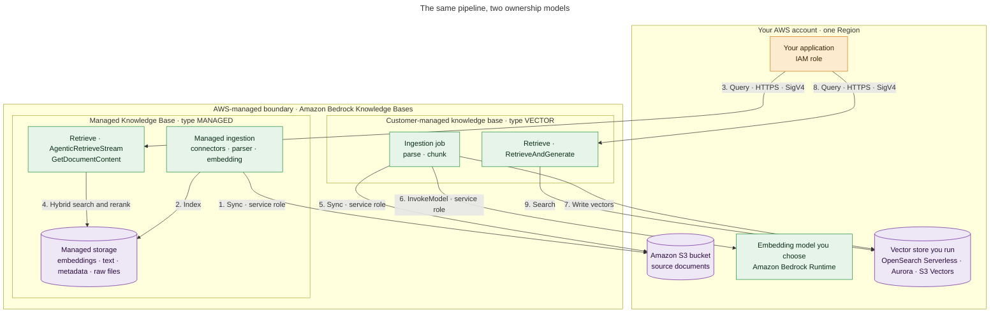
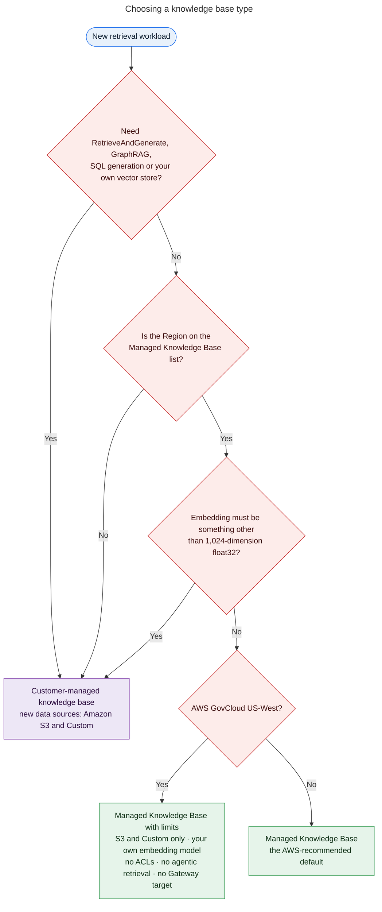

# Knowledge Bases overview: managed versus customer-managed

> **Level:** Intermediate · **Verified:** 2026-11-15 · **Feature status:** GA · **Time:** ~20 min

Amazon Bedrock Knowledge Bases turns your documents into something a model can search. Since 2026
it comes in two types with different storage, connectors, APIs, Regions and prices, so the first
design decision in any retrieval-augmented generation (RAG) workload is which type to create.

## Learning objectives

After this chapter you can:

- Explain what a knowledge base does and which Amazon Bedrock endpoints serve it.
- Compare a Managed Knowledge Base with a customer-managed knowledge base, feature by feature.
- Choose a type for a workload using the decision flowchart, and justify the choice.
- Describe what changed in 2026, including the connector restriction of 2026-09-30.
- Find the chapter that covers each part of the pipeline in depth.

## Prerequisites

- [Retrieval-augmented generation (RAG)](../../00-foundations/generative-ai-fundamentals/04-rag-fundamentals.md)
- [Embeddings, vector search, semantic search and hybrid search](../../00-foundations/generative-ai-fundamentals/03-embeddings-and-vector-search.md)
- [What Amazon Bedrock is: services, namespaces and planes](../overview/01-what-is-amazon-bedrock.md)

## Concept in plain language

A foundation model knows nothing about your contracts, tickets or manuals. A **knowledge base** is
a library built from those documents, with a reference desk in front: you ask a question, and the
desk hands back the passages most likely to contain the answer. Your application then gives those
passages to a model, or asks the service to write the answer for it.

The two types differ in who runs the building:

- **Managed Knowledge Base** — you deliver the boxes of documents; AWS runs the shelves, the
  catalogue and the reference desk.
- **Customer-managed knowledge base** — AWS supplies the cataloguing process, but the shelves (a
  vector store) are yours to buy, size and maintain.

Terms such as *embedding*, *chunking* and *reranking* are defined in the [glossary](../../GLOSSARY.md).

## How it really works

A knowledge base is a resource of the `bedrock-agent` build-time API. Every type follows the same
pipeline: **connect** a data source, **parse** files into text, **chunk** it, **embed** each
chunk, **store** the vectors, then **retrieve** (and optionally **rerank** and **generate**) at
query time through `bedrock-agent-runtime`. The type is fixed at creation by
`knowledgeBaseConfiguration.type`: `MANAGED`, or `VECTOR` for a customer-managed vector knowledge
base (`SQL` and `KENDRA` are the structured-data and Amazon Kendra variants).

> [!NOTE]
> **Documented fact** — "For optimized retrieval accuracy and a managed experience, we recommend
> Amazon Bedrock Managed Knowledge Base."
> Source: [Amazon Bedrock Knowledge Bases](https://docs.aws.amazon.com/bedrock/latest/userguide/knowledge-base.html)

### The two types side by side

| Dimension | Managed Knowledge Base | Customer-managed knowledge base |
|:--|:--|:--|
| API `type` | `MANAGED`; no `storageConfiguration` | `VECTOR` plus a `storageConfiguration` |
| Who runs storage | Amazon Bedrock: an auto-scaling datastore of embeddings, text, metadata and raw files | You. Quick-create: Amazon OpenSearch Serverless, Amazon Aurora PostgreSQL Serverless, Amazon Neptune Analytics, Amazon S3 Vectors. Or a store you created, such as an OpenSearch Service managed cluster (public access only) |
| Direct access to the store | None | Yes — it is your resource |
| Data sources | Amazon S3, Custom, SharePoint Online, OneDrive, Google Drive, Confluence, Salesforce, Web Crawler and more — the pages disagree on the full list, see [Managed Knowledge Base](02-managed-knowledge-base.md) | New data sources: **Amazon S3 and Custom only**. Confluence, SharePoint, Salesforce and Web Crawler connectors created before 2026-09-30 keep working |
| Embedding model | Service-managed by default, at no extra charge; or your own Bedrock model with float32 and 1,024 dimensions | Any supported Bedrock embedding model; float32 or binary vectors |
| Parsing | Built-in managed parser for multimodal file types | Default text parser, a foundation model, or Amazon Bedrock Data Automation |
| Retrieval APIs | `Retrieve`, `AgenticRetrieveStream`, `GetDocumentContent` | `Retrieve`, `RetrieveAndGenerate`, `RetrieveAndGenerateStream`; `GenerateQuery` for structured data |
| One-call RAG | `AgenticRetrieveStream` with `maxAgentIteration` set to 1 | `RetrieveAndGenerate` |
| Agentic retrieval | Supported (not in GovCloud) | Not supported |
| Hybrid search | Always on; semantic-only search is not available | You choose the search strategy (`overrideSearchType` on `Retrieve`) |
| Reranking | Managed reranker on by default at no extra charge (with managed embedding); or your own Bedrock reranker; or none | Your own Bedrock reranker model, charged per query |
| Document-level ACLs | Supported per data source, except Web Crawler; not in GovCloud | Not available |
| Resource policy (cross-account) | Supported for `Retrieve` and `GetDocumentContent` | Not supported for type `VECTOR` |
| AgentCore Gateway target | Supported | Not supported |
| Regions | Nine: `us-east-1`, `us-west-2`, `eu-west-1`, `eu-west-2`, `eu-central-1`, `ap-northeast-1`, `ap-southeast-1`, `ap-southeast-2`, `us-gov-west-1` (reduced features) | More. The document history lists Regions that are not in the managed list, for example US East (Ohio), Asia Pacific (Hyderabad), Asia Pacific (Osaka), Europe (Milan), Europe (Spain) and Europe (Zurich) |
| Pricing dimensions | Raw data stored per GB-month; `Retrieve` per 1,000 calls; agentic calls per 1,000 plus the underlying retrieves. Managed parsing, embedding and reranking are included | The pricing page's self-managed section lists SQL generation per request and rerank models per query. **Our reading:** you also pay for every model you invoke (embedding, parsing, generation) and for the vector store service you run |
| IaC | Terraform `aws_bedrockagent_knowledge_base` with `managed_knowledge_base_configuration`; CloudFormation `AWS::Bedrock::KnowledgeBase`; CDK L1 only | The same Terraform resource with `vector_knowledge_base_configuration` and `storage_configuration`; CloudFormation `AWS::Bedrock::KnowledgeBase`; CDK L1 and the alpha L2 `KnowledgeBase` |
| AWS positions it for | End-to-end managed RAG with native connectors and agentic retrieval | Custom vector database configurations |

Sources: [Build a managed knowledge base](https://docs.aws.amazon.com/bedrock/latest/userguide/kb-build-managed.html),
[Amazon Bedrock Knowledge Bases](https://docs.aws.amazon.com/bedrock/latest/userguide/knowledge-base.html),
[Create a knowledge base](https://docs.aws.amazon.com/bedrock/latest/userguide/knowledge-base-create.html),
[Prerequisites for a vector store you created](https://docs.aws.amazon.com/bedrock/latest/userguide/knowledge-base-setup.html),
[Connect a data source](https://docs.aws.amazon.com/bedrock/latest/userguide/data-source-connectors.html),
[Query a knowledge base and retrieve data](https://docs.aws.amazon.com/bedrock/latest/userguide/kb-test-retrieve.html),
[Retrieving information from data sources](https://docs.aws.amazon.com/bedrock/latest/userguide/kb-how-retrieval.html),
[Resource policies for managed knowledge bases](https://docs.aws.amazon.com/bedrock/latest/userguide/kb-managed-cross-account.html),
[Supported AWS Regions](https://docs.aws.amazon.com/bedrock/latest/userguide/kb-managed-regions.html),
[Document history](https://docs.aws.amazon.com/bedrock/latest/userguide/bedrock-ug-doc-history.html),
[Amazon Bedrock pricing](https://aws.amazon.com/bedrock/pricing/). IaC rows:
[Terraform schema](../../references/terraform-aws-provider-bedrock-schema.json),
[CDK and CloudFormation reference](../../references/cdk-and-cloudformation-bedrock.md).

The `StorageConfiguration` API type still lists `PINECONE`, `REDIS_ENTERPRISE_CLOUD` and
`MONGO_DB_ATLAS` as valid values. Whether AWS still recommends those third-party stores is
**UNVERIFIED — REQUIRES DOCUMENTATION REVIEW**, as in the [register](../../FEATURE-VERIFICATION.md)
(looked for a statement in the vector store prerequisites page; the text retrieved was truncated).
Source: [StorageConfiguration](https://docs.aws.amazon.com/bedrock/latest/APIReference/API_agent_StorageConfiguration.html)

### What changed in 2026

| Date | Change | Source |
|:--|:--|:--|
| 2026-03-02 | The document history adds "fully managed knowledge bases with agentic retrieval". Whether that release was a preview is **UNVERIFIED** (register item U2) | [Document history](https://docs.aws.amazon.com/bedrock/latest/userguide/bedrock-ug-doc-history.html) |
| 2026-06-17 | Managed Knowledge Base is generally available, with six native connectors, in eight Regions | [GA announcement](https://aws.amazon.com/about-aws/whats-new/2026/06/amazon-bedrock-managed-knowledge-base/) |
| 2026-08-14 | Agentic retrieval can use AgentCore Memory (`memoryConfiguration`) | [Document history](https://docs.aws.amazon.com/bedrock/latest/userguide/bedrock-ug-doc-history.html) |
| 2026-09-30 | **No new** Confluence, SharePoint, Salesforce or Web Crawler connectors on customer-managed knowledge bases | [Connect a data source](https://docs.aws.amazon.com/bedrock/latest/userguide/data-source-connectors.html) |
| 2026-10-19 | Retrieval instructions for agentic retrieval | [Document history](https://docs.aws.amazon.com/bedrock/latest/userguide/bedrock-ug-doc-history.html) |
| 2026-11-09 | `maxAgentIteration` accepts 0–5: retrieval only, single-shot RAG, or agentic | [AWS Machine Learning Blog](https://aws.amazon.com/blogs/machine-learning/single-shot-and-agentic-retrieval-with-amazon-bedrock-managed-knowledge-base/) |

> [!IMPORTANT]
> **Status** — "Starting September 30, 2026, the creation of new connectors for Confluence,
> Microsoft SharePoint, Salesforce, and Web Crawler will no longer be supported on
> customer-managed knowledge bases. Existing connectors of these types will continue to function,
> including data ingestion and retrieval." AWS recommends Managed Knowledge Base for those sources.
> Source: [Connect a data source to your knowledge base](https://docs.aws.amazon.com/bedrock/latest/userguide/data-source-connectors.html)

## Architecture diagram



**What this shows** — both types read the same sources with a service role and answer through the
same runtime endpoint. The difference is where the embedding model and the index live: inside the
AWS-managed boundary for a Managed Knowledge Base, inside your account for a customer-managed one.

**Walkthrough**

1. Managed: an ingestion job reads the source with the knowledge base service role.
2. Managed: the service parses, embeds and indexes into storage that it operates.
3. Managed: the application calls `Retrieve` or `AgenticRetrieveStream`.
4. Managed: the runtime runs hybrid search and reranking against managed storage.
5. Customer-managed: an ingestion job reads the same kind of source.
6. Customer-managed: the service role invokes the embedding model you selected.
7. Customer-managed: vectors are written to the vector store in your account.
8. Customer-managed: the application calls `Retrieve` or `RetrieveAndGenerate`.
9. Customer-managed: the runtime queries your vector store.

**Legend** — solid arrow: request or write · cylinder: data at rest · outer boxes: your account and
the AWS-managed service · inner boxes: the two knowledge base types. Green: Bedrock · purple: data.

**Variations** — a Managed Knowledge Base with a bring-your-own embedding model also invokes a
model in your account. Structured data (`SQL`) and GraphRAG have no managed equivalent. Detailed
views: [diagram set 8](../../diagrams/mermaid/08-managed-knowledge-base.md) for managed,
[diagram sets 6](../../diagrams/mermaid/06-knowledge-base-ingestion-pipeline.md) and
[7](../../diagrams/mermaid/07-knowledge-base-retrieval-pipeline.md) for the pipelines.

## Implementation details

### Which type do I choose?



**What this shows** — four questions, asked in order, each of which is a documented hard limit.
Blue: start · red: decision · green: managed outcome · purple: customer-managed outcome.

1. A Managed Knowledge Base cannot serve `RetrieveAndGenerate`, graph or SQL retrieval, and gives
   no access to its store.
2. It exists in nine Regions.
3. A bring-your-own embedding model must produce 1,024-dimension float32 vectors.
4. In GovCloud (US-West) it runs without SaaS connectors, ACLs, managed models, agentic retrieval
   or the Gateway target.

> [!TIP]
> **Academy recommendation** — Default to a Managed Knowledge Base and treat customer-managed as
> the exception you can name a reason for. If your content sits in Confluence, SharePoint,
> Salesforce or a website and you have no existing connector, the decision is already made: after
> 2026-09-30 only the managed type can create those connectors.
> This is our design guidance, not an official AWS reference architecture.

The type cannot be converted in place: moving from customer-managed to managed means a new
knowledge base, a re-ingestion and a change of query code (`managedSearchConfiguration`, and
`AgenticRetrieveStream` in place of `RetrieveAndGenerate`).

### Map of the knowledge-base chapters

| Chapter | Read it for |
|:--|:--|
| [Managed Knowledge Base](02-managed-knowledge-base.md) | Connectors, managed and custom embedding, sync schedules, ACLs, service role, encryption, quotas, Terraform |
| [Customer-managed knowledge bases and vector stores](03-customer-managed-knowledge-bases.md) | Vector store options, `RetrieveAndGenerate`, existing connectors |
| [Ingestion, parsing and chunking](04-ingestion-parsing-chunking.md) | Parsers, chunking strategies, ingestion jobs |
| [Retrieval, reranking and metadata filtering](05-retrieval-reranking-filtering.md) | `Retrieve` in depth, filters, rerankers |
| [Structured data retrieval and GraphRAG](06-structured-data-and-graphrag.md) | `GenerateQuery` over Amazon Redshift, Neptune Analytics graphs |
| [Agentic retrieval with AgenticRetrieveStream](../agentic-retrieval/01-agentic-retrieval.md) | Multi-step retrieval and one-call answers on managed knowledge bases |
| [Pattern: enterprise RAG](../../03-architecture-patterns/enterprise-rag/README.md) · [Project C](../../05-practical-projects/project-03-enterprise-rag/README.md) | A whole design and its code |
| [Vector store selection](../../09-advanced-topics/02-vector-store-selection.md) · [Multitenant RAG](../../09-advanced-topics/06-multitenant-rag.md) | The trade-offs behind the customer-managed path and tenant isolation |

## Example

The same `CreateKnowledgeBase` operation creates both types; only the body differs. Both bodies
follow the examples in the AWS documentation; ARNs use placeholder values.

> **Code status:** syntax-checked (JSON parse) · illustrative · **never deployed**

```json
{
  "name": "policies-managed",
  "roleArn": "arn:aws:iam::111122223333:role/BedrockKBRole",
  "knowledgeBaseConfiguration": {
    "type": "MANAGED",
    "managedKnowledgeBaseConfiguration": {
      "embeddingModelType": "MANAGED"
    }
  }
}
```

```json
{
  "name": "policies-customer-managed",
  "roleArn": "arn:aws:iam::111122223333:role/BedrockKBRole",
  "knowledgeBaseConfiguration": {
    "type": "VECTOR",
    "vectorKnowledgeBaseConfiguration": {
      "embeddingModelArn": "<embedding-model-arn>"
    }
  },
  "storageConfiguration": {
    "type": "OPENSEARCH_SERVERLESS",
    "opensearchServerlessConfiguration": {
      "collectionArn": "arn:aws:aoss:us-east-1:111122223333:collection/<collection-id>",
      "vectorIndexName": "<index-name>",
      "fieldMapping": {
        "vectorField": "vector",
        "textField": "text",
        "metadataField": "metadata"
      }
    }
  }
}
```

The query differs in the same way. A managed knowledge base takes
`"retrievalConfiguration": {"managedSearchConfiguration": {"numberOfResults": 5}}`; a
customer-managed one takes `"vectorSearchConfiguration"` in the same position.

## Common mistakes

> [!WARNING]
> **Common mistake** — following a pre-2026 tutorial that calls `RetrieveAndGenerate`. Its API
> reference now says: "This API cannot be used with managed knowledge bases. Use
> AgenticRetrieveStream or Retrieve with managed knowledge bases."
> Source: [RetrieveAndGenerate](https://docs.aws.amazon.com/bedrock/latest/APIReference/API_agent-runtime_RetrieveAndGenerate.html)

| Mistake | Symptom | Fix |
|:--|:--|:--|
| Planning a new SharePoint or Confluence connector on a customer-managed knowledge base | Creation is no longer supported since 2026-09-30 | Use a Managed Knowledge Base, or push content through a Custom data source |
| Assuming the managed type exists in every Bedrock Region | The managed type is offered in nine Regions only | Check the Region list first; fall back to customer-managed |
| Expecting document-level permissions from a customer-managed knowledge base | Every caller sees every chunk | Use the managed type with ACLs, or enforce tenant filters yourself |
| Choosing customer-managed "for control" without a named requirement | You operate and pay for a vector store you did not need | Apply the flowchart; write down the requirement |
| Sending `vectorSearchConfiguration` to a managed knowledge base | That field is for customer-managed knowledge bases only; what a managed one does with it is not documented | Use `managedSearchConfiguration` |

## Security considerations

- **Service role.** Both types use an IAM role that `bedrock.amazonaws.com` assumes to read your
  sources. Scope it to the buckets and secrets of that knowledge base.
- **Where data rests.** Managed: in AWS-operated storage, encrypted with a service default key or
  one customer managed KMS key. Customer-managed: in your vector store, under that service's controls.
- **Per-user access.** Only the managed type filters by document ACL, and AWS describes it as
  filtering, not authorization. See [Multitenant RAG](../../09-advanced-topics/06-multitenant-rag.md).
- **Cross-account use.** Resource policies exist only on managed knowledge bases.
- **Untrusted content.** Retrieved text is input to a model; see
  [Prompt injection, untrusted tool output and retrieval poisoning](../../06-security-governance/04-prompt-injection-and-untrusted-content.md).
- **Private access.** Interface endpoints `bedrock-agent` and `bedrock-agent-runtime` serve both types.

## Cost considerations

- **Managed** is metered on two things: gigabytes of raw data stored per month and the number of
  retrieval calls (agentic calls cost more and also count their underlying retrieves). Parsing,
  embedding and reranking with the managed models are included.
- **Customer-managed** has no single meter. **Our reading:** cost is the sum of the vector store
  (which may bill while idle), embedding and parsing model usage at ingestion, and reranking and
  generation at query time.
- A small corpus with few queries favours the managed type's pay-per-use shape; a large corpus
  with an existing, well-utilised vector store can favour customer-managed. Estimate both — see
  [Pricing model and cost drivers](../../08-cost-performance-and-reliability/01-pricing-model-and-cost-drivers.md).
- Source for the dimensions: [Amazon Bedrock pricing](https://aws.amazon.com/bedrock/pricing/).

## Knowledge check

1. Your team has a working customer-managed knowledge base with a Confluence connector created in 2025. Does the 2026-09-30 change break it?
2. A new project needs GraphRAG over product relationships and document-level permissions for HR files. Can one knowledge base do both?
3. What would happen if you pointed an application written for `RetrieveAndGenerate` at a new Managed Knowledge Base ID?
4. A workload must run in Europe (Spain). Which type can you create there, and what do you give up?

<details>
<summary>Answers</summary>

1. No. Existing connectors of those types continue to ingest and retrieve; only the creation of new ones is no longer supported.
2. No. GraphRAG needs a customer-managed knowledge base on Neptune Analytics, while document-level ACLs exist only on the managed type. Use two knowledge bases and route between them.
3. It does not work: the API reference states that `RetrieveAndGenerate` cannot be used with managed knowledge bases (the exact error is not documented on that page). Switch to `AgenticRetrieveStream` (with `maxAgentIteration` 1 for the same single-shot behaviour) or to `Retrieve` plus your own model call.
4. Customer-managed only, because Europe (Spain) is not one of the nine managed Regions. You give up agentic retrieval, managed connectors, document-level ACLs, resource policies and the Gateway target.

</details>

## Further reading

Official sources opened while writing this chapter:

- [Amazon Bedrock Knowledge Bases](https://docs.aws.amazon.com/bedrock/latest/userguide/knowledge-base.html) — the two types and AWS's recommendation.
- [Build a managed knowledge base](https://docs.aws.amazon.com/bedrock/latest/userguide/kb-build-managed.html) — AWS's own comparison table.
- [Create a knowledge base by connecting to a data source](https://docs.aws.amazon.com/bedrock/latest/userguide/knowledge-base-create.html) — customer-managed creation and quick-create vector stores.
- [Prerequisites for using a vector store you created](https://docs.aws.amazon.com/bedrock/latest/userguide/knowledge-base-setup.html) — bring-your-own vector stores.
- [Connect a data source to your knowledge base](https://docs.aws.amazon.com/bedrock/latest/userguide/data-source-connectors.html) — the 2026-09-30 connector notice.
- [Supported models and Regions for knowledge bases](https://docs.aws.amazon.com/bedrock/latest/userguide/knowledge-base-supported.html) — embedding models and structured-data Regions.
- [Retrieving information from data sources](https://docs.aws.amazon.com/bedrock/latest/userguide/kb-how-retrieval.html) and [Query a knowledge base and retrieve data](https://docs.aws.amazon.com/bedrock/latest/userguide/kb-test-retrieve.html) — query operations and managed search behaviour.
- [Supported AWS Regions (managed)](https://docs.aws.amazon.com/bedrock/latest/userguide/kb-managed-regions.html) — Region list and GovCloud differences.
- [Resource policies for managed knowledge bases](https://docs.aws.amazon.com/bedrock/latest/userguide/kb-managed-cross-account.html) — cross-account access.
- API reference: [KnowledgeBaseConfiguration](https://docs.aws.amazon.com/bedrock/latest/APIReference/API_agent_KnowledgeBaseConfiguration.html), [StorageConfiguration](https://docs.aws.amazon.com/bedrock/latest/APIReference/API_agent_StorageConfiguration.html), [Retrieve](https://docs.aws.amazon.com/bedrock/latest/APIReference/API_agent-runtime_Retrieve.html), [RetrieveAndGenerate](https://docs.aws.amazon.com/bedrock/latest/APIReference/API_agent-runtime_RetrieveAndGenerate.html).
- [Document history for the Amazon Bedrock User Guide](https://docs.aws.amazon.com/bedrock/latest/userguide/bedrock-ug-doc-history.html) — 2026 dates.
- [Managed Knowledge Base GA announcement](https://aws.amazon.com/about-aws/whats-new/2026/06/amazon-bedrock-managed-knowledge-base/) and [single-shot and agentic retrieval post](https://aws.amazon.com/blogs/machine-learning/single-shot-and-agentic-retrieval-with-amazon-bedrock-managed-knowledge-base/).
- [Amazon Bedrock pricing](https://aws.amazon.com/bedrock/pricing/) — Managed and self-managed knowledge base sections.
- [Feature verification matrix](../../FEATURE-VERIFICATION.md) and [API operations reference](../../references/bedrock-api-operations.md) — the academy's register and the SDK-derived operation list.
