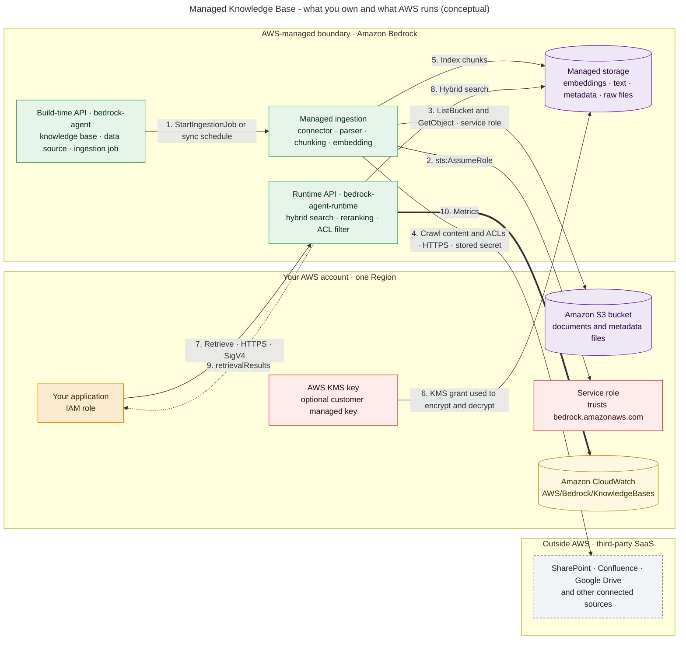
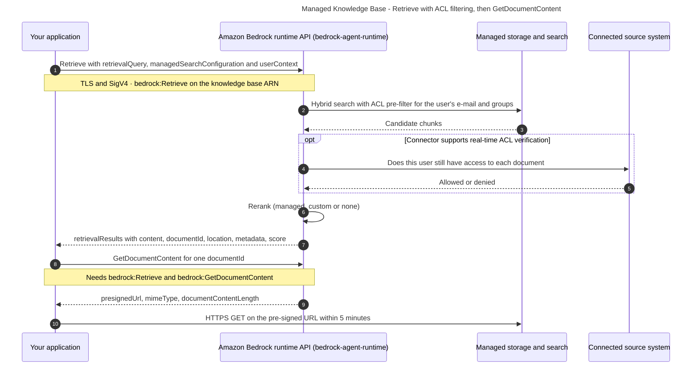

# Managed Knowledge Base

> **Level:** Intermediate · **Verified:** 2026-11-15 · **Feature status:** GA · **Time:** ~25 min

A Managed Knowledge Base is the knowledge base type in which Amazon Bedrock runs the whole
retrieval pipeline — connectors, parsing, embedding, storage, search and reranking — and you
supply only the data sources and an IAM role. It is the retrieval layer that agents and
applications call through `Retrieve` and `AgenticRetrieveStream`.

> [!IMPORTANT]
> **Status** — Generally available since **2026-06-17**. Available in nine Regions, one of which
> (AWS GovCloud (US-West)) has a reduced feature set. AWS recommends this type over a
> customer-managed knowledge base. `RetrieveAndGenerate` does **not** work on it.
> Sources: [GA announcement](https://aws.amazon.com/about-aws/whats-new/2026/06/amazon-bedrock-managed-knowledge-base/),
> [Supported AWS Regions](https://docs.aws.amazon.com/bedrock/latest/userguide/kb-managed-regions.html),
> [Build a managed knowledge base](https://docs.aws.amazon.com/bedrock/latest/userguide/kb-build-managed.html),
> [RetrieveAndGenerate API reference](https://docs.aws.amazon.com/bedrock/latest/APIReference/API_agent-runtime_RetrieveAndGenerate.html)

## Learning objectives

- List what Amazon Bedrock operates for you in a Managed Knowledge Base and what stays yours.
- Choose between the service-managed embedding model and your own, and state the constraints.
- Configure a data source with a connector, a sync schedule and document-level access control.
- Call `Retrieve` and `GetDocumentContent` correctly for a managed knowledge base.
- Write the service role, the encryption setup and the Terraform for a managed knowledge base.

## Prerequisites

- [Knowledge Bases overview: managed versus customer-managed](01-knowledge-bases-overview.md)
- [Retrieval-augmented generation (RAG)](../../00-foundations/generative-ai-fundamentals/04-rag-fundamentals.md)
- [Embeddings, vector search, semantic search and hybrid search](../../00-foundations/generative-ai-fundamentals/03-embeddings-and-vector-search.md)
- [IAM roles, trust policies and cross-account access](../../00-foundations/security/02-iam-roles-and-trust.md)
- [AWS KMS and encryption](../../00-foundations/security/04-kms-encryption.md)

## 1. What it is

**Plain language.** You point the service at where your documents live. It copies them in, reads
them (including tables, images, audio and video), builds a searchable index, keeps the index in
step with the source, and answers search requests. You never see a vector database.

**Precisely.** It is a knowledge base created with `CreateKnowledgeBase` where
`knowledgeBaseConfiguration.type` is `MANAGED` and no `storageConfiguration` is given. Data
sources are created with `CreateDataSource` using the type `MANAGED_KNOWLEDGE_BASE_CONNECTOR`.

| Item | Value |
|:--|:--|
| Service namespace / endpoint | Build time: `bedrock-agent` · Query time: `bedrock-agent-runtime` |
| Control-plane operations | `CreateKnowledgeBase`, `CreateDataSource`, `UpdateDataSource`, `StartIngestionJob`, `StopIngestionJob`, `GetIngestionJob`, `ListIngestionJobs`, `IngestKnowledgeBaseDocuments`, `PutResourcePolicy`, `GetResourcePolicy`, `DeleteResourcePolicy` |
| Data-plane operations | `Retrieve`, `AgenticRetrieveStream`, `GetDocumentContent`; for ACL troubleshooting `GetIngestedDocumentAcl`, `CheckIngestedDocumentAcl` |
| IAM action prefix | `bedrock:` |
| ARN | `arn:aws:bedrock:<region>:<account-id>:knowledge-base/<kb-id>` |
| Console location | Amazon Bedrock AgentCore › Built-in tools › Knowledge Base |

Sources: [Create a managed knowledge base](https://docs.aws.amazon.com/bedrock/latest/userguide/kb-managed-create.html),
[Connect a data source](https://docs.aws.amazon.com/bedrock/latest/userguide/kb-managed-connect-ds.html),
[KnowledgeBaseConfiguration](https://docs.aws.amazon.com/bedrock/latest/APIReference/API_agent_KnowledgeBaseConfiguration.html).
Every operation name was also checked against the SDK service models in
[the API operations reference](../../references/bedrock-api-operations.md).

### What AWS manages and what you keep

| AWS runs | You still own |
|:--|:--|
| Connectors that crawl content (and permissions) from each source | The source systems, their credentials and their permissions |
| The managed parser, chunking and media extraction | Which modalities to index; chunking choice |
| The embedding model (default) and the reranker (default) | The decision to bring your own model, and that model's access and cost |
| An auto-scaling datastore of embeddings, text, metadata and raw files | The KMS key, if you want a customer managed key |
| Hybrid search and its scaling | The service role, caller IAM policies and the user identity you pass for ACLs |

Source: [Build a managed knowledge base](https://docs.aws.amazon.com/bedrock/latest/userguide/kb-build-managed.html)

## 2. Why it exists

A customer-managed knowledge base still leaves you a vector store to size, secure, patch and pay
for, an embedding model with its own quotas, a parser to choose per file type, and a connector
per source. AWS's launch post names the three recurring costs: connecting enterprise data,
tuning retrieval accuracy, and operating the infrastructure at scale. Managed Knowledge Base
folds those into one resource with two billing dimensions (data stored and retrievals).
Source: [AWS News Blog launch post](https://aws.amazon.com/blogs/aws/introducing-amazon-bedrock-managed-knowledge-base-for-faster-more-accurate-enterprise-ai-applications/)

## 3. When to use it

- Documents live in Amazon S3 or in a supported SaaS source and you want them searchable quickly.
- Users may only see documents they are entitled to (document-level access control).
- You need [agentic retrieval](../agentic-retrieval/01-agentic-retrieval.md), which works only here.
- An agent should reach the knowledge base as an MCP tool through
  [AgentCore Gateway](../agentcore/04-agentcore-gateway.md).
- Another account must query the knowledge base (resource policies exist only for this type).

## 4. When not to use it

- **You depend on `RetrieveAndGenerate`, GraphRAG or SQL generation.** Use a
  [customer-managed knowledge base](03-customer-managed-knowledge-bases.md) or
  [structured data retrieval and GraphRAG](06-structured-data-and-graphrag.md).
- **You must control or query the vector store directly**, or choose the search strategy — see
  [Vector store selection](../../09-advanced-topics/02-vector-store-selection.md).
- **Your Region is not on the list**, or you are in GovCloud and need SaaS connectors, ACLs or
  agentic retrieval — see [section 5](#regions-and-govcloud).
- **Your embedding model is not 1,024-dimension float32** (for example binary vectors) — see
  [Embedding model selection](../../09-advanced-topics/04-embedding-model-selection.md).
- **You need semantic-only search.** Retrieval here is always hybrid.
- **ACL filtering would be your only authorization control.** AWS states it is filtering, not a
  security boundary; see [Multitenant RAG](../../09-advanced-topics/06-multitenant-rag.md).

## 5. Internal architecture

AWS documents the resources, the APIs and what is stored; it does not document the storage
engine. The diagram is a conceptual model of the customer-visible parts.



**What this shows** — your account holds only the sources, a role, an optional key and the
metrics. Everything between the connector and the search result sits inside the AWS-managed
boundary and is reachable only through the two Bedrock endpoints.

1. An ingestion job starts: on demand with `StartIngestionJob`, or on the data source's schedule.
2. The service assumes the knowledge base service role.
3. For Amazon S3 it lists and reads objects with that role.
4. For SaaS sources it crawls content, and permissions when ACLs are enabled, using credentials
   you stored in AWS Secrets Manager.
5. Documents are parsed, chunked, embedded and indexed into managed storage.
6. With a customer managed key, Bedrock uses a KMS grant to encrypt and decrypt that storage.
7. Your application calls `Retrieve` with its own IAM role.
8. The runtime runs hybrid (keyword plus semantic) search, filters by ACL, and reranks.
9. Results return with content, location, metadata and score.
10. Request metrics are published to your account.

| Legend | Meaning |
|:--|:--|
| Solid / dashed / thick arrow | Request · response · asynchronous telemetry |
| Cylinder | Data at rest |
| Boxes | Trust boundaries: third party, your account, AWS-managed service |

**Variations** — a Custom data source has no crawl: you push documents with
`IngestKnowledgeBaseDocuments` and no sync is needed. With a bring-your-own embedding model, step 5
invokes that model in your account through the service role. The full picture, with every control,
is in [diagram set 8](../../diagrams/mermaid/08-managed-knowledge-base.md).

### Data sources and connectors

| Connector | `connectorParameters.type` | Document-level ACLs | Real-time ACL check |
|:--|:--|:-:|:-:|
| Amazon S3 | `S3` | Yes — ACL files you provide | No |
| Custom (you push documents) | `CUSTOM` | Yes — ACL in document metadata | No |
| Microsoft SharePoint Online | `SHAREPOINT` | Yes | Yes |
| Microsoft OneDrive | `ONEDRIVE` | Yes | Yes |
| Google Drive | `GOOGLE_DRIVE` | Yes | Yes |
| Confluence Cloud | `CONFLUENCE` | Yes | Yes |
| Salesforce | `SALESFORCE` | Yes | Yes |
| Web Crawler | `WEB_CRAWLER` | No | n/a |
| Confluence Data Center, Box, Zendesk | not listed on the page read | Yes | Yes |
| ServiceNow | not listed on the page read | Yes | Partial |

Sources: [Create a managed knowledge base](https://docs.aws.amazon.com/bedrock/latest/userguide/kb-managed-create.html),
[Connect a data source](https://docs.aws.amazon.com/bedrock/latest/userguide/kb-managed-connect-ds.html),
[Access Control Lists awareness enablement](https://docs.aws.amazon.com/bedrock/latest/userguide/kb-managed-acl.html),
[Custom](https://docs.aws.amazon.com/bedrock/latest/userguide/kb-managed-ds-custom.html)

> [!WARNING]
> **Common mistake** — trusting one page for the connector list. On 2026-11-15 the pages disagreed:
>
> | Page | What it lists |
> |:--|:--|
> | GA announcement (2026-06-17) | Six: Amazon S3, SharePoint, Confluence, Google Drive, OneDrive, Web Crawler |
> | *Build a managed knowledge base* (comparison table) | "7 native connectors (S3, SharePoint, Confluence, Web Crawler, Google Drive, OneDrive, Custom)" |
> | *Connect a data source* (`type` values) | `S3`, `ONEDRIVE`, `CONFLUENCE`, `SHAREPOINT`, `WEB_CRAWLER`, `GOOGLE_DRIVE`, `SALESFORCE` |
> | *Create a managed knowledge base* ("Supported data source connectors") | Twelve: Amazon S3, Box, Confluence Cloud, Confluence Data Center, Microsoft SharePoint Online, Google Drive, Microsoft OneDrive, Salesforce, ServiceNow, Zendesk, Web Crawler, Custom connector |
> | *Access Control Lists awareness enablement* (support matrix) | The same twelve |
>
> The table above follows the twelve-connector pages. The `type` strings for Box, ServiceNow,
> Zendesk and Confluence Data Center are **UNVERIFIED — REQUIRES DOCUMENTATION REVIEW** (looked
> for them on the pages listed here; their connector pages were not opened).

`CreateDataSource` is asynchronous for this type: the data source moves from `CREATING` to
`AVAILABLE`. An S3 source must be a general purpose bucket in the same Region as the knowledge base.
Source: [Amazon S3 connector](https://docs.aws.amazon.com/bedrock/latest/userguide/kb-managed-ds-s3.html)

### Managed versus bring-your-own embedding model

| | Managed (default) | Custom (`embeddingModelType: CUSTOM`) |
|:--|:--|:--|
| What you configure | Nothing | `embeddingModelArn` and `embeddingModelConfiguration` (both required) |
| Constraints | — | **1,024 dimensions, float32** |
| Models named in the docs | Not disclosed | Amazon Titan Text Embeddings V2, Cohere Embed English v3, Cohere Embed Multilingual v3, Cohere Embed v4, Amazon Nova Multimodal Embeddings; TwelveLabs Marengo Embed 3.0 as the multimodal option |
| Model access and quotas | Not needed | Yours — the service role invokes the model |
| Managed reranker | Available (default) | **Not available** — bring a reranker or run without |
| Charge | Included | Model provider pricing |
| GovCloud (US-West) | Not available | Required |

You **cannot change the embedding model type after creation**; switching means a new knowledge base
and a full re-ingestion. The Marengo option also needs a multimodal storage bucket
(`supplementalDataStorageConfiguration`).
Source: [Create a managed knowledge base](https://docs.aws.amazon.com/bedrock/latest/userguide/kb-managed-create.html)

### Parsing and chunking

The managed parser is the default (`parsingStrategy: SMART_PARSING` in the API example); AWS
describes it as choosing a parsing strategy per document type. Chunking is default, fixed-size or
none. Three media extractions are switched on per data source: images (standalone files and
visuals embedded in `.pdf`, `.docx`, `.ppt`, `.pptx`), audio and video. Detail is in
[Ingestion, parsing and chunking](04-ingestion-parsing-chunking.md).

### Sync and schedules

Syncing is **incremental**: only documents added, modified or deleted since the last sync are
processed. `syncSchedule` on the data source takes exactly one of `daily` (system-chosen off-peak
time), `weekly` (`dayOfWeek`) or `monthly` (`dayNumber` 1–28, or `lastDayOfMonth`); omit it for
on-demand only. `deletionProtectionConfiguration` skips a sync's delete phase when the sync would
remove more than a threshold percentage of indexed documents (default 15; not for Custom).
Sources: [Sync a data source](https://docs.aws.amazon.com/bedrock/latest/userguide/kb-managed-sync.html),
[Connect a data source](https://docs.aws.amazon.com/bedrock/latest/userguide/kb-managed-connect-ds.html)

### Document-level access control

Set `aclEnabled` to `true` in `connectorParameters` when you create the data source — it is
**permanent**. The service then ingests allow and deny lists with each document and filters at
query time in two stages: a pre-retrieval filter from the last crawl, and, for connectors that
support it, a real-time check against the source. The user is identified by **e-mail address** in
`userContext.userId`; deny overrides allow; evaluation **fails closed**.

> [!NOTE]
> **Documented fact** — "Bedrock Managed Knowledge Base provides ACL-aware filtering, not a
> security boundary." It does not authenticate end users; your application must.
> Source: [Access Control Lists awareness enablement](https://docs.aws.amazon.com/bedrock/latest/userguide/kb-managed-acl.html)

To debug a filter, `GetIngestedDocumentAcl` returns the allow and deny lists ingested for one
document, and `CheckIngestedDocumentAcl` returns `hasAccess` for a `documentId` and a `userContext`.
Sources: [GetIngestedDocumentAcl](https://docs.aws.amazon.com/bedrock/latest/APIReference/API_agent-runtime_GetIngestedDocumentAcl.html),
[CheckIngestedDocumentAcl](https://docs.aws.amazon.com/bedrock/latest/APIReference/API_agent-runtime_CheckIngestedDocumentAcl.html)

### Regions and GovCloud

`us-east-1`, `us-west-2`, `eu-west-1`, `eu-west-2`, `eu-central-1`, `ap-northeast-1`,
`ap-southeast-1`, `ap-southeast-2`, `us-gov-west-1`. In GovCloud (US-West) there are **no**
third-party connectors (S3 and Custom only), **no** ACLs, **no** service-managed embedding or
reranking models, **no** agentic retrieval and **no** AgentCore Gateway target.
Source: [Supported AWS Regions](https://docs.aws.amazon.com/bedrock/latest/userguide/kb-managed-regions.html)

## 6. Request and response lifecycle



- **Steps 1–2.** `Retrieve` on a managed knowledge base takes
  `retrievalConfiguration.managedSearchConfiguration` (`numberOfResults`, `filter`,
  `rerankingModelType`, `rerankingConfiguration`), not `vectorSearchConfiguration`. The query is
  limited to 10,000 characters.
- **Steps 3–4.** Search is always hybrid. Without `userContext`, ACL-enabled data sources return
  **zero** results; non-ACL sources in the same knowledge base still answer.
- **Steps 5–6.** Real-time verification can remove documents; the service does not backfill, so
  you may get fewer results than requested.
- **Steps 7–8.** Reranking defaults to the managed reranker when the knowledge base uses managed
  embedding.
- **Steps 9–11.** `GetDocumentContent` returns a pre-signed URL for the original (`RAW`) or parsed
  (`EXTRACTED`) document, or for an embedded image when you pass `mediaId`. The URL expires after
  5 minutes.

Error paths: **403** when IAM, or a missing resource policy for a cross-account caller, denies the
call; **429** `ThrottlingException` above the per-knowledge-base rate; **400** `ValidationException`
for invalid input. The `startsWith` and `stringContains` metadata filters are not supported on
managed knowledge bases. ACL evaluation fails closed: affected documents are withheld, so the
symptom is zero or fewer results, and AWS says error responses indicate an ACL resolution failure.
Sources: [Retrieve](https://docs.aws.amazon.com/bedrock/latest/APIReference/API_agent-runtime_Retrieve.html),
[Query a knowledge base and retrieve data](https://docs.aws.amazon.com/bedrock/latest/userguide/kb-test-retrieve.html),
[ACL-aware retrieval](https://docs.aws.amazon.com/bedrock/latest/userguide/kb-test-retrieve-acl.html),
[GetDocumentContent](https://docs.aws.amazon.com/bedrock/latest/APIReference/API_agent-runtime_GetDocumentContent.html)

## 7. Dependencies

| Depends on | Why | Required or optional |
|:--|:--|:-:|
| IAM service role | Bedrock assumes it to read data sources and to publish `Retrieve` metrics | Required |
| A data source | Nothing to search without one | Required |
| AWS Secrets Manager secret | Credentials for SaaS connectors | Required for those connectors |
| AWS KMS customer managed key | Replaces the service-owned default key | Optional |
| A Bedrock embedding or reranking model | Only with `CUSTOM` types | Optional (required in GovCloud) |
| Amazon S3 bucket for multimodal storage | Only with the multimodal embedding model | Optional |
| Amazon CloudWatch Logs, S3 or Data Firehose | Destination for ingestion logs | Optional |
| AgentCore Gateway | Exposes `Retrieve` and `AgenticRetrieveStream` as MCP tools | Optional |

## 8. Security considerations

**Service role.** The trust policy lets `bedrock.amazonaws.com` assume the role, narrowed with
`aws:SourceAccount` and an `aws:SourceArn` of your knowledge base ARNs. Grant it only what the
connectors need: `s3:ListBucket` and `s3:GetObject` (with `aws:ResourceAccount`),
`secretsmanager:GetSecretValue` for SaaS credentials, `bedrock:InvokeModel` on a custom embedding
model. The identity that creates the knowledge base needs `iam:PassRole` restricted with
`iam:PassedToService = bedrock.amazonaws.com`.
Sources: [Create a service role for managed knowledge bases](https://docs.aws.amazon.com/bedrock/latest/userguide/kb-managed-permissions.html),
[Prerequisites](https://docs.aws.amazon.com/bedrock/latest/userguide/kb-managed-prereqs.html)

**Encryption.** One key covers both transient data during ingestion and stored data. By default
that is a service-owned key (the encryption page says "AWS-owned key"; the console step says "AWS
managed key"). With a customer managed key, set once at creation, Bedrock creates a **grant** and
retires it when you delete the knowledge base. The key policy must allow the **creating identity**
`kms:CreateGrant`, `kms:GenerateDataKey` and `kms:Decrypt` via `bedrock.<region>.amazonaws.com`.

> [!WARNING]
> **Common mistake** — following only the prerequisites page, which says to "add the required KMS
> permissions to the service role". The encryption page says the opposite: the service role "does
> not require any permissions on the KMS key"; the permissions belong in the key policy for the
> identity that creates the knowledge base. Follow the encryption page and test in a sandbox.
> Source: [Encryption of knowledge base resources](https://docs.aws.amazon.com/bedrock/latest/userguide/encryption-kb.html)

**Callers.** Scope `bedrock:Retrieve` and `bedrock:GetDocumentContent` to the knowledge base ARN.
Cross-account callers additionally need a **resource policy** on the knowledge base
(`PutResourcePolicy`), which supports exactly those two actions and no wildcards.
`bedrock:AgenticRetrieveStream` is not in that list. Source:
[Resource policies for managed knowledge bases](https://docs.aws.amazon.com/bedrock/latest/userguide/kb-managed-cross-account.html)

**User identity.** `userContext.userId` is whatever your application sends. Authenticate the user
first, and never let a model or an end user set that field. Guardrails on `Retrieve` apply to the
query, not to the retrieved references. Related: [Prompt injection, untrusted tool output and retrieval poisoning](../../06-security-governance/04-prompt-injection-and-untrusted-content.md).

**Logging.** Ingestion logs (per job and per document) are vended logs you enable on the knowledge
base; `Retrieve` can emit traces to AWS X-Ray. Source:
[Observability for managed knowledge bases](https://docs.aws.amazon.com/bedrock/latest/userguide/kb-managed-observability.html)

## 9. Networking requirements

Both APIs are Regional public endpoints with interface VPC endpoints available:
`com.amazonaws.<region>.bedrock-agent` (build time) and `com.amazonaws.<region>.bedrock-agent-runtime`
(query time). The ingestion pipeline runs on the AWS side, so your VPC needs no route to SharePoint
or Google Drive; the source must be reachable by the service. Pre-signed URLs from
`GetDocumentContent` are fetched over HTTPS by whoever holds them. See
[Private connectivity for Bedrock](../../02-related-aws-services/networking/01-private-connectivity-for-bedrock.md).
Source: [Interface VPC endpoints for Amazon Bedrock](https://docs.aws.amazon.com/bedrock/latest/userguide/vpc-interface-endpoints.html)

## 10. Pricing dimensions

Figures are those shown on the pricing page on 2026-11-15; confirm before budgeting.

| Dimension | Unit | Notes |
|:--|:--|:--|
| Index storage | $5.00 per GB of **raw data** per month | Tracked by the `RawDataSize` metric |
| Standard retrieval (`Retrieve`) | $1.00 per 1,000 API calls | Hybrid search |
| Agentic retrieval, managed planner | $4.00 per 1,000 agentic calls **plus** $1.00 per 1,000 underlying `Retrieve` calls | With your own model: $1.00 per 1,000 underlying retrieves plus that model's price |
| Managed parsing, embedding, reranking | $0 | Included |
| Custom embedding or reranking model | Model provider pricing | Charged separately |
| AgentCore Gateway, CloudWatch | Their own rates | Apply when used |

Source: [Amazon Bedrock pricing](https://aws.amazon.com/bedrock/pricing/)

## 11. Scaling considerations

| Quota | Default | Adjustable |
|:--|:--|:-:|
| Managed knowledge bases per account, per Region | 10,000 | No |
| Data sources per knowledge base | 200 | Yes |
| Concurrent ingestion jobs per knowledge base | 50 | No |
| Raw data storage per knowledge base | 10 TB | Yes |
| Query input characters (`Retrieve`, `AgenticRetrieveStream`, English text) | 10,000 | No |
| `Retrieve` requests per minute, per knowledge base | 600 (burst of 25 requests per second) | Yes |
| `AgenticRetrieveStream` requests per minute, per account | 300 | Yes |

Storage scales automatically; throttling surfaces as HTTP 429 and in the `Throttles` metric of the
`AWS/Bedrock/KnowledgeBases` namespace. Group membership for very large groups can lag behind a
completed sync. Sources: [Service quotas for managed knowledge bases](https://docs.aws.amazon.com/bedrock/latest/userguide/kb-managed-quotas.html),
[Observability](https://docs.aws.amazon.com/bedrock/latest/userguide/kb-managed-observability.html).
Wider guidance: [Quotas, rate limits and throttling](../../08-cost-performance-and-reliability/05-quotas-rate-limits-and-throttling.md).

## 12. IaC support

| Tool | Support | Resource / construct | Notes |
|:--|:-:|:--|:--|
| Terraform (`hashicorp/aws` 6.73.0) | ✅ | `aws_bedrockagent_knowledge_base` with `managed_knowledge_base_configuration`; `aws_bedrockagent_data_source` with `managed_knowledge_base_connector_configuration` | `connector_parameters` is a JSON string. No argument for a multimodal storage bucket, and no resource for the knowledge base resource policy |
| CloudFormation | ✅ | `AWS::Bedrock::KnowledgeBase`, `AWS::Bedrock::DataSource`, `AWS::Bedrock::KnowledgeBasePolicy` | |
| AWS CDK (`aws-cdk-lib` 2.277.0) | L1 | `aws_bedrock.CfnKnowledgeBase` (`managedKnowledgeBaseConfiguration`), `CfnDataSource`, `CfnKnowledgeBasePolicy` | The alpha L2 `KnowledgeBase` (2.277.0-alpha.0) offers only `KnowledgeBaseType.vector` |

Checked against [the Terraform schema](../../references/terraform-aws-provider-bedrock-schema.json),
the installed CDK typings and [the CDK and CloudFormation reference](../../references/cdk-and-cloudformation-bedrock.md).
For the resource policy in Terraform, the verified alternatives are the CloudFormation type or a
`PutResourcePolicy` call. See [Terraform coverage for Amazon Bedrock](../../04-infrastructure-as-code/terraform/10-terraform-for-bedrock.md).

## 13. Working example

> **Code status:** validated with `terraform fmt -check` and `terraform validate` (Terraform 1.17.2, provider 6.73.0, with a `versions.tf` that sets `required_version = ">= 1.11.0"` and `hashicorp/aws ~> 6.73`) · **never planned or applied against AWS**

`terraform validate` checks the schema, not the contents of the `connector_parameters` JSON string;
those keys are copied from the S3 connector page.

```hcl
provider "aws" {
  region = var.region

  default_tags {
    tags = var.tags
  }
}

variable "region" {
  description = "Region for the knowledge base. Must be one where Managed Knowledge Base is available."
  type        = string
  default     = "us-east-1"
}

variable "name" {
  description = "Name of the managed knowledge base. Also used as a prefix for the role and the data source."
  type        = string
}

variable "source_bucket_name" {
  description = "Existing general purpose S3 bucket, in the same Region, that holds the documents."
  type        = string
}

variable "source_prefixes" {
  description = "S3 key prefixes to ingest. An empty list ingests the whole bucket."
  type        = list(string)
  default     = []
}

variable "kms_key_arn" {
  description = "Optional customer managed KMS key for the managed storage. null uses the service default."
  type        = string
  default     = null
}

variable "sync_day_of_week" {
  description = "Day for the weekly scheduled sync (SUNDAY to SATURDAY)."
  type        = string
  default     = "MONDAY"
}

variable "tags" {
  description = "Tags applied to every resource through the provider's default_tags."
  type        = map(string)
  default     = {}
}

data "aws_caller_identity" "current" {}
data "aws_partition" "current" {}

locals {
  account_id = data.aws_caller_identity.current.account_id
  partition  = data.aws_partition.current.partition
  bucket_arn = "arn:${local.partition}:s3:::${var.source_bucket_name}"
}

# --- Service role: Amazon Bedrock assumes it to read the data source -----------------------

data "aws_iam_policy_document" "kb_trust" {
  statement {
    sid     = "BedrockKnowledgeBaseAssumeRole"
    actions = ["sts:AssumeRole"]

    principals {
      type        = "Service"
      identifiers = ["bedrock.amazonaws.com"]
    }

    condition {
      test     = "StringEquals"
      variable = "aws:SourceAccount"
      values   = [local.account_id]
    }

    condition {
      test     = "ArnLike"
      variable = "aws:SourceArn"
      values   = ["arn:${local.partition}:bedrock:${var.region}:${local.account_id}:knowledge-base/*"]
    }
  }
}

resource "aws_iam_role" "kb" {
  name               = "${var.name}-kb-service-role"
  assume_role_policy = data.aws_iam_policy_document.kb_trust.json
}

data "aws_iam_policy_document" "kb_permissions" {
  statement {
    sid       = "S3ListBucketStatement"
    actions   = ["s3:ListBucket"]
    resources = [local.bucket_arn]

    condition {
      test     = "StringEquals"
      variable = "aws:ResourceAccount"
      values   = [local.account_id]
    }
  }

  statement {
    sid       = "S3GetObjectStatement"
    actions   = ["s3:GetObject"]
    resources = ["${local.bucket_arn}/*"]

    condition {
      test     = "StringEquals"
      variable = "aws:ResourceAccount"
      values   = [local.account_id]
    }
  }

  # Lets the service publish Retrieve metrics on behalf of this role (best effort).
  statement {
    sid       = "PublishKnowledgeBaseMetrics"
    actions   = ["cloudwatch:PutMetricData"]
    resources = ["*"]

    condition {
      test     = "StringEquals"
      variable = "cloudwatch:namespace"
      values   = ["AWS/Bedrock/KnowledgeBases"]
    }
  }
}

resource "aws_iam_role_policy" "kb" {
  name   = "${var.name}-kb-data-source-access"
  role   = aws_iam_role.kb.id
  policy = data.aws_iam_policy_document.kb_permissions.json
}

# --- Managed knowledge base: no storage_configuration block --------------------------------

resource "aws_bedrockagent_knowledge_base" "managed" {
  name        = var.name
  description = "Managed Knowledge Base with service-managed embedding and reranking"
  role_arn    = aws_iam_role.kb.arn

  knowledge_base_configuration {
    type = "MANAGED"

    managed_knowledge_base_configuration {
      # MANAGED = service-managed embedding model. The type cannot be changed after creation.
      embedding_model_type = "MANAGED"

      dynamic "server_side_encryption_configuration" {
        for_each = var.kms_key_arn == null ? [] : [var.kms_key_arn]

        content {
          kms_key_arn = server_side_encryption_configuration.value
        }
      }
    }
  }

  depends_on = [aws_iam_role_policy.kb]
}

# --- Data source: Amazon S3 through the managed connector ---------------------------------

resource "aws_bedrockagent_data_source" "s3" {
  knowledge_base_id = aws_bedrockagent_knowledge_base.managed.id
  name              = "${var.name}-s3"
  description       = "Amazon S3 documents ingested by the managed connector"

  data_source_configuration {
    type = "MANAGED_KNOWLEDGE_BASE_CONNECTOR"

    managed_knowledge_base_connector_configuration {
      # connector_parameters is a JSON string; its keys are the API's camelCase field names.
      connector_parameters = jsonencode(merge(
        {
          type    = "S3"
          version = "1"
          connectionConfiguration = {
            bucketName           = var.source_bucket_name
            bucketOwnerAccountId = local.account_id
          }
          # Document-level access control. Immutable after creation.
          aclEnabled = false
        },
        length(var.source_prefixes) == 0 ? {} : {
          filterConfiguration = {
            inclusionPrefixes = var.source_prefixes
          }
        }
      ))

      # Skip the delete phase of a sync that would remove more than 15% of indexed documents.
      deletion_protection_configuration {
        deletion_protection_status    = "ENABLED"
        deletion_protection_threshold = 15
      }

      # Omit this block to sync on demand only (StartIngestionJob).
      sync_schedule {
        weekly {
          day_of_week = var.sync_day_of_week
        }
      }
    }
  }

  vector_ingestion_configuration {
    parsing_configuration {
      parsing_strategy = "SMART_PARSING"
    }
  }
}

# --- Identity policy for the application that queries the knowledge base -------------------

data "aws_iam_policy_document" "query" {
  statement {
    sid       = "RetrieveAndExpandDocuments"
    actions   = ["bedrock:Retrieve", "bedrock:GetDocumentContent"]
    resources = [aws_bedrockagent_knowledge_base.managed.arn]
  }

  # Documented with Resource "*": the action is not scoped to a knowledge base ARN.
  statement {
    sid       = "AgenticRetrieval"
    actions   = ["bedrock:AgenticRetrieveStream"]
    resources = ["*"]
  }

  # Planner and answer model calls made with the caller's credentials.
  statement {
    sid       = "AgenticRetrievalModelCalls"
    actions   = ["bedrock:InvokeModelWithResponseStream"]
    resources = ["*"]
  }
}

output "knowledge_base_id" {
  description = "Pass to Retrieve, or as a retriever in AgenticRetrieveStream."
  value       = aws_bedrockagent_knowledge_base.managed.id
}

output "knowledge_base_arn" {
  description = "ARN of the managed knowledge base."
  value       = aws_bedrockagent_knowledge_base.managed.arn
}

output "data_source_id" {
  description = "Pass to StartIngestionJob for an on-demand sync."
  value       = aws_bedrockagent_data_source.s3.data_source_id
}

output "query_policy_json" {
  description = "Attach to the IAM role of the application that queries the knowledge base."
  value       = data.aws_iam_policy_document.query.json
}
```

Querying it. Field names are those of the `Retrieve` and `GetDocumentContent` API references; the
`_data_source_id` metadata key is taken from the AWS user guide example.

> **Code status:** syntax-checked (`python -m py_compile`) · **never run against AWS**

```python
import os

import boto3

runtime = boto3.client("bedrock-agent-runtime")
kb_id = os.environ["KNOWLEDGE_BASE_ID"]  # the Terraform output

response = runtime.retrieve(
    knowledgeBaseId=kb_id,
    retrievalQuery={"text": "What is the refund policy for annual plans?"},
    retrievalConfiguration={
        # managedSearchConfiguration, not vectorSearchConfiguration, on a managed knowledge base.
        "managedSearchConfiguration": {"numberOfResults": 5, "rerankingModelType": "MANAGED"}
    },
    # Required for data sources created with aclEnabled = true: the authenticated user's e-mail.
    userContext={"userId": os.environ["END_USER_EMAIL"]},
)

for result in response["retrievalResults"]:
    print(round(result.get("score", 0.0), 3), result["content"].get("text", "")[:100])

if response["retrievalResults"]:
    top = response["retrievalResults"][0]
    document = runtime.get_document_content(
        knowledgeBaseId=kb_id,
        dataSourceId=top["metadata"]["_data_source_id"],
        documentId=top["documentId"],
        outputFormat="RAW",  # or EXTRACTED for the parsed text as JSON
        userContext={"userId": os.environ["END_USER_EMAIL"]},
    )
    print(document["mimeType"], document["presignedUrl"])  # the URL expires after 5 minutes
```

> [!CAUTION]
> **Cost or security hazard** — if you apply the Terraform in a sandbox, storage is billed on the
> raw size of everything the connector ingests, every month, until you run `terraform destroy`.
> Start with a narrow `source_prefixes` value and watch the `RawDataSize` metric.

## Common mistakes

| Mistake | Symptom | Fix |
|:--|:--|:--|
| Calling `RetrieveAndGenerate` | The API "cannot be used with managed knowledge bases" | Use `AgenticRetrieveStream` (`maxAgentIteration` 1 for single-shot RAG) or `Retrieve` plus your own model call |
| Sending `vectorSearchConfiguration` | That field is for customer-managed knowledge bases only; what a managed one does with it is not documented | Use `managedSearchConfiguration` |
| No `userContext` on an ACL-enabled source | Zero results, no error | Pass the authenticated user's e-mail in `userContext.userId` |
| Treating ACL filtering as authorization | Any caller that can set `userId` reads as that user | Authenticate upstream; restrict who may call `Retrieve` |
| Deciding on ACLs or the embedding type later | Neither can be changed after creation | Decide before the first ingestion; otherwise recreate and re-ingest |
| Custom embedding model, expecting managed reranking | Results are not reranked | Set `rerankingModelType` to `CUSTOM` with a model, or accept `NONE` |
| Documents without an ACL entry in an ACL-enabled S3 source | Documents are not ingested | Cover every document in the global ACL file or its metadata file |

## Knowledge check

1. A team creates a managed knowledge base with a custom embedding model and later wants the managed reranker. What must they do?
2. A user has access to a SharePoint document, yet `Retrieve` returns nothing for them while a colleague gets results. Name two likely causes.
3. Why does the KMS key policy name the identity that creates the knowledge base instead of the service role?
4. Your sync deleted nothing although 40% of the source files were removed. Which setting explains it?
5. What would happen if you deployed the same design in AWS GovCloud (US-West) with a SharePoint source and ACLs?

<details>
<summary>Answers</summary>

1. Create a new knowledge base with the managed embedding type and re-ingest: the embedding type is immutable and the managed reranker is available only with managed embedding.
2. The `userContext.userId` e-mail does not exactly match the e-mail in SharePoint, or the call omitted `userContext`; group membership propagation after a sync, or a failed real-time check, also fails closed.
3. Bedrock creates a KMS grant on behalf of the creating identity and then uses the grant; the encryption page states the service role needs no permissions on the key.
4. Deletion protection: the sync would have removed more than the threshold (default 15%), so its delete phase was skipped.
5. It cannot be built: GovCloud supports only the S3 and Custom connectors, has no ACLs, and requires your own embedding model.

</details>

## 14. Official documentation

- [Build a managed knowledge base](https://docs.aws.amazon.com/bedrock/latest/userguide/kb-build-managed.html) — AWS's managed versus customer-managed table.
- [Prerequisites](https://docs.aws.amazon.com/bedrock/latest/userguide/kb-managed-prereqs.html) — `iam:PassRole`, optional models and key.
- [Create a managed knowledge base](https://docs.aws.amazon.com/bedrock/latest/userguide/kb-managed-create.html) — console steps, API shapes, embedding options, connector list.
- [Connect a data source](https://docs.aws.amazon.com/bedrock/latest/userguide/kb-managed-connect-ds.html) — connector configuration, deletion protection, media extraction, `syncSchedule`.
- [Amazon S3 connector](https://docs.aws.amazon.com/bedrock/latest/userguide/kb-managed-ds-s3.html) and [Custom](https://docs.aws.amazon.com/bedrock/latest/userguide/kb-managed-ds-custom.html) — connector parameters.
- [Sync a data source](https://docs.aws.amazon.com/bedrock/latest/userguide/kb-managed-sync.html) — incremental sync and schedules.
- [Access Control Lists awareness enablement](https://docs.aws.amazon.com/bedrock/latest/userguide/kb-managed-acl.html) and [ACL-aware retrieval](https://docs.aws.amazon.com/bedrock/latest/userguide/kb-test-retrieve-acl.html) — identity model, connector matrix, failure behaviour.
- [Create a service role for managed knowledge bases](https://docs.aws.amazon.com/bedrock/latest/userguide/kb-managed-permissions.html) — trust policy and permissions.
- [Encryption of knowledge base resources](https://docs.aws.amazon.com/bedrock/latest/userguide/encryption-kb.html) — key policy and grant.
- [Resource policies for managed knowledge bases](https://docs.aws.amazon.com/bedrock/latest/userguide/kb-managed-cross-account.html) — cross-account access.
- [Observability for managed knowledge bases](https://docs.aws.amazon.com/bedrock/latest/userguide/kb-managed-observability.html) — metrics, ingestion logs, traces.
- [Query a knowledge base and retrieve data](https://docs.aws.amazon.com/bedrock/latest/userguide/kb-test-retrieve.html) — managed search considerations.
- [Retrieve the content of documents](https://docs.aws.amazon.com/bedrock/latest/userguide/kb-test-get-document-content.html) — `GetDocumentContent` usage and permissions.
- [Connect to your knowledge base through AgentCore Gateway](https://docs.aws.amazon.com/bedrock/latest/userguide/kb-gateway-target.html) — the MCP connector.
- [Supported AWS Regions](https://docs.aws.amazon.com/bedrock/latest/userguide/kb-managed-regions.html) and [Service quotas](https://docs.aws.amazon.com/bedrock/latest/userguide/kb-managed-quotas.html).
- API reference: [Retrieve](https://docs.aws.amazon.com/bedrock/latest/APIReference/API_agent-runtime_Retrieve.html), [GetDocumentContent](https://docs.aws.amazon.com/bedrock/latest/APIReference/API_agent-runtime_GetDocumentContent.html), [ManagedKnowledgeBaseConfiguration](https://docs.aws.amazon.com/bedrock/latest/APIReference/API_agent_ManagedKnowledgeBaseConfiguration.html), [RetrieveAndGenerate](https://docs.aws.amazon.com/bedrock/latest/APIReference/API_agent-runtime_RetrieveAndGenerate.html).
- [Interface VPC endpoints for Amazon Bedrock](https://docs.aws.amazon.com/bedrock/latest/userguide/vpc-interface-endpoints.html) — endpoint service names.
- [Amazon Bedrock pricing](https://aws.amazon.com/bedrock/pricing/) — Managed Knowledge Bases section.
- [GA announcement](https://aws.amazon.com/about-aws/whats-new/2026/06/amazon-bedrock-managed-knowledge-base/) and [AWS News Blog launch post](https://aws.amazon.com/blogs/aws/introducing-amazon-bedrock-managed-knowledge-base-for-faster-more-accurate-enterprise-ai-applications/).
- Terraform: [`aws_bedrockagent_knowledge_base`](https://raw.githubusercontent.com/hashicorp/terraform-provider-aws/main/website/docs/r/bedrockagent_knowledge_base.html.markdown) and [`aws_bedrockagent_data_source`](https://raw.githubusercontent.com/hashicorp/terraform-provider-aws/main/website/docs/r/bedrockagent_data_source.html.markdown).
- [Feature verification matrix](../../FEATURE-VERIFICATION.md) — the academy's register entry for this feature.
