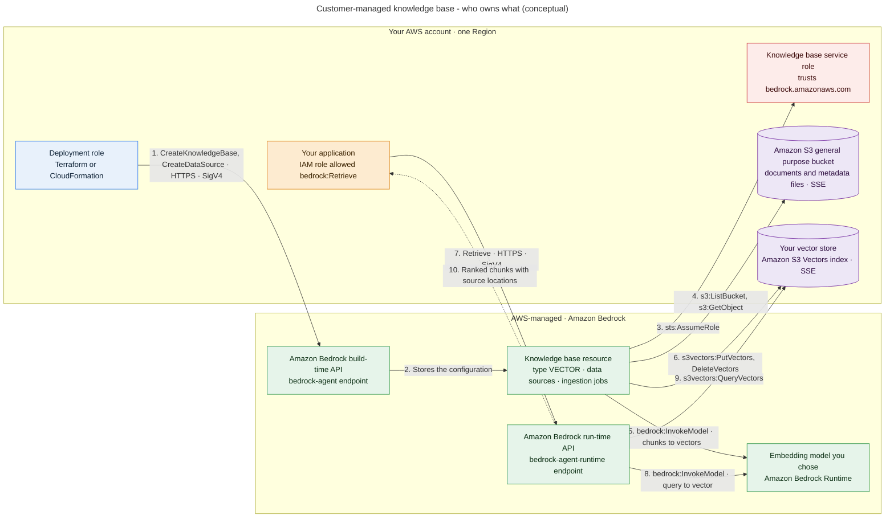
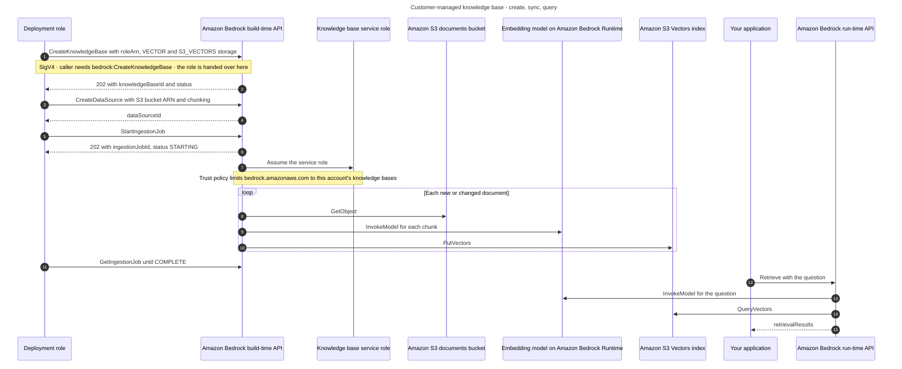

# Customer-managed knowledge bases and vector stores

> **Level:** Intermediate · **Verified:** 2026-11-15 · **Feature status:** GA · **Time:** ~25 min

A customer-managed knowledge base is the Amazon Bedrock Knowledge Bases type in which **you** own
the retrieval infrastructure: the vector store, its index, the embedding model choice and the role
that connects them. Amazon Bedrock runs the ingestion and query workflow on top of what you built.

> [!IMPORTANT]
> **Status** — GA, but no longer the AWS default. The documentation now opens with "we recommend
> Amazon Bedrock Managed Knowledge Base". Since **2026-09-30** you cannot create new Confluence,
> Microsoft SharePoint, Salesforce or Web Crawler connectors on a customer-managed knowledge base;
> existing ones keep ingesting and retrieving. `RetrieveAndGenerate` cannot be used with managed
> knowledge bases, which is one reason to stay on this type.
> Sources: [Knowledge Bases overview](https://docs.aws.amazon.com/bedrock/latest/userguide/knowledge-base.html),
> [Connect a data source](https://docs.aws.amazon.com/bedrock/latest/userguide/data-source-connectors.html),
> [RetrieveAndGenerate](https://docs.aws.amazon.com/bedrock/latest/APIReference/API_agent-runtime_RetrieveAndGenerate.html)

## Learning objectives

- List what you own in a customer-managed knowledge base and what Amazon Bedrock still does for you.
- Compare the vector stores the documentation supports today and pick one from their documented limits.
- Write the service role: its trust policy and the permission blocks each component needs.
- State which data sources can still be added and which encryption settings exist.
- Create the whole stack with Terraform: documents bucket, Amazon S3 Vectors index, role, knowledge base, data source.

## Prerequisites

- [Knowledge Bases overview: managed versus customer-managed](01-knowledge-bases-overview.md)
- [Embeddings, vector search, semantic search and hybrid search](../../00-foundations/generative-ai-fundamentals/03-embeddings-and-vector-search.md)
- [Retrieval-augmented generation (RAG)](../../00-foundations/generative-ai-fundamentals/04-rag-fundamentals.md)
- [IAM roles, trust policies and cross-account access](../../00-foundations/security/02-iam-roles-and-trust.md)

## 1. What it is

**Plain language.** A knowledge base turns documents into searchable numbers (vectors) and finds
the passages closest to a question. In the customer-managed type, the database holding those
vectors is yours: you create it, size it, secure it and pay its bill. Bedrock is the worker that
reads your documents, calls the embedding model and writes into your database.

**Precisely.** It is a `CreateKnowledgeBase` call whose `knowledgeBaseConfiguration.type` is
`VECTOR`, with a `vectorKnowledgeBaseConfiguration` (embedding model) and a `storageConfiguration`
(your vector store). The API reference calls this family "self-managed"; `KENDRA` and `SQL` are the
other non-managed types (see [Structured data retrieval and GraphRAG](06-structured-data-and-graphrag.md)),
and `MANAGED` is the [Managed Knowledge Base](02-managed-knowledge-base.md).

| Item | Value |
|:--|:--|
| Service namespace / endpoint | Build time: `bedrock-agent.<region>.amazonaws.com` · Run time: `bedrock-agent-runtime.<region>.amazonaws.com` |
| Control-plane operations | `CreateKnowledgeBase`, `GetKnowledgeBase`, `UpdateKnowledgeBase`, `DeleteKnowledgeBase`, `ListKnowledgeBases`, `CreateDataSource`, `UpdateDataSource`, `DeleteDataSource`, `StartIngestionJob`, `GetIngestionJob`, `StopIngestionJob` |
| Data-plane operations | `Retrieve`, `RetrieveAndGenerate`, `RetrieveAndGenerateStream`, `Rerank` |
| IAM action prefix | `bedrock:` |

Sources: [CreateKnowledgeBase](https://docs.aws.amazon.com/bedrock/latest/APIReference/API_agent_CreateKnowledgeBase.html),
[KnowledgeBaseConfiguration](https://docs.aws.amazon.com/bedrock/latest/APIReference/API_agent_KnowledgeBaseConfiguration.html).
Operation names are checked against [the API operations reference](../../references/bedrock-api-operations.md).

### What you own

| You own | Treat as fixed at creation | Bedrock does |
|:--|:--|:--|
| Vector store and index | Store type, index name, field mapping | Writes, updates and deletes vectors |
| Embedding model, dimensions, vector type | All three: the index is built for one dimension | Calls the model during ingestion and at query time |
| Service role | — | Assumes it for every read and write |
| Data sources and when they sync | Chunking strategy, parsing strategy type (documented as unchangeable) | Crawls, parses, chunks, tracks changes |
| Capacity, availability and cost of the store | — | Nothing: this is your infrastructure |

The Terraform provider marks both `knowledge_base_configuration` and `storage_configuration` as
"Forces new resource". Plan for it: a different embedding model means a new knowledge base and a
full re-ingestion.

## 2. Why it exists

It was the original design, and it still answers needs that the managed type does not: you may
already run a vector database, need the index for other applications, need a specific index
engine or distance metric, or need the one-call `RetrieveAndGenerate` API. Without it you would
write the crawler, change tracking, chunker, embedding batcher and index writer yourself.

## 3. When to use it

- You must keep vectors in a store you control (existing OpenSearch domain, Aurora cluster, third-party store).
- Your application depends on `RetrieveAndGenerate` or `RetrieveAndGenerateStream`.
- You need a setting only this type exposes: binary vectors, semantic-only search, your own chunking Lambda, GraphRAG.
- You want the lowest idle cost and accept semantic-only search: Amazon S3 Vectors charges for what you use.
- The Region you need is not on the Managed Knowledge Base Region list.

## 4. When not to use it

- **A new project with no store preference** — use the [Managed Knowledge Base](02-managed-knowledge-base.md), which AWS recommends.
- **New Confluence, SharePoint, Salesforce or web-crawl sources** — those connectors can only be created on the managed type.
- **Document-level permissions (ACLs)** — available only on the managed type.
- **Multi-step questions** — [agentic retrieval](../agentic-retrieval/01-agentic-retrieval.md) runs on managed knowledge bases only.
- **Questions over tables** — use a structured knowledge base, [chapter 6](06-structured-data-and-graphrag.md).

## 5. Internal architecture

AWS documents the resources, the role and the calls made with it. The diagram is the
customer-visible architecture; how Bedrock schedules the work internally is not documented.



| Legend | Meaning |
|:--|:--|
| Solid arrow | Request or write |
| Dashed arrow | Response |
| Cylinder | Data at rest, in your account |
| Blue / orange / green / purple / red | Caller / your compute / Bedrock / data store / security control |

**What this shows** — everything that holds data sits in your account; Bedrock holds only the
configuration and reaches your data through one role.

1. A deployment role creates the knowledge base and its data source.
2. Bedrock records the embedding model, the store and the field mapping.
3. For every ingestion and query, Bedrock assumes the service role.
4. It lists and reads the documents the data source points at.
5. It sends each chunk to the embedding model.
6. It writes vectors, chunk text and metadata into your index, and removes vectors of deleted documents.
7. Your application calls `Retrieve` on the run-time endpoint.
8. The question is embedded with the **same** model.
9. Bedrock queries your index.
10. Chunks, scores, metadata and source URIs come back.

**Variations** — with Amazon OpenSearch Serverless, steps 6 and 9 are `aoss:APIAccessAll` calls; with
Aurora they are RDS Data API statements authenticated through an AWS Secrets Manager secret. The
ingestion half is drawn in full in [diagram set 6](../../diagrams/mermaid/06-knowledge-base-ingestion-pipeline.md),
the query half in [diagram set 7](../../diagrams/mermaid/07-knowledge-base-retrieval-pipeline.md).

### Supported vector stores

The console can **quick-create** four stores; the others you create first and then reference.

| Store | `storageConfiguration` type | Quick create | Vector types | Hybrid search | Documented constraints |
|:--|:--|:-:|:--|:-:|:--|
| Amazon OpenSearch Serverless | `OPENSEARCH_SERVERLESS` | ✅ | float32, binary | ✅ | `faiss` engine required for filtering; the only store allowed for Confluence, SharePoint and Salesforce data sources |
| Amazon OpenSearch Service managed cluster | `OPENSEARCH_MANAGED_CLUSTER` | ❌ | float32, binary (engine 2.16+) | not listed | Domain must use **public access**; k-NN index needs 2.13+; `nmslib` unsupported |
| Amazon Aurora PostgreSQL | `RDS` | ✅ (Serverless) | float32 | ✅ | Same account as the knowledge base; RDS Data API plus a Secrets Manager secret; columns fixed at creation |
| Amazon Neptune Analytics | `NEPTUNE_ANALYTICS` | ✅ | float32 recommended | not listed | GraphRAG; Amazon S3 data source only; dimension fixed when the graph is created |
| Amazon S3 Vectors | `S3_VECTORS` | ✅ | float32 only | ❌ semantic only | 1 KB of custom metadata and 35 keys per vector; no `startsWith` / `stringContains` filters; hierarchical chunking not recommended |
| MongoDB Atlas | `MONGO_DB_ATLAS` | ❌ | float32 | ✅ | Third party; metadata filters need manual index setup; optional AWS PrivateLink |
| Pinecone | `PINECONE` | ❌ | float32 | not listed | Third party; API key in Secrets Manager |
| Redis Enterprise Cloud | `REDIS_ENTERPRISE_CLOUD` | ❌ | float32 | not listed | Third party; TLS required; credentials and certificates in Secrets Manager |

Sources: [Prerequisites for using a vector store you created](https://docs.aws.amazon.com/bedrock/latest/userguide/knowledge-base-setup.html),
[Create a knowledge base](https://docs.aws.amazon.com/bedrock/latest/userguide/knowledge-base-create.html),
[Query configurations](https://docs.aws.amazon.com/bedrock/latest/userguide/kb-test-config.html) (hybrid search note),
[Using S3 Vectors with Knowledge Bases](https://docs.aws.amazon.com/AmazonS3/latest/userguide/s3-vectors-bedrock-kb.html).

> [!NOTE]
> **Documented fact** — The academy register lists Pinecone, Redis Enterprise Cloud and MongoDB
> Atlas as unverified. On the verification date the prerequisites page still has a setup tab for
> each, and `CreateKnowledgeBase` still documents their configuration objects. They are
> bring-your-own stores only, and AWS adds that you "authorize AWS to access the designated
> third-party source on your behalf".
> Source: [Prerequisites for using a vector store you created](https://docs.aws.amazon.com/bedrock/latest/userguide/knowledge-base-setup.html)

"Not listed" means the hybrid search note names only Amazon RDS, OpenSearch Serverless and MongoDB;
treat every other store as semantic-only. How to choose is covered in
[Vector store selection](../../09-advanced-topics/02-vector-store-selection.md).

## 6. Request and response lifecycle



1. Creation is asynchronous: the call returns HTTP 202 and a status. Wait until the knowledge base is ready.
2. A data source is only a pointer plus ingestion settings; nothing is read yet.
3. `StartIngestionJob` does the work. Its states and failure handling are in [Ingestion, parsing and chunking](04-ingestion-parsing-chunking.md).
4. All data access uses the service role, never the caller's identity.
5. Queries are covered in [Retrieval, reranking and metadata filtering](05-retrieval-reranking-filtering.md).

Error paths that matter: **400 `ValidationException`** when the store description is inconsistent
(for S3 Vectors, sending both `indexArn` and `indexName`); **403 `AccessDeniedException`** when the
caller lacks the `bedrock:` action; **409 `ConflictException`**; **429 `ThrottlingException`** — the
create, update and delete operations allow 2 requests per second and `StartIngestionJob` 0.1.
**Our reading:** a role that cannot reach the store, or an index whose dimension differs from the
model's, surfaces during creation or the first sync rather than at `terraform validate` time. Also
our reading: because the role is handed over in `CreateKnowledgeBase`, that call is where
`iam:PassRole` matters; the documentation states only that the data source operations skip it.

## 7. Dependencies

| Depends on | Why | Required or optional |
|:--|:--|:-:|
| A supported vector store with an index | Holds vectors, chunk text and metadata | Required |
| An embedding model in the same Region | Converts chunks and queries to vectors | Required |
| IAM service role | The only identity Bedrock uses on your data | Required |
| A data source (Amazon S3 or Custom for new ones) | Where documents come from | Required |
| AWS Secrets Manager secret | Credentials for Aurora and third-party stores | Required for those stores |
| AWS KMS customer managed keys | Encrypting documents, transient data, vectors, sessions | Optional |
| Amazon S3 location for extracted images | Multimodal parsing output; cannot be added after creation | Optional |
| Reranker or generation model | Reranking, `RetrieveAndGenerate` | Optional |

## 8. Security considerations

**Trust policy.** The documented trust relationship lets the Bedrock service principal assume the
role, restricted to your account and to knowledge base ARNs:

> **Code status:** illustrative (copied from the documentation, placeholder account ID) · **never deployed**

```json
{
  "Version": "2012-10-17",
  "Statement": [
    {
      "Effect": "Allow",
      "Principal": { "Service": "bedrock.amazonaws.com" },
      "Action": "sts:AssumeRole",
      "Condition": {
        "StringEquals": { "aws:SourceAccount": "111122223333" },
        "ArnLike": { "aws:SourceArn": "arn:aws:bedrock:us-east-1:111122223333:knowledge-base/*" }
      }
    }
  ]
}
```

**Permission blocks.** Attach only what your design uses:

| Component | Actions on the service role |
|:--|:--|
| Embedding model | `bedrock:InvokeModel` on the model ARN (the documented policy also lists `bedrock:ListFoundationModels`, `bedrock:ListCustomModels`) |
| Amazon S3 data source | `s3:ListBucket`, `s3:GetObject`, with an `aws:ResourceAccount` condition |
| Amazon S3 Vectors | `s3vectors:PutVectors`, `GetVectors`, `DeleteVectors`, `QueryVectors`, `GetIndex` on the index ARN |
| OpenSearch Serverless | `aoss:APIAccessAll` on the collection |
| OpenSearch managed cluster | `es:ESHttpGet`, `ESHttpPost`, `ESHttpPut`, `ESHttpDelete` on the index, `es:DescribeDomain` on the domain |
| Aurora | `rds:DescribeDBClusters`, `rds-data:ExecuteStatement`, `rds-data:BatchExecuteStatement` |
| Neptune Analytics | `neptune-graph:GetGraph`, `ReadDataViaQuery`, `WriteDataViaQuery`, `DeleteDataViaQuery` |
| Secret-based stores | `secretsmanager:GetSecretValue` (plus `kms:Decrypt` if the secret uses your key) |
| Reranking inside `Retrieve` | `bedrock:Rerank` and `bedrock:InvokeModel` on the reranker |

> [!CAUTION]
> **Security hazard** — `CreateDataSource`, `UpdateDataSource` and `StartIngestionJob` do not pass
> a role, so no `iam:PassRole` check happens. Anyone allowed to manage data sources can ingest any
> location the service role can read and then read it back with `Retrieve`. Scope the role to the
> exact buckets and prefixes, and treat data source actions as privileged. Everything synced is
> visible to every principal with `bedrock:Retrieve` on the knowledge base.
> Source: [Create a service role for Knowledge Bases](https://docs.aws.amazon.com/bedrock/latest/userguide/kb-permissions.html)

**Encryption.** By default Bedrock uses an AWS owned key. Customer managed keys are possible at
these points:

| What | Setting | Extra permission |
|:--|:--|:--|
| Source documents in Amazon S3 | Bucket SSE-KMS | `kms:Decrypt` with `kms:ViaService` = `s3.<region>.amazonaws.com` |
| Transient data during ingestion | Data source `serverSideEncryptionConfiguration.kmsKeyArn` | `kms:GenerateDataKey`, `kms:Decrypt` |
| Vectors in S3 Vectors | SSE-S3 by default or SSE-KMS; the bucket's type cannot be changed later, an index may override it | See the S3 Vectors encryption page — exact role actions **UNVERIFIED — REQUIRES DOCUMENTATION REVIEW** (the Bedrock page gives none) |
| Vectors in OpenSearch Serverless | Key passed at quick create | Collection encryption policy |
| Store credentials | Secrets Manager secret with your key | `kms:Decrypt` |
| `RetrieveAndGenerate` session | `sessionConfiguration.kmsKeyArn` | Key policy allows `bedrock.amazonaws.com` `kms:GenerateDataKey`, `kms:Decrypt` |

Traffic to third-party stores uses TLS "where the provider permits and supports" it.
Source: [Encryption of knowledge base resources](https://docs.aws.amazon.com/bedrock/latest/userguide/encryption-kb.html).
Background: [AWS KMS and encryption](../../00-foundations/security/04-kms-encryption.md).

## 9. Networking requirements

- **Your callers.** Interface endpoints exist for `com.amazonaws.<region>.bedrock-agent` (build time) and `com.amazonaws.<region>.bedrock-agent-runtime` (queries). See [Private connectivity for Bedrock](../../02-related-aws-services/networking/01-private-connectivity-for-bedrock.md).
- **Documents.** The S3 bucket must be in the same Region as the knowledge base; only general purpose buckets are supported.
- **The store.** An OpenSearch Serverless collection may be private behind a VPC endpoint. An OpenSearch managed domain must use public access — "domains that are behind a VPC are not supported". For Neptune Analytics, Bedrock creates the connection itself. MongoDB Atlas can be reached over PrivateLink through `endpointServiceName`; Pinecone and Redis Enterprise Cloud are reached at their public endpoints.

Sources: [Interface VPC endpoints](https://docs.aws.amazon.com/bedrock/latest/userguide/vpc-interface-endpoints.html),
[Prerequisites for using a vector store you created](https://docs.aws.amazon.com/bedrock/latest/userguide/knowledge-base-setup.html).

## 10. Pricing dimensions

| Dimension | Unit | Notes |
|:--|:--|:--|
| Embedding | Tokens, at the embedding model's rate | Ingestion **and** every query |
| Vector store | Whatever the store's own service charges | "A provisioned retrieval service can have a minimum idle cost"; S3 Vectors charges for use |
| Parsing | Pages (Bedrock Data Automation) or tokens (foundation model) | The default text parser is free |
| Standard retrieval | — | No Bedrock per-query charge on this type; the store may charge per query |
| Reranking | Queries | Billed per query of up to 100 chunks |
| Generation | Tokens of the model named in `RetrieveAndGenerate` | |

Sources: [Amazon Bedrock pricing](https://aws.amazon.com/bedrock/pricing/),
[AWS blog: migrate to Managed Knowledge Base](https://aws.amazon.com/blogs/machine-learning/migrate-to-amazon-bedrock-managed-knowledge-base-with-your-coding-agent/)
(cost driver table). No figure is quoted here; read the pricing pages of Bedrock and of your store.

## 11. Scaling considerations

Default quotas per Region, none of them adjustable, as listed in the AWS General Reference:

| Quota | Value |
|:--|--:|
| Knowledge bases per account | 100 |
| Data sources per knowledge base | 5 |
| Concurrent ingestion jobs per knowledge base / per account | 1 / 5 |
| `Retrieve`, `RetrieveAndGenerate` requests per second | 20 each |
| `CreateKnowledgeBase`, `CreateDataSource` requests per second | 2 each |
| User query size | 1,000 characters |

Source: [Amazon Bedrock endpoints and quotas](https://docs.aws.amazon.com/general/latest/gr/bedrock.html).
Beyond these, the ceiling is your store: an under-sized OpenSearch domain fails ingestion, and AWS
tells you to raise IOPS and throughput. Embedding models are throttled per request rate, so a large
first sync competes with query traffic for the same model quota.

## 12. IaC support

| Tool | Support | Resource / construct | Notes |
|:--|:-:|:--|:--|
| Terraform (`hashicorp/aws` 6.73.0) | ✅ | `aws_bedrockagent_knowledge_base`, `aws_bedrockagent_data_source`, `aws_s3vectors_vector_bucket`, `aws_s3vectors_index`, `aws_s3vectors_vector_bucket_policy` | No resource starts an ingestion job; call `StartIngestionJob` from a pipeline step or a schedule |
| CloudFormation | ✅ | `AWS::Bedrock::KnowledgeBase`, `AWS::Bedrock::DataSource`, `AWS::S3Vectors::VectorBucket`, `AWS::S3Vectors::Index` | |
| AWS CDK (`aws-cdk-lib` 2.277.0) | L1 · alpha L2 | `aws_bedrock.CfnKnowledgeBase`, `aws_bedrock.CfnDataSource`, `aws_s3vectors.CfnIndex`; `KnowledgeBase` in `@aws-cdk/aws-bedrock-alpha` | The alpha package is experimental |

Checked against [the Terraform reference](../../references/terraform-aws-provider-bedrock.md) and
[the CDK and CloudFormation reference](../../references/cdk-and-cloudformation-bedrock.md). The
provider schema also accepts `pinecone_configuration`, `redis_enterprise_cloud_configuration` and
`mongo_db_atlas_configuration`. See [Terraform coverage for Amazon Bedrock](../../04-infrastructure-as-code/terraform/10-terraform-for-bedrock.md).

## 13. Working example

> **Code status:** validated with `terraform fmt` and `terraform validate` (Terraform 1.17.2, provider 6.73.0, together with a `versions.tf` that sets `required_version = ">= 1.11.0"` and `hashicorp/aws ~> 6.73`) · **never planned or applied against AWS**

```hcl
provider "aws" {
  region = var.region

  default_tags {
    tags = var.tags
  }
}

variable "region" {
  description = "Region for the knowledge base, the documents bucket and the vector bucket. All three must be in the same Region."
  type        = string
  default     = "us-east-1"
}

variable "name_prefix" {
  description = "Prefix for resource names. Lowercase letters, digits and hyphens only, because it is used in bucket names."
  type        = string
  default     = "academy-kb"
}

variable "embedding_model_id" {
  description = "Embedding model ID. Confirm the current ID and its Region support in the Bedrock documentation before you use this default."
  type        = string
  default     = "amazon.titan-embed-text-v2:0"
}

variable "embedding_dimensions" {
  description = "Vector dimensions. Must be a value the embedding model supports and must equal the dimension of the vector index."
  type        = number
  default     = 1024
}

variable "document_prefix" {
  description = "S3 prefix that holds the source documents. Only this prefix is ingested."
  type        = string
  default     = "documents/"
}

variable "tags" {
  description = "Tags applied to every resource through the provider's default_tags."
  type        = map(string)
  default     = {}
}

data "aws_caller_identity" "current" {}
data "aws_partition" "current" {}

locals {
  account_id          = data.aws_caller_identity.current.account_id
  partition           = data.aws_partition.current.partition
  embedding_model_arn = "arn:${local.partition}:bedrock:${var.region}::foundation-model/${var.embedding_model_id}"
}

# 1. Source documents: a general purpose S3 bucket in the same Region as the knowledge base.
resource "aws_s3_bucket" "documents" {
  bucket = "${var.name_prefix}-documents-${local.account_id}"
}

resource "aws_s3_bucket_public_access_block" "documents" {
  bucket = aws_s3_bucket.documents.id

  block_public_acls       = true
  block_public_policy     = true
  ignore_public_acls      = true
  restrict_public_buckets = true
}

# 2. Vector store: an S3 vector bucket and one vector index. You own both.
resource "aws_s3vectors_vector_bucket" "kb" {
  vector_bucket_name = "${var.name_prefix}-vectors-${local.account_id}"
}

resource "aws_s3vectors_index" "kb" {
  index_name         = "${var.name_prefix}-index"
  vector_bucket_name = aws_s3vectors_vector_bucket.kb.vector_bucket_name

  data_type       = "float32" # S3 Vectors stores floating-point vectors only
  dimension       = var.embedding_dimensions
  distance_metric = "cosine"

  # Keys that Bedrock writes for chunk text and its own bookkeeping. They must be
  # non-filterable so that they do not count against the filterable metadata limit.
  metadata_configuration {
    non_filterable_metadata_keys = ["AMAZON_BEDROCK_TEXT", "AMAZON_BEDROCK_METADATA"]
  }
}

# 3. Service role: Amazon Bedrock assumes it to read documents, call the embedding
#    model and write vectors. The trust policy is limited to this account's knowledge bases.
data "aws_iam_policy_document" "kb_trust" {
  statement {
    sid     = "AmazonBedrockKnowledgeBaseTrust"
    actions = ["sts:AssumeRole"]

    principals {
      type        = "Service"
      identifiers = ["bedrock.amazonaws.com"]
    }

    condition {
      test     = "StringEquals"
      variable = "aws:SourceAccount"
      values   = [local.account_id]
    }

    condition {
      test     = "ArnLike"
      variable = "aws:SourceArn"
      values   = ["arn:${local.partition}:bedrock:${var.region}:${local.account_id}:knowledge-base/*"]
    }
  }
}

resource "aws_iam_role" "kb" {
  name               = "${var.name_prefix}-service-role"
  assume_role_policy = data.aws_iam_policy_document.kb_trust.json
}

data "aws_iam_policy_document" "kb_permissions" {
  statement {
    sid       = "ListModels"
    actions   = ["bedrock:ListFoundationModels", "bedrock:ListCustomModels"]
    resources = ["*"]
  }

  statement {
    sid       = "InvokeEmbeddingModel"
    actions   = ["bedrock:InvokeModel"]
    resources = [local.embedding_model_arn]
  }

  statement {
    sid       = "ListDocumentsBucket"
    actions   = ["s3:ListBucket"]
    resources = [aws_s3_bucket.documents.arn]

    condition {
      test     = "StringEquals"
      variable = "aws:ResourceAccount"
      values   = [local.account_id]
    }
  }

  statement {
    sid       = "ReadDocuments"
    actions   = ["s3:GetObject"]
    resources = ["${aws_s3_bucket.documents.arn}/${var.document_prefix}*"]

    condition {
      test     = "StringEquals"
      variable = "aws:ResourceAccount"
      values   = [local.account_id]
    }
  }

  statement {
    sid = "ReadAndWriteVectorIndex"
    actions = [
      "s3vectors:PutVectors",
      "s3vectors:GetVectors",
      "s3vectors:DeleteVectors",
      "s3vectors:QueryVectors",
      "s3vectors:GetIndex",
    ]
    resources = [aws_s3vectors_index.kb.index_arn]
  }
}

resource "aws_iam_role_policy" "kb" {
  name   = "knowledge-base-access"
  role   = aws_iam_role.kb.id
  policy = data.aws_iam_policy_document.kb_permissions.json
}

# 4. The customer-managed knowledge base: type VECTOR, storage S3_VECTORS.
resource "aws_bedrockagent_knowledge_base" "this" {
  name        = "${var.name_prefix}-customer-managed"
  description = "Customer-managed knowledge base backed by Amazon S3 Vectors"
  role_arn    = aws_iam_role.kb.arn

  knowledge_base_configuration {
    type = "VECTOR"

    vector_knowledge_base_configuration {
      embedding_model_arn = local.embedding_model_arn

      embedding_model_configuration {
        bedrock_embedding_model_configuration {
          dimensions          = var.embedding_dimensions
          embedding_data_type = "FLOAT32"
        }
      }
    }
  }

  storage_configuration {
    type = "S3_VECTORS"

    s3_vectors_configuration {
      index_arn = aws_s3vectors_index.kb.index_arn
    }
  }

  # The role must already be able to reach the index when Bedrock validates the store.
  depends_on = [aws_iam_role_policy.kb]
}

# 5. The data source: the documents prefix, chunked with the fixed-size strategy.
resource "aws_bedrockagent_data_source" "documents" {
  knowledge_base_id    = aws_bedrockagent_knowledge_base.this.id
  name                 = "${var.name_prefix}-s3-documents"
  data_deletion_policy = "DELETE"

  data_source_configuration {
    type = "S3"

    s3_configuration {
      bucket_arn              = aws_s3_bucket.documents.arn
      bucket_owner_account_id = local.account_id
      inclusion_prefixes      = [var.document_prefix]
    }
  }

  vector_ingestion_configuration {
    chunking_configuration {
      chunking_strategy = "FIXED_SIZE"

      fixed_size_chunking_configuration {
        max_tokens         = 300
        overlap_percentage = 20
      }
    }
  }
}

output "knowledge_base_id" {
  description = "Pass to Retrieve, RetrieveAndGenerate and StartIngestionJob."
  value       = aws_bedrockagent_knowledge_base.this.id
}

output "data_source_id" {
  description = "Pass to StartIngestionJob together with the knowledge base ID."
  value       = aws_bedrockagent_data_source.documents.data_source_id
}

output "vector_index_arn" {
  description = "ARN of the S3 vector index that stores the embeddings."
  value       = aws_s3vectors_index.kb.index_arn
}
```

Notes on the example:

- `s3_vectors_configuration` takes `index_arn` alone. The API rejects `indexArn` together with `indexName`.
- The read statement is narrowed to the ingested prefix, as the role guidance asks. Metadata files live beside the documents, so they are covered.
- `data_deletion_policy = "DELETE"` removes the vectors when the data source is deleted; the vector bucket itself is never deleted by Bedrock.
- After `apply`, nothing is searchable until the first sync. The script for that is in [chapter 4](04-ingestion-parsing-chunking.md).

> [!CAUTION]
> **Cost hazard** — applying this in your own sandbox creates billable resources: embedding tokens
> for every sync and query, and S3 Vectors storage and requests. Destroy the stack when you finish;
> empty the documents bucket first. Nothing in this repository has been applied to an AWS account.

> [!TIP]
> **Academy recommendation** — Keep one vector index per knowledge base and never write to it
> yourself. Bedrock's change tracking assumes it is the only writer.
> This is our design guidance, not an official AWS reference architecture.

## Common mistakes

| Mistake | Symptom | Fix |
|:--|:--|:--|
| Index dimension differs from the model's dimensions | Creation or the first sync fails | Take both from one variable, as in the example |
| Binary embeddings with S3 Vectors or Aurora | Not supported: only the two OpenSearch options store binary vectors | Use `FLOAT32`, or OpenSearch |
| OpenSearch managed domain inside a VPC | Knowledge base cannot connect | Use a public-access domain with fine-grained access control, or OpenSearch Serverless |
| Missing non-filterable keys on the S3 Vectors index | The ingestion job throws an exception when a vector's metadata exceeds the limit | Add `AMAZON_BEDROCK_TEXT` and `AMAZON_BEDROCK_METADATA` as non-filterable keys |
| Service role can read the whole bucket | Any data source manager can exfiltrate through `Retrieve` | Scope to prefixes; restrict data source actions |
| Planning a new SharePoint connector here | `CreateDataSource` no longer supported for that type | Use the Managed Knowledge Base |
| Expecting hybrid search on S3 Vectors | Queries silently run as semantic search | Choose OpenSearch Serverless, Aurora or MongoDB Atlas |

## Knowledge check

1. You change `embedding_dimensions` from 1024 to 512 in the example. What does Terraform do, and what must happen before queries work again?
2. A colleague may call `bedrock:CreateDataSource` but has no Amazon S3 permissions. Can they read a bucket the service role can read? Why?
3. Which vector stores can hold binary vectors, and which support hybrid search according to the documentation?
4. Your design needs a new Confluence source and `RetrieveAndGenerate`. What is the conflict?
5. Why does the trust policy carry an `aws:SourceArn` condition?

<details>
<summary>Answers</summary>

1. The index and the knowledge base are replaced (both settings force a new resource), the data source has to be recreated under the new knowledge base ID, and every document must be ingested again.
2. Yes. Data source operations pass no role, so no `iam:PassRole` check applies; ingestion runs with the service role, and `Retrieve` returns the content.
3. Binary: OpenSearch Serverless and OpenSearch managed clusters. Hybrid: Amazon RDS (Aurora), OpenSearch Serverless and MongoDB, when the index has a filterable text field.
4. New Confluence connectors exist only on the Managed Knowledge Base, and `RetrieveAndGenerate` cannot be used with managed knowledge bases. You must either export Confluence content to Amazon S3 or a Custom data source, or move to `Retrieve` or `AgenticRetrieveStream` on the managed type.
5. It limits the Bedrock service principal to acting for knowledge bases in your account and Region, which prevents another account's resource from using your role (the confused deputy problem).

</details>

## 14. Official documentation

- [Retrieve data and generate AI responses with Amazon Bedrock Knowledge Bases](https://docs.aws.amazon.com/bedrock/latest/userguide/knowledge-base.html) — the two types and AWS's recommendation.
- [Create a knowledge base by connecting to a data source](https://docs.aws.amazon.com/bedrock/latest/userguide/knowledge-base-create.html) — quick-create stores, required fields.
- [Prerequisites for using a vector store you created](https://docs.aws.amazon.com/bedrock/latest/userguide/knowledge-base-setup.html) — one tab per store, field mappings, S3 Vectors limits.
- [Supported models and Regions for knowledge bases](https://docs.aws.amazon.com/bedrock/latest/userguide/knowledge-base-supported.html) — embedding models, dimensions, vector types.
- [Connect a data source to your knowledge base](https://docs.aws.amazon.com/bedrock/latest/userguide/data-source-connectors.html) — the 2026-09-30 connector change.
- [Create a service role for Amazon Bedrock Knowledge Bases](https://docs.aws.amazon.com/bedrock/latest/userguide/kb-permissions.html) — trust policy and every permission block.
- [Encryption of knowledge base resources](https://docs.aws.amazon.com/bedrock/latest/userguide/encryption-kb.html) — where customer managed keys apply.
- [Prerequisites for OpenSearch Managed Clusters](https://docs.aws.amazon.com/bedrock/latest/userguide/kb-osm-permissions-prereq.html) — domain policy and capacity guidance.
- [Delete a data source](https://docs.aws.amazon.com/bedrock/latest/userguide/kb-ds-delete.html) — `DELETE` versus `RETAIN`.
- [Query configurations](https://docs.aws.amazon.com/bedrock/latest/userguide/kb-test-config.html) — which stores support hybrid search and which filters.
- [Using S3 Vectors with Amazon Bedrock Knowledge Bases](https://docs.aws.amazon.com/AmazonS3/latest/userguide/s3-vectors-bedrock-kb.html) — semantic-only search and metadata limits.
- [CreateKnowledgeBase](https://docs.aws.amazon.com/bedrock/latest/APIReference/API_agent_CreateKnowledgeBase.html), [StorageConfiguration](https://docs.aws.amazon.com/bedrock/latest/APIReference/API_agent_StorageConfiguration.html), [S3VectorsConfiguration](https://docs.aws.amazon.com/bedrock/latest/APIReference/API_agent_S3VectorsConfiguration.html) — request shape.
- [Interface VPC endpoints for Amazon Bedrock](https://docs.aws.amazon.com/bedrock/latest/userguide/vpc-interface-endpoints.html) — endpoint service names.
- [Amazon Bedrock endpoints and quotas](https://docs.aws.amazon.com/general/latest/gr/bedrock.html) — the quotas quoted above.
- [Amazon Bedrock pricing](https://aws.amazon.com/bedrock/pricing/) — reranking and model rates.
- [Migrate to Amazon Bedrock Managed Knowledge Base](https://aws.amazon.com/blogs/machine-learning/migrate-to-amazon-bedrock-managed-knowledge-base-with-your-coding-agent/) — AWS's own cost-driver and quota comparison of the two types.
- Terraform: [`aws_bedrockagent_knowledge_base`](https://raw.githubusercontent.com/hashicorp/terraform-provider-aws/main/website/docs/r/bedrockagent_knowledge_base.html.markdown), [`aws_bedrockagent_data_source`](https://raw.githubusercontent.com/hashicorp/terraform-provider-aws/main/website/docs/r/bedrockagent_data_source.html.markdown), [`aws_s3vectors_index`](https://raw.githubusercontent.com/hashicorp/terraform-provider-aws/main/website/docs/r/s3vectors_index.html.markdown), [`aws_s3vectors_vector_bucket`](https://raw.githubusercontent.com/hashicorp/terraform-provider-aws/main/website/docs/r/s3vectors_vector_bucket.html.markdown).
- [Feature verification matrix](../../FEATURE-VERIFICATION.md) — the academy's register rows for knowledge bases.
