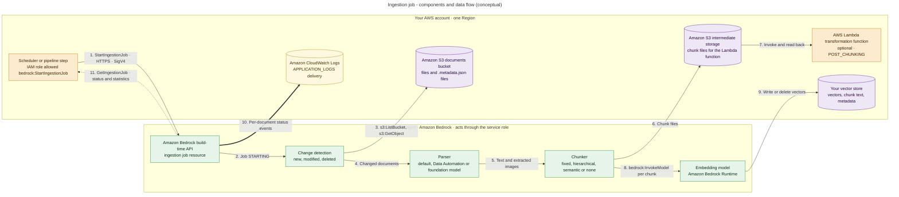
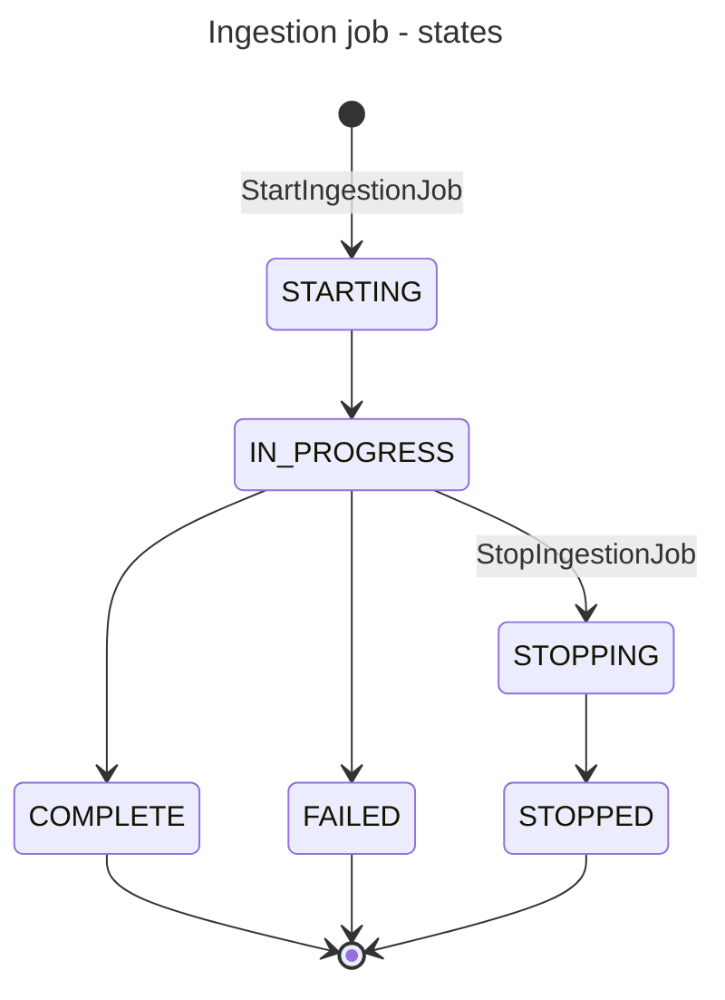
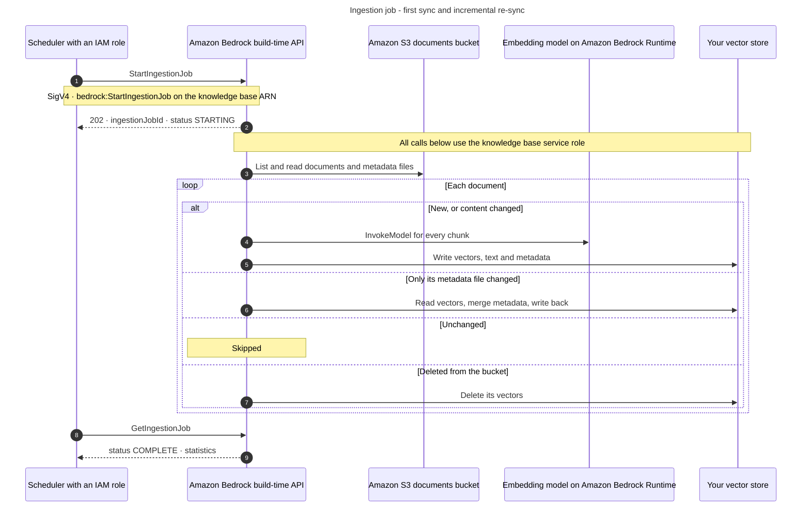

# Ingestion, parsing and chunking

> **Level:** Intermediate · **Verified:** 2026-11-15 · **Feature status:** GA · **Time:** ~25 min

Ingestion is the write path of a knowledge base. An **ingestion job** (the console calls it a
*sync*) reads a data source, turns each document into text, cuts the text into chunks, embeds each
chunk and writes the vectors to the store. Every retrieval-quality decision you can make before a
question is asked is made here.

> [!IMPORTANT]
> **Status** — GA for customer-managed knowledge bases, which this chapter describes. The
> knowledge base support page still describes the Amazon Bedrock Data Automation **parser** as
> "supported in US West (Oregon) and … in preview". Two parsing strategy values, `SMART_PARSING`
> and `MULTI_MODAL_EMBEDDINGS`, apply to managed knowledge bases only.
> Sources: [Supported models and Regions for knowledge bases](https://docs.aws.amazon.com/bedrock/latest/userguide/knowledge-base-supported.html),
> [ParsingConfiguration](https://docs.aws.amazon.com/bedrock/latest/APIReference/API_agent_ParsingConfiguration.html)

## Learning objectives

- Describe the ingestion job lifecycle, its six states and its statistics.
- Explain what an incremental sync re-processes, and when it avoids the embedding model altogether.
- Choose a parser and a chunking strategy, and quote their parameters and limits.
- Write a metadata file and say which metadata influences the vector.
- Find a failed document and list what drives the cost of ingestion.

## Prerequisites

- [Customer-managed knowledge bases and vector stores](03-customer-managed-knowledge-bases.md)
- [Retrieval-augmented generation (RAG)](../../00-foundations/generative-ai-fundamentals/04-rag-fundamentals.md)
- [Tokens, context windows, and training versus inference](../../00-foundations/generative-ai-fundamentals/02-tokens-context-windows-inference.md)

## 1. What it is

**Plain language.** A model cannot search a 300-page PDF. Ingestion cuts the PDF into passages
small enough to match one question, labels each passage with where it came from, and files it in
an index. A sync repeats this only for what changed.

**Precisely.** `StartIngestionJob` on the build-time endpoint starts an asynchronous job for one
data source. Its behaviour is fixed by the data source's `vectorIngestionConfiguration`: an
optional `parsingConfiguration`, `chunkingConfiguration` and `customTransformationConfiguration`.

| Item | Value |
|:--|:--|
| Service namespace / endpoint | `bedrock-agent.<region>.amazonaws.com` (build time) |
| Control-plane operations | `StartIngestionJob`, `GetIngestionJob`, `ListIngestionJobs`, `StopIngestionJob`; direct ingestion: `IngestKnowledgeBaseDocuments`, `GetKnowledgeBaseDocuments`, `ListKnowledgeBaseDocuments`, `DeleteKnowledgeBaseDocuments` |
| Data-plane operations | None — ingestion has no run-time call; queries are in [chapter 5](05-retrieval-reranking-filtering.md) |
| IAM action prefix | `bedrock:` |

| Stage | What happens | You configure |
|:--|:--|:--|
| 1. Change detection | New, modified and deleted documents are found | Data source, inclusion prefix |
| 2. Parsing | Raw file becomes text (and, optionally, extracted images) | `parsingConfiguration` |
| 3. Chunking | Text becomes chunks | `chunkingConfiguration` |
| 4. Custom transformation | Your Lambda function rewrites chunks or adds metadata | `customTransformationConfiguration` |
| 5. Embedding | Each chunk becomes a vector | Embedding model of the knowledge base |
| 6. Indexing | Vector, chunk text and metadata are written | Vector store |

Sources: [StartIngestionJob](https://docs.aws.amazon.com/bedrock/latest/APIReference/API_agent_StartIngestionJob.html),
[Sync your data](https://docs.aws.amazon.com/bedrock/latest/userguide/kb-data-source-sync-ingest.html),
[Customize ingestion](https://docs.aws.amazon.com/bedrock/latest/userguide/kb-data-source-customize-ingestion.html)

## 2. Why it exists

Without it you would build a crawler with change tracking, a parser for each file format, a
token-aware splitter, a rate-limited embedding batcher and an idempotent index writer that also
removes vectors of deleted files. Ingestion jobs give you that pipeline as configuration.

## 3. When to use it

- **Sync (`StartIngestionJob`)** — after files in an Amazon S3 data source were added, changed or removed.
- **Direct ingestion (`IngestKnowledgeBaseDocuments`)** — one document must be searchable now, in an S3 or Custom data source.
- **Advanced parsing** — documents contain tables, charts, figures or scanned pages.
- **Hierarchical chunking** — you want precise matching on small chunks but a larger passage in the prompt.
- **Semantic chunking** — long documents whose topic shifts without headings.
- **A transformation Lambda function** — your own chunking logic, or metadata per chunk.

## 4. When not to use it

- **Text-only PDFs with an advanced parser** — once you pick Bedrock Data Automation or a foundation model, it parses *every* PDF and you pay for each. Keep the default parser.
- **Hierarchical chunking on Amazon S3 Vectors** — not recommended; parent context is stored as metadata and can exceed the per-vector limit. See [chapter 3](03-customer-managed-knowledge-bases.md).
- **No chunking when you need page citations** — the page-number metadata field is not produced.
- **Rows and columns** — do not embed tables you want to aggregate; use a [structured knowledge base](06-structured-data-and-graphrag.md).
- **New Confluence, SharePoint, Salesforce or web sources** — use the [Managed Knowledge Base](02-managed-knowledge-base.md).
- **Choosing a strategy by intuition** — the trade-offs are in [Chunking strategies](../../09-advanced-topics/03-chunking-strategies.md).

## 5. Internal architecture

The stages are documented ("parsing, chunking, generating embeddings, and indexing"); how Bedrock
runs them is not. The boxes inside the Bedrock boundary are therefore a conceptual model.



| Legend | Meaning |
|:--|:--|
| Solid arrow | Request or write |
| Dashed arrow | Response |
| Thick arrow | Asynchronous log delivery |
| Orange / green / purple / yellow | Your compute / Bedrock / data at rest / observability |

**What this shows** — one job moving changed documents from your bucket to your store, with every
access to your resources made through the knowledge base service role.

1. A caller starts the job; the call returns immediately with an `ingestionJobId`.
2. The job enters `STARTING`.
3. Bedrock lists the data source and reads documents and their metadata files.
4. Only documents that are new or changed go further; deleted ones are queued for removal.
5. The parser produces text. Advanced parsers can also store extracted images in the multimodal storage location.
6. The chunker splits the text. With a custom transformation, chunk files are written to your intermediate bucket.
7. Your Lambda function rewrites those files and returns references to them.
8. Each chunk is embedded.
9. Vectors, chunk text and metadata are written; vectors of deleted documents are removed.
10. If you enabled log delivery, one event per document status change is delivered.
11. The caller polls `GetIngestionJob`.

**Variations** — a Custom data source has no step 3: you push documents with
`IngestKnowledgeBaseDocuments`. With Amazon Nova Multimodal Embeddings, audio and video skip steps 5
and 6 and are segmented by the embedding model. The full pipeline with keys and roles is in
[diagram set 6](../../diagrams/mermaid/06-knowledge-base-ingestion-pipeline.md).

### Parsing options

| Parser | `parsingStrategy` | Reads | Billed by | Documented limits |
|:--|:--|:--|:--|:--|
| Default | omit `parsingConfiguration` | Text in `.txt`, `.md`, `.html`, `.doc/.docx`, `.xls/.xlsx`, `.pdf` | No charge | Text only |
| Amazon Bedrock Data Automation | `BEDROCK_DATA_AUTOMATION` | Figures, charts and tables in PDFs; `.jpeg`, `.png`; audio and video as transcripts and summaries | Page or image | 1,000 files |
| Foundation model | `BEDROCK_FOUNDATION_MODEL` | The same visual content, with a prompt you can edit | Input and output tokens | 1,000 files; 100 GB in total; Claude, Nova and Llama 4 vision model families |

- An advanced parser handles **all** PDFs in the data source, including text-only ones.
- If an advanced parser fails on a file, the default parser is used for that file.
- The strategy *type* cannot be changed after the data source is created; its parameters can.
- Extracted images need an S3 location set on the knowledge base at creation
  (`supplementalDataStorageConfiguration`); it cannot be added later.

Sources: [Parsing options](https://docs.aws.amazon.com/bedrock/latest/userguide/kb-advanced-parsing.html),
[Customize ingestion](https://docs.aws.amazon.com/bedrock/latest/userguide/kb-data-source-customize-ingestion.html).
The parser itself is described in [Amazon Bedrock Data Automation](../data-automation/01-bedrock-data-automation.md).

### Chunking strategies

| Strategy | `chunkingStrategy` | Parameters (accepted range) | Behaviour |
|:--|:--|:--|:--|
| Default | omit `chunkingConfiguration` | — | About 300 tokens per chunk, sentence boundaries kept |
| Fixed-size | `FIXED_SIZE` | `maxTokens` 1–8,192 · `overlapPercentage` 1–99 | Chunks of roughly equal size; parsed content is not merged across pages or sections |
| Hierarchical | `HIERARCHICAL` | Exactly two `levelConfigurations`, each `maxTokens` 1–8,192 · `overlapTokens` ≥ 1 | Child chunks are searched, the parent chunk is returned; fewer results than requested are possible |
| Semantic | `SEMANTIC` | `maxTokens` 1–8,192 · `bufferSize` 0–1 · `breakpointPercentileThreshold` 50–99 | Splits where adjacent sentences are least similar; uses a foundation model, which costs extra |
| None | `NONE` | — | One chunk per file; no page number in citations |
| Custom | any of the above plus `customTransformationConfiguration` | Lambda ARN · intermediate S3 URI · `stepToApply` = `POST_CHUNKING` | Your function chunks (with `NONE`) or adds chunk-level metadata, which overrides file-level metadata |

The chunking strategy cannot be changed after the data source is created.

> [!NOTE]
> **Documented fact** — When content is processed as Markdown (a `.md` file, advanced-parser output
> or converted HTML) and a page holds a table or figure, Bedrock attaches the full page or table
> (up to 10,000 characters) to each chunk and returns that instead of the matching chunk. Results
> that share the context are merged, so you can receive fewer results than `numberOfResults`.
> Source: [How content chunking works](https://docs.aws.amazon.com/bedrock/latest/userguide/kb-chunking.html)

### Metadata files

A metadata file sits next to its document, has the document's full name plus `.metadata.json`,
and may not exceed 10 KB. Attributes can be `STRING`, `NUMBER`, `BOOLEAN` or `STRING_LIST`.
`includeForEmbedding: true` prepends the key and value to the chunk text before embedding, so the
metadata influences similarity; with `false`, or with the short form `"key": "value"`, it is stored
for filtering only. For CSV files a `documentStructureConfiguration` names the single content
column and the metadata columns. A mis-named metadata file is ignored.

### Multimodal content

Images, audio and video are ingested only from Amazon S3 and Custom data sources. There are two
routes: a multimodal embedding model embeds the media directly (with Amazon Nova Multimodal
Embeddings, audio and video segments of 1–30 seconds, default 5), or Bedrock Data Automation
converts media to text that is then chunked normally. JPEG and PNG files are limited to 3.75 MB.
Sources: [Build a knowledge base for multimodal content](https://docs.aws.amazon.com/bedrock/latest/userguide/kb-multimodal.html),
[How content chunking works](https://docs.aws.amazon.com/bedrock/latest/userguide/kb-chunking.html),
[Prerequisites for your knowledge base data](https://docs.aws.amazon.com/bedrock/latest/userguide/knowledge-base-ds.html).

## 6. Request and response lifecycle



The six values are the documented `status` enum; **our reading** is the order of the transitions,
which the API reference does not draw.



1. The job is asynchronous. Poll `GetIngestionJob` (10 requests per second allowed) or list jobs with `ListIngestionJobs`.
2. Syncing is **incremental**: unchanged documents are skipped; a changed document is re-parsed, re-chunked, re-embedded and re-indexed in full.
3. **Metadata-only optimization** — if only `.metadata.json` files changed, the content is not CSV and no transformation Lambda function is configured, Bedrock merges the new metadata into the existing vectors without calling the embedding model. CSV files are always re-ingested when their metadata file changes.
4. `statistics` reports scanned, new, modified, deleted, skipped and failed documents, plus metadata documents scanned and modified. `textReadyAt` marks when all text was extracted.
5. After `COMPLETE`, new vectors can take a few minutes to become searchable in stores other than Aurora.

**Failure handling**

| Signal | Where | What to do |
|:--|:--|:--|
| Job `FAILED` | `status`, `failureReasons` | Fix the cause (role, store, quota) and start again |
| Some documents failed | `statistics.numberOfDocumentsFailed`; console *View warnings* | Read the document events in the delivered logs |
| Per-document reason | CloudWatch Logs events with `status` such as `RESOURCE_IGNORED`, `EMBEDDING_FAILED`, `INDEXING_FAILED`, `DELETION_FAILED`, and `status_reasons` | Query, for example, `filter event.status = "EMBEDDING_FAILED"` |
| A new job cannot start | `StartIngestionJob` error: 409 `ConflictException`, 402 `ServiceQuotaExceededException` or 429 `ThrottlingException` | One job per knowledge base and per data source at a time; 0.1 requests per second. Which error a concurrent start returns is not documented |
| Job must end early | `StopIngestionJob` → `STOPPING` → `STOPPED` | Start again later "to ingest the rest of your data" |

**Our reading:** a document that failed is not in the index, so the next sync treats it as new and
retries it; the documentation does not state this explicitly. Do not run `StartIngestionJob` and
`IngestKnowledgeBaseDocuments` at the same time — the documentation forbids it — and remember that
a directly ingested S3 document is overwritten by the next sync unless you also put it in the bucket.

## 7. Dependencies

| Depends on | Why | Required or optional |
|:--|:--|:-:|
| A knowledge base and a data source | The job belongs to one data source | Required |
| Knowledge base service role | Reads documents, invokes models, writes vectors | Required |
| Embedding model quota | Every chunk is one embedding request | Required |
| Vector store capacity | Writes arrive in bursts during a sync | Required |
| Parser model or Bedrock Data Automation | Advanced parsing | Optional |
| S3 multimodal storage location | Extracted images returned at query time | Optional |
| AWS Lambda function and intermediate S3 location | Custom transformation | Optional |
| CloudWatch Logs delivery | Per-document diagnostics | Optional, strongly advised |

## 8. Security considerations

- **Identity.** The job runs as the service role, not as the caller. Whoever may start jobs or edit data sources can make the role's readable data retrievable — see the caution in [chapter 3](03-customer-managed-knowledge-bases.md).
- **Transient data.** Data held while a job runs is encrypted with an AWS owned key, or with your key when the data source sets `serverSideEncryptionConfiguration.kmsKeyArn`; the role then needs `kms:GenerateDataKey` and `kms:Decrypt`.
- **Documented role additions.** Bedrock Data Automation: `bedrock:InvokeDataAutomationAsync`, `bedrock:GetDataAutomationStatus`. Multimodal storage: `s3:PutObject`, `s3:GetObject`, `s3:DeleteObject`, `s3:ListBucket`. Nova Multimodal Embeddings: `bedrock:InvokeModel` and `bedrock:GetAsyncInvoke`.
- **Not on the service-role page.** The permissions for a foundation-model parser and for invoking the transformation Lambda function and using its intermediate bucket are **UNVERIFIED — REQUIRES DOCUMENTATION REVIEW**; the page read lists neither. The console adds what it needs when it creates the role.
- **Content is untrusted input.** A document can carry instructions aimed at the model. See [Prompt injection, untrusted tool output and retrieval poisoning](../../06-security-governance/04-prompt-injection-and-untrusted-content.md).
- **Logs.** Delivered events contain document URIs. Enabling delivery requires `bedrock:AllowVendedLogDeliveryForResource`.

Sources: [Create a service role](https://docs.aws.amazon.com/bedrock/latest/userguide/kb-permissions.html),
[Encryption of knowledge base resources](https://docs.aws.amazon.com/bedrock/latest/userguide/encryption-kb.html),
[Monitor knowledge bases using CloudWatch Logs](https://docs.aws.amazon.com/bedrock/latest/userguide/knowledge-bases-logging.html)

## 9. Networking requirements

Callers reach `StartIngestionJob` on the public build-time endpoint or through the interface
endpoint `com.amazonaws.<region>.bedrock-agent`. The documents bucket must be in the knowledge
base's Region. If the parser uses a cross-Region inference profile, document content is processed
in another Region of that geography: "your data can be shared across Regions". The store's own
network rules are in [chapter 3](03-customer-managed-knowledge-bases.md).

## 10. Pricing dimensions

The pricing page lists no ingestion charge for self-managed knowledge bases; you pay for what the
job calls.

| Dimension | Unit | Notes |
|:--|:--|:--|
| Embedding | Tokens at the embedding model's rate | Paid again for every changed document, in full |
| Advanced parsing | Pages or images (Data Automation); tokens (foundation model) | Applies to every PDF once selected |
| Semantic chunking | Foundation model usage | "Additional costs … due to its use of a foundation model" |
| Graph construction | Tokens of the construction model | GraphRAG only — [chapter 6](06-structured-data-and-graphrag.md) |
| Vector store | Writes, storage, provisioned capacity | Billed by the store's service |
| Custom transformation | Lambda invocations and intermediate S3 storage | |
| Multimodal storage | S3 storage of file copies | "Can incur additional storage charges" |
| Log delivery | CloudWatch Logs ingestion and storage | |

Sources: [Amazon Bedrock pricing](https://aws.amazon.com/bedrock/pricing/),
[AWS blog: migrate to Managed Knowledge Base](https://aws.amazon.com/blogs/machine-learning/migrate-to-amazon-bedrock-managed-knowledge-base-with-your-coding-agent/).
No price is quoted here. The largest lever is how often documents change: one edited byte re-embeds
the whole document. Wider guidance: [Pricing model and cost drivers](../../08-cost-performance-and-reliability/01-pricing-model-and-cost-drivers.md).

## 11. Scaling considerations

Default quotas per Region (none adjustable), from the AWS General Reference:

| Quota | Value |
|:--|--:|
| `StartIngestionJob` requests per second | 0.1 |
| Concurrent ingestion jobs per data source / knowledge base / account | 1 / 1 / 5 |
| Ingestion job size | 100 GB |
| File size, text content | 50 MB |
| Files to add or update per job; files to delete per job | 5,000,000 each |
| Files with a foundation-model parser; with the Data Automation parser | 1,000 each |
| `IngestKnowledgeBaseDocuments`: documents per request / payload / requests per second | 25 / 6 MB / 5 |

Source: [Amazon Bedrock endpoints and quotas](https://docs.aws.amazon.com/general/latest/gr/bedrock.html).
Because one knowledge base runs one job at a time, a large first load decides how fresh the index
can be. Split content across data sources only for organisation — they still queue behind each other.

## 12. IaC support

| Tool | Support | Resource / construct | Notes |
|:--|:-:|:--|:--|
| Terraform (`hashicorp/aws` 6.73.0) | ✅ configuration · ❌ job | `aws_bedrockagent_data_source` → `vector_ingestion_configuration` | No resource starts or tracks an ingestion job |
| CloudFormation | ✅ configuration · ❌ job | `AWS::Bedrock::DataSource` | Log delivery uses the CloudWatch Logs delivery resources |
| AWS CDK (`aws-cdk-lib` 2.277.0) | L1 | `aws_bedrock.CfnDataSource` | |

The verified alternative for running jobs is an API call: from a pipeline step, or from a scheduled
Lambda function or AWS Step Functions task, using the script in section 13. Checked against
[the Terraform reference](../../references/terraform-aws-provider-bedrock.md) and
[the API operations reference](../../references/bedrock-api-operations.md).

## 13. Working example

**A data source with a foundation-model parser, hierarchical chunking and a transformation Lambda function.**

> **Code status:** validated with `terraform fmt` and `terraform validate` (Terraform 1.17.2, provider 6.73.0, together with a `versions.tf` and a provider block) · **never planned or applied against AWS**

```hcl
variable "knowledge_base_id" {
  description = "ID of an existing customer-managed knowledge base that was created with a multimodal storage location."
  type        = string
}

variable "documents_bucket_arn" {
  description = "ARN of the S3 bucket that holds the source documents."
  type        = string
}

variable "parser_model_arn" {
  description = "ARN of a vision-capable foundation model or inference profile used as the parser. Confirm current model support in the documentation."
  type        = string
}

variable "transformation_lambda_arn" {
  description = "ARN of the Lambda function that adds chunk-level metadata after chunking."
  type        = string
}

variable "intermediate_bucket_uri" {
  description = "S3 URI (s3://bucket/prefix/) where Bedrock exchanges chunk files with the Lambda function."
  type        = string
}

resource "aws_bedrockagent_data_source" "manuals" {
  knowledge_base_id    = var.knowledge_base_id
  name                 = "product-manuals"
  data_deletion_policy = "DELETE"

  data_source_configuration {
    type = "S3"

    s3_configuration {
      bucket_arn         = var.documents_bucket_arn
      inclusion_prefixes = ["manuals/"]
    }
  }

  vector_ingestion_configuration {
    # Parser: a foundation model reads tables and figures. Every PDF is billed per token.
    parsing_configuration {
      parsing_strategy = "BEDROCK_FOUNDATION_MODEL"

      bedrock_foundation_model_configuration {
        model_arn        = var.parser_model_arn
        parsing_modality = "MULTIMODAL"
      }
    }

    # Chunker: search on small child chunks, return the larger parent chunk.
    chunking_configuration {
      chunking_strategy = "HIERARCHICAL"

      hierarchical_chunking_configuration {
        overlap_tokens = 60

        level_configuration {
          max_tokens = 1500 # parent
        }

        level_configuration {
          max_tokens = 300 # child
        }
      }
    }

    # Optional post-chunking step: your Lambda function rewrites the chunk files.
    custom_transformation_configuration {
      intermediate_storage {
        s3_location {
          uri = var.intermediate_bucket_uri
        }
      }

      transformation {
        step_to_apply = "POST_CHUNKING"

        transformation_function {
          transformation_lambda_configuration {
            lambda_arn = var.transformation_lambda_arn
          }
        }
      }
    }
  }
}
```

The token values are examples inside the accepted ranges, not recommendations.

**A metadata file**, stored as `leave-policy.pdf.metadata.json` beside `leave-policy.pdf`:

> **Code status:** syntax-checked (JSON parse) · format copied from the documentation · **never deployed**

```json
{
  "metadataAttributes": {
    "department": {
      "value": { "type": "STRING", "stringValue": "hr" },
      "includeForEmbedding": false
    },
    "year": {
      "value": { "type": "NUMBER", "numberValue": 2026 },
      "includeForEmbedding": false
    },
    "title": {
      "value": { "type": "STRING", "stringValue": "Parental leave policy" },
      "includeForEmbedding": true
    }
  }
}
```

**Start a sync and wait for it.**

> **Code status:** syntax-checked (`python -m py_compile`) · request shapes validated offline against the AWS SDK service model (botocore 1.35.99) and run against a stub · **never run against AWS**

```python
"""Start a sync for one data source and wait for it to finish."""
import os
import time

import boto3

REGION = os.environ.get("AWS_REGION", "us-east-1")
KB_ID = os.environ["KNOWLEDGE_BASE_ID"]
DATA_SOURCE_ID = os.environ["DATA_SOURCE_ID"]

TERMINAL_STATES = {"COMPLETE", "FAILED", "STOPPED"}

agent = boto3.client("bedrock-agent", region_name=REGION)


def sync(description: str = "scheduled sync", poll_seconds: int = 30) -> dict:
    """Run one ingestion job. Only added, changed and deleted documents are processed."""
    job = agent.start_ingestion_job(
        knowledgeBaseId=KB_ID,
        dataSourceId=DATA_SOURCE_ID,
        description=description,
    )["ingestionJob"]

    while job["status"] not in TERMINAL_STATES:
        time.sleep(poll_seconds)  # GetIngestionJob is rate limited; do not poll in a tight loop
        job = agent.get_ingestion_job(
            knowledgeBaseId=KB_ID,
            dataSourceId=DATA_SOURCE_ID,
            ingestionJobId=job["ingestionJobId"],
        )["ingestionJob"]
    return job


def report(job: dict) -> bool:
    """Print the outcome. Return False when the job or any document failed."""
    stats = job.get("statistics", {})
    print("status:", job["status"])
    for key in (
        "numberOfDocumentsScanned",
        "numberOfNewDocumentsIndexed",
        "numberOfModifiedDocumentsIndexed",
        "numberOfDocumentsDeleted",
        "numberOfDocumentsSkipped",
        "numberOfDocumentsFailed",
    ):
        print(f"  {key}: {stats.get(key, 0)}")
    for reason in job.get("failureReasons", []):
        print("  reason:", reason)
    return job["status"] == "COMPLETE" and stats.get("numberOfDocumentsFailed", 0) == 0


if __name__ == "__main__":
    raise SystemExit(0 if report(sync()) else 1)
```

> [!TIP]
> **Academy recommendation** — Treat `numberOfDocumentsFailed > 0` as a failed run even when the
> status is `COMPLETE`, and alarm on it. A quietly missing document is the most common reason a
> RAG system "does not know" something.
> This is our design guidance, not an official AWS reference architecture.

## Common mistakes

| Mistake | Symptom | Fix |
|:--|:--|:--|
| Uploading files and not syncing | New content never appears in answers | Start a job after every change, or on a schedule |
| Metadata file named `doc.metadata.json` for `doc.pdf` | Metadata ignored, filters return nothing | Name it `doc.pdf.metadata.json` |
| Choosing an advanced parser for mostly text PDFs | Parsing bill grows with every sync | Separate data sources: default parser for text, advanced parser for visual documents |
| Trying to change chunking on an existing data source | Not possible; Terraform plans a replacement | Create a new data source and re-ingest |
| Large chunks on S3 Vectors with hierarchical chunking | Job throws an exception on the metadata limit | Use fixed-size chunks, or another store |
| Starting jobs in a loop | Conflict, quota or throttling errors | One job at a time; wait for a terminal state |
| Direct ingestion into an S3 data source only | Document disappears at the next sync | Also write the file to the bucket |
| OpenSearch index created with `nmslib` | Metadata files ignored | Recreate the index with the `faiss` engine |

## Knowledge check

1. You fix a typo in one page of a 200-page PDF and sync. What is re-embedded?
2. Only `report.pdf.metadata.json` changed. Under which three conditions does Bedrock avoid calling the embedding model?
3. A job ends `COMPLETE`, yet users cannot find last week's contract. Name two places to look.
4. Why can a query that asks for five results return three when hierarchical chunking is used?
5. Your data source uses a foundation-model parser and holds 4,000 PDFs. Which documented limit is the problem?

<details>
<summary>Answers</summary>

1. The whole document: a changed document is re-parsed, re-chunked, re-embedded and re-indexed.
2. Only metadata files were modified, the content file is not a CSV file, and the data source has no custom transformation Lambda function.
3. `statistics.numberOfDocumentsFailed` (and `numberOfDocumentsSkipped`) on the job, and the per-document events in the delivered CloudWatch Logs — for example `RESOURCE_IGNORED` with its `status_reasons`.
4. The number of results counts child chunks; children that share a parent are replaced by that one parent chunk.
5. The quota of 1,000 files for foundation models as a parser (and the 100 GB total size limit).

</details>

## 14. Official documentation

- [Sync your data with your knowledge base](https://docs.aws.amazon.com/bedrock/latest/userguide/kb-data-source-sync-ingest.html) — incremental sync, metadata-only optimization, CSV behaviour.
- [Customize ingestion for a data source](https://docs.aws.amazon.com/bedrock/latest/userguide/kb-data-source-customize-ingestion.html) — request shapes for parsing, chunking and Lambda transformation; what cannot be changed.
- [Parsing options for your data source](https://docs.aws.amazon.com/bedrock/latest/userguide/kb-advanced-parsing.html) — the three parsers and how each is billed.
- [How content chunking works](https://docs.aws.amazon.com/bedrock/latest/userguide/kb-chunking.html) — strategies, tables and figures, multimodal chunking.
- [Use a custom transformation Lambda function](https://docs.aws.amazon.com/bedrock/latest/userguide/kb-custom-transformation.html) — input, output and file contracts.
- [Include metadata in a data source](https://docs.aws.amazon.com/bedrock/latest/userguide/kb-metadata.html) and [Connect to Amazon S3](https://docs.aws.amazon.com/bedrock/latest/userguide/s3-data-source-connector.html) — metadata file format, `includeForEmbedding`, CSV configuration.
- [Prerequisites for your knowledge base data](https://docs.aws.amazon.com/bedrock/latest/userguide/knowledge-base-ds.html) — formats and file size limits.
- [Ingest changes directly into a knowledge base](https://docs.aws.amazon.com/bedrock/latest/userguide/kb-direct-ingestion.html) and [Ingest documents directly](https://docs.aws.amazon.com/bedrock/latest/userguide/kb-direct-ingestion-add.html) — the `KnowledgeBaseDocuments` operations.
- [Connect to a custom data source](https://docs.aws.amazon.com/bedrock/latest/userguide/custom-data-source-connector.html) — data sources without a sync.
- [Build a knowledge base for multimodal content](https://docs.aws.amazon.com/bedrock/latest/userguide/kb-multimodal.html) — the two multimodal routes.
- [Monitor knowledge bases using CloudWatch Logs](https://docs.aws.amazon.com/bedrock/latest/userguide/knowledge-bases-logging.html) — log delivery and document status values.
- API reference: [StartIngestionJob](https://docs.aws.amazon.com/bedrock/latest/APIReference/API_agent_StartIngestionJob.html), [IngestionJob](https://docs.aws.amazon.com/bedrock/latest/APIReference/API_agent_IngestionJob.html), [IngestionJobStatistics](https://docs.aws.amazon.com/bedrock/latest/APIReference/API_agent_IngestionJobStatistics.html), [ChunkingConfiguration](https://docs.aws.amazon.com/bedrock/latest/APIReference/API_agent_ChunkingConfiguration.html), [FixedSizeChunkingConfiguration](https://docs.aws.amazon.com/bedrock/latest/APIReference/API_agent_FixedSizeChunkingConfiguration.html), [HierarchicalChunkingConfiguration](https://docs.aws.amazon.com/bedrock/latest/APIReference/API_agent_HierarchicalChunkingConfiguration.html), [SemanticChunkingConfiguration](https://docs.aws.amazon.com/bedrock/latest/APIReference/API_agent_SemanticChunkingConfiguration.html), [ParsingConfiguration](https://docs.aws.amazon.com/bedrock/latest/APIReference/API_agent_ParsingConfiguration.html), [Transformation](https://docs.aws.amazon.com/bedrock/latest/APIReference/API_agent_Transformation.html).
- [Amazon Bedrock endpoints and quotas](https://docs.aws.amazon.com/general/latest/gr/bedrock.html) — the quotas quoted above.
- [Terraform `aws_bedrockagent_data_source`](https://raw.githubusercontent.com/hashicorp/terraform-provider-aws/main/website/docs/r/bedrockagent_data_source.html.markdown) — block and argument names.
- [Feature verification matrix](../../FEATURE-VERIFICATION.md) — the academy's register rows for knowledge bases.
