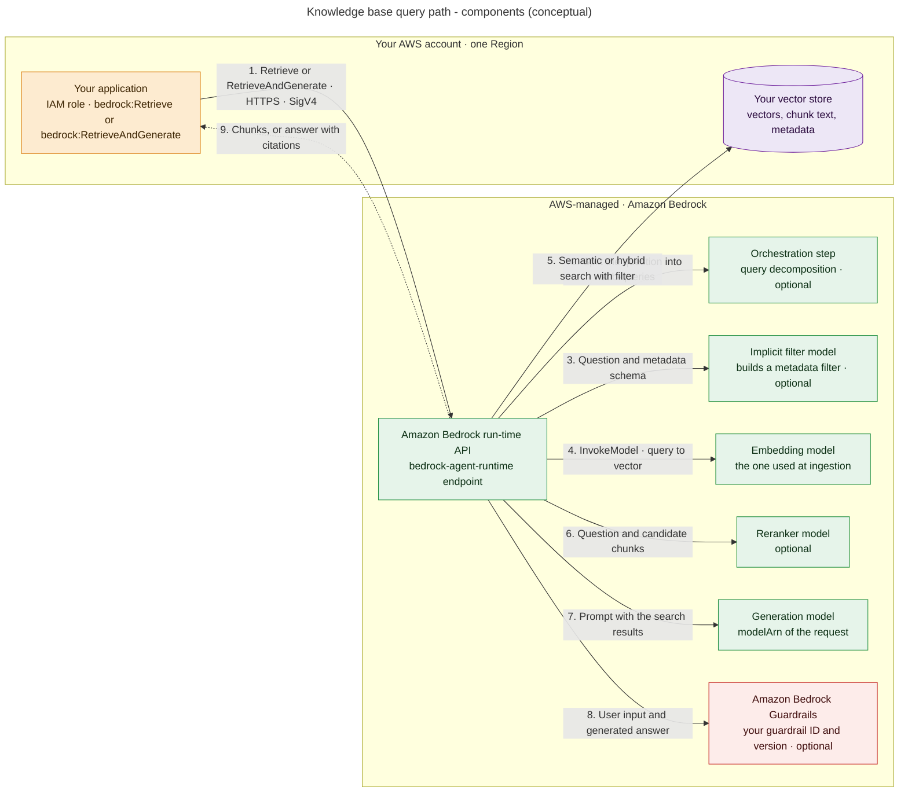
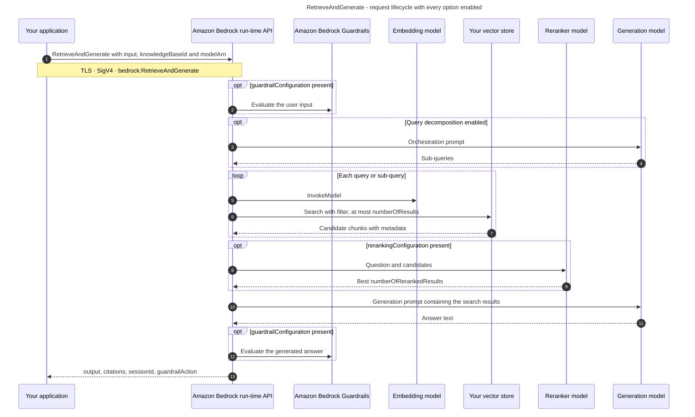

# Retrieval, reranking and metadata filtering

> **Level:** Intermediate · **Verified:** 2026-11-15 · **Feature status:** GA · **Time:** ~25 min

Retrieval is the read path of a knowledge base: a question goes in, and either ranked chunks
(`Retrieve`) or a generated answer with citations (`RetrieveAndGenerate`) comes out. Every option
in this chapter is a field of the request — nothing is provisioned.

> [!IMPORTANT]
> **Status** — GA. `Retrieve` works on both knowledge base types. `RetrieveAndGenerate` and
> `RetrieveAndGenerateStream` "cannot be used with managed knowledge bases"; there you use
> `Retrieve` or `AgenticRetrieveStream`. Two reranker models are offered, in five Regions between
> them (`ap-northeast-1`, `ca-central-1`, `eu-central-1`, `us-west-2`, and `us-east-1` for Cohere
> Rerank 3.5 only).
> Sources: [RetrieveAndGenerate](https://docs.aws.amazon.com/bedrock/latest/APIReference/API_agent-runtime_RetrieveAndGenerate.html),
> [Supported Regions and models for reranking](https://docs.aws.amazon.com/bedrock/latest/userguide/rerank-supported.html)

## Learning objectives

- Choose between `Retrieve`, `RetrieveAndGenerate` and `RetrieveAndGenerateStream`.
- Set the search type and the number of results, and predict when fewer results come back.
- Write a metadata filter, and explain implicit filtering.
- Add a reranker inside a query or call the `Rerank` API on its own.
- Read citations, and state exactly what a guardrail does and does not check.

## Prerequisites

- [Customer-managed knowledge bases and vector stores](03-customer-managed-knowledge-bases.md)
- [Ingestion, parsing and chunking](04-ingestion-parsing-chunking.md)
- [Embeddings, vector search, semantic search and hybrid search](../../00-foundations/generative-ai-fundamentals/03-embeddings-and-vector-search.md)
- [Amazon Bedrock Guardrails](../guardrails/01-guardrails.md)

## 1. What it is

**Plain language.** Retrieval is a librarian. `Retrieve` hands you the five most relevant pages
and stops. `RetrieveAndGenerate` also reads those pages and writes the answer, with footnotes.

**Precisely.** Both are operations of the run-time endpoint that embed the query with the knowledge
base's embedding model, search the vector store, optionally filter and rerank, and — for
`RetrieveAndGenerate` — fill a prompt template and invoke the model you name in `modelArn`.

| Item | Value |
|:--|:--|
| Service namespace / endpoint | `bedrock-agent-runtime.<region>.amazonaws.com` |
| Control-plane operations | None — all behaviour is set per request |
| Data-plane operations | `Retrieve` (`POST /knowledgebases/{knowledgeBaseId}/retrieve`), `RetrieveAndGenerate` (`POST /retrieveAndGenerate`), `RetrieveAndGenerateStream`, `Rerank` (`POST /rerank`) |
| IAM action prefix | `bedrock:` — `Retrieve`, `RetrieveAndGenerate` (also authorises the streaming call), `Rerank` |

| | `Retrieve` | `RetrieveAndGenerate` | `RetrieveAndGenerateStream` |
|:--|:--|:--|:--|
| Returns | `retrievalResults`: content, score, location, metadata; `nextToken` | `output.text`, `citations`, `sessionId`, `guardrailAction` | A stream of `output`, `citation` and `guardrail` events; session ID in a response header |
| Models invoked | Embedding, optional reranker | Plus the generation model | Same |
| Managed Knowledge Base | ✅ with `managedSearchConfiguration` | ❌ | ❌ |
| Conversation memory | None | `sessionId` | `sessionId` |
| Who builds the prompt | You | Bedrock, from a template you may replace | Same |
| Default quota | 20 requests per second | 20 | 20 |

Sources: [Retrieve](https://docs.aws.amazon.com/bedrock/latest/APIReference/API_agent-runtime_Retrieve.html),
[RetrieveAndGenerateStream](https://docs.aws.amazon.com/bedrock/latest/APIReference/API_agent-runtime_RetrieveAndGenerateStream.html),
[Endpoints and quotas](https://docs.aws.amazon.com/general/latest/gr/bedrock.html).
Operation names and top-level fields are checked against [the API operations reference](../../references/bedrock-api-operations.md).

## 2. Why it exists

Without these calls your application would hold the embedding model ID, speak each vector store's
query language, merge keyword and vector scores, call a reranker, build a grounded prompt and map
answer sentences back to sources. `Retrieve` hides the store; `RetrieveAndGenerate` hides the rest.

## 3. When to use it

- **`Retrieve`** — you own the prompt and the model call (for example with the [Converse API](../inference/01-converse-api.md)), you feed an agent, or the knowledge base is managed.
- **`RetrieveAndGenerate`** — a single-turn or conversational question-and-answer feature with citations and no orchestration code.
- **`RetrieveAndGenerateStream`** — the same, when users should see text as it is produced.
- **Metadata filters** — narrowing by attributes you attached at ingestion: department, year, product.
- **A reranker** — retrieve many candidates cheaply, keep the few that matter, shorten the prompt.
- **`Rerank` on its own** — you fetched passages elsewhere and only need relevance ordering.

## 4. When not to use it

- **`RetrieveAndGenerate` on a Managed Knowledge Base** — not supported; use [agentic retrieval](../agentic-retrieval/01-agentic-retrieval.md).
- **Questions that need several dependent look-ups** — query decomposition splits a question once; it does not iterate. Use agentic retrieval.
- **A client-supplied filter as your access control** — see section 8 and [Multitenant RAG](../../09-advanced-topics/06-multitenant-rag.md).
- **Reranking images, audio or video** — "You can use reranking for only textual data."
- **Hybrid search on a store that lacks it** — the request quietly runs as semantic search. See the store table in [chapter 3](03-customer-managed-knowledge-bases.md).
- **Tuning by feel** — measure with [Model and RAG evaluation](../model-evaluation/01-model-evaluation.md); the design trade-offs are in [Hybrid search, reranking and metadata filtering](../../09-advanced-topics/05-hybrid-search-reranking-metadata-filtering.md).

## 5. Internal architecture

AWS documents the request fields and their effect. The stage boxes below are a conceptual model of
that behaviour, not a description of Bedrock internals.



| Legend | Meaning |
|:--|:--|
| Solid arrow | Request made by the run-time API on behalf of the query |
| Dashed arrow | Response to the caller |
| Cylinder | Data at rest in your account |
| Orange / green / purple / red | Your compute / Bedrock models and API / data store / security control |

**What this shows** — one query fanning out to as many as five model or store calls. `Retrieve`
uses steps 1, 3–6 and 9; `RetrieveAndGenerate` can use all nine.

1. The application calls the run-time endpoint with a signed request.
2. With query decomposition, the question is first split into sub-queries (`RetrieveAndGenerate` only).
3. With implicit filtering, a model turns the question into a metadata filter.
4. The question (or each sub-query) is embedded.
5. The store is searched, restricted by the filter.
6. A reranker reorders the candidates and keeps the best.
7. The chunks are placed in the generation prompt and the model answers.
8. A guardrail evaluates the user input and the generated answer.
9. The caller receives chunks, or text with citations.

**Variations** — on a Managed Knowledge Base, search is always hybrid, a managed reranker runs by
default (`rerankingModelType`: `MANAGED`, `CUSTOM` or `NONE`) and the configuration object is
`managedSearchConfiguration`. Both paths are drawn in
[diagram set 7](../../diagrams/mermaid/07-knowledge-base-retrieval-pipeline.md).

### Search type and number of results

| `overrideSearchType` | Behaviour | Where |
|:--|:--|:--|
| omitted | Bedrock chooses the strategy suited to your store | Everywhere |
| `HYBRID` | Vector search combined with raw-text search | Amazon RDS (Aurora), OpenSearch Serverless and MongoDB stores "that contain a filterable text field" |
| `SEMANTIC` | Vector search only | Every customer-managed store |

- The default is "up to five results". `numberOfResults` accepts 1–100 and is a **maximum**.
- Fewer can return: with hierarchical chunking it counts child chunks, and children of one parent collapse into that parent; chunks that share a table or page context are merged.
- `Retrieve` pages with `nextToken`. A query may hold at most 1,000 characters (quota).

Source: [Configure and customize queries](https://docs.aws.amazon.com/bedrock/latest/userguide/kb-test-config.html).
The API reference text for `overrideSearchType` mentions hybrid search for OpenSearch Serverless
only; the user guide's list of three stores is the newer statement.

### Metadata filter syntax

A filter is one operator object, or `andAll` / `orAll` around several. Each operator takes a
`key` and a `value`.

| Operator | Value type | Notes |
|:--|:--|:--|
| `equals`, `notEquals` | string, number, boolean | `notEquals` also returns chunks that do not have the key |
| `greaterThan`, `greaterThanOrEquals`, `lessThan`, `lessThanOrEquals` | number | |
| `in`, `notIn` | list of strings | "Best supported" on OpenSearch Serverless and Neptune Analytics |
| `startsWith` | string | OpenSearch Serverless only |
| `stringContains` | string | Substring of a string, or of a list member; best on OpenSearch Serverless |
| `listContains` | string | The attribute is a list that contains the value |
| `andAll`, `orAll` | list of filters | At least 2 members; the guide describes up to 5 per group and one level of nesting |

Limits by store: S3 Vectors and managed knowledge bases reject `startsWith` and `stringContains`;
OpenSearch needs the `faiss` engine; MongoDB Atlas needs filters configured in its index. Keys
that start with `x-amz-bedrock` are reserved — for example `x-amz-bedrock-kb-document-page-number`,
written for PDFs on OpenSearch Serverless and Aurora.
Source: [RetrievalFilter](https://docs.aws.amazon.com/bedrock/latest/APIReference/API_agent-runtime_RetrievalFilter.html).

**Implicit filtering.** Instead of writing the filter, give `implicitFilterConfiguration` a
`modelArn` and 1–25 `metadataAttributes` (`key`, `type`, `description`). A model reads the question
and generates the filter. The documentation states it is "supported by Anthropic Claude models".
**Our reading:** this is one more model invocation per query, so it adds latency and tokens.

### Reranking

| | Inside `Retrieve` / `RetrieveAndGenerate` | `Rerank` API |
|:--|:--|:--|
| Field | `rerankingConfiguration` with `type` = `BEDROCK_RERANKING_MODEL` | `rerankingConfiguration`, `queries`, `sources` |
| Input | The retrieved chunks | Exactly 1 text query; 1–1,000 inline sources (text or JSON) |
| Output size | `numberOfRerankedResults` 1–100 | `numberOfResults` 1–1,000 |
| Extra control | `metadataConfiguration`: `selectionMode` `ALL` or `SELECTIVE` with `fieldsToInclude` / `fieldsToExclude` | `additionalModelRequestFields` |
| Who needs `bedrock:Rerank` and `bedrock:InvokeModel` | The **service role** for `Retrieve`; the **caller** for `RetrieveAndGenerate` | The caller |
| Default quota | — | 10 requests per second |

The models are Amazon Rerank 1.0 (`amazon.rerank-v1:0`, not available in `us-east-1`) and Cohere
Rerank 3.5 (`cohere.rerank-v3-5:0`). If `numberOfRerankedResults` exceeds `numberOfResults`, you get
`numberOfResults` — except with query decomposition, where it may be up to five times larger.
Sources: [Reranker models](https://docs.aws.amazon.com/bedrock/latest/userguide/rerank.html),
[Permissions for reranking](https://docs.aws.amazon.com/bedrock/latest/userguide/rerank-prereq.html),
[Rerank](https://docs.aws.amazon.com/bedrock/latest/APIReference/API_agent-runtime_Rerank.html).

### Query decomposition

Setting `orchestrationConfiguration.queryTransformationConfiguration.type` to
`QUERY_DECOMPOSITION` lets Bedrock break a broad question into sub-queries, run each against the
knowledge base and answer from the union. The field exists on `RetrieveAndGenerate` only.

## 6. Request and response lifecycle



1. The request names the knowledge base and the generation model (a model ID, model ARN or inference profile ARN).
2. A guardrail, if configured, sees the user input. **Our reading:** the orchestration prompt runs on the same `modelArn`, because `orchestrationConfiguration` has no model field of its own.
3. Retrieval runs once per query or sub-query, as in `Retrieve`.
4. The reranker, if any, shortens the candidate list.
5. The generation prompt must contain the `$search_results$` placeholder; `$query$`, `$current_time$` and `$output_format_instructions$` are the others.
6. The answer returns with `citations` and a `sessionId`. Send that ID back to continue the conversation; you cannot choose it yourself.

**Citations.** Each element of `citations` pairs a `generatedResponsePart.textResponsePart` (the
`text` and its `span.start` / `span.end` offsets in the answer) with the `retrievedReferences`
that support it: `content`, `location` and `metadata`. If you replace the prompt template and drop
`$output_format_instructions$`, "the response won't contain citations". In the stream, read
`generatedResponsePart` and `retrievedReferences` on the citation event; its nested `citation`
member is deprecated. Images are never returned in the answer, only cited.

**Guardrails.** Put `guardrailId` and `guardrailVersion` in
`generationConfiguration.guardrailConfiguration`. The response's `guardrailAction` is `INTERVENED`
or `NONE`.

> [!NOTE]
> **Documented fact** — "Guardrails are applied only to the input and the generated response from
> the LLM. They are not applied to the references retrieved from Knowledge Bases at runtime."
> Contextual grounding with knowledge bases is not supported on Claude 3 Sonnet and Haiku.
> Sources: [Query a knowledge base and generate responses](https://docs.aws.amazon.com/bedrock/latest/userguide/kb-test-retrieve-generate.html),
> [Configure and customize queries](https://docs.aws.amazon.com/bedrock/latest/userguide/kb-test-config.html)

`Retrieve` also accepts a top-level `guardrailConfiguration` and returns `guardrailAction`. What a
guardrail evaluates on a call that generates nothing is **UNVERIFIED — REQUIRES DOCUMENTATION
REVIEW**: the user guide lists the field but does not describe its effect.

**Errors.** `ValidationException` (400) for a malformed filter or an over-long query;
`AccessDeniedException` (403); `ResourceNotFoundException` (404); `DependencyFailedException`
(424) and `BadGatewayException` (502) when something Bedrock calls fails; `ThrottlingException`
(429); `InternalServerException` (500), whose reason can be
`BEDROCK_MODEL_INVOCATION_SERVICE_UNAVAILABLE` — retry. If the generation prompt exceeds the
model's limit, lower `numberOfResults`, shorten the template, or re-ingest with smaller chunks.

## 7. Dependencies

| Depends on | Why | Required or optional |
|:--|:--|:-:|
| A knowledge base with at least one completed sync | Nothing to search otherwise | Required |
| The embedding model and its quota | Every query is embedded | Required |
| The vector store being reachable | Step 5 | Required |
| Metadata files at ingestion | Filters match only attributes that were ingested | Required for filtering |
| Generation model access | `RetrieveAndGenerate` | Required for generation |
| Reranker model in a supported Region | Reranking | Optional |
| A guardrail and version | Input and output checks | Optional |
| AWS KMS key | `sessionConfiguration.kmsKeyArn` encrypts session context | Optional |

## 8. Security considerations

- **IAM.** `bedrock:Retrieve` can be scoped to a knowledge base ARN. The documented policy grants `bedrock:RetrieveAndGenerate` on `*`, with `bedrock:Retrieve` and `bedrock:GetKnowledgeBase` on the knowledge base. With a reranker in `RetrieveAndGenerate`, the caller also needs `bedrock:Rerank` and `bedrock:InvokeModel` on the reranker and generation models.
- **No per-document authorisation on this type.** "All data that you sync … becomes available to anyone with `bedrock:Retrieve` permissions." Document-level access control lists exist only on the Managed Knowledge Base.
- **Retrieved text is untrusted.** Guardrails do not screen retrieved chunks, so a poisoned document reaches the model. See [Prompt injection, untrusted tool output and retrieval poisoning](../../06-security-governance/04-prompt-injection-and-untrusted-content.md).
- **Session data.** Conversation context is encrypted with an AWS owned key unless you pass `sessionConfiguration.kmsKeyArn`; the key policy must then allow `bedrock.amazonaws.com` to use `kms:GenerateDataKey` and `kms:Decrypt`.
- **Logging.** The default generation prompt, including its static example content, appears in model invocation logs.

> [!TIP]
> **Academy recommendation** — Never let the browser or the end user compose the `filter`. Derive
> tenant and entitlement filters on the server from the authenticated identity, and add them with
> `andAll` around any user-chosen filter. A filter is a query option, not an authorisation check.
> This is our design guidance, not an official AWS reference architecture.

Sources: [Permissions for knowledge base users](https://docs.aws.amazon.com/bedrock/latest/userguide/knowledge-base-prereq-permissions-general.html),
[Encryption of knowledge base resources](https://docs.aws.amazon.com/bedrock/latest/userguide/encryption-kb.html)

## 9. Networking requirements

Queries go to the public `bedrock-agent-runtime` endpoint or to the interface endpoint
`com.amazonaws.<region>.bedrock-agent-runtime`. The knowledge base reaches the vector store as
described in [chapter 3](03-customer-managed-knowledge-bases.md); your application never connects
to the store. If `modelArn` is a cross-Region inference profile, the prompt — retrieved chunks
included — is processed in another Region of that geography. See
[Private connectivity for Bedrock](../../02-related-aws-services/networking/01-private-connectivity-for-bedrock.md)
and [Cross-Region inference](../inference/04-cross-region-inference.md).

## 10. Pricing dimensions

| Dimension | Unit | Notes |
|:--|:--|:--|
| Query embedding | Tokens at the embedding model's rate | Once per query or sub-query |
| Vector store query | Whatever the store charges | No Bedrock per-query charge on customer-managed knowledge bases |
| Reranking | Queries; one query covers up to 100 chunks | The pricing page lists Cohere Rerank 3.5 at $2.00 per 1,000 queries; an AWS blog of 2026-11-12 gives $1 per 1,000 for Amazon Rerank |
| Generation, orchestration, implicit filter | Tokens of the model used | Retrieved chunks are input tokens |
| Guardrail | Text units, per policy type | See the guardrails chapter |
| Managed Knowledge Base `Retrieve` | Per 1,000 calls | [Managed Knowledge Base](02-managed-knowledge-base.md) |

Figures are as of the verification date; confirm them on the
[Amazon Bedrock pricing page](https://aws.amazon.com/bedrock/pricing/) before you rely on them.
Blog source: [Migrate to Managed Knowledge Base](https://aws.amazon.com/blogs/machine-learning/migrate-to-amazon-bedrock-managed-knowledge-base-with-your-coding-agent/).

## 11. Scaling considerations

- **Quotas** (per Region, not adjustable): `Retrieve`, `RetrieveAndGenerate` and `RetrieveAndGenerateStream` 20 requests per second each; `Rerank` 10; user query 1,000 characters.
- **The real ceiling is usually a model quota**: embedding models are limited by requests per minute, generation models by tokens per minute. See [Quotas, rate limits and throttling](../../08-cost-performance-and-reliability/05-quotas-rate-limits-and-throttling.md).
- **Latency adds up.** Each optional stage is another round trip. Enable one at a time and measure.
- **Structured knowledge bases** use only 10 retrieved results for generation ([chapter 6](06-structured-data-and-graphrag.md)).

## 12. IaC support

| Tool | Support | Resource / construct | Notes |
|:--|:-:|:--|:--|
| Terraform (`hashicorp/aws` 6.73.0) | n/a | — | Retrieval options are request fields; provision the knowledge base and the guardrail (`aws_bedrock_guardrail`) instead |
| CloudFormation | n/a | — | Same |
| AWS CDK (`aws-cdk-lib` 2.277.0) | n/a | — | Same |

Keep retrieval settings (number of results, filter schema, reranker ARN, prompt template) in
versioned application configuration, so that a change is reviewed like code.

## 13. Working example

> **Code status:** syntax-checked (`python -m py_compile`) · request shapes validated offline against the AWS SDK service model (botocore 1.35.99) and top-level fields against [the API operations reference](../../references/bedrock-api-operations.md) · run against a stub · **never run against AWS**

```python
"""Query a customer-managed knowledge base: Retrieve, then RetrieveAndGenerate."""
import os

import boto3

REGION = os.environ.get("AWS_REGION", "us-east-1")
KB_ID = os.environ["KNOWLEDGE_BASE_ID"]
# Foundation model or inference profile ARN. Configuration, never a literal in code.
GENERATION_MODEL_ARN = os.environ["GENERATION_MODEL_ARN"]
RERANK_MODEL_ARN = os.environ.get("RERANK_MODEL_ARN")  # optional
GUARDRAIL_ID = os.environ.get("GUARDRAIL_ID")  # optional
GUARDRAIL_VERSION = os.environ.get("GUARDRAIL_VERSION", "DRAFT")

runtime = boto3.client("bedrock-agent-runtime", region_name=REGION)


def vector_search_configuration() -> dict:
    """The same object is accepted by Retrieve and by RetrieveAndGenerate."""
    config = {
        "numberOfResults": 20,  # candidates fetched from the vector store (1-100)
        "filter": {
            "andAll": [
                {"equals": {"key": "department", "value": "hr"}},
                {"greaterThanOrEquals": {"key": "year", "value": 2025}},
            ]
        },
    }
    if RERANK_MODEL_ARN:
        config["rerankingConfiguration"] = {
            "type": "BEDROCK_RERANKING_MODEL",
            "bedrockRerankingConfiguration": {
                "modelConfiguration": {"modelArn": RERANK_MODEL_ARN},
                "numberOfRerankedResults": 5,  # what is returned after reranking
            },
        }
    return config


def retrieve(question: str) -> list:
    """Return ranked chunks only. No model generates anything."""
    response = runtime.retrieve(
        knowledgeBaseId=KB_ID,
        retrievalQuery={"text": question},
        retrievalConfiguration={"vectorSearchConfiguration": vector_search_configuration()},
    )
    return response["retrievalResults"]


def retrieve_and_generate(question: str, session_id: str | None = None) -> dict:
    """Retrieve, build the prompt, generate and return citations in one call."""
    generation = {
        "inferenceConfig": {"textInferenceConfig": {"maxTokens": 512, "temperature": 0.0}},
    }
    if GUARDRAIL_ID:
        generation["guardrailConfiguration"] = {
            "guardrailId": GUARDRAIL_ID,
            "guardrailVersion": GUARDRAIL_VERSION,
        }
    request = {
        "input": {"text": question},
        "retrieveAndGenerateConfiguration": {
            "type": "KNOWLEDGE_BASE",
            "knowledgeBaseConfiguration": {
                "knowledgeBaseId": KB_ID,
                "modelArn": GENERATION_MODEL_ARN,
                "retrievalConfiguration": {
                    "vectorSearchConfiguration": vector_search_configuration()
                },
                "generationConfiguration": generation,
                "orchestrationConfiguration": {
                    "queryTransformationConfiguration": {"type": "QUERY_DECOMPOSITION"}
                },
            },
        },
    }
    if session_id:  # returned by the first call; reuse it to continue the conversation
        request["sessionId"] = session_id
    return runtime.retrieve_and_generate(**request)


def rerank(question: str, passages: list, top_n: int = 3) -> list:
    """Standalone Rerank API: reorder passages you fetched from any source."""
    response = runtime.rerank(
        queries=[{"type": "TEXT", "textQuery": {"text": question}}],  # exactly one query
        sources=[
            {
                "type": "INLINE",
                "inlineDocumentSource": {"type": "TEXT", "textDocument": {"text": passage}},
            }
            for passage in passages
        ],
        rerankingConfiguration={
            "type": "BEDROCK_RERANKING_MODEL",
            "bedrockRerankingConfiguration": {
                "modelConfiguration": {"modelArn": RERANK_MODEL_ARN},
                "numberOfResults": top_n,
            },
        },
    )
    return [(item["index"], item["relevanceScore"]) for item in response["results"]]


if __name__ == "__main__":
    QUESTION = "How many days of parental leave do employees get, and who approves it?"

    for result in retrieve(QUESTION):
        source = result.get("location", {}).get("s3Location", {}).get("uri", "unknown source")
        print(f"{result.get('score', 0):.3f}  {source}")
        print("   ", result["content"].get("text", "")[:120])

    answer = retrieve_and_generate(QUESTION)
    print(answer["output"]["text"])
    print("guardrail:", answer.get("guardrailAction", "NONE"), "| session:", answer["sessionId"])
    for citation in answer.get("citations", []):
        part = citation["generatedResponsePart"]["textResponsePart"]
        print(f"[{part['span']['start']}-{part['span']['end']}] {part['text'][:80]}")
        for reference in citation.get("retrievedReferences", []):
            print("    cites", reference.get("location", {}).get("s3Location", {}).get("uri"))
```

What to notice:

- The filter keys (`department`, `year`) are the attributes of the metadata file in [chapter 4](04-ingestion-parsing-chunking.md). `year` must have been ingested as a number.
- Twenty candidates are fetched, five survive reranking — the reranked count cannot exceed `numberOfResults`.
- No `overrideSearchType` is sent, so the example also runs on a semantic-only store such as S3 Vectors.
- `Retrieve` with this reranker needs the reranker permissions on the **service role**; `RetrieveAndGenerate` needs them on the **caller**.
- The inner field names of the streaming events and of the selective reranking metadata are not used here; take them from the API reference when you need them.

## Common mistakes

| Mistake | Symptom | Fix |
|:--|:--|:--|
| Calling `RetrieveAndGenerate` on a managed knowledge base | Request fails | Use `Retrieve` or `AgenticRetrieveStream` |
| Filtering on an attribute that was never ingested | Empty results | Add metadata files and sync; check the key spelling and type |
| Comparing a number stored as a string | Range filter returns nothing | Ingest it as `NUMBER` (CSV metadata columns are always strings) |
| `startsWith` on S3 Vectors or Aurora | Validation error or no match | Use `equals` / `in`, or a store that supports it |
| `numberOfRerankedResults` larger than `numberOfResults` | Fewer results than expected | Raise `numberOfResults`; rerank down to what the prompt needs |
| Custom prompt template without `$output_format_instructions$` | Answers arrive without citations | Keep the placeholder, or write your own citation instructions |
| Assuming the guardrail screens retrieved chunks | Injected instructions in a document steer the answer | Control what is ingested; treat chunks as untrusted |
| Reranker model in an unsupported Region | Access or validation error | Check the reranking Region table; Amazon Rerank 1.0 is absent from `us-east-1` |
| Inventing a `sessionId` | Validation error | Omit it on the first call and reuse the returned value |

## Knowledge check

1. Your application builds its own prompt and calls the Converse API. Which operation do you need, and what does it return?
2. You request `numberOfResults = 10` on a knowledge base with hierarchical chunking and receive four results. Is something broken?
3. Write the filter that returns chunks whose `region` is `emea` or `apac` **and** whose `year` is at least 2024.
4. A guardrail with a prompt-attack filter is attached to `RetrieveAndGenerate`. A PDF in the knowledge base contains "ignore previous instructions". Is that text checked?
5. For reranking inside `Retrieve`, which principal needs `bedrock:Rerank`?

<details>
<summary>Answers</summary>

1. `Retrieve`. It returns `retrievalResults` — chunk content, relevance score, source location and metadata — and a `nextToken` when more exist. No text is generated.
2. No. `numberOfResults` is a maximum counted in child chunks; children of the same parent are replaced by one parent chunk.
3. `{"andAll": [{"in": {"key": "region", "value": ["emea", "apac"]}}, {"greaterThanOrEquals": {"key": "year", "value": 2024}}]}`
4. No. Guardrails are applied to the user input and to the generated response, not to the retrieved references.
5. The knowledge base service role (together with `bedrock:InvokeModel` on the reranker). The caller needs only `bedrock:Retrieve`.

</details>

## 14. Official documentation

- [Query a knowledge base and retrieve data](https://docs.aws.amazon.com/bedrock/latest/userguide/kb-test-retrieve.html) — `Retrieve`, managed knowledge base differences, multimodal queries.
- [Query a knowledge base and generate responses](https://docs.aws.amazon.com/bedrock/latest/userguide/kb-test-retrieve-generate.html) — `RetrieveAndGenerate`, citations, the reranked-results rule.
- [Configure and customize queries and response generation](https://docs.aws.amazon.com/bedrock/latest/userguide/kb-test-config.html) — number of results, search type, filters, implicit filtering, guardrails, query decomposition, prompt templates.
- [Improve relevance with a reranker model](https://docs.aws.amazon.com/bedrock/latest/userguide/rerank.html), [Use a reranker model](https://docs.aws.amazon.com/bedrock/latest/userguide/rerank-use.html), [Permissions for reranking](https://docs.aws.amazon.com/bedrock/latest/userguide/rerank-prereq.html), [Supported Regions and models for reranking](https://docs.aws.amazon.com/bedrock/latest/userguide/rerank-supported.html).
- API reference: [Retrieve](https://docs.aws.amazon.com/bedrock/latest/APIReference/API_agent-runtime_Retrieve.html), [RetrieveAndGenerate](https://docs.aws.amazon.com/bedrock/latest/APIReference/API_agent-runtime_RetrieveAndGenerate.html), [RetrieveAndGenerateStream](https://docs.aws.amazon.com/bedrock/latest/APIReference/API_agent-runtime_RetrieveAndGenerateStream.html), [Rerank](https://docs.aws.amazon.com/bedrock/latest/APIReference/API_agent-runtime_Rerank.html).
- Data types: [KnowledgeBaseVectorSearchConfiguration](https://docs.aws.amazon.com/bedrock/latest/APIReference/API_agent-runtime_KnowledgeBaseVectorSearchConfiguration.html), [RetrievalFilter](https://docs.aws.amazon.com/bedrock/latest/APIReference/API_agent-runtime_RetrievalFilter.html), [ImplicitFilterConfiguration](https://docs.aws.amazon.com/bedrock/latest/APIReference/API_agent-runtime_ImplicitFilterConfiguration.html), [VectorSearchRerankingConfiguration](https://docs.aws.amazon.com/bedrock/latest/APIReference/API_agent-runtime_VectorSearchRerankingConfiguration.html), [VectorSearchBedrockRerankingConfiguration](https://docs.aws.amazon.com/bedrock/latest/APIReference/API_agent-runtime_VectorSearchBedrockRerankingConfiguration.html), [MetadataConfigurationForReranking](https://docs.aws.amazon.com/bedrock/latest/APIReference/API_agent-runtime_MetadataConfigurationForReranking.html), [QueryTransformationConfiguration](https://docs.aws.amazon.com/bedrock/latest/APIReference/API_agent-runtime_QueryTransformationConfiguration.html), [GenerationConfiguration](https://docs.aws.amazon.com/bedrock/latest/APIReference/API_agent-runtime_GenerationConfiguration.html), [Citation](https://docs.aws.amazon.com/bedrock/latest/APIReference/API_agent-runtime_Citation.html), [GuardrailConfiguration](https://docs.aws.amazon.com/bedrock/latest/APIReference/API_agent-runtime_GuardrailConfiguration.html).
- [Set up permissions to create and query knowledge bases](https://docs.aws.amazon.com/bedrock/latest/userguide/knowledge-base-prereq-permissions-general.html) — identity policies for `Retrieve` and `RetrieveAndGenerate`.
- [Encryption of knowledge base resources](https://docs.aws.amazon.com/bedrock/latest/userguide/encryption-kb.html) — session encryption.
- [Interface VPC endpoints for Amazon Bedrock](https://docs.aws.amazon.com/bedrock/latest/userguide/vpc-interface-endpoints.html) — `bedrock-agent-runtime` service name.
- [Amazon Bedrock endpoints and quotas](https://docs.aws.amazon.com/general/latest/gr/bedrock.html) and [Amazon Bedrock pricing](https://aws.amazon.com/bedrock/pricing/) — quotas and rates quoted above.
- [Feature verification matrix](../../FEATURE-VERIFICATION.md) — the academy's register rows for knowledge bases.
