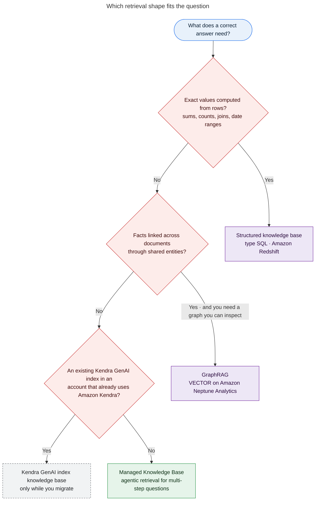
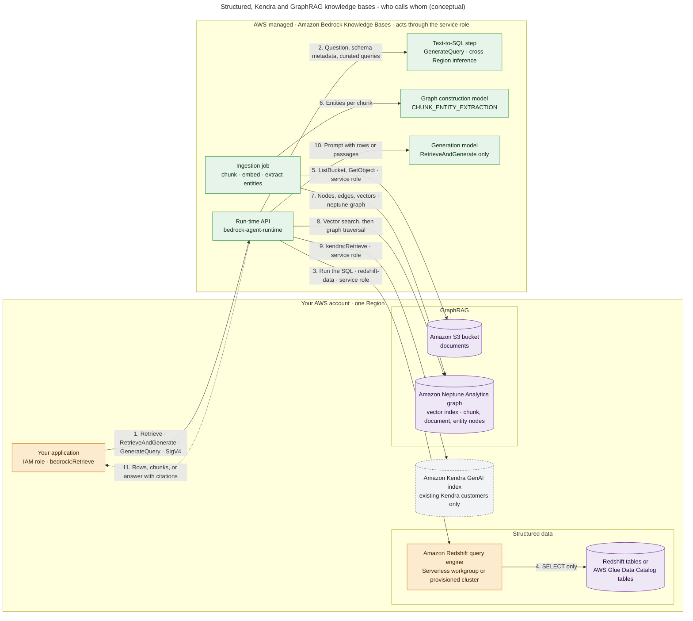
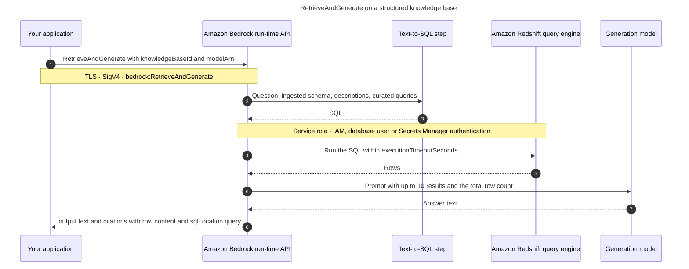
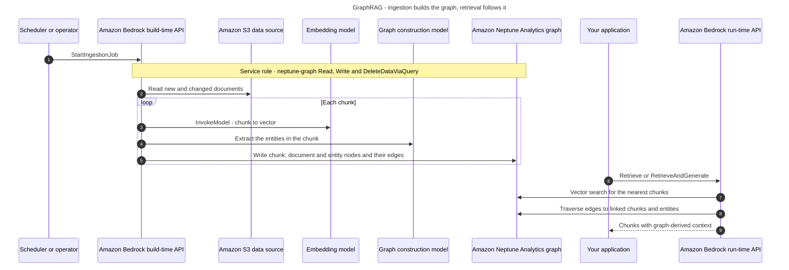

# Structured data retrieval and GraphRAG

> **Level:** Advanced · **Verified:** 2026-11-15 · **Feature status:** GA (the Amazon Kendra option sits on a service in maintenance mode) · **Time:** ~25 min

Three knowledge base shapes answer questions that a plain vector index answers badly: a
**structured knowledge base** that turns questions into SQL over Amazon Redshift, a knowledge base
over an **Amazon Kendra GenAI index**, and **GraphRAG**, a vector knowledge base stored in Amazon
Neptune Analytics that also records which entities connect which chunks. None of them exists as a
Managed Knowledge Base; all three are customer-managed types.

> [!IMPORTANT]
> **Status** — Structured data retrieval is GA (launched 2024-12-04) and offered in 16 Regions.
> GraphRAG is GA since 2025-03-07 and offered in 7 Regions. Amazon Kendra entered **maintenance
> mode on 2026-06-30** and has been **closed to new customers since 2026-07-30**; the Kendra GenAI
> index page of the Bedrock guide now opens with "we recommend Amazon Bedrock Managed Knowledge Base".
> Sources: [Structured data retrieval launch](https://aws.amazon.com/about-aws/whats-new/2024/12/amazon-bedrock-knowledge-bases-structured-data-retrieval/),
> [Supported Regions for structured data stores](https://docs.aws.amazon.com/bedrock/latest/userguide/knowledge-base-supported.html),
> [Document history](https://docs.aws.amazon.com/bedrock/latest/userguide/bedrock-ug-doc-history.html),
> [GraphRAG](https://docs.aws.amazon.com/bedrock/latest/userguide/knowledge-base-build-graphs.html),
> [Amazon Kendra availability change](https://docs.aws.amazon.com/kendra/latest/dg/kendra-availability-change.html),
> [Kendra GenAI index knowledge bases](https://docs.aws.amazon.com/bedrock/latest/userguide/knowledge-base-build-kendra-genai-index.html)

## Learning objectives

- Configure a structured knowledge base: query engine, authentication, storage and query-generation context.
- Predict what `GenerateQuery`, `Retrieve` and `RetrieveAndGenerate` return on a SQL knowledge base.
- Explain how GraphRAG builds its graph during ingestion and what the graph adds at query time.
- State what Kendra's maintenance mode means for a new design.
- Choose between these shapes, a Managed Knowledge Base and agentic retrieval for a given question.

## Prerequisites

- [Knowledge Bases overview: managed versus customer-managed](01-knowledge-bases-overview.md)
- [Customer-managed knowledge bases and vector stores](03-customer-managed-knowledge-bases.md)
- [Ingestion, parsing and chunking](04-ingestion-parsing-chunking.md)
- [Retrieval, reranking and metadata filtering](05-retrieval-reranking-filtering.md)

## 1. What it is

**Plain language.** A vector knowledge base finds *passages that sound like the question*. That is
the wrong tool for "what were total sales last month?" (the answer is a sum over rows) and a weak
tool for "which suppliers in the incident reports also appear in the audit?" (the answer lives in
the links between documents). A structured knowledge base writes and runs a database query instead.
GraphRAG keeps a map of entities next to the vectors and follows it. A Kendra knowledge base lets
Bedrock reuse a search index you already run in Amazon Kendra.

**Precisely.**

| Item | Structured (SQL) | Kendra GenAI index | GraphRAG |
|:--|:--|:--|:--|
| `knowledgeBaseConfiguration.type` | `SQL` with `sqlKnowledgeBaseConfiguration` (`type` `REDSHIFT`) | `KENDRA` with `kendraKnowledgeBaseConfiguration.kendraIndexArn` | `VECTOR`, with `storageConfiguration.type` `NEPTUNE_ANALYTICS` |
| What is ingested | Schema metadata only (data source type `REDSHIFT_METADATA`) | Nothing in Bedrock; Kendra syncs its own data sources | Documents from Amazon S3: chunks, vectors and extracted entities |
| Run-time operations | `GenerateQuery`, `Retrieve`, `RetrieveAndGenerate`, `RetrieveAndGenerateStream` | `Retrieve` (documented); see section 5 for `RetrieveAndGenerate` | `Retrieve`, `RetrieveAndGenerate`, `RetrieveAndGenerateStream` |
| Regions | 16, including AWS GovCloud (US-West) | Not listed on the Bedrock pages read | 7: `us-east-1`, `us-west-2`, `eu-central-1`, `eu-west-1`, `eu-west-2`, `ap-northeast-1`, `ap-southeast-1` |
| Endpoints | Build time `bedrock-agent` · run time `bedrock-agent-runtime` | Same | Same |
| IAM action prefix | `bedrock:` | `bedrock:` | `bedrock:` |

Sources: [Create a structured knowledge base](https://docs.aws.amazon.com/bedrock/latest/userguide/knowledge-base-structured-create.html),
[Generate a query for structured data](https://docs.aws.amazon.com/bedrock/latest/userguide/knowledge-base-generate-query.html),
[Create a Kendra GenAI index knowledge base](https://docs.aws.amazon.com/bedrock/latest/userguide/knowledge-base-kendra-genai-index-create.html),
[Create a GraphRAG knowledge base](https://docs.aws.amazon.com/bedrock/latest/userguide/knowledge-base-build-graphs-build.html).
The Region list for GraphRAG is the user guide's (Frankfurt, London, Ireland, Oregon, N. Virginia,
Tokyo, Singapore). The `REDSHIFT_METADATA` data source type comes from the `DataSourceType` enum in
the AWS SDK model and from AWS's own
[structured knowledge base sample](https://github.com/aws-samples/amazon-bedrock-samples/tree/main/rag/knowledge-bases/use-case-examples/e2e-structured-rag-using-s3-glue-bkb).

## 2. Why it exists

Embedding a table row by row produces chunks that cannot be summed, joined or filtered reliably.
Without a structured knowledge base you would write and secure your own text-to-SQL layer: schema
extraction, prompt design, query execution with a least-privilege identity and answer synthesis.
Without GraphRAG you would run an entity-extraction pipeline, model a graph, load it and write the
traversal. Kendra knowledge bases existed so that teams with a tuned Kendra index did not have to
re-ingest everything into a second store.

## 3. When to use it



**What this shows** — three questions, asked in order. Blue: start · red: decision · purple:
customer-managed shapes in this chapter · grey dashed: a path on a service closed to new customers ·
green: the default.

1. If the answer is computed from rows, a structured knowledge base runs real SQL against the data.
2. If the answer depends on relationships across documents, GraphRAG adds graph traversal to vector search.
3. A Kendra knowledge base makes sense only where the index already exists and the account is an existing Kendra customer.
4. Everything else starts on the Managed Knowledge Base.

**Variations** — a multi-step question over documents can also go to
[agentic retrieval](../agentic-retrieval/01-agentic-retrieval.md) on a managed knowledge base, which
decomposes the question instead of keeping a graph. Measure both with
[Model and RAG evaluation](../model-evaluation/01-model-evaluation.md) before you commit.

Concrete fits:

- **Structured** — analysts ask about data already in Amazon Redshift or registered in the AWS Glue Data Catalog; an agent needs a "query the warehouse" tool; you want to show users the SQL before running it (`GenerateQuery`).
- **GraphRAG** — compliance, research or incident corpora where the same people, products or suppliers recur across many documents and answers must connect them.
- **Kendra** — an existing Kendra customer bridging an application to Bedrock while it migrates.

## 4. When not to use it

- **Free-text questions over documents** — use a [Managed Knowledge Base](02-managed-knowledge-base.md); none of these shapes is offered as a managed type.
- **Data in Aurora, DynamoDB or an operational database** — the only query engine is Amazon Redshift. Move or federate the data first, or expose your own query tool to an agent.
- **Metadata filters, reranking or hybrid search on SQL results** — those query settings "are only applicable to unstructured data sources" ([Query configurations](https://docs.aws.amazon.com/bedrock/latest/userguide/kb-test-config.html)).
- **Per-user row permissions** — every query runs with one database identity (section 8).
- **GraphRAG with SharePoint, Confluence or a Custom data source** — GraphRAG supports Amazon S3 only.
- **A new design on Kendra** — new accounts cannot start using Kendra; see [Managed Knowledge Base](02-managed-knowledge-base.md).
- **Multi-hop questions on a managed knowledge base** — use [agentic retrieval](../agentic-retrieval/01-agentic-retrieval.md) instead of building a graph.

## 5. Internal architecture

AWS documents the resources, the permissions and the request and response shapes. Boxes inside the
Bedrock boundary are a conceptual model of that documented behaviour.



| Legend | Meaning |
|:--|:--|
| Solid / dashed arrow | Request or write · response |
| Cylinder | Data at rest in your account |
| Orange / green / purple / grey dashed | Your compute · Bedrock · your data · a service closed to new customers |

**What this shows** — one run-time endpoint in front of three different back ends. Everything that
holds data stays in your account; Bedrock reaches it with the knowledge base service role.

1. The application calls the same run-time API as for any knowledge base.
2. On a SQL knowledge base the question, the ingested schema and your generation context become SQL.
3. **Our reading:** the SQL runs through the Amazon Redshift Data API, because the documented service-role policy grants `redshift-data:ExecuteStatement` and the statement-result actions.
4. The database identity should hold `SELECT` only.
5. GraphRAG ingestion reads documents from Amazon S3.
6. A foundation model extracts entities from each chunk.
7. Chunks, documents and entities become linked nodes in Neptune Analytics, next to the vectors.
8. At query time a vector search finds chunks, then the graph supplies related ones.
9. A Kendra knowledge base calls the Kendra index with the service role.
10. `RetrieveAndGenerate` places rows or passages in the prompt.
11. The caller receives rows, chunks or an answer.

**Variations** — the two halves of a vector knowledge base are drawn in full in
[diagram set 6](../../diagrams/mermaid/06-knowledge-base-ingestion-pipeline.md) (ingestion) and
[diagram set 7](../../diagrams/mermaid/07-knowledge-base-retrieval-pipeline.md) (retrieval).

### Structured data: query engine and storage

| Setting | Amazon Redshift provisioned | Amazon Redshift Serverless |
|:--|:--|:--|
| `queryEngineConfiguration.type` | `PROVISIONED` + `clusterIdentifier` | `SERVERLESS` + `workgroupArn` |
| Auth `IAM` | ✅ role needs `redshift:GetClusterCredentialsWithIAM` | ✅ role needs `redshift-serverless:GetCredentials` |
| Auth `USERNAME` (temporary credentials for a database user) | ✅ `databaseUser`; role needs `redshift:GetClusterCredentials` | ❌ |
| Auth `USERNAME_PASSWORD` (AWS Secrets Manager) | ✅ `usernamePasswordSecretArn`; role needs `secretsmanager:GetSecretValue` | ✅ same |

Storage is one entry: `REDSHIFT` with a `databaseName`, or `AWS_DATA_CATALOG` with `tableNames`
(`database.table` or `database.*`). The Glue Data Catalog option supports **IAM authentication
only**, needs Glue read actions and `lakeformation:GetDataAccess` on the role, and Lake Formation
`Describe` and `Select` grants. Both engines also need the Redshift Data API statement actions,
four `sqlworkbench:` actions and `bedrock:GenerateQuery`.
Source: [Set up your query engine and permissions](https://docs.aws.amazon.com/bedrock/latest/userguide/knowledge-base-prereq-structured.html)

**Query-generation context** (`queryGenerationConfiguration`) improves the SQL; AWS calls it
"non-deterministic" and "best effort":

| Field | What it does | Limit |
|:--|:--|:--|
| `executionTimeoutSeconds` | Query time-out | 1–200 |
| `generationContext.tables` | `name` as `database.schema.table`, `description`, `inclusion` (`INCLUDE` or `EXCLUDE`), per-column `description` and `inclusion` | 0–50 tables |
| `generationContext.curatedQueries` | Example `naturalLanguage` and `sql` pairs | 0–10 |

With `INCLUDE`, every table not listed is ignored. AWS warns that inclusions and exclusions "aren't
a substitute for guardrails".
Sources: [Create a structured knowledge base](https://docs.aws.amazon.com/bedrock/latest/userguide/knowledge-base-structured-create.html),
[QueryGenerationConfiguration](https://docs.aws.amazon.com/bedrock/latest/APIReference/API_agent_QueryGenerationConfiguration.html),
[QueryGenerationContext](https://docs.aws.amazon.com/bedrock/latest/APIReference/API_agent_QueryGenerationContext.html)

**Sync.** A sync is a *metadata* ingestion: it lets Bedrock translate prompts into queries for the
database. "Whenever you make modifications to your database schema, you need to sync the changes."
Rows are never copied or embedded.
Source: [Sync your structured data store](https://docs.aws.amazon.com/bedrock/latest/userguide/kb-data-source-structured-sync-ingest.html)

### How the three operations behave on a SQL knowledge base

| Operation | What happens | What you get back |
|:--|:--|:--|
| `GenerateQuery` | Converts an **English** question into SQL; nothing runs | `queries[]`, each with `type` `REDSHIFT_SQL` and `sql` (the array may be empty) |
| `Retrieve` | Generates the SQL and runs it | `retrievalResults[]` with `content.type` `ROW`, `content.row[]` (`columnName`, `columnValue`, `type`) and `location.sqlLocation.query` |
| `RetrieveAndGenerate`, `RetrieveAndGenerateStream` | Uses `GenerateQuery`, `Retrieve` and a model call | An answer whose citations carry the rows and the SQL. Only 10 retrieved results are used for the answer; the total row count is included in the prompt |

The same 10-result limit applies to Agents Classic (`InvokeAgent`), which does not pass the total
row count. Generating SQL is billed per request, and `GenerateQuery` has a quota of 2 requests per
second. Sources: [Generate a query for structured data](https://docs.aws.amazon.com/bedrock/latest/userguide/knowledge-base-generate-query.html),
[Retrieving information from data sources](https://docs.aws.amazon.com/bedrock/latest/userguide/kb-how-retrieval.html),
[GenerateQuery](https://docs.aws.amazon.com/bedrock/latest/APIReference/API_agent-runtime_GenerateQuery.html),
[RetrieveAndGenerate](https://docs.aws.amazon.com/bedrock/latest/APIReference/API_agent-runtime_RetrieveAndGenerate.html)

### Kendra GenAI index knowledge bases

You point `kendraIndexArn` at a Kendra **GenAI Enterprise Edition** index. Through the API the index
must already exist, and data sources cannot be created with Bedrock API operations — only in the
console or with Kendra's own `CreateDataSource`. The service role needs `kendra:Retrieve` and
`kendra:DescribeIndex`. `Retrieve` returns the standard result shape plus Kendra fields such as
`x-amz-kendra-document-title` and `x-amz-kendra-score-confidence`, and Kendra document attributes
become filterable metadata. The query page documents `Retrieve` only; the `RetrieveAndGenerate`
response schema has a `kendraDocumentLocation`, and AWS's sample notebook calls it on a Kendra
knowledge base.
Sources: [Create a Kendra GenAI index knowledge base](https://docs.aws.amazon.com/bedrock/latest/userguide/knowledge-base-kendra-genai-index-create.html),
[Query a Kendra GenAI index knowledge base](https://docs.aws.amazon.com/bedrock/latest/userguide/kb-test-kendra.html),
[Service role permissions](https://docs.aws.amazon.com/bedrock/latest/userguide/kb-permissions.html),
[CreateIndex](https://docs.aws.amazon.com/kendra/latest/APIReference/API_CreateIndex.html),
[AWS sample notebook](https://github.com/aws-samples/amazon-bedrock-samples/blob/main/rag/knowledge-bases/features-examples/09-managed-index/kb_with_kendra_genai_Index.ipynb)

> [!IMPORTANT]
> **Status** — "Amazon Kendra is no longer open to new customers." During maintenance mode AWS
> fixes bugs and security issues for existing customers but builds no new features, and recommends
> migrating Kendra applications, and building new ones, on Amazon Bedrock Managed Knowledge Base.
> No end-of-support date was published on the page read.
> Source: [Amazon Kendra availability change](https://docs.aws.amazon.com/kendra/latest/dg/kendra-availability-change.html)

**What it means for a new design.** **Our reading:** an account that was not a Kendra customer by
2026-07-30 cannot create the index this knowledge base type requires, so the type is closed to it.
For an existing Kendra customer the knowledge base keeps working but will not improve; treat it as a
bridge and plan the move to a Managed Knowledge Base. Whether an existing customer can still create a
*new* Kendra knowledge base in Bedrock is **UNVERIFIED — REQUIRES DOCUMENTATION REVIEW** (register
item U3; neither the Kendra notice nor the Bedrock pages state it).

> [!WARNING]
> **Common mistake** — the Kendra migration guide shows `RetrieveAndGenerate` against a managed
> knowledge base. The `RetrieveAndGenerate` API reference says it "cannot be used with managed
> knowledge bases". Follow the API reference: use `Retrieve` or
> [`AgenticRetrieveStream`](../agentic-retrieval/01-agentic-retrieval.md).

### GraphRAG: how the graph is built and used

| Stage | What happens | Source |
|:--|:--|:--|
| Create | A Neptune Analytics graph with a vector search index (quick-create, or your own). The index can only be created with the graph; its dimension must equal the embedding model's | [Vector store prerequisites](https://docs.aws.amazon.com/bedrock/latest/userguide/knowledge-base-setup.html), [Vector indexing in Neptune Analytics](https://docs.aws.amazon.com/neptune-analytics/latest/userguide/vector-index.html) |
| Configure | The data source names a **graph construction model** in `contextEnrichmentConfiguration` (`BEDROCK_FOUNDATION_MODEL`, method `CHUNK_ENTITY_EXTRACTION`). Choosing it "automatically enables contextual enrichment" | [Create a GraphRAG knowledge base](https://docs.aws.amazon.com/bedrock/latest/userguide/knowledge-base-build-graphs-build.html) |
| Ingest | Documents are chunked and embedded; a model step (`ExtractChunkEntity`) finds the entities in each chunk; chunk, document and entity **nodes** are written with edges linking each chunk to its document and to its entities | [AWS blog: Build GraphRAG applications](https://aws.amazon.com/blogs/machine-learning/build-graphrag-applications-using-amazon-bedrock-knowledge-bases/) |
| Query | After the vector search, Bedrock fetches graph nodes or chunk identifiers linked to the hits, traverses the graph for related chunks, and uses that enriched context | [GraphRAG](https://docs.aws.amazon.com/bedrock/latest/userguide/knowledge-base-build-graphs.html) |

Documented graph construction models are Claude 3 Haiku (now Legacy), Claude Haiku 4.5 and the
Amazon Nova family; some are reachable only through cross-Region inference profiles.

**Limits.** No options to customise the graph build. No autoscaling for Neptune Analytics graphs.
Amazon S3 is the only data source. 1,000 files per data source, raisable to 10,000. With
hierarchical chunking only child chunks are returned. Deleting the knowledge base does not delete the
graph, which keeps billing.

## 6. Request and response lifecycle



1. The caller needs `bedrock:RetrieveAndGenerate`; nothing about the database is in the request.
2. SQL generation uses cross-Region inference inside your geography.
3. The SQL runs as the knowledge base's database identity, never the caller's.
4. Rows return; at most 10 reach the model.
5. The citations let you show users the exact SQL behind the answer.

**Error paths.** `ValidationException` (400) for malformed input; `AccessDeniedException` (403) for
missing caller permissions; `DependencyFailedException` (424) or `BadGatewayException` (502) when
something Bedrock calls fails; `ThrottlingException` (429) above the quota. **Our reading:** a
missing `GRANT` or an expired time-out surfaces as a dependency failure; the pages read do not map
database errors to API errors.



1. Ingestion is the normal job of [chapter 4](04-ingestion-parsing-chunking.md) with one extra model call per chunk.
2. **Our reading:** each document's nodes are replaced when it changes; AWS describes the graph as automatically created and updated but not the update mechanics.
3. Retrieval needs no new request fields; the graph step is part of the knowledge base.

## 7. Dependencies

| Depends on | Why | Required or optional |
|:--|:--|:-:|
| Amazon Redshift workgroup or cluster in a supported Region | The only query engine | Required (SQL) |
| A database user with `SELECT` grants | The identity that runs generated SQL | Required (SQL) |
| AWS Glue Data Catalog and AWS Lake Formation grants | Querying catalog tables through Redshift | Optional (SQL) |
| AWS Secrets Manager secret | `USERNAME_PASSWORD` authentication | Optional (SQL) |
| Neptune Analytics graph with a vector index | Graph and vector storage | Required (GraphRAG) |
| Embedding model and graph construction model | Vectors and entities | Required (GraphRAG) |
| An existing Kendra GenAI Enterprise Edition index | The retriever | Required (Kendra) |
| Generation model | `RetrieveAndGenerate` | Optional |

## 8. Security considerations

- **Generated SQL is untrusted code.** "Executing arbitrary SQL queries can be a security risk for any Text-to-SQL application." AWS recommends restricted roles, read-only databases and sandboxing, and says: grant `SELECT` and do not grant `CREATE`, `UPDATE` or `DELETE`.
- **One identity for every caller.** The query runs as `IAMR:<service role name>`, a database user or the secret's user. **Our reading:** row-level security keyed to the end user cannot apply, so anyone with `bedrock:Retrieve` on the knowledge base sees every table you granted. Create one knowledge base per audience with its own grants.
- **Caller permissions.** `GenerateQuery` needs `bedrock:GetKnowledgeBase`, `bedrock:GenerateQuery` and `sqlworkbench:GetSqlRecommendations`; `Retrieve` is scoped to the knowledge base ARN; `RetrieveAndGenerate` is documented on `*`.
- **Service role.** Same trust policy as [chapter 3](03-customer-managed-knowledge-bases.md). Scope `redshift-data:ExecuteStatement`, the credential action and `neptune-graph:*` statements to one workgroup, cluster or graph; scope `kendra:Retrieve` to one index.
- **Data movement.** SQL generation keeps data stored in the source Region, but prompts and outputs may be processed elsewhere in the geography. With a cross-Region graph construction profile, "data is stored only in the source Region"; the destination is used for inference only.
- **Encryption.** A Neptune Analytics graph accepts a customer managed key (`kms_key_identifier` in Terraform); Redshift and Kendra use their own encryption settings.
- **Logging.** Knowledge base log deliveries "are not supported" for a structured data store or a Kendra GenAI index. **Our reading:** audit the database's own query history and CloudTrail instead.
- **Retrieved text and rows** reach the model unscreened; see [Prompt injection, untrusted tool output and retrieval poisoning](../../06-security-governance/04-prompt-injection-and-untrusted-content.md).

Sources: [Query engine permissions](https://docs.aws.amazon.com/bedrock/latest/userguide/knowledge-base-prereq-structured.html),
[Generate a query](https://docs.aws.amazon.com/bedrock/latest/userguide/knowledge-base-generate-query.html),
[Service role](https://docs.aws.amazon.com/bedrock/latest/userguide/kb-permissions.html),
[CloudWatch Logs for knowledge bases](https://docs.aws.amazon.com/bedrock/latest/userguide/knowledge-bases-logging.html)

## 9. Networking requirements

- **Callers** use `bedrock-agent-runtime` publicly or through the interface endpoint `com.amazonaws.<region>.bedrock-agent-runtime`; see [Private connectivity for Bedrock](../../02-related-aws-services/networking/01-private-connectivity-for-bedrock.md).
- **Neptune Analytics.** "Amazon Bedrock will create a networking connection" to the graph; you configure neither public connectivity nor private endpoints for it.
- **Amazon Redshift.** AWS does not describe the network path. **Our reading:** because the documented permissions are Redshift Data API actions, Bedrock reaches the engine through that AWS API rather than a connection into your VPC. Test with your workgroup's settings before relying on it.
- **Cross-Region processing** for SQL generation and for graph construction models given as inference profiles — see [Cross-Region inference](../inference/04-cross-region-inference.md).

## 10. Pricing dimensions

| Dimension | Unit | Notes |
|:--|:--|:--|
| Structured data retrieval | Per request that generates a SQL query | Listed under self-managed knowledge bases on the pricing page |
| Amazon Redshift | Redshift's own billing | The generated SQL consumes your warehouse capacity |
| Generation | Tokens of `modelArn` | `RetrieveAndGenerate` only |
| Neptune Analytics | m-NCU per hour (1 m-NCU ≈ 1 GB memory with compute) | Billed while the graph runs |
| Embedding and graph construction | Tokens of each model | Paid again for every changed document |
| Amazon Kendra | Kendra's own billing | Not quoted here |

Sources: [Amazon Bedrock pricing](https://aws.amazon.com/bedrock/pricing/),
[Amazon Neptune pricing](https://aws.amazon.com/neptune/pricing/). No figure is quoted; confirm on
the pricing pages. Background: [Amazon Redshift, Amazon Kendra and AWS DMS](../../02-related-aws-services/databases/04-redshift-kendra-dms.md).

## 11. Scaling considerations

| Limit | Value | Source |
|:--|--:|:--|
| `GenerateQuery` requests per second | 2 | [Generate a query](https://docs.aws.amazon.com/bedrock/latest/userguide/knowledge-base-generate-query.html) |
| Results used to generate an answer (SQL) | 10 | Same |
| Query time-out | ≤ 200 s | [QueryGenerationConfiguration](https://docs.aws.amazon.com/bedrock/latest/APIReference/API_agent_QueryGenerationConfiguration.html) |
| Tables / curated queries in the context | 50 / 10 | [QueryGenerationContext](https://docs.aws.amazon.com/bedrock/latest/APIReference/API_agent_QueryGenerationContext.html) |
| GraphRAG files per data source | 1,000 (up to 10,000 on request) | [GraphRAG](https://docs.aws.amazon.com/bedrock/latest/userguide/knowledge-base-build-graphs.html) |

Neptune Analytics graphs do not autoscale: watch `GraphStorageUsagePercent` and resize before it
nears 100 ([Monitoring Neptune Analytics](https://docs.aws.amazon.com/neptune-analytics/latest/userguide/monitoring-cw.html)).
The Redshift engine's own capacity bounds SQL throughput. `Retrieve` and ingestion quotas are those
of [chapter 5](05-retrieval-reranking-filtering.md) and [chapter 4](04-ingestion-parsing-chunking.md).

## 12. IaC support

| Tool | Support | Resource / construct | Notes |
|:--|:-:|:--|:--|
| Terraform (`hashicorp/aws` 6.73.0) | ✅ | `aws_bedrockagent_knowledge_base` (`sql_knowledge_base_configuration`, `kendra_knowledge_base_configuration`, `storage_configuration.neptune_analytics_configuration`), `aws_bedrockagent_data_source` (`REDSHIFT_METADATA`; `context_enrichment_configuration`), `aws_neptunegraph_graph`, `aws_redshiftserverless_workgroup`, `aws_kendra_index` | No resource runs `GRANT` statements or starts a sync |
| CloudFormation | ✅ | `AWS::Bedrock::KnowledgeBase` (`SqlKnowledgeBaseConfiguration`, `KendraKnowledgeBaseConfiguration`, `NeptuneAnalyticsConfiguration`), `AWS::Bedrock::DataSource` (`ContextEnrichmentConfiguration`), `AWS::NeptuneGraph::Graph` | |
| AWS CDK (`aws-cdk-lib` 2.277.0) | L1 | `aws_bedrock.CfnKnowledgeBase`, `aws_bedrock.CfnDataSource`, `aws_neptunegraph.CfnGraph` | The alpha `KnowledgeBaseType` offers only `vector()` with an OpenSearch Serverless store |

Checked against [the Terraform reference](../../references/terraform-aws-provider-bedrock.md), the
provider schema and the installed CDK typings
([CDK and CloudFormation reference](../../references/cdk-and-cloudformation-bedrock.md)). See
[Terraform coverage for Amazon Bedrock](../../04-infrastructure-as-code/terraform/10-terraform-for-bedrock.md).

## 13. Working example

**A structured knowledge base over Redshift Serverless, IAM authentication, with table descriptions
and a curated query.**

> **Code status:** validated with `terraform fmt`, `terraform validate` and TFLint 0.66 (core rules) together with a `versions.tf` (`required_version = ">= 1.11.0"`, `hashicorp/aws ~> 6.73`); mock-tested with `terraform test` and `mock_provider` (2 runs, 8 assertions) · **never planned or applied against AWS**

```hcl
provider "aws" {
  region = var.region

  default_tags {
    tags = var.tags
  }
}

variable "region" {
  description = "Region for the knowledge base. It must offer structured data retrieval and contain the Redshift Serverless workgroup."
  type        = string
  default     = "us-east-1"
}

variable "name_prefix" {
  description = "Prefix for resource names."
  type        = string
  default     = "academy-sql-kb"
}

variable "workgroup_arn" {
  description = "ARN of an existing Amazon Redshift Serverless workgroup that acts as the query engine."
  type        = string
}

variable "database_name" {
  description = "Amazon Redshift database whose schema metadata the knowledge base ingests."
  type        = string
  default     = "dev"
}

variable "query_timeout_seconds" {
  description = "executionTimeoutSeconds for query generation (the API accepts 1-200)."
  type        = number
  default     = 30
}

variable "tables" {
  description = "Tables offered to SQL generation (at most 50). Names use database.schema.table. Column descriptions are optional."
  type = list(object({
    name        = string
    description = string
    columns     = map(string)
  }))
  default = [
    {
      name        = "dev.sales.orders"
      description = "One row per customer order. order_total is in euros, including VAT."
      columns = {
        order_date  = "Date the order was placed, in UTC."
        order_total = "Order value in euros, including VAT."
      }
    },
  ]
}

variable "curated_queries" {
  description = "Example question and SQL pairs that steer SQL generation (at most 10)."
  type = list(object({
    natural_language = string
    sql              = string
  }))
  default = [
    {
      natural_language = "What was the total order value last month?"
      sql              = "SELECT SUM(order_total) FROM sales.orders WHERE order_date >= DATE_TRUNC('month', CURRENT_DATE) - INTERVAL '1 month' AND order_date < DATE_TRUNC('month', CURRENT_DATE);"
    },
  ]
}

variable "tags" {
  description = "Tags applied to every resource through the provider's default_tags."
  type        = map(string)
  default     = {}
}

data "aws_caller_identity" "current" {}
data "aws_partition" "current" {}

locals {
  account_id = data.aws_caller_identity.current.account_id
  partition  = data.aws_partition.current.partition
}

# 1. Service role. Amazon Bedrock assumes it to read schema metadata, generate SQL
#    and run the SQL in Amazon Redshift. Trust is limited to this account's knowledge bases.
data "aws_iam_policy_document" "kb_trust" {
  statement {
    sid     = "AmazonBedrockKnowledgeBaseTrust"
    actions = ["sts:AssumeRole"]

    principals {
      type        = "Service"
      identifiers = ["bedrock.amazonaws.com"]
    }

    condition {
      test     = "StringEquals"
      variable = "aws:SourceAccount"
      values   = [local.account_id]
    }

    condition {
      test     = "ArnLike"
      variable = "aws:SourceArn"
      values   = ["arn:${local.partition}:bedrock:${var.region}:${local.account_id}:knowledge-base/*"]
    }
  }
}

resource "aws_iam_role" "kb" {
  name               = "${var.name_prefix}-service-role"
  assume_role_policy = data.aws_iam_policy_document.kb_trust.json
}

data "aws_iam_policy_document" "kb_permissions" {
  # Read the results of statements this role started, and nothing else.
  statement {
    sid = "RedshiftDataAPIStatementPermissions"
    actions = [
      "redshift-data:GetStatementResult",
      "redshift-data:DescribeStatement",
      "redshift-data:CancelStatement",
    ]
    resources = ["*"]

    condition {
      test     = "StringEquals"
      variable = "redshift-data:statement-owner-iam-userid"
      values   = ["$${aws:userid}"] # literal IAM policy variable, not Terraform interpolation
    }
  }

  statement {
    sid       = "RedshiftDataAPIExecutePermissions"
    actions   = ["redshift-data:ExecuteStatement"]
    resources = [var.workgroup_arn]
  }

  # IAM authentication to Redshift Serverless.
  statement {
    sid       = "RedshiftServerlessGetCredentials"
    actions   = ["redshift-serverless:GetCredentials"]
    resources = [var.workgroup_arn]
  }

  statement {
    sid = "SqlWorkbenchAccess"
    actions = [
      "sqlworkbench:GetSqlRecommendations",
      "sqlworkbench:PutSqlGenerationContext",
      "sqlworkbench:GetSqlGenerationContext",
      "sqlworkbench:DeleteSqlGenerationContext",
    ]
    resources = ["*"]
  }

  statement {
    sid       = "GenerateQueryAccess"
    actions   = ["bedrock:GenerateQuery"]
    resources = ["*"]
  }
}

resource "aws_iam_role_policy" "kb" {
  name   = "structured-knowledge-base-access"
  role   = aws_iam_role.kb.id
  policy = data.aws_iam_policy_document.kb_permissions.json
}

# 2. The structured knowledge base: type SQL, Redshift Serverless query engine,
#    IAM authentication, schema metadata read from a Redshift database.
resource "aws_bedrockagent_knowledge_base" "sql" {
  name        = "${var.name_prefix}-redshift"
  description = "Natural-language questions over Amazon Redshift tables"
  role_arn    = aws_iam_role.kb.arn

  knowledge_base_configuration {
    type = "SQL"

    sql_knowledge_base_configuration {
      type = "REDSHIFT"

      redshift_configuration {
        query_engine_configuration {
          type = "SERVERLESS"

          serverless_configuration {
            workgroup_arn = var.workgroup_arn

            auth_configuration {
              type = "IAM"
            }
          }
        }

        storage_configuration {
          type = "REDSHIFT"

          redshift_configuration {
            database_name = var.database_name
          }
        }

        query_generation_configuration {
          execution_timeout_seconds = var.query_timeout_seconds

          generation_context {
            dynamic "table" {
              for_each = var.tables

              content {
                name        = table.value.name
                description = table.value.description
                inclusion   = "INCLUDE"

                dynamic "column" {
                  for_each = table.value.columns

                  content {
                    name        = column.key
                    description = column.value
                  }
                }
              }
            }

            dynamic "curated_query" {
              for_each = var.curated_queries

              content {
                natural_language = curated_query.value.natural_language
                sql              = curated_query.value.sql
              }
            }
          }
        }
      }
    }
  }

  # The role must be able to reach the query engine before Bedrock validates it.
  depends_on = [aws_iam_role_policy.kb]
}

# 3. The data source of a structured knowledge base is the schema metadata, not rows.
#    A sync (StartIngestionJob) ingests table and column metadata; re-sync after schema changes.
resource "aws_bedrockagent_data_source" "metadata" {
  knowledge_base_id = aws_bedrockagent_knowledge_base.sql.id
  name              = "${var.name_prefix}-redshift-metadata"

  data_source_configuration {
    type = "REDSHIFT_METADATA"
  }
}

output "knowledge_base_id" {
  description = "Pass to Retrieve, RetrieveAndGenerate and StartIngestionJob."
  value       = aws_bedrockagent_knowledge_base.sql.id
}

output "knowledge_base_arn" {
  description = "Pass to GenerateQuery (textToSqlConfiguration.knowledgeBaseConfiguration.knowledgeBaseArn)."
  value       = aws_bedrockagent_knowledge_base.sql.arn
}

output "data_source_id" {
  description = "Pass to StartIngestionJob to ingest schema metadata."
  value       = aws_bedrockagent_data_source.metadata.data_source_id
}

output "database_user_to_create" {
  description = "Redshift user that IAM authentication maps the service role to. Create it and grant SELECT before the first sync."
  value       = "IAMR:${aws_iam_role.kb.name}"
}
```

Notes on the example:

- The policy statements follow the documented service-role policy. The documentation shows the `ExecuteStatement` resource for a provisioned cluster; scoping it to the workgroup ARN follows AWS's [structured knowledge base helper](https://github.com/aws-samples/amazon-bedrock-samples/blob/main/rag/knowledge-bases/features-examples/utils/structured_knowledge_base.py).
- `REDSHIFT_METADATA` with no further configuration is how that AWS helper creates the data source. Whether the provider accepts it at apply time is untested here.
- `inclusion = "INCLUDE"` limits SQL generation to the tables you list.
- Nothing is queryable until the database user exists, holds `SELECT`, and a sync has completed.

**Run once in Amazon Redshift query editor v2, before the first sync** (statements from the
prerequisites page; replace the placeholders):

> **Code status:** illustrative · copied from the documentation · **never run**

```sql
CREATE USER "IAMR:academy-sql-kb-service-role" WITH PASSWORD DISABLE;
GRANT USAGE ON SCHEMA sales TO "IAMR:academy-sql-kb-service-role";
GRANT SELECT ON sales.orders TO "IAMR:academy-sql-kb-service-role";
```

**Show the SQL, then fetch the rows.**

> **Code status:** syntax-checked (`python -m py_compile`) · run against `botocore.stub.Stubber` with boto3/botocore 1.44.3 (request and response shapes validated against the SDK model) · **never run against AWS**

```python
"""Ask a structured (SQL) knowledge base: show the SQL first, then fetch the rows."""
import os

import boto3

REGION = os.environ.get("AWS_REGION", "us-east-1")
KB_ID = os.environ["KNOWLEDGE_BASE_ID"]
KB_ARN = os.environ["KNOWLEDGE_BASE_ARN"]

runtime = boto3.client("bedrock-agent-runtime", region_name=REGION)


def generate_sql(question: str) -> str:
    """GenerateQuery: natural language (English) to SQL. Nothing is executed."""
    response = runtime.generate_query(
        queryGenerationInput={"type": "TEXT", "text": question},
        transformationConfiguration={
            "mode": "TEXT_TO_SQL",
            "textToSqlConfiguration": {
                "type": "KNOWLEDGE_BASE",
                "knowledgeBaseConfiguration": {"knowledgeBaseArn": KB_ARN},
            },
        },
    )
    queries = response["queries"]  # may be empty
    return queries[0]["sql"] if queries else ""


def retrieve_rows(question: str) -> list[dict]:
    """Retrieve: Bedrock generates the SQL, runs it in Redshift and returns rows."""
    response = runtime.retrieve(
        knowledgeBaseId=KB_ID,
        retrievalQuery={"text": question},
    )
    rows = []
    for result in response["retrievalResults"]:
        content = result["content"]
        if content.get("type") != "ROW":
            continue
        rows.append(
            {
                "values": {col["columnName"]: col.get("columnValue") for col in content.get("row", [])},
                "sql": result.get("location", {}).get("sqlLocation", {}).get("query"),
            }
        )
    return rows


if __name__ == "__main__":
    QUESTION = "What was the total order value last month?"
    print("Generated SQL:", generate_sql(QUESTION))
    for row in retrieve_rows(QUESTION):
        print(row["values"], "<-", row["sql"])
```

No `retrievalConfiguration` is sent: filters, search type and reranking do not apply to structured
data. Start the metadata sync with the script in [chapter 4](04-ingestion-parsing-chunking.md).

> [!CAUTION]
> **Cost hazard** — in your own sandbox, every question is a billed SQL generation request plus
> Redshift compute, and `RetrieveAndGenerate` adds model tokens. A GraphRAG graph bills per m-NCU-hour
> until you delete it — and deleting the knowledge base does not delete it. Destroy what you create.

> [!TIP]
> **Academy recommendation** — Point a structured knowledge base at a dedicated read-only schema of
> views, not at base tables. You decide exactly which columns exist, the descriptions stay accurate,
> and a bad query cannot touch anything else.
> This is our design guidance, not an official AWS reference architecture.

## Common mistakes

| Mistake | Symptom | Fix |
|:--|:--|:--|
| Syncing before creating the `IAMR:` user and granting `SELECT` | The sync fails | Run the SQL above first, then sync |
| Granting more than `SELECT` | Generated SQL could modify data | `SELECT` (and `USAGE` on the schema) only |
| Changing the schema without a sync | SQL refers to old columns | Sync after every schema change |
| Non-English questions to `GenerateQuery` | Poor or empty SQL | Queries "must be written in English" |
| Graph construction model given as a plain model ARN when it is profile-only | `ValidationException: Invalid graph bedrock foundation model provided` (provider docs) | Use an inference profile ARN; grant the role `bedrock:GetInferenceProfile` on `*` and `bedrock:InvokeModel` on the profile and its Regional models |
| Neptune vector dimension differs from the embedding model's | Creation or first sync fails | Choose the model first; the index dimension is fixed at graph creation |
| Copying Claude 3 Haiku from an older GraphRAG example | Model is Legacy | Pick a current model from the model lifecycle page |
| Deleting the knowledge base and forgetting the graph | Neptune Analytics keeps billing | Delete the knowledge base, then the graph |
| Planning a Kendra knowledge base in a new account | Kendra is closed to new customers | Use a Managed Knowledge Base |

The GraphRAG permission row comes from the
[Terraform provider documentation](https://raw.githubusercontent.com/hashicorp/terraform-provider-aws/main/website/docs/r/bedrockagent_data_source.html.markdown);
the AWS pages read say only that the console adds the required permissions.

## Knowledge check

1. A sales manager asks "how many orders over €1,000 did we take in March?". Why does a vector knowledge base built from CSV exports fail, and what does a structured knowledge base do instead?
2. You send `numberOfResults = 50` and a metadata filter to `Retrieve` on a SQL knowledge base. What happens to those settings?
3. Your `RetrieveAndGenerate` answer quotes 10 customers, but the query matched 4,000 rows. Is the answer necessarily wrong?
4. What three node types does GraphRAG create, and what does the graph add after the vector search?
5. A team in an account opened in September 2026 wants to reuse a colleague's Kendra design. What do you tell them?

<details>
<summary>Answers</summary>

1. Embeddings find similar text, not sums or filters over all rows; the top chunks are a sample. A structured knowledge base generates SQL from the schema, runs it in Amazon Redshift, and returns or summarises the exact result.
2. Filters, search type, number of results and reranking "are only applicable to unstructured data sources"; on a SQL knowledge base the question becomes SQL and those settings do not shape the result.
3. Not necessarily. Only 10 retrieved results are used for generation, but `RetrieveAndGenerate` includes the total row count in the prompt. Check the cited SQL; for full results call `Retrieve` and page through the rows.
4. Chunk, document and entity nodes, linked by edges. After the vector search, Bedrock follows the edges from the matched chunks to related chunks and entities and adds that context.
5. Kendra has been closed to new customers since 2026-07-30, so the account cannot create the Kendra GenAI index the knowledge base needs. Build on a Managed Knowledge Base, which AWS recommends for new search applications.

</details>

## 14. Official documentation

- [Build a knowledge base by connecting to a structured data store](https://docs.aws.amazon.com/bedrock/latest/userguide/knowledge-base-build-structured.html) — what structured retrieval does.
- [Set up your query engine and permissions](https://docs.aws.amazon.com/bedrock/latest/userguide/knowledge-base-prereq-structured.html) — authentication methods, role policies, `GRANT` statements, Glue and Lake Formation.
- [Create a knowledge base connected to a structured data store](https://docs.aws.amazon.com/bedrock/latest/userguide/knowledge-base-structured-create.html) — request shapes and query-generation context.
- [Sync your structured data store](https://docs.aws.amazon.com/bedrock/latest/userguide/kb-data-source-structured-sync-ingest.html) — metadata ingestion and schema changes.
- [Generate a query for structured data](https://docs.aws.amazon.com/bedrock/latest/userguide/knowledge-base-generate-query.html) — `GenerateQuery`, cross-Region inference, the 10-result rule, the quota and caller permissions.
- [Retrieving information from data sources](https://docs.aws.amazon.com/bedrock/latest/userguide/kb-how-retrieval.html) — `RetrieveAndGenerate` uses `GenerateQuery` underneath.
- [Supported models and Regions for knowledge bases](https://docs.aws.amazon.com/bedrock/latest/userguide/knowledge-base-supported.html) — the 16 structured-data Regions.
- API reference: [GenerateQuery](https://docs.aws.amazon.com/bedrock/latest/APIReference/API_agent-runtime_GenerateQuery.html), [RetrieveAndGenerate](https://docs.aws.amazon.com/bedrock/latest/APIReference/API_agent-runtime_RetrieveAndGenerate.html), [QueryGenerationConfiguration](https://docs.aws.amazon.com/bedrock/latest/APIReference/API_agent_QueryGenerationConfiguration.html), [QueryGenerationContext](https://docs.aws.amazon.com/bedrock/latest/APIReference/API_agent_QueryGenerationContext.html).
- [Build a knowledge base with Amazon Neptune Analytics graphs](https://docs.aws.amazon.com/bedrock/latest/userguide/knowledge-base-build-graphs.html) and [Create it](https://docs.aws.amazon.com/bedrock/latest/userguide/knowledge-base-build-graphs-build.html) — Regions, how GraphRAG works, limits, graph construction models.
- [Prerequisites for a vector store you created](https://docs.aws.amazon.com/bedrock/latest/userguide/knowledge-base-setup.html) and [Vector indexing in Neptune Analytics](https://docs.aws.amazon.com/neptune-analytics/latest/userguide/vector-index.html) — graph and vector index set-up.
- [AWS blog: Build GraphRAG applications using Amazon Bedrock Knowledge Bases](https://aws.amazon.com/blogs/machine-learning/build-graphrag-applications-using-amazon-bedrock-knowledge-bases/) — how the graph is constructed.
- [Build a knowledge base with a Kendra GenAI index](https://docs.aws.amazon.com/bedrock/latest/userguide/knowledge-base-build-kendra-genai-index.html), [Create it](https://docs.aws.amazon.com/bedrock/latest/userguide/knowledge-base-kendra-genai-index-create.html), [Query it](https://docs.aws.amazon.com/bedrock/latest/userguide/kb-test-kendra.html).
- [Amazon Kendra availability change](https://docs.aws.amazon.com/kendra/latest/dg/kendra-availability-change.html) and [AWS service availability updates](https://aws.amazon.com/about-aws/whats-new/2026/06/aws-service-availability/) — maintenance mode and migration guidance.
- [Create a service role for Knowledge Bases](https://docs.aws.amazon.com/bedrock/latest/userguide/kb-permissions.html) — Kendra and Neptune Analytics permission blocks.
- [Configure and customize queries](https://docs.aws.amazon.com/bedrock/latest/userguide/kb-test-config.html) — which settings apply to unstructured data only; filter support on Neptune Analytics.
- [Monitor knowledge bases using CloudWatch Logs](https://docs.aws.amazon.com/bedrock/latest/userguide/knowledge-bases-logging.html) — log delivery not supported for structured and Kendra knowledge bases.
- [Amazon Bedrock pricing](https://aws.amazon.com/bedrock/pricing/) and [Amazon Neptune pricing](https://aws.amazon.com/neptune/pricing/).
- Terraform: [`aws_bedrockagent_knowledge_base`](https://raw.githubusercontent.com/hashicorp/terraform-provider-aws/main/website/docs/r/bedrockagent_knowledge_base.html.markdown), [`aws_bedrockagent_data_source`](https://raw.githubusercontent.com/hashicorp/terraform-provider-aws/main/website/docs/r/bedrockagent_data_source.html.markdown).
- [Feature verification matrix](../../FEATURE-VERIFICATION.md) — the academy's register rows for these features.
