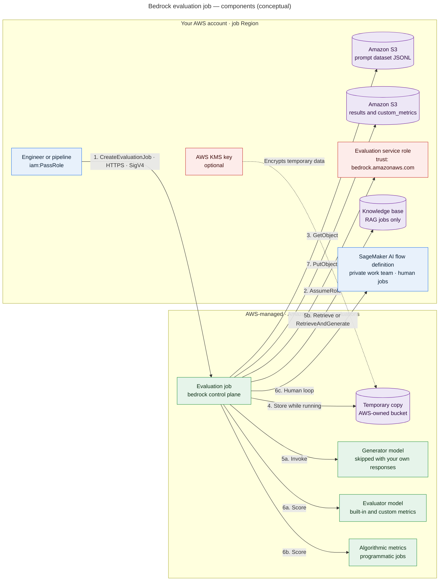
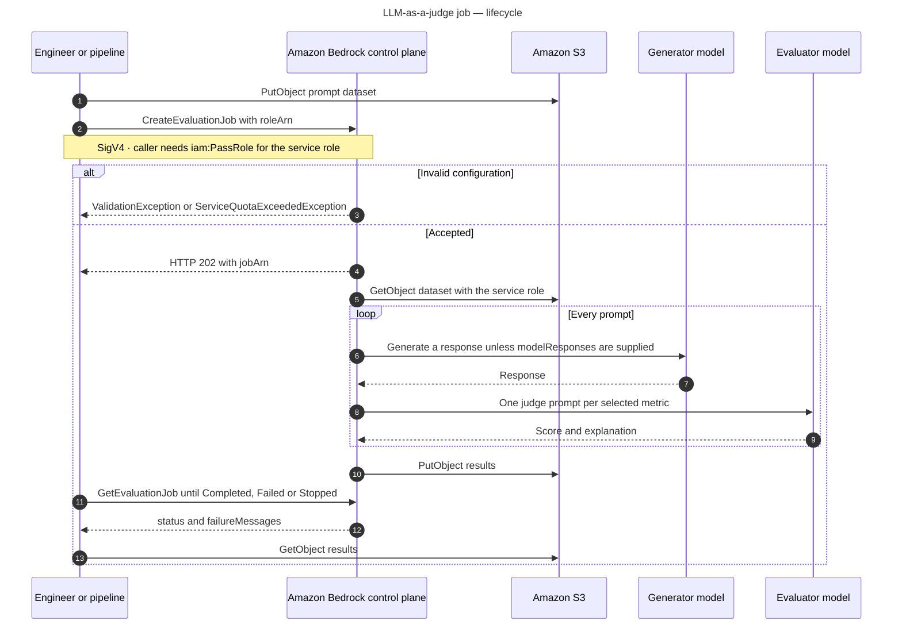

# Model and RAG evaluation

> **Level:** Intermediate · **Verified:** 2026-11-15 · **Feature status:** GA · **Time:** ~25 min

Amazon Bedrock evaluations are asynchronous jobs that score a model, a knowledge base or responses you
produced elsewhere against a prompt dataset in Amazon S3, and write a report back to S3. They are the
offline release gate described in
[Model evaluation and model selection](../../00-foundations/generative-ai-fundamentals/07-model-evaluation-and-selection.md);
this chapter is about running that gate on AWS.

> [!IMPORTANT]
> **Status** — GA. The document history has no dated 2026 entry for evaluations (register item U5), but
> the current pages list newer judge models (for example `openai.gpt-5.5` and `anthropic.claude-opus-4-8`)
> and accept generator models called through the OpenAI Responses API on `bedrock-mantle` — API and CLI
> only, not the console. No feature-level Region list exists; the user guide's Region page now points to
> per-model availability.
> Sources: [LLM as a judge](https://docs.aws.amazon.com/bedrock/latest/userguide/evaluation-judge.html),
> [Start an automatic job](https://docs.aws.amazon.com/bedrock/latest/userguide/model-evaluation-jobs-management-create.html),
> [Feature support by Region](https://docs.aws.amazon.com/bedrock/latest/userguide/features-regions.html)

## Learning objectives

- Choose the right job type: programmatic, LLM-as-a-judge, human, RAG retrieve-only or retrieve-and-generate.
- Prepare a prompt dataset in the format each job type expects, including bring-your-own responses.
- Name the documented metrics correctly and write a custom judge metric with a rating scale.
- Configure the service role, S3 locations and KMS key, and find the results.
- Create a judge job with Terraform and gate a pipeline on its scores.

## Prerequisites

- [Model evaluation and model selection](../../00-foundations/generative-ai-fundamentals/07-model-evaluation-and-selection.md) — the concepts this chapter assumes.
- [Model lifecycle and selection](../foundation-models/02-model-lifecycle-and-selection.md) — where evaluation fits in a model choice.
- [IAM roles, trust policies and cross-account access](../../00-foundations/security/02-iam-roles-and-trust.md)
- [Knowledge Bases overview: managed versus customer-managed](../knowledge-bases/01-knowledge-bases-overview.md) — for RAG evaluation.

## 1. What it is

**Plain language.** You give Bedrock a list of questions (and, ideally, the answers you expect), say
what to test and how to mark it. Bedrock runs the questions, marks every answer — with formulas, with a
second "judge" model, or with your reviewers — and leaves a report card and the raw marks in your bucket.

**Precisely.** One control-plane resource, the *evaluation job*, created with `CreateEvaluationJob`.
Its `evaluationConfig` is either `automated` or `human`; its `inferenceConfig` is either `models` (model
evaluation) or `ragConfigs` (RAG evaluation); `applicationType` is `ModelEvaluation` or `RagEvaluation`.

| Item | Value |
|:--|:--|
| Service namespace / endpoint | `bedrock` (control plane) |
| Control-plane operations | `CreateEvaluationJob`, `GetEvaluationJob`, `ListEvaluationJobs`, `StopEvaluationJob`, `BatchDeleteEvaluationJob` |
| Data-plane operations | None of its own; the job invokes models and knowledge bases with your service role |
| IAM action prefix | `bedrock:` — resource `arn:aws:bedrock:<region>:<account-id>:evaluation-job/<id>` |

### Job types

| Job type | `evaluationConfig` | `inferenceConfig` | Who scores | Inference sources per job |
|:--|:--|:--|:--|:-:|
| Programmatic (automatic) | `automated` with built-in or custom dataset | `models` | Algorithms, no judge | 1 |
| LLM-as-a-judge | `automated` + `evaluatorModelConfig` | `models` | One evaluator model | 1 |
| Human | `human` + SageMaker AI flow definition | `models` | Your work team | Up to 2 |
| RAG, retrieve only | `automated` + evaluator | `ragConfigs` → `retrieveConfig` | Evaluator model | 1 knowledge base |
| RAG, retrieve and generate | `automated` + evaluator | `ragConfigs` → `retrieveAndGenerateConfig` | Evaluator model | 1 knowledge base + generator |
| Bring your own responses | Any of the above | `precomputedInferenceSource` or `precomputedRagSourceConfig` | As above | Responses are read from the dataset |

With your own responses "Amazon Bedrock skips the model invoke step" — the way to score anything that
runs outside Bedrock. Bedrock generators can be foundation, Marketplace, customized and imported models,
prompt routers, Provisioned Throughput and Responses API models.

### Metrics — names as documented

| Job type | `metricNames` values |
|:--|:--|
| Programmatic | `Builtin.Accuracy`, `Builtin.Robustness`, `Builtin.Toxicity` (computed per task type: BERTScore, NLP-F1, word error rate and others) |
| LLM-as-a-judge | `Builtin.Correctness`, `Builtin.Completeness`, `Builtin.Faithfulness`, `Builtin.Helpfulness`, `Builtin.Coherence`, `Builtin.Relevance`, `Builtin.FollowingInstructions`, `Builtin.ProfessionalStyleAndTone`, `Builtin.Harmfulness`, `Builtin.Stereotyping`, `Builtin.Refusal` |
| RAG, retrieve only | `Builtin.ContextRelevance`, `Builtin.ContextCoverage` (needs ground truth) |
| RAG, retrieve and generate | `Builtin.Correctness`, `Builtin.Completeness`, `Builtin.Helpfulness`, `Builtin.LogicalCoherence`, `Builtin.Faithfulness`, `Builtin.CitationPrecision`, `Builtin.CitationCoverage`, `Builtin.Harmfulness`, `Builtin.Stereotyping`, `Builtin.Refusal` |
| Human | The `name` of each custom metric; rating methods `ThumbsUpDown`, `IndividualLikertScale`, `ComparisonLikertScale`, `ComparisonChoice`, `ComparisonRank` |
| Built-in datasets (programmatic, 100 prompts each) | `Builtin.Bold`, `Builtin.BoolQ`, `Builtin.NaturalQuestions`, `Builtin.Gigaword`, `Builtin.RealToxicityPrompts`, `Builtin.TriviaQA`, `Builtin.T-Rex`, `Builtin.WomensEcommerceClothingReviews`, `Builtin.Wikitext2` |
| Task types (`taskType`) | `Summarization`, `Classification`, `QuestionAndAnswer`, `Generation`, `Custom` |

> [!WARNING]
> **Common mistake** — logical coherence is `Builtin.Coherence` in a model job but
> `Builtin.LogicalCoherence` in a RAG job. Copy names from the table for the job type you run.

### Custom metrics

| Part | Rule |
|:--|:--|
| Number | Up to 10 per judge or RAG job |
| `name` | Also listed in `metricNames`; documented as unique in your Region |
| `instructions` | The judge prompt, at most 5,000 characters; input variables go **last** |
| Variables, model jobs | `{{prompt}}`, `{{prediction}}`, `{{ground_truth}}` |
| Variables, RAG jobs | `{{context}}` (required for retrieve-only), `{{prediction}}` (required for retrieve-and-generate), `{{prompt}}`, `{{ground_truth}}`, `{{reference_contexts}}` |
| `ratingScale` | Optional, 1–10 entries, all numbers or all strings; definitions of at most 100 characters. Without it you get explanations but no averages or charts |
| Judge | Its own `evaluatorModelConfig`, chosen from a separate supported-model list |

Sources: [Evaluations](https://docs.aws.amazon.com/bedrock/latest/userguide/evaluation.html),
[Task types](https://docs.aws.amazon.com/bedrock/latest/userguide/model-evaluation-tasks.html),
[Judge metrics](https://docs.aws.amazon.com/bedrock/latest/userguide/model-evaluation-metrics.html),
[RAG metrics](https://docs.aws.amazon.com/bedrock/latest/userguide/knowledge-base-evaluation-metrics.html),
[Custom metric prompts](https://docs.aws.amazon.com/bedrock/latest/userguide/model-evaluation-custom-metrics-prompt-formats.html),
[RAG custom metric prompts](https://docs.aws.amazon.com/bedrock/latest/userguide/kb-evaluation-custom-metrics-prompt-formats.html),
[CLI reference](https://docs.aws.amazon.com/cli/latest/reference/bedrock/create-evaluation-job.html)

## 2. Why it exists

Without it you would build a harness: run every prompt against every candidate, call a judge with a
versioned rubric for every metric, collect human ratings in a labelling tool, store per-record evidence
and draw comparisons. Evaluation jobs give you that harness with published judge prompts, a console
report card, and a **Compare** view for two finished jobs.

## 3. When to use it

- Choosing between models, or checking a forced migration from a Legacy model, on your own prompts.
- Proving that a prompt, inference-parameter or knowledge-base change did not regress quality.
- Comparing two knowledge-base configurations (chunking, embedding model, number of results) on the same questions.
- Scoring a model or RAG system that runs outside Bedrock, by bringing its responses.
- Collecting expert ratings for tone or domain correctness, and calibrating a judge against them.

## 4. When not to use it

| Situation | Better choice |
|:--|:--|
| Scoring agent sessions, tool calls and traces, online or in batch | AgentCore Evaluations — [AgentCore Evaluations and Optimization](../agentcore/10-agentcore-evaluations-and-optimization.md) |
| Rewriting a prompt until it scores better | Advanced Prompt Optimization — [Prompt optimization](../prompt-management/02-prompt-optimization.md) |
| Monitoring live production traffic | [Model quality evaluation in production](../../09-advanced-topics/13-model-quality-evaluation.md) |
| Blocking a harmful response at request time | [Amazon Bedrock Guardrails](../guardrails/01-guardrails.md) — evaluation measures, it does not block |
| More than 1,000 prompts per run | Split the dataset across jobs, or batch inference plus your own scoring ([Batch inference](../inference/08-batch-inference.md)) |

| | Bedrock evaluation jobs | AgentCore Evaluations | Advanced Prompt Optimization |
|:--|:--|:--|:--|
| Unit scored | One prompt–response (or RAG turn) | Agent sessions, traces and spans | A prompt template per target model |
| Input | JSONL prompt dataset in S3 | OpenTelemetry traces from your agent | JSONL templates and samples in S3 |
| Mode | Offline jobs | Online, on-demand and batch | Offline job with a rewrite loop |
| Output | Scores and explanations | Scores per evaluator | A rewritten prompt plus scores |
| API | `bedrock`: `CreateEvaluationJob` | `bedrock-agentcore`: `Evaluate`, `StartBatchEvaluation`; `bedrock-agentcore-control`: `CreateEvaluator`, `CreateOnlineEvaluationConfig` | `bedrock`: `CreateAdvancedPromptOptimizationJob` |
| Acts as | A service role you pass | — | Your calling identity |

Sources: [AgentCore Evaluations](https://docs.aws.amazon.com/bedrock-agentcore/latest/devguide/evaluations.html),
[Feature verification matrix](../../FEATURE-VERIFICATION.md), [Prompt optimization](../prompt-management/02-prompt-optimization.md)

> [!WARNING]
> **Managed Knowledge Base** — `retrieveConfig` carries only `vectorSearchConfiguration`, and a Managed
> Knowledge Base expects `managedSearchConfiguration` and does not support `RetrieveAndGenerate`. Whether a
> knowledge-base-backed RAG job works against a Managed Knowledge Base is
> **UNVERIFIED — REQUIRES DOCUMENTATION REVIEW**: the user guide is silent and an AWS sample notebook
> says "Retrieval only". Bringing your own responses works for any source.
> Sources: [Query a knowledge base](https://docs.aws.amazon.com/bedrock/latest/userguide/kb-test-retrieve.html),
> [AWS sample notebook](https://github.com/aws-samples/amazon-bedrock-samples/blob/main/rag/managed-knowledge-bases/02-feature-examples/04-rag-evaluation/02-ragas-evaluation.ipynb)

## 5. Internal architecture

AWS documents the inputs, the roles and the outputs. What happens between them is a conceptual model.



**What this shows** — the job acts through a **service role** you pass, not your own identity (unlike
Advanced Prompt Optimization). While it runs, Bedrock keeps "a temporary copy of your data" in an
AWS-owned bucket and deletes it afterwards.

1. The caller creates the job and passes the role.
2. Bedrock assumes the role, limited by the trust policy to `evaluation-job/*` in your account.
3. The dataset is read from a bucket "in the same AWS Region".
4. The temporary copy is encrypted with an AWS owned key or your KMS key.
5. Responses come from the generator (a) or knowledge base (b), unless you supplied them.
6. Scores come from the evaluator model (a), algorithms (b) or your reviewers (c).
7. Results and custom-metric definitions are written to your output location.

**Legend** — solid arrow: request or write · dashed arrow: key use · cylinder: data at rest · red:
security control · green: managed Bedrock component · blue: people and callers.

**Our reading:** the documented role policies include `bedrock:CreateModelInvocationJob` and
`bedrock:StopModelInvocationJob`, so the service can run inference as batch jobs on your behalf; AWS
does not say when.

### Prompt datasets

| Job type | One JSONL line contains | Bring your own responses |
|:--|:--|:--|
| Programmatic, judge, human | `prompt`, optional `referenceResponse` and `category` (programmatic accuracy and robustness need `referenceResponse`) | `modelResponses` with `response` and `modelIdentifier`: exactly one per line for judge jobs; one or two for human jobs |
| RAG, retrieve only | `conversationTurns[]` with `prompt.content[].text` and `referenceResponses` | `output.knowledgeBaseIdentifier` and `output.retrievedResults.retrievalResults[]` |
| RAG, retrieve and generate | As above | `output.text`, `output.knowledgeBaseIdentifier`, `output.retrievedPassages.retrievalResults[]`, optional `modelIdentifier` and `citations` |

`referenceResponses` holds the expected **final answer**; expected chunks go in `referenceContexts`,
which only custom metrics read. Note `retrievedResults` versus `retrievedPassages`.

### Where results land

| Job | Output path |
|:--|:--|
| Automated (programmatic, judge, RAG) | `<output>/<job-name>/<job-uuid>/models/<model-id>/taskTypes/<task-type>/datasets/<dataset>/<file-uuid>_output.jsonl` |
| Human | `<output>/<job-name>/<job-uuid>/datasets/<dataset-name>/<file-uuid>_output.jsonl` |
| Custom metric definitions | `<output>/<job-name>/<job-uuid>/custom_metrics` |

Each automated record carries `automatedEvaluationResult.scores[]` (`metricName`, `result`),
`inputRecord` and `modelResponses`. RAG scores lie between 0 and 1, "the closer to 1, the more that
metric's characteristic appears" — so lower is better for Harmfulness, Stereotyping and Refusal.

Sources: [Judge datasets](https://docs.aws.amazon.com/bedrock/latest/userguide/model-evaluation-prompt-datasets-judge.html),
[Human datasets](https://docs.aws.amazon.com/bedrock/latest/userguide/model-evaluation-prompt-datasets-custom-human.html),
[Retrieve-only datasets](https://docs.aws.amazon.com/bedrock/latest/userguide/knowledge-base-evaluation-prompt-retrieve.html),
[Retrieve-and-generate datasets](https://docs.aws.amazon.com/bedrock/latest/userguide/knowledge-base-evaluation-prompt-retrieve-generate.html),
[Results in S3](https://docs.aws.amazon.com/bedrock/latest/userguide/model-evaluation-report-s3.html),
[RAG report card](https://docs.aws.amazon.com/bedrock/latest/userguide/knowledge-base-eval-llm-results.html),
[Data management and encryption](https://docs.aws.amazon.com/bedrock/latest/userguide/evaluation-data-management.html)

## 6. Request and response lifecycle



- **Steps 1–3** — creation can fail with validation, quota, conflict, not-found, access-denied or
  throttling errors.
- **Steps 4–10** — generator and judge must be "available in the same AWS Region"; cross-Region
  inference profiles are accepted for the listed judges. **Our reading:** service-role permission
  problems (S3, models, key) surface later, as a failed job with `failureMessages`.
- **Steps 11–14** — status goes from InProgress to Completed, Failed or Stopped. An AWS blog puts a
  small RAG job at 10–15 minutes and a large one at "a few hours": poll.
- **Afterwards** — Compare two finished jobs in the console (radar chart, per-metric differences).
  Completed, failed or stopped jobs can be deleted, 25 per `BatchDeleteEvaluationJob` call; S3 results stay.

Sources: [CreateEvaluationJob](https://docs.aws.amazon.com/bedrock/latest/APIReference/API_CreateEvaluationJob.html),
[Create a judge job](https://docs.aws.amazon.com/bedrock/latest/userguide/model-evaluation-judge-create.html),
[Delete a job](https://docs.aws.amazon.com/bedrock/latest/userguide/model-evaluation-jobs-management-delete.html),
[Evaluating RAG applications (AWS blog)](https://aws.amazon.com/blogs/machine-learning/evaluating-rag-applications-with-amazon-bedrock-knowledge-base-evaluation/),
[Amazon Bedrock Evaluations](https://aws.amazon.com/bedrock/evaluations/)

## 7. Dependencies

| Depends on | Why | Required or optional |
|:--|:--|:-:|
| Amazon S3 bucket in the job's Region | Dataset and results | Required |
| Evaluation service role | Bedrock acts through it | Required |
| Access to the generator and evaluator models in that Region | Inference and scoring | Required (generator optional with your own responses) |
| Knowledge base | RAG jobs that query Bedrock | Optional |
| Amazon SageMaker AI flow definition and private work team | Human jobs; created for you in the console, by you for the API | Optional |
| AWS KMS customer managed key | Encrypt the job's temporary data | Optional |

## 8. Security considerations

| Control | What the documentation requires or warns |
|:--|:--|
| Service role trust | `bedrock.amazonaws.com`, with `aws:SourceAccount` and `aws:SourceArn` = `arn:aws:bedrock:<region>:<account>:evaluation-job/*` |
| Service role permissions | `s3:GetObject` on the dataset, `s3:PutObject` on the output prefix, invoke rights on generator and judge; RAG jobs add `bedrock:Retrieve` and `bedrock:RetrieveAndGenerate` on one knowledge base; human jobs add `sagemaker:StartHumanLoop` and related actions, plus a second role for the flow definition |
| `iam:PassRole` | A user who cannot invoke a model but can pass a role that can will get it invoked on their behalf. Limit `iam:PassRole` to named roles with `iam:PassedToService` |
| Customer managed key | `customerEncryptionKeyId`. The key policy allows `bedrock.amazonaws.com` `kms:GenerateDataKey`, `kms:Decrypt`, `kms:DescribeKey`, conditioned on `kms:EncryptionContext:evaluationJobArn` and `aws:SourceArn`; the creating identity needs the same three actions |
| Who sees the data | The judge model; in human jobs, people — workers "may be shown toxic or offensive material". Console-created human jobs need a CORS rule on the output bucket for the worker portal |

Treat datasets as production data — see
[Data protection, privacy and data leakage prevention](../../06-security-governance/03-data-protection-and-privacy.md).

Sources: [Judge service role](https://docs.aws.amazon.com/bedrock/latest/userguide/judge-service-roles.html),
[RAG service role](https://docs.aws.amazon.com/bedrock/latest/userguide/rag-eval-service-roles.html),
[Human service roles](https://docs.aws.amazon.com/bedrock/latest/userguide/model-eval-service-roles.html),
[Service roles and PassRole](https://docs.aws.amazon.com/bedrock/latest/userguide/security-iam-sr.html),
[KMS key policy](https://docs.aws.amazon.com/bedrock/latest/userguide/model-evaluation-security-kms.html),
[CORS](https://docs.aws.amazon.com/bedrock/latest/userguide/model-evaluation-security-cors.html)

## 9. Networking requirements

You call the `bedrock` control-plane endpoint, publicly or through an interface endpoint
([VPC endpoints and AWS PrivateLink](../../00-foundations/networking/03-vpc-endpoints-and-privatelink.md)).
The job runs inside AWS with the service role; the API has no VPC settings. With a cross-Region
inference profile as generator or judge, prompts can be processed in any Region the profile routes to
([Cross-Region inference](../inference/04-cross-region-inference.md)).

**Our reading:** a bucket policy that admits only requests through your VPC endpoint
(`aws:SourceVpce`) also shuts out the job's service role.

## 10. Pricing dimensions

| Dimension | Unit | Notes |
|:--|:--|:--|
| Generator inference | Tokens of the model under test | Not incurred with your own responses |
| Judge inference | Tokens, at on-demand Standard tier prices | Judge prompts are published and count as input tokens, per metric |
| Algorithmic scores | — | "Provided at no extra charge" |
| Human tasks | $0.21 per completed task | One task = one worker rating one prompt and its responses; read 2026-11-15 |
| Knowledge base usage | Regular knowledge-base charges | RAG jobs that query a Bedrock knowledge base |

The pricing page's example: 50 prompts × 2 workers = 100 tasks = $21.00 plus inference. Judge cost grows
with prompts × metrics, because each metric is its own judge prompt.
Source: [Amazon Bedrock pricing](https://aws.amazon.com/bedrock/pricing/) (Model Evaluation section)

## 11. Scaling considerations

| Quota (per account and Region) | Value | Adjustable |
|:--|--:|:-:|
| Concurrent automatic model evaluation jobs | 20 | No |
| Concurrent jobs that use human workers | 10 | No |
| Evaluation jobs (total) | 5,000 | No |
| Prompts in a custom prompt dataset | 1,000 | No |
| Size of one prompt | 4 KB | No |
| Datasets per automated job | 5 | No |
| Metrics per dataset, automated job | 3 | No |
| Models: automated job / human job | 1 / 2 | No |
| Custom metrics in a human job (judge jobs: also 10, per the user guide) | 10 | No |
| Task time for workers | 30 days | No |

> [!WARNING]
> **Source conflict** — the General Reference says 3 metrics per dataset (built-in and custom), while
> the API allows 25 `metricNames` and the user guide's RAG example requests 10. Test your configuration
> at small scale before relying on more than 3.

**Our reading:** generator and judge calls draw on the same on-demand quotas as your application, so a
large job competes with production traffic in the same account and Region; run it from a
non-production account.
Source: [Bedrock endpoints and quotas](https://docs.aws.amazon.com/general/latest/gr/bedrock.html)

## 12. IaC support

| Tool | Support | Resource / construct | Notes |
|:--|:-:|:--|:--|
| Terraform (`hashicorp/aws` 6.73.0) | ✅ | `aws_bedrock_evaluation_job` | All job types; gaps below |
| CloudFormation | ❌ | — | No type in the specification bundled with `aws-cdk-lib` 2.277.0 |
| AWS CDK (`aws-cdk-lib` 2.277.0) | ❌ | — | Call `CreateEvaluationJob` from a pipeline or custom resource |

What the Terraform schema cannot express, compared with the API (botocore 1.44.3):

| API field | Effect of the gap |
|:--|:--|
| Retrieval `filter`, `overrideSearchType`, `implicitFilterConfiguration`, `rerankingConfiguration` | RAG jobs run with default search |
| `generationConfiguration` (prompt template, guardrail, inference settings), `orchestrationConfiguration` | Retrieve-and-generate jobs use the defaults |
| `externalSourcesConfiguration` | Not available |
| `taskType` value `General` used in the user guide's examples | Not in the API enum and rejected by Terraform's enum check; **our reading:** `Generation` is the API name of the console's "General text generation" |

> [!WARNING]
> **Source conflict** — the provider documentation says Bedrock "does not support permanently deleting
> an evaluation job", so `terraform destroy` only stops a running job. The user guide documents
> `BatchDeleteEvaluationJob` for completed, failed or stopped jobs. There is no update operation, so any
> change means a new job, and job names must be unique per account and Region. **Our reading:** a
> replacement under the same `job_name` can collide with the job that still exists — version your names.
> Sources: [Terraform resource documentation](https://raw.githubusercontent.com/hashicorp/terraform-provider-aws/main/website/docs/r/bedrock_evaluation_job.html.markdown),
> [Delete a job](https://docs.aws.amazon.com/bedrock/latest/userguide/model-evaluation-jobs-management-delete.html)

> [!TIP]
> **Academy recommendation** — keep the role, bucket and key in IaC and submit jobs from the pipeline
> that changes the model or prompt, with a job name derived from the commit. A Terraform-managed job
> suits a fixed, reviewed benchmark. This is our design guidance, not an official AWS reference
> architecture.

## 13. Working example

An LLM-as-a-judge job with two built-in metrics and one custom metric, its service role and its
dataset — the design drawn in [Model evaluation architecture](../../diagrams/mermaid/20-model-evaluation.md).

> **Code status:** validated with `terraform validate` (provider 6.73.0, with a `versions.tf` that sets `required_version = ">= 1.11.0"` and `hashicorp/aws ~> 6.73`), `terraform fmt -check` and TFLint 0.66 (core rules) · mock-tested with `terraform test` (mock provider, 4 runs) · never planned or applied against AWS · **never deployed**

> [!CAUTION]
> **Cost or security hazard** — applying this starts a real job billed for generator and judge tokens.
> Use a sandbox account, keep the dataset small, and delete the job and the S3 objects afterwards.

```hcl
provider "aws" {
  region = var.region

  default_tags {
    tags = var.tags
  }
}

variable "region" {
  description = "Region of the job. The bucket and both models must be usable in this Region."
  type        = string
  default     = "us-east-1"
}

variable "job_name" {
  description = "Unique per account and Region. Add a version suffix: a replaced job needs a new name."
  type        = string

  validation {
    condition     = can(regex("^[a-z0-9](-*[a-z0-9]){0,62}$", var.job_name))
    error_message = "job_name must be 1-63 lowercase letters, digits and hyphens, starting and ending with a letter or digit."
  }
}

variable "evaluation_bucket" {
  description = "Existing S3 bucket in the same Region. The dataset goes under datasets/, results under results/."
  type        = string
}

variable "generator_model_id" {
  description = "Model under test (foundation model ID). Confirm the current ID on the model card."
  type        = string
}

variable "evaluator_model_id" {
  description = "Judge model. Must be on the supported evaluator list for built-in and custom metrics."
  type        = string
}

variable "kms_key_arn" {
  description = "Optional customer managed KMS key for the job's temporary data. Null uses an AWS owned key."
  type        = string
  default     = null
}

variable "tags" {
  description = "Tags applied through the provider's default_tags."
  type        = map(string)
  default     = {}
}

data "aws_caller_identity" "current" {}
data "aws_partition" "current" {}
data "aws_region" "current" {}

locals {
  account_id  = data.aws_caller_identity.current.account_id
  partition   = data.aws_partition.current.partition
  region      = data.aws_region.current.region
  bucket_arn  = "arn:${local.partition}:s3:::${var.evaluation_bucket}"
  dataset_key = "datasets/${var.job_name}.jsonl"

  # Two illustrative records. A real dataset has up to 1,000 prompts that cover the hard cases.
  records = [
    {
      prompt            = "Policy: returns are accepted within 30 days with a receipt. Question: can I return a jacket after five weeks?"
      referenceResponse = "No. Returns are accepted within 30 days with a receipt."
      category          = "returns"
    },
    {
      prompt            = "Policy: delivery is free above 50 EUR. Question: is delivery free for a 60 EUR order?"
      referenceResponse = "Yes. Delivery is free for orders above 50 EUR."
      category          = "delivery"
    },
  ]

  # Foundation-model ARNs for direct model IDs. For an inference profile, add the profile ARN
  # and the model ARN in every Region the profile can route to.
  model_arns = [
    for id in distinct([var.generator_model_id, var.evaluator_model_id]) :
    "arn:${local.partition}:bedrock:${local.region}::foundation-model/${id}"
  ]
}

resource "aws_s3_object" "dataset" {
  bucket       = var.evaluation_bucket
  key          = local.dataset_key
  content      = join("\n", [for r in local.records : jsonencode(r)])
  content_type = "application/jsonl"
}

# Trust: only Amazon Bedrock, only for evaluation jobs of this account in this Region.
data "aws_iam_policy_document" "trust" {
  statement {
    actions = ["sts:AssumeRole"]

    principals {
      type        = "Service"
      identifiers = ["bedrock.amazonaws.com"]
    }

    condition {
      test     = "StringEquals"
      variable = "aws:SourceAccount"
      values   = [local.account_id]
    }

    condition {
      test     = "ArnEquals"
      variable = "aws:SourceArn"
      values   = ["arn:${local.partition}:bedrock:${local.region}:${local.account_id}:evaluation-job/*"]
    }
  }
}

data "aws_iam_policy_document" "permissions" {
  statement {
    sid       = "ReadDataset"
    actions   = ["s3:GetObject"]
    resources = ["${local.bucket_arn}/datasets/*"]
  }

  statement {
    sid = "WriteResults"
    actions = [
      "s3:GetObject",
      "s3:PutObject",
      "s3:AbortMultipartUpload",
    ]
    resources = ["${local.bucket_arn}/results/*"]
  }

  statement {
    sid       = "Bucket"
    actions   = ["s3:ListBucket", "s3:GetBucketLocation", "s3:ListBucketMultipartUploads"]
    resources = [local.bucket_arn]
  }

  # Actions as listed for judge jobs in the user guide.
  statement {
    sid = "GeneratorAndJudge"
    actions = [
      "bedrock:InvokeModel",
      "bedrock:CreateModelInvocationJob",
      "bedrock:StopModelInvocationJob",
    ]
    resources = local.model_arns
  }

  dynamic "statement" {
    for_each = var.kms_key_arn == null ? [] : [var.kms_key_arn]

    content {
      sid       = "JobKey"
      actions   = ["kms:Decrypt", "kms:GenerateDataKey", "kms:DescribeKey"]
      resources = [statement.value]
    }
  }
}

resource "aws_iam_role" "evaluation" {
  name_prefix        = "bedrock-eval-"
  assume_role_policy = data.aws_iam_policy_document.trust.json
}

resource "aws_iam_role_policy" "evaluation" {
  role   = aws_iam_role.evaluation.id
  policy = data.aws_iam_policy_document.permissions.json
}

resource "aws_bedrock_evaluation_job" "judge" {
  job_name                   = var.job_name
  job_description            = "LLM-as-a-judge: two built-in metrics and one custom metric"
  role_arn                   = aws_iam_role.evaluation.arn
  application_type           = "ModelEvaluation"
  customer_encryption_key_id = var.kms_key_arn

  evaluation_config {
    automated {
      dataset_metric_config {
        task_type    = "Generation" # the user guide's examples write "General"; the API enum does not
        metric_names = ["Builtin.Correctness", "Builtin.Completeness", "CitesPolicy"]

        dataset {
          name = "support-answers"

          dataset_location {
            s3_uri = "s3://${var.evaluation_bucket}/${aws_s3_object.dataset.key}"
          }
        }
      }

      # Judge for the built-in metrics.
      evaluator_model_config {
        bedrock_evaluator_model {
          model_identifier = var.evaluator_model_id
        }
      }

      custom_metric_config {
        custom_metric {
          custom_metric_definition {
            name         = "CitesPolicy"
            instructions = <<-EOT
              You are a customer-support quality reviewer.
              You are given a customer prompt that contains a policy and a question, and a response from an assistant.
              Decide whether the response states the policy rule it relies on, in substance, before or after giving the answer.
              Rate the response:
              - Cites policy: the response states the relevant policy rule.
              - No citation: the response answers without stating the rule.
              Prompt: {{prompt}}
              Response: {{prediction}}
            EOT

            rating_scale {
              definition = "Cites policy"
              value {
                float_value = 1
              }
            }

            rating_scale {
              definition = "No citation"
              value {
                float_value = 0
              }
            }
          }
        }

        # Judge for the custom metric; may differ from the one above.
        evaluator_model_config {
          bedrock_evaluator_model {
            model_identifier = var.evaluator_model_id
          }
        }
      }
    }
  }

  inference_config {
    model {
      bedrock_model {
        model_identifier = var.generator_model_id
        inference_params = jsonencode({ inferenceConfig = { maxTokens = 512, temperature = 0 } })
      }
    }
  }

  output_data_config {
    s3_uri = "s3://${var.evaluation_bucket}/results/"
  }

  # The role must carry its permissions before Amazon Bedrock assumes it.
  depends_on = [aws_iam_role_policy.evaluation]
}

output "job_arn" {
  description = "Poll with GetEvaluationJob; results are written under results/<job-name>/."
  value       = aws_bedrock_evaluation_job.judge.job_arn
}

output "evaluation_role_arn" {
  description = "Service role; add it to the KMS key policy when kms_key_arn is set."
  value       = aws_iam_role.evaluation.arn
}
```

Left out on purpose: the KMS key policy statement (section 8), inference-profile ARNs, and the RAG and
human variants (`rag_config` instead of `model`; `human` with a `flow_definition_arn` instead of
`automated`). The test file `tests/evaluation_job.tftest.hcl` checks the metric list, the trust scope and
the job-name rule:

```hcl
mock_provider "aws" {
  mock_data "aws_caller_identity" {
    defaults = { account_id = "111122223333" }
  }
  mock_data "aws_partition" {
    defaults = { partition = "aws" }
  }
  mock_data "aws_region" {
    defaults = { region = "us-east-1" }
  }
  mock_data "aws_iam_policy_document" {
    defaults = { json = "{\"Version\":\"2012-10-17\",\"Statement\":[]}" }
  }
}

variables {
  job_name           = "support-judge-v1"
  evaluation_bucket  = "amzn-s3-demo-bucket"
  generator_model_id = "example.generator-model-v1:0"
  evaluator_model_id = "example.judge-model-v1:0"
}

run "custom_metric_is_defined_and_requested" {
  command = plan

  assert {
    condition = contains(
      aws_bedrock_evaluation_job.judge.evaluation_config[0].automated[0].dataset_metric_config[0].metric_names,
      aws_bedrock_evaluation_job.judge.evaluation_config[0].automated[0].custom_metric_config[0].custom_metric[0].custom_metric_definition[0].name,
    )
    error_message = "A custom metric must also be listed in metric_names."
  }

  assert {
    condition     = length(aws_bedrock_evaluation_job.judge.evaluation_config[0].automated[0].dataset_metric_config[0].metric_names) <= 3
    error_message = "The General Reference quota allows 3 metrics per dataset in an automated job."
  }
}

run "trust_is_scoped_to_evaluation_jobs" {
  command = plan

  assert {
    condition = anytrue([
      for c in data.aws_iam_policy_document.trust.statement[0].condition :
      c.variable == "aws:SourceArn" && contains(c.values, "arn:aws:bedrock:us-east-1:111122223333:evaluation-job/*")
    ])
    error_message = "The trust policy must be limited to evaluation jobs in this account and Region."
  }
}

run "dataset_and_results_use_separate_prefixes" {
  command = plan

  assert {
    condition     = aws_s3_object.dataset.key == "datasets/support-judge-v1.jsonl"
    error_message = "The dataset must be written under datasets/."
  }

  assert {
    condition     = aws_bedrock_evaluation_job.judge.output_data_config[0].s3_uri == "s3://amzn-s3-demo-bucket/results/"
    error_message = "Results must go under results/."
  }
}

run "rejects_invalid_job_name" {
  command = plan

  variables {
    job_name = "Support_Judge"
  }

  expect_failures = [var.job_name]
}
```

To use the scores as a release gate, read them back. The thresholds are yours to set.

> **Code status:** syntax-checked (`python -m py_compile`) · mock-tested with botocore `Stubber` (boto3/botocore 1.44.3) · never run against AWS · **never deployed**

```python
"""Wait for an Amazon Bedrock evaluation job, average each metric, and fail a pipeline below thresholds."""
import json
import time
from collections import defaultdict
from urllib.parse import urlparse

TERMINAL = {"Completed", "Failed", "Stopped"}


def wait_for_job(bedrock, job_arn: str, poll_seconds: int = 60) -> dict:
    """Poll GetEvaluationJob until the job reaches a terminal status."""
    while True:
        job = bedrock.get_evaluation_job(jobIdentifier=job_arn)
        if job["status"] in TERMINAL:
            return job
        time.sleep(poll_seconds)


def average_scores(s3, job: dict) -> dict:
    """Average automatedEvaluationResult.scores[].result per metric over every *_output.jsonl file."""
    location = urlparse(job["outputDataConfig"]["s3Uri"])
    prefix = location.path.lstrip("/")
    if prefix and not prefix.endswith("/"):
        prefix += "/"
    prefix += job["jobName"] + "/"
    totals, counts = defaultdict(float), defaultdict(int)
    for page in s3.get_paginator("list_objects_v2").paginate(Bucket=location.netloc, Prefix=prefix):
        for item in page.get("Contents", []):
            if not item["Key"].endswith("_output.jsonl"):
                continue
            body = s3.get_object(Bucket=location.netloc, Key=item["Key"])["Body"].read().decode("utf-8")
            for line in filter(None, (raw.strip() for raw in body.splitlines())):
                for score in json.loads(line).get("automatedEvaluationResult", {}).get("scores", []):
                    if isinstance(score.get("result"), (int, float)):  # records without a score are skipped
                        totals[score["metricName"]] += score["result"]
                        counts[score["metricName"]] += 1
    return {name: totals[name] / counts[name] for name in totals}


def gate(averages: dict, minimums: dict, maximums: dict) -> list:
    """Return the violations. Use maximums for metrics where a high score is bad, such as harmfulness."""
    failures = [f"{m} missing or below {v}" for m, v in minimums.items() if averages.get(m, float("-inf")) < v]
    failures += [f"{m} missing or above {v}" for m, v in maximums.items() if averages.get(m, float("inf")) > v]
    return failures
```

Read `metricName` in your first results file before setting thresholds: the documented example shows
`Accuracy`, not `Builtin.Accuracy`.

## Common mistakes

| Mistake | Symptom | Fix |
|:--|:--|:--|
| Copying `"taskType": "General"` from the user guide into Terraform | `Invalid String Enum Value` at validate | `Generation` (or `Custom`) |
| `Builtin.Coherence` in a RAG job, or `Builtin.LogicalCoherence` in a model job | Metric name not valid for the job type | Use the name for the job type |
| Custom metric defined but not listed in `metricNames` | Metric never scored | Add its `name` to `metricNames` |
| No rating scale on a custom metric | Explanations but no averages or charts | Define `ratingScale` |
| Two `modelIdentifier` values in a judge dataset | Breaks the documented format | One identifier per judge job, matching `inferenceSourceIdentifier` |
| Expected chunks in `referenceResponses` | Context coverage scored against the wrong text | Final answer in `referenceResponses`; chunks in `referenceContexts` |
| Bucket in another Region | Job fails | Same Region as the job |
| Same judge as generator | Flattering scores | A different judge, checked against human ratings |

## Knowledge check

1. You must compare your current model with two candidates using a judge. How many jobs do you need, and why?
2. A retrieve-only job reports high context relevance and low context coverage. What does that tell you, and what must the dataset contain for the second metric?
3. A developer cannot call `InvokeModel` on an expensive custom model but can create evaluation jobs. Why is that a problem, and what control fixes it?
4. Your RAG system runs on a Managed Knowledge Base with `AgenticRetrieveStream`. How do you evaluate it with Bedrock evaluations?
5. Why does `terraform destroy` followed by `terraform apply` with the same `job_name` risk failure?

<details>
<summary>Answers</summary>

1. Three, one per model: automated jobs take exactly one inference source. Use the same dataset, judge and metrics in each, then compare the jobs in the console.
2. The passages are on topic but miss information the answer needs — retrieve more or better chunks. Context coverage requires `referenceResponses` (ground truth) in every line.
3. The job invokes models with the service role, so passing a powerful role bypasses the developer's own limits. Restrict `iam:PassRole` to specific roles with `iam:PassedToService`, and scope each role to the models it may invoke.
4. Run your system yourself, write each turn's prompt, `output.text`, `retrievedPassages` and a `knowledgeBaseIdentifier` into the dataset, and create a retrieve-and-generate job with `precomputedRagSourceConfig`. Add `citations` if you want the citation metrics; otherwise leave those metrics out.
5. Destroy only stops the job; the job, and its name, can still exist in the account, and names must be unique per account and Region. Use versioned names or delete the job with `BatchDeleteEvaluationJob`.

</details>

## 14. Official documentation

- [Evaluate the performance of Amazon Bedrock resources](https://docs.aws.amazon.com/bedrock/latest/userguide/evaluation.html) — job types and supported model types.
- [Model evaluation task types](https://docs.aws.amazon.com/bedrock/latest/userguide/model-evaluation-tasks.html) and [prompt datasets](https://docs.aws.amazon.com/bedrock/latest/userguide/model-evaluation-prompt-datasets.html) — programmatic metrics and built-in datasets.
- [Start an automatic job](https://docs.aws.amazon.com/bedrock/latest/userguide/model-evaluation-jobs-management-create.html) and [automatic job prerequisites](https://docs.aws.amazon.com/bedrock/latest/userguide/model-evaluation-type-automatic.html) — same-Region S3, Responses API models.
- [LLM as a judge](https://docs.aws.amazon.com/bedrock/latest/userguide/evaluation-judge.html), [create a judge job](https://docs.aws.amazon.com/bedrock/latest/userguide/model-evaluation-judge-create.html), [built-in metrics job](https://docs.aws.amazon.com/bedrock/latest/userguide/model-evaluation-built-in-metrics.html) and [judge metrics](https://docs.aws.amazon.com/bedrock/latest/userguide/model-evaluation-metrics.html).
- [Custom metric prompts](https://docs.aws.amazon.com/bedrock/latest/userguide/model-evaluation-custom-metrics-prompt-formats.html) and [custom metric jobs](https://docs.aws.amazon.com/bedrock/latest/userguide/model-evaluation-custom-metrics-create-job.html).
- [Judge datasets](https://docs.aws.amazon.com/bedrock/latest/userguide/model-evaluation-prompt-datasets-judge.html) and [human datasets](https://docs.aws.amazon.com/bedrock/latest/userguide/model-evaluation-prompt-datasets-custom-human.html) — bring-your-own responses.
- [Create a human-based job](https://docs.aws.amazon.com/bedrock/latest/userguide/model-evaluation-jobs-management-create-human.html) — work teams and flow definitions.
- [RAG evaluation](https://docs.aws.amazon.com/bedrock/latest/userguide/evaluation-kb.html), [RAG metrics](https://docs.aws.amazon.com/bedrock/latest/userguide/knowledge-base-evaluation-metrics.html), [retrieve-only datasets](https://docs.aws.amazon.com/bedrock/latest/userguide/knowledge-base-evaluation-prompt-retrieve.html), [retrieve-and-generate datasets](https://docs.aws.amazon.com/bedrock/latest/userguide/knowledge-base-evaluation-prompt-retrieve-generate.html), [retrieve-and-generate jobs](https://docs.aws.amazon.com/bedrock/latest/userguide/knowledge-base-evaluation-create-randg.html), [RAG custom metric prompts](https://docs.aws.amazon.com/bedrock/latest/userguide/kb-evaluation-custom-metrics-prompt-formats.html) and [RAG report card](https://docs.aws.amazon.com/bedrock/latest/userguide/knowledge-base-eval-llm-results.html).
- [Results in S3](https://docs.aws.amazon.com/bedrock/latest/userguide/model-evaluation-report-s3.html) and [Delete a job](https://docs.aws.amazon.com/bedrock/latest/userguide/model-evaluation-jobs-management-delete.html).
- Roles and encryption: [judge](https://docs.aws.amazon.com/bedrock/latest/userguide/judge-service-roles.html), [automatic](https://docs.aws.amazon.com/bedrock/latest/userguide/automatic-service-roles.html), [RAG](https://docs.aws.amazon.com/bedrock/latest/userguide/rag-eval-service-roles.html), [human](https://docs.aws.amazon.com/bedrock/latest/userguide/model-eval-service-roles.html), [service roles and PassRole](https://docs.aws.amazon.com/bedrock/latest/userguide/security-iam-sr.html), [data management](https://docs.aws.amazon.com/bedrock/latest/userguide/evaluation-data-management.html), [KMS key policy](https://docs.aws.amazon.com/bedrock/latest/userguide/model-evaluation-security-kms.html), [CORS](https://docs.aws.amazon.com/bedrock/latest/userguide/model-evaluation-security-cors.html).
- [CreateEvaluationJob API reference](https://docs.aws.amazon.com/bedrock/latest/APIReference/API_CreateEvaluationJob.html) and [create-evaluation-job CLI reference](https://docs.aws.amazon.com/cli/latest/reference/bedrock/create-evaluation-job.html) — request fields, enums and limits.
- [Amazon Bedrock endpoints and quotas](https://docs.aws.amazon.com/general/latest/gr/bedrock.html) — the evaluation quotas.
- [Amazon Bedrock pricing](https://aws.amazon.com/bedrock/pricing/) — Model Evaluation section.
- [Evaluate agent performance with AgentCore Evaluations](https://docs.aws.amazon.com/bedrock-agentcore/latest/devguide/evaluations.html) — the agent-level counterpart.
- [Evaluating RAG applications with knowledge base evaluation](https://aws.amazon.com/blogs/machine-learning/evaluating-rag-applications-with-amazon-bedrock-knowledge-base-evaluation/) — AWS blog: comparing jobs, job duration.
- [Evaluate models or RAG systems using Amazon Bedrock Evaluations – now generally available](https://aws.amazon.com/blogs/machine-learning/evaluate-models-or-rag-systems-using-amazon-bedrock-evaluations-now-generally-available/) — AWS blog: bring-your-own RAG responses and the `citations` field.
- [Amazon Bedrock Evaluations](https://aws.amazon.com/bedrock/evaluations/) — product page: the Compare feature.
- [Terraform `aws_bedrock_evaluation_job`](https://raw.githubusercontent.com/hashicorp/terraform-provider-aws/main/website/docs/r/bedrock_evaluation_job.html.markdown) — arguments and destroy behaviour; schema checked against [the generated reference](../../references/terraform-aws-provider-bedrock.md).
- [Feature verification matrix](../../FEATURE-VERIFICATION.md) — the academy's register entry for this feature.
