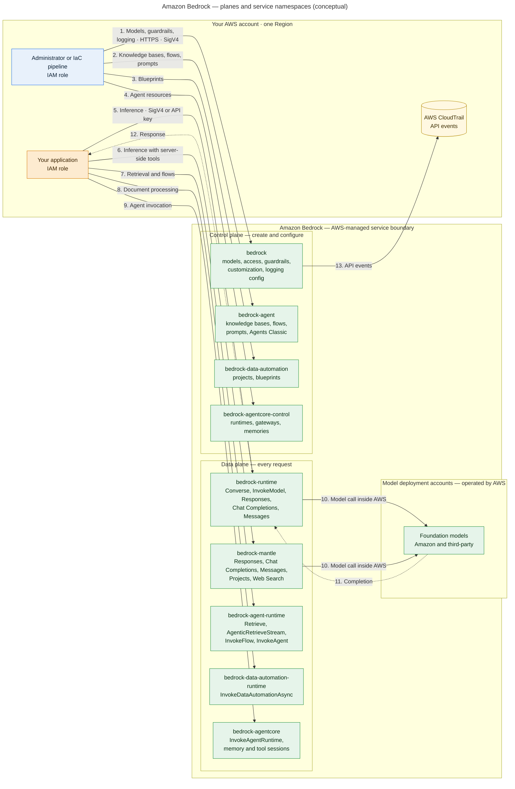

# What Amazon Bedrock is: services, namespaces and planes

> **Level:** Intermediate · **Verified:** 2026-11-15 · **Feature status:** GA · **Time:** ~20 min

Amazon Bedrock is not one API. It is a family of endpoints, split into a control plane and a data
plane, and every later chapter assumes you know which one you are talking to. This chapter gives
you that map, and records what AWS documents about how your prompts and outputs are handled.

## Learning objectives

After this chapter you can:

- Explain the difference between the control plane and the data plane, and place any Bedrock operation on one of them.
- Name the nine service namespaces and say what lives on each.
- Find the chapter, namespace and IAM prefix for a given capability.
- State what AWS documents about training use, storage, retention and logging of your data, and what you must configure yourself.

## Prerequisites

- [IAM fundamentals: principals, policies and evaluation](../../00-foundations/security/01-iam-fundamentals.md)
- [VPC endpoints and AWS PrivateLink](../../00-foundations/networking/03-vpc-endpoints-and-privatelink.md)
- [Generative AI, foundation models and LLMs](../../00-foundations/generative-ai-fundamentals/01-generative-ai-and-foundation-models.md)
- [Tokens, context windows, and training versus inference](../../00-foundations/generative-ai-fundamentals/02-tokens-context-windows-inference.md)

## Concept in plain language

Think of a city's electricity company. There is an **office** where you sign a contract, choose a
tariff and ask for a meter. There is the **socket** in your wall that delivers power every second.
You visit the office rarely; you use the socket constantly. If the office is closed, the lights
stay on.

Amazon Bedrock is a managed service that gives you access to foundation models
([glossary](../../GLOSSARY.md)) without running any servers. It has the same two sides. The
**control plane** is the office: you set up guardrails, knowledge bases, logging and access. The
**data plane** is the socket: your application sends a prompt and gets an answer. The two sides
have different endpoints, different IAM permissions and different audit records.

## How it really works

### Two planes

| | Control plane | Data plane |
|:--|:--|:--|
| Purpose | Create and configure resources | Carry each request and response |
| Typical caller | Administrator or IaC pipeline | Your application at run time |
| Volume | Low | High |
| Examples | `CreateGuardrail`, `CreateInferenceProfile`, `PutModelInvocationLoggingConfiguration` | `Converse`, `InvokeModel`, `Retrieve` |
| AWS CloudTrail | Management events, recorded by default | Mixed — see the note below |

> [!NOTE]
> **Documented fact** — On `bedrock-runtime`, `InvokeModel`, `InvokeModelWithResponseStream`,
> `Converse` and `ConverseStream` are logged as CloudTrail *management* events. Agent, knowledge
> base, flow and `ApplyGuardrail` runtime calls are *data* events, which CloudTrail does not log
> by default. Inference on `bedrock-mantle` is also a data event.
> Sources: [Monitor Amazon Bedrock API calls using CloudTrail](https://docs.aws.amazon.com/bedrock/latest/userguide/logging-using-cloudtrail.html),
> [Monitor bedrock-mantle API calls using CloudTrail](https://docs.aws.amazon.com/bedrock/latest/userguide/logging-cloudtrail-mantle.html)

### Nine namespaces

A *namespace* here means an endpoint family with its own hostname and its own SDK client.

| Namespace | Plane | Hostname pattern | What lives there |
|:--|:-:|:--|:--|
| `bedrock` | Control | `bedrock.{region}.amazonaws.com` | Model catalog (`ListFoundationModels`), model access agreements, customization and import jobs, guardrails, inference profiles, Provisioned Throughput, batch jobs (`CreateModelInvocationJob`), evaluation jobs, prompt routers, invocation-logging configuration, account data retention |
| `bedrock-runtime` | Data | `bedrock-runtime.{region}.amazonaws.com` | `InvokeModel`, `InvokeModelWithResponseStream`, `Converse`, `ConverseStream`, `ApplyGuardrail`; the OpenAI-compatible Responses and Chat Completions APIs under `/openai/v1`; the Anthropic Messages API under `/anthropic` |
| `bedrock-mantle` | Data, plus Projects management | `bedrock-mantle.{region}.api.aws` | Responses, Chat Completions and Messages APIs; Projects and Workspaces; server-side tools such as Web Search; background inference; Files and fine-tuning routes |
| `bedrock-agent` | Control ("build-time") | `bedrock-agent.{region}.amazonaws.com` | Knowledge bases and data sources, Flows, Prompt management, Amazon Bedrock Agents Classic |
| `bedrock-agent-runtime` | Data | `bedrock-agent-runtime.{region}.amazonaws.com` | `Retrieve`, `AgenticRetrieveStream`, `RetrieveAndGenerate`, `InvokeFlow`, `InvokeAgent` |
| `bedrock-data-automation` | Control | `bedrock-data-automation.{region}.amazonaws.com` | Data Automation projects, blueprints and libraries |
| `bedrock-data-automation-runtime` | Data | `bedrock-data-automation-runtime.{region}.amazonaws.com` | `InvokeDataAutomationAsync`, `InvokeDataAutomation` |
| `bedrock-agentcore-control` | Control | `bedrock-agentcore-control.{region}.amazonaws.com` | AgentCore resources: `CreateAgentRuntime`, `CreateGateway`, `CreateMemory` |
| `bedrock-agentcore` | Data | `bedrock-agentcore.{region}.amazonaws.com`; gateways at `{gatewayId}.gateway.bedrock-agentcore.{region}.amazonaws.com` | `InvokeAgentRuntime`, `InvokeHarness`, memory events (`CreateEvent`), browser and code interpreter sessions |

Sources: [Amazon Bedrock endpoints and quotas](https://docs.aws.amazon.com/general/latest/gr/bedrock.html),
[Amazon Bedrock AgentCore endpoints and quotas](https://docs.aws.amazon.com/general/latest/gr/bedrock_agentcore.html),
[Inference endpoints](https://docs.aws.amazon.com/bedrock/latest/userguide/endpoints.html). Operation names are
checked against the [generated API reference](../../references/bedrock-api-operations.md); `bedrock-mantle`
is not modelled in the AWS SDKs, so it does not appear there.

Three details save hours of debugging:

- **IAM prefixes do not follow the hostnames.** Calls to `bedrock-runtime` are authorised with
  the `bedrock:` prefix (`bedrock:InvokeModel`) and appear in CloudTrail under the event source
  `bedrock.amazonaws.com`. `bedrock-mantle` has its own prefix (`bedrock-mantle:CreateInference`)
  and its own event source (`bedrock-mantle.amazonaws.com`). The SDK service models show the same
  split in the SigV4 signing name: `bedrock` for `bedrock`, `bedrock-runtime`, `bedrock-agent`,
  `bedrock-agent-runtime` and both Data Automation namespaces; `bedrock-agentcore` for both
  AgentCore namespaces.
- **Web Search has an IAM prefix but no endpoint of its own.** `bedrock-websearch:` actions are
  evaluated when a model on `bedrock-mantle` uses the tool.
- **AWS recommends `bedrock-runtime` for new applications.** The
  [next chapter](02-endpoints-apis-and-authentication.md) compares the two inference endpoints.

### Capability map

| Area | Capabilities and chapters | Namespaces |
|:--|:--|:--|
| Models | [Providers and catalog](../foundation-models/01-model-providers-and-catalog.md) · [Lifecycle](../foundation-models/02-model-lifecycle-and-selection.md) · [Model access](03-model-access-and-subscriptions.md) · [Bedrock Marketplace](../foundation-models/05-bedrock-marketplace.md) | `bedrock` |
| Inference APIs | [Converse](../inference/01-converse-api.md) · [InvokeModel and streaming](../inference/02-invokemodel-and-streaming.md) · [OpenAI- and Anthropic-compatible APIs](../inference/03-openai-and-anthropic-compatible-apis.md) | `bedrock-runtime`, `bedrock-mantle` |
| Capacity and routing | [Cross-Region inference](../inference/04-cross-region-inference.md) · [Application inference profiles](../inference/05-application-inference-profiles.md) · [Service tiers](../inference/06-service-tiers.md) · [Provisioned Throughput](../inference/07-provisioned-throughput.md) · [Batch inference](../inference/08-batch-inference.md) | `bedrock` to configure, `bedrock-runtime` to use |
| Prompts | [Prompt management](../prompt-management/01-prompt-management.md) · [Prompt optimization](../prompt-management/02-prompt-optimization.md) · [Prompt caching](../prompt-caching/01-prompt-caching.md) | `bedrock-agent`, `bedrock`; caching is a request option |
| Knowledge and retrieval | [Knowledge Bases overview](../knowledge-bases/01-knowledge-bases-overview.md) · [Managed Knowledge Base](../knowledge-bases/02-managed-knowledge-base.md) · [Customer-managed](../knowledge-bases/03-customer-managed-knowledge-bases.md) · [Agentic retrieval](../agentic-retrieval/01-agentic-retrieval.md) | `bedrock-agent`, `bedrock-agent-runtime` |
| Agents | [AgentCore overview](../agentcore/01-agentcore-overview.md) · [Agents Classic](../agents/01-agents-classic.md) (maintenance mode) · [Classic versus AgentCore](../agents/03-agents-classic-vs-agentcore.md) | `bedrock-agentcore-control`, `bedrock-agentcore`; Classic on `bedrock-agent`, `bedrock-agent-runtime` |
| Orchestration | [Amazon Bedrock Flows](../flows/01-bedrock-flows.md) | `bedrock-agent`, `bedrock-agent-runtime` |
| Safety | [Guardrails](../guardrails/01-guardrails.md) · [Automated Reasoning and enforcement](../guardrails/02-automated-reasoning-and-enforcement.md) | `bedrock` to create, `bedrock-runtime` to apply |
| Customization | [Model customization](../foundation-models/03-model-customization.md) · [Custom Model Import](../foundation-models/04-custom-model-import.md) | `bedrock` |
| Evaluation | [Model and RAG evaluation](../model-evaluation/01-model-evaluation.md) | `bedrock` |
| Documents and media | [Amazon Bedrock Data Automation](../data-automation/01-bedrock-data-automation.md) | `bedrock-data-automation`, `bedrock-data-automation-runtime` |
| Isolation and web grounding | [Projects, Workspaces and the Web Search tool](04-projects-workspaces-and-web-search.md) | `bedrock-mantle` |
| Observability | [CloudWatch and Bedrock observability](../../02-related-aws-services/observability/01-cloudwatch-and-bedrock-observability.md) · [CloudTrail for Bedrock](../../02-related-aws-services/security/05-cloudtrail-for-bedrock.md) | `bedrock` (logging configuration) |

> [!IMPORTANT]
> **Status** — Amazon Bedrock Agents Classic is closed to new customers since 2026-07-30; AWS
> points new work to AgentCore. The Bedrock FAQ also describes "Amazon Bedrock Managed Agents,
> powered by OpenAI (preview)", which this academy does not cover yet.
> Sources: [API reference welcome page](https://docs.aws.amazon.com/bedrock/latest/APIReference/welcome.html),
> [Document history](https://docs.aws.amazon.com/bedrock/latest/userguide/bedrock-ug-doc-history.html),
> [Amazon Bedrock FAQs](https://aws.amazon.com/bedrock/faqs/)

### What AWS documents about your data

Only statements found on the linked pages are listed. Quotation marks mean the words are AWS's.

| Topic | What AWS states | Source |
|:--|:--|:--|
| Training | "AWS and the third-party model providers will not use any inputs to or outputs from Amazon Bedrock to train Amazon Nova, Amazon Titan, or any third-party models." | [FAQs](https://aws.amazon.com/bedrock/faqs/) |
| Sharing with providers | "Users' inputs and model outputs are not shared with any model providers." Models run in Model Deployment Accounts "owned and operated by the Amazon Bedrock service team"; providers "don't have access to Amazon Bedrock logs or to customer prompts and completions". | [FAQs](https://aws.amazon.com/bedrock/faqs/), [Data protection](https://docs.aws.amazon.com/bedrock/latest/userguide/data-protection.html) |
| Where content rests | "Any customer content processed by Amazon Bedrock is encrypted and stored at rest in the AWS Region where you are using Amazon Bedrock." With cross-Region inference, a stored response is kept in the Region that processed the request. | [FAQs](https://aws.amazon.com/bedrock/faqs/), [Responses API](https://docs.aws.amazon.com/bedrock/latest/userguide/inference-responses-api.html) |
| Retention by the service | Set per Region with a data retention mode: `none`, `default`, `aws_review`, legacy `provider_data_share`, or `inherit`. Under `default`, "the data retention policy of the model applies". | [Data retention](https://docs.aws.amazon.com/bedrock/latest/userguide/data-retention.html) |
| Abuse detection | Bedrock "uses a zero operator access (ZOA) data security model, subject to the model-specific abuse and CSAM detection". For some models, inputs and outputs are kept for up to 30 days: classifier-flagged traffic for most OpenAI models, all traffic for the Claude Fable 5 family (with possible human review by AWS). Retained data is "not shared with third-party model providers". | [Abuse detection](https://docs.aws.amazon.com/bedrock/latest/userguide/abuse-detection.html) |
| Stored conversation state | On the Responses API, `store` defaults to `true` and Bedrock "retains the response, including the input and output, for 30 days". | [Responses API](https://docs.aws.amazon.com/bedrock/latest/userguide/inference-responses-api.html) |
| Logging you switch on | "Model invocation logging is disabled by default." When enabled it delivers request data, response data and metadata to Amazon CloudWatch Logs or Amazon S3 in the same account and Region — only for calls through `bedrock-runtime`. | [Model invocation logging](https://docs.aws.amazon.com/bedrock/latest/userguide/model-invocation-logging.html) |
| Encryption | "We require TLS 1.2 and recommend TLS 1.3." You can supply an AWS KMS key for specific resources such as customization jobs, agents, knowledge-base ingestion and evaluation jobs. | [Data protection](https://docs.aws.amazon.com/bedrock/latest/userguide/data-protection.html), [Data encryption](https://docs.aws.amazon.com/bedrock/latest/userguide/data-encryption.html) |

> [!TIP]
> **Academy recommendation** — In a security review, ask two separate questions: "is my data used
> for training or shared with the provider?" and "is my data retained, by whom, where and for how
> long?". The documented answer to the first is no. The answer to the second depends on the model,
> the API (`store`), the Region's retention mode and your own logging. Record all four.
> This is our design guidance, not an official AWS reference architecture.

## Architecture diagram



**What this shows** — the nine namespaces grouped by plane. Configuration flows in on the left of
the service boundary, requests on the right, and models run in accounts that AWS operates. It is
a conceptual map: AWS documents the endpoints and the model deployment accounts, not the internal
wiring between them.

**Walkthrough**

1. An administrator or pipeline configures core resources on `bedrock`.
2. The same role creates knowledge bases, flows and prompts on `bedrock-agent`.
3. Data Automation blueprints and projects are created on `bedrock-data-automation`.
4. AgentCore runtimes, gateways and memories are created on `bedrock-agentcore-control`.
5. The application sends inference requests to `bedrock-runtime`.
6. Requests that need server-side tools, background mode or Projects go to `bedrock-mantle`.
7. Retrieval and flow invocations go to `bedrock-agent-runtime`.
8. Documents and media are processed through `bedrock-data-automation-runtime`.
9. Agents hosted on AgentCore are invoked through `bedrock-agentcore`.
10. The inference endpoints call the model inside AWS-operated model deployment accounts.
11. The model returns its completion to the endpoint.
12. The endpoint returns the response to the application.
13. API activity is recorded in AWS CloudTrail in your account.

**Legend** — solid arrow: request · dashed arrow: response · cylinder: data store · boxes: trust boundaries · green: Bedrock-managed components.

The full picture, with VPC endpoints, logging and encryption, is in
[Diagram 02 — Amazon Bedrock high-level architecture](../../diagrams/mermaid/02-bedrock-high-level-architecture.md).

## Implementation details

1. **Pick the Region, then check the namespace is there.** The User Guide states that
   `bedrock-runtime` is available in every Region where Bedrock is offered and that
   `bedrock-mantle` is available in a subset
   ([Regional availability by endpoints](https://docs.aws.amazon.com/bedrock/latest/userguide/endpoints-region-availability.html)).
   Agents, Data Automation and AgentCore each have their own, shorter Region lists.
2. **Grant IAM by the documented prefix**, not by the hostname (see the three details above).
3. **Choose the client.** AWS SDKs and the AWS CLI have one client per namespace — for example
   `aws bedrock …` and `aws bedrock-runtime …`. The OpenAI-compatible APIs "are called on the
   `/openai/v1` paths of this endpoint rather than through the AWS SDKs".
4. **Add private connectivity per namespace.** Interface VPC endpoints exist for `bedrock`,
   `bedrock-runtime`, `bedrock-mantle`, `bedrock-agent` and `bedrock-agent-runtime`
   ([interface VPC endpoints](https://docs.aws.amazon.com/bedrock/latest/userguide/vpc-interface-endpoints.html)).
   See [Private connectivity for Bedrock](../../02-related-aws-services/networking/01-private-connectivity-for-bedrock.md).
5. **Decide what you record.** Turn on model invocation logging if you need prompts and outputs;
   add CloudTrail data events if you use `bedrock-mantle`, agents or knowledge bases.
6. **Set the data retention mode** for each Region you use if the model default is not what you want.

> [!WARNING]
> **Common mistake** — Treating the AWS General Reference endpoint tables as the definitive Region
> list. On the verification date its `bedrock-runtime` table listed fewer Regions than its
> `bedrock` control-plane table, while the User Guide says the runtime endpoint is available
> wherever Bedrock is offered. Check the User Guide's availability pages and the model card before
> you commit to a Region.

## Example

> **Code status:** illustrative · **never deployed**

```python
"""One control-plane call and one data-plane call. Nothing here is specific to a model."""
import os

import boto3

REGION = os.environ.get("AWS_REGION", "us-east-1")
# A foundation model ID. Confirm the current ID on the model card before you use it.
MODEL_ID = os.environ["BEDROCK_MODEL_ID"]

control = boto3.client("bedrock", region_name=REGION)          # control plane
runtime = boto3.client("bedrock-runtime", region_name=REGION)  # data plane

# Control plane: is this account allowed to use the model?
availability = control.get_foundation_model_availability(modelId=MODEL_ID)
print(availability["agreementAvailability"]["status"])  # AVAILABLE when access exists

# Data plane: send a prompt.
response = runtime.converse(
    modelId=MODEL_ID,
    messages=[{"role": "user", "content": [{"text": "Say hello in one sentence."}]}],
)
print(response["output"]["message"]["content"][0]["text"])
```

The two calls need different permissions: the first is a control-plane action on `bedrock`, the
second needs `bedrock:InvokeModel`. An application role normally holds only the second.

## Common mistakes

| Mistake | Symptom | Fix |
|:--|:--|:--|
| Calling `converse` on the `bedrock` client | The SDK reports that the operation does not exist | Use the `bedrock-runtime` client for inference |
| Writing `bedrock-runtime:InvokeModel` in a policy | The statement grants nothing; calls fail with `AccessDeniedException` | The documented action is `bedrock:InvokeModel` |
| Creating only a `bedrock` interface endpoint | Inference still leaves through a NAT gateway, or fails in an isolated subnet | Add an endpoint for each namespace you call |
| Expecting prompts in CloudTrail | The `InvokeModel` event shows the model ID, not the content | Enable model invocation logging |
| Filtering detective controls on `bedrock.amazonaws.com` only | `bedrock-mantle` activity is invisible | Add `bedrock-mantle.amazonaws.com` and enable its data events |
| Reading "not used for training" as "nothing is retained" | Surprise in a compliance review | Check the retention mode, `store`, and the model's abuse-detection terms |
| Starting a new agent on Agents Classic | HTTP 403 on `CreateAgent` in a new account | Use [AgentCore](../agentcore/01-agentcore-overview.md) |

## Security considerations

- **Separate roles per plane.** An application role needs data-plane actions only; keep
  `Create*`, `Put*` and `Delete*` on `bedrock` for the pipeline role. See
  [Identity, least privilege and IAM isolation for agents](../../06-security-governance/02-identity-and-least-privilege.md).
- **Two authentication methods.** SigV4 with AWS credentials, or a Bedrock API key — covered in
  [Endpoints, APIs and authentication](02-endpoints-apis-and-authentication.md).
- **Providers are outside the trust boundary.** Models run in AWS-operated accounts that the
  provider cannot reach.
- **Retention is a setting, not an assumption.** Details are in
  [Data protection, privacy and data leakage prevention](../../06-security-governance/03-data-protection-and-privacy.md).
- **Invocation logs contain full prompts and outputs.** Protect the log group and bucket like
  the source data.

## Cost considerations

- You pay for what the data plane does: mainly input and output tokens. "Per-token pricing for the
  same model is identical on `bedrock-runtime` and `bedrock-mantle`."
- Some third-party serverless models appear as an AWS Marketplace line on the bill
  ([FAQs](https://aws.amazon.com/bedrock/faqs/)).
- CloudTrail data events and stored invocation logs are billed by those services, not by Bedrock.
- The pricing dimensions of each capability are in
  [Pricing model and cost drivers](../../08-cost-performance-and-reliability/01-pricing-model-and-cost-drivers.md).

## Knowledge check

1. Your pipeline role can create guardrails but your application gets `AccessDeniedException` on `Converse`. Which plane and which IAM prefix do you look at?
2. A colleague adds an interface VPC endpoint for `com.amazonaws.region.bedrock` and expects inference to become private. What is missing?
3. A reviewer says "AWS does not train on our prompts, so nothing is stored". Which three documented mechanisms can still retain content?
4. Which namespaces would a Managed Knowledge Base project touch, and on which plane is each?

<details>
<summary>Answers</summary>

1. The data plane. `Converse` on `bedrock-runtime` needs `bedrock:InvokeModel` on the application's role; control-plane permissions do not imply it.
2. An endpoint for `bedrock-runtime` (and for any other namespace the application calls). Each namespace has its own interface endpoint.
3. Model-specific abuse-detection retention (up to 30 days for some models), Responses API stored state (`store` defaults to `true`, 30 days), and your own model invocation logging. The Region's data retention mode governs the first two.
4. `bedrock-agent` (control plane) to create the knowledge base and data sources, `bedrock-agent-runtime` (data plane) for `Retrieve` and `AgenticRetrieveStream`, and usually `bedrock-runtime` for other inference.

</details>

## Further reading

Official sources opened while writing this chapter:

- [Amazon Bedrock overview](https://docs.aws.amazon.com/bedrock/latest/userguide/what-is-bedrock.html) — service definition, quickstart and the recommendation to use `bedrock-runtime`.
- [Inference endpoints supported by Amazon Bedrock](https://docs.aws.amazon.com/bedrock/latest/userguide/endpoints.html) — the two inference endpoints and their hostnames.
- [APIs supported by Amazon Bedrock](https://docs.aws.amazon.com/bedrock/latest/userguide/apis.html) — the five inference API patterns.
- [Amazon Bedrock endpoints and quotas (AWS General Reference)](https://docs.aws.amazon.com/general/latest/gr/bedrock.html) — hostnames per namespace and Region, including FIPS endpoints.
- [Amazon Bedrock AgentCore endpoints and quotas](https://docs.aws.amazon.com/general/latest/gr/bedrock_agentcore.html) — AgentCore control-plane, data-plane and gateway hostnames.
- [Amazon Bedrock API reference — welcome](https://docs.aws.amazon.com/bedrock/latest/APIReference/welcome.html) and [operation list](https://docs.aws.amazon.com/bedrock/latest/APIReference/API_Operations_Amazon_Bedrock.html) — the API sets and control-plane operations.
- [What is Amazon Bedrock AgentCore](https://docs.aws.amazon.com/bedrock-agentcore/latest/devguide/what-is-bedrock-agentcore.html) — the AgentCore services.
- [Regional availability by endpoints](https://docs.aws.amazon.com/bedrock/latest/userguide/endpoints-region-availability.html) — where each inference endpoint exists.
- [Interface VPC endpoints for Amazon Bedrock](https://docs.aws.amazon.com/bedrock/latest/userguide/vpc-interface-endpoints.html) — PrivateLink service names.
- [Data protection](https://docs.aws.amazon.com/bedrock/latest/userguide/data-protection.html) — model deployment accounts and TLS requirements.
- [Data encryption](https://docs.aws.amazon.com/bedrock/latest/userguide/data-encryption.html) — which resources accept a KMS key.
- [Data retention](https://docs.aws.amazon.com/bedrock/latest/userguide/data-retention.html) — retention modes and scopes.
- [Amazon Bedrock abuse detection](https://docs.aws.amazon.com/bedrock/latest/userguide/abuse-detection.html) — model-specific retention for abuse detection.
- [Responses API](https://docs.aws.amazon.com/bedrock/latest/userguide/inference-responses-api.html) — stored conversation state.
- [Model invocation logging](https://docs.aws.amazon.com/bedrock/latest/userguide/model-invocation-logging.html) — what is logged and where.
- [Monitor Amazon Bedrock API calls using CloudTrail](https://docs.aws.amazon.com/bedrock/latest/userguide/logging-using-cloudtrail.html) and [Monitor bedrock-mantle API calls using CloudTrail](https://docs.aws.amazon.com/bedrock/latest/userguide/logging-cloudtrail-mantle.html) — management versus data events.
- [Document history for the Amazon Bedrock User Guide](https://docs.aws.amazon.com/bedrock/latest/userguide/bedrock-ug-doc-history.html) — dates of status changes.
- [Amazon Bedrock FAQs](https://aws.amazon.com/bedrock/faqs/) — training use, sharing with providers, storage Region.
- [Amazon Bedrock security and privacy](https://aws.amazon.com/bedrock/security-compliance/) — summary of data-protection and audit capabilities.
- Generated reference: [Amazon Bedrock API operations](../../references/bedrock-api-operations.md) — every SDK operation per namespace, with signing names.
