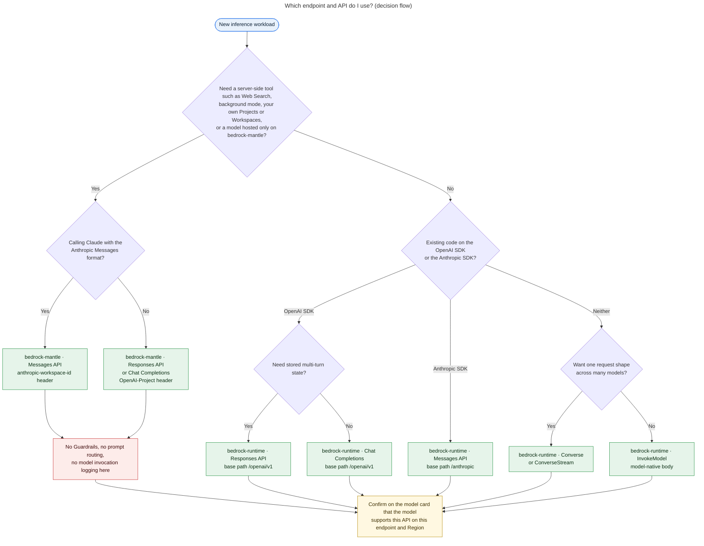
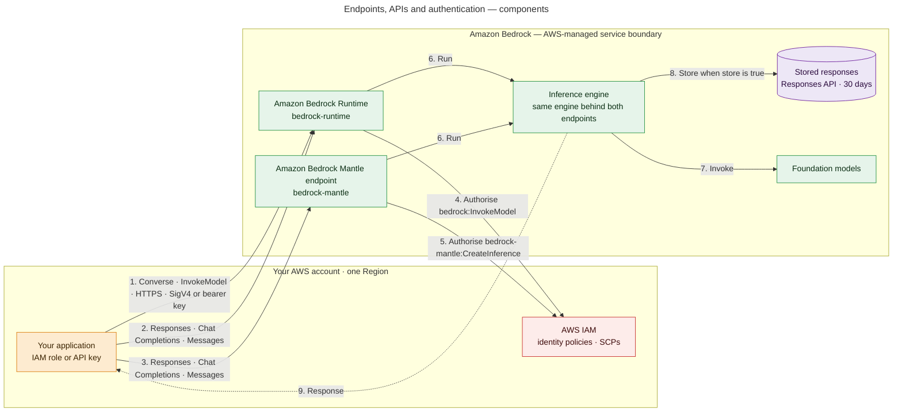
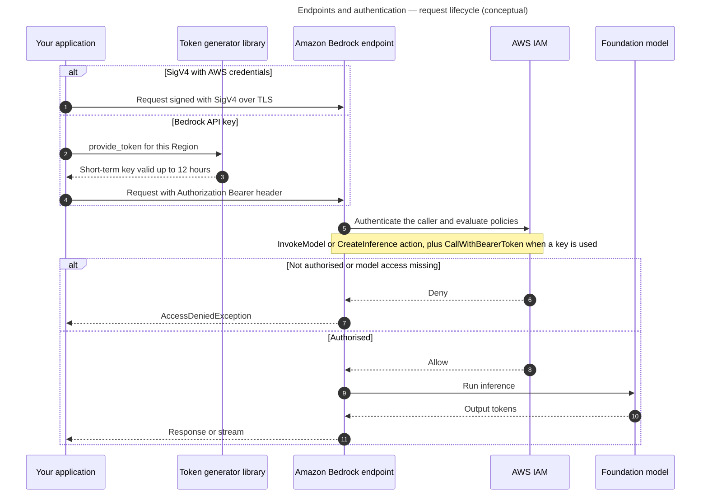

# Endpoints, APIs and authentication

> **Level:** Intermediate · **Verified:** 2026-11-15 · **Feature status:** GA · **Time:** ~25 min

Amazon Bedrock has two inference endpoints, five inference API shapes and two ways to
authenticate. This chapter tells you which combination to pick, what each one cannot do, and how
every option maps back to IAM.

> [!IMPORTANT]
> **Status** — Both endpoints are generally available. Since 2026-08-15 the User Guide recommends
> `bedrock-runtime` for new applications, including OpenAI- and Anthropic-compatible workloads.
> `bedrock-mantle` "continues to be fully supported" and exists in a subset of Regions.
> Sources: [Inference endpoints](https://docs.aws.amazon.com/bedrock/latest/userguide/endpoints.html),
> [Document history](https://docs.aws.amazon.com/bedrock/latest/userguide/bedrock-ug-doc-history.html)

## Learning objectives

- Choose between `bedrock-runtime` and `bedrock-mantle` for a given requirement.
- Choose between Converse, InvokeModel, Responses, Chat Completions and Messages.
- Explain how SigV4, short-term API keys and long-term API keys map to IAM principals.
- Write IAM statements for each endpoint and restrict API-key use.
- Recognise the features that exist on only one endpoint before you design around them.

## Prerequisites

- [What Amazon Bedrock is: services, namespaces and planes](01-what-is-amazon-bedrock.md)
- [IAM fundamentals: principals, policies and evaluation](../../00-foundations/security/01-iam-fundamentals.md)
- [VPC endpoints and AWS PrivateLink](../../00-foundations/networking/03-vpc-endpoints-and-privatelink.md)

## 1. What it is

An *endpoint* is the URL your application sends inference requests to. An *API* is the request
and response format you use on that endpoint. *Authentication* proves who is calling; IAM then
decides whether the call is allowed.

Precisely: both endpoints are Regional HTTPS endpoints in front of the same engine. AWS states
that "the `bedrock-mantle` name identifies an endpoint surface, not a different inference engine".

| Item | Value |
|:--|:--|
| Service namespace / endpoint | `bedrock-runtime.{region}.amazonaws.com` · `bedrock-mantle.{region}.api.aws` |
| Control-plane operations | None on `bedrock-runtime` (discover models with `ListFoundationModels` and `ListInferenceProfiles` on `bedrock`). On `bedrock-mantle`: `ListModels`, `GetModel`, and the Projects API |
| Data-plane operations | Runtime: `InvokeModel`, `InvokeModelWithResponseStream`, `Converse`, `ConverseStream`, plus Responses and Chat Completions under `/openai/v1` and Messages under `/anthropic`. Mantle: `POST /v1/responses`, `POST /v1/chat/completions`, `POST /anthropic/v1/messages` |
| IAM action prefix | `bedrock:` for `bedrock-runtime` · `bedrock-mantle:` for `bedrock-mantle` |

Runtime operation names are checked against the
[generated API reference](../../references/bedrock-api-operations.md). `bedrock-mantle` is not
modelled in the AWS SDKs; its names here are the CloudTrail event names and IAM actions given in
the User Guide.

### The two endpoints compared

AWS publishes this comparison with check-mark images that our retrieval tool could not read.
Every cell below is backed by a sentence on the linked pages; the one cell with no supporting
sentence is marked.

| | `bedrock-runtime` | `bedrock-mantle` |
|:--|:--|:--|
| AWS position | Recommended for new applications | Use for capabilities available only there |
| InvokeModel, Converse | ✅ | ❌ |
| Chat Completions | ✅ | ✅ |
| Responses | ✅ synchronous only | ✅ including `background=true` |
| Messages (Anthropic) | ✅ | ✅ |
| Stored multi-turn state | ✅ | ✅ |
| Client-side tool use | ✅ | ✅ |
| Server-side and pre-configured tools, including Web Search | ❌ | ✅ |
| Projects | Default project only | ✅ |
| Workspaces | ❌ | ✅ |
| Cross-Region inference profiles | ✅ | **UNVERIFIED — REQUIRES DOCUMENTATION REVIEW** (listed as a reason to choose runtime; the table cell was not readable) |
| Application inference profiles | ✅ except on the Responses API (400 error) | ❌ — use Projects |
| Guardrails, intelligent prompt routing | ✅ | ❌ |
| Prompt caching | ✅ | ✅ depends on the model |
| Model invocation logging | ✅ | ❌ |
| Batch inference, Provisioned Throughput | ✅ | ❌ |
| IAM action for inference | `bedrock:InvokeModel`, `bedrock:InvokeModelWithResponseStream` | `bedrock-mantle:CreateInference` |
| Inference in AWS CloudTrail | Management event | Data event, off by default |
| Model discovery | `ListFoundationModels`, `ListInferenceProfiles` | `GET /v1/models` |
| Price per token | Identical on both endpoints | Identical on both endpoints |

Sources: [Inference endpoints](https://docs.aws.amazon.com/bedrock/latest/userguide/endpoints.html),
[Responses API](https://docs.aws.amazon.com/bedrock/latest/userguide/inference-responses-api.html),
[Model invocation logging](https://docs.aws.amazon.com/bedrock/latest/userguide/model-invocation-logging.html),
[Quotas for the bedrock-mantle endpoint](https://docs.aws.amazon.com/bedrock/latest/userguide/quotas-mantle.html),
[CloudTrail for bedrock-mantle](https://docs.aws.amazon.com/bedrock/latest/userguide/logging-cloudtrail-mantle.html).

### The five APIs

| API | Endpoint | Use it for |
|:--|:--|:--|
| Converse / ConverseStream | Runtime | One request shape across models — see [The Converse API](../inference/01-converse-api.md) |
| InvokeModel | Runtime | Model-native bodies: embeddings, images, provider-specific parameters — see [InvokeModel and streaming APIs](../inference/02-invokemodel-and-streaming.md) |
| Responses | Both | OpenAI-compatible, stateful conversations |
| Chat Completions | Both | OpenAI-compatible, stateless chat |
| Messages | Both | Anthropic-native format for Claude models |

The last three are detailed in
[OpenAI- and Anthropic-compatible APIs](../inference/03-openai-and-anthropic-compatible-apis.md).

## 2. Why it exists

Teams arrive at Bedrock from two directions. Some build on AWS SDKs and want one AWS-native API
with IAM, guardrails and logging built in. Others have code written for the OpenAI or Anthropic
SDKs and want to change "only the base URL and API key". Without these options you would run a
gateway to translate request formats and exchange long-lived secrets for AWS credentials.

## 3. When to use it

- **`bedrock-runtime`** — the default. Use it for Converse and InvokeModel, for OpenAI- or
  Anthropic-compatible code that needs guardrails, cross-Region inference or invocation logging.
- **`bedrock-mantle`** — when you need a server-side tool such as Web Search, `background=true`,
  your own Projects or Workspaces, or a model hosted only there.
- **Both together** — AWS states that both endpoints "can be used together from the same
  application".



**What this shows** — the order in which to ask the questions. Start with the hard constraint
(a mantle-only capability), then follow your existing SDK, and only then choose between the two
AWS-native APIs. Every path ends at the model card, because API support differs per model.

> [!TIP]
> **Academy recommendation** — For new code with no SDK history, start with Converse on
> `bedrock-runtime`. You keep SigV4, guardrails and invocation logging, and you can change models
> without changing the request format. This is our design guidance, not an official AWS reference
> architecture.

## 4. When not to use it

- **Do not call a model directly for retrieval over your documents** — use a knowledge base:
  [Knowledge Bases overview](../knowledge-bases/01-knowledge-bases-overview.md).
- **Do not use `bedrock-mantle` when you need Guardrails** — they are not available there; use
  `bedrock-runtime` ([Amazon Bedrock Guardrails](../guardrails/01-guardrails.md)).
- **Do not use long-term API keys in production** — AWS recommends them "only for exploration".
  Use an IAM role with SigV4, or short-term keys.
- **Do not use on-demand endpoints for large offline jobs** — see
  [Batch inference](../inference/08-batch-inference.md).
- **Do not use API keys with agents or Data Automation** — keys are "limited to Amazon Bedrock and
  Amazon Bedrock Runtime actions". Use SigV4 for `bedrock-agent`, `bedrock-agent-runtime` and the
  Data Automation APIs.

## 5. Internal architecture



**What this shows** — one application, two endpoint surfaces, one engine. The endpoints differ in
the APIs they accept, the IAM action they check and the features layered on top.
**Our reading:** the arrows to IAM and to the engine are a conceptual model; AWS documents the
required permissions and the shared engine, not the internal call path.

**Walkthrough**

1. AWS-native calls go to `bedrock-runtime`, signed with SigV4 or carrying a Bedrock API key.
2. OpenAI- and Anthropic-compatible calls can use the same endpoint under `/openai/v1` and `/anthropic`.
3. The same three compatible APIs are served by `bedrock-mantle`.
4. Runtime checks `bedrock:InvokeModel` (or `bedrock:InvokeModelWithResponseStream`) on the inference target.
5. Mantle checks `bedrock-mantle:CreateInference`.
6. Both hand the request to the same inference engine.
7. The engine invokes the model.
8. For the Responses API with `store` left at `true`, the response is kept for 30 days.
9. The response returns to the application, as a whole or as a stream.

**Legend** — solid arrow: request · dashed arrow: response · cylinder: data at rest · boxes: trust boundaries.

## 6. Request and response lifecycle



1. With SigV4 the SDK signs the request with the role's temporary credentials.
2. With an API key, the application first asks the token generator for a key.
3. The generator returns a short-term key that inherits the permissions of the principal that created it.
4. The application sends the key in the `Authorization: Bearer` header.
5. The endpoint authenticates the caller. "Authentication does not grant access by itself": the
   IAM principal behind the signature or key must be allowed the action.
6. IAM denies the call when a permission or model access is missing.
7. The endpoint returns `AccessDeniedException`.
8. Otherwise IAM allows the call.
9. The endpoint runs inference on the model.
10. The model returns output tokens.
11. The endpoint returns the response, whole or as a stream.

Error paths that matter:

- **Validation** — `background=true`, or an application inference profile as the target, on the
  runtime Responses API is rejected with a 400 error.
- **Throttling** — `bedrock-mantle` returns HTTP 429 when a token quota would be exceeded. Retry
  with exponential backoff on both endpoints
  ([Quotas, rate limits and throttling](../../08-cost-performance-and-reliability/05-quotas-rate-limits-and-throttling.md)).
- **Wrong path prefix on mantle** — most models are served under `/v1`, some under `/openai/v1`;
  the wrong prefix is rejected with "isn't supported on this route".

## 7. Dependencies

| Depends on | Why | Required or optional |
|:--|:--|:-:|
| IAM principal with the right action | Authorisation for every call | Required |
| [Model access](03-model-access-and-subscriptions.md) | Third-party models need a subscription on first use | Required |
| Region that offers the endpoint and the model | `bedrock-mantle` exists in a subset of Regions | Required |
| System-defined inference profile | OpenAI GPT models on runtime must be named by a `us.` or `global.` profile ID, not a foundation model ID | Required for those models |
| `aws-bedrock-token-generator` | Creates short-term API keys (Python, JavaScript, Java) | Optional |
| OpenAI SDK or Anthropic SDK | Client for the compatible APIs | Optional |

## 8. Security considerations

**SigV4 versus API keys**

| | SigV4 | Short-term API key | Long-term API key |
|:--|:--|:--|:--|
| What you send | A signature made with AWS credentials | Bearer token | Bearer token |
| Lifetime | The credentials' lifetime | Lasts "up to 12 hours (or the duration of your session, whichever is shorter)" | Until the configured expiry |
| IAM mapping | The calling principal | "Inherits permissions from the IAM principal used to generate it" | "Creates an IAM user with attached policies"; the key is an IAM service-specific credential for `bedrock.amazonaws.com` |
| Region scope | Any Region the policy allows | Only the Region it was generated in | — |
| AWS guidance | — | "Recommended for production use" | "Recommended only for exploration" |
| Revoke | Change the policy or the role session | Invalidate the session, or deny `CallWithBearerToken` | Deactivate, reset or delete the credential |

Source: [API keys](https://docs.aws.amazon.com/bedrock/latest/userguide/api-keys.html),
[API keys reference](https://docs.aws.amazon.com/bedrock/latest/userguide/api-keys-reference.html).

- **Controlling keys.** `bedrock:CallWithBearerToken` and `bedrock-mantle:CallWithBearerToken`
  control key use on each endpoint; the `bedrock:bearerTokenType` and
  `bedrock-mantle:bearerTokenType` condition keys take `SHORT_TERM` or `LONG_TERM`.
  `iam:CreateServiceSpecificCredential` controls who can create long-term keys.
- **Keys are not logged.** "All API calls are logged in AWS CloudTrail. API keys are passed as
  authorization headers and are not logged."
- **Responses API on runtime needs two resources.** Creating a response checks
  `bedrock:InvokeModel` on the inference target *and* on the default project,
  `arn:aws:bedrock:region:account-id:project/default`. Stored responses use `bedrock:GetInvoke`,
  `bedrock:CancelInvoke` and `bedrock:DeleteInvoke` on that project.
- **Audit differs by endpoint.** A trail without data events records runtime inference but not
  mantle inference. See [AWS CloudTrail for Bedrock](../../02-related-aws-services/security/05-cloudtrail-for-bedrock.md).
- **Data handling** is summarised in
  [What Amazon Bedrock is](01-what-is-amazon-bedrock.md#what-aws-documents-about-your-data).

## 9. Networking requirements

- Both endpoints are public, Regional HTTPS endpoints. AWS requires TLS 1.2 and recommends TLS 1.3.
- **Interface VPC endpoints** exist for both: `com.amazonaws.region.bedrock-runtime` and
  `com.amazonaws.region.bedrock-mantle`. With private DNS enabled, the standard hostnames resolve
  to the endpoint. Endpoint policies can restrict actions such as `bedrock:InvokeModel` or
  `bedrock-mantle:CreateInference`. Details:
  [Private connectivity for Bedrock](../../02-related-aws-services/networking/01-private-connectivity-for-bedrock.md).
- **FIPS endpoints** are documented for `bedrock-runtime` (`bedrock-runtime-fips.{region}.amazonaws.com`)
  in us-east-1, us-east-2, us-west-2, ca-central-1, us-gov-east-1 and us-gov-west-1, with a matching
  `bedrock-runtime-fips` interface endpoint service in the same Regions. A FIPS endpoint for
  `bedrock-mantle` was not listed — **UNVERIFIED — REQUIRES DOCUMENTATION REVIEW**.
- **Dual-stack (IPv6) endpoints** for the inference endpoints are not stated on the pages opened —
  **UNVERIFIED — REQUIRES DOCUMENTATION REVIEW** (looked in the General Reference endpoint tables
  and the endpoints page).
- **Cross-Region traffic.** A cross-Region inference profile on `bedrock-runtime` can process a
  request in another Region; see [Cross-Region inference](../inference/04-cross-region-inference.md).
- **`aws:SourceIp` conditions** cannot be satisfied for requests that arrive through a VPC endpoint.

## 10. Pricing dimensions

"Per-token pricing for the same model is identical on `bedrock-runtime` and `bedrock-mantle`.
Choose an endpoint based on the APIs and capabilities you need, not cost."

| Dimension | Unit | Notes |
|:--|:--|:--|
| Model inference | Input and output tokens (other units for some modalities) | Depends on model, Region and service tier — see the [pricing page](https://aws.amazon.com/bedrock/pricing/) |
| Authentication method | — | No pricing dimension was found for SigV4 or API keys |
| CloudTrail data events | Per event, billed by CloudTrail | Needed to audit `bedrock-mantle` inference |
| Network path | Billed by the networking service | AWS suggests interface endpoints to avoid NAT or internet gateway data charges |

## 11. Scaling considerations

"Traffic to the two endpoints is tracked against separate quotas, even when calling the same
underlying model."

| | `bedrock-runtime` | `bedrock-mantle` |
|:--|:--|:--|
| Token quotas | Per-model tokens per minute, input and output counted together; separate quotas for on-demand and cross-Region use | Separate input-tokens-per-minute and output-tokens-per-minute per model |
| Requests per minute | Enforced for some models | Not enforced |
| Daily quota | Cross-model tokens per day, per account and Region | — |
| Behaviour at the limit | Throttled | HTTP 429; requests may be briefly queued |
| Increase | Service Quotas | AWS Support limit-increase form |

Default values depend on the model and on your account; read them in the Service Quotas console.
Sources: [runtime quotas](https://docs.aws.amazon.com/bedrock/latest/userguide/quotas-runtime.html),
[mantle quotas](https://docs.aws.amazon.com/bedrock/latest/userguide/quotas-mantle.html).

## 12. IaC support

Endpoints and API keys are not resources you declare; the things around them are.

| Tool | Support | Resource / construct | Notes |
|:--|:-:|:--|:--|
| Terraform (`hashicorp/aws` 6.73.0) | ✅ / ❌ | `aws_bedrock_inference_profile`; data sources `aws_bedrock_foundation_models`, `aws_bedrock_inference_profiles` | No `bedrock-mantle` resource in this provider version |
| CloudFormation | ✅ | `AWS::Bedrock::ApplicationInferenceProfile`, `AWS::BedrockMantle::Project` | — |
| AWS CDK (`aws-cdk-lib` 2.277.0) | L1 · alpha | `aws_bedrock.CfnApplicationInferenceProfile`, `aws_bedrockmantle.CfnProject`; alpha `ApplicationInferenceProfile` | — |

- **API keys:** a long-term key is created with the IAM `CreateServiceSpecificCredential`
  operation. Our generated references cover Bedrock resource types only, so check your tool's IAM
  documentation. Short-term keys are generated at run time and never belong in IaC.
- **IAM policies and interface endpoints** are ordinary IAM and VPC resources; see
  [Terraform coverage for Amazon Bedrock](../../04-infrastructure-as-code/terraform/10-terraform-for-bedrock.md).

## 13. Working example

> **Code status:** illustrative · **never deployed**. Model and profile IDs are read from the
> environment; confirm current IDs on the model card.

AWS-native API with SigV4:

```python
import os

import boto3

region = os.environ.get("AWS_REGION", "us-east-1")
runtime = boto3.client("bedrock-runtime", region_name=region)  # SigV4 with the role's credentials

response = runtime.converse(
    modelId=os.environ["BEDROCK_MODEL_ID"],
    messages=[{"role": "user", "content": [{"text": "Say hello in one sentence."}]}],
)
print(response["output"]["message"]["content"][0]["text"])
```

OpenAI SDK and Anthropic SDK on `bedrock-runtime` with a short-term key:

```python
import os

from anthropic import Anthropic
from aws_bedrock_token_generator import provide_token
from openai import OpenAI

region = os.environ.get("AWS_REGION", "us-east-1")
short_term_key = provide_token(region=region)  # inherits the caller's IAM permissions

openai_client = OpenAI(
    base_url=f"https://bedrock-runtime.{region}.amazonaws.com/openai/v1",
    api_key=short_term_key,
)
result = openai_client.responses.create(
    model=os.environ["BEDROCK_INFERENCE_PROFILE_ID"],  # a us. or global. profile for OpenAI GPT models
    input="Say hello in one sentence.",
    store=False,  # do not keep the response for 30 days
)
print(result.output_text)

anthropic_client = Anthropic(
    base_url=f"https://bedrock-runtime.{region}.amazonaws.com/anthropic",
    api_key=short_term_key,
)
message = anthropic_client.messages.create(
    model=os.environ["BEDROCK_CLAUDE_MODEL_ID"],
    max_tokens=256,
    messages=[{"role": "user", "content": "Say hello in one sentence."}],
)
print(message.content[0].text)
```

An identity policy for the application role: approved targets only, and no long-term keys.

```json
{
  "Version": "2012-10-17",
  "Statement": [
    {
      "Sid": "InvokeApprovedTargets",
      "Effect": "Allow",
      "Action": ["bedrock:InvokeModel", "bedrock:InvokeModelWithResponseStream"],
      "Resource": [
        "arn:aws:bedrock:*::foundation-model/<model-id>",
        "arn:aws:bedrock:*:111122223333:inference-profile/<inference-profile-id>"
      ]
    },
    {
      "Sid": "DenyLongTermKeysOnRuntime",
      "Effect": "Deny",
      "Action": "bedrock:CallWithBearerToken",
      "Resource": "*",
      "Condition": { "StringEquals": { "bedrock:bearerTokenType": "LONG_TERM" } }
    },
    {
      "Sid": "DenyLongTermKeysOnMantle",
      "Effect": "Deny",
      "Action": "bedrock-mantle:CallWithBearerToken",
      "Resource": "*",
      "Condition": { "StringEquals": { "bedrock-mantle:bearerTokenType": "LONG_TERM" } }
    }
  ]
}
```

## Common mistakes

| Mistake | Symptom | Fix |
|:--|:--|:--|
| Leaving the OpenAI SDK on its default base URL or OpenAI key | Requests go to OpenAI, not to Bedrock | Set the base URL to the Bedrock endpoint and use a Bedrock API key |
| Passing a foundation model ID for an OpenAI GPT model on runtime | The call fails: in-Region inference is not available for these models on this endpoint | Name a `us.` or `global.` inference profile |
| `background=true` or Web Search on runtime | 400 error; tool unavailable | Use the Responses API on `bedrock-mantle` |
| `client.models.list()` against runtime | Operation not implemented | Use `ListFoundationModels` and `ListInferenceProfiles` |
| Policy scoped to the model but not to `project/default` | Runtime Responses call denied | Add the default project ARN |
| Short-term key reused in another Region | Authentication fails | Generate a key per Region |
| Assuming one quota pool for both endpoints | Unexpected throttling after a migration | Plan and request capacity per endpoint |
| Relying on runtime guardrails after moving to mantle | Content is no longer filtered | Keep guarded traffic on `bedrock-runtime` |

## Knowledge check

1. An existing OpenAI SDK application needs guardrails and must stay inside the EU. Which endpoint and API do you choose, and why?
2. A long-term API key is leaked. Which IAM object does the key belong to, and what are two ways to stop it working?
3. Why can the same trail show `Converse` calls but no `CreateInference` calls for the same application?

<details>
<summary>Answers</summary>

1. `bedrock-runtime` with the Responses or Chat Completions API. Guardrails and geographic cross-Region inference profiles are documented for runtime, and the OpenAI SDK only needs a new base URL and key.
2. An IAM user holding a service-specific credential for `bedrock.amazonaws.com`. Deactivate or delete the credential, or attach a deny on `bedrock:CallWithBearerToken` (and the mantle equivalent).
3. Runtime inference is a CloudTrail management event, recorded by default. Mantle inference is a data event, recorded only when you enable data events for `AWS::BedrockMantle::Project`.

</details>

## 14. Official documentation

- [Inference endpoints supported by Amazon Bedrock](https://docs.aws.amazon.com/bedrock/latest/userguide/endpoints.html) — endpoint comparison and AWS's recommendation.
- [APIs supported by Amazon Bedrock](https://docs.aws.amazon.com/bedrock/latest/userguide/apis.html) — the five API patterns and when to use each.
- [Responses API](https://docs.aws.amazon.com/bedrock/latest/userguide/inference-responses-api.html) — base URLs, runtime differences, stored state, permissions.
- [Making inference requests](https://docs.aws.amazon.com/bedrock/latest/userguide/inference.html) and [Prerequisites for running model inference](https://docs.aws.amazon.com/bedrock/latest/userguide/inference-prereq.html) — IAM policies per endpoint.
- [API keys](https://docs.aws.amazon.com/bedrock/latest/userguide/api-keys.html) and [API keys reference](https://docs.aws.amazon.com/bedrock/latest/userguide/api-keys-reference.html) — short-term and long-term keys, limits, IAM controls.
- [Regional availability by endpoints](https://docs.aws.amazon.com/bedrock/latest/userguide/endpoints-region-availability.html) — where each endpoint exists.
- [Amazon Bedrock endpoints and quotas (AWS General Reference)](https://docs.aws.amazon.com/general/latest/gr/bedrock.html) — hostnames and FIPS endpoints.
- [Interface VPC endpoints for Amazon Bedrock](https://docs.aws.amazon.com/bedrock/latest/userguide/vpc-interface-endpoints.html) — PrivateLink service names and endpoint policies.
- [Quotas for Amazon Bedrock](https://docs.aws.amazon.com/bedrock/latest/userguide/quotas.html), [runtime quotas](https://docs.aws.amazon.com/bedrock/latest/userguide/quotas-runtime.html), [mantle quotas](https://docs.aws.amazon.com/bedrock/latest/userguide/quotas-mantle.html) — quota model per endpoint.
- [Monitor bedrock-mantle API calls using CloudTrail](https://docs.aws.amazon.com/bedrock/latest/userguide/logging-cloudtrail-mantle.html) — event classes and resource types.
- [Model invocation logging](https://docs.aws.amazon.com/bedrock/latest/userguide/model-invocation-logging.html) — runtime-only logging.
- [Request access to models](https://docs.aws.amazon.com/bedrock/latest/userguide/model-access.html) — `aws:SourceIp` behaviour through VPC endpoints.
- [Data protection](https://docs.aws.amazon.com/bedrock/latest/userguide/data-protection.html) — TLS requirements.
- [Document history](https://docs.aws.amazon.com/bedrock/latest/userguide/bedrock-ug-doc-history.html) — date of the endpoint recommendation.
- [Amazon Bedrock pricing](https://aws.amazon.com/bedrock/pricing/) — current prices.
