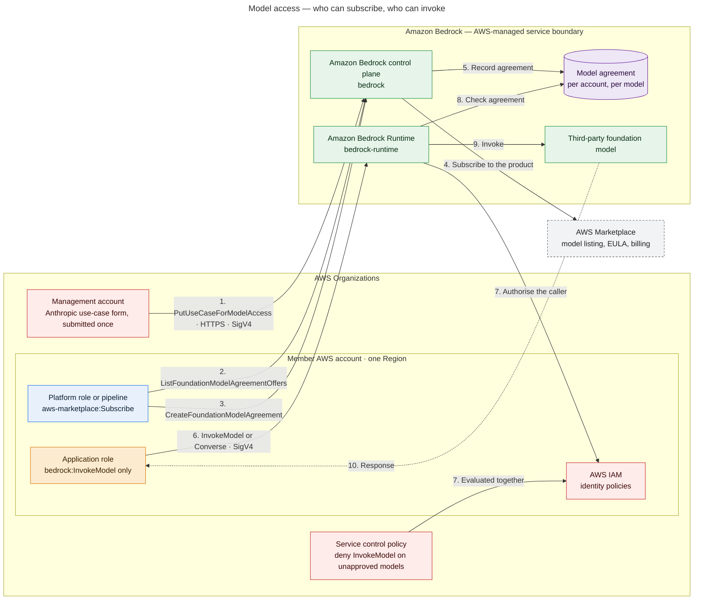
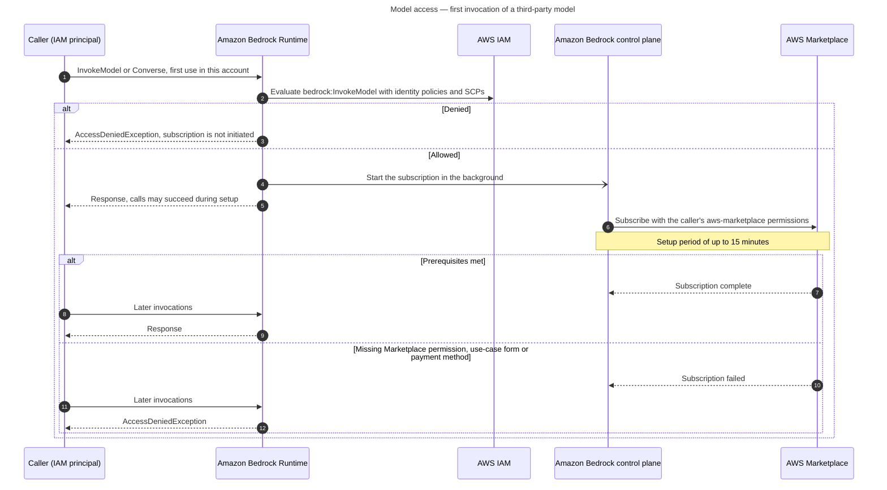

# Model access and subscriptions

> **Level:** Intermediate · **Verified:** 2026-11-15 · **Feature status:** GA · **Time:** ~20 min

Model access decides whether your AWS account may call a given foundation model. It sits on the
`bedrock` control plane, in front of every inference call, and it changed completely in late
2025: there is no longer a "request model access" step.

> [!IMPORTANT]
> **Status** — Since 2025-10-15, "access to all Amazon Bedrock foundation models is now enabled
> by default with the correct IAM permissions". In commercial Regions there is no access request
> to submit; the console's **Model access** page applies to AWS GovCloud (US) only.
> Sources: [Document history](https://docs.aws.amazon.com/bedrock/latest/userguide/bedrock-ug-doc-history.html),
> [Request access to models](https://docs.aws.amazon.com/bedrock/latest/userguide/model-access.html)

## Learning objectives

- Explain the four gates a request passes before a model answers.
- Predict what happens on the first call to a third-party model, and why it can fail minutes later.
- Decide who in your organisation holds AWS Marketplace permissions.
- Restrict model use with IAM policies and service control policies (SCPs) that actually block.
- Manage agreements with Terraform and know what is missing in CloudFormation and the CDK.

## Prerequisites

- [What Amazon Bedrock is: services, namespaces and planes](01-what-is-amazon-bedrock.md)
- [Endpoints, APIs and authentication](02-endpoints-apis-and-authentication.md)
- [IAM fundamentals: principals, policies and evaluation](../../00-foundations/security/01-iam-fundamentals.md)
- [AWS Organizations and AWS Control Tower](../../00-foundations/aws-fundamentals/05-organizations-control-tower.md)

## 1. What it is

In plain language: some models belong to Amazon, and many belong to other companies that sell
them through AWS. Before you use a third-party model, your account has to subscribe to it and
accept its licence. Bedrock now does that for you the first time you call the model — provided
the caller is allowed to subscribe.

Precisely, a request must pass up to four gates:

| # | Gate | Applies to | What satisfies it |
|--:|:--|:--|:--|
| 1 | IAM permission to invoke | Every model | `bedrock:InvokeModel` on the model or inference profile |
| 2 | AWS Marketplace subscription (a *model agreement*) | Third-party serverless models that have a Marketplace product ID | Created automatically on the first invocation, or explicitly with `CreateFoundationModelAgreement` |
| 3 | Anthropic first-time-use (FTU) form | Anthropic models earlier than Claude Opus 4.7, unless reached through `bedrock-mantle` | `PutUseCaseForModelAccess`, once per account or once in the organisation's management account |
| 4 | Additional account-level access | "Some models". Separately, the pricing page says access to Claude Mythos models "is gated and requires approval" | Decided per account, not by subscription: AWS says to "contact AWS Sales" (for Mythos, the Anthropic account team) |

| Item | Value |
|:--|:--|
| Service namespace / endpoint | `bedrock` control plane · `bedrock.{region}.amazonaws.com` |
| Control-plane operations | `ListFoundationModelAgreementOffers`, `CreateFoundationModelAgreement`, `DeleteFoundationModelAgreement`, `GetFoundationModelAvailability`, `PutUseCaseForModelAccess`, `GetUseCaseForModelAccess` |
| Data-plane operations | None of its own. The first `InvokeModel` or `Converse` call triggers the automatic subscription |
| IAM action prefix | `bedrock:` and `aws-marketplace:` (`Subscribe`, `Unsubscribe`, `ViewSubscriptions`) |

> [!NOTE]
> **Documented fact** — Models from Amazon, DeepSeek, Google, Meta, MiniMax, Mistral AI,
> Moonshot AI, NVIDIA, Qwen, xAI and Z.AI "aren't sold through AWS Marketplace and don't have
> product keys". The same is true of OpenAI's open-weight `gpt-oss` models and Writer Palmyra
> Vision 7B. Gate 2 does not apply to them; control them with `bedrock:` actions and model IDs.
> Source: [Request access to models](https://docs.aws.amazon.com/bedrock/latest/userguide/model-access.html)

Related gates you will meet elsewhere: the FTU form "does not apply to Anthropic models accessed
through the `bedrock-mantle` endpoint", and some models are unavailable until the account's data
retention mode allows them
([data retention](https://docs.aws.amazon.com/bedrock/latest/userguide/data-retention.html)).

## 2. Why it exists

Third-party models are commercial products with their own End User License Agreements (EULAs).
AWS Marketplace is the mechanism that records who agreed to what and who is billed. AWS states:
"by invoking/using the model for the first time you are agreeing to the applicable End User
License Agreement".

Automatic subscription removes a manual console step that used to block every new account.
The price of that convenience is that *using* a model is now also *accepting its terms* — which
is why organisations need a deliberate policy rather than a default.

## 3. When to use it

You act on model access in these situations:

- **New account or new model** — create the agreement in advance, or make the first call from a
  principal with Marketplace permissions.
- **Application roles without Marketplace permissions** — a platform role creates the agreement
  once; afterwards "users don't need AWS Marketplace subscription permissions to invoke models".
- **Older Anthropic models** — submit the FTU form once in the management account, where it
  "will be inherited by other accounts in the same AWS Organization".
- **Legal review before use** — block first, review the EULA, then allow.
- **AWS GovCloud (US)** — enable models manually (section 9).

## 4. When not to use it

- **Do not create agreements for models without a product ID** — there is nothing to subscribe
  to. Use IAM on the model ARN instead.
- **Do not rely on denying `aws-marketplace:Subscribe` to block a model** — AWS warns that it
  "will not block the first model invocation". Deny `bedrock:InvokeModel` instead (section 8).
- **Do not rely on deleting an agreement to remove access** — "invoking the model will create
  the access again".
- **Do not confuse this with Amazon Bedrock Marketplace**, where you deploy a model to a managed
  endpoint: see [Amazon Bedrock Marketplace](../foundation-models/05-bedrock-marketplace.md).
- **Do not treat a quota increase as access** — "a quota increase doesn't grant additional
  account-level access to a model". See
  [Quotas, rate limits and throttling](../../08-cost-performance-and-reliability/05-quotas-rate-limits-and-throttling.md).

## 5. Internal architecture



**What this shows** — the separation the academy recommends: one role is allowed to subscribe,
another is allowed only to invoke, and an SCP limits both. **Our reading:** steps 5, 8 and the
arrows to IAM are a conceptual model; AWS documents the API operations and the outcome, not the
internal checks.

**Walkthrough**

1. For older Anthropic models, the use-case form is submitted once, in the management account.
2. A platform role lists the offers for the model and receives an offer token.
3. It creates the agreement with that token. This accepts the provider's EULA for the account.
4. Bedrock subscribes the account to the AWS Marketplace product.
5. The agreement now exists for this account and model.
6. The application role calls the model.
7. IAM evaluates the role's identity policies together with any SCP.
8. Bedrock checks that the account has access to the model.
9. The model is invoked.
10. The response returns to the application.

If nobody runs steps 2 and 3, the first invocation in step 6 triggers steps 4 and 5 in the
background — using the *caller's* Marketplace permissions.

**Legend** — solid arrow: request · dashed arrow: response · cylinder: stored state · boxes: trust boundaries · dashed grey box: outside your account.

## 6. Request and response lifecycle



1. The first call arrives. It is "authorized like any other `bedrock:InvokeModel` request".
2. IAM evaluates the caller, including condition keys such as `aws:SourceIp`.
3. If IAM denies the call, the subscription "isn't initiated".
4. If IAM allows it, Bedrock "automatically initiates the subscription process in the background".
5. During setup, "your API calls may succeed temporarily".
6. Bedrock subscribes using the caller's AWS Marketplace permissions.
7. When all prerequisites are met, the subscription completes.
8. Later calls arrive from any principal in the account that may invoke the model.
9. They succeed.
10. If a prerequisite is missing, "the subscription attempt fails".
11. Later calls arrive as before.
12. They return `AccessDeniedException` — possibly minutes after the first success.

After you fix the cause, "it may take up to 2 minutes for the subscription to complete". To see
the state instead of guessing, call `GetFoundationModelAvailability` and read
`agreementAvailability.status`; it is `AVAILABLE` when access exists. A submitted FTU form can
also leave the agreement in a pending state, during which calls keep returning
`AccessDeniedException`; AWS sends an e-mail when setup finishes.

## 7. Dependencies

| Depends on | Why | Required or optional |
|:--|:--|:-:|
| `aws-marketplace:Subscribe`, `Unsubscribe`, `ViewSubscriptions` | Needed by whoever triggers the first subscription | Required once per account and model |
| Valid payment method on the account | AWS Marketplace purchases | Required for Marketplace models |
| Anthropic FTU form | Provider prerequisite for older Claude models | Required for those models |
| AWS Organizations | FTU inheritance from the management account; SCPs | Optional |
| Region support for the model | "Default model access applies in all commercial AWS Regions where the model is supported" | Required |
| AWS CLI 2.27.42 or later | Needed for the agreement commands | Optional |

## 8. Security considerations

**Who needs what.** Marketplace permissions are "only required the first time a model is being
used in an account". Keep them on a platform role; give application roles `bedrock:InvokeModel`
on named targets only.

**Three ways to restrict, and what each really does**

| Goal | Mechanism | Documented caveat |
|:--|:--|:--|
| Stop a principal subscribing to a product | Deny `aws-marketplace:Subscribe` with the `aws-marketplace:ProductId` condition key | Does not block the first invocation; does not help once the account is subscribed in any Region |
| Stop use of a specific model | Deny `bedrock:` actions on `arn:aws:bedrock:*::foundation-model/<model-id>` | Works for models with and without product IDs |
| Block everything until the EULA is reviewed | Deny `bedrock:InvokeModel` in an SCP or IAM policy, then allow approved models | AWS's own three-step recommendation |

An SCP that blocks one model and its Marketplace product (illustrative — placeholders in angle brackets):

```json
{
  "Version": "2012-10-17",
  "Statement": [
    {
      "Sid": "DenyUnapprovedModels",
      "Effect": "Deny",
      "Action": ["bedrock:InvokeModel", "bedrock:InvokeModelWithResponseStream"],
      "Resource": ["arn:aws:bedrock:*::foundation-model/<unapproved-model-id>"]
    },
    {
      "Sid": "DenySubscribeToUnapprovedProduct",
      "Effect": "Deny",
      "Action": "aws-marketplace:Subscribe",
      "Resource": "*",
      "Condition": {
        "ForAnyValue:StringEquals": { "aws-marketplace:ProductId": ["<marketplace-product-id>"] }
      }
    }
  ]
}
```

The product ID is shown in the "Marketplace product ID" field of the model card. If the card has
no such field, "scope your policy by model ID instead".

- **The first call must satisfy your conditions.** `aws:SourceIp` "isn't present in the request
  context when the request is made through a VPC endpoint", so a policy conditioned on it cannot
  be met from there.
- **New models are allowed by default.** With a deny-list, a principal "will have access to any
  newly added models by default".
- **Audit.** Agreement and use-case calls are CloudTrail management events
  ([AWS CloudTrail for Bedrock](../../02-related-aws-services/security/05-cloudtrail-for-bedrock.md)).

> [!TIP]
> **Academy recommendation** — Deny `bedrock:InvokeModel` by default and allow a short, named
> list of models per environment. Test the policy with inference profile IDs as well as
> foundation model IDs ([Cross-Region inference](../inference/04-cross-region-inference.md)).
> More in [Governance at scale](../../06-security-governance/06-governance-at-scale.md).
> This is our design guidance, not an official AWS reference architecture.

## 9. Networking requirements

- Agreement and use-case operations are calls to the `bedrock` control-plane endpoint. A private
  path needs the `com.amazonaws.region.bedrock` interface endpoint
  ([interface VPC endpoints](https://docs.aws.amazon.com/bedrock/latest/userguide/vpc-interface-endpoints.html)).
- **Our reading:** in the automatic flow, Bedrock performs the Marketplace subscription on the
  service side, so your network needs no route to AWS Marketplace. The documentation describes
  the subscription as initiated "in the background" and lists no network prerequisite.
- **Regions.** After a subscription in one Region, "the model becomes available for the identity
  to request access in all AWS Regions in which the model is available". The FTU form is needed
  once "across all commercial regions, with the exception of opt-in regions where this form needs
  to be filled again".
- **AWS GovCloud (US)** accounts use the Model access page in `us-gov-west-1`; for third-party
  models access "needs to be enabled in both the linked AWS commercial account in addition the
  AWS GovCloud account".

## 10. Pricing dimensions

| Dimension | Unit | Notes |
|:--|:--|:--|
| Model access, agreements, FTU form | — | No price for these steps was found on the pages opened; you pay for usage |
| Use of third-party serverless models | Tokens or other model units | Can appear as an AWS Marketplace line: "customers will see an AWS Marketplace bill for certain Bedrock serverless models" ([FAQs](https://aws.amazon.com/bedrock/faqs/)) |
| Offers | — | `ListFoundationModelAgreementOffers` returns public offers by default; `offerType` `ALL` includes private offers |

Current prices are on the [Amazon Bedrock pricing page](https://aws.amazon.com/bedrock/pricing/).

## 11. Scaling considerations

- **Timing.** Allow up to 15 minutes for the first automatic subscription and up to 2 minutes
  after you repair a missing prerequisite. Do not run a launch-day load test as the first call.
- **Scope.** An agreement is per account and per model; in a multi-account platform, create it
  in each account from a pipeline
  ([multi-account pattern](../../03-architecture-patterns/multi-account/README.md)).
- **Limits.** No quota on the number of agreements was found on the pages opened —
  **UNVERIFIED — REQUIRES DOCUMENTATION REVIEW** (looked in the model access page and the
  General Reference quota table).

## 12. IaC support

| Tool | Support | Resource / construct | Notes |
|:--|:-:|:--|:--|
| Terraform (`hashicorp/aws` 6.73.0) | ✅ | `aws_bedrock_foundation_model_agreement`, `aws_bedrock_use_case_for_model_access`; data sources `aws_bedrock_foundation_model_agreement_offers`, `aws_bedrock_use_case_for_model_access`, `aws_bedrock_foundation_model` | Agreement arguments: `model_id`, `offer_token`, optional `region` |
| CloudFormation | ❌ | — | No model-access type in the specification bundled with `aws-cdk-lib` 2.277.0 |
| AWS CDK (`aws-cdk-lib` 2.277.0) | ❌ | — | No L1 or L2 construct |

Without CloudFormation or CDK support, the verified alternatives are: let the first invocation
subscribe automatically, or run the API calls from a pipeline step or custom resource. Two
Terraform behaviours to know, from the provider documentation:

- `aws_bedrock_use_case_for_model_access` is an "advanced resource": if a form already exists,
  Terraform adopts it; it cannot be updated; `terraform destroy` only removes it from state.
- The provider's own example sets `lifecycle { ignore_changes = [offer_token] }` on the
  agreement. **Our reading:** the token returned by the data source can differ between runs, so
  keep that setting.

## 13. Working example

> **Code status:** validated with `terraform validate` (Terraform 1.17.2, provider 6.73.0) in a
> scratch directory · **never planned or applied against AWS**

```hcl
terraform {
  required_version = ">= 1.11.0"
  required_providers {
    aws = {
      source  = "hashicorp/aws"
      version = "~> 6.73"
    }
  }
}

variable "region" {
  description = "Region in which the agreement is created."
  type        = string
  default     = "us-east-1"
}

variable "model_id" {
  description = "Model ID of a third-party model sold through AWS Marketplace. Confirm the current ID on the model card."
  type        = string
}

variable "anthropic_use_case" {
  description = "Anthropic first-time-use form. Set to null if the form is not required or was already submitted for the organisation."
  type = object({
    company_name    = string
    company_website = string
    intended_users  = string # "0" internal, "1" external, "2" both
    industry        = string
    use_cases       = string
  })
  default = null
}

provider "aws" {
  region = var.region
}

# The offer token that the agreement needs.
data "aws_bedrock_foundation_model_agreement_offers" "this" {
  model_id   = var.model_id
  offer_type = "PUBLIC"
}

# Anthropic models earlier than Claude Opus 4.7 only. Terraform adopts an existing form
# and cannot update or delete it.
resource "aws_bedrock_use_case_for_model_access" "anthropic" {
  count = var.anthropic_use_case == null ? 0 : 1

  form_data = jsonencode({
    companyName         = var.anthropic_use_case.company_name
    companyWebsite      = var.anthropic_use_case.company_website
    intendedUsers       = var.anthropic_use_case.intended_users
    industryOption      = var.anthropic_use_case.industry
    otherIndustryOption = ""
    useCases            = var.anthropic_use_case.use_cases
  })
}

# Creating the agreement accepts the provider's EULA for this account.
resource "aws_bedrock_foundation_model_agreement" "this" {
  model_id    = data.aws_bedrock_foundation_model_agreement_offers.this.model_id
  offer_token = data.aws_bedrock_foundation_model_agreement_offers.this.offers[0].offer_token

  lifecycle {
    ignore_changes = [offer_token]
  }

  depends_on = [aws_bedrock_use_case_for_model_access.anthropic]
}
```

> [!CAUTION]
> **Cost or security hazard** — Applying this configuration accepts a third-party EULA on behalf
> of your organisation and enables a billable model. Run it only in your own sandbox account,
> after the terms have been reviewed, and remove access with a deny policy, not with `destroy`.

A pre-flight check for a deployment pipeline:

> **Code status:** illustrative · **never deployed**

```python
import os

import boto3

control = boto3.client("bedrock", region_name=os.environ.get("AWS_REGION", "us-east-1"))
model_id = os.environ["BEDROCK_MODEL_ID"]  # a foundation model ID from the model card

status = control.get_foundation_model_availability(modelId=model_id)["agreementAvailability"]["status"]
if status != "AVAILABLE":
    raise SystemExit(f"Model access is not ready for {model_id}: {status}")
```

## Common mistakes

| Mistake | Symptom | Fix |
|:--|:--|:--|
| Looking for the "request model access" button | Old tutorials do not match the console | Call the model; in commercial Regions access starts on first use |
| First call made by a role without Marketplace permissions | Works briefly, then `AccessDeniedException` | Create the agreement from a role that can subscribe, then retry |
| Denying only `aws-marketplace:Subscribe` | The model can still be invoked | Deny `bedrock:InvokeModel` on the model |
| Deleting the agreement to remove access | Access returns on the next invocation | Add a deny policy |
| FTU form submitted in a member account only | Other accounts still fail on older Claude models | Submit it in the management account |
| First call from behind a VPC endpoint with an `aws:SourceIp` condition | `AccessDeniedException`; subscription never starts | Use a condition that the request context can satisfy |
| Requesting a quota increase to fix `AccessDeniedException` | No change | Access and quota are separate; check prerequisites or contact AWS Sales |

## Knowledge check

1. A load test passes at 09:00 and fails with `AccessDeniedException` at 09:10 with no deployment in between. What is the most likely cause?
2. Your security team wants no third-party model to be usable until its EULA is reviewed. Which control achieves that, and which popular control does not?
3. An application role has `bedrock:InvokeModel` but no Marketplace permissions. Under what condition can it still use a third-party model?

<details>
<summary>Answers</summary>

1. The first call started an automatic subscription and succeeded during the setup period; a prerequisite (Marketplace permission, FTU form or payment method) was missing, so the subscription failed and later calls are denied.
2. A deny on `bedrock:InvokeModel` in an SCP or IAM policy, lifted per approved model. Denying `aws-marketplace:Subscribe` alone does not block the first invocation.
3. When the model has already been enabled for the account by a principal that could subscribe — Marketplace permissions are needed only the first time.

</details>

## 14. Official documentation

- [Request access to models](https://docs.aws.amazon.com/bedrock/latest/userguide/model-access.html) — default access, automatic subscription, FTU form, IAM examples, SDK and CLI steps, GovCloud.
- [Amazon Bedrock API operations](https://docs.aws.amazon.com/bedrock/latest/APIReference/API_Operations_Amazon_Bedrock.html) — names of the agreement and use-case operations.
- [Document history](https://docs.aws.amazon.com/bedrock/latest/userguide/bedrock-ug-doc-history.html) — date default access was introduced.
- [Data retention](https://docs.aws.amazon.com/bedrock/latest/userguide/data-retention.html) — models that need a retention mode before they can be invoked.
- [Quotas for the bedrock-mantle endpoint](https://docs.aws.amazon.com/bedrock/latest/userguide/quotas-mantle.html) — quota increases do not grant access.
- [Monitor Amazon Bedrock API calls using CloudTrail](https://docs.aws.amazon.com/bedrock/latest/userguide/logging-using-cloudtrail.html) — control-plane operations as management events.
- [Interface VPC endpoints for Amazon Bedrock](https://docs.aws.amazon.com/bedrock/latest/userguide/vpc-interface-endpoints.html) — the `bedrock` endpoint service.
- [Amazon Bedrock FAQs](https://aws.amazon.com/bedrock/faqs/) — AWS Marketplace billing entries.
- [Amazon Bedrock pricing](https://aws.amazon.com/bedrock/pricing/) — current prices; note on gated models.
- Generated reference: [Amazon Bedrock API operations](../../references/bedrock-api-operations.md) — operation names and request members.
- [Terraform: `aws_bedrock_foundation_model_agreement`](https://raw.githubusercontent.com/hashicorp/terraform-provider-aws/main/website/docs/r/bedrock_foundation_model_agreement.html.markdown) and [`aws_bedrock_use_case_for_model_access`](https://raw.githubusercontent.com/hashicorp/terraform-provider-aws/main/website/docs/r/bedrock_use_case_for_model_access.html.markdown) — arguments and resource behaviour.
- Generated references: [Terraform provider](../../references/terraform-aws-provider-bedrock.md) · [CDK and CloudFormation](../../references/cdk-and-cloudformation-bedrock.md).
