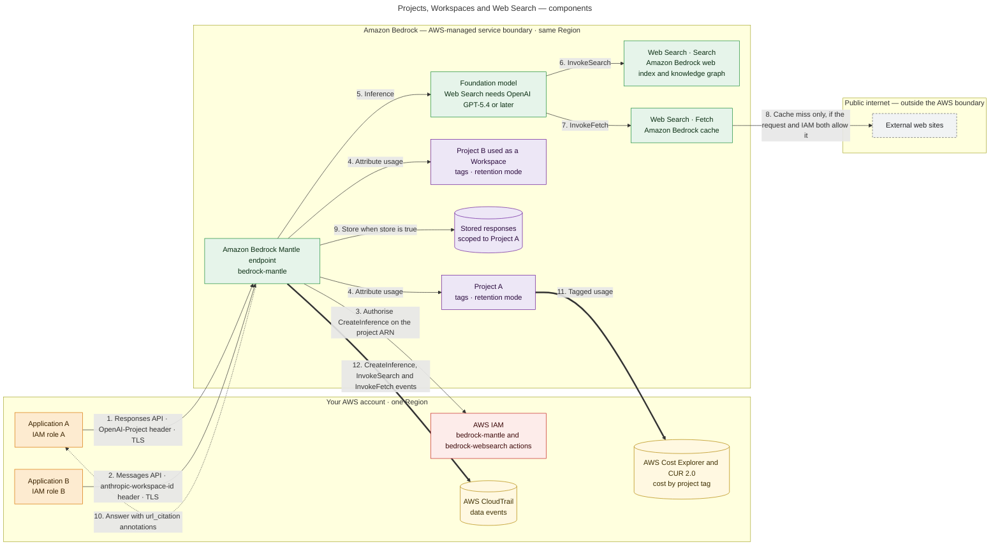
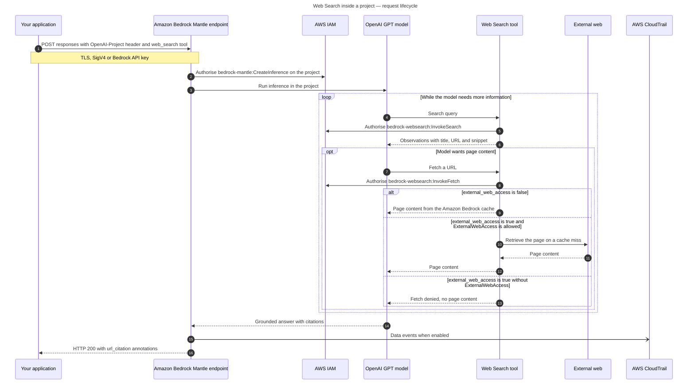

# Projects, Workspaces and the Web Search tool

> **Level:** Intermediate · **Verified:** 2026-11-15 · **Feature status:** GA · **Time:** ~25 min

Three capabilities exist only on the `bedrock-mantle` endpoint: **Projects** and **Workspaces**,
which separate applications inside one account, and **Web Search**, a tool that AWS runs on the
model's behalf. This chapter covers what they isolate, what they cost and what can leave AWS.

> [!IMPORTANT]
> **Status** — Projects and Workspaces are generally available on `bedrock-mantle`. Web Search
> became generally available on 2026-08-04 for OpenAI GPT models in US East (N. Virginia),
> US East (Ohio) and US West (Oregon); external web access followed on 2026-08-19. The User Guide
> also lists AWS GovCloud (US-West). AWS recommends `bedrock-runtime` for new applications unless
> you need these capabilities.
> Sources: [Web Search launch](https://aws.amazon.com/about-aws/whats-new/2026/08/amazon-bedrock-web/),
> [External web access launch](https://aws.amazon.com/about-aws/whats-new/2026/08/amazon-bedrock-web-access-web-search/),
> [Web Search](https://docs.aws.amazon.com/bedrock/latest/userguide/web-search.html),
> [Projects](https://docs.aws.amazon.com/bedrock/latest/userguide/projects.html)

## Learning objectives

- Explain what a Project isolates, what it does not, and how a Workspace relates to it.
- Choose between Projects, Workspaces and application inference profiles for cost allocation.
- Add the Web Search tool to a Responses API request and read its citations.
- Write IAM policies for `bedrock-mantle` and `bedrock-websearch`, and keep retrieval inside AWS.
- Find the audit trail for project inference and for search and fetch calls.

## Prerequisites

- [Endpoints, APIs and authentication](02-endpoints-apis-and-authentication.md)
- [Model access and subscriptions](03-model-access-and-subscriptions.md)
- [OpenAI- and Anthropic-compatible APIs](../inference/03-openai-and-anthropic-compatible-apis.md)

## 1. What it is

In plain language: a **Project** is a labelled box for one application's model usage inside your
account. The label says who may use the box and which cost centre pays. A **Workspace** is the
same box, addressed the way the Anthropic SDK expects. **Web Search** lets a model look
something up during a request, with AWS doing the searching.

Precisely:

| Item | Value |
|:--|:--|
| Service namespace / endpoint | `bedrock-mantle.{region}.api.aws` · Projects API under `/v1/organization/projects` |
| Control-plane operations | `CreateProject`, `ListProjects`, `GetProject`, `UpdateProject`, `ArchiveProject` |
| Data-plane operations | `CreateInference` (Responses, Chat Completions, Messages), `GetInference`, `CancelInference`, `DeleteInference`; for Web Search, `InvokeSearch` and `InvokeFetch` |
| IAM action prefix | `bedrock-mantle:` · `bedrock-websearch:` |

These are not AWS SDK operations: `bedrock-mantle` is not modelled in the SDKs. The names are the
CloudTrail event names and IAM actions from the User Guide; you call them as HTTP routes such as
`POST /v1/organization/projects` and `POST /v1/responses`.

### Projects, Workspaces and inference profiles

"Workspaces are the same underlying resource as Projects" — only the request header differs.

| | Project | Workspace | Application inference profile |
|:--|:--|:--|:--|
| Endpoint | `bedrock-mantle` | `bedrock-mantle` | `bedrock-runtime` |
| APIs | Responses, Chat Completions | Anthropic Messages | InvokeModel, Converse, Chat Completions |
| How a request selects it | `OpenAI-Project: {project-id}` header | `anthropic-workspace-id: {project-id}` header | Profile ARN as the model ID |
| Managed with | Projects API | Projects API | `bedrock` control plane |
| Access control | Project ARN in IAM policies | Project ARN in IAM policies | Profile ARN in IAM policies |
| Cost tracking | Tags on the project | Tags on the project | Tags on the profile |

Source: [Projects](https://docs.aws.amazon.com/bedrock/latest/userguide/projects.html),
[Workspaces](https://docs.aws.amazon.com/bedrock/latest/userguide/workspaces.html).

### What a project isolates

| Isolated per project | How |
|:--|:--|
| Access | IAM policies scoped to `arn:aws:bedrock-mantle:{region}:{account-id}:project/{project-id}` |
| Cost | Project tags, activated as cost allocation tags, in AWS Cost Explorer and CUR 2.0 |
| Stored conversation state | "A response from one Project cannot be used as the previous response or read in a second Project" |
| Data retention mode | Set per project, falling back to the account's mode for the Region |
| Audit records | CloudTrail data events carry the project as the resource (`AWS::BedrockMantle::Project`) |

Every account has a **default project**; requests without a project header are associated with
it. **Our reading:** a project is not a capacity boundary. The mantle quotas are documented per
model, per Region, for "your account", so one busy project can consume the tokens another needs.

### Web Search

Web Search is a server-side tool: you add `{"type": "web_search"}` to the `tools` array of a
Responses API request on `bedrock-mantle`, and the model decides when to use it. It is built
from two operations:

- **Search** returns titles, URLs and snippets from "a web index built and maintained by Amazon"
  and a knowledge graph. It makes no outbound calls.
- **Fetch** retrieves page content for a URL: from the Amazon Bedrock cache, and from the external
  web only on a cache miss when both the request and IAM allow it.

Supported models: "OpenAI GPT-5.4 and later models in the commercial US Regions"; in AWS GovCloud
(US), three named OpenAI models. It is not available through Converse, InvokeModel or the
Responses API on `bedrock-runtime`.

## 2. Why it exists

**Projects and Workspaces** answer a question every shared account eventually faces: which
application spent this, and who was allowed to? Without them you would create an AWS account per
application, or build a proxy that tags and meters every call. AWS positions Projects as a way to
run several workloads "without creating separate AWS accounts".

**Web Search** removes the work of onboarding a search vendor, managing its keys and writing the
tool-call loop. Because AWS hosts the index, grounding can happen inside the AWS boundary.

## 3. When to use it

- You already use the OpenAI or Anthropic SDKs on `bedrock-mantle` and need per-application cost
  and access boundaries.
- You need a different data retention mode for one application than for the rest of the account.
- An OpenAI GPT model must answer from current public information, with citations.
- You want web grounding with a documented mode that keeps retrieval inside the AWS boundary.

## 4. When not to use it

- **New application with no mantle-only requirement** — use `bedrock-runtime` with
  [application inference profiles](../inference/05-application-inference-profiles.md).
- **You need Guardrails or model invocation logging** — neither is available on `bedrock-mantle`;
  stay on `bedrock-runtime` ([Amazon Bedrock Guardrails](../guardrails/01-guardrails.md)).
- **Web grounding for agents or for models other than OpenAI GPT** — see
  [AgentCore Payments, Web Search and Web Answer](../agentcore/12-agentcore-payments-and-web-search.md).
- **Answers from your own documents** — use a
  [Managed Knowledge Base](../knowledge-bases/02-managed-knowledge-base.md).
- **Hard tenant or environment isolation** — a project is a logical boundary inside one account.
  Use separate accounts: [multi-account pattern](../../03-architecture-patterns/multi-account/README.md).

## 5. Internal architecture



**What this shows** — two applications share one account and one endpoint but land in different
projects, and the only path out of AWS is Fetch on a cache miss. **Our reading:** the placement
of projects, state and the search components inside one service boundary is a conceptual model
built from the documented behaviour.

**Walkthrough**

1. Application A calls the Responses API and names its project in the `OpenAI-Project` header.
2. Application B calls the Messages API and names its project in the `anthropic-workspace-id` header.
3. The endpoint authorises `bedrock-mantle:CreateInference`; a policy can scope it to a project ARN.
4. Usage is attributed to the project named in the request.
5. The model runs.
6. If the model needs current information, it issues a search, authorised as `bedrock-websearch:InvokeSearch`.
7. If it wants page content, it issues a fetch, authorised as `bedrock-websearch:InvokeFetch`.
8. Fetch reaches the external web only on a cache miss, with `external_web_access` true and `bedrock-websearch:ExternalWebAccess` allowed.
9. With `store` left at `true`, the response is kept for 30 days inside the project.
10. The answer returns with `url_citation` annotations.
11. Project tags flow to billing data.
12. Inference and Web Search calls are CloudTrail data events — recorded only if you enable them.

**Legend** — solid arrow: request · dashed arrow: response · thick arrow: asynchronous record · cylinder: data at rest · boxes: trust boundaries.

## 6. Request and response lifecycle



| Step | What happens |
|:--|:--|
| 1–2 | The request names the project and adds the tool. IAM checks `bedrock-mantle:CreateInference`. |
| 3 | The model starts and decides whether it needs current information. |
| 4–6 | Search returns a budget of observations set by `search_context_size`: up to 5 (`low`), 11 (`medium`, the default) or 25 (`high`). The model may search again in the same turn. |
| 7–8 | Fetch is authorised separately: "each permission is evaluated only when the model actually attempts that call". |
| 9 | With `external_web_access` false, Fetch uses the cache only. |
| 10–12 | With the parameter true and the permission granted, Fetch reaches the external web after a cache miss. |
| 13 | With the parameter left at its default of true but no permission, every Fetch attempt fails "before the cache is read". |
| 14–16 | The answer returns with citations. The request can still be HTTP 200 after a denied Fetch. |

Error paths that matter:

- **Silent degradation.** "The model response is not guaranteed to disclose the Fetch failure,
  and the presence of a citation does not mean the cited page was fetched." Only CloudTrail shows it.
- **Throttling.** HTTP 429 when the model's input-token quota on `bedrock-mantle` would be exceeded.
- **Archived project.** Archived projects "cannot be used for new inference requests".
- **Retention mode `none`.** An explicit `store=true` is rejected, and background mode is not available.
- **Wrong route.** On `bedrock-mantle` some models are served under `/openai/v1` instead of `/v1`.

## 7. Dependencies

| Depends on | Why | Required or optional |
|:--|:--|:-:|
| `bedrock-mantle` endpoint in the Region | Projects, Workspaces and Web Search exist only there | Required |
| A model served on `bedrock-mantle` | Projects need OpenAI-compatible APIs; Workspaces need the Messages API | Required |
| OpenAI GPT-5.4 or later | The only models documented for Web Search | Required for Web Search |
| IAM permissions for `bedrock-mantle` and `bedrock-websearch` | Authorisation | Required |
| Cost allocation tags activated in Billing | Tags appear in Cost Explorer only after activation | Required for cost reports |
| AWS CloudTrail data events | Audit of inference and of Search and Fetch | Optional |

## 8. Security considerations

**IAM for projects.** Inference needs `bedrock-mantle:CreateInference`; AWS's baseline also
includes `GetProject`, `ListProjects` and `ListTagsForResources`. Scope `Resource` to a project
ARN to bind a role to one project, and deny `bedrock-mantle:CreateProject` for application roles.
Managed policies: `AmazonBedrockMantleFullAccess`, `AmazonBedrockMantleReadOnly`,
`AmazonBedrockMantleInferenceAccess`. The default policy on long-term API keys can get and list
projects but not create, update or archive them.

**IAM for Web Search** — three actions, all on resource `*`:

| Action | Allows |
|:--|:--|
| `bedrock-websearch:InvokeSearch` | Search queries against the Amazon Bedrock web index |
| `bedrock-websearch:InvokeFetch` | Page retrieval — cache only unless external access is also enabled |
| `bedrock-websearch:ExternalWebAccess` | Fetch from the external web after a cache miss |

`AmazonBedrockFullAccess`, `AmazonBedrockLimitedAccess` and `AmazonBedrockMantleInferenceAccess`
grant the first two. None of the general policies grants the third.

**What leaves AWS**

| Request setting and permission | Fetch behaviour | Request data leaves the AWS boundary? |
|:--|:--|:--|
| `external_web_access: false` | Cache only | No — "your request data does not leave the AWS boundary" |
| `true` and `ExternalWebAccess` allowed | Cache first, external web on a miss | Yes, possibly — "your request data may leave the AWS boundary" |
| `true` (the default) and no `ExternalWebAccess` | Each Fetch attempt fails authorisation | No external retrieval, and no cached page content either |

> [!CAUTION]
> **Cost or security hazard** — `external_web_access` defaults to `true`. AWS warns that external
> access "introduces data exfiltration risk. An agent could encode query data into a URL and then
> attempt to fetch that URL". Set the parameter to `false` explicitly for sensitive data, and deny
> `bedrock-websearch:ExternalWebAccess` where it must never happen.

- **Turn it off centrally.** An SCP denying `bedrock-websearch:*` disables Web Search for an
  organisation; `aws:RequestedRegion` restricts it by Region.
- **Audit.** Mantle inference and Web Search calls are CloudTrail *data* events, off by default.
  For Fetch, `additionalEventData.fetchedSources` counts pages served from `CACHE` and
  `EXTERNAL_WEB`. "CloudTrail does not expose the query text, the URLs, or the raw search results
  from Web Search."
  Customer-supplied `metadata` on inference calls *is* logged verbatim — keep secrets out of it.
- **Retention.** Stored responses live 30 days in the project. For most OpenAI models,
  "classifier-flagged traffic will be retained for up to 30 days" for abuse detection.
- **Untrusted content.** Web pages are attacker-controlled input. Use `filters.allowed_domains`
  (up to 100 entries) and read
  [Prompt injection, untrusted tool output and retrieval poisoning](../../06-security-governance/04-prompt-injection-and-untrusted-content.md).

## 9. Networking requirements

- **Endpoint.** `bedrock-mantle.{region}.api.aws`, public and Regional, over TLS.
- **Private access.** Interface VPC endpoint `com.amazonaws.region.bedrock-mantle`; with private
  DNS the standard hostname resolves to it. An endpoint policy can restrict
  `bedrock-mantle:CreateInference`. See
  [Private connectivity for Bedrock](../../02-related-aws-services/networking/01-private-connectivity-for-bedrock.md).
- **No outbound path from your VPC is needed for Web Search.** The tool is "hosted and built by
  AWS". **Our reading:** an external Fetch originates from the service, not from your network, so
  VPC egress controls do not govern it — IAM and the request parameter do.
- **Regions.** Web Search: us-east-1, us-east-2, us-west-2 and us-gov-west-1. It is strictly
  Regional: "queries, fetches, index data, and results are not routed across Regions".
  `bedrock-mantle` itself exists in a subset of Bedrock Regions
  ([Regional availability by endpoints](https://docs.aws.amazon.com/bedrock/latest/userguide/endpoints-region-availability.html)).

## 10. Pricing dimensions

| Dimension | Unit | Notes |
|:--|:--|:--|
| Projects and Workspaces | — | No separate price was found on the pages opened; they scope and tag usage |
| Inference inside a project | Input and output tokens | Per-token price is identical on both endpoints |
| Web Search | Per call | "You are charged per call, where a call represents a single web search request" |
| Tokens added by search results | Input tokens | A larger `search_context_size` "can increase the model input tokens and associated inference cost" |
| CloudTrail data events | Per event, billed by CloudTrail | Needed for the audit trail on this endpoint |

Prices: [Amazon Bedrock pricing](https://aws.amazon.com/bedrock/pricing/). IAM principal
attribution works on both endpoints and complements project tags; see
[Cost optimization and token budgeting](../../08-cost-performance-and-reliability/02-cost-optimization-and-token-budgeting.md).

## 11. Scaling considerations

- **Projects.** "You can have up to 1000 projects per account." For archived projects,
  "historical data and metrics remain accessible for up to 30 days".
- **Throughput.** Mantle quotas are per model and Region: input tokens per minute and output
  tokens per minute, with no requests-per-minute quota. Increases go through an AWS Support case.
- **Web Search.** The model may issue several Search calls per turn; `search_context_size` limits
  observations per call, not the number of calls. A rate limit for Web Search itself was not
  found — **UNVERIFIED — REQUIRES DOCUMENTATION REVIEW** (looked in the Web Search page and the
  mantle quotas page).
- **Domain filters.** Up to 100 `allowed_domains` and 100 `blocked_domains`; each entry also
  matches its subdomains.

## 12. IaC support

| Tool | Support | Resource / construct | Notes |
|:--|:-:|:--|:--|
| Terraform (`hashicorp/aws` 6.73.0) | ❌ | — | No `bedrock-mantle` resource in this provider version |
| CloudFormation | ✅ | `AWS::BedrockMantle::Project` | One type covers Projects and Workspaces |
| AWS CDK (`aws-cdk-lib` 2.277.0) | L1 | `aws_bedrockmantle.CfnProject` | No L2 construct |

- **Terraform users:** the verified alternatives are the CloudFormation type, deployed through
  your pipeline, or the Projects API called from a pipeline step. Our generated reference lists
  the type name only — read its properties in the CloudFormation template reference before you
  write a template.
- **Web Search** is a request option, not a resource. What you manage as code is IAM: the
  `bedrock-websearch` actions and any SCP that disables them.

## 13. Working example

> **Code status:** illustrative · **never deployed**. Model IDs come from the environment;
> confirm current IDs and the route prefix on the model card.

```python
"""Create a project, then ask a grounded question inside it. bedrock-mantle only."""
import os

import requests
from aws_bedrock_token_generator import provide_token
from openai import OpenAI

region = os.environ.get("AWS_REGION", "us-west-2")  # must offer Web Search
host = f"https://bedrock-mantle.{region}.api.aws"
short_term_key = provide_token(region=region)  # inherits the caller's IAM permissions

# 1. Control plane: create the project with cost-allocation tags (needs bedrock-mantle:CreateProject).
project = requests.post(
    f"{host}/v1/organization/projects",
    headers={"Authorization": f"Bearer {short_term_key}"},
    json={"name": "support-assistant-dev", "tags": {"Environment": "dev", "CostCenter": "cc-example"}},
    timeout=30,
).json()

# 2. Data plane: every request from this client is attributed to the project.
#    The Web Search guide's examples use the /openai/v1 route; most other models use /v1.
client = OpenAI(
    base_url=os.environ.get("BEDROCK_MANTLE_BASE_URL", f"{host}/openai/v1"),
    api_key=short_term_key,
    project=project["id"],  # sent as the OpenAI-Project header
)
response = client.responses.create(
    model=os.environ["BEDROCK_WEB_SEARCH_MODEL_ID"],  # an OpenAI GPT-5.4 or later model
    input="Summarize recent guidance on AWS Lambda cold starts.",
    tools=[{
        "type": "web_search",
        "external_web_access": False,  # stay inside the AWS boundary
        "search_context_size": "low",
        "filters": {"allowed_domains": ["aws.amazon.com"]},  # also matches subdomains
    }],
    store=False,  # do not keep the response for 30 days
)

print(response.output_text)
for item in response.output:
    if item.type == "message":
        for block in item.content:
            if block.type == "output_text":
                for annotation in block.annotations:
                    if annotation.type == "url_citation":
                        print(f"- {annotation.title}: {annotation.url}")
```

A matching identity policy: one project, short-term keys, search and cached fetch in one Region,
and never the external web.

```json
{
  "Version": "2012-10-17",
  "Statement": [
    {
      "Sid": "InferenceInOneProject",
      "Effect": "Allow",
      "Action": ["bedrock-mantle:CreateInference", "bedrock-mantle:GetProject"],
      "Resource": "arn:aws:bedrock-mantle:us-west-2:111122223333:project/<project-id>"
    },
    {
      "Sid": "ShortTermKeysOnly",
      "Effect": "Allow",
      "Action": "bedrock-mantle:CallWithBearerToken",
      "Resource": "*",
      "Condition": { "StringEquals": { "bedrock-mantle:bearerTokenType": "SHORT_TERM" } }
    },
    {
      "Sid": "SearchAndCachedFetchInOneRegion",
      "Effect": "Allow",
      "Action": ["bedrock-websearch:InvokeSearch", "bedrock-websearch:InvokeFetch"],
      "Resource": "*",
      "Condition": { "StringEquals": { "aws:RequestedRegion": "us-west-2" } }
    },
    {
      "Sid": "NeverReachTheExternalWeb",
      "Effect": "Deny",
      "Action": "bedrock-websearch:ExternalWebAccess",
      "Resource": "*"
    }
  ]
}
```

## Common mistakes

| Mistake | Symptom | Fix |
|:--|:--|:--|
| Adding `web_search` to a request on `bedrock-runtime` | Tool not available | Call the Responses API on `bedrock-mantle` |
| Leaving `external_web_access` at its default with a general managed policy | Answers cite sources but no page was ever fetched; no error | Set it to `false`, or grant `ExternalWebAccess` deliberately |
| Treating a citation as proof that the page was read | Wrong assumptions in an audit | Check `fetchedSources` in the CloudTrail data event |
| Expecting project inference in the default CloudTrail event history | Nothing recorded | Enable data events for `AWS::BedrockMantle::Project` |
| Sending `OpenAI-Project` with a custom project to `bedrock-runtime` | Request rejected | Runtime accepts only the default project; use inference profiles there |
| Creating projects but never activating the tags | Costs are not split in Cost Explorer | Activate the tags as cost allocation tags |
| Assuming a project has its own quota | One application throttles another | Plan quota per model for the whole account |
| Using a long-term API key to create projects | Access denied | Add permissions, or better, use a role or short-term key |

## Knowledge check

1. Two teams share an account and use Claude through the Anthropic SDK on `bedrock-mantle`. How do you split their costs, and what do they change in their code?
2. A security reviewer asks whether prompts can reach the public internet through Web Search. What two controls decide that, and what is the safe configuration?
3. Answers contain citations, yet CloudTrail shows `AccessDenied` on `InvokeFetch`. What happened, and why did the request still succeed?

<details>
<summary>Answers</summary>

1. Create one project per team with cost-allocation tags, activate the tags, and have each team send its project ID in the `anthropic-workspace-id` header — a Workspace is a Project addressed from the Messages API.
2. The `external_web_access` request parameter and the `bedrock-websearch:ExternalWebAccess` IAM permission; both must allow it. The safe configuration sets the parameter to `false` and denies the permission.
3. The parameter was left at `true` without the permission, so each Fetch failed authorisation before the cache was read. The model continued with Search observations, which also carry URLs for citations, so the Responses API returned HTTP 200.

</details>

## 14. Official documentation

- [Projects (OpenAI-compatible)](https://docs.aws.amazon.com/bedrock/latest/userguide/projects.html) — definition, default project, Projects API, limits, tagging.
- [Workspaces (Anthropic-compatible)](https://docs.aws.amazon.com/bedrock/latest/userguide/workspaces.html) — relationship to Projects and the request header.
- [IAM policies for Amazon Bedrock Projects](https://docs.aws.amazon.com/bedrock/latest/userguide/security-iam-projects.html) — `bedrock-mantle` actions and project ARNs.
- [Making inference requests](https://docs.aws.amazon.com/bedrock/latest/userguide/inference.html) — baseline permissions for `bedrock-mantle`.
- [Web Search](https://docs.aws.amazon.com/bedrock/latest/userguide/web-search.html) — operations, supported models, Regions, parameters, external web access.
- [Identity and access management for Web Search](https://docs.aws.amazon.com/bedrock/latest/userguide/security-web-search.html) — actions, managed policies, how to disable.
- [Monitor Web Search](https://docs.aws.amazon.com/bedrock/latest/userguide/monitoring-web-search.html) — CloudTrail fields and what is deliberately not logged.
- [Monitor bedrock-mantle API calls using CloudTrail](https://docs.aws.amazon.com/bedrock/latest/userguide/logging-cloudtrail-mantle.html) — event names, routes and resource type.
- [Responses API](https://docs.aws.amazon.com/bedrock/latest/userguide/inference-responses-api.html) — stored state per project and route prefixes.
- [Data retention](https://docs.aws.amazon.com/bedrock/latest/userguide/data-retention.html) and [Abuse detection](https://docs.aws.amazon.com/bedrock/latest/userguide/abuse-detection.html) — project-level retention and model-specific retention.
- [Quotas for the bedrock-mantle endpoint](https://docs.aws.amazon.com/bedrock/latest/userguide/quotas-mantle.html) — quota model and how to request increases.
- [Track usage and costs in Amazon Bedrock](https://docs.aws.amazon.com/bedrock/latest/userguide/cost-management.html) — attribution mechanisms per endpoint.
- [API keys](https://docs.aws.amazon.com/bedrock/latest/userguide/api-keys.html) — `bedrock-mantle:CallWithBearerToken` and key types.
- [Interface VPC endpoints for Amazon Bedrock](https://docs.aws.amazon.com/bedrock/latest/userguide/vpc-interface-endpoints.html) — the `bedrock-mantle` endpoint service.
- [Web Search launch announcement](https://aws.amazon.com/about-aws/whats-new/2026/08/amazon-bedrock-web/) and [external web access announcement](https://aws.amazon.com/about-aws/whats-new/2026/08/amazon-bedrock-web-access-web-search/) — dates and Regions.
- [Amazon Bedrock pricing](https://aws.amazon.com/bedrock/pricing/) — Web Search charging unit.
- Generated reference: [CDK and CloudFormation](../../references/cdk-and-cloudformation-bedrock.md).
