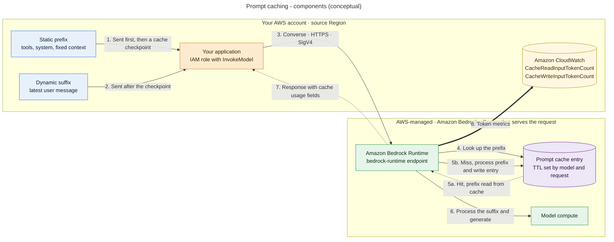
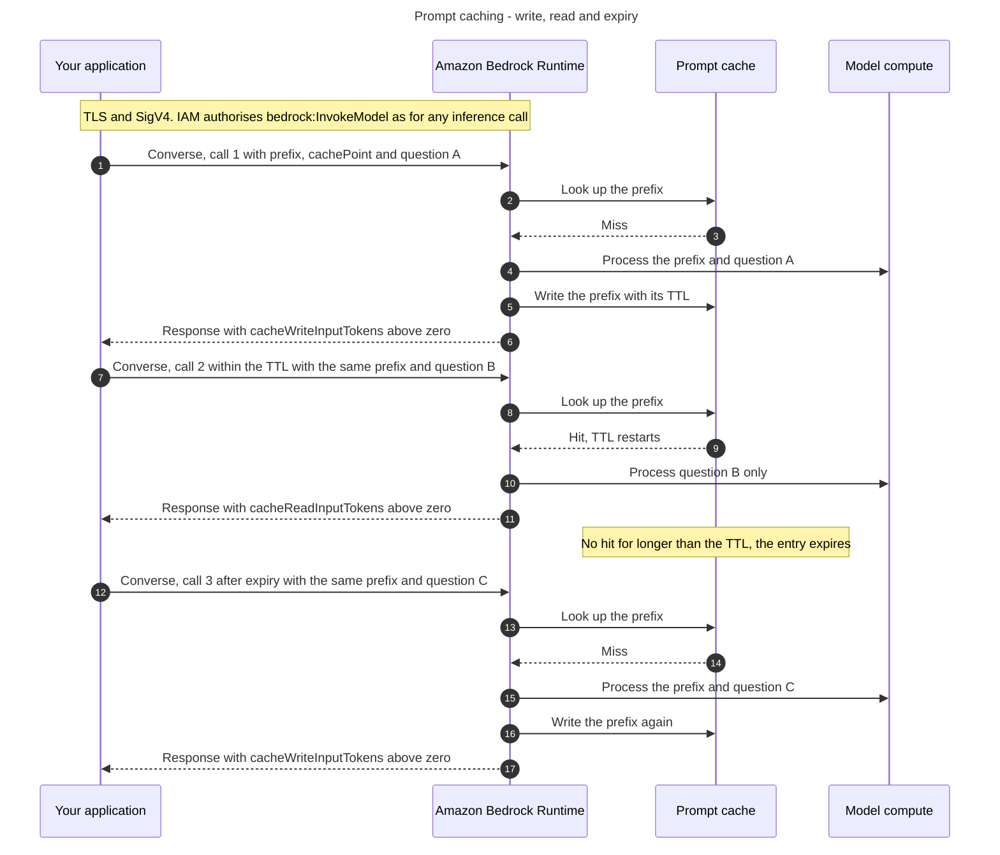

# Prompt caching

> **Level:** Intermediate · **Verified:** 2026-11-15 · **Feature status:** GA · **Time:** ~25 min

Prompt caching lets Amazon Bedrock reuse the work it did on the **beginning** of a prompt. When the
next request starts with the same bytes, the model reads that prefix from a cache instead of
processing it again, which lowers input cost and latency. It is a request-time option of the
inference APIs, not a resource you create.

> [!IMPORTANT]
> **Status** — GA. Available "in all AWS Regions where the supported models are available", for
> on-demand inference only — "not supported with the batch inference API". How long an entry lives,
> how large a prefix must be and which request field marks it all **depend on the model**. A 1-hour
> lifetime for select Anthropic Claude models was announced on 2026-01-26.
> Sources: [Prompt caching](https://docs.aws.amazon.com/bedrock/latest/userguide/prompt-caching.html),
> [1-hour duration announcement](https://aws.amazon.com/about-aws/whats-new/2026/01/amazon-bedrock-one-hour-duration-prompt-caching/)

## Learning objectives

- Explain what is cached (a prompt prefix) and what is not (the response).
- Distinguish implicit from explicit caching and place a cache checkpoint correctly.
- Write the cache marker for Converse, InvokeModel and the OpenAI-compatible APIs.
- Read the lifetime, minimum size and checkpoint limit for a model from the documentation table.
- Read cache reads and writes from the response and from Amazon CloudWatch, and reason about cost.

## Prerequisites

- [Tokens, context windows, and training versus inference](../../00-foundations/generative-ai-fundamentals/02-tokens-context-windows-inference.md)
- [Latency and token economics](../../00-foundations/generative-ai-fundamentals/08-latency-and-token-economics.md)
- [The Converse API](../inference/01-converse-api.md)
- [Cross-Region inference: Geo and Global profiles](../inference/04-cross-region-inference.md)

## 1. What it is

**Plain language.** Many requests begin with the same long text: instructions, tool definitions, a
contract. Caching is a bookmark placed after that shared part. The first request pays to read up to
the bookmark and to save it; later requests that start identically jump to the bookmark and read
only what follows.

**Precisely.** Bedrock caches a **prompt prefix**. A **cache checkpoint** marks "the contiguous
subsection of your prompt that you want to cache". A later request reads the entry only if its
prefix up to the checkpoint is unchanged and the entry has not expired. The time to live (TTL)
"resets with each successful cache hit".

| Item | Value |
|:--|:--|
| Service namespace / endpoint | `bedrock-runtime`; the Responses API with OpenAI models is also served on `bedrock-mantle` |
| Control-plane operations | None — there is nothing to create |
| Data-plane operations | `Converse`, `ConverseStream`, `InvokeModel`, `InvokeModelWithResponseStream`; the OpenAI-compatible Responses and Chat Completions APIs; the Anthropic Messages API |
| IAM action prefix | `bedrock:` — the normal inference actions; caching needs no extra permission |

### Implicit and explicit caching

| Type | How it works | What you send |
|:--|:--|:--|
| Implicit | Bedrock and the model "automatically attempt to reuse eligible prompt prefixes". Best effort | Nothing. Keep static content first |
| Explicit | You opt in with model-specific cache controls or checkpoints | The marker for your model and API |

### The marker, by API

| API | Model family | Marker, exactly as documented |
|:--|:--|:--|
| Converse, ConverseStream | Anthropic Claude, Amazon Nova | A block `{"cachePoint": {"type": "default"}}` in `system`, in a message's `content`, or in `toolConfig.tools`. Optional `"ttl": "1h"` on models that support it (API values: `5m`, `1h`) |
| Converse | Anthropic Claude (automatic caching) | `additionalModelRequestFields={"cache_control": {"type": "ephemeral"}}` — Claude places and moves the checkpoint itself |
| InvokeModel, Anthropic Messages API | Anthropic Claude | `"cache_control": {"type": "ephemeral"}` on a content block, optionally with `"ttl": "1h"`; or one top-level `cache_control` for automatic caching |
| InvokeModel | Amazon Nova | `"cachePoint": {"type": "default"}` on a content item |
| Responses API | OpenAI GPT-5.6 and later | `"prompt_cache_breakpoint": {"mode": "explicit"}` on a supported content block; `prompt_cache_options.mode` is `implicit` (default) or `explicit` |
| Chat Completions, InvokeModel | OpenAI GPT-5.6 and later | `prompt_cache_breakpoint` on `text` content parts. "Converse doesn't support explicit caching for this model" |
| Any supported API | OpenAI GPT-5.5 and earlier | None — implicit caching of prefixes of 1,024 tokens or more |

### Limits by model family

Read on 2026-11-15 from the table "Supported models, Regions, and explicit caching limits". Check the
row for your exact model — the minimum differs between models of one family.

| Family (explicit caching) | Supported TTL | Minimum tokens per checkpoint | Maximum per request | Fields that accept a checkpoint |
|:--|:--|:--|:--|:--|
| Anthropic Claude (Haiku 4.5 through the 5.x models) | 5 minutes, 1 hour | 512, 1,024 or 4,096 depending on the model | 4 checkpoints | `system`, `messages`, `tools` |
| OpenAI GPT-5.6, GPT-6 and GPT-6.1 models | 30 minutes | 1,024 | 4 cache writes | `prompt_cache_breakpoint` (not through Converse) |
| Amazon Nova (2 Lite, Pro, Lite, Micro) | 5 minutes | 1K; at most 20K tokens cached | 4 checkpoints | `system`, `messages` |

Amazon Nova also applies implicit caching to all text prompts; that reuse "isn't reported in the
cache usage fields and isn't billed as cache reads".

Source for this section: [Prompt caching](https://docs.aws.amazon.com/bedrock/latest/userguide/prompt-caching.html),
[CachePointBlock](https://docs.aws.amazon.com/bedrock/latest/APIReference/API_runtime_CachePointBlock.html)

## 2. Why it exists

A model has no memory between calls, so a chat application resends its instructions, tools and
history on every turn, and an agent resends them on every step. You pay input tokens and processing
time for the same text again and again. Without prompt caching the only remedies are shorter
prompts or fewer calls.

## 3. When to use it

- A long system prompt or tool list is identical across requests.
- Users ask several questions about one document.
- Multi-turn chat and agent loops, where each request extends the previous one.
- Few-shot prompts with many fixed examples.
- You are near a tokens-per-minute quota: tokens read from the cache "don't count toward your TPM quota".

## 4. When not to use it

- **The prefix is below the model's minimum.** Inference "still succeeds, but your prefix isn't cached".
- **The start of the prompt changes every time** (a timestamp, a request ID, a user name first).
  Move the changing part to the end, or accept no caching.
- **Requests are rarer than the TTL.** You pay cache writes and never read them.
- **Batch inference.** Not supported — see [Batch inference](../inference/08-batch-inference.md).
- **You want to reuse answers, not inputs.** Prompt caching never returns a stored response; the
  model still generates. For response and retrieval caches see
  [Caching strategies](../../08-cost-performance-and-reliability/04-caching-strategies.md).
- **You need a guaranteed hit.** "Support for prompt caching doesn't guarantee a cache hit for any request."

## 5. Internal architecture

AWS documents the request markers, the matching rule, the TTL and the usage fields. It says only
that "a cache entry is stored on the server that processed the request". The diagram is a conceptual
model, not a description of the service's implementation.



| Legend | Meaning |
|:--|:--|
| Solid arrow | Request or write |
| Dashed arrow | Response or cache read |
| Thick arrow | Asynchronous metrics |
| Cylinder | Stored data (the cache entry is transient) |

**What this shows** — the application decides what is cacheable by ordering the prompt. The service
decides, per request, whether an entry can be read.

1. The application puts unchanging content first and marks its end with a checkpoint.
2. Content that changes goes after the checkpoint.
3. The request is an ordinary inference call.
4. Bedrock checks whether an entry exists for this exact prefix.
5. On a hit the prefix is read from the cache; on a miss it is processed and written.
6. The model processes the rest and generates the answer — always.
7. The response reports how many tokens were read from and written to the cache.
8. CloudWatch receives the same counts as metrics.

**Variations** — with implicit caching there is no step 1 marker; the service picks the prefix. With
a cross-Region inference profile, the box on the right can be a different Region on each call. The
full picture, including expiry, is in [diagram set 19](../../diagrams/mermaid/19-prompt-caching.md).

## 6. Request and response lifecycle



- **Steps 1–6, first call.** The prefix is processed in full and written. Write tokens are billed at
  the cache-write rate.
- **Steps 7–11, second call within the TTL.** The prefix is read; only the new content is processed.
  The hit restarts the TTL.
- **Steps 12–17, after expiry.** The entry is gone, so the call behaves like the first one.

### Rules that decide a hit

- **Order.** "Cache checkpoints are processed in this order: `tools` → `system` → `messages`."
  Changing an earlier section invalidates the later ones: "modifying `tools` invalidates the `system`
  and `messages` caches".
- **Minimum size is cumulative.** It is "evaluated against the cumulative tokens across all three
  sections combined"; there is "no minimum number of tokens required between cache checkpoints".
- **Exact prefix.** "Changes to a prompt prefix in subsequent requests result in cache misses."
- **Claude lookback.** A checkpoint also finds earlier, already-written boundaries, but "only about
  20 content blocks before your cache checkpoint". Beyond that, add checkpoints.
- **Mixed TTLs (Claude).** Longer first: "a 1-hour cache entry must appear before any 5-minute cache entries".
- **Same server.** Requests "served by a different server, such as one in another Region, or … sent
  before an identical request has started its response, write a new entry instead of reading one".
  Parallel fan-out of identical first calls therefore writes several times.

### Reading the result

| Where | Fields |
|:--|:--|
| Converse response `usage` | `cacheReadInputTokens`, `cacheWriteInputTokens`, `cacheDetails[]` (`ttl`, `inputTokens` written per TTL). `inputTokens` then counts **only** the uncached input: total input = `inputTokens + cacheReadInputTokens + cacheWriteInputTokens` |
| Responses API `usage` (OpenAI models) | `input_tokens_details.cached_tokens` and `cache_write_tokens`; here `input_tokens` **includes** both |
| Amazon CloudWatch, namespace `AWS/Bedrock` | `CacheReadInputTokenCount` (does not count toward TPM), `CacheWriteInputTokenCount` (counts toward TPM) |
| InvokeModel | The provider's own usage object. Its cache field names are on each model's parameter page, which was not opened for this chapter — **UNVERIFIED — REQUIRES DOCUMENTATION REVIEW** |

Error paths: adding `ttl` for a model that supports only 5 minutes "can result in a
`ValidationException`"; so does top-level `cache_control` on a Claude model without automatic
caching. A checkpoint on a too-short prefix is not an error.

Sources: [Prompt caching](https://docs.aws.amazon.com/bedrock/latest/userguide/prompt-caching.html),
[TokenUsage](https://docs.aws.amazon.com/bedrock/latest/APIReference/API_runtime_TokenUsage.html),
[CacheDetail](https://docs.aws.amazon.com/bedrock/latest/APIReference/API_runtime_CacheDetail.html),
[CloudWatch metrics for bedrock-runtime](https://docs.aws.amazon.com/bedrock/latest/userguide/monitoring-runtime-metrics.html)

## 7. Dependencies

| Depends on | Why | Required or optional |
|:--|:--|:-:|
| A model that supports caching on the API you use | Support "varies by model and API" | Required |
| On-demand inference | Batch inference is excluded | Required |
| A stable, long enough prefix | Minimum tokens per checkpoint | Required |
| The `CHAT` template type | To cache inside a managed prompt | Required with [Prompt management](../prompt-management/01-prompt-management.md) |
| Cross-Region inference | Works with caching; can increase writes | Optional |

## 8. Security considerations

- **Permissions.** None beyond `bedrock:InvokeModel` / `bedrock:InvokeModelWithResponseStream`.
- **What is retained.** The Converse reference says Bedrock "doesn't store any text, images, or
  documents that you provide as content". A cache entry nevertheless keeps a processed prefix for its
  TTL. The pages read do not describe the entry's form, its encryption, or how entries are isolated
  between accounts or callers — **UNVERIFIED — REQUIRES DOCUMENTATION REVIEW** (looked on the prompt
  caching page and the Converse reference). Raise it with AWS if your data classification depends on it.
- **Location.** With a cross-Region profile the entry is created where the request was served.
  Treat it as you treat cross-Region inference itself — see
  [Cross-Region considerations and data residency](../../09-advanced-topics/11-cross-region-and-data-residency.md).
- **Prefix content.** The cached part is usually the most sensitive part (instructions, documents).
  Per-user data placed before the checkpoint also prevents sharing the prefix between users.
- **Logging.** Model invocation logging records requests whether or not they hit the cache.

## 9. Networking requirements

Nothing new: the same public endpoint or interface endpoint
(`com.amazonaws.<region>.bedrock-runtime`) as any inference call. Caching "can be used in
conjunction with cross region inference", but because the profile picks a Region per request,
"at times of high demand, these optimizations may lead to increased cache writes". See
[Private connectivity for Bedrock](../../02-related-aws-services/networking/01-private-connectivity-for-bedrock.md)
and [diagram set 21](../../diagrams/mermaid/21-cross-region-inference.md).

## 10. Pricing dimensions

Input tokens are billed at one of three rates. No figure is quoted here; rates are per model.

| Dimension | Unit | Notes |
|:--|:--|:--|
| Cache write | Input tokens written | At the model's cache-write rate, which "can be higher than the standard input token rate". The 1-hour cache "is billed at a different rate than the standard 5-minute cache". GPT-5.6 and later: 1.25× the uncached input rate. GPT-5.5 and earlier: no write fee |
| Cache read | Input tokens read | At the model's reduced cache-read rate |
| Standard input | All other input tokens | Unchanged |
| Output | Output tokens | Unchanged — caching never reduces output cost |
| Amazon Nova implicit reuse | — | Not reported and not billed as cache reads |

**Our reading:** caching pays when reads within the TTL outweigh the write premium. Per prefix
token, a read saves (input rate − read rate) and a write costs (write rate − input rate); where the
write rate is above the input rate, a prefix that is written and never read costs more than no caching.

Source: [Amazon Bedrock pricing](https://aws.amazon.com/bedrock/pricing/)

## 11. Scaling considerations

- **Quota relief.** Cache reads do not count toward tokens-per-minute; cache writes do.
- **At most four.** Four checkpoints (Claude, Nova) or four cache writes (GPT-5.6 and later) per request.
- **Traffic shape matters.** A steady stream of requests keeps an entry alive because each hit
  restarts the TTL. Bursty traffic with gaps longer than the TTL writes repeatedly.
- **Warm before fan-out.** Send one request and let it start responding before issuing parallel
  requests with the same prefix.
- **Longer TTL.** The documentation recommends the 1-hour option when follow-ups arrive less often
  than every five minutes but more often than hourly, for example a slow agent step.

## 12. IaC support

| Tool | Support | Resource / construct | Notes |
|:--|:-:|:--|:--|
| Terraform (`hashicorp/aws` 6.73.0) | n/a | — | A request option. `aws_bedrockagent_prompt` and the inline prompt of `aws_bedrockagent_flow` accept `cache_point { type = "default" }` blocks |
| CloudFormation | n/a | — | Nothing to provision |
| AWS CDK (`aws-cdk-lib` 2.277.0) | n/a | — | Nothing to provision |

Checked against [the Terraform reference](../../references/terraform-aws-provider-bedrock.md). The
caching decision lives in application code and in prompt templates.

## 13. Working example

> **Code status:** syntax-checked (`python -m py_compile`) · **never run against AWS**

```python
"""Converse with one explicit cache checkpoint, then read the cache usage fields."""
import os

import boto3

runtime = boto3.client("bedrock-runtime")

# Configuration, never a literal: confirm the current model or inference profile ID
# and that the model supports explicit caching through Converse.
MODEL_ID = os.environ["MODEL_ID"]

# Static prefix: identical bytes on every call. It must reach the model's minimum
# token count before the checkpoint, otherwise nothing is cached (and nothing fails).
POLICY_TEXT = open(os.environ["POLICY_FILE"], encoding="utf-8").read()

SYSTEM = [
    {"text": "You answer questions about the policy below. Quote the clause you used."},
    {"text": POLICY_TEXT},
    # Everything before this marker is the cacheable prefix (tools, then system).
    # Add "ttl": "1h" only for a model whose table row lists the 1-hour TTL.
    {"cachePoint": {"type": "default"}},
]


def ask(question: str) -> dict:
    response = runtime.converse(
        modelId=MODEL_ID,
        system=SYSTEM,
        # Dynamic suffix: changes on every call, so it sits after the checkpoint.
        messages=[{"role": "user", "content": [{"text": question}]}],
        inferenceConfig={"maxTokens": 300},
    )
    usage = response["usage"]
    read = usage.get("cacheReadInputTokens", 0)
    written = usage.get("cacheWriteInputTokens", 0)
    uncached = usage["inputTokens"]  # excludes tokens read from or written to the cache
    return {
        "answer": response["output"]["message"]["content"][0]["text"],
        "cache": "hit" if read else ("write" if written else "none"),
        "cache_read_tokens": read,
        "cache_write_tokens": written,
        "write_ttls": [(d["ttl"], d["inputTokens"]) for d in usage.get("cacheDetails", [])],
        "total_input_tokens": uncached + read + written,
        "output_tokens": usage["outputTokens"],
    }


if __name__ == "__main__":
    first = ask("How many days do I have to return an item?")
    second = ask("Who pays for return shipping?")
    for label, result in (("first", first), ("second", second)):
        print(label, {k: v for k, v in result.items() if k != "answer"})
    # Expected when caching works: first -> "write", second (within the TTL) -> "hit".
    # A second "write" means the prefix changed, was too short, or another server took the call.
```

> [!TIP]
> **Academy recommendation** — Log the three input counters on every call and alarm on the
> read-to-write ratio. A deployment that adds a date to the system prompt silently turns every call
> into a cache write; only the counters show it.
> This is our design guidance, not an official AWS reference architecture.

## Common mistakes

| Mistake | Symptom | Fix |
|:--|:--|:--|
| Dynamic text (date, user name) at the top of the system prompt | `cacheWriteInputTokens` on every call, never a read | Move it after the checkpoint |
| Prefix shorter than the model's minimum | Both cache counters are zero, no error | Check the table row; cache more or do not cache |
| Reading `inputTokens` as the total | Dashboards show input "dropping" | Add the read and write counters (Converse) |
| `ttl` on a model with only a 5-minute TTL | `ValidationException` | Omit `ttl` |
| `cachePoint` through Converse for a GPT-5.6 or later model | No explicit caching | Use `prompt_cache_breakpoint` on Responses, Chat Completions or InvokeModel |
| Changing the tool list between turns | Later caches invalidated | Keep `tools` stable; order is tools → system → messages |
| Expecting cheaper output | Output cost unchanged | Caching affects input only |
| Parallel first requests | Several writes of the same prefix | Warm with one request first |

## Knowledge check

1. Your Converse response shows `inputTokens: 40`, `cacheReadInputTokens: 6000`, `cacheWriteInputTokens: 0`. How many input tokens did you send, and what happened?
2. You add a tool between two turns of a conversation. Which cached sections are lost?
3. Why can a cross-Region inference profile lower your cache hit rate?
4. A nightly job sends one request per hour with a 2,000-token system prompt on a model whose only TTL is 5 minutes. Should it use explicit caching?

<details>
<summary>Answers</summary>

1. 6,040. The 6,000-token prefix was read from the cache (a hit) and only 40 tokens were processed at the standard rate.
2. All of them. Checkpoints are processed tools → system → messages and the sections are chained, so a change in `tools` invalidates `system` and `messages` caches.
3. An entry lives on the server that processed the request. The profile may send the next request to another Region, which writes a new entry instead of reading the existing one.
4. No. Each request arrives long after the entry expired, so every call is a write, billed at the cache-write rate, and nothing is ever read.

</details>

## 14. Official documentation

- [Prompt caching for faster model inference](https://docs.aws.amazon.com/bedrock/latest/userguide/prompt-caching.html) — types, the model table, per-API syntax, ordering rules, usage fields.
- [Amazon Bedrock now supports 1-hour duration for prompt caching](https://aws.amazon.com/about-aws/whats-new/2026/01/amazon-bedrock-one-hour-duration-prompt-caching/) — 2026-01-26 announcement.
- [CachePointBlock](https://docs.aws.amazon.com/bedrock/latest/APIReference/API_runtime_CachePointBlock.html) — `type` and `ttl` values.
- [TokenUsage](https://docs.aws.amazon.com/bedrock/latest/APIReference/API_runtime_TokenUsage.html) and [CacheDetail](https://docs.aws.amazon.com/bedrock/latest/APIReference/API_runtime_CacheDetail.html) — cache fields in the Converse response.
- [Converse API reference](https://docs.aws.amazon.com/bedrock/latest/APIReference/API_runtime_Converse.html) — request and response syntax; statement on content storage.
- [Monitor bedrock-runtime inference using CloudWatch metrics](https://docs.aws.amazon.com/bedrock/latest/userguide/monitoring-runtime-metrics.html) — cache token metrics and their effect on TPM.
- [Create a prompt using Prompt management](https://docs.aws.amazon.com/bedrock/latest/userguide/prompt-management-create.html) — caching options for managed prompts.
- [Amazon Bedrock pricing](https://aws.amazon.com/bedrock/pricing/) — cache read and cache write rates per model.
- [Feature verification matrix](../../FEATURE-VERIFICATION.md) — the academy's register entry for this feature.
