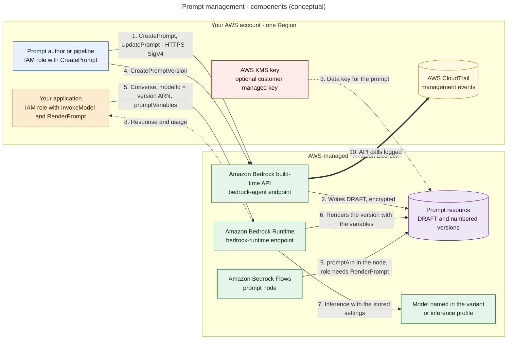
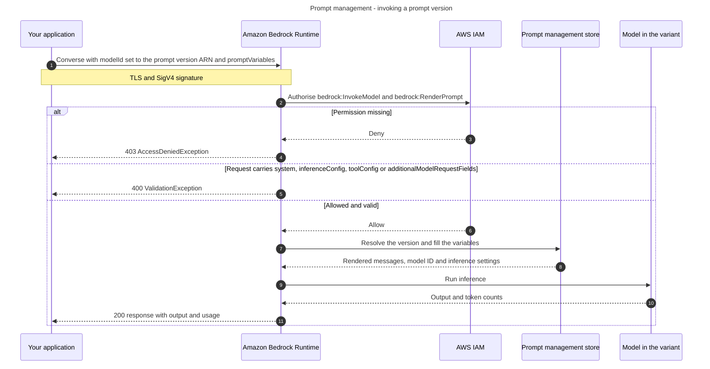

# Prompt management

> **Level:** Intermediate · **Verified:** 2026-11-15 · **Feature status:** GA · **Time:** ~20 min

Prompt management stores a prompt — its text, variables, model and inference settings — as a
versioned Amazon Bedrock resource. Your application then calls the prompt by ARN instead of carrying
the prompt text in code, and Amazon Bedrock Flows can reference the same resource from a prompt node.

> [!IMPORTANT]
> **Status** — GA since 2024-11-07. Supported in the 22 Regions listed in the documentation,
> including both AWS GovCloud (US) Regions. Works with any text model supported by the Converse API;
> `InvokeModel` works only for prompts configured with an Anthropic Claude or Meta Llama model.
> Sources: [Supported Regions and models for Prompt management](https://docs.aws.amazon.com/bedrock/latest/userguide/prompt-management-supported.html),
> [Document history](https://docs.aws.amazon.com/bedrock/latest/userguide/bedrock-ug-doc-history.html)

## Learning objectives

- Describe a prompt resource: variants, variables, the draft and numbered versions.
- Create a prompt and cut a version, and say which of the two Terraform can do.
- Invoke a prompt version through Converse and list the request fields that are then rejected.
- Write the IAM permissions for authors, for callers and for a flow that uses the prompt.
- Decide when a managed prompt is worth the extra resource and when it is not.

## Prerequisites

- [The Converse API](../inference/01-converse-api.md)
- [Tokens, context windows, and training versus inference](../../00-foundations/generative-ai-fundamentals/02-tokens-context-windows-inference.md)
- [IAM fundamentals: principals, policies and evaluation](../../00-foundations/security/01-iam-fundamentals.md)
- [AWS KMS and encryption](../../00-foundations/security/04-kms-encryption.md)

## 1. What it is

**Plain language.** A prompt is usually a string buried in application code. Prompt management moves
it into Amazon Bedrock as a named object with a history. You edit a draft, freeze a numbered version
when it is good, and your application asks for "version 3 of the support prompt" and supplies only
the values for the blanks.

**Precisely.** A prompt is a `bedrock-agent` resource created with `CreatePrompt`. It holds one or
more **variants**; each variant has a template (`TEXT` or `CHAT`), a model or inference profile ID
(or an agent), base inference parameters and optional model-specific fields. `CreatePromptVersion`
snapshots the draft. At run time you pass the version's ARN as `modelId` to Converse and fill the
`{{variables}}` through `promptVariables`.

| Item | Value |
|:--|:--|
| Service namespace / endpoint | Authoring on `bedrock-agent` (build-time endpoint); invocation on `bedrock-runtime` |
| Control-plane operations | `CreatePrompt`, `GetPrompt`, `ListPrompts`, `UpdatePrompt`, `DeletePrompt`, `CreatePromptVersion` |
| Data-plane operations | `Converse`, `ConverseStream`, `InvokeModel`, `InvokeModelWithResponseStream` with `modelId` = prompt version ARN |
| IAM action prefix | `bedrock:` — including `bedrock:RenderPrompt`, an IAM action with no API operation of the same name |
| ARN | `arn:aws:bedrock:<region>:<account-id>:prompt/<prompt-id>` plus `:<version>` for a version |

Operation names were checked against [the API operations reference](../../references/bedrock-api-operations.md).

### The parts of a prompt

| Term | Meaning (as documented) |
|:--|:--|
| Variable | A placeholder written `{{name}}`, filled when you test or invoke the prompt |
| Variant | "An alternative configuration of the prompt, including its message or the model or inference configurations used". The console compares up to three |
| Template type | `TEXT` (one message) or `CHAT` (system prompt, message history, tools). `CHAT` needs a Converse-capable model and is required for prompt caching |
| Draft | The working copy, version `DRAFT`. Every save overwrites it |
| Version | A snapshot of the draft. "Versions are created incrementally, starting from 1" |
| Default variant | The variant named in `defaultVariant` |

Sources: [Prompt management](https://docs.aws.amazon.com/bedrock/latest/userguide/prompt-management.html),
[Create a prompt](https://docs.aws.amazon.com/bedrock/latest/userguide/prompt-management-create.html),
[Create a version](https://docs.aws.amazon.com/bedrock/latest/userguide/prompt-management-version-create.html)

## 2. Why it exists

Without it, a prompt change is a code deployment, nobody can say which wording produced last week's
answers, and the prompt, model ID and temperature drift apart across services. You would build your
own store, versioning, access control and encryption. Prompt management gives you those four things
and one place where a prompt, its model and its parameters are frozen together.

## 3. When to use it

- Several applications or flows share one prompt and must change together.
- Prompt authors are not the people who deploy the application.
- You need an audit trail: which version, who changed it, when (AWS CloudTrail records the API calls).
- You want to roll a prompt back by changing one ARN in configuration.
- You compare variants across models before choosing one, or feed a prompt to
  [prompt optimization](02-prompt-optimization.md).

## 4. When not to use it

- **The prompt is assembled dynamically** (retrieved context, tool results, long history). A managed
  prompt fixes the system prompt and tools; build the request yourself with
  [the Converse API](../inference/01-converse-api.md).
- **You must set `inferenceConfig`, `toolConfig` or `system` per request.** Converse rejects them with
  a managed prompt.
- **You use the OpenAI- or Anthropic-compatible APIs.** The documentation describes prompt invocation
  only for Converse and InvokeModel — see [OpenAI- and Anthropic-compatible APIs](../inference/03-openai-and-anthropic-compatible-apis.md).
- **You want multi-step logic.** A prompt is one model call; use [Amazon Bedrock Flows](../flows/01-bedrock-flows.md).
- **Git review is your control.** A prompt kept in the repository and deployed with the code is
  simpler when one team owns both.

## 5. Internal architecture

AWS documents the resource, the two endpoints and the permissions. How a version is stored and
rendered inside the service is not documented; the diagram is a conceptual model of the visible parts.



| Legend | Meaning |
|:--|:--|
| Solid arrow | Request |
| Dashed arrow | Response or key use |
| Thick arrow | Asynchronous logging |
| Cylinder | Data at rest |

**What this shows** — authoring and invocation use different endpoints and different permissions.
The prompt lives in the service; the application holds only an ARN.

1. An author calls `CreatePrompt` (or `UpdatePrompt`) with the variants.
2. The response "creates a `DRAFT` version and returns an ID and ARN".
3. The prompt is encrypted with an AWS managed key, or with your key if you name one.
4. `CreatePromptVersion` snapshots the draft as the next number.
5. The application calls Converse with the version ARN and the variable values.
6. Bedrock resolves the version and fills the variables.
7. Inference runs on the model and with the parameters stored in the version.
8. The response is a normal Converse response.
9. A flow's prompt node can point at the same version through `promptArn`.
10. CloudTrail records the authoring calls.

**Variations** — a variant can target an agent (`genAiResource`) instead of a model; such a prompt can
only be tested in the console. **Our reading:** when a version has several variants, the default
variant is the one that runs; the pages read do not say so explicitly. The inference path itself is
drawn in [diagram set 4](../../diagrams/mermaid/04-converse-api-application.md).

## 6. Request and response lifecycle



- **Step 1** — the request body can be only `promptVariables`. You "don't need to specify `messages`
  or `system` fields — these are defined in the prompt template".
- **Steps 2–4** — the caller needs `bedrock:InvokeModel` (or the streaming action) and
  `bedrock:RenderPrompt`, "required to invoke a prompt from Prompt management".
- **Step 5** — with a managed prompt "you can't include … `additionalModelRequestFields`,
  `inferenceConfig`, `system`, or `toolConfig`". **Our reading:** the rejection is a 400
  `ValidationException`; the page states the rule, not the status code.
- **Steps 6–11** — anything you send in `messages` is "appended after the messages defined in the
  prompt". A `guardrailConfig` applies to the whole prompt unless you mark `guardContent` blocks.

Other error paths: **404 `ResourceNotFoundException`** for a deleted version, **429** when the
underlying model throttles.

Sources: [Converse API reference](https://docs.aws.amazon.com/bedrock/latest/APIReference/API_runtime_Converse.html),
[Test a prompt](https://docs.aws.amazon.com/bedrock/latest/userguide/prompt-management-test.html),
[Prerequisites for running model inference](https://docs.aws.amazon.com/bedrock/latest/userguide/inference-prereq.html)

## 7. Dependencies

| Depends on | Why | Required or optional |
|:--|:--|:-:|
| A text model supported by Converse, or an inference profile | The variant's `modelId` | Required to invoke |
| Access to that model | The prompt does not grant model access | Required |
| IAM permissions for authoring and for rendering | Separate action sets | Required |
| AWS KMS customer managed key | Encrypt the prompt with your own key | Optional |
| Amazon Bedrock Flows | To run the prompt as a node | Optional |
| Amazon Bedrock Guardrails | Applied at invocation with `guardrailConfig` | Optional |

## 8. Security considerations

- **Two audiences, two policies.** Authors need `bedrock:CreatePrompt`, `UpdatePrompt`, `GetPrompt`,
  `ListPrompts`, `DeletePrompt` and `CreatePromptVersion`. Callers need only `bedrock:RenderPrompt`
  on the prompt ARN and `bedrock:InvokeModel` on the model. The documented example uses
  `"Resource": "*"`; narrow it.
- **A prompt is an instruction to the model.** Whoever can call `UpdatePrompt` and
  `CreatePromptVersion` can change what your application says. Pin applications to a version ARN.
- **Encryption.** "If you omit this field, your prompt will be encrypted with an AWS managed key."
  For a customer managed key, the key policy lets `bedrock.amazonaws.com` use `kms:GenerateDataKey`
  and `kms:Decrypt`, scoped by the encryption context key `aws:bedrock-prompts:arn`.
- **Variables are untrusted input.** A value placed in `{{question}}` reaches the model; see
  [Prompt injection, untrusted tool output and retrieval poisoning](../../06-security-governance/04-prompt-injection-and-untrusted-content.md).
- **Do not put secrets in a prompt.** Anyone with `bedrock:GetPrompt` can read it.

Source: [Prerequisites for prompt management](https://docs.aws.amazon.com/bedrock/latest/userguide/prompt-management-prereq.html)

## 9. Networking requirements

Both endpoints are public Regional endpoints with interface VPC endpoints available:
`com.amazonaws.<region>.bedrock-agent` for authoring and `com.amazonaws.<region>.bedrock-runtime`
for invocation. A prompt is a Regional resource; if its variant names a cross-Region inference
profile, inference can run in another Region while the prompt stays where it was created. See
[Private connectivity for Bedrock](../../02-related-aws-services/networking/01-private-connectivity-for-bedrock.md).

Source: [Interface VPC endpoints for Amazon Bedrock](https://docs.aws.amazon.com/bedrock/latest/userguide/vpc-interface-endpoints.html)

## 10. Pricing dimensions

| Dimension | Unit | Notes |
|:--|:--|:--|
| Inference through a prompt | Tokens, at the model's rate | Same as calling the model directly |
| The prompt resource and its versions | — | No separate charge appears on the pricing page (searched; none found) |
| Simple prompt optimization in the prompt builder | Tokens | Charged separately — see [Prompt optimization](02-prompt-optimization.md) |
| Customer managed KMS key | AWS KMS rates | Only if you bring a key |

Source: [Amazon Bedrock pricing](https://aws.amazon.com/bedrock/pricing/)

## 11. Scaling considerations

| Quota (each supported Region) | Default | Adjustable |
|:--|--:|:-:|
| Prompts per account | 500 | Yes |
| Versions per prompt | 10 | No |
| `CreatePrompt`, `UpdatePrompt`, `DeletePrompt`, `CreatePromptVersion` requests per second | 2 | No |
| `GetPrompt`, `ListPrompts` requests per second | 10 | No |

Invocation throughput is the model's, not the prompt's. Ten versions is a small number: delete old
versions as part of the release process, and keep the full history in source control.

Source: [Amazon Bedrock endpoints and quotas](https://docs.aws.amazon.com/general/latest/gr/bedrock.html)

## 12. IaC support

| Tool | Support | Resource / construct | Notes |
|:--|:-:|:--|:--|
| Terraform (`hashicorp/aws` 6.73.0) | ✅ prompt · ❌ version | `aws_bedrockagent_prompt` | Manages the `DRAFT` only; the provider has no prompt-version resource |
| CloudFormation | ✅ | `AWS::Bedrock::Prompt`, `AWS::Bedrock::PromptVersion` | |
| AWS CDK (`aws-cdk-lib` 2.277.0) | L1 · alpha L2 | `aws_bedrock.CfnPrompt`, `aws_bedrock.CfnPromptVersion`; `Prompt`, `PromptVersion` in `@aws-cdk/aws-bedrock-alpha` | The alpha package is experimental |

With Terraform, create versions with `CreatePromptVersion` from the pipeline (SDK or CLI) after
`terraform apply`, or use CloudFormation for the version. Checked against
[the Terraform reference](../../references/terraform-aws-provider-bedrock.md) and
[the CDK and CloudFormation reference](../../references/cdk-and-cloudformation-bedrock.md).

## 13. Working example

> **Code status:** validated with `terraform validate` (provider 6.73.0, with a `versions.tf` that sets `required_version = ">= 1.11.0"` and `hashicorp/aws ~> 6.73`) · **never planned or applied against AWS**

```hcl
provider "aws" {
  region = var.region

  default_tags {
    tags = var.tags
  }
}

variable "region" {
  description = "Region in which the prompt is stored. Prompt management must be available there."
  type        = string
  default     = "us-east-1"
}

variable "model_id" {
  description = "Model ID or inference profile ID that the variant runs on. Confirm the current ID in the model catalog; do not hard-code one."
  type        = string
}

variable "prompt_name" {
  description = "Name of the prompt resource."
  type        = string
  default     = "support-answer"
}

variable "kms_key_arn" {
  description = "Customer managed KMS key for the prompt. Leave null to use the AWS managed key."
  type        = string
  default     = null
}

variable "tags" {
  description = "Tags applied to every resource through the provider's default_tags."
  type        = map(string)
  default     = {}
}

resource "aws_bedrockagent_prompt" "support_answer" {
  name                        = var.prompt_name
  description                 = "Answers a customer question from the supplied policy text."
  default_variant             = "concise"
  customer_encryption_key_arn = var.kms_key_arn

  variant {
    name          = "concise"
    model_id      = var.model_id
    template_type = "CHAT" # CHAT needs a Converse-capable model

    inference_configuration {
      text {
        max_tokens  = 500
        temperature = 0.2
      }
    }

    template_configuration {
      chat {
        system {
          text = "You are a support assistant. Answer only from the policy text. If the answer is not there, say so."
        }

        message {
          role = "user"

          content {
            text = "Policy:\n{{policy}}\n\nQuestion:\n{{question}}"
          }
        }

        input_variable {
          name = "policy"
        }

        input_variable {
          name = "question"
        }
      }
    }
  }
}

output "prompt_id" {
  description = "Prompt identifier. Pass it to CreatePromptVersion to cut an immutable version."
  value       = aws_bedrockagent_prompt.support_answer.id
}

output "prompt_draft_arn" {
  description = "ARN of the prompt (the DRAFT). Append :<version> after creating a version."
  value       = aws_bedrockagent_prompt.support_answer.arn
}

output "prompt_version" {
  description = "Version that Terraform manages. Always DRAFT for this resource."
  value       = aws_bedrockagent_prompt.support_answer.version
}
```

The `system`, `message` and tool blocks also accept a `cache_point` block; see
[Prompt caching](../prompt-caching/01-prompt-caching.md). Invoking a version:

> **Code status:** syntax-checked (`python -m py_compile`) · **never run against AWS**

```python
import os

import boto3

runtime = boto3.client("bedrock-runtime")

response = runtime.converse(
    # ARN of a prompt *version*, for example ...:prompt/<prompt-id>:1 — from configuration.
    modelId=os.environ["PROMPT_VERSION_ARN"],
    promptVariables={
        "policy": {"text": "Items can be returned within 30 days with a receipt."},
        "question": {"text": "Can I return a jacket after five weeks?"},
    },
    # Not allowed with a managed prompt: system, inferenceConfig, toolConfig,
    # additionalModelRequestFields. They come from the prompt version.
)

print(response["output"]["message"]["content"][0]["text"])
print(response["usage"])
```

> [!TIP]
> **Academy recommendation** — Treat a version ARN like a container image tag: applications reference
> a number, never the draft, and promotion between environments is a configuration change.
> This is our design guidance, not an official AWS reference architecture.

## Common mistakes

| Mistake | Symptom | Fix |
|:--|:--|:--|
| Sending `inferenceConfig` or `system` with a prompt ARN | Request rejected | Remove them; change the prompt and cut a new version |
| Caller has `InvokeModel` but not `RenderPrompt` | 403 on every call | Add `bedrock:RenderPrompt` on the prompt ARN |
| Application points at the draft | Behaviour changes whenever an author saves | Use a version ARN |
| `TEXT` template when prompt caching is wanted | No cache checkpoints available | Use the `CHAT` template type |
| `InvokeModel` with a prompt whose model is not Claude or Llama | Request fails | Use Converse |
| Expecting Terraform to create versions | Only `DRAFT` exists | Call `CreatePromptVersion` in the pipeline or use `AWS::Bedrock::PromptVersion` |
| Hitting 10 versions | `CreatePromptVersion` fails | Delete unused versions |

## Knowledge check

1. Your Converse call with a prompt version ARN also sets `inferenceConfig.temperature`. What happens, and why is that a sensible rule?
2. Which two IAM actions does an application need to invoke a prompt version, and on which resources?
3. A teammate updates the prompt in the console and saves. Does production change if it uses `…:prompt/<id>:4`?
4. Why can't you manage a prompt's full release process with Terraform provider 6.73.0 alone?

<details>
<summary>Answers</summary>

1. The request is rejected: `inferenceConfig`, `system`, `toolConfig` and `additionalModelRequestFields` must be defined in Prompt management. A version is meant to freeze the prompt together with its settings.
2. `bedrock:RenderPrompt` on the prompt, and `bedrock:InvokeModel` (or `InvokeModelWithResponseStream`) on the model or inference profile the variant uses.
3. No. Saving changes the draft. Version 4 is a snapshot and stays as it was.
4. `aws_bedrockagent_prompt` manages only the draft; there is no prompt-version resource. Versions need `CreatePromptVersion` or CloudFormation.

</details>

## 14. Official documentation

- [Construct and store reusable prompts with Prompt management](https://docs.aws.amazon.com/bedrock/latest/userguide/prompt-management.html) — workflow and key definitions.
- [Create a prompt using Prompt management](https://docs.aws.amazon.com/bedrock/latest/userguide/prompt-management-create.html) — variants, template types, variables, encryption option.
- [Deploy a prompt using versions](https://docs.aws.amazon.com/bedrock/latest/userguide/prompt-management-deploy.html) and [Create a version](https://docs.aws.amazon.com/bedrock/latest/userguide/prompt-management-version-create.html) — draft versus versions.
- [Test a prompt using Prompt management](https://docs.aws.amazon.com/bedrock/latest/userguide/prompt-management-test.html) — invocation and the Converse restrictions.
- [Run Prompt management code samples](https://docs.aws.amazon.com/bedrock/latest/userguide/prompt-management-code-ex.html) — SDK calls, including use in a flow.
- [Prerequisites for prompt management](https://docs.aws.amazon.com/bedrock/latest/userguide/prompt-management-prereq.html) — IAM actions and the KMS key policy.
- [Supported Regions and models for Prompt management](https://docs.aws.amazon.com/bedrock/latest/userguide/prompt-management-supported.html) — Region list and the InvokeModel limitation.
- [Converse API reference](https://docs.aws.amazon.com/bedrock/latest/APIReference/API_runtime_Converse.html) — `modelId` forms, `promptVariables`, disallowed fields.
- [Prerequisites for running model inference](https://docs.aws.amazon.com/bedrock/latest/userguide/inference-prereq.html) — `bedrock:RenderPrompt`.
- [Create a service role for Amazon Bedrock Flows](https://docs.aws.amazon.com/bedrock/latest/userguide/flows-permissions.html) — `RenderPrompt` for prompt nodes.
- [Interface VPC endpoints for Amazon Bedrock](https://docs.aws.amazon.com/bedrock/latest/userguide/vpc-interface-endpoints.html) — endpoint service names.
- [Amazon Bedrock endpoints and quotas](https://docs.aws.amazon.com/general/latest/gr/bedrock.html) — Prompt management quotas.
- [Amazon Bedrock pricing](https://aws.amazon.com/bedrock/pricing/) — no separate line for stored prompts.
- [Terraform `aws_bedrockagent_prompt`](https://raw.githubusercontent.com/hashicorp/terraform-provider-aws/main/website/docs/r/bedrockagent_prompt.html.markdown) — arguments and exported attributes.
- [Feature verification matrix](../../FEATURE-VERIFICATION.md) — the academy's register entry for this feature.
