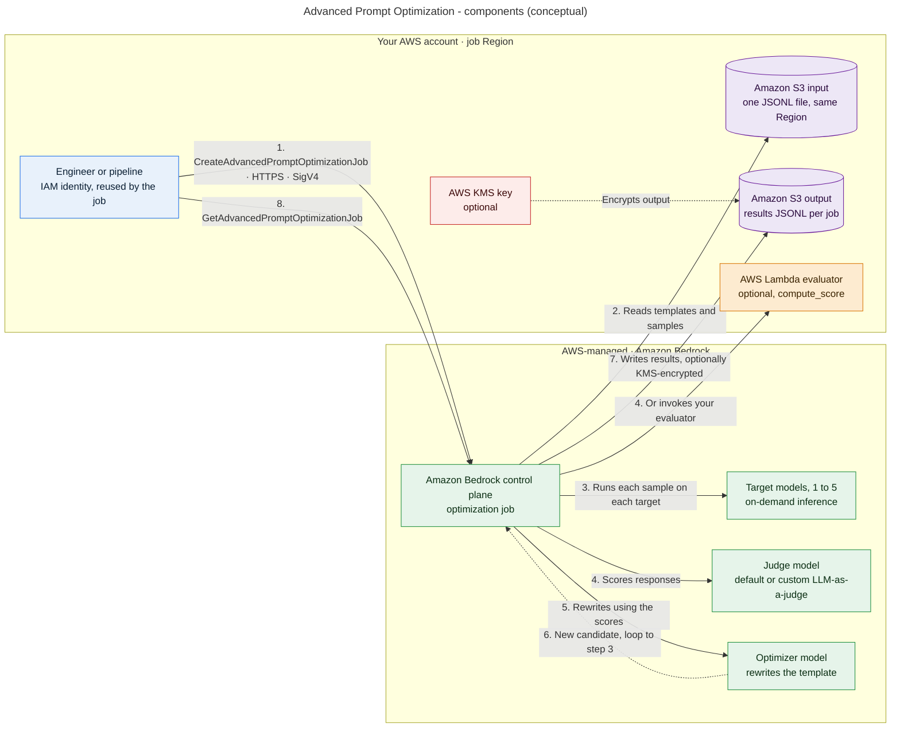
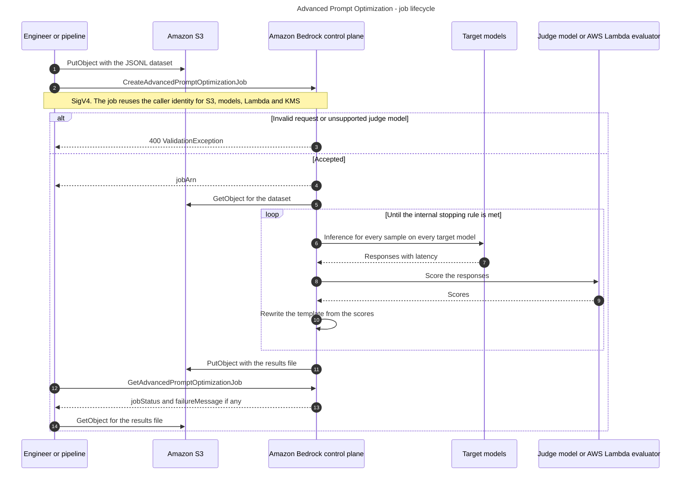

# Prompt optimization

> **Level:** Intermediate · **Verified:** 2026-11-15 · **Feature status:** GA · **Time:** ~20 min

Amazon Bedrock has two prompt optimizers. **Advanced Prompt Optimization** is a batch job that
rewrites prompt templates against your own evaluation data, for up to five models at once — the tool
for model migrations. **Simple prompt optimization** is the older one-shot rewrite of a single short
prompt. Both sit beside [Prompt management](01-prompt-management.md); neither changes a stored prompt
for you.

> [!IMPORTANT]
> **Status** — Advanced Prompt Optimization launched on 2026-05-14 and is available in 14 Regions
> (listed in section 9). On 2026-10-20 it gained prompt shortening and accepts application inference
> profiles as target and judge models. Simple prompt optimization (`OptimizePrompt`) is still
> documented and priced; its supported-model table lists older model generations only.
> Sources: [Launch announcement](https://aws.amazon.com/about-aws/whats-new/2026/05/amazon-bedrock-advanced-prompt-optimization-migration-tool/),
> [Supported Regions, models, and quotas](https://docs.aws.amazon.com/bedrock/latest/userguide/advanced-prompt-optimization-quotas.html),
> [Document history](https://docs.aws.amazon.com/bedrock/latest/userguide/bedrock-ug-doc-history.html),
> [Optimize a prompt](https://docs.aws.amazon.com/bedrock/latest/userguide/prompt-management-optimize.html)

## Learning objectives

- Distinguish simple prompt optimization from Advanced Prompt Optimization.
- Prepare the JSONL input for a job and choose one of the four evaluation methods.
- State the job limits and read the results file.
- Use a job to compare a current model with candidate models before a migration.
- Estimate what a job costs and recognise when not to run one.

## Prerequisites

- [Prompt management](01-prompt-management.md)
- [Model evaluation and model selection](../../00-foundations/generative-ai-fundamentals/07-model-evaluation-and-selection.md)
- [Model lifecycle and selection](../foundation-models/02-model-lifecycle-and-selection.md)
- [Amazon S3, AWS Lambda and Amazon API Gateway](../../00-foundations/aws-fundamentals/02-s3-lambda-api-gateway.md)

## 1. What it is

**Plain language.** You hand Bedrock a prompt with blanks, a set of example inputs, the answers you
expect and a way to score an answer. It runs the prompt, scores the results, rewrites the prompt and
repeats. At the end you get the original and the rewritten prompt for each model, with scores and
latency, so you can decide with numbers.

**Precisely.** Advanced Prompt Optimization is an asynchronous job on the `bedrock` control plane.
The job reads one JSONL file from Amazon S3 (one prompt template per line), runs an
"evaluation-based feedback loop" of inference, evaluation and rewriting, and writes a results file
to S3.

| Item | Value |
|:--|:--|
| Service namespace / endpoint | Advanced: `bedrock` (control plane). Simple: `bedrock-agent-runtime` |
| Control-plane operations | `CreateAdvancedPromptOptimizationJob`, `GetAdvancedPromptOptimizationJob`, `ListAdvancedPromptOptimizationJobs`, `StopAdvancedPromptOptimizationJob`, `BatchDeleteAdvancedPromptOptimizationJob` |
| Data-plane operations | Simple optimizer: `OptimizePrompt` (`POST /optimize-prompt`, streamed response) |
| IAM action prefix | `bedrock:` — job resource `arn:aws:bedrock:<region>:<account-id>:advanced-prompt-optimization-job/*` |

Operation names follow [the API operations reference](../../references/bedrock-api-operations.md)
(generated from the AWS SDK). The user guide's Python sample spells the delete call in the plural
and its IAM table contains a stray space; trust the SDK model.

### The two optimizers

| | Simple prompt optimization | Advanced Prompt Optimization |
|:--|:--|:--|
| Shape | One synchronous streamed call | Asynchronous job |
| Input | One prompt and one `targetModelId` | Up to 10 templates, each with 1–100 evaluation samples |
| Models | One | 1–5 per job |
| Uses evaluation data | No — "a fast, heuristic rewrite" | Yes — the evaluation steers the rewriting |
| Best for | Prompts of "approximately 1k tokens or less" | Migration and measured improvement |
| Where | Playground, prompt builder, `OptimizePrompt` | Console and `CreateAdvancedPromptOptimizationJob` |

### Job inputs

The API request carries `jobName`, `modelConfigurations` (1–5 entries; each `modelId` is a foundation
model ID, a cross-Region inference profile ID or an application inference profile ARN),
`inputConfig.s3Uri`, `outputConfig.s3Uri`, and optionally `encryptionKeyArn`, `jobDescription`,
`tags` and `clientToken`. Everything else is **per template, in the JSONL file**:

| Field | Purpose |
|:--|:--|
| `version` | Fixed value `bedrock-2026-05-14` |
| `templateId`, `promptTemplate` | The template; placeholders are `{{variableName}}` |
| `evaluationSamples[]` | `inputVariables` (one key per object), optional `referenceResponse`, optional `inputVariablesMultimodal` (`IMAGE` or `PDF` by `s3Uri`) |
| `steeringCriteria` | Evaluation method 2 |
| `customLLMJConfig` + `customEvaluationMetricLabel` | Evaluation method 3 |
| `evaluationMetricLambdaArn` + `customEvaluationMetricLabel` | Evaluation method 4 |
| `optimizationConfig.shortenPrompt` | Prompt shortening (since 2026-10-20) |

### Evaluation methods — pick one per template

| Method | How it scores |
|:--|:--|
| Default | Omit the optional fields. A built-in LLM judge (documented as Anthropic Claude Sonnet 4.6) scores Answer Accuracy, Answer Completeness and Expression Quality |
| Steering criteria | Up to 5 short natural-language descriptors, for example `["PROFESSIONAL", "CONCISE"]` |
| Custom LLM-as-a-judge | Your rubric (placeholders `{{prompt}}`, `{{response}}`, `{{referenceResponse}}`) and a judge model from the supported list; it is merged with the system judge prompt and weighted more heavily |
| Custom Lambda evaluator | Your function implements `compute_score(preds, golds)` and returns an aggregate `score` and per-sample `scores`; higher must be better |

Sources: [How Advanced Prompt Optimization works](https://docs.aws.amazon.com/bedrock/latest/userguide/advanced-prompt-optimization-how.html),
[Prepare your input dataset](https://docs.aws.amazon.com/bedrock/latest/userguide/advanced-prompt-optimization-input.html),
[Define evaluation methods](https://docs.aws.amazon.com/bedrock/latest/userguide/advanced-prompt-optimization-evaluation.html),
[CreateAdvancedPromptOptimizationJob](https://docs.aws.amazon.com/bedrock/latest/APIReference/API_CreateAdvancedPromptOptimizationJob.html)

## 2. Why it exists

A prompt tuned for one model rarely transfers unchanged to the next. The announcement puts the cost
at "days to weeks" of rewriting and regression testing per migration. Doing it yourself means
building an evaluation harness, a judge, a rewriting loop and a side-by-side report. The job is that
harness, run by the service, with your evaluation as the objective.

## 3. When to use it

- **Model migration.** Select "your current model as a baseline and up to 4 other models".
- A model you depend on is reaching end of life and the prompt must move.
- You have labelled examples and a prompt that underperforms on them.
- Prompts are long and you want them shorter without losing score (`shortenPrompt`).
- You are leaving a non-Bedrock model: score its outputs with a Lambda evaluator, then run the job
  with the same evaluator for the Bedrock targets.

## 4. When not to use it

- **No evaluation data.** The evaluation steers the result; with weak samples you optimise noise.
  Build the dataset first — see [Model and RAG evaluation](../model-evaluation/01-model-evaluation.md).
- **A quick tidy-up of one short prompt.** Use simple prompt optimization in the prompt builder.
- **Agent instructions and tool descriptions.** That is AgentCore Optimization — see
  [AgentCore Evaluations and Optimization](../agentcore/10-agentcore-evaluations-and-optimization.md).
- **The answer is wrong because the model lacks knowledge.** Rewording does not add facts; use
  [retrieval-augmented generation](../../00-foundations/generative-ai-fundamentals/04-rag-fundamentals.md).
- **Strict in-Region processing.** The service may use cross-Region inference for evaluation and
  rewriting (section 9).
- **Models that do not output text.** Targets are "models that output text modality".

## 5. Internal architecture

AWS documents the inputs, the loop in outline, the permissions and the outputs. The loop "repeats
and completes according to proprietary internal optimization parameters"; the diagram is a conceptual
model.



| Legend | Meaning |
|:--|:--|
| Solid arrow | Request or write |
| Dashed arrow | Response or key use |
| Cylinder | Data at rest in your account |

**What this shows** — there is no service role. Bedrock "accesses resources in your account on your
behalf using the permissions of your calling identity" (Forward Access Sessions), so the identity
that creates the job must be able to do everything the job does.

1. The caller creates the job with a name, the models and two S3 locations.
2. The job reads the JSONL file; the bucket "must be in the same Region as the job".
3. Samples are injected into the placeholders and sent to each target model.
4. Responses are graded by the judge model or by your Lambda function.
5. The service "analyzes the evaluation results and automatically rewrites your prompts".
6. The loop repeats until the service's internal stopping rule is met.
7. Results go to `<output-s3-uri>/<job-id>/advanced_prompt_optimization_results.jsonl`.
8. The caller polls the job; `jobStatus` and `failureMessage` report the outcome.

**Variations** — images and PDFs are sent in the payload, not through placeholders. Selective
optimization limits rewriting to tagged sections, using a tag pair in the `advpo:` namespace (the
page shows `<advpo:exclude>` for frozen text; copy the exact tags from it). With `shortenPrompt`, the
rewritten prompt is returned only if it is both shorter and scores at least as high; otherwise you
get the original with a compression ratio of 1.0.

## 6. Request and response lifecycle



- **Steps 1–2** — the file must not exceed 50 MB; one line per template.
- **Step 3** — `ValidationException` if a template mixes evaluation methods, omits
  `customEvaluationMetricLabel` with a judge or Lambda, or names an unsupported judge model.
- **Steps 5–10** — the job fails with "No inference API is accessible for model" if the caller cannot
  invoke a target; with `AccessDenied` on S3 if bucket permissions are missing.
- **Steps 11–14** — a single prompt with a few samples "could run for 15 to 20 minutes"; large jobs
  "over an hour, potentially for multiple hours". Poll, do not wait synchronously.

> [!WARNING]
> **Common mistake** — putting several keys in one `inputVariables` object. The documentation calls
> this a "silent failure": write `[{"policy": "…"}, {"question": "…"}]`, one key per object.

### What you receive

One JSON line per template: `promptTemplateId`, and `promptOptimizationResults` with, per target
model, `modelId`, `status`, `optimizedPromptTemplate`, evaluation scores per sample, average and
median latency and time to first token, and — if shortening is on — the compression ratio and the
original and optimized token counts. Scores are normalised; higher is better.

Sources: [Create and manage optimization jobs](https://docs.aws.amazon.com/bedrock/latest/userguide/advanced-prompt-optimization-jobs.html),
[View and interpret results](https://docs.aws.amazon.com/bedrock/latest/userguide/advanced-prompt-optimization-results.html),
[Troubleshooting](https://docs.aws.amazon.com/bedrock/latest/userguide/advanced-prompt-optimization-troubleshooting.html),
[Shorten prompts](https://docs.aws.amazon.com/bedrock/latest/userguide/advanced-prompt-optimization-shorten.html),
[Selective optimization](https://docs.aws.amazon.com/bedrock/latest/userguide/advanced-prompt-optimization-selective.html)

## 7. Dependencies

| Depends on | Why | Required or optional |
|:--|:--|:-:|
| Amazon S3 bucket in the job's Region | Input dataset and results | Required |
| Access to every target model | The job invokes them as you | Required |
| An evaluation dataset | 1–100 samples per template | Required |
| Judge model from the supported list | Custom LLM-as-a-judge | Optional |
| AWS Lambda function | Custom evaluator; needs a resource policy that lets `bedrock.amazonaws.com` invoke it | Optional |
| AWS KMS key | Output encryption or SSE-KMS buckets | Optional |

## 8. Security considerations

- **The job is you.** The calling identity needs the job actions, `bedrock:InvokeModel` and
  `bedrock:InvokeModelWithResponseStream` on the targets (plus the inference profile and its
  underlying models), `s3:GetObject`, `s3:PutObject`, `s3:ListBucket`, and for a Lambda evaluator
  `lambda:InvokeFunction` and `lambda:GetFunction`.
- **Your evaluation data and prompts are in S3.** Apply the same controls as for any dataset that
  contains customer text — see [Data protection, privacy and data leakage prevention](../../06-security-governance/03-data-protection-and-privacy.md).
- **Lambda source is read by the service.** "The full source code is read by the system" to
  understand the metric. Keep secrets out of it.
- **Encryption.** `encryptionKeyArn` encrypts job output with your KMS key (`kms:Encrypt`,
  `kms:GenerateDataKey`, `kms:DescribeKey`); SSE-KMS buckets additionally need `kms:Decrypt`.
- **Organisation-wide control.** The documentation includes a service control policy that denies the
  job actions, for organisations that do not want the feature used.
- **Review the output.** A rewritten prompt is model-generated text that will instruct a model.
  Read it before it reaches production.

Source: [Prerequisites and permissions](https://docs.aws.amazon.com/bedrock/latest/userguide/advanced-prompt-optimization-prereqs.html)

## 9. Networking requirements

Jobs are created on the `bedrock` endpoint (interface endpoint `com.amazonaws.<region>.bedrock`);
`OptimizePrompt` uses `bedrock-agent-runtime`. Regions for Advanced Prompt Optimization: us-east-1,
us-east-2, us-west-2, ca-central-1, sa-east-1, eu-west-1, eu-west-2, eu-central-1, eu-central-2,
ap-south-1, ap-northeast-1, ap-northeast-2, ap-southeast-1, ap-southeast-2.

> [!NOTE]
> **Documented fact** — "The service may use cross-region inference (CRIS) for evaluation and prompt
> rewriting. For European regions, the service will use eu CRIS regions." For ap-south-1, sa-east-1,
> ap-northeast-2 and ap-southeast-1 "it may use global CRIS".
> Source: [Prerequisites and permissions](https://docs.aws.amazon.com/bedrock/latest/userguide/advanced-prompt-optimization-prereqs.html)

In those four Regions your samples can therefore be processed anywhere a Global profile routes. See
[Cross-Region considerations and data residency](../../09-advanced-topics/11-cross-region-and-data-residency.md).

## 10. Pricing dimensions

"There is no separate Advanced Prompt Optimization service charge beyond inference costs."

| Dimension | Unit | Notes |
|:--|:--|:--|
| Target model inference | On-demand tokens | Pricing page estimate per template: `16 × N × (P + O)` tokens |
| Optimizer model | On-demand input tokens | Estimate: `101 × (3700 + 0.35 × P)` |
| LLM judge (default, steering criteria or custom) | On-demand tokens | Estimate: `16 × N × (P + O + G + judge prompt)` |
| Lambda evaluator | Lambda pricing | Estimate: `16 × N` invocations per template |
| Simple prompt optimization | Tokens of the input prompt plus the optimized prompt | $0.03 per 1,000 tokens on the pricing page, read 2026-11-15 |

`N` = samples per template, `P` = prompt template tokens, `O` = expected output tokens, `G` =
reference response tokens. The cost drivers are therefore samples × models × output length.

Source: [Amazon Bedrock pricing](https://aws.amazon.com/bedrock/pricing/) (Prompt Optimization section)

## 11. Scaling considerations

| Quota | Limit |
|:--|--:|
| Concurrent jobs | 20 per account per Region |
| Input file size | 50 MB |
| Templates per job | 10 |
| Evaluation samples per template | 100 |
| Models per job | 5 |
| Text variables per template | 20 |
| Multimodal files per sample | 100 |
| Steering criteria per template | 5 |

The job's inference uses your on-demand quotas for the target and judge models. **Our reading:** a
large job can therefore compete with production traffic in the same account and Region; run it in a
non-production account or outside peak hours.

Source: [Supported Regions, models, and quotas](https://docs.aws.amazon.com/bedrock/latest/userguide/advanced-prompt-optimization-quotas.html)

## 12. IaC support

| Tool | Support | Resource / construct | Notes |
|:--|:-:|:--|:--|
| Terraform (`hashicorp/aws` 6.73.0) | ❌ | — | No resource for either optimizer |
| CloudFormation | ❌ | — | No `AWS::Bedrock::*` type for optimization jobs in the specification bundled with `aws-cdk-lib` 2.277.0 |
| AWS CDK (`aws-cdk-lib` 2.277.0) | ❌ | — | No L1 or L2 |

A job is an operation, not infrastructure. The verified alternative is the API
(`CreateAdvancedPromptOptimizationJob`) from a pipeline or notebook. Provision what surrounds it —
the S3 bucket, the Lambda evaluator, the IAM role and KMS key — with IaC, and store the winning
prompt with `aws_bedrockagent_prompt`. Checked against
[the Terraform reference](../../references/terraform-aws-provider-bedrock.md) and
[the CDK and CloudFormation reference](../../references/cdk-and-cloudformation-bedrock.md).

## 13. Working example

A migration job: the model in use today as the baseline, one candidate, steering criteria and prompt
shortening.

> **Code status:** syntax-checked (`python -m py_compile`) · **never run against AWS**

```python
import json
import os

import boto3

region = os.environ.get("AWS_REGION", "us-east-1")
s3 = boto3.client("s3", region_name=region)
bedrock = boto3.client("bedrock", region_name=region)

bucket = os.environ["APO_BUCKET"]  # same Region as the job

# One JSON object per line = one prompt template. Evaluation settings live here, not in the API call.
record = {
    "version": "bedrock-2026-05-14",
    "templateId": "support-answer-v1",
    "promptTemplate": "You are a support agent.\n\nPolicy:\n{{policy}}\n\nQuestion:\n{{question}}\n\nAnswer briefly.",
    "optimizationConfig": {"shortenPrompt": True},
    "steeringCriteria": ["CONCISE", "Quote the policy clause used"],
    "evaluationSamples": [
        {
            "inputVariables": [
                {"policy": "Items can be returned within 30 days with a receipt."},
                {"question": "Can I return a jacket after five weeks?"},
            ],
            "referenceResponse": "No. Returns are accepted within 30 days with a receipt.",
        }
    ],
}
s3.put_object(Bucket=bucket, Key="apo/input/dataset.jsonl", Body=json.dumps(record) + "\n")

response = bedrock.create_advanced_prompt_optimization_job(
    jobName="support-answer-migration",
    modelConfigurations=[
        {"modelId": os.environ["BASELINE_MODEL_ID"]},  # the model you use today
        {"modelId": os.environ["CANDIDATE_MODEL_ID"]},  # up to 5 models per job
    ],
    inputConfig={"s3Uri": f"s3://{bucket}/apo/input/dataset.jsonl"},
    outputConfig={"s3Uri": f"s3://{bucket}/apo/output/"},
)
job_arn = response["jobArn"]

status = bedrock.get_advanced_prompt_optimization_job(jobIdentifier=job_arn)["jobStatus"]
print(job_arn, status)
# Results: <output-s3-uri>/<job-id>/advanced_prompt_optimization_results.jsonl
```

One sample is enough to show the shape, not to optimise. The documentation's dataset advice: mix
easy and hard examples, cover the cases you care about, and "test on data the optimizer hasn't seen".

> [!TIP]
> **Academy recommendation** — Keep a held-out set that never goes into a job, and accept a rewritten
> prompt only if it also wins there. Then store it as a new prompt version and promote it like code.
> This is our design guidance, not an official AWS reference architecture.

## Common mistakes

| Mistake | Symptom | Fix |
|:--|:--|:--|
| `{variable}` instead of `{{variable}}` | `ValidationException` | Double curly brackets |
| Two evaluation methods on one template | `ValidationException` | One method per template |
| Looking for an API parameter to enable shortening | Nothing changes | Set `optimizationConfig.shortenPrompt` in the JSONL line |
| Caller cannot invoke a target model | Job fails: "No inference API is accessible for model" | Grant `InvokeModel` and `InvokeModelWithResponseStream`; check model access |
| Moving the results file | Console results page does not render | Leave results at the output location |
| All-easy samples | Scores already at maximum; original prompt returned | Add harder, representative samples |
| Accepting the rewrite unread | Prompt drifts from policy | Review, test on held-out data, then version it |

## Knowledge check

1. You are moving from model A to model B or C. How do you set up one job to compare all three?
2. Why does the identity that creates the job need `s3:PutObject` and `bedrock:InvokeModel`?
3. With `shortenPrompt` enabled the result has a compression ratio of 1.0. What happened?
4. Which optimizer would you use to clean up a 300-token prompt for one model, with no test data?

<details>
<summary>Answers</summary>

1. List three `modelConfigurations`: A as the baseline plus B and C (up to five models). Each gets its own optimized template, scores and latency.
2. There is no service role. The job runs with the caller's permissions, so the caller must be able to read the dataset, invoke the models and write the results.
3. The optimizer found no prompt that was both shorter and at least as high scoring, so the original was returned.
4. Simple prompt optimization (`OptimizePrompt`, or the Optimize button in the prompt builder). It needs no evaluation data and targets one model.

</details>

## 14. Official documentation

- [How Advanced Prompt Optimization works](https://docs.aws.amazon.com/bedrock/latest/userguide/advanced-prompt-optimization-how.html) — loop, outputs, cost statement, duration.
- [Prerequisites and permissions](https://docs.aws.amazon.com/bedrock/latest/userguide/advanced-prompt-optimization-prereqs.html) — caller-identity model, IAM, KMS, cross-Region inference.
- [Prepare your input dataset](https://docs.aws.amazon.com/bedrock/latest/userguide/advanced-prompt-optimization-input.html) — JSONL schema, limits, common mistakes.
- [Define evaluation methods](https://docs.aws.amazon.com/bedrock/latest/userguide/advanced-prompt-optimization-evaluation.html) — the four methods and the Lambda contract.
- [Create and manage optimization jobs](https://docs.aws.amazon.com/bedrock/latest/userguide/advanced-prompt-optimization-jobs.html) — console steps and SDK calls.
- [View and interpret results](https://docs.aws.amazon.com/bedrock/latest/userguide/advanced-prompt-optimization-results.html) — output location and format.
- [Shorten prompts](https://docs.aws.amazon.com/bedrock/latest/userguide/advanced-prompt-optimization-shorten.html) and [Selective optimization](https://docs.aws.amazon.com/bedrock/latest/userguide/advanced-prompt-optimization-selective.html) — the October 2026 option and tag-scoped rewriting.
- [Supported Regions, models, and quotas](https://docs.aws.amazon.com/bedrock/latest/userguide/advanced-prompt-optimization-quotas.html) — Regions, judge models, quotas.
- [Troubleshooting](https://docs.aws.amazon.com/bedrock/latest/userguide/advanced-prompt-optimization-troubleshooting.html) — error messages and causes.
- [CreateAdvancedPromptOptimizationJob API reference](https://docs.aws.amazon.com/bedrock/latest/APIReference/API_CreateAdvancedPromptOptimizationJob.html) — request fields and constraints.
- [Optimize a prompt](https://docs.aws.amazon.com/bedrock/latest/userguide/prompt-management-optimize.html) and [OptimizePrompt API reference](https://docs.aws.amazon.com/bedrock/latest/APIReference/API_agent-runtime_OptimizePrompt.html) — simple prompt optimization.
- [Launch announcement, 2026-05-14](https://aws.amazon.com/about-aws/whats-new/2026/05/amazon-bedrock-advanced-prompt-optimization-migration-tool/) and [prompt shortening announcement, 2026-10-20](https://aws.amazon.com/about-aws/whats-new/2026/10/bedrock-prompt-optimization-shortening/).
- [Document history](https://docs.aws.amazon.com/bedrock/latest/userguide/bedrock-ug-doc-history.html) — 2026-10-20 and 2026-10-26 entries.
- [Amazon Bedrock pricing](https://aws.amazon.com/bedrock/pricing/) — both optimizers and the estimation formulas.
- [Feature verification matrix](../../FEATURE-VERIFICATION.md) — the academy's register entry for this feature.
