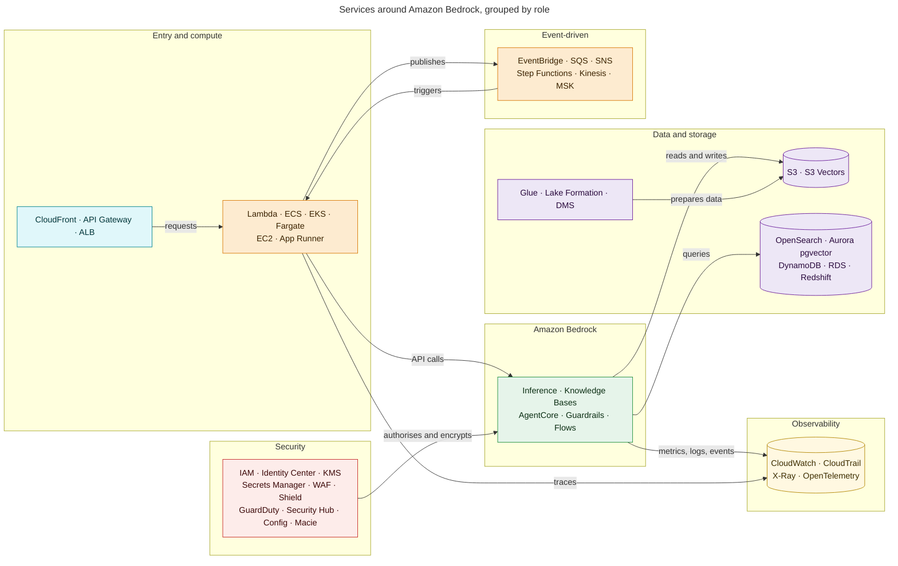

# Related AWS services and integrations

> **Level:** Intermediate · **Verified:** 2026-11-15 · **Time:** about 3 days at 2 hours a day

Bedrock is rarely used alone. This section goes through the services around it and, for each
one, answers the same three questions: **what exactly is the interaction, who calls whom, and
which way does the data flow?**

[Academy home](../README.md) · [Feature verification matrix](../FEATURE-VERIFICATION.md) · Previous: [Amazon Bedrock deep dive](../01-amazon-bedrock/README.md) · Next: [Architecture patterns](../03-architecture-patterns/README.md)

## The ecosystem in one picture

## How every chapter describes an integration

| Column | Meaning |
|:--|:--|
| Interaction | The API call, event or configuration that connects the two services |
| Initiator | Which side makes the call — your code, Bedrock acting with a service role, or the other service |
| Direction of data | Which way prompts, documents, embeddings, results or telemetry move |
| Identity used | Execution role, service role, resource policy or service-linked role |
| Network path | Public endpoint, interface VPC endpoint, or inside the AWS-managed service |

> [!IMPORTANT]
> **Status** — Amazon Kendra is in maintenance mode, and customer-managed knowledge bases can no
> longer add new Confluence, SharePoint, Salesforce or Web Crawler connectors. The chapters say
> where that changes a design. See the [verification matrix](../FEATURE-VERIFICATION.md#maintenance-mode-and-deprecations-to-design-around).

## Chapters

<!-- TOC:START — generated by scripts/build-nav.py; do not edit by hand -->
| # | Chapter | Group | Status |
|--:|:--|:--|:-:|
| 1 | [Amazon S3 and Amazon S3 Vectors](storage/01-amazon-s3-and-s3-vectors.md) | Data and storage | 🚧 planned |
| 2 | [AWS Glue and AWS Lake Formation](storage/02-glue-and-lake-formation.md) | Data and storage | 🚧 planned |
| 3 | [Amazon OpenSearch Service and OpenSearch Serverless](databases/01-opensearch.md) | Databases and search | 🚧 planned |
| 4 | [Amazon Aurora PostgreSQL with pgvector, and Amazon RDS](databases/02-aurora-pgvector-and-rds.md) | Databases and search | 🚧 planned |
| 5 | [Amazon DynamoDB](databases/03-dynamodb.md) | Databases and search | 🚧 planned |
| 6 | [Amazon Redshift, Amazon Kendra and AWS DMS](databases/04-redshift-kendra-dms.md) | Databases and search | 🚧 planned |
| 7 | [AWS Lambda with Bedrock](compute/01-lambda.md) | Compute and applications | 🚧 planned |
| 8 | [Amazon ECS, Amazon EKS and AWS Fargate](compute/02-containers-ecs-eks-fargate.md) | Compute and applications | 🚧 planned |
| 9 | [Amazon EC2 and AWS App Runner](compute/03-ec2-and-app-runner.md) | Compute and applications | 🚧 planned |
| 10 | [API Gateway, CloudFront and Application Load Balancer](compute/04-api-gateway-cloudfront-alb.md) | Compute and applications | 🚧 planned |
| 11 | [Private connectivity for Bedrock: interface endpoints and PrivateLink](networking/01-private-connectivity-for-bedrock.md) | Networking | 🚧 planned |
| 12 | [EventBridge, SQS and SNS with Bedrock](messaging/01-eventbridge-sqs-sns.md) | Event-driven architecture | 🚧 planned |
| 13 | [AWS Step Functions with Bedrock](messaging/02-step-functions.md) | Event-driven architecture | 🚧 planned |
| 14 | [Amazon Kinesis and Amazon MSK](messaging/03-kinesis-and-msk.md) | Event-driven architecture | 🚧 planned |
| 15 | [IAM and IAM Identity Center for Bedrock](security/01-iam-and-identity-center.md) | Security services | 🚧 planned |
| 16 | [AWS KMS, Secrets Manager and Parameter Store](security/02-kms-secrets-manager-parameter-store.md) | Security services | 🚧 planned |
| 17 | [AWS WAF and AWS Shield](security/03-waf-and-shield.md) | Security services | 🚧 planned |
| 18 | [GuardDuty, Security Hub, AWS Config and Macie](security/04-guardduty-security-hub-config-macie.md) | Security services | 🚧 planned |
| 19 | [AWS CloudTrail for Bedrock](security/05-cloudtrail-for-bedrock.md) | Security services | 🚧 planned |
| 20 | [CloudWatch and Bedrock-specific observability](observability/01-cloudwatch-and-bedrock-observability.md) | Observability | 🚧 planned |
| 21 | [AWS X-Ray, OpenTelemetry and ADOT](observability/02-xray-opentelemetry-adot.md) | Observability | 🚧 planned |
<!-- TOC:END -->
