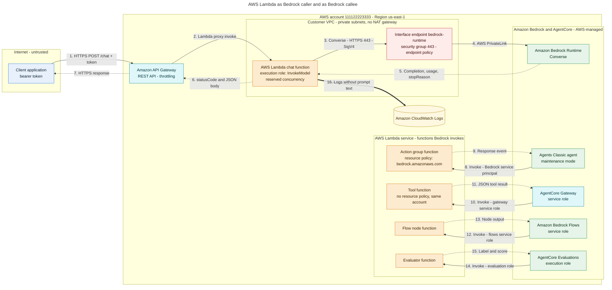

# AWS Lambda with Bedrock

> **Level:** Intermediate · **Verified:** 2026-11-15 · **Feature status:** n/a · **Time:** ~25 min

AWS Lambda meets Amazon Bedrock in two directions: your function **calls** Bedrock, or a Bedrock feature **calls** your function. Each direction has its own identity, limits and failure modes.

## Learning objectives

After this chapter you can:

- Configure a Converse-calling function's execution role, timeouts and concurrency ceiling.
- Line up model latency, SDK read timeout, function timeout and front-door timeout.
- Decide when Lambda response streaming is worth its constraints.
- Name, for each Bedrock feature that invokes Lambda, the invoker and the authorising policy.
- Reach Bedrock from a VPC-attached function through an interface endpoint.

## Prerequisites

- [Amazon S3, AWS Lambda and Amazon API Gateway](../../00-foundations/aws-fundamentals/02-s3-lambda-api-gateway.md)
- [IAM roles, trust policies and cross-account access](../../00-foundations/security/02-iam-roles-and-trust.md) and [Resource-based policies](../../00-foundations/security/03-resource-policies.md).
- [The Converse API](../../01-amazon-bedrock/inference/01-converse-api.md).
- [VPC endpoints and AWS PrivateLink](../../00-foundations/networking/03-vpc-endpoints-and-privatelink.md).

## Concept in plain language

Think of a hospital switchboard. Sometimes your clerk (a Lambda function) phones the specialist (a Bedrock model) and waits; the clerk's badge (the **execution role**) decides whether the call goes through, and the clerk can wait only as long as the shift lasts (the **function timeout**).

Other times the specialist phones the clerk: an agent needs an order looked up, or a gateway needs a tool run. Now the question is "who may ring this extension?", answered either on the extension (a **resource-based policy** on the function) or on the caller's badge (an **identity-based policy** on a Bedrock service role), depending on the feature.

## How it really works

### Lambda as the caller

| Concern | What the documentation says | What it means for you |
|:--|:--|:--|
| Identity | The function signs requests with its execution role. `Converse` needs `bedrock:InvokeModel`; `ConverseStream` needs `bedrock:InvokeModelWithResponseStream`. With an inference profile you must also allow the foundation model in each Region of the profile | Scope the role to the profile and model ARNs you use — see the example policy below |
| Time | Lambda Event Functions run for at most 900 seconds. Botocore's default read timeout is 60 seconds. AWS documents a 60-minute inference timeout for Amazon Nova and for Claude 3.7 Sonnet and Claude 4 models, and recommends raising the SDK read timeout | A single long generation can outlive a function. Long work belongs in streaming, asynchronous or batch patterns |
| Payload | Synchronous invocation: 6 MB request and 6 MB response; streamed response up to 200 MB; asynchronous 1 MB | Images and documents in a Converse request can exceed 6 MB before Bedrock ever sees them — pass large inputs by reference |
| Concurrency | 1,000 concurrent executions per Region by default; each function scales by 1,000 execution environments every 10 seconds | Lambda scales faster than your Bedrock quota grows |
| Bedrock quota | Per-model, per-Region tokens per minute (input and output combined), separate for on-demand and cross-Region use; requests per minute for some models; a cross-model tokens-per-day quota per account. `maxTokens` affects quota deductions | Use **reserved concurrency** as a ceiling so a traffic spike becomes queued or rejected requests, not a storm of `ThrottlingException` |
| Streaming | Native response streaming is on Node.js managed runtimes; Python needs a custom runtime or the Lambda Web Adapter. Streams go through a function URL, `InvokeWithResponseStream` or an API Gateway proxy integration. Billing covers the full duration even if the client disconnects | See [API Gateway, CloudFront and Application Load Balancer](04-api-gateway-cloudfront-alb.md) for the front-door side |
| VPC | A function runs in a Lambda-managed VPC with internet access until you attach it to your VPC; then it reaches only what that VPC can reach. A public subnet does not give it internet access. Function URLs do not support response streaming within a VPC environment | Attach the function to private subnets and create an interface endpoint for `bedrock-runtime` (or a NAT gateway) |

Sources: [Lambda quotas](https://docs.aws.amazon.com/lambda/latest/dg/gettingstarted-limits.html), [Response streaming](https://docs.aws.amazon.com/lambda/latest/dg/configuration-response-streaming.html), [Lambda and VPCs](https://docs.aws.amazon.com/lambda/latest/dg/configuration-vpc.html), [Internet access for VPC functions](https://docs.aws.amazon.com/lambda/latest/dg/configuration-vpc-internet.html), [Quotas for the bedrock-runtime endpoint](https://docs.aws.amazon.com/bedrock/latest/userguide/quotas-runtime.html), [Inference profile prerequisites](https://docs.aws.amazon.com/bedrock/latest/userguide/inference-profiles-prereq.html), [Amazon Nova models](https://docs.aws.amazon.com/bedrock/latest/userguide/model-parameters-nova.html).

> [!IMPORTANT]
> **Status** — Lambda now calls the classic function a *Lambda Event Function*; Managed Instances, MicroVMs and Web Functions have separate quotas (Managed Instances allow 90 minutes for asynchronous invocations). This chapter covers Event Functions.
> Source: [Lambda quotas](https://docs.aws.amazon.com/lambda/latest/dg/gettingstarted-limits.html)

### Lambda as the callee

Five Bedrock features invoke a Lambda function you own. They do **not** all use the same authorisation mechanism.

| Feature | Who invokes the function | Authorisation you configure | Principal | Contract and limits |
|:--|:--|:--|:--|:--|
| [Agents Classic](../../01-amazon-bedrock/agents/01-agents-classic.md) action group | Amazon Bedrock, for the agent | **Resource-based policy** on the function | `bedrock.amazonaws.com`, with `AWS:SourceAccount` and `AWS:SourceArn` = the agent ARN | One function per action group; input and response events with `messageVersion` 1.0 |
| [AgentCore Gateway](../../01-amazon-bedrock/agentcore/04-agentcore-gateway.md) Lambda target | The gateway, with its service role | **Identity-based policy** on the gateway service role (`lambda:InvokeFunction`). A resource-based policy only when the function is in another account | The gateway service role ARN (cross-account case) | Event = tool arguments; tool name in the client context as `target___tool`; 15-minute invocation, 6 MB payload |
| Knowledge base [custom transformation](../../01-amazon-bedrock/knowledge-bases/04-ingestion-parsing-chunking.md) | Bedrock, during an ingestion job | **UNVERIFIED — REQUIRES DOCUMENTATION REVIEW**: the knowledge base service-role page lists no Lambda statement; the console adds what it needs | Not documented on the pages opened | Input names S3 keys in an intermediate bucket; your function reads and writes them with its own execution role |
| [Flows](../../01-amazon-bedrock/flows/01-bedrock-flows.md) Lambda node | The flow, with its service role | **Identity-based policy** on the flows service role (`lambda:InvokeFunction`) | The flows service role. Flows created before 2024-11-22 used the Bedrock service principal | Node input in, node output back |
| AgentCore Evaluations [code-based evaluator](../../01-amazon-bedrock/agentcore/10-agentcore-evaluations-and-optimization.md) | The evaluation service | **Identity-based policy** (`lambda:InvokeFunction`, `lambda:GetFunction`) on the evaluation execution role; for on-demand `Evaluate` calls, on the caller's identity | The execution role or the caller | Session spans in (up to 6 MB); `label`, optional `value` and `explanation` out; timeout 1–300 seconds, default 60 |

Sources: [Agents service role and action group policy](https://docs.aws.amazon.com/bedrock/latest/userguide/agents-permissions.html), [Gateway permissions](https://docs.aws.amazon.com/bedrock-agentcore/latest/devguide/gateway-prerequisites-permissions.html), [Gateway Lambda targets](https://docs.aws.amazon.com/bedrock-agentcore/latest/devguide/gateway-add-target-lambda.html), [Custom transformation](https://docs.aws.amazon.com/bedrock/latest/userguide/kb-custom-transformation.html), [Knowledge base service role](https://docs.aws.amazon.com/bedrock/latest/userguide/kb-permissions.html), [Flows service role](https://docs.aws.amazon.com/bedrock/latest/userguide/flows-permissions.html), [Code-based evaluators](https://docs.aws.amazon.com/bedrock-agentcore/latest/devguide/code-based-evaluators.html).

> [!NOTE]
> **Documented fact** — Agents Classic: "whether you use a custom role or not, you also need to attach a resource-based policy to the Lambda functions". AgentCore Gateway: a resource-based policy only "if the function is in a different account from the gateway service role".
> Source: [Agents service role](https://docs.aws.amazon.com/bedrock/latest/userguide/agents-permissions.html), [Gateway permissions](https://docs.aws.amazon.com/bedrock-agentcore/latest/devguide/gateway-prerequisites-permissions.html)

Other hooks: a Lambda evaluator in [prompt optimization](../../01-amazon-bedrock/prompt-management/02-prompt-optimization.md) and a reward function in [model customization](../../01-amazon-bedrock/foundation-models/03-model-customization.md). Agents Classic is in maintenance mode (closed to new customers since 2026-07-30); put new tool code behind AgentCore Gateway.

### Integration with Amazon Bedrock

| Interaction | Initiator | Direction of data | Identity used | Network path |
|:--|:--|:--|:--|:--|
| `Converse` / `ConverseStream` from a function | Your code | Prompt out; completion, usage and stop reason back | Execution role (SigV4) | Public `bedrock-runtime` endpoint, or an interface endpoint when the function is attached to a VPC |
| `Retrieve` / `AgenticRetrieveStream` from a function | Your code | Query out; chunks or a streamed answer back | Execution role | `bedrock-agent-runtime` endpoint, public or interface |
| Action group invocation (Agents Classic) | Bedrock, for the agent | Parameters to the function; result event back to the agent | Function resource-based policy for `bedrock.amazonaws.com` | Inside AWS: Bedrock calls the Lambda service; nothing crosses your VPC |
| Lambda target invocation (AgentCore Gateway) | The gateway | Tool arguments in; JSON result back as an MCP result | Gateway service role (identity-based) | Inside AWS |
| Custom transformation during ingestion | Bedrock ingestion job | S3 keys in; S3 keys out; chunk files in the intermediate bucket | Knowledge base service role (mechanism **UNVERIFIED**); the function's own role for S3 | Inside AWS; the function's S3 calls follow its own network configuration |
| Lambda node in a flow | Amazon Bedrock Flows | Node input in; node output back | Flows service role (identity-based) | Inside AWS |
| Code-based evaluator | AgentCore Evaluations | Spans in; label and score back, written to CloudWatch Logs | Evaluation execution role, or the `Evaluate` caller | Inside AWS |

**No native integration:** a model call never triggers a function. **Our reading:** the rows above are the only places Bedrock invokes Lambda; to react to finished asynchronous jobs, use events ([EventBridge, SQS and SNS with Bedrock](../messaging/01-eventbridge-sqs-sns.md)).

## Architecture diagram



**What this shows** — Left: Lambda as caller, reaching Bedrock Runtime privately. Right: Lambda as callee, invoked by four Bedrock features, each authorised differently (the knowledge base transformation is omitted: its authorisation is unverified).

**Walkthrough**

1. The client calls the REST API; API Gateway authorises and throttles.
2. API Gateway invokes the function, allowed by the function's resource-based policy for `apigateway.amazonaws.com`.
3. The function signs `Converse` with its execution role; private DNS resolves `bedrock-runtime` to the endpoint.
4. The endpoint security group and endpoint policy admit the request; PrivateLink carries it.
5. –7. The completion, token usage and `stopReason` return to the client.
8. –9. An Agents Classic agent invokes its action group function, allowed by a resource-based policy naming `bedrock.amazonaws.com` and the agent ARN.
10. –11. AgentCore Gateway invokes a tool function with its service role; same account, so no resource-based policy.
12. –13. A flow invokes its Lambda node with the flows service role.
14. –15. AgentCore Evaluations invokes a code-based evaluator with its execution role.
16. Logs carry token counts, never prompts.

**Legend** — solid: request · dashed: response · thick: asynchronous telemetry · red: enforcement point · boxes: trust boundaries. **Variations:** without a VPC attachment, step 3 uses the public Regional endpoint; with a streaming Node.js function behind a REST API in `STREAM` mode, steps 5–7 become a stream. Full picture: [diagram set 22](../../diagrams/mermaid/22-serverless-enterprise-chatbot.md).

## Implementation details

1. **Execution role.** Scope `bedrock:InvokeModel` (plus `bedrock:InvokeModelWithResponseStream` to stream) to one profile and its models; add `bedrock:ApplyGuardrail` when you pass a `guardrailConfig` ([guardrail permissions](https://docs.aws.amazon.com/bedrock/latest/userguide/guardrails-permissions.html)). Policy below.
2. **Timeout budget.** Set the numbers from the outside in:

| Layer | Set it to | Why |
|:--|:--|:--|
| Front door | 29 s on a default REST API, 30 s on an HTTP API | The hard ceiling for a buffered response |
| Lambda function timeout | A few seconds below the front door | A function that outlives its caller keeps billing for nothing |
| SDK `read_timeout` | Below the function timeout, with retries counted | Botocore's 60-second default exceeds both numbers above |
| `maxTokens` | The longest answer you really need | Bounds generation time and quota deduction |

3. **Retries.** A 20-second read timeout in a 25-second function leaves room for one attempt; retry at the client, with backoff, on 429 and 503.
4. **Concurrency.** Estimate `concurrency = requests per second × average duration` and compare it with the Regional pool. Then work backwards from Bedrock: a function capped at reserved concurrency *C* with average duration *d* seconds sends at most `C ÷ d × 60` requests per minute; multiplied by tokens per request, that must fit the model's tokens-per-minute quota.
5. **VPC.** Two private subnets, a `bedrock-runtime` interface endpoint with private DNS, 443 allowed from the function's security group. `AWSLambdaVPCAccessExecutionRole` is needed only to create the network interfaces; you can remove it afterwards.
6. **Streaming.** Only when users must see tokens early: a Node.js handler (or custom runtime / Lambda Web Adapter), a REST API in `STREAM` mode or a function URL, billing until the stream ends.
7. **Callee functions.** Grant the permission named in the callee table, strip the `target___` prefix in gateway tools, return the documented shape.

> [!TIP]
> **Academy recommendation** — Give each Bedrock-facing function its own execution role and reserved concurrency. Reserved concurrency is the only hard limit on this path, so it protects both your Bedrock quota and your bill.
> This is our design guidance, not an official AWS reference architecture.

## Example

A chat function behind a Lambda proxy integration: input validation, `Converse` with an optional guardrail, error mapping, and logs with token usage but no prompt.

> **Code status:** syntax-checked (`python -m py_compile`) · mock-tested: 8 `unittest` cases with botocore `Stubber` (boto3/botocore 1.44.3) · **never deployed**

```python
"""POST /chat: Amazon API Gateway (Lambda proxy) -> AWS Lambda -> Amazon Bedrock Runtime (Converse)."""
import json
import logging
import os

import boto3
from botocore.config import Config
from botocore.exceptions import ClientError, ReadTimeoutError

LOGGER = logging.getLogger()
LOGGER.setLevel(logging.INFO)

# Configuration, not secrets. Confirm the current model or inference profile ID in the Bedrock docs.
MODEL_ID = os.environ["MODEL_ID"]
MAX_TOKENS = int(os.environ.get("MAX_TOKENS", "512"))
MAX_PROMPT_CHARS = int(os.environ.get("MAX_PROMPT_CHARS", "8000"))
# Budget: SDK read timeout < Lambda timeout < front-door timeout (29 s on a default REST API).
READ_TIMEOUT_SECONDS = int(os.environ.get("BEDROCK_READ_TIMEOUT_SECONDS", "20"))
GUARDRAIL_ID = os.environ.get("GUARDRAIL_ID", "")
GUARDRAIL_VERSION = os.environ.get("GUARDRAIL_VERSION", "")

SYSTEM_PROMPT = [{"text": "You are a concise assistant. Answer in at most five sentences."}]
THROTTLED = {"ThrottlingException"}
UNAVAILABLE = {"ServiceUnavailableException", "ModelNotReadyException"}

# Created once per execution environment (Init phase) and reused by warm invocations.
# One attempt only: a retry inside a 20-second budget would outlive the caller's timeout.
bedrock = boto3.client(
    "bedrock-runtime",
    config=Config(
        connect_timeout=3,
        read_timeout=READ_TIMEOUT_SECONDS,
        retries={"mode": "standard", "max_attempts": 1},
    ),
)


def _response(status: int, body: dict) -> dict:
    """The shape a Lambda proxy integration expects."""
    return {
        "statusCode": status,
        "headers": {"Content-Type": "application/json"},
        "body": json.dumps(body),
    }


def _prompt_from(event: dict):
    """Return the validated prompt, or None if the request body is unusable."""
    if event.get("isBase64Encoded"):
        return None
    try:
        payload = json.loads(event.get("body") or "")
    except ValueError:
        return None
    prompt = payload.get("prompt") if isinstance(payload, dict) else None
    if not isinstance(prompt, str) or not prompt.strip() or len(prompt) > MAX_PROMPT_CHARS:
        return None
    return prompt.strip()


def _converse_request(prompt: str) -> dict:
    request = {
        "modelId": MODEL_ID,
        "system": SYSTEM_PROMPT,
        "messages": [{"role": "user", "content": [{"text": prompt}]}],
        "inferenceConfig": {"maxTokens": MAX_TOKENS},
    }
    if GUARDRAIL_ID and GUARDRAIL_VERSION:
        request["guardrailConfig"] = {
            "guardrailIdentifier": GUARDRAIL_ID,
            "guardrailVersion": GUARDRAIL_VERSION,
        }
    return request


def handler(event, context):
    prompt = _prompt_from(event)
    if prompt is None:
        return _response(400, {"message": f"Send JSON with a non-empty 'prompt' (max {MAX_PROMPT_CHARS} characters)."})

    try:
        result = bedrock.converse(**_converse_request(prompt))
    except ReadTimeoutError:
        LOGGER.warning("Converse read timeout after %s s", READ_TIMEOUT_SECONDS)
        return _response(504, {"message": "The model did not answer in time."})
    except ClientError as err:
        code = err.response["Error"]["Code"]
        LOGGER.warning("Converse failed with %s", code)  # never log the prompt itself
        if code in THROTTLED:
            return _response(429, {"message": "Busy. Retry with backoff."})
        if code in UNAVAILABLE:
            return _response(503, {"message": "Temporarily unavailable. Retry with backoff."})
        if code == "ModelTimeoutException":
            return _response(504, {"message": "The model did not answer in time."})
        if code == "ValidationException":
            return _response(400, {"message": "The request was rejected."})
        raise  # AccessDenied, ResourceNotFound, internal errors: let Lambda record a failure

    blocks = result["output"]["message"]["content"]
    answer = "".join(block.get("text", "") for block in blocks)
    usage = result["usage"]
    LOGGER.info(
        "stopReason=%s inputTokens=%s outputTokens=%s latencyMs=%s",
        result["stopReason"], usage["inputTokens"], usage["outputTokens"], result["metrics"]["latencyMs"],
    )
    return _response(200, {
        "answer": answer,
        "stopReason": result["stopReason"],  # "guardrail_intervened" when a guardrail blocked
        "usage": {"inputTokens": usage["inputTokens"], "outputTokens": usage["outputTokens"]},
    })
```

The tests stub the client and run offline (`python -m unittest -v test_handler`).

> **Code status:** 8 tests pass with `TOOLS/py-sdk/bin/python -m unittest` (boto3/botocore 1.44.3) · **never deployed**

```python
"""Unit tests for handler.py. The Bedrock client is stubbed with botocore's Stubber; nothing calls AWS."""
import json
import os
import unittest
from unittest import mock

os.environ.setdefault("AWS_DEFAULT_REGION", "us-east-1")
os.environ["MODEL_ID"] = "test-model-id"          # placeholder, not a real model ID
os.environ["BEDROCK_READ_TIMEOUT_SECONDS"] = "20"

from botocore.exceptions import ReadTimeoutError  # noqa: E402
from botocore.stub import Stubber  # noqa: E402

import handler  # noqa: E402


def api_event(body) -> dict:
    """A minimal API Gateway proxy event."""
    return {"body": body if isinstance(body, str) else json.dumps(body), "isBase64Encoded": False}


CONVERSE_OK = {
    "output": {"message": {"role": "assistant", "content": [{"text": "Hello"}, {"text": " there."}]}},
    "stopReason": "end_turn",
    "usage": {"inputTokens": 12, "outputTokens": 4, "totalTokens": 16},
    "metrics": {"latencyMs": 420},
}


class ConverseHandlerTest(unittest.TestCase):
    def setUp(self):
        self.stubber = Stubber(handler.bedrock)
        self.stubber.activate()

    def tearDown(self):
        self.stubber.deactivate()

    def test_success_sends_expected_request_and_returns_answer(self):
        expected = {
            "modelId": "test-model-id",
            "system": handler.SYSTEM_PROMPT,
            "messages": [{"role": "user", "content": [{"text": "Say hello"}]}],
            "inferenceConfig": {"maxTokens": handler.MAX_TOKENS},
        }
        self.stubber.add_response("converse", CONVERSE_OK, expected)

        result = handler.handler(api_event({"prompt": "  Say hello  "}), None)

        self.assertEqual(result["statusCode"], 200)
        body = json.loads(result["body"])
        self.assertEqual(body["answer"], "Hello there.")
        self.assertEqual(body["usage"], {"inputTokens": 12, "outputTokens": 4})
        self.stubber.assert_no_pending_responses()

    def test_guardrail_is_added_when_configured(self):
        with mock.patch.object(handler, "GUARDRAIL_ID", "gr-example"), \
                mock.patch.object(handler, "GUARDRAIL_VERSION", "1"):
            request = handler._converse_request("hi")
        self.assertEqual(request["guardrailConfig"], {"guardrailIdentifier": "gr-example", "guardrailVersion": "1"})

    def test_invalid_body_is_rejected_without_calling_bedrock(self):
        for body in ["not json", {"prompt": ""}, {"prompt": 42}, {"text": "hi"}, {"prompt": "x" * 9000}]:
            with self.subTest(body=body):
                self.assertEqual(handler.handler(api_event(body), None)["statusCode"], 400)
        self.stubber.assert_no_pending_responses()  # no stubbed call was consumed or expected

    def test_throttling_maps_to_429(self):
        self.stubber.add_client_error("converse", service_error_code="ThrottlingException", http_status_code=429)
        self.assertEqual(handler.handler(api_event({"prompt": "hi"}), None)["statusCode"], 429)

    def test_model_not_ready_maps_to_503(self):
        self.stubber.add_client_error("converse", service_error_code="ModelNotReadyException", http_status_code=429)
        self.assertEqual(handler.handler(api_event({"prompt": "hi"}), None)["statusCode"], 503)

    def test_validation_error_maps_to_400(self):
        self.stubber.add_client_error("converse", service_error_code="ValidationException", http_status_code=400)
        self.assertEqual(handler.handler(api_event({"prompt": "hi"}), None)["statusCode"], 400)

    def test_access_denied_is_raised(self):
        self.stubber.add_client_error("converse", service_error_code="AccessDeniedException", http_status_code=403)
        with self.assertRaises(handler.ClientError):
            handler.handler(api_event({"prompt": "hi"}), None)

    def test_read_timeout_maps_to_504(self):
        err = ReadTimeoutError(endpoint_url="https://bedrock-runtime.us-east-1.amazonaws.com")
        with mock.patch.object(handler.bedrock, "converse", side_effect=err):
            self.assertEqual(handler.handler(api_event({"prompt": "hi"}), None)["statusCode"], 504)


if __name__ == "__main__":
    unittest.main()
```

The execution role's Bedrock statements, for a Geo cross-Region inference profile. Replace the profile and model names with the ones you confirmed; the logging statement from `AWSLambdaBasicExecutionRole` is added separately.

> **Code status:** syntax-checked (JSON parse) · illustrative ARNs · **never deployed**

```json
{
  "Version": "2012-10-17",
  "Statement": [
    {
      "Sid": "InvokeThroughOneProfile",
      "Effect": "Allow",
      "Action": "bedrock:InvokeModel",
      "Resource": "arn:aws:bedrock:us-east-1:111122223333:inference-profile/PROFILE_ID"
    },
    {
      "Sid": "ModelsBehindTheProfileOnly",
      "Effect": "Allow",
      "Action": "bedrock:InvokeModel",
      "Resource": "arn:aws:bedrock:*::foundation-model/MODEL_ID",
      "Condition": {
        "StringLike": {
          "bedrock:InferenceProfileArn": "arn:aws:bedrock:us-east-1:111122223333:inference-profile/PROFILE_ID"
        }
      }
    },
    {
      "Sid": "OptionalGuardrail",
      "Effect": "Allow",
      "Action": "bedrock:ApplyGuardrail",
      "Resource": "arn:aws:bedrock:us-east-1:111122223333:guardrail/GUARDRAIL_ID"
    }
  ]
}
```

## Common mistakes

> [!WARNING]
> **Common mistake** — Keeping botocore's 60-second read timeout behind a 29-second front door. The client gets a 504 while the function keeps waiting, billing and possibly retrying a generation nobody will read.

| Mistake | Symptom | Fix |
|:--|:--|:--|
| No resource-based policy on an action group function | `dependencyFailedException` on the first tool call | Add `lambda:InvokeFunction` for `bedrock.amazonaws.com`, scoped to the agent ARN |
| Adding a `bedrock.amazonaws.com` resource policy for an AgentCore Gateway target | Still `AccessDenied` from the gateway | Grant `lambda:InvokeFunction` on the gateway service role instead |
| Gateway tool function compares the full tool name | Every call goes to the "unknown tool" branch | Strip the `target___` prefix from `bedrockAgentCoreToolName` |
| Unlimited function concurrency in front of a fixed Bedrock quota | Bursts of `ThrottlingException`, retries amplify them | Reserved concurrency sized from the tokens-per-minute quota |
| VPC-attached function without a `bedrock-runtime` endpoint or NAT | Calls time out | Interface endpoint with private DNS, 443 allowed from the function |
| Expecting a Python handler to stream natively | The answer arrives in one piece | Node.js runtime, custom runtime or Lambda Web Adapter |
| Logging the full request or response | Prompts and answers in CloudWatch Logs | Log token counts and stop reasons only |

## Security considerations

- **Two policies, two questions.** The execution role says what the function may do; the resource-based policy (or the Bedrock service role's policy) says who may run it. See [Identity, least privilege and IAM isolation for agents](../../06-security-governance/02-identity-and-least-privilege.md).
- **Confused deputy.** Always add `AWS:SourceAccount` and `AWS:SourceArn` to a `bedrock.amazonaws.com` grant, as the documented policy does.
- **Callee input is untrusted.** Tool arguments come from a model reasoning over user text; validate them like public input. See [Prompt injection, untrusted tool output and retrieval poisoning](../../06-security-governance/04-prompt-injection-and-untrusted-content.md).
- **The gateway role is shared.** Every Lambda target on a gateway is reachable by any caller the gateway authorises; split gateways by trust level.
- **No secrets in environment variables.** Use AWS Secrets Manager; see [AWS KMS, Secrets Manager and Parameter Store](../security/02-kms-secrets-manager-parameter-store.md).

## Cost considerations

- **Lambda bills while it waits.** Duration × memory includes every second spent waiting for the model; streaming bills until the stream ends, even after the client leaves.
- **Bedrock bills tokens.** `maxTokens`, prompt size and prompt caching ([Prompt caching](../../01-amazon-bedrock/prompt-caching/01-prompt-caching.md)) matter more than Lambda memory.
- **Retries cost twice.** A retried timeout can mean two paid generations.
- **Endpoints cost money.** Each interface endpoint bills per hour per Availability Zone plus per GB; see [Private connectivity for Bedrock](../networking/01-private-connectivity-for-bedrock.md).
- Pricing: [Lambda pricing](https://aws.amazon.com/lambda/pricing/), [Amazon Bedrock pricing](https://aws.amazon.com/bedrock/pricing/).

## Knowledge check

1. Behind an HTTP API, answers take 20–45 seconds. Which settings change, and is any combination enough?
2. An AgentCore Gateway in account 111122223333 must call a function in 444455556666. Which policies, on which resources?
3. A function with no reserved concurrency sees traffic triple. Which throttles first, Lambda or Bedrock?
4. A teammate attaches the function to public subnets "so it can reach Bedrock". What happens?

<details>
<summary>Answers</summary>

1. The SDK read timeout, the function timeout and `maxTokens` — but no combination is enough: an HTTP API has a fixed 30-second integration timeout. Use a REST API in `STREAM` mode with a streaming function, or an asynchronous pattern.
2. `lambda:InvokeFunction` in the gateway service role's policy, plus a resource-based policy on the function naming the gateway service role ARN.
3. Whichever limit is lower. Compare 1,000 concurrent executions with the requests and tokens per minute they would send; when the model's quota is lower, unbounded concurrency becomes `ThrottlingException` storms. Reserved concurrency makes the function the bottleneck you control.
4. Calls time out: a public subnet gives a function no internet access. Use private subnets with a `bedrock-runtime` endpoint or a NAT gateway.

</details>

## Further reading

Official sources opened while writing this chapter:

- [Lambda quotas](https://docs.aws.amazon.com/lambda/latest/dg/gettingstarted-limits.html) — timeout, payload, concurrency and streaming limits.
- [Response streaming for Lambda Event Functions](https://docs.aws.amazon.com/lambda/latest/dg/configuration-response-streaming.html) — runtimes, bandwidth, VPC compatibility, billing.
- [Giving Lambda functions access to resources in a VPC](https://docs.aws.amazon.com/lambda/latest/dg/configuration-vpc.html) and [Enable internet access for VPC-connected functions](https://docs.aws.amazon.com/lambda/latest/dg/configuration-vpc-internet.html).
- [Select a method to invoke a Lambda function using an HTTP request](https://docs.aws.amazon.com/lambda/latest/dg/furls-http-invoke-decision.html) — function URLs versus API Gateway.
- [Quotas for the bedrock-runtime endpoint](https://docs.aws.amazon.com/bedrock/latest/userguide/quotas-runtime.html) — tokens per minute, requests per minute, daily quota.
- [Prerequisites for inference profiles](https://docs.aws.amazon.com/bedrock/latest/userguide/inference-profiles-prereq.html) — IAM for cross-Region profiles.
- [Set up permissions to use guardrails](https://docs.aws.amazon.com/bedrock/latest/userguide/guardrails-permissions.html) — `bedrock:ApplyGuardrail` during model inference.
- [Amazon Nova models](https://docs.aws.amazon.com/bedrock/latest/userguide/model-parameters-nova.html) — 60-minute inference timeout and SDK read timeout advice.
- [Create a service role for Amazon Bedrock Agents](https://docs.aws.amazon.com/bedrock/latest/userguide/agents-permissions.html) — action group resource-based policy.
- [Set up permissions for AgentCore Gateway](https://docs.aws.amazon.com/bedrock-agentcore/latest/devguide/gateway-prerequisites-permissions.html) and [AWS Lambda function targets](https://docs.aws.amazon.com/bedrock-agentcore/latest/devguide/gateway-add-target-lambda.html).
- [Use a custom transformation Lambda function](https://docs.aws.amazon.com/bedrock/latest/userguide/kb-custom-transformation.html) and [Create a service role for Knowledge Bases](https://docs.aws.amazon.com/bedrock/latest/userguide/kb-permissions.html).
- [Create a service role for Amazon Bedrock Flows](https://docs.aws.amazon.com/bedrock/latest/userguide/flows-permissions.html) — Lambda node permissions and the 2024-11-22 change.
- [Custom code-based evaluator](https://docs.aws.amazon.com/bedrock-agentcore/latest/devguide/code-based-evaluators.html) — contract, timeout, permissions.
- [Lambda pricing](https://aws.amazon.com/lambda/pricing/) and [Amazon Bedrock pricing](https://aws.amazon.com/bedrock/pricing/) — pricing dimensions.
