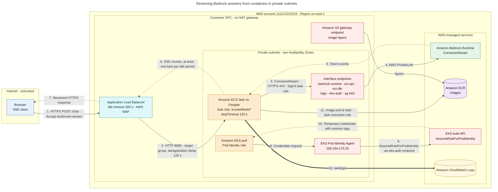

# Amazon ECS, Amazon EKS and AWS Fargate

> **Level:** Intermediate · **Verified:** 2026-11-15 · **Feature status:** n/a · **Time:** ~25 min

Containers are the natural home for Bedrock workloads that outgrow a function: long streamed answers, WebSocket sessions, Python streaming, sidecars, or steady traffic. This chapter covers how a task or pod gets its Bedrock permissions, how to keep long streams alive behind a load balancer, when to choose AgentCore Runtime instead, and what a private subnet needs.

## Learning objectives

After this chapter you can:

- Give an ECS task or an EKS pod Bedrock permissions with a task role, EKS Pod Identity or IRSA.
- Configure load balancer, target group and container timeouts for long-lived streams.
- Decide between Lambda, self-hosted containers and AgentCore Runtime for a Bedrock workload.
- List the interface endpoints a container workload needs in subnets without internet access.

## Prerequisites

- [AWS Lambda with Bedrock](01-lambda.md)
- [IAM roles, trust policies and cross-account access](../../00-foundations/security/02-iam-roles-and-trust.md)
- [VPC endpoints and AWS PrivateLink](../../00-foundations/networking/03-vpc-endpoints-and-privatelink.md)
- [AgentCore Runtime](../../01-amazon-bedrock/agentcore/02-agentcore-runtime.md)

## Concept in plain language

A Lambda function is a taxi: it appears for one trip and the meter stops when it leaves. A container service is a company car pool: the cars stay running, a driver can take a passenger on a three-hour journey, and you can fit a roof rack (a sidecar). The trade is that you own the fleet — the parking (subnets), the keys each driver carries (roles), and the rule for how long a car may sit silent at the gate before the barrier closes (the load balancer's idle timeout).

## How it really works

### Identity: how a container gets Bedrock permissions

| Platform | Mechanism | Trusted principal | Facts that matter |
|:--|:--|:--|:--|
| Amazon ECS (Fargate, EC2, Managed Instances) | **Task role**, delivered to the SDK by the container credential provider | `ecs-tasks.amazonaws.com`; AWS recommends `aws:SourceAccount` and `aws:SourceArn` conditions (cluster-level `SourceArn` is not supported — use a wildcard) | Separate from the **task execution role**, which pulls images and writes logs. On EC2 and Managed Instances there is no task isolation: containers may reach other tasks' credentials and the instance role through IMDS unless you block it. Each Fargate task has its own isolation boundary |
| Amazon EKS — **Pod Identity** | Association of an IAM role with a service account in a namespace | `pods.eks.amazonaws.com` with `sts:AssumeRole` and `sts:TagSession` | AWS recommends it "whenever possible". The Pod Identity Agent DaemonSet vends credentials on 169.254.170.23. Session tags (namespace, service account, cluster) enable attribute-based access. 5,000 associations per cluster. **Not available** for pods on Fargate |
| Amazon EKS — **IRSA** | Service account annotated with a role; SDK calls `AssumeRoleWithWebIdentity` | The cluster's IAM OIDC provider | One OIDC provider per cluster (default limit 100 per account); trust policy updated for each new cluster. **Our reading:** it is the mechanism left for Fargate pods |

Sources: [ECS task IAM role](https://docs.aws.amazon.com/AmazonECS/latest/developerguide/task-iam-roles.html), [EKS Pod Identity](https://docs.aws.amazon.com/eks/latest/userguide/pod-identities.html), [Pod Identity role trust policy](https://docs.aws.amazon.com/eks/latest/userguide/pod-id-role.html), [Pod Identity versus IRSA](https://docs.aws.amazon.com/eks/latest/userguide/service-accounts.html).

> [!NOTE]
> **Documented fact** — "Containers are not a security boundary and the use of task IAM roles does not change this." The EKS guide says the same of Pod Identity. Isolation between workloads with different Bedrock permissions comes from separate tasks on Fargate, separate nodes, or separate accounts.
> Source: [ECS task IAM role](https://docs.aws.amazon.com/AmazonECS/latest/developerguide/task-iam-roles.html), [EKS Pod Identity](https://docs.aws.amazon.com/eks/latest/userguide/pod-identities.html)

### Long-lived streaming behind a load balancer

A streamed answer is one long HTTP response. Four timers can cut it short:

| Timer | Default and range | What to do |
|:--|:--|:--|
| ALB connection idle timeout | 60 s; 1–4,000 s | Set it above the longest silence (a reasoning model may think before its first token). Send at least one byte per period; HTTP/2 PING frames do not reset it |
| Application keep-alive | Yours | Keep it longer than the ALB idle timeout, or the ALB may reuse a closed connection and return 502 |
| Target group deregistration delay | 300 s; 0–3,600 s | Longer than your longest stream, so deployments drain instead of cutting answers; AWS warns not to use 5 s for streaming connections |
| ECS `stopTimeout` | 30 s; at most 120 s on Fargate | Handle SIGTERM: stop accepting new streams, finish or checkpoint open ones. Fargate Spot gives a two-minute warning |

Sources: [ALB attributes](https://docs.aws.amazon.com/elasticloadbalancing/latest/application/edit-load-balancer-attributes.html), [ALB troubleshooting](https://docs.aws.amazon.com/elasticloadbalancing/latest/application/load-balancer-troubleshooting.html), [Target group attributes](https://docs.aws.amazon.com/elasticloadbalancing/latest/application/edit-target-group-attributes.html), [ECS connection draining](https://docs.aws.amazon.com/AmazonECS/latest/developerguide/load-balancer-connection-draining.html), [Fargate capacity providers](https://docs.aws.amazon.com/AmazonECS/latest/developerguide/fargate-capacity-providers.html).

### When containers beat Lambda

| Need | Lambda Event Function | ECS, EKS or Fargate |
|:--|:--|:--|
| One answer streamed for longer than 15 minutes | Not possible (900-second maximum) | Limited only by the timers above |
| Native streaming from Python | Custom runtime or Lambda Web Adapter | Any framework that writes chunked responses |
| Long-lived WebSocket or server-sent events sessions | Needs API Gateway WebSocket or `STREAM` mode | Direct, behind an ALB |
| Sidecars (OpenTelemetry collector, proxy) | Extensions only | Native |
| Spiky, short, stateless requests | Strong fit: scales from zero, bills per millisecond | You pay for idle capacity |

### Self-hosted containers or AgentCore Runtime?

If the container **is an agent**, compare with [AgentCore Runtime](../../01-amazon-bedrock/agentcore/02-agentcore-runtime.md):

| | AgentCore Runtime (container deployment) | ECS, EKS or Fargate |
|:--|:--|:--|
| Image contract | ARM64 image in Amazon ECR, listening on `0.0.0.0`; HTTP 8080 (`/invocations`, `/ping`), MCP 8000, A2A 9000 | Any architecture, port and path |
| Isolation | One microVM per session | Task or pod; shared kernel on EC2 nodes |
| Session routing | Built in, by `runtimeSessionId` | Yours to build |
| Limits | 8-hour session (14 days on Instances), 15-minute synchronous request, 60-minute stream, 100 MB payload | Your timers |
| Inbound authentication | SigV4 or JWT, one per runtime | Your ALB or API Gateway |
| Identity | Execution role trusted by `bedrock-agentcore.amazonaws.com` | Task role or pod role |
| Billing | Per second of CPU consumed and memory held | Provisioned task or node capacity |

> [!TIP]
> **Academy recommendation** — Use AgentCore Runtime for per-session agents and MCP servers; use ECS or EKS for the web tier, for streaming chat front ends, and for anything that needs sidecars or control of the host. Many designs use both: a containerised web tier calling `InvokeAgentRuntime`.
> This is our design guidance, not an official AWS reference architecture.

### Private subnets with interface endpoints

| Endpoint service | Needed for |
|:--|:--|
| `ecr.api`, `ecr.dkr` and the Amazon S3 **gateway** endpoint | Pulling images from Amazon ECR (Fargate platform 1.4.0 and later) |
| `logs` | The `awslogs` driver without internet access |
| `secretsmanager`, `ssm` | Secrets and parameters referenced in task definitions |
| `sts` (Regional STS endpoint configured in the SDK) | IRSA |
| `eks-auth` | EKS Pod Identity |
| `oidc-eks` | Setting up IRSA from inside the VPC |
| `eks`, `ec2`, `elasticloadbalancing` | EKS nodes and the AWS Load Balancer Controller |
| `bedrock-runtime` (plus others your code calls) | The application's model calls — see [Private connectivity for Bedrock](../networking/01-private-connectivity-for-bedrock.md) |

Endpoint security groups must allow 443 from the task or node security groups. Sources: [Amazon ECR interface endpoints](https://docs.aws.amazon.com/AmazonECR/latest/userguide/vpc-endpoints.html), [Amazon ECS interface endpoints](https://docs.aws.amazon.com/AmazonECS/latest/developerguide/vpc-endpoints.html), [EKS private clusters](https://docs.aws.amazon.com/eks/latest/userguide/private-clusters.html).

### Integration with Amazon Bedrock

| Interaction | Initiator | Direction of data | Identity used | Network path |
|:--|:--|:--|:--|:--|
| `ConverseStream` from a task or pod | Your code | Prompt out, token events back | Task role, Pod Identity role or IRSA role (SigV4) | `bedrock-runtime` interface endpoint, or NAT gateway to the public endpoint |
| `InvokeAgentRuntime` from a web tier | Your code | Payload out, JSON or SSE back | Task or pod role with `bedrock-agentcore:InvokeAgentRuntime` | `bedrock-agentcore` interface endpoint or public endpoint |
| AgentCore Runtime pulling your agent image | AgentCore Runtime | Image layers from Amazon ECR into the runtime | Runtime execution role (ECR pull permissions) | Inside AWS |
| AgentCore Gateway calling a service you run on ECS or EKS (MCP server, OpenAPI target) | AgentCore Gateway | Tool calls in, results out | Gateway outbound credential: OAuth, API key or IAM | Public HTTPS, or a private endpoint through Amazon VPC Lattice |

**No native integration:** no Bedrock feature invokes an ECS task or a Kubernetes pod directly. Bedrock reaches your containers only through an HTTP interface you expose — for example as an AgentCore Gateway target.

## Architecture diagram



**What this shows** — A streaming chat back end on Fargate, and the equivalent identity path for an EKS pod, in subnets without internet access. Every AWS API the containers need goes through an endpoint.

**Walkthrough**

1. The browser opens a server-sent events (SSE) request to the ALB.
2. The ALB forwards it to a task registered by IP address.
3. The task signs `ConverseStream` with its task role; private DNS sends it to the endpoint.
4. PrivateLink carries it to Bedrock Runtime.
5. –7. Token events flow back and are relayed as SSE chunks; the idle timeout only matters between chunks.
8. –10. On EKS, the pod's SDK asks the node-local Pod Identity Agent, which exchanges the pod's token through the `eks-auth` endpoint for credentials tagged with namespace and service account.
11. At start, the task execution role pulls the image from Amazon ECR; layers come from Amazon S3 through the gateway endpoint.
12. Logs go to CloudWatch Logs through the `logs` endpoint.

**Legend** — solid: request · dashed: response · thick: asynchronous · red: security control or enforcement point · cylinder: data store · boxes: trust and network boundaries. **Variations:** IRSA replaces steps 8–10 with an STS call; on EC2-backed ECS, block IMDS so containers cannot use the instance role.

## Implementation details

1. **Roles.** One task role or pod role per service, scoped to the inference profile and its models. Keep the task execution role free of Bedrock permissions.
2. **EKS identity.** Prefer Pod Identity; restrict the trust policy with the `kubernetes-namespace` and `kubernetes-service-account` request tags, as in the example.
3. **Load balancer.** Idle timeout above the longest silence, deregistration delay above the longest stream, target type `ip` for Fargate and pods.
4. **Shutdown.** Handle SIGTERM; set `stopTimeout` (Fargate: 120 seconds or less).
5. **Endpoints.** Create the table's endpoints before removing the NAT route; test an image pull and a model call from the private subnets.
6. **Scaling.** Scale on concurrent streams or CPU, and cap the maximum task count from the model's tokens-per-minute quota — idle-looking tasks may hold open streams.

## Example

An ECS task role and an optional EKS Pod Identity role with the same Bedrock policy, and an ALB plus target group tuned for streaming.

> **Code status:** validated with `terraform fmt -check`, `terraform validate` and TFLint 0.66 (core rules), provider `hashicorp/aws` 6.73.0, with the `versions.tf` shown in [Private connectivity for Bedrock](../networking/01-private-connectivity-for-bedrock.md#example) · mock-tested: 3 `terraform test` runs pass · **never planned or applied against AWS**

```hcl
variable "aws_region" {
  description = "Region of the cluster, the load balancer and the Bedrock calls."
  type        = string
  default     = "us-east-1"
}

variable "tags" {
  description = "Tags applied to every resource through the provider's default_tags."
  type        = map(string)
  default     = { Project = "bedrock-academy", Chapter = "containers" }
}

variable "name" {
  description = "Name prefix for the roles and the load balancer."
  type        = string
  default     = "bedrock-chat"
}

variable "inference_profile_arn" {
  description = "Inference profile the service may call. Confirm the current profile ID in the Bedrock docs."
  type        = string
}

variable "foundation_model_arns" {
  description = "Foundation model ARNs behind the profile, one per Region of the profile (or with Region *)."
  type        = list(string)
}

variable "vpc_id" {
  description = "VPC of the tasks or pods."
  type        = string
}

variable "alb_subnet_ids" {
  description = "Subnets for the load balancer, in at least two Availability Zones."
  type        = list(string)
}

variable "alb_security_group_ids" {
  description = "Security groups of the load balancer."
  type        = list(string)
}

variable "alb_idle_timeout_seconds" {
  description = "Seconds a connection may stay silent. Must exceed the longest gap between streamed chunks."
  type        = number
  default     = 300

  validation {
    condition     = var.alb_idle_timeout_seconds >= 1 && var.alb_idle_timeout_seconds <= 4000
    error_message = "The ALB idle timeout must be 1 to 4000 seconds."
  }
}

variable "eks_cluster_name" {
  description = "EKS cluster for the Pod Identity association; null to create only the ECS task role."
  type        = string
  default     = null
}

variable "kubernetes_namespace" {
  description = "Namespace of the service account that may use the Pod Identity role."
  type        = string
  default     = "chat"
}

variable "kubernetes_service_account" {
  description = "Service account that may use the Pod Identity role."
  type        = string
  default     = "chat-backend"
}

data "aws_caller_identity" "current" {}
data "aws_partition" "current" {}
data "aws_region" "current" {}

locals {
  account_id = data.aws_caller_identity.current.account_id
  ecs_arns   = "arn:${data.aws_partition.current.partition}:ecs:${data.aws_region.current.region}:${local.account_id}:*"
}

# What the application may do in Bedrock: one profile, and its models only through that profile.
data "aws_iam_policy_document" "bedrock_invoke" {
  statement {
    sid       = "InvokeThroughProfile"
    actions   = ["bedrock:InvokeModel", "bedrock:InvokeModelWithResponseStream"]
    resources = [var.inference_profile_arn]
  }

  statement {
    sid       = "ModelsBehindProfile"
    actions   = ["bedrock:InvokeModel", "bedrock:InvokeModelWithResponseStream"]
    resources = var.foundation_model_arns

    condition {
      test     = "StringLike"
      variable = "bedrock:InferenceProfileArn"
      values   = [var.inference_profile_arn]
    }
  }
}

# Amazon ECS: the task role (not the task execution role) is what application code uses.
data "aws_iam_policy_document" "ecs_task_trust" {
  statement {
    actions = ["sts:AssumeRole"]

    principals {
      type        = "Service"
      identifiers = ["ecs-tasks.amazonaws.com"]
    }

    condition {
      test     = "StringEquals"
      variable = "aws:SourceAccount"
      values   = [local.account_id]
    }

    condition {
      test     = "ArnLike"
      variable = "aws:SourceArn"
      values   = [local.ecs_arns]
    }
  }
}

resource "aws_iam_role" "ecs_task" {
  name               = "${var.name}-ecs-task"
  assume_role_policy = data.aws_iam_policy_document.ecs_task_trust.json
}

resource "aws_iam_role_policy" "ecs_task_bedrock" {
  name   = "bedrock-invoke"
  role   = aws_iam_role.ecs_task.id
  policy = data.aws_iam_policy_document.bedrock_invoke.json
}

# Amazon EKS: a Pod Identity role, limited to one namespace and service account by session tags.
data "aws_iam_policy_document" "pod_identity_trust" {
  statement {
    actions = ["sts:AssumeRole", "sts:TagSession"]

    principals {
      type        = "Service"
      identifiers = ["pods.eks.amazonaws.com"]
    }

    condition {
      test     = "StringEquals"
      variable = "aws:RequestTag/kubernetes-namespace"
      values   = [var.kubernetes_namespace]
    }

    condition {
      test     = "StringEquals"
      variable = "aws:RequestTag/kubernetes-service-account"
      values   = [var.kubernetes_service_account]
    }
  }
}

resource "aws_iam_role" "pod" {
  count = var.eks_cluster_name == null ? 0 : 1

  name               = "${var.name}-eks-pod"
  assume_role_policy = data.aws_iam_policy_document.pod_identity_trust.json
}

resource "aws_iam_role_policy" "pod_bedrock" {
  count = var.eks_cluster_name == null ? 0 : 1

  name   = "bedrock-invoke"
  role   = aws_iam_role.pod[0].id
  policy = data.aws_iam_policy_document.bedrock_invoke.json
}

resource "aws_eks_pod_identity_association" "chat" {
  count = var.eks_cluster_name == null ? 0 : 1

  cluster_name    = var.eks_cluster_name
  namespace       = var.kubernetes_namespace
  service_account = var.kubernetes_service_account
  role_arn        = aws_iam_role.pod[0].arn
}

# Load balancer settings for long-lived streamed responses.
resource "aws_lb" "chat" {
  name                       = "${var.name}-alb"
  load_balancer_type         = "application"
  internal                   = true
  subnets                    = var.alb_subnet_ids
  security_groups            = var.alb_security_group_ids
  idle_timeout               = var.alb_idle_timeout_seconds
  drop_invalid_header_fields = true
}

resource "aws_lb_target_group" "chat" {
  name                 = "${var.name}-tg"
  target_type          = "ip" # Fargate tasks and EKS pods register by IP address
  port                 = 8080
  protocol             = "HTTP"
  vpc_id               = var.vpc_id
  deregistration_delay = "120" # let in-flight streams finish during deployments

  health_check {
    path    = "/healthz"
    matcher = "200"
  }
}

output "ecs_task_role_arn" {
  description = "Set as taskRoleArn in the ECS task definition."
  value       = aws_iam_role.ecs_task.arn
}

output "pod_identity_role_arn" {
  description = "Role that EKS Pod Identity vends to the chat service account (null without a cluster)."
  value       = one(aws_iam_role.pod[*].arn)
}

output "target_group_arn" {
  description = "Target group for the ECS service or the AWS Load Balancer Controller."
  value       = aws_lb_target_group.chat.arn
}
```

`tests/containers.tftest.hcl`:

```hcl
mock_provider "aws" {
  mock_data "aws_caller_identity" {
    defaults = { account_id = "111122223333" }
  }
  mock_data "aws_partition" {
    defaults = { partition = "aws" }
  }
  mock_data "aws_region" {
    defaults = { region = "us-east-1" }
  }
  mock_data "aws_iam_policy_document" {
    defaults = { json = "{\"Version\":\"2012-10-17\",\"Statement\":[]}" }
  }
}

variables {
  inference_profile_arn  = "arn:aws:bedrock:us-east-1:111122223333:inference-profile/us.example-model-id"
  foundation_model_arns  = ["arn:aws:bedrock:*::foundation-model/example-model-id"]
  vpc_id                 = "vpc-0example"
  alb_subnet_ids         = ["subnet-0aaa", "subnet-0bbb"]
  alb_security_group_ids = ["sg-0alb"]
}

run "ecs_only_by_default" {
  command = plan

  assert {
    condition     = length(aws_iam_role.pod) == 0 && length(aws_eks_pod_identity_association.chat) == 0
    error_message = "Without a cluster name, no Pod Identity resources are created."
  }

  assert {
    condition     = aws_lb.chat.idle_timeout == 300 && aws_lb_target_group.chat.deregistration_delay == "120"
    error_message = "Streaming needs a raised idle timeout and a draining period."
  }
}

run "pod_identity_when_cluster_given" {
  command = plan

  variables {
    eks_cluster_name = "academy"
  }

  assert {
    condition     = aws_eks_pod_identity_association.chat[0].namespace == "chat" && aws_eks_pod_identity_association.chat[0].service_account == "chat-backend"
    error_message = "The association must bind the role to the chat service account."
  }
}

run "rejects_idle_timeout_out_of_range" {
  command = plan

  variables {
    alb_idle_timeout_seconds = 5000
  }

  expect_failures = [var.alb_idle_timeout_seconds]
}
```

The load balancer is internal; publish it through CloudFront or an API Gateway private integration as described in [API Gateway, CloudFront and Application Load Balancer](04-api-gateway-cloudfront-alb.md). If you deploy this in a sandbox account, the load balancer bills hourly; run `terraform destroy` when you finish.

## Common mistakes

> [!WARNING]
> **Common mistake** — Putting Bedrock permissions on the task **execution** role. The application cannot use them (the SDK in the container receives the task role), and the agent that pulls images now holds model access it never needs.

| Mistake | Symptom | Fix |
|:--|:--|:--|
| ALB idle timeout left at 60 s | 504 before the first token from a thinking model | Raise it; send heartbeat bytes |
| Deregistration delay of 5 s on a streaming service | Answers cut off at every deployment | Delay longer than the longest stream; handle SIGTERM |
| Pod Identity on Fargate pods | Pods receive no Pod Identity credentials | IRSA for Fargate pods (our reading), or EC2 nodes |
| Private EKS cluster without `eks-auth` endpoint | Pod Identity credential calls time out | Create the `eks-auth` interface endpoint |
| IRSA with a v1 SDK using the global STS endpoint | Credential calls bypass the STS endpoint and fail | Configure the Regional STS endpoint |
| No S3 gateway endpoint in an ECR-only private subnet | Image pulls fail | Add the S3 gateway endpoint to the subnets' route tables |

## Security considerations

- **One role per service**, scoped to one inference profile; use Pod Identity session tags to stop other namespaces using the role.
- **Block IMDS from containers** on EC2-backed ECS and EKS nodes so tasks cannot use the instance role; see [Amazon EC2 and AWS App Runner](03-ec2-and-app-runner.md).
- **Separate trust levels** with separate Fargate tasks, node groups or accounts — containers are not a security boundary.
- **Validate prompts** in the service; the ALB forwards whatever it receives. See [Prompt injection, untrusted tool output and retrieval poisoning](../../06-security-governance/04-prompt-injection-and-untrusted-content.md).

## Cost considerations

- **Capacity bills while streams idle.** A task holding a 3-minute stream is mostly waiting for tokens; size tasks for concurrent connections, not CPU.
- **Endpoints and the load balancer** bill hourly per Availability Zone (see [Private connectivity for Bedrock](../networking/01-private-connectivity-for-bedrock.md)); one ALB can front several services.
- **Fargate Spot** suits stateless workers but interrupts streams with a two-minute warning.
- **Bedrock tokens** still dominate; cap the task count from the tokens-per-minute quota.

## Knowledge check

1. An EKS pod running on Fargate needs Bedrock access. Pod Identity or IRSA, and which endpoint does a private cluster need for it?
2. Users report that answers longer than about a minute never start in the browser, although the container logs show tokens arriving. Which setting do you check first?
3. Your agent needs per-session isolation and 2-hour sessions. Why might AgentCore Runtime be a better host than ECS?
4. During each deployment, a few users lose their answers mid-stream. Name two settings to change.

<details>
<summary>Answers</summary>

1. Pod Identity is not available for Fargate pods, so IRSA; a private cluster needs the Regional `sts` interface endpoint (and `oidc-eks` to set it up from inside the VPC).
2. The ALB idle timeout (60 seconds by default): a model that thinks before its first token leaves the connection silent. Raise it or send heartbeat bytes.
3. AgentCore Runtime gives each session its own microVM, routes by session ID and supports 8-hour sessions without building session affinity, idle reaping or isolation yourself.
4. The target group deregistration delay (longer than the longest stream) and the container `stopTimeout` with SIGTERM handling (at most 120 seconds on Fargate).

</details>

## Further reading

Official sources opened while writing this chapter:

- [Amazon ECS task IAM role](https://docs.aws.amazon.com/AmazonECS/latest/developerguide/task-iam-roles.html) — task role, trust policy, isolation warning.
- [EKS Pod Identity](https://docs.aws.amazon.com/eks/latest/userguide/pod-identities.html), [Pod Identity role](https://docs.aws.amazon.com/eks/latest/userguide/pod-id-role.html), [Pod Identity association](https://docs.aws.amazon.com/eks/latest/userguide/pod-id-association.html) — trust policy, session tags, restrictions.
- [Grant Kubernetes workloads access to AWS](https://docs.aws.amazon.com/eks/latest/userguide/service-accounts.html) — Pod Identity versus IRSA.
- [Deploy private clusters with limited internet access](https://docs.aws.amazon.com/eks/latest/userguide/private-clusters.html) — `eks-auth`, `sts`, `oidc-eks` and other endpoints.
- [Amazon ECR interface VPC endpoints](https://docs.aws.amazon.com/AmazonECR/latest/userguide/vpc-endpoints.html) and [Amazon ECS interface VPC endpoints](https://docs.aws.amazon.com/AmazonECS/latest/developerguide/vpc-endpoints.html).
- [Edit ALB attributes](https://docs.aws.amazon.com/elasticloadbalancing/latest/application/edit-load-balancer-attributes.html), [Target group attributes](https://docs.aws.amazon.com/elasticloadbalancing/latest/application/edit-target-group-attributes.html), [Troubleshoot ALBs](https://docs.aws.amazon.com/elasticloadbalancing/latest/application/load-balancer-troubleshooting.html).
- [Optimize load balancer connection draining for ECS](https://docs.aws.amazon.com/AmazonECS/latest/developerguide/load-balancer-connection-draining.html) and [Fargate capacity providers](https://docs.aws.amazon.com/AmazonECS/latest/developerguide/fargate-capacity-providers.html) — `stopTimeout`, Spot warning.
- [AgentCore Runtime Instances](https://docs.aws.amazon.com/bedrock-agentcore/latest/devguide/runtime-instances-how-it-works.html) — compute types compared; the Runtime contract itself is summarised in [AgentCore Runtime](../../01-amazon-bedrock/agentcore/02-agentcore-runtime.md).
- [Terraform `aws_eks_pod_identity_association`](https://raw.githubusercontent.com/hashicorp/terraform-provider-aws/main/website/docs/r/eks_pod_identity_association.html.markdown) — resource arguments.
