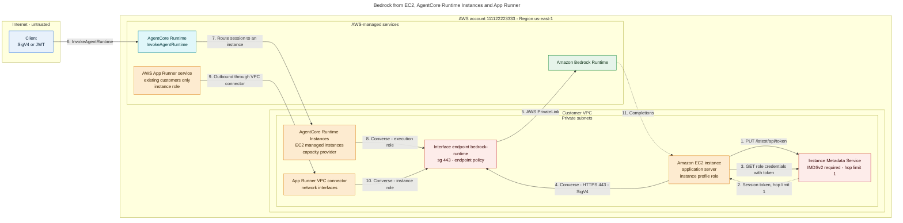

# Amazon EC2 and AWS App Runner

> **Level:** Intermediate · **Verified:** 2026-11-15 · **Feature status:** Maintenance mode (App Runner) · **Time:** ~20 min

Amazon EC2 is for when you need the machine: a long-running server, licensed software, a GPU, or — through AgentCore Runtime's Instances compute type — agents on EC2 in your own account. AWS App Runner, the simplest container web service, is now closed to new customers. This chapter covers how both get Bedrock permissions and when EC2 is the right answer.

> [!IMPORTANT]
> **Status** — Maintenance. "AWS App Runner is no longer open to new customers." The change took effect on 2026-04-30 (announced 2026-03-31). "Existing AWS App Runner customers can continue to use the service as normal, including creating new resources and services … we do not plan to introduce new features." AWS recommends **Amazon ECS Express Mode** instead.
> Source: [App Runner availability change](https://docs.aws.amazon.com/apprunner/latest/dg/apprunner-availability-change.html), [AWS Service Availability Updates (2026-03-31)](https://aws.amazon.com/about-aws/whats-new/2026/03/aws-service-availability/), [App Runner release notes](https://docs.aws.amazon.com/apprunner/latest/relnotes/relnotes.html)

## Learning objectives

After this chapter you can:

- Give an EC2 application Bedrock permissions through an instance profile.
- Require IMDSv2 and choose the hop limit deliberately.
- Decide between calling Bedrock, self-hosting a model on EC2, and AgentCore Runtime Instances.
- State App Runner's current availability exactly, and what existing customers configure to call Bedrock.

## Prerequisites

- [IAM roles, trust policies and cross-account access](../../00-foundations/security/02-iam-roles-and-trust.md)
- [Amazon ECS, Amazon EKS and AWS Fargate](02-containers-ecs-eks-fargate.md)
- [AgentCore Runtime](../../01-amazon-bedrock/agentcore/02-agentcore-runtime.md)

## Concept in plain language

An EC2 instance is a rented office with a key cabinet on the wall. The cabinet (the **Instance Metadata Service**, IMDS) hands out a temporary key to the office's role (the **instance profile**). Version 2 of the cabinet (IMDSv2) first asks for a ticket that can only be requested from inside the room, which stops a visitor in the corridor — a server-side request forgery bug — from walking off with the key.

## How it really works

### Instance profiles

| Fact | Detail |
|:--|:--|
| What it is | A container that passes **one** IAM role to an instance; a role can be in many profiles |
| Console versus API | The IAM console creates a same-named profile with an EC2 role; with the CLI, API or IaC you create role and profile separately |
| Changing permissions | Replace the instance profile; removing a role from a profile can take up to an hour to take effect |
| Session duration | EC2 role credentials are not subject to the role's maximum session duration |

Sources: [IAM roles for Amazon EC2](https://docs.aws.amazon.com/AWSEC2/latest/UserGuide/iam-roles-for-amazon-ec2.html), [Use instance profiles](https://docs.aws.amazon.com/IAM/latest/UserGuide/id_roles_use_switch-role-ec2_instance-profiles.html).

### IMDSv2

IMDSv2 requires a `PUT` to `/latest/api/token` (token lifetime up to 21,600 seconds) and the token on every `GET`; with tokens **required**, requests without one get `401`. The `PUT` response has a hop limit, 1 by default, settable from 1 to 64. Setting the account default to IMDSv2 makes new instances launch with tokens required and a hop limit of 2; an AMI registered with `imds-support` `v2.0` does the same. AWS recommends a hop limit of 2 "in a container environment", because the hop to a container counts.

> [!NOTE]
> **Documented fact** — The ECS task role guidance says containers on EC2 hosts "can potentially access credentials for other tasks … as well as data from co-located tasks" and the instance role through IMDS, and recommends preventing that access.
> Source: [Amazon ECS task IAM role](https://docs.aws.amazon.com/AmazonECS/latest/developerguide/task-iam-roles.html), [Configure IMDS options](https://docs.aws.amazon.com/AWSEC2/latest/UserGuide/configuring-instance-metadata-options.html), [Access instance metadata](https://docs.aws.amazon.com/AWSEC2/latest/UserGuide/instancedata-data-retrieval.html)

**Our reading:** these two pieces of advice pull in opposite directions. Keep the hop limit at 1 on hosts whose containers have their own roles (task roles, Pod Identity), so they cannot reach the instance role; use 2 only when a containerised application is meant to use the instance role.

### When EC2 is the right compute

| Option | Use it when | You operate |
|:--|:--|:--|
| **Call Bedrock** from any compute | The model is in the Bedrock catalog and per-token pricing suits the load | Nothing model-related |
| **Self-host an open-weight model on EC2** (GPU or AWS Inferentia instances) | You need a model, version or runtime Bedrock does not offer, or full control of the serving stack | Drivers, serving software, scaling, patching, capacity |
| **Bring the weights to Bedrock** instead | You have customised weights of a supported architecture | Nothing: [Custom Model Import](../../01-amazon-bedrock/foundation-models/04-custom-model-import.md) bills per Custom Model Unit and scales to zero; [Bedrock Marketplace](../../01-amazon-bedrock/foundation-models/05-bedrock-marketplace.md) deploys to a SageMaker AI-managed endpoint |
| **AgentCore Runtime Instances** | Agents need sessions up to 14 days, GPUs, several collaborating agents per machine, or your EC2 pricing agreements | Only the capacity provider definition; AgentCore provisions, patches, scales and tears down |
| **Application servers on EC2** | Existing or licensed software that calls Bedrock | The instances; Bedrock access through the instance profile |

**AgentCore Runtime Instances**, precisely: AgentCore provisions Amazon EC2 managed instances in your account from a **capacity provider** (operating system, instance types, VPC and subnets, volumes, IAM roles). A session is one instance, runs up to 14 days and keeps persistent volumes across stops. `x86_64` and `arm64`, VPC networking only, GPU families `g4dn`, `g5`, `g6`, `g6e`, `gr6`, `g6f`, `gr6f`, `g7e` and `inf2` with drivers provisioned. You do not launch, patch or terminate the instances, and the compute type is fixed at creation. Source: [Instances](https://docs.aws.amazon.com/bedrock-agentcore/latest/devguide/runtime-instances-how-it-works.html).

### AWS App Runner, for existing customers

| Need | What App Runner provides |
|:--|:--|
| Bedrock permissions | An **instance role** trusted by `tasks.apprunner.amazonaws.com`, passed as `InstanceRoleArn` |
| Private outbound | A **VPC connector**: all outbound traffic then follows your VPC's routes, so the service reaches AWS APIs only through a NAT gateway or VPC endpoints; inbound traffic and App Runner's own image pulls, logs and secret retrieval do not use your VPC |
| Protection | AWS WAF can protect App Runner services; private services use the `apprunner.requests` endpoint service |

Sources: [App Runner and IAM](https://docs.aws.amazon.com/apprunner/latest/dg/security_iam_service-with-iam.html), [App Runner networking](https://docs.aws.amazon.com/apprunner/latest/dg/network-vpc.html), [AWS WAF](https://docs.aws.amazon.com/waf/latest/developerguide/waf-chapter.html), [PrivateLink services](https://docs.aws.amazon.com/vpc/latest/privatelink/aws-services-privatelink-support.html).

New projects should use Amazon ECS Express Mode: one API call with a container image and two IAM roles provisions an ECS service on Fargate, an Application Load Balancer, auto scaling and networking, at no additional charge beyond the resources. Bedrock access then works as in [Amazon ECS, Amazon EKS and AWS Fargate](02-containers-ecs-eks-fargate.md).

### Integration with Amazon Bedrock

| Interaction | Initiator | Direction of data | Identity used | Network path |
|:--|:--|:--|:--|:--|
| `Converse` from an application on EC2 | Your code | Prompt out, completion back | Instance profile role, credentials from IMDSv2 | `bedrock-runtime` interface endpoint or NAT gateway |
| AgentCore Runtime placing a session on an instance | AgentCore Runtime | Invocation payload to the agent on your instance; persistent volume data stays in your account | IAM roles named in the capacity provider (role details **UNVERIFIED — REQUIRES DOCUMENTATION REVIEW**: the IAM roles section of the Instances page was not read) | Your VPC and subnets |
| Agent on an Instances session calling a model | Your agent code | Prompt out, completion back | The runtime's execution role | Your VPC routes: endpoint or NAT |
| `Converse` from an App Runner service | Your code | Prompt out, completion back | App Runner instance role | Public endpoint, or VPC connector plus endpoint or NAT |

**No native integration:** Bedrock cannot serve, route to or meter a model you host on your own EC2 instance. To use self-managed weights through Bedrock APIs, import them with Custom Model Import. **Our reading:** an AgentCore Gateway inference provider target could put such an endpoint behind one gateway URL; see [AgentCore Gateway](../../01-amazon-bedrock/agentcore/04-agentcore-gateway.md).

## Architecture diagram



**What this shows** — Three ways compute on or near EC2 reaches Bedrock privately. All three converge on the same interface endpoint; only their identity differs.

**Walkthrough**

1. –3. The SDK on the instance obtains an IMDSv2 token, then the instance role's temporary credentials.
4. –5. It signs `Converse` and reaches Bedrock Runtime through the endpoint.
6. –7. A client invokes an agent runtime whose compute type is Instances; AgentCore places the session on an EC2 managed instance in your VPC.
8. The agent calls Bedrock with the runtime's execution role, through your network.
9. –10. An existing App Runner service with a VPC connector sends its outbound calls through your VPC.
11. Responses return on the same connections (drawn once).

**Legend** — solid: request · dashed: response · red: security control · boxes: trust and network boundaries. **Variations:** without a VPC connector, App Runner calls the public endpoint; with a hop limit of 2, containers on the instance can also obtain the instance role.

## Implementation details

1. **Create a role per application** trusted by `ec2.amazonaws.com`, scoped to one inference profile and its models; wrap it in an instance profile.
2. **Require IMDSv2** in every launch template, and set the account default to IMDSv2 so that nothing launches without it.
3. **Choose the hop limit**: 1 by default; 2 only for containers that are meant to use the instance role.
4. **Private subnets plus endpoints**: `bedrock-runtime`, and `ssm` endpoints if you manage instances with Systems Manager instead of SSH.
5. **For agents on EC2**, prefer AgentCore Runtime Instances over hand-built hosts when you need its session model; define the capacity provider with IaC (in Terraform 6.73.0 only through the CloudFormation types, as noted in [AgentCore Runtime](../../01-amazon-bedrock/agentcore/02-agentcore-runtime.md)).
6. **For App Runner**, do not start new services in new accounts; plan existing services' migration to ECS Express Mode.

## Example

An instance role scoped to one inference profile, its instance profile, and a launch template that requires IMDSv2.

> **Code status:** validated with `terraform fmt -check`, `terraform validate` and TFLint 0.66 (core rules), provider `hashicorp/aws` 6.73.0, with the `versions.tf` shown in [Private connectivity for Bedrock](../networking/01-private-connectivity-for-bedrock.md#example) · mock-tested: 2 `terraform test` runs pass · **never planned or applied against AWS**

```hcl
variable "aws_region" {
  description = "Region of the instances and the Bedrock calls."
  type        = string
  default     = "us-east-1"
}

variable "tags" {
  description = "Tags applied to every resource through the provider's default_tags."
  type        = map(string)
  default     = { Project = "bedrock-academy", Chapter = "ec2" }
}

variable "name" {
  description = "Name prefix for the role, instance profile and launch template."
  type        = string
  default     = "bedrock-app"
}

variable "ami_id" {
  description = "AMI to launch. Prefer an AMI registered with imds-support v2.0."
  type        = string
}

variable "instance_type" {
  description = "Instance type for the application servers."
  type        = string
  default     = "t4g.small"
}

variable "security_group_ids" {
  description = "Security groups of the instances (outbound 443 to the Bedrock endpoint)."
  type        = list(string)
}

variable "inference_profile_arn" {
  description = "Inference profile the application may call. Confirm the current profile ID in the Bedrock docs."
  type        = string
}

variable "foundation_model_arns" {
  description = "Foundation model ARNs behind the profile (Region * covers cross-Region routing)."
  type        = list(string)
}

variable "metadata_hop_limit" {
  description = "IMDS PUT response hop limit: 1 keeps the token on the host; 2 lets containers on the host reach IMDS."
  type        = number
  default     = 1

  validation {
    condition     = var.metadata_hop_limit >= 1 && var.metadata_hop_limit <= 64
    error_message = "The hop limit must be 1 to 64."
  }
}

data "aws_iam_policy_document" "ec2_trust" {
  statement {
    actions = ["sts:AssumeRole"]

    principals {
      type        = "Service"
      identifiers = ["ec2.amazonaws.com"]
    }
  }
}

data "aws_iam_policy_document" "bedrock_invoke" {
  statement {
    sid       = "InvokeThroughProfile"
    actions   = ["bedrock:InvokeModel", "bedrock:InvokeModelWithResponseStream"]
    resources = [var.inference_profile_arn]
  }

  statement {
    sid       = "ModelsBehindProfile"
    actions   = ["bedrock:InvokeModel", "bedrock:InvokeModelWithResponseStream"]
    resources = var.foundation_model_arns

    condition {
      test     = "StringLike"
      variable = "bedrock:InferenceProfileArn"
      values   = [var.inference_profile_arn]
    }
  }
}

resource "aws_iam_role" "app" {
  name               = "${var.name}-ec2"
  assume_role_policy = data.aws_iam_policy_document.ec2_trust.json
}

resource "aws_iam_role_policy" "bedrock" {
  name   = "bedrock-invoke"
  role   = aws_iam_role.app.id
  policy = data.aws_iam_policy_document.bedrock_invoke.json
}

# The instance profile is the container that passes exactly one role to the instance.
resource "aws_iam_instance_profile" "app" {
  name = "${var.name}-ec2"
  role = aws_iam_role.app.name
}

resource "aws_launch_template" "app" {
  name_prefix            = "${var.name}-"
  image_id               = var.ami_id
  instance_type          = var.instance_type
  vpc_security_group_ids = var.security_group_ids

  iam_instance_profile {
    arn = aws_iam_instance_profile.app.arn
  }

  # IMDSv2 only: credentials require a session token obtained with PUT.
  metadata_options {
    http_endpoint               = "enabled"
    http_tokens                 = "required"
    http_put_response_hop_limit = var.metadata_hop_limit
    instance_metadata_tags      = "disabled"
  }
}

output "launch_template_id" {
  description = "Use with an Auto Scaling group or aws_instance."
  value       = aws_launch_template.app.id
}

output "instance_role_arn" {
  description = "Role whose temporary credentials the SDK reads from IMDS."
  value       = aws_iam_role.app.arn
}
```

`tests/ec2.tftest.hcl`:

```hcl
mock_provider "aws" {
  mock_data "aws_iam_policy_document" {
    defaults = { json = "{\"Version\":\"2012-10-17\",\"Statement\":[]}" }
  }
}

variables {
  ami_id                = "ami-0example"
  security_group_ids    = ["sg-0app"]
  inference_profile_arn = "arn:aws:bedrock:us-east-1:111122223333:inference-profile/us.example-model-id"
  foundation_model_arns = ["arn:aws:bedrock:*::foundation-model/example-model-id"]
}

run "requires_imdsv2_with_hop_limit_one" {
  command = plan

  assert {
    condition     = one(aws_launch_template.app.metadata_options).http_tokens == "required"
    error_message = "Instances must require IMDSv2 session tokens."
  }

  assert {
    condition     = one(aws_launch_template.app.metadata_options).http_put_response_hop_limit == 1
    error_message = "The default hop limit keeps tokens on the host."
  }
}

run "rejects_hop_limit_zero" {
  command = plan

  variables {
    metadata_hop_limit = 0
  }

  expect_failures = [var.metadata_hop_limit]
}
```

A launch template costs nothing by itself; instances launched from it bill per second while running. Remove them and run `terraform destroy` after experimenting.

## Common mistakes

> [!WARNING]
> **Common mistake** — Raising the hop limit to 2 on a shared container host "to fix a slow SDK". Every container on the host can now obtain the instance role's credentials, bypassing the per-task roles you designed.

| Mistake | Symptom | Fix |
|:--|:--|:--|
| IMDSv1 still allowed | SSRF bugs can read role credentials | `http_tokens = "required"`, account default IMDSv2 |
| Hop limit 1 for an app in a container that needs the instance role | SDK delays or no credentials | Hop limit 2 for that host, or pass settings into the container |
| Removing a role from an instance profile to revoke access | Access persists for up to an hour | Replace the instance profile; revoke sessions |
| Self-hosting a model Bedrock already offers | GPU bill while idle, patching backlog | Bedrock on-demand, Custom Model Import, or Runtime Instances for agents |
| New App Runner service in a new account | Service creation is not available | Amazon ECS Express Mode |
| App Runner VPC connector without NAT or endpoints | Bedrock calls time out | Add a `bedrock-runtime` endpoint or a NAT gateway |

## Security considerations

- **IMDSv2 everywhere** and the account default set; see [Identity, least privilege and IAM isolation for agents](../../06-security-governance/02-identity-and-least-privilege.md).
- **Restrict `iam:PassRole`** for instance profiles that carry Bedrock permissions: whoever can launch an instance with the profile can use the model.
- **Patch what you run.** Self-hosted model servers and their drivers are your responsibility; Runtime Instances shift patching to AgentCore.
- **Keep Bedrock traffic private** with an interface endpoint and a restrictive endpoint policy.

## Cost considerations

- **EC2 bills while running**, busy or idle; GPU instances make idle time expensive. Bedrock on-demand bills only tokens.
- **Runtime Instances** bill the EC2 instance at your rates plus a management fee (a percentage of the public On-Demand price, not covered by Savings Plans), and EBS persistent volumes even while a session is stopped ([AgentCore pricing](https://aws.amazon.com/bedrock/agentcore/pricing/)).
- **Custom Model Import** bills per Custom Model Unit and scales to zero after idle minutes, which often beats an always-on GPU for spiky use.

## Knowledge check

1. An application in Docker on an EC2 host needs the instance role, but the SDK hangs before every first call. What is happening and what are your two options?
2. A team wants to serve a fine-tuned open-weight model for an internal chatbot with unpredictable traffic. Which options would you compare before buying GPU instances?
3. Is AWS App Runner deprecated? Answer precisely.
4. Why is a hop limit of 1 a security control on an ECS-on-EC2 host?

<details>
<summary>Answers</summary>

1. With a hop limit of 1 the token response cannot reach the container, so the SDK waits. Raise the hop limit to 2 on that host (every container can then use the role) or pass settings into the container.
2. A Bedrock catalog model on demand, Custom Model Import (scales to zero), Bedrock Marketplace on a SageMaker AI-managed endpoint — and only then EC2.
3. Not with an end date: AWS lists it as moving to maintenance. It is closed to new customers since 2026-04-30; existing customers keep using it, including new services, but get no new features. No end-of-life date was found. AWS recommends Amazon ECS Express Mode.
4. The hop to a container counts, so containers cannot obtain IMDSv2 tokens and must use their own task roles.

</details>

## Further reading

Official sources opened while writing this chapter:

- [IAM roles for Amazon EC2](https://docs.aws.amazon.com/AWSEC2/latest/UserGuide/iam-roles-for-amazon-ec2.html) and [Use instance profiles](https://docs.aws.amazon.com/IAM/latest/UserGuide/id_roles_use_switch-role-ec2_instance-profiles.html).
- [Use IMDS to access instance metadata](https://docs.aws.amazon.com/AWSEC2/latest/UserGuide/configuring-instance-metadata-service.html), [Configure IMDS options](https://docs.aws.amazon.com/AWSEC2/latest/UserGuide/configuring-instance-metadata-options.html), [Configure IMDS for new instances](https://docs.aws.amazon.com/AWSEC2/latest/UserGuide/configuring-IMDS-new-instances.html), [Access instance metadata](https://docs.aws.amazon.com/AWSEC2/latest/UserGuide/instancedata-data-retrieval.html).
- [Amazon ECS task IAM role](https://docs.aws.amazon.com/AmazonECS/latest/developerguide/task-iam-roles.html) — container access to IMDS.
- [AgentCore Runtime Instances](https://docs.aws.amazon.com/bedrock-agentcore/latest/devguide/runtime-instances-how-it-works.html) — capacity providers, sessions, GPU families, compute type comparison.
- [AWS App Runner availability change](https://docs.aws.amazon.com/apprunner/latest/dg/apprunner-availability-change.html), [AWS Service Availability Updates](https://aws.amazon.com/about-aws/whats-new/2026/03/aws-service-availability/), [App Runner release notes](https://docs.aws.amazon.com/apprunner/latest/relnotes/relnotes.html).
- [How App Runner works with IAM](https://docs.aws.amazon.com/apprunner/latest/dg/security_iam_service-with-iam.html) and [Enabling VPC access for outgoing traffic](https://docs.aws.amazon.com/apprunner/latest/dg/network-vpc.html).
- [AWS WAF](https://docs.aws.amazon.com/waf/latest/developerguide/waf-chapter.html) and [AWS services that integrate with PrivateLink](https://docs.aws.amazon.com/vpc/latest/privatelink/aws-services-privatelink-support.html).
- [AgentCore pricing](https://aws.amazon.com/bedrock/agentcore/pricing/) — Instances billing dimensions.
