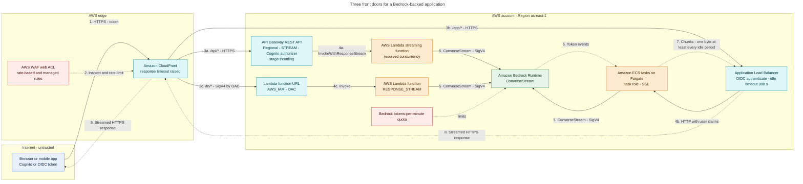
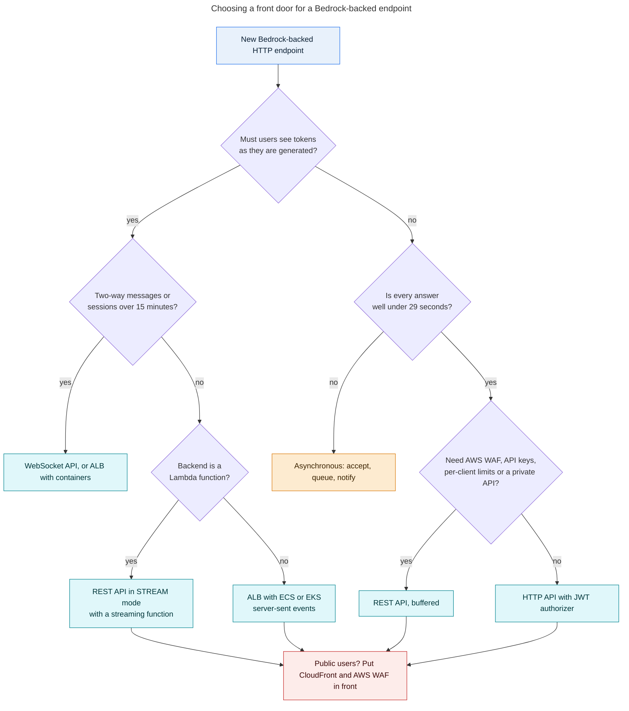

# API Gateway, CloudFront and Application Load Balancer

> **Level:** Intermediate · **Verified:** 2026-11-15 · **Feature status:** n/a · **Time:** ~25 min

Every Bedrock-backed web application needs an HTTP front door. The choice decides how long a client can wait for a model, whether tokens can be streamed, where users are authenticated, and what stands between a leaked token and your model bill.

## Learning objectives

After this chapter you can:

- Compare REST, HTTP and WebSocket APIs, Lambda function URLs, Application Load Balancers and CloudFront on timeout, streaming, authentication and AWS WAF support.
- Configure a REST API that streams a Lambda function's response for up to 15 minutes.
- Explain why usage plans are not a cost control, and build a cost guard that is.
- Set CloudFront and ALB timeouts that survive long generations.
- Choose a front door with a decision flowchart.

## Prerequisites

- [Amazon S3, AWS Lambda and Amazon API Gateway](../../00-foundations/aws-fundamentals/02-s3-lambda-api-gateway.md)
- [AWS Lambda with Bedrock](01-lambda.md) and [Amazon ECS, Amazon EKS and AWS Fargate](02-containers-ecs-eks-fargate.md)
- [InvokeModel and streaming APIs](../../01-amazon-bedrock/inference/02-invokemodel-and-streaming.md)

## Concept in plain language

A model answer is like a long phone dictation. A **buffered** front door waits until the whole letter is written and then hands it over — if writing takes longer than the receptionist's patience (the **integration timeout**), the visitor is sent away with nothing. A **streaming** front door passes each sentence on as it is spoken; the visitor starts reading at once, and the receptionist only needs patience between sentences (an **idle timeout**).

The front door is also the security desk. It checks badges (authorizers), limits how many visitors enter per second (throttling) and can turn away known troublemakers (AWS WAF). It does not, however, know what a token costs.

## How it really works

### The front doors compared

| Front door | Longest buffered wait | Streaming to the client | Authentication | AWS WAF | Rate controls |
|:--|:--|:--|:--|:--|:--|
| API Gateway **REST API** | Integration timeout 50 ms–29 s; can be raised for Regional and private APIs, possibly with a lower Region-level throttle quota | `STREAM` transfer mode for `AWS_PROXY` and `HTTP_PROXY`: up to 15 minutes; idle timeout 5 min (Regional, private) or 30 s (edge-optimized) | IAM, resource policies, Amazon Cognito, Lambda authorizers | Yes | Stage and method throttling; API keys and usage plans (best effort) |
| API Gateway **HTTP API** | 30 s, fixed | No | IAM, JWT (including Cognito), Lambda authorizers | No | Account-level throttling; no API keys or per-client limits |
| API Gateway **WebSocket API** | 29 s per integration call | Server pushes messages; connection up to 2 h, idle 10 min; 128 KB message, 32 KB frame | IAM, Lambda authorizer on `$connect` | Not listed | 500 new connections per second per account and Region |
| **Lambda function URL** | Function timeout (900 s) | `RESPONSE_STREAM` invoke mode (200 MB) | `NONE` or `AWS_IAM`; CloudFront origin access control | Only through CloudFront | Function concurrency; 429 when exhausted |
| **Application Load Balancer** | Idle timeout 60 s default, 1–4,000 s — measured between bytes, not end to end | Yes for HTTP targets; Lambda targets limited to 1 MB and no WebSockets | OIDC or Amazon Cognito authenticate action on HTTPS listeners | Yes | Through AWS WAF rules |
| **CloudFront** (in front of any of these) | Origin response timeout 30 s default, 1–120 s, applied per packet; optional response-completion timeout | Passes chunks as they arrive (**our reading** of the per-packet timeout); WebSocket over HTTP/1.1 | At the origin; OAC signs requests to function URL origins | Yes | Through AWS WAF rules |

Sources: [REST API quotas](https://docs.aws.amazon.com/apigateway/latest/developerguide/api-gateway-execution-service-limits-table.html), [HTTP API quotas](https://docs.aws.amazon.com/apigateway/latest/developerguide/http-api-quotas.html), [WebSocket API quotas](https://docs.aws.amazon.com/apigateway/latest/developerguide/apigateway-execution-service-websocket-limits-table.html), [REST versus HTTP APIs](https://docs.aws.amazon.com/apigateway/latest/developerguide/http-api-vs-rest.html), [Response streaming](https://docs.aws.amazon.com/apigateway/latest/developerguide/response-transfer-mode.html), [Lambda HTTP invoke options](https://docs.aws.amazon.com/lambda/latest/dg/furls-http-invoke-decision.html), [Lambda quotas](https://docs.aws.amazon.com/lambda/latest/dg/gettingstarted-limits.html), [ALB attributes](https://docs.aws.amazon.com/elasticloadbalancing/latest/application/edit-load-balancer-attributes.html), [ALB Lambda targets](https://docs.aws.amazon.com/elasticloadbalancing/latest/application/lambda-functions.html), [ALB authentication](https://docs.aws.amazon.com/elasticloadbalancing/latest/application/listener-authenticate-users.html), [CloudFront origin settings](https://docs.aws.amazon.com/AmazonCloudFront/latest/DeveloperGuide/DownloadDistValuesOrigin.html), [CloudFront WebSockets](https://docs.aws.amazon.com/AmazonCloudFront/latest/DeveloperGuide/distribution-working-with.websockets.html), [AWS WAF resource types](https://docs.aws.amazon.com/waf/latest/developerguide/waf-chapter.html).

> [!NOTE]
> **Documented fact** — REST API response streaming lists "Lower the time-to-first-byte (TTFB) for generative AI applications like chatbots" as its first use case. In `STREAM` mode endpoint caching, content encoding and VTL response transformation are unavailable; the first 10 MB are not bandwidth-restricted, then 2 MB/s; and the Lambda function may keep running after a timeout closes the connection.
> Source: [Stream the integration response](https://docs.aws.amazon.com/apigateway/latest/developerguide/response-transfer-mode.html)

### Authorizers

Authenticate before any paid model call. REST APIs offer Cognito user pool authorizers, Lambda authorizers and IAM; HTTP APIs add native JWT authorizers (1.5-second timeouts for the JWKS and discovery endpoints; 10 seconds for a Lambda authorizer response). WebSocket APIs authorise once, on `$connect`. ALBs authenticate users themselves through an OIDC identity provider or Cognito and pass the user's claims to the target; the IdP's endpoints must be publicly resolvable.

### Throttling is not a budget

API Gateway handles up to 10,000 requests per second per Region by default, with a 5,000 burst ([Lambda HTTP invoke options](https://docs.aws.amazon.com/lambda/latest/dg/furls-http-invoke-decision.html)); REST APIs add stage and method limits. Usage plans add per-key throttling and quotas — but AWS is explicit about their limits.

> [!CAUTION]
> **Cost or security hazard** — "Usage plan throttling and quotas are not hard limits, and are applied on a best-effort basis … Don't rely on usage plan quotas or throttling to control costs or block access to an API." AWS also says not to use API keys for authentication. Source: [Usage plans and API keys](https://docs.aws.amazon.com/apigateway/latest/developerguide/api-gateway-api-usage-plans.html)

A real cost guard is layered: an authorizer decides **who**; stage throttling and AWS WAF rules shape the **rate**; Lambda reserved concurrency (or a fixed task count) is the **hard ceiling**; Bedrock's own tokens-per-minute quota is the last line; AWS Budgets alarms tell you when the money moves.

### CloudFront and ALB timeouts for long answers

- **CloudFront** waits up to the origin response timeout for the first byte **and between packets**, so a stream that keeps sending is not cut off; a response-completion timeout, if you set one, caps the total. A Regional REST API behind your own distribution can exceed the 30-second edge idle timeout by raising the distribution's response timeout.
- **ALB** closes a connection that is idle longer than its idle timeout; AWS advises sending at least one byte per period, and HTTP/2 PING frames do not count. Set the application's keep-alive longer than the ALB's.
- **Function URLs behind CloudFront** use origin access control; for `POST` and `PUT`, clients must send the body's SHA-256 in `x-amz-content-sha256`.

### Integration with Amazon Bedrock

| Interaction | Initiator | Direction of data | Identity used | Network path |
|:--|:--|:--|:--|:--|
| Client request through a front door to compute that calls Bedrock | The client | Prompt in, completion (buffered or streamed) out | User token checked by the authorizer or ALB; the backend's IAM role signs the Bedrock call | Internet → front door → Regional compute → Bedrock endpoint |
| AgentCore Gateway calling a REST API stage as an MCP target | AgentCore Gateway | Tool arguments to API methods; responses back as MCP results | Gateway service role (IAM), an API key, or none | Gateway → the stage's endpoint |
| AWS WAF protecting AgentCore Gateway | AWS WAF, inline | Inspects inbound HTTP requests | Web ACL association | In front of the gateway endpoint |
| CloudFront signing requests to a function URL | CloudFront | Viewer request forwarded to the function | OAC; function policy allows `cloudfront.amazonaws.com` for `lambda:InvokeFunctionUrl` and `lambda:InvokeFunction` | AWS edge network → Lambda |

Sources: [AgentCore Gateway](../../01-amazon-bedrock/agentcore/04-agentcore-gateway.md), [AWS WAF](https://docs.aws.amazon.com/waf/latest/developerguide/waf-chapter.html), [Restrict access to a Lambda function URL origin](https://docs.aws.amazon.com/AmazonCloudFront/latest/DeveloperGuide/private-content-restricting-access-to-lambda.html).

**No native integration:** none of the three services calls Bedrock for you or understands tokens. A REST API's generic AWS-service integration could in principle be pointed at `bedrock-runtime`; we found no AWS page documenting that for Bedrock — **UNVERIFIED — REQUIRES DOCUMENTATION REVIEW**.

## Architecture diagram



**What this shows** — One CloudFront distribution with AWS WAF in front of three alternative origins. Each path ends with backend code signing a streaming Bedrock call; only the ALB path's response is drawn in full.

**Walkthrough**

1. The client sends an HTTPS request with a token.
2. AWS WAF inspects it at the edge and applies rate-based rules.
3. CloudFront routes by path: (a) REST API, (b) ALB, (c) function URL signed by origin access control.
4. (a) API Gateway authorises with Cognito and invokes the function in streaming mode; (b) the ALB authenticates the user and forwards claims to a task; (c) Lambda checks the OAC signature and invokes the function.
5. Each backend calls `ConverseStream` with its own role, within the model's quota.
6. –9. On the ALB path, token events flow back as chunks; each hop only needs data inside its idle or per-packet timeout.

**Legend** — solid: request · dashed: response or control · red: security control · boxes: trust boundaries. **Variations:** an HTTP API cannot stream, so a 30-second answer is its ceiling; WebSocket APIs suit two-way chat but cap connections at 2 hours; ALB Lambda targets cannot stream past 1 MB.

### Decision flowchart



**What this shows** — The academy's decision path, built from the documented limits above; it is our guidance, not an AWS decision tree. Asynchronous patterns are in [EventBridge, SQS and SNS with Bedrock](../messaging/01-eventbridge-sqs-sns.md).

## Implementation details

1. **Pick the front door** from the flowchart; prefer streaming over raising buffered timeouts for interactive chat.
2. **Authenticate at the door.** Cognito or JWT authorizers, or the ALB authenticate action; never API keys alone.
3. **Align timeouts outward-in:** CloudFront response timeout ≥ API or ALB idle timeout ≥ backend timeout ≥ SDK read timeout.
4. **Throttle to the Bedrock quota.** Derive stage limits from the model's tokens per minute divided by tokens per request; add reserved concurrency as the hard stop.
5. **Attach AWS WAF** to the REST API stage, ALB or CloudFront distribution; HTTP APIs need CloudFront in front for WAF.
6. **Disable what streaming cannot use** — caching, compression and VTL on streamed methods.

> [!TIP]
> **Academy recommendation** — For a public chat UI, use CloudFront with AWS WAF in front of a Regional REST API in `STREAM` mode. You get edge protection, Cognito authorization, per-client limits and a 15-minute stream, and you stay on serverless pricing.
> This is our design guidance, not an official AWS reference architecture.

## Example

A Regional REST API with `POST /chat` streamed from an existing Lambda function, a Cognito authorizer, stage throttling sized for the model quota, and an optional AWS WAF association.

> **Code status:** validated with `terraform fmt -check`, `terraform validate` and TFLint 0.66 (core rules), provider `hashicorp/aws` 6.73.0, with the same `versions.tf` as in [Private connectivity for Bedrock](../networking/01-private-connectivity-for-bedrock.md#example) · mock-tested: 2 `terraform test` runs pass · **never planned or applied against AWS**

```hcl
variable "aws_region" {
  description = "Region of the REST API and the Lambda function."
  type        = string
  default     = "us-east-1"
}

variable "tags" {
  description = "Tags applied to every resource through the provider's default_tags."
  type        = map(string)
  default     = { Project = "bedrock-academy", Chapter = "front-doors" }
}

variable "api_name" {
  description = "Name of the REST API."
  type        = string
  default     = "bedrock-chat"
}

variable "streaming_function_name" {
  description = "Existing Lambda function that streams its response (Node.js managed runtime, custom runtime or Lambda Web Adapter)."
  type        = string
}

variable "cognito_user_pool_arn" {
  description = "Amazon Cognito user pool whose tokens the API accepts."
  type        = string
}

variable "integration_timeout_ms" {
  description = "Integration timeout. STREAM mode allows up to 900000 ms (15 minutes)."
  type        = number
  default     = 300000

  validation {
    condition     = var.integration_timeout_ms >= 50 && var.integration_timeout_ms <= 900000
    error_message = "STREAM integrations accept 50 to 900000 milliseconds."
  }
}

variable "throttle_rate_limit" {
  description = "Steady-state requests per second for the stage. Size it from the Bedrock quota, not from the API's capacity."
  type        = number
  default     = 20
}

variable "throttle_burst_limit" {
  description = "Burst size for the stage's token bucket."
  type        = number
  default     = 40
}

variable "web_acl_arn" {
  description = "Optional AWS WAF web ACL (Regional scope) to associate with the stage. Null for none."
  type        = string
  default     = null
}

data "aws_lambda_function" "chat" {
  function_name = var.streaming_function_name
}

resource "aws_api_gateway_rest_api" "this" {
  name        = var.api_name
  description = "Bedrock chat front door with a streamed Lambda integration"

  endpoint_configuration {
    types = ["REGIONAL"] # STREAM idle timeout: 5 minutes Regional, 30 seconds edge-optimized
  }
}

resource "aws_api_gateway_resource" "chat" {
  rest_api_id = aws_api_gateway_rest_api.this.id
  parent_id   = aws_api_gateway_rest_api.this.root_resource_id
  path_part   = "chat"
}

resource "aws_api_gateway_authorizer" "cognito" {
  name            = "cognito"
  rest_api_id     = aws_api_gateway_rest_api.this.id
  type            = "COGNITO_USER_POOLS"
  provider_arns   = [var.cognito_user_pool_arn]
  identity_source = "method.request.header.Authorization"
}

resource "aws_api_gateway_method" "post_chat" {
  rest_api_id   = aws_api_gateway_rest_api.this.id
  resource_id   = aws_api_gateway_resource.chat.id
  http_method   = "POST"
  authorization = "COGNITO_USER_POOLS"
  authorizer_id = aws_api_gateway_authorizer.cognito.id
}

# Proxy integration in STREAM mode: API Gateway forwards bytes as the function writes them.
resource "aws_api_gateway_integration" "post_chat" {
  rest_api_id             = aws_api_gateway_rest_api.this.id
  resource_id             = aws_api_gateway_resource.chat.id
  http_method             = aws_api_gateway_method.post_chat.http_method
  type                    = "AWS_PROXY"
  integration_http_method = "POST"
  uri                     = data.aws_lambda_function.chat.response_streaming_invoke_arn
  response_transfer_mode  = "STREAM"
  timeout_milliseconds    = var.integration_timeout_ms
}

# Resource-based policy on the function: only this API, only POST /chat.
resource "aws_lambda_permission" "api_gateway" {
  statement_id  = "AllowRestApiPostChat"
  action        = "lambda:InvokeFunction"
  function_name = data.aws_lambda_function.chat.function_name
  principal     = "apigateway.amazonaws.com"
  source_arn    = "${aws_api_gateway_rest_api.this.execution_arn}/*/POST/chat"
}

resource "aws_api_gateway_deployment" "this" {
  rest_api_id = aws_api_gateway_rest_api.this.id

  triggers = {
    redeployment = sha1(jsonencode([
      aws_api_gateway_resource.chat.id,
      aws_api_gateway_method.post_chat.id,
      aws_api_gateway_integration.post_chat.id,
      aws_api_gateway_integration.post_chat.response_transfer_mode,
      aws_api_gateway_integration.post_chat.timeout_milliseconds,
    ]))
  }

  lifecycle {
    create_before_destroy = true
  }
}

resource "aws_api_gateway_stage" "prod" {
  rest_api_id   = aws_api_gateway_rest_api.this.id
  deployment_id = aws_api_gateway_deployment.this.id
  stage_name    = "prod"
}

# Stage-wide throttling protects the backend and the Bedrock quota. It is not a billing cap.
resource "aws_api_gateway_method_settings" "all" {
  rest_api_id = aws_api_gateway_rest_api.this.id
  stage_name  = aws_api_gateway_stage.prod.stage_name
  method_path = "*/*"

  settings {
    metrics_enabled        = true
    throttling_rate_limit  = var.throttle_rate_limit
    throttling_burst_limit = var.throttle_burst_limit
  }
}

resource "aws_wafv2_web_acl_association" "stage" {
  count = var.web_acl_arn == null ? 0 : 1

  resource_arn = aws_api_gateway_stage.prod.arn
  web_acl_arn  = var.web_acl_arn
}

output "chat_url" {
  description = "POST endpoint that streams the model's answer."
  value       = "${aws_api_gateway_stage.prod.invoke_url}/chat"
}
```

`tests/front_door.tftest.hcl`:

```hcl
mock_provider "aws" {
  mock_data "aws_lambda_function" {
    defaults = {
      function_name                 = "chat-stream"
      response_streaming_invoke_arn = "arn:aws:apigateway:us-east-1:lambda:path/2021-11-15/functions/arn:aws:lambda:us-east-1:111122223333:function:chat-stream/response-streaming-invocations"
    }
  }
}

variables {
  streaming_function_name = "chat-stream"
  cognito_user_pool_arn   = "arn:aws:cognito-idp:us-east-1:111122223333:userpool/us-east-1_EXAMPLE"
}

run "streams_with_cognito_and_stage_throttling" {
  command = plan

  assert {
    condition     = aws_api_gateway_integration.post_chat.response_transfer_mode == "STREAM" && aws_api_gateway_integration.post_chat.type == "AWS_PROXY"
    error_message = "The integration must be a Lambda proxy integration in STREAM mode."
  }

  assert {
    condition     = aws_api_gateway_method.post_chat.authorization == "COGNITO_USER_POOLS"
    error_message = "POST /chat must require a Cognito token."
  }

  assert {
    condition     = one(aws_api_gateway_method_settings.all.settings).throttling_rate_limit == 20
    error_message = "Stage throttling must be set."
  }

  assert {
    condition     = length(aws_wafv2_web_acl_association.stage) == 0
    error_message = "No WAF association unless a web ACL ARN is given."
  }
}

run "rejects_timeout_above_fifteen_minutes" {
  command = plan

  variables {
    integration_timeout_ms = 1000000
  }

  expect_failures = [var.integration_timeout_ms]
}
```

The integration's `uri` uses the function's response-streaming invoke ARN, as in the [Terraform `aws_api_gateway_integration` streaming example](https://raw.githubusercontent.com/hashicorp/terraform-provider-aws/main/website/docs/r/api_gateway_integration.html.markdown). If you deploy this in a sandbox account, every streamed request bills API Gateway, Lambda duration and Bedrock tokens; run `terraform destroy` afterwards.

## Common mistakes

> [!WARNING]
> **Common mistake** — Treating a usage plan quota as a spending limit. It is best-effort; clients can exceed it. Combine authorizers, throttling, reserved concurrency and AWS Budgets alarms.

| Mistake | Symptom | Fix |
|:--|:--|:--|
| Long answers through an HTTP API | Timeout error after 30 seconds | REST API in `STREAM` mode, ALB, or asynchronous |
| Streaming through an edge-optimized REST API | Streams cut after 30 idle seconds | Regional endpoint, optionally behind your own CloudFront |
| ALB idle timeout left at 60 s for a thinking model | 504 before the first token | Raise the idle timeout or send heartbeat bytes |
| Lambda behind ALB for long answers | 502 above 1 MB | Containers behind the ALB, or REST API streaming |
| CloudFront response timeout left at 30 s | 504 at the edge while the origin is still working | Raise it; stream so packets keep flowing |
| `POST` to a function URL through CloudFront OAC without a body hash | Signature errors | Clients send `x-amz-content-sha256` |

## Security considerations

- **Authenticate before you spend.** Unauthenticated routes to a model are a direct path to your bill; see [AWS WAF and AWS Shield](../security/03-waf-and-shield.md).
- **Validate and size-limit prompts in the backend.** API Gateway forwards what it receives; streaming methods cannot use VTL to reshape it.
- **Lock origins.** Use OAC for function URLs and restrict ALBs to CloudFront where CloudFront is the intended door.
- **Agents have doors too.** AgentCore Gateway can be protected by AWS WAF like any other front door.

## Cost considerations

- **API Gateway** bills per request and data transfer out for REST and HTTP APIs, per message and connection minute for WebSocket APIs; response streaming incurs its own cost ([API Gateway pricing](https://aws.amazon.com/api-gateway/pricing/)).
- **Lambda** bills streaming duration in full, even after the client disconnects; **ALB** and **CloudFront** bill by usage on their pricing pages.
- **Bedrock** tokens dominate: every request your door admits is a potential paid generation, which is why the throttling layers above matter.

## Knowledge check

1. A chatbot's answers take up to 3 minutes. Which documented front doors can deliver them without an asynchronous pattern?
2. Why does a usage plan with a quota of 10,000 requests per month not cap your Bedrock bill?
3. Your REST API streams fine when called directly, but streams die after 30 seconds of silence through CloudFront. What do you check?
4. You need AWS WAF and JWT validation for a simple JSON backend. Why is an HTTP API alone not enough?

<details>
<summary>Answers</summary>

1. A REST API in `STREAM` mode (up to 15 minutes), an ALB with an idle timeout above the longest silence, a WebSocket API pushing messages, or a function URL with `RESPONSE_STREAM`. A buffered REST API only if a timeout increase is granted; an HTTP API not at all.
2. AWS documents usage plan quotas as best-effort, and a request's cost depends on tokens, not on the request count.
3. The distribution's origin response timeout (30 seconds by default, applied between packets), and whether the API is edge-optimized (30-second streaming idle timeout).
4. HTTP APIs have no AWS WAF integration. Add CloudFront with AWS WAF in front, or use a REST API with a Lambda or Cognito authorizer.

</details>

## Further reading

Official sources opened while writing this chapter:

- [Choose between REST APIs and HTTP APIs](https://docs.aws.amazon.com/apigateway/latest/developerguide/http-api-vs-rest.html) — features, authorization, WAF, streaming.
- [Stream the integration response](https://docs.aws.amazon.com/apigateway/latest/developerguide/response-transfer-mode.html) — `STREAM` mode limits and use cases.
- [REST API quotas](https://docs.aws.amazon.com/apigateway/latest/developerguide/api-gateway-execution-service-limits-table.html), [HTTP API quotas](https://docs.aws.amazon.com/apigateway/latest/developerguide/http-api-quotas.html), [WebSocket API quotas](https://docs.aws.amazon.com/apigateway/latest/developerguide/apigateway-execution-service-websocket-limits-table.html).
- [Usage plans and API keys](https://docs.aws.amazon.com/apigateway/latest/developerguide/api-gateway-api-usage-plans.html) — best-effort quotas and API key guidance.
- [Select a method to invoke a Lambda function using HTTP](https://docs.aws.amazon.com/lambda/latest/dg/furls-http-invoke-decision.html) — function URLs versus API Gateway, default throttling.
- [Lambda quotas](https://docs.aws.amazon.com/lambda/latest/dg/gettingstarted-limits.html) and [Lambda response streaming](https://docs.aws.amazon.com/lambda/latest/dg/configuration-response-streaming.html).
- [Origin settings](https://docs.aws.amazon.com/AmazonCloudFront/latest/DeveloperGuide/DownloadDistValuesOrigin.html), [origin failover settings](https://docs.aws.amazon.com/AmazonCloudFront/latest/DeveloperGuide/high_availability_origin_failover.html) and [CustomOriginConfig](https://docs.aws.amazon.com/cloudfront/latest/APIReference/API_CustomOriginConfig.html) — CloudFront timeouts.
- [Use WebSockets with CloudFront](https://docs.aws.amazon.com/AmazonCloudFront/latest/DeveloperGuide/distribution-working-with.websockets.html) and [Restrict access to a Lambda function URL origin](https://docs.aws.amazon.com/AmazonCloudFront/latest/DeveloperGuide/private-content-restricting-access-to-lambda.html).
- [Edit ALB attributes](https://docs.aws.amazon.com/elasticloadbalancing/latest/application/edit-load-balancer-attributes.html), [Lambda functions as ALB targets](https://docs.aws.amazon.com/elasticloadbalancing/latest/application/lambda-functions.html), [Authenticate users with an ALB](https://docs.aws.amazon.com/elasticloadbalancing/latest/application/listener-authenticate-users.html).
- [AWS WAF](https://docs.aws.amazon.com/waf/latest/developerguide/waf-chapter.html) — protectable resource types, including AgentCore Gateway.
- [API Gateway pricing](https://aws.amazon.com/api-gateway/pricing/) — pricing dimensions.
- [Terraform `aws_api_gateway_integration`](https://raw.githubusercontent.com/hashicorp/terraform-provider-aws/main/website/docs/r/api_gateway_integration.html.markdown) — `response_transfer_mode` and streaming URI.
