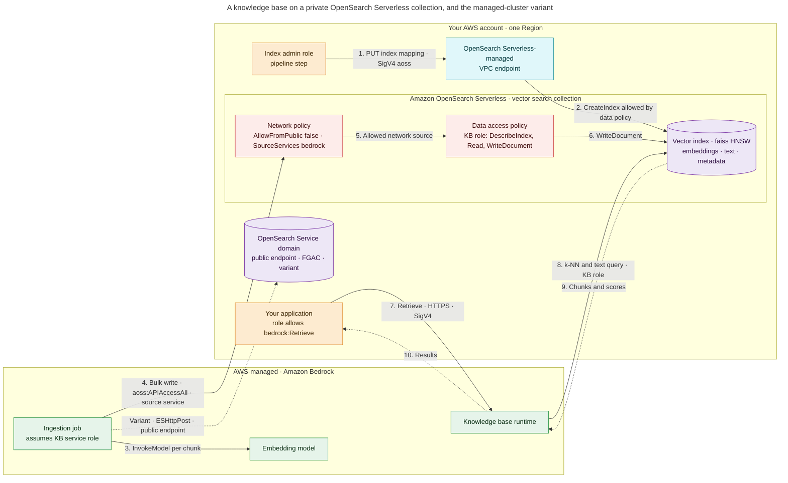

# Amazon OpenSearch Service and OpenSearch Serverless

> **Level:** Intermediate · **Verified:** 2026-11-15 · **Feature status:** GA · **Time:** ~30 min

Amazon OpenSearch Serverless is the vector store the Bedrock console has offered longest for a
customer-managed knowledge base, and an OpenSearch Service managed cluster is the bring-your-own
alternative. This chapter covers what each must look like for Bedrock to use it — index mapping,
access policies, network rules — what it costs to run, and the one direction in which OpenSearch
itself calls Bedrock.

## Learning objectives

After this chapter you can:

- Create an OpenSearch Serverless vector collection and index that a knowledge base accepts, with encryption, network and data access policies.
- Explain why a private collection needs `bedrock.amazonaws.com` as a source service, and why a managed cluster must be public.
- Choose between OpenSearch Serverless, a managed cluster and other stores on hybrid search, binary vectors and capacity.
- Estimate the cost dimensions, including the 2026 NextGen generation of OpenSearch Serverless.

## Prerequisites

- [Embeddings, vector search, semantic search and hybrid search](../../00-foundations/generative-ai-fundamentals/03-embeddings-and-vector-search.md)
- [Customer-managed knowledge bases and vector stores](../../01-amazon-bedrock/knowledge-bases/03-customer-managed-knowledge-bases.md)
- [Retrieval, reranking and metadata filtering](../../01-amazon-bedrock/knowledge-bases/05-retrieval-reranking-filtering.md)

## Concept in plain language

OpenSearch is a search engine that can find documents by words **and** by meaning. For a knowledge
base, Bedrock is a tenant who writes chunks into one index and later asks it questions. You are the
landlord: you build the room (the index with the right fields), hand Bedrock a key that opens only
that room (a data access policy), and decide which roads lead to the building (a network policy).

## How it really works

### Two deployment options

| | OpenSearch Serverless vector search collection | OpenSearch Service managed cluster |
|:--|:--|:--|
| `storageConfiguration.type` | `OPENSEARCH_SERVERLESS` (`collectionArn`, `vectorIndexName`, `fieldMapping`) | `OPENSEARCH_MANAGED_CLUSTER` (`domainArn`, `domainEndpoint`, `vectorIndexName`, `fieldMapping`) |
| Console quick create | ✅ Bedrock creates the collection, index and policies | ❌ you create the domain and index |
| Engine requirements | `faiss` engine | `faiss` (`nmslib` unsupported); engine 2.13+ for a k-NN index, 2.16+ for binary vectors |
| Network | Public, or **private** through OpenSearch Serverless-managed VPC endpoints and AWS service private access | **Public access only** — "OpenSearch domains that are behind a VPC are not supported" |
| Authorisation of the knowledge base role | IAM `aoss:APIAccessAll` **plus** a data access policy | IAM `es:ESHttp*` and `es:DescribeDomain`, the domain's resource policy, and (recommended) fine-grained access control role mapping |
| Binary vectors / hybrid search | ✅ / ✅ (with a filterable text field) | ✅ / not listed |
| Only store allowed for existing Confluence, SharePoint, Salesforce data sources | ✅ | ❌ |

Sources: [Prerequisites for a vector store you created](https://docs.aws.amazon.com/bedrock/latest/userguide/knowledge-base-setup.html),
[Create a knowledge base](https://docs.aws.amazon.com/bedrock/latest/userguide/knowledge-base-create.html),
[OpenSearch managed cluster prerequisites](https://docs.aws.amazon.com/bedrock/latest/userguide/kb-osm-permissions-prereq.html).
Hybrid-search support per store is in [Retrieval, reranking and metadata filtering](../../01-amazon-bedrock/knowledge-bases/05-retrieval-reranking-filtering.md).

### Index and field mapping

| Field (your names) | Mapping | Notes |
|:--|:--|:--|
| Vector field → `vectorField` | `knn_vector`, `dimension` = the embedding model's dimensions, `method` `hnsw` with engine `faiss`; `space_type` `l2` for float vectors (AWS recommends Euclidean), `hamming` for binary | Dimension is fixed; a model change means a new index |
| Text field → `textField` | `text`, indexed (filterable) | Holds the chunk; needed for hybrid search |
| Bedrock metadata field → `metadataField` | `text`, `index: false` | Bedrock's bookkeeping; never filter on it |
| Your filter attributes | `keyword`, or `text` with a `keyword` sub-field | Otherwise filters fail with a "Rewrite first" error (managed clusters) |

Source: [Prerequisites for a vector store you created](https://docs.aws.amazon.com/bedrock/latest/userguide/knowledge-base-setup.html)

### The three OpenSearch Serverless policies

1. **Encryption policy** — must cover the collection name *before* the collection exists (AWS owned
   key or your key).
2. **Network policy** — `AllowFromPublic`, or private access from `SourceVPCEs` and/or
   `SourceServices: ["bedrock.amazonaws.com"]`. Service access applies to the collection endpoint
   only, never to Dashboards; a public rule overrides private ones for the same collection.
3. **Data access policy** — grants per index or collection to IAM principals. For the knowledge
   base role AWS documents `aoss:DescribeIndex`, `aoss:ReadDocument` and `aoss:WriteDocument` on
   `index/<collection>/*`. Policies are additive and cannot deny, and "being granted permissions
   within a data access policy is not sufficient": the principal also needs IAM `aoss:APIAccessAll`.

Sources: [Network access for OpenSearch Serverless](https://docs.aws.amazon.com/opensearch-service/latest/developerguide/serverless-network.html),
[Data access control](https://docs.aws.amazon.com/opensearch-service/latest/developerguide/serverless-data-access.html),
[Set up security configurations for your knowledge base](https://docs.aws.amazon.com/bedrock/latest/userguide/kb-create-security.html)

### Integration with Amazon Bedrock

| Interaction | Initiator (who calls whom) | Direction of data | Identity used | Network path |
|:--|:--|:--|:--|:--|
| Create the vector index (prerequisite) | You (pipeline or operator) call the collection's OpenSearch API; or the Bedrock console during quick create | Mapping → collection | Admin role: `aoss:APIAccessAll` + data access policy `aoss:CreateIndex` | Collection endpoint: public, or an OpenSearch Serverless-managed VPC endpoint |
| Ingestion writes | Bedrock ingestion job calls the collection | Vectors, chunk text, metadata: Bedrock → index; deletes for removed documents | Knowledge base service role: IAM `aoss:APIAccessAll` on the collection ARN + data access policy (`DescribeIndex`, `ReadDocument`, `WriteDocument`) | AWS-managed to the collection endpoint; a private collection must list `bedrock.amazonaws.com` in `SourceServices` |
| Retrieval (`Retrieve`, `RetrieveAndGenerate`) | Your app calls Bedrock; Bedrock queries the collection (k-NN, plus text for hybrid) | Query vector → index; chunks and scores → Bedrock → app | Same service role; the caller needs only `bedrock:Retrieve` | As above; the caller reaches `bedrock-agent-runtime` publicly or through its interface endpoint |
| Managed cluster ingestion and retrieval | Bedrock calls the domain endpoint | As above | Service role with `es:ESHttpGet/Post/Put/Delete` on the index and `es:DescribeDomain`; domain resource policy; FGAC back-end role mapping | **Public domain endpoint only** — no VPC domains |
| OpenSearch ML connector to Bedrock (neural search outside knowledge bases) | **OpenSearch** calls Bedrock (`InvokeModel`) during ingest pipelines or queries | Text → Bedrock; embeddings or completions → OpenSearch | Role in the connector's `credential.roleArn`, trusted by `opensearchservice.amazonaws.com` / `es.amazonaws.com` (domains) or `ml.opensearchservice.amazonaws.com` (Serverless); creator needs `iam:PassRole` | From the OpenSearch service to the Bedrock endpoint (path not documented). **Not used by knowledge bases** |
| S3 Vectors index export to OpenSearch Serverless | You run the export | Vectors: S3 Vectors → collection | Your role | **No Bedrock involvement** |

Sources: [Create a service role for Knowledge Bases](https://docs.aws.amazon.com/bedrock/latest/userguide/kb-permissions.html),
[OpenSearch ML connectors for AWS services](https://docs.aws.amazon.com/opensearch-service/latest/developerguide/ml-amazon-connector.html),
[What is S3 Vectors?](https://docs.aws.amazon.com/AmazonS3/latest/userguide/s3-vectors.html)

> [!IMPORTANT]
> **Status** — On **2026-05-28** AWS launched **NextGen** OpenSearch Serverless: collections live
> in **collection groups**, compute scales to zero after 10 idle minutes, and NextGen is the
> console default; existing collections are now called **Classic**. NextGen vector indexes do not
> take the `engine` parameter, while the Bedrock prerequisites still ask for `faiss`. Whether a
> knowledge base accepts a NextGen collection, and which generation Bedrock's quick create builds,
> is **UNVERIFIED — REQUIRES DOCUMENTATION REVIEW** (no statement in the Bedrock user guide or its
> document history). The example below uses a Classic collection.
> Sources: [Next generation of OpenSearch Serverless](https://aws.amazon.com/blogs/aws/introducing-the-next-generation-of-amazon-opensearch-serverless-for-building-your-agentic-ai-applications/),
> [Working with vector search collections](https://docs.aws.amazon.com/opensearch-service/latest/developerguide/serverless-vector-search.html),
> [Scale to zero](https://docs.aws.amazon.com/opensearch-service/latest/developerguide/serverless-scale-to-zero.html)

## Architecture diagram



**What this shows** — two independent gates protect the collection: the network policy (where may
a request come from) and the data access policy plus IAM (who may do what). Bedrock passes the
network gate as a named source service, not through your VPC.

**Walkthrough**

1. An admin role sends the index mapping through a VPC endpoint (the collection is private).
2. The data access policy allows that role `CreateIndex`.
3. During a sync, Bedrock embeds each chunk.
4. It writes in bulk with the knowledge base role; the request arrives as source service `bedrock.amazonaws.com`.
5. The network policy admits the source.
6. The data access policy admits the write.
7. A question reaches the runtime.
8. Bedrock runs a k-NN query (plus a text query for hybrid search) with the same role.
9. Ranked chunks return to Bedrock.
10. The application receives the results.

| Legend | Meaning |
|:--|:--|
| Solid / dashed arrow | Request / response; the dashed "Variant" arrow is the managed-cluster alternative |
| Cylinder | Data at rest |
| Red boxes | Policies that gate access |

**Variations** — with a **public** collection, steps 1 and 4 go to the public endpoint and only
step 6 gates access. With a **managed cluster**, the domain resource policy and FGAC replace the
two Serverless policies, and the endpoint must be public. More context:
[diagram set 7](../../diagrams/mermaid/07-knowledge-base-retrieval-pipeline.md).

## Implementation details

1. **Create policies first, then the collection** (`VECTORSEARCH`), then the index, then the
   knowledge base. The provider cannot create an index inside a collection; run the mapping below
   through the OpenSearch API from a pipeline step, then re-apply with `index_created = true`.
2. **Match the dimension** to the embedding model and keep `faiss`; an `nmslib` index ignores
   metadata files and cannot be used for filtering.
3. **Private collections:** add `bedrock.amazonaws.com` to `SourceServices` and an
   OpenSearch Serverless-managed VPC endpoint for the people and pipelines that create indexes.
4. **Managed clusters:** public access, engine 2.13+ (2.16+ for binary), fine-grained access
   control mapping the knowledge base role to an OpenSearch role with index read and write
   permissions. If ingestion fails, AWS's first advice is more IOPS and throughput.
5. **One index per knowledge base.** Bedrock tracks its own documents; other writers break that.

> **Code status:** syntax-checked (JSON parse) · illustrative — field names are your choice; the mapping follows the Bedrock prerequisites page · **never deployed**

```json
{
  "settings": {
    "index": {
      "knn": true
    }
  },
  "mappings": {
    "properties": {
      "embeddings": {
        "type": "knn_vector",
        "dimension": 1024,
        "space_type": "l2",
        "method": {
          "name": "hnsw",
          "engine": "faiss",
          "parameters": {
            "ef_construction": 128,
            "m": 24
          }
        }
      },
      "AMAZON_BEDROCK_TEXT_CHUNK": {
        "type": "text",
        "index": "true"
      },
      "AMAZON_BEDROCK_METADATA": {
        "type": "text",
        "index": "false"
      },
      "department": {
        "type": "text",
        "fields": {
          "keyword": {
            "type": "keyword"
          }
        }
      }
    }
  }
}
```

## Example

**A private Classic OpenSearch Serverless collection with the three policies, the IAM permission,
and a knowledge base created on the second apply.** The knowledge base service role already exists
(see [Customer-managed knowledge bases](../../01-amazon-bedrock/knowledge-bases/03-customer-managed-knowledge-bases.md)).

> **Code status:** validated with `terraform fmt`, `terraform validate` and `tflint`; mock-tested with `terraform test` (2 runs, `mock_provider`) — Terraform 1.17.2, `hashicorp/aws` 6.73.0, with a `versions.tf` that sets `required_version = ">= 1.11.0"` and `aws ~> 6.73` · **never planned or applied against AWS**

```hcl
provider "aws" {
  region = var.region

  default_tags {
    tags = var.tags
  }
}

variable "region" {
  description = "Region for the collection and the knowledge base."
  type        = string
  default     = "us-east-1"
}

variable "collection_name" {
  description = "Collection name: 3-32 lowercase letters, digits and hyphens."
  type        = string
  default     = "academy-kb-vectors"
}

variable "knowledge_base_role_name" {
  description = "Name of the existing service role of the customer-managed knowledge base."
  type        = string
  default     = "academy-kb-service-role"
}

variable "index_admin_role_arn" {
  description = "Role that creates the vector index through the OpenSearch API (a pipeline role or an operator role)."
  type        = string
  default     = "arn:aws:iam::111122223333:role/academy-search-admin"
}

variable "admin_vpc_endpoint_ids" {
  description = "OpenSearch Serverless-managed VPC endpoint IDs from which the index admin reaches the private collection."
  type        = list(string)
  default     = []
}

variable "vector_index_name" {
  description = "Name of the vector index that you create inside the collection before creating the knowledge base."
  type        = string
  default     = "bedrock-kb-index"
}

variable "index_created" {
  description = "Set to true only after the vector index exists; the knowledge base is created in that second apply."
  type        = bool
  default     = false
}

variable "embedding_model_arn" {
  description = "Embedding model ARN. Confirm the current model ID in the Bedrock documentation."
  type        = string
  default     = "arn:aws:bedrock:us-east-1::foundation-model/amazon.titan-embed-text-v2:0"
}

variable "tags" {
  description = "Tags applied through default_tags."
  type        = map(string)
  default     = {}
}

data "aws_iam_role" "kb" {
  name = var.knowledge_base_role_name
}

# 1. Encryption policy: must exist before the collection. Here an AWS owned key;
#    use "KmsARN" instead of "AWSOwnedKey" for a customer managed key.
resource "aws_opensearchserverless_security_policy" "encryption" {
  name = "${var.collection_name}-enc"
  type = "encryption"
  policy = jsonencode({
    Rules       = [{ ResourceType = "collection", Resource = ["collection/${var.collection_name}"] }]
    AWSOwnedKey = true
  })
}

# 2. Network policy: no public access. Amazon Bedrock is allowed as a source
#    service; operators reach the collection only through the listed VPC endpoints.
resource "aws_opensearchserverless_security_policy" "network" {
  name = "${var.collection_name}-net"
  type = "network"
  policy = jsonencode([
    merge(
      {
        Description     = "Private collection endpoint for Bedrock and admin VPC endpoints"
        Rules           = [{ ResourceType = "collection", Resource = ["collection/${var.collection_name}"] }]
        AllowFromPublic = false
        SourceServices  = ["bedrock.amazonaws.com"]
      },
      length(var.admin_vpc_endpoint_ids) > 0 ? { SourceVPCEs = var.admin_vpc_endpoint_ids } : {}
    )
  ])
}

# 3. The vector search collection (no collection group, so a Classic collection).
resource "aws_opensearchserverless_collection" "kb" {
  name             = var.collection_name
  type             = "VECTORSEARCH"
  standby_replicas = "ENABLED"
  description      = "Vector store for a customer-managed Bedrock knowledge base"

  depends_on = [
    aws_opensearchserverless_security_policy.encryption,
    aws_opensearchserverless_security_policy.network,
  ]
}

# 4. Data access policy: the knowledge base role reads and writes documents;
#    the admin role manages the index. Data access policies cannot deny.
resource "aws_opensearchserverless_access_policy" "kb" {
  name = "${var.collection_name}-data"
  type = "data"
  policy = jsonencode([
    {
      Description = "Knowledge base role: documents in every index of the collection"
      Rules = [
        {
          ResourceType = "index"
          Resource     = ["index/${var.collection_name}/*"]
          Permission   = ["aoss:DescribeIndex", "aoss:ReadDocument", "aoss:WriteDocument"]
        }
      ]
      Principal = [data.aws_iam_role.kb.arn]
    },
    {
      Description = "Index administration"
      Rules = [
        {
          ResourceType = "index"
          Resource     = ["index/${var.collection_name}/*"]
          Permission   = ["aoss:CreateIndex", "aoss:UpdateIndex", "aoss:DescribeIndex", "aoss:DeleteIndex"]
        },
        {
          ResourceType = "collection"
          Resource     = ["collection/${var.collection_name}"]
          Permission   = ["aoss:DescribeCollectionItems"]
        }
      ]
      Principal = [var.index_admin_role_arn]
    }
  ])
}

# 5. The IAM half: without aoss:APIAccessAll the data access policy alone gives 403.
data "aws_iam_policy_document" "kb_aoss" {
  statement {
    sid       = "OpenSearchServerlessDataPlane"
    actions   = ["aoss:APIAccessAll"]
    resources = [aws_opensearchserverless_collection.kb.arn]
  }
}

resource "aws_iam_role_policy" "kb_aoss" {
  name   = "opensearch-serverless-collection"
  role   = data.aws_iam_role.kb.name
  policy = data.aws_iam_policy_document.kb_aoss.json
}

# 6. Second apply: the knowledge base that points at the index and its field mapping.
resource "aws_bedrockagent_knowledge_base" "this" {
  count    = var.index_created ? 1 : 0
  name     = "${var.collection_name}-kb"
  role_arn = data.aws_iam_role.kb.arn

  knowledge_base_configuration {
    type = "VECTOR"

    vector_knowledge_base_configuration {
      embedding_model_arn = var.embedding_model_arn
    }
  }

  storage_configuration {
    type = "OPENSEARCH_SERVERLESS"

    opensearch_serverless_configuration {
      collection_arn    = aws_opensearchserverless_collection.kb.arn
      vector_index_name = var.vector_index_name

      field_mapping {
        vector_field   = "embeddings"
        text_field     = "AMAZON_BEDROCK_TEXT_CHUNK"
        metadata_field = "AMAZON_BEDROCK_METADATA"
      }
    }
  }

  depends_on = [
    aws_opensearchserverless_access_policy.kb,
    aws_iam_role_policy.kb_aoss,
  ]
}

output "collection_endpoint" {
  description = "Endpoint for the index-creation request (signed with service name aoss)."
  value       = aws_opensearchserverless_collection.kb.collection_endpoint
}

output "collection_arn" {
  description = "Value for opensearch_serverless_configuration.collection_arn."
  value       = aws_opensearchserverless_collection.kb.arn
}
```

The mock tests assert that `SourceVPCEs` is omitted when no endpoints are given, that Bedrock is
always a source service, and that the knowledge base appears only when `index_created` is true.

> [!CAUTION]
> **Cost hazard** — a Classic collection bills OCU-hours from the moment it exists, even with no
> queries (see below). Destroy it when you finish. Nothing here has been applied to an AWS account.

## Common mistakes

> [!WARNING]
> **Common mistake** — a correct data access policy and a 403 anyway. Data access policies grant
> nothing without the IAM permission `aoss:APIAccessAll` on the collection.
> Source: [Data access control for OpenSearch Serverless](https://docs.aws.amazon.com/opensearch-service/latest/developerguide/serverless-data-access.html)

| Mistake | Symptom | Fix |
|:--|:--|:--|
| Collection made private without `SourceServices` | Sync and queries fail after the network change | Add `bedrock.amazonaws.com`; keep `AllowFromPublic` false |
| An old public rule matching the same collection | Collection stays public | Public rules override private ones — remove the overlap |
| Index created with `nmslib` or the wrong dimension | Knowledge base creation or filtering fails | Recreate the index with `faiss` and the model's dimension |
| Managed cluster inside a VPC | Knowledge base cannot connect | Public domain with FGAC, or use Serverless |
| Filter attribute mapped as plain `text` on a managed cluster | "Rewrite first" errors | `keyword` or a `keyword` sub-field |
| NextGen collection with an `engine` field in the mapping | `400`: field parameter not supported | See the status note; test before relying on NextGen |

## Security considerations

- **Least privilege in two places.** Scope IAM `aoss:APIAccessAll` to one collection ARN and the
  data access policy to `index/<collection>/*`; give index administration to a different role.
- **Private by default.** Use a private network policy; Bedrock reaches it as a source service and
  operators through VPC endpoints ([Private connectivity](../networking/01-private-connectivity-for-bedrock.md)).
- **Managed clusters are internet-facing** by requirement: rely on the domain resource policy, FGAC
  and SigV4, and audit with CloudTrail.
- **Encryption** with your own key is set in the encryption policy before creation.
- **ML connectors** let OpenSearch call Bedrock with a role you pass — scope it to model ARNs.

## Cost considerations

| Option | Pricing dimensions | Idle behaviour |
|:--|:--|:--|
| Serverless **Classic** | Indexing OCU-hours, search OCU-hours (1 OCU ≈ 6 GiB memory with vCPU), managed storage GB-month | Minimum **2 OCUs** for the first collection (0.5 × 2 indexing, 0.5 × 2 search); a dev-test mode without standby halves it; later collections with the same KMS key share OCUs |
| Serverless **NextGen** | Indexing and search OCU-hours per collection group, hot storage GB-month | Scales to **0 OCUs** after 10 idle minutes; first request takes about 10–30 seconds |
| Managed cluster | Instance hours, EBS storage, provisioned IOPS, data transfer | Runs and bills continuously |

Sources: [Amazon OpenSearch Service pricing](https://aws.amazon.com/opensearch-service/pricing/),
[Managing capacity limits](https://docs.aws.amazon.com/opensearch-service/latest/developerguide/serverless-scaling.html),
[Scale to zero](https://docs.aws.amazon.com/opensearch-service/latest/developerguide/serverless-scale-to-zero.html).
Capacity limits: up to 1,700 OCUs each for indexing and search per collection group, 1,000 indexes
per collection. Set a maximum OCU value as a budget guard.

**Our reading:** for a small, rarely queried knowledge base, Classic's always-on minimum usually
outweighs everything else — compare with [S3 Vectors](../storage/01-amazon-s3-and-s3-vectors.md)
or a [Managed Knowledge Base](../../01-amazon-bedrock/knowledge-bases/02-managed-knowledge-base.md).
For steady high query rates, OpenSearch's per-OCU model and hybrid search win. See
[Vector store selection](../../09-advanced-topics/02-vector-store-selection.md).

## Knowledge check

1. You switch a working collection's network policy to private with only a VPC endpoint. What breaks, and what is the fix?
2. The knowledge base role is in the data access policy but every write returns 403. What is missing?
3. Why can't a VPC-only OpenSearch Service domain back a knowledge base, and what are your options?
4. A test knowledge base is queried twice a week. Which OpenSearch cost dimension dominates on a Classic collection?

<details>
<summary>Answers</summary>

1. Bedrock can no longer reach the collection: add `"SourceServices": ["bedrock.amazonaws.com"]` to the network policy.
2. The IAM permission `aoss:APIAccessAll` on the collection ARN in the role's identity policy.
3. Bedrock supports public-access domains only. Use a public domain with FGAC and a restrictive resource policy, or OpenSearch Serverless with a private network policy.
4. The minimum OCU-hours (2 OCUs for the first collection, or 1 in dev-test mode), billed whether or not anyone queries.

</details>

## Further reading

Official sources opened while writing this chapter:

- [Prerequisites for using a vector store you created](https://docs.aws.amazon.com/bedrock/latest/userguide/knowledge-base-setup.html) — Serverless and managed-cluster index requirements.
- [Set up security configurations for your knowledge base](https://docs.aws.amazon.com/bedrock/latest/userguide/kb-create-security.html) — data access and network policies for Bedrock.
- [Prerequisites for OpenSearch Managed Clusters](https://docs.aws.amazon.com/bedrock/latest/userguide/kb-osm-permissions-prereq.html) — domain policy, FGAC, capacity.
- [Create a service role for Knowledge Bases](https://docs.aws.amazon.com/bedrock/latest/userguide/kb-permissions.html) and [Create a knowledge base](https://docs.aws.amazon.com/bedrock/latest/userguide/knowledge-base-create.html).
- [Network access for OpenSearch Serverless](https://docs.aws.amazon.com/opensearch-service/latest/developerguide/serverless-network.html) and [Data access control](https://docs.aws.amazon.com/opensearch-service/latest/developerguide/serverless-data-access.html).
- [Working with vector search collections](https://docs.aws.amazon.com/opensearch-service/latest/developerguide/serverless-vector-search.html), [Managing capacity limits](https://docs.aws.amazon.com/opensearch-service/latest/developerguide/serverless-scaling.html), [Scale to zero](https://docs.aws.amazon.com/opensearch-service/latest/developerguide/serverless-scale-to-zero.html).
- [Introducing the next generation of Amazon OpenSearch Serverless](https://aws.amazon.com/blogs/aws/introducing-the-next-generation-of-amazon-opensearch-serverless-for-building-your-agentic-ai-applications/) and [Built from the ground up for agents](https://aws.amazon.com/blogs/big-data/the-next-generation-of-amazon-opensearch-serverless-built-from-the-ground-up-for-agents/).
- [OpenSearch Service ML connectors for AWS services](https://docs.aws.amazon.com/opensearch-service/latest/developerguide/ml-amazon-connector.html).
- [Amazon OpenSearch Service pricing](https://aws.amazon.com/opensearch-service/pricing/).
- Terraform: [`aws_opensearchserverless_collection`](https://registry.terraform.io/providers/hashicorp/aws/latest/docs/resources/opensearchserverless_collection) and the [generated provider reference](../../references/terraform-aws-provider-bedrock.md).
- [Feature verification matrix](../../FEATURE-VERIFICATION.md).
