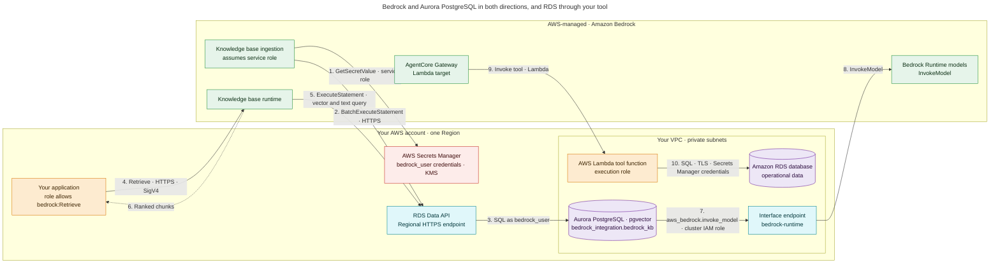

# Amazon Aurora PostgreSQL with pgvector, and Amazon RDS

> **Level:** Intermediate · **Verified:** 2026-11-15 · **Feature status:** GA · **Time:** ~25 min

Amazon Aurora PostgreSQL with the `pgvector` extension can be the vector store of a
customer-managed knowledge base, and Aurora can also call Bedrock from SQL. Other Amazon RDS
databases meet Bedrock only through your code — as the application's database or as a tool an
agent calls. This chapter covers both sides and where the line runs.

## Learning objectives

After this chapter you can:

- Prepare an Aurora PostgreSQL cluster, schema, table and indexes that a knowledge base accepts.
- Explain how Bedrock reaches the cluster (RDS Data API and an AWS Secrets Manager secret) and why no inbound network rule is needed.
- Call a Bedrock model from SQL with the Aurora machine learning extension, and name its limits.
- Design RDS access from agent tools when there is no native integration.

## Prerequisites

- [Embeddings, vector search, semantic search and hybrid search](../../00-foundations/generative-ai-fundamentals/03-embeddings-and-vector-search.md)
- [Customer-managed knowledge bases and vector stores](../../01-amazon-bedrock/knowledge-bases/03-customer-managed-knowledge-bases.md)
- [VPCs and subnets](../../00-foundations/networking/01-vpc-and-subnets.md)

## Concept in plain language

`pgvector` adds a "vector" column type and nearest-neighbour indexes to PostgreSQL, so one database
can hold text, metadata and embeddings side by side. Bedrock does not log in to the database like
an application server would. It sends SQL through the **RDS Data API** — a web API in front of the
cluster — carrying a reference to a stored password (a Secrets Manager secret). The cluster can
therefore stay in private subnets with no door opened for Bedrock.

## How it really works

### Requirements for a knowledge base store

| Requirement | Detail |
|:--|:--|
| Engine | Aurora PostgreSQL with `pgvector` 0.5.0 or later: every 16.x and later major version; 15.4+, 14.9+, 13.12+ |
| Access path | RDS Data API enabled on the cluster |
| Credentials | A database user in AWS Secrets Manager (`credentialsSecretArn`) |
| Account | **Same account** as the knowledge base |
| Table | Columns for a UUID primary key, a `vector(n)` embedding, `text` chunks, `json` Bedrock metadata and optional `jsonb` custom metadata. Names are yours; they are fixed at knowledge base creation |
| Indexes | HNSW on the vector column; GIN on `to_tsvector(...)` of the text column; GIN on the custom metadata column if present |
| Vector type | float32 only (binary vectors need OpenSearch) |
| Hybrid search | Supported |

Sources: [Using Aurora PostgreSQL as a knowledge base](https://docs.aws.amazon.com/AmazonRDS/latest/AuroraUserGuide/AuroraPostgreSQL.VectorDB.html),
[Prerequisites for a vector store you created — Aurora tab](https://docs.aws.amazon.com/bedrock/latest/userguide/knowledge-base-setup.html)

Two documented tuning notes matter in production. With metadata filters, enable HNSW **iterative
index scans** (`pgvector` 0.8.0+); without them "selective metadata filters can return fewer results
than expected because filtering is applied after the HNSW index scan". And for English text, a GIN
index with the `'english'` dictionary improves hybrid accuracy and latency over `'simple'`.

> [!WARNING]
> **Common mistake** — mixing distance operators. The Bedrock setup page builds the HNSW index with
> `vector_cosine_ops`; the Aurora **quick create** page says its index uses Euclidean distance.
> Which operator Bedrock's queries use is not documented (**UNVERIFIED — REQUIRES DOCUMENTATION
> REVIEW**). Follow the Bedrock setup page for a cluster you build, and do not mix operators.

**Quick create.** The console can provision everything through CloudFormation: an Aurora PostgreSQL
Serverless v2 cluster (0–16 ACUs, so it can scale to zero), Data API on, the default VPC, an
RDS-managed admin secret, the schema and a limited-privilege Bedrock user. AWS positions it for
"experimentation and quick setup"; it "may not be suitable for production use" and cannot be moved
into your own VPC. Source: [Aurora quick create for Bedrock](https://docs.aws.amazon.com/AmazonRDS/latest/AuroraUserGuide/AuroraPostgreSQL.quickcreatekb.html)

### Aurora calling Bedrock

The `aws_ml` 2.0 extension adds `aws_bedrock.invoke_model` (any model; JSON text in, text out) and
`aws_bedrock.invoke_model_get_embeddings` (returns `float8[]`). The cluster uses an IAM role
associated with it for the **Bedrock** feature; the model must be in the same Region; the functions
"don't support batched or parallel calls"; and `EXECUTE` must be granted to non-admin users.
Source: [Aurora machine learning with Aurora PostgreSQL](https://docs.aws.amazon.com/AmazonRDS/latest/AuroraUserGuide/postgresql-ml.html)

### Integration with Amazon Bedrock

| Interaction | Initiator (who calls whom) | Direction of data | Identity used | Network path |
|:--|:--|:--|:--|:--|
| Schema preparation (prerequisite) | You run SQL through `psql` or the Data API | DDL → cluster | Master user (RDS-managed secret), then `bedrock_user` | Your network path to the cluster, or the Data API |
| Ingestion writes | Bedrock ingestion job calls the RDS Data API | Chunks, embeddings, metadata: Bedrock → table; deletes for removed documents | Knowledge base service role: `rds:DescribeDBClusters`, `rds-data:ExecuteStatement`, `rds-data:BatchExecuteStatement`; `secretsmanager:GetSecretValue` (plus `kms:Decrypt` for a customer managed key); database privileges of the secret's user | RDS Data API, an AWS HTTPS endpoint. **Our reading:** no inbound security group rule and no Bedrock network interface in your VPC |
| Retrieval (`Retrieve`, `RetrieveAndGenerate`) | Your app calls Bedrock; Bedrock queries through the Data API | Query embedding and text → SQL; rows → Bedrock → app | Same service role and secret | Same. Newly synced vectors are searchable at once (other stores can take minutes) |
| Quick create | Bedrock console runs CloudFormation stacks | Creates cluster, schema, user, knowledge base | Console user's permissions | Default VPC |
| Aurora calls Bedrock (`aws_bedrock.invoke_model`) | **Aurora** calls `bedrock-runtime` | Prompt or text → model; completion or embedding → SQL result | IAM role associated with the cluster (feature "Bedrock"), `bedrock:InvokeModel` on chosen models | From the cluster's VPC; the security group must allow outbound to the service. **Our reading:** private subnets need a `bedrock-runtime` interface endpoint or NAT |
| Amazon RDS (any engine) as application database or agent tool target | **Your** function or agent tool connects to RDS | Rows ↔ your code; your code calls Bedrock separately | Your execution role; database credentials from Secrets Manager | Your VPC. **No native Bedrock integration** |

Sources: [Create a service role for Knowledge Bases — Aurora](https://docs.aws.amazon.com/bedrock/latest/userguide/kb-permissions.html),
[Sync your data](https://docs.aws.amazon.com/bedrock/latest/userguide/kb-data-source-sync-ingest.html),
[Aurora machine learning](https://docs.aws.amazon.com/AmazonRDS/latest/AuroraUserGuide/postgresql-ml.html).

**Where there is no integration.** The knowledge base storage type is named `RDS`, but the
documentation describes it only for **Aurora PostgreSQL** clusters reached through the Data API.
Whether an RDS for PostgreSQL instance with `pgvector` is accepted is **UNVERIFIED — REQUIRES
DOCUMENTATION REVIEW** (no Bedrock page mentions it); treat it as unsupported. RDS for MySQL,
MariaDB, Oracle, SQL Server and Db2 have no knowledge base role at all — not as a vector store and
not as a data source (new data sources are Amazon S3 or Custom). Bedrock's structured retrieval
uses Amazon Redshift, not RDS ([Redshift, Kendra and DMS](04-redshift-kendra-dms.md)).

### RDS as an agent tool target

An agent that must read an order or update a ticket in RDS calls **a tool you write** — a Lambda
function exposed through an [AgentCore Gateway](../../01-amazon-bedrock/agentcore/04-agentcore-gateway.md)
target, for example — and that tool connects to the database. The model never receives database
credentials and never connects itself.

> [!TIP]
> **Academy recommendation** — Give each tool its own database user with only the statements it
> needs (often stored procedures or views), fetch credentials from Secrets Manager at run time, and
> validate every argument the model supplies before it reaches SQL. Never let a model compose free
> SQL against an operational database. This is our design guidance, not an official AWS reference
> architecture.

## Architecture diagram



**What this shows** — three different relationships. Bedrock *uses* Aurora as a store (1–6)
through an AWS API, never through your VPC. Aurora *calls* Bedrock (7–8) from inside your VPC. RDS
meets Bedrock only through a tool you own (9–10).

**Walkthrough**

1. The ingestion job reads the database secret with the knowledge base service role.
2. It sends batched SQL to the Data API.
3. The Data API runs it on the cluster as `bedrock_user`.
4. A question reaches the runtime.
5. Bedrock runs the vector (and, for hybrid, text) query through the Data API.
6. Ranked chunks return to the application.
7. A SQL function in Aurora calls Bedrock with the role associated with the cluster.
8. The call leaves the VPC through a `bedrock-runtime` interface endpoint (our design choice).
9. An agent's tool call reaches a Lambda function through AgentCore Gateway.
10. The function queries RDS with its own credentials.

| Legend | Meaning |
|:--|:--|
| Solid / dashed arrow | Request / response |
| Cylinder | Database |
| Teal boxes | Endpoints (Data API, interface endpoint) |
| Inner box | Your VPC's private subnets |

**Variations** — with quick create, the cluster sits in the default VPC. Without an interface
endpoint, step 8 needs a NAT path. Agent design is covered in
[Agentic AI, tool calling and multi-agent architectures](../../00-foundations/generative-ai-fundamentals/06-agents-tool-calling-multi-agent.md).

## Implementation details

> **Code status:** illustrative (statements from the AWS documentation; dimension 1024 assumes a 1,024-dimension embedding model) · **never deployed**

```sql
-- As the master user (RDS-managed secret)
CREATE EXTENSION IF NOT EXISTS vector;
SELECT extversion FROM pg_extension WHERE extname = 'vector';   -- 0.5.0 or later
CREATE SCHEMA bedrock_integration;
CREATE ROLE bedrock_user LOGIN;
\password bedrock_user
GRANT ALL ON SCHEMA bedrock_integration TO bedrock_user;

-- As bedrock_user
CREATE TABLE bedrock_integration.bedrock_kb (
  id uuid PRIMARY KEY,
  embedding vector(1024),
  chunks text,
  metadata json,
  custom_metadata jsonb
);
CREATE INDEX ON bedrock_integration.bedrock_kb USING hnsw (embedding vector_cosine_ops);
CREATE INDEX ON bedrock_integration.bedrock_kb USING gin (to_tsvector('simple', chunks));
CREATE INDEX ON bedrock_integration.bedrock_kb USING gin (custom_metadata);

-- Metadata filters (pgvector 0.8.0+): takes effect for new sessions
ALTER DATABASE kb SET hnsw.iterative_scan = 'relaxed_order';
ALTER DATABASE kb SET hnsw.max_scan_tuples = 20000;
```

Then store `bedrock_user`'s credentials in the secret the knowledge base references (never in code
or Terraform state), and only then create the knowledge base. Data API sessions are pooled, so the
iterative-scan settings can take "a few minutes" to apply.

## Example

**An Aurora PostgreSQL Serverless v2 cluster with the Data API, a secret for the Bedrock user, the
service-role permissions, and the knowledge base on the second apply** (after the SQL above).

> **Code status:** validated with `terraform fmt`, `terraform validate` and `tflint` (Terraform 1.17.2, `hashicorp/aws` 6.73.0, with a `versions.tf` that sets `required_version = ">= 1.11.0"` and `aws ~> 6.73`) · **never planned, applied or deployed**

```hcl
provider "aws" {
  region = var.region

  default_tags {
    tags = var.tags
  }
}

variable "region" {
  description = "Region for the cluster and the knowledge base (same account and Region are required)."
  type        = string
  default     = "us-east-1"
}

variable "name_prefix" {
  description = "Prefix for resource names."
  type        = string
  default     = "academy-pgvector"
}

variable "engine_version" {
  description = "Aurora PostgreSQL version. Null lets AWS choose its default; pin a version that includes pgvector 0.5.0 or later and supports the RDS Data API."
  type        = string
  default     = null
}

variable "db_subnet_group_name" {
  description = "Existing DB subnet group with private subnets in at least two Availability Zones."
  type        = string
  default     = "academy-private-db"
}

variable "vpc_security_group_ids" {
  description = "Security groups for the cluster. The knowledge base uses the Data API, so no inbound rule is needed for Bedrock."
  type        = list(string)
  default     = []
}

variable "max_acu" {
  description = "Upper bound for Aurora Serverless v2 capacity."
  type        = number
  default     = 16
}

variable "knowledge_base_role_name" {
  description = "Existing service role of the customer-managed knowledge base."
  type        = string
  default     = "academy-kb-service-role"
}

variable "schema_ready" {
  description = "Set to true after the pgvector extension, schema, table and indexes exist (see the SQL in this chapter)."
  type        = bool
  default     = false
}

variable "embedding_model_arn" {
  description = "Embedding model ARN; its dimensions must match vector(n) in the table. Confirm the current model ID."
  type        = string
  default     = "arn:aws:bedrock:us-east-1::foundation-model/amazon.titan-embed-text-v2:0"
}

variable "tags" {
  description = "Tags applied through default_tags."
  type        = map(string)
  default     = {}
}

data "aws_iam_role" "kb" {
  name = var.knowledge_base_role_name
}

# 1. Aurora PostgreSQL with the RDS Data API (enable_http_endpoint) and an
#    RDS-managed master secret. Serverless v2 can scale down to 0 ACU.
resource "aws_rds_cluster" "vectors" {
  cluster_identifier          = "${var.name_prefix}-cluster"
  engine                      = "aurora-postgresql"
  engine_version              = var.engine_version
  database_name               = "kb"
  master_username             = "kbadmin"
  manage_master_user_password = true
  enable_http_endpoint        = true
  storage_encrypted           = true
  db_subnet_group_name        = var.db_subnet_group_name
  vpc_security_group_ids      = var.vpc_security_group_ids
  backup_retention_period     = 7
  skip_final_snapshot         = false
  final_snapshot_identifier   = "${var.name_prefix}-final"

  serverlessv2_scaling_configuration {
    min_capacity = 0
    max_capacity = var.max_acu
  }
}

resource "aws_rds_cluster_instance" "writer" {
  identifier         = "${var.name_prefix}-writer"
  cluster_identifier = aws_rds_cluster.vectors.id
  engine             = aws_rds_cluster.vectors.engine
  engine_version     = aws_rds_cluster.vectors.engine_version
  instance_class     = "db.serverless"
}

# 2. A separate secret for the least-privileged database role (bedrock_user)
#    that the knowledge base uses. Its value is set outside Terraform, so it
#    never appears in state or code.
resource "aws_secretsmanager_secret" "bedrock_user" {
  name        = "${var.name_prefix}/bedrock-user"
  description = "Credentials of the bedrock_user database role used by the knowledge base"
}

# 3. Knowledge base role permissions for this store (from the Bedrock service-role page).
data "aws_iam_policy_document" "kb_aurora" {
  statement {
    sid       = "DescribeCluster"
    actions   = ["rds:DescribeDBClusters"]
    resources = [aws_rds_cluster.vectors.arn]
  }

  statement {
    sid       = "DataApi"
    actions   = ["rds-data:ExecuteStatement", "rds-data:BatchExecuteStatement"]
    resources = [aws_rds_cluster.vectors.arn]
  }

  statement {
    sid       = "ReadDatabaseSecret"
    actions   = ["secretsmanager:GetSecretValue"]
    resources = [aws_secretsmanager_secret.bedrock_user.arn]
  }
}

resource "aws_iam_role_policy" "kb_aurora" {
  name   = "aurora-vector-store"
  role   = data.aws_iam_role.kb.name
  policy = data.aws_iam_policy_document.kb_aurora.json
}

# 4. Second apply: the knowledge base. Column names must match the table exactly
#    and cannot be changed after creation.
resource "aws_bedrockagent_knowledge_base" "this" {
  count    = var.schema_ready ? 1 : 0
  name     = "${var.name_prefix}-kb"
  role_arn = data.aws_iam_role.kb.arn

  knowledge_base_configuration {
    type = "VECTOR"

    vector_knowledge_base_configuration {
      embedding_model_arn = var.embedding_model_arn
    }
  }

  storage_configuration {
    type = "RDS"

    rds_configuration {
      resource_arn           = aws_rds_cluster.vectors.arn
      credentials_secret_arn = aws_secretsmanager_secret.bedrock_user.arn
      database_name          = aws_rds_cluster.vectors.database_name
      table_name             = "bedrock_integration.bedrock_kb"

      field_mapping {
        primary_key_field     = "id"
        vector_field          = "embedding"
        text_field            = "chunks"
        metadata_field        = "metadata"
        custom_metadata_field = "custom_metadata"
      }
    }
  }

  depends_on = [aws_iam_role_policy.kb_aurora, aws_rds_cluster_instance.writer]
}

output "cluster_arn" {
  description = "Use with the Data API (aws rds-data execute-statement) to run the schema SQL."
  value       = aws_rds_cluster.vectors.arn
}

output "master_secret_arn" {
  description = "RDS-managed master secret; use it only to create the schema and bedrock_user."
  value       = aws_rds_cluster.vectors.master_user_secret[0].secret_arn
}
```

`min_capacity = 0` follows the quick-create default (0–16 ACUs); the first query after a pause
waits for the cluster to resume. Keep a minimum above zero for latency-sensitive retrieval.

> [!CAUTION]
> **Cost hazard** — an Aurora cluster bills for capacity (ACUs), storage, I/O and backups, and the
> secret bills monthly. Destroy test clusters; this example keeps a final snapshot.

## Common mistakes

| Mistake | Symptom | Fix |
|:--|:--|:--|
| Data API not enabled | Knowledge base creation fails to validate the store | `enable_http_endpoint = true` |
| Cluster in another account | Not supported | Same account as the knowledge base |
| Table or column names changed after creation | Ingestion or retrieval errors | Names are fixed; create a new knowledge base |
| No GIN index on the text column | Hybrid search slow or failing | Create the documented GIN index |
| Selective filters return too few chunks | Fewer results than `numberOfResults` | Enable iterative scans (`pgvector` 0.8.0+) |
| Knowledge base using the master secret | Bedrock can alter any object | A dedicated `bedrock_user` limited to one schema |
| `aws_bedrock.invoke_model` in a row-by-row update over millions of rows | Slow, throttled, expensive | No batching or parallelism — use [batch inference](../../01-amazon-bedrock/inference/08-batch-inference.md) |

## Security considerations

- **Two identities.** The service role reaches the Data API and the secret; the secret's database
  user decides what SQL can do. Restrict both.
- **Secrets.** Encrypt the secret with your key if required and grant the role `kms:Decrypt`
  ([AWS KMS, Secrets Manager and Parameter Store](../security/02-kms-secrets-manager-parameter-store.md)).
- **Network.** The Data API path keeps the cluster private. For `aws_ml`, prefer a `bedrock-runtime`
  interface endpoint over NAT ([Private connectivity](../networking/01-private-connectivity-for-bedrock.md)).
- **Multi-tenant databases.** Revoke `USAGE` on the `aws_bedrock` schema from tenants that must not
  call models (documented on the Aurora ML page).
- **Agent tools** are an injection surface: arguments come from a model
  ([Prompt injection and untrusted tool output](../../06-security-governance/04-prompt-injection-and-untrusted-content.md)).

## Cost considerations

- **Aurora:** capacity (ACUs for Serverless v2 or instance hours), storage, I/O and backups; with a
  minimum of 0 ACUs an idle cluster stops paying for compute.
- **Bedrock:** embedding tokens at ingestion and per query; generation tokens for
  `RetrieveAndGenerate`; every `aws_bedrock.invoke_model` call is an on-demand model call.
- **Our reading:** Aurora is attractive when you already run it and want vectors next to relational
  data with transactional consistency; for a vector-only workload compare
  [S3 Vectors](../storage/01-amazon-s3-and-s3-vectors.md) and [OpenSearch](01-opensearch.md)
  ([Vector store selection](../../09-advanced-topics/02-vector-store-selection.md)).

## Knowledge check

1. Your cluster is in private subnets with no inbound rules. Can a knowledge base use it?
2. Which three IAM permission groups does the service role need for an Aurora store?
3. Filtered retrievals return 2 chunks when you asked for 10. What is the likely cause?
4. Can an RDS for MySQL database be a knowledge base data source? How would an agent use its data?

<details>
<summary>Answers</summary>

1. Yes. Bedrock uses the RDS Data API, so it needs the Data API enabled, a secret and IAM permissions — not a network route into the VPC (our reading of the documented access path).
2. `rds:DescribeDBClusters`; `rds-data:ExecuteStatement` and `BatchExecuteStatement` on the cluster; `secretsmanager:GetSecretValue` on the secret (plus `kms:Decrypt` for a customer managed key).
3. HNSW filtering after the index scan; enable iterative scans with `pgvector` 0.8.0 or later.
4. No — new data sources are Amazon S3 or Custom, and MySQL is not a store. Export to S3 (or push through a Custom data source), or give the agent a tool that queries the database.

</details>

## Further reading

Official sources opened while writing this chapter:

- [Using Aurora PostgreSQL as a knowledge base for Amazon Bedrock](https://docs.aws.amazon.com/AmazonRDS/latest/AuroraUserGuide/AuroraPostgreSQL.VectorDB.html) — versions, schema, indexes, secret.
- [Quick create an Aurora PostgreSQL knowledge base](https://docs.aws.amazon.com/AmazonRDS/latest/AuroraUserGuide/AuroraPostgreSQL.quickcreatekb.html) — what quick create provisions and its limits.
- [Prerequisites for a vector store you created — Aurora tab](https://docs.aws.amazon.com/bedrock/latest/userguide/knowledge-base-setup.html) — field mapping, iterative scans, expression indexes.
- [Create a service role for Knowledge Bases](https://docs.aws.amazon.com/bedrock/latest/userguide/kb-permissions.html) — Aurora and Secrets Manager statements.
- [Sync your data](https://docs.aws.amazon.com/bedrock/latest/userguide/kb-data-source-sync-ingest.html) — searchability after a sync.
- [Using Amazon Aurora machine learning with Aurora PostgreSQL](https://docs.aws.amazon.com/AmazonRDS/latest/AuroraUserGuide/postgresql-ml.html) — `aws_ml` 2.0 and Bedrock.
- [Create a knowledge base](https://docs.aws.amazon.com/bedrock/latest/userguide/knowledge-base-create.html) — quick-create store options.
- [Feature verification matrix](../../FEATURE-VERIFICATION.md).
