# Amazon DynamoDB

> **Level:** Intermediate · **Verified:** 2026-11-15 · **Feature status:** GA · **Time:** ~25 min

Bedrock's inference APIs forget everything between calls, so a chat application or agent must keep
its own state: conversation history, request records, budgets and tool state. Amazon DynamoDB is
the usual place for that state. This chapter shows the patterns and states plainly what Bedrock
does — and does not — integrate with natively, including DynamoDB's new vector search.

## Learning objectives

After this chapter you can:

- Explain why conversation state lives outside Bedrock, and compare DynamoDB with the managed alternatives.
- Model conversation turns, idempotency records and token budgets in one table with TTL.
- Keep a knowledge base in step with DynamoDB data through Streams and direct ingestion.
- State which Bedrock features have **no** DynamoDB integration, including vector search.

## Prerequisites

- [The Converse API](../../01-amazon-bedrock/inference/01-converse-api.md)
- [AgentCore Memory](../../01-amazon-bedrock/agentcore/06-agentcore-memory.md)
- [Ingestion, parsing and chunking](../../01-amazon-bedrock/knowledge-bases/04-ingestion-parsing-chunking.md)

## Concept in plain language

A model is like a consultant with no memory: every meeting starts from zero, so you bring the
minutes of the earlier meetings each time. DynamoDB is the filing cabinet for those minutes — fast
to open by customer and date, and with a shredder (TTL) that disposes of old files on its own.

## How it really works

### Where conversation state can live

> [!NOTE]
> **Documented fact** — "Amazon Bedrock doesn't store any text, images, or documents that you
> provide as content. The data is only used to generate the response." Context exists only if you
> resend it in `messages`.
> Source: [Converse API reference](https://docs.aws.amazon.com/bedrock/latest/APIReference/API_runtime_Converse.html)

| Option | Who stores the history | Fit |
|:--|:--|:--|
| **Your DynamoDB table** | You | Any model API; full control of retention, encryption and access |
| Responses API with `store` (default `true`) | Bedrock, 30 days, per project | OpenAI-compatible clients; see [OpenAI- and Anthropic-compatible APIs](../../01-amazon-bedrock/inference/03-openai-and-anthropic-compatible-apis.md) |
| [AgentCore Memory](../../01-amazon-bedrock/agentcore/06-agentcore-memory.md) | AgentCore: short-term events and extracted long-term records | Agents that also need summaries, preferences and semantic recall |
| Session management APIs (`CreateSession`, `PutInvocationStep`, …) | Bedrock; **preview**; 1,000 steps, 50 MB per step, 1-hour idle timeout, deleted after 30 days | LangGraph checkpoints through `BedrockSessionSaver` |
| Agents Classic sessions | Bedrock, per `sessionId` | Existing Agents Classic users only — maintenance mode |

Source for the session APIs: [Session management APIs](https://docs.aws.amazon.com/bedrock/latest/userguide/sessions.html).

### DynamoDB facts that shape the design

| Fact | Value | Consequence |
|:--|:--|:--|
| Maximum item size | 400 KB, attribute names included | One item per turn, not one item per conversation |
| TTL | Expired items deleted "typically within a few days", without consuming write throughput; they still appear in reads until then | Filter `expires_at > now` in queries |
| Streams | Each change appears once, in order per item; records kept 24 hours; TTL deletions appear as *service* deletions | A consumer can mirror changes, including expiries, elsewhere |
| Conditional writes | `ConditionExpression` on `PutItem` / `UpdateItem` | Idempotency and budget checks without locks |

Sources: [Constraints](https://docs.aws.amazon.com/amazondynamodb/latest/developerguide/Constraints.html),
[Time to live](https://docs.aws.amazon.com/amazondynamodb/latest/developerguide/TTL.html),
[DynamoDB Streams](https://docs.aws.amazon.com/amazondynamodb/latest/developerguide/Streams.html)

> [!IMPORTANT]
> **Status** — DynamoDB **vector search** is GA since **2026-08-05**: vector indexes on a table
> attribute, searched with `SearchVectors` (up to 4,096 dimensions, top-K 1–100, on-demand capacity
> only, no fine-grained access control on `SearchVectors`, 16 MB responses without pagination).
> It is **not** a Bedrock knowledge base store: the knowledge base `storageConfiguration` types in
> the AWS SDK (botocore 1.44.3) are OpenSearch Serverless, OpenSearch managed clusters, RDS
> (Aurora), Neptune Analytics, S3 Vectors, Pinecone, Redis Enterprise Cloud and MongoDB Atlas.
> Sources: [What's New, 2026-08-05](https://aws.amazon.com/about-aws/whats-new/2026/08/amazon-dynamodb-vector-search/),
> [Using vector indexes](https://docs.aws.amazon.com/amazondynamodb/latest/developerguide/VectorSearch.html),
> [Requirements and limitations](https://docs.aws.amazon.com/amazondynamodb/latest/developerguide/VectorSearch.Requirements.html),
> [SearchVectors](https://docs.aws.amazon.com/amazondynamodb/latest/APIReference/API_SearchVectors.html)

### Integration with Amazon Bedrock

| Interaction | Initiator (who calls whom) | Direction of data | Identity used | Network path |
|:--|:--|:--|:--|:--|
| Load and append conversation turns | Your function calls DynamoDB, then Bedrock | History: DynamoDB → your code → `messages` in `Converse`; new turns: your code → DynamoDB | Function execution role: `dynamodb:Query`, `PutItem`; `bedrock:InvokeModel` | Your compute to DynamoDB (gateway endpoint in a VPC) and to `bedrock-runtime` (public or interface endpoint) |
| Idempotency and token budgets | Your function, before and after the model call | Request keys and token counts (from the response `usage`) → DynamoDB | Same role: conditional `PutItem`, `UpdateItem` | As above |
| Agent tool state | A tool function (for example behind AgentCore Gateway) | Business state ↔ DynamoDB | The tool's execution role | Your compute |
| Keep a knowledge base in step with table data | DynamoDB Streams invoke your function; it calls Bedrock | Changed items → documents → `IngestKnowledgeBaseDocuments` / `DeleteKnowledgeBaseDocuments` on a Custom data source | Function role: `bedrock:IngestKnowledgeBaseDocuments`, `bedrock:DeleteKnowledgeBaseDocuments`, stream read | Lambda event source mapping; your function to `bedrock-agent` |
| Semantic search over items with DynamoDB vector search | Your code embeds with Bedrock, then calls `SearchVectors` | Text → embedding (Bedrock) → DynamoDB; items → your code → model prompt | Your role: `bedrock:InvokeModel`, `dynamodb:SearchVectors` (a new action) | Your compute. **No Bedrock integration** — you build the retrieval |
| Knowledge base storage or data source on DynamoDB | — | — | — | **None.** Not a vector store type and not a connector |

Sources: [Ingestion, parsing and chunking](../../01-amazon-bedrock/knowledge-bases/04-ingestion-parsing-chunking.md)
(direct ingestion: 25 documents and 6 MB per request, 5 requests per second, never while a sync
runs), [Vector search tutorial](https://docs.aws.amazon.com/amazondynamodb/latest/developerguide/VectorSearchTutorial.html)
(`dynamodb:SearchVectors` is a new action).

> [!TIP]
> **Academy recommendation** — Use AgentCore Memory when you want managed summaries and semantic
> recall; use DynamoDB when the history is a business record you must retain, audit, export or
> delete on request, or when the application is not an agent at all. Many systems use both: Memory
> for the agent's context, DynamoDB for the authoritative transcript and budgets. This is our design
> guidance, not an official AWS reference architecture.

## Architecture diagram

```mermaid
---
title: DynamoDB beside Bedrock - conversation state, budgets and change propagation
---
flowchart LR
    subgraph internet["Internet · untrusted"]
        user["Chat user"]:::client
    end
    subgraph account["Your AWS account · one Region"]
        api["Amazon API Gateway<br/>authenticated route"]:::edge
        fn["AWS Lambda chat function<br/>execution role"]:::compute
        table[("Amazon DynamoDB table<br/>turns · idempotency · quotas · TTL")]:::data
        stream[("DynamoDB stream<br/>24-hour change log")]:::data
        sync["AWS Lambda sync function<br/>event source mapping"]:::compute
        key["AWS KMS key<br/>table encryption"]:::security
    end
    subgraph managed["AWS-managed · Amazon Bedrock"]
        runtime["Bedrock Runtime<br/>Converse"]:::ai
        kb["Knowledge base<br/>Custom data source"]:::ai
    end

    user -- "1. HTTPS message · request ID" --> api
    api -- "2. Invoke" --> fn
    fn -- "3. Conditional PutItem · idempotency" --> table
    fn -- "4. Query last N turns" --> table
    fn -- "5. Converse with history · SigV4" --> runtime
    runtime -. "6. Reply and token usage" .-> fn
    fn -- "7. PutItem turns · UpdateItem budget" --> table
    fn -. "8. HTTPS reply" .-> user
    table == "9. Item changes" ==> stream
    stream == "10. Batch of records" ==> sync
    sync -- "11. IngestKnowledgeBaseDocuments · Delete" --> kb
    table -- "encrypted with" --> key

    classDef client   fill:#E8F1FB,stroke:#1F6FEB,color:#0B1F33
    classDef edge     fill:#E0F7FA,stroke:#00838F,color:#00363A
    classDef compute  fill:#FDEBD0,stroke:#D97706,color:#3B2300
    classDef ai       fill:#E6F4EA,stroke:#1E8E3E,color:#0B2E13
    classDef data     fill:#EDE7F6,stroke:#6A1B9A,color:#2A0A3D
    classDef security fill:#FDECEA,stroke:#C62828,color:#3D0A0A
```



**What this shows** — Bedrock never touches DynamoDB. Every arrow into the table comes from your
functions; the only link to a Bedrock feature is your sync function calling the knowledge base API.

**Walkthrough**

1. The client sends a message with a request ID it reuses on retries.
2. API Gateway invokes the chat function.
3. A conditional write records the request ID; a retry is detected and not billed twice.
4. The function loads the recent turns.
5. It calls `Converse` with the history plus the new user message.
6. The reply includes token usage.
7. It stores both turns and adds the tokens to the tenant's daily budget item.
8. The answer returns.
9. Item changes (including TTL expiries) enter the stream.
10. Lambda reads them in batches, in order per item.
11. The sync function pushes changed records as documents to a Custom data source, or deletes them.

| Legend | Meaning |
|:--|:--|
| Solid / dashed / thick arrow | Request / response / asynchronous event |
| Cylinder | Data at rest |
| Boxes | Internet, your account, the AWS-managed Bedrock boundary |

**Variations** — with AgentCore, Memory replaces steps 4 and 7 for the agent's context, and
DynamoDB keeps business state. Streams can also be read with the Kinesis adapter or Apache Flink
(DynamoDB Streams page); event routing patterns are in
[EventBridge, SQS and SNS with Bedrock](../messaging/01-eventbridge-sqs-sns.md).

## Implementation details

1. **Key design.** `pk = SESSION#<id>`, `sk = TURN#<zero-padded number>` keeps a conversation in one
   item collection, sorted; `Query` with `ScanIndexForward = false` and a `Limit` returns the latest
   turns. Store content blocks as JSON exactly as Converse returns them.
2. **Window, not archive.** Send only the last turns (or a summary plus the last turns); the full
   transcript stays in the table. A 400 KB item limit applies per turn.
3. **Idempotency.** Put `IDEMPOTENCY#<request id>` with `attribute_not_exists(pk)` before calling
   the model; on `ConditionalCheckFailedException`, return the stored result instead.
4. **Budgets.** After each call, `UpdateItem ... ADD tokens :n` on `QUOTA#<tenant>` for today, with
   a condition that rejects the next request once over budget. Bedrock's own quotas are per account
   and Region ([Quotas, rate limits and throttling](../../08-cost-performance-and-reliability/05-quotas-rate-limits-and-throttling.md)).
5. **Retention.** Every item carries `expires_at`; queries filter expired items until TTL deletes them.
6. **Change propagation.** For a Custom data source, map `INSERT`/`MODIFY` to
   `IngestKnowledgeBaseDocuments` and `REMOVE` to `DeleteKnowledgeBaseDocuments`, batched to the
   direct-ingestion limits. Never run it while a `StartIngestionJob` sync of that data source runs.

> **Code status:** mock-tested (`unittest` with `botocore.stub.Stubber`, boto3/botocore 1.44.3, 5 tests pass) · syntax-checked (`py_compile`) · **never run against AWS**

```python
"""Conversation state for a stateless model API, kept in Amazon DynamoDB.

Converse does not remember earlier turns, so the application stores them and
sends the recent ones with every request. Items expire through TTL.
"""
import json
import time

from botocore.exceptions import ClientError

TURN_TTL_SECONDS = 30 * 24 * 3600   # keep turns for 30 days
IDEMPOTENCY_TTL_SECONDS = 24 * 3600  # remember handled requests for 1 day


def append_turn(ddb, table, session_id, turn_no, role, content):
    """Write one turn. Fails if that turn number already exists (no silent overwrite)."""
    ddb.put_item(
        TableName=table,
        Item={
            "pk": {"S": f"SESSION#{session_id}"},
            "sk": {"S": f"TURN#{turn_no:06d}"},
            "role": {"S": role},
            "content": {"S": json.dumps(content)},
            "expires_at": {"N": str(int(time.time()) + TURN_TTL_SECONDS)},
        },
        ConditionExpression="attribute_not_exists(sk)",
    )


def load_history(ddb, table, session_id, max_turns=20):
    """Return the newest turns, oldest first, in Converse `messages` format."""
    response = ddb.query(
        TableName=table,
        KeyConditionExpression="pk = :pk AND begins_with(sk, :turn)",
        FilterExpression="expires_at > :now",
        ExpressionAttributeValues={
            ":pk": {"S": f"SESSION#{session_id}"},
            ":turn": {"S": "TURN#"},
            ":now": {"N": str(int(time.time()))},
        },
        ScanIndexForward=False,
        Limit=max_turns,
    )
    items = list(reversed(response["Items"]))
    while items and items[0]["role"]["S"] != "user":
        items.pop(0)  # start the window at a user turn, never with an orphan reply
    return [{"role": i["role"]["S"], "content": json.loads(i["content"]["S"])} for i in items]


def claim_request(ddb, table, idempotency_key):
    """Return True the first time a key is seen, False for a retry of the same request."""
    try:
        ddb.put_item(
            TableName=table,
            Item={
                "pk": {"S": f"IDEMPOTENCY#{idempotency_key}"},
                "sk": {"S": "REQUEST"},
                "expires_at": {"N": str(int(time.time()) + IDEMPOTENCY_TTL_SECONDS)},
            },
            ConditionExpression="attribute_not_exists(pk)",
        )
        return True
    except ClientError as err:
        if err.response["Error"]["Code"] == "ConditionalCheckFailedException":
            return False
        raise
```

## Example

**The state table — TTL, point-in-time recovery, encryption, a stream — and the chat role's
permissions.**

> **Code status:** validated with `terraform fmt`, `terraform validate` and `tflint` (Terraform 1.17.2, `hashicorp/aws` 6.73.0, with a `versions.tf` that sets `required_version = ">= 1.11.0"` and `aws ~> 6.73`) · **never planned, applied or deployed**

```hcl
provider "aws" {
  region = var.region

  default_tags {
    tags = var.tags
  }
}

variable "region" {
  description = "Region for the table; keep it in the Region of the application that calls Bedrock."
  type        = string
  default     = "us-east-1"
}

variable "table_name" {
  description = "Name of the conversation-state table."
  type        = string
  default     = "academy-chat-state"
}

variable "kms_key_arn" {
  description = "Customer managed KMS key for the table. Null uses the AWS managed key for DynamoDB."
  type        = string
  default     = null
}

variable "app_role_name" {
  description = "Existing execution role of the chat function that calls Bedrock and this table."
  type        = string
  default     = "academy-chat-function-role"
}

variable "tags" {
  description = "Tags applied through default_tags."
  type        = map(string)
  default     = {}
}

data "aws_iam_role" "app" {
  name = var.app_role_name
}

# One table, several item types (single-table design):
#   pk = "SESSION#<id>"      sk = "TURN#<zero-padded number>"  -> one conversation turn
#   pk = "SESSION#<id>"      sk = "META"                       -> owner, model, summary
#   pk = "IDEMPOTENCY#<key>" sk = "REQUEST"                    -> request already handled
#   pk = "QUOTA#<tenant>"    sk = "<yyyy-mm-dd>"               -> tokens used today
resource "aws_dynamodb_table" "state" {
  name                        = var.table_name
  billing_mode                = "PAY_PER_REQUEST"
  hash_key                    = "pk"
  range_key                   = "sk"
  deletion_protection_enabled = true

  attribute {
    name = "pk"
    type = "S"
  }

  attribute {
    name = "sk"
    type = "S"
  }

  # Items carry expires_at (epoch seconds); DynamoDB deletes them after expiry,
  # typically within a few days, without consuming write capacity.
  ttl {
    attribute_name = "expires_at"
    enabled        = true
  }

  point_in_time_recovery {
    enabled = true
  }

  server_side_encryption {
    enabled     = true
    kms_key_arn = var.kms_key_arn
  }

  # NEW_AND_OLD_IMAGES lets a consumer see what changed, including TTL deletions.
  stream_enabled   = true
  stream_view_type = "NEW_AND_OLD_IMAGES"
}

# The chat function's role: item access to this table and model invocation.
data "aws_iam_policy_document" "app" {
  statement {
    sid = "ConversationState"
    actions = [
      "dynamodb:GetItem",
      "dynamodb:PutItem",
      "dynamodb:UpdateItem",
      "dynamodb:Query",
    ]
    resources = [aws_dynamodb_table.state.arn]
  }

  statement {
    sid       = "InvokeModels"
    actions   = ["bedrock:InvokeModel", "bedrock:InvokeModelWithResponseStream"]
    resources = ["*"] # Narrow to your model and inference-profile ARNs.
  }
}

resource "aws_iam_role_policy" "app" {
  name   = "chat-state-and-bedrock"
  role   = data.aws_iam_role.app.name
  policy = data.aws_iam_policy_document.app.json
}

output "table_name" {
  description = "Table name for the application's configuration."
  value       = aws_dynamodb_table.state.name
}

output "stream_arn" {
  description = "Stream for an event source mapping (for example, a function that indexes finished conversations)."
  value       = aws_dynamodb_table.state.stream_arn
}
```

With `server_side_encryption { enabled = true }` and no key ARN, the table uses the AWS managed
key `alias/aws/dynamodb`; omitting the block leaves the AWS owned key (Terraform `aws_dynamodb_table`
documentation). Provider 6.73.0 has no vector-index argument on `aws_dynamodb_table`.

> [!CAUTION]
> **Cost hazard** — on-demand tables bill per request and per GB stored; point-in-time recovery,
> streams read by Lambda and a customer managed key add charges. Delete the table (deletion
> protection must be turned off first) when you finish.

## Common mistakes

> [!WARNING]
> **Common mistake** — one item per conversation with a growing list of turns. It hits the 400 KB
> item limit, and every append rewrites (and bills) the whole item. Store one item per turn.

| Mistake | Symptom | Fix |
|:--|:--|:--|
| Relying on TTL for exact expiry | "Deleted" turns still sent to the model | Filter on `expires_at` in every query |
| Sending the whole transcript every turn | Token cost and latency grow without bound | A window of recent turns, or a summary |
| Retrying a timed-out call without an idempotency key | Duplicate answers and double token spend | Conditional idempotency record |
| Expecting a knowledge base to read the table | No such connector | Streams → Custom data source, or export to S3 |
| Treating DynamoDB vector search as a Bedrock store | No `storageConfiguration` type exists | Build retrieval yourself, or use a supported store |

## Security considerations

- **Tenant isolation.** Prefix keys with the tenant or user, and where one role serves several
  tenants restrict items by primary-key value with IAM policy conditions
  ([fine-grained access control](https://docs.aws.amazon.com/amazondynamodb/latest/developerguide/specifying-conditions.html);
  [Multitenant RAG](../../09-advanced-topics/06-multitenant-rag.md)).
- **Transcripts are sensitive.** They hold prompts and answers: encrypt with your key if required,
  set TTL to your retention policy, and support deletion on request
  ([Data protection and privacy](../../06-security-governance/03-data-protection-and-privacy.md)).
- **History is model input.** A stored turn can carry an injected instruction into later prompts;
  treat it as untrusted ([Prompt injection](../../06-security-governance/04-prompt-injection-and-untrusted-content.md)).
- **Vector search** has no fine-grained access control on `SearchVectors`: isolate tenants by table
  or index, not by item-level policy.
- **Private paths.** A DynamoDB gateway endpoint and Bedrock interface endpoints keep both calls off
  the internet ([VPC endpoints and AWS PrivateLink](../../00-foundations/networking/03-vpc-endpoints-and-privatelink.md)).

## Cost considerations

- **DynamoDB:** request units (on-demand) or capacity units, storage, stream reads, backups and
  PITR. TTL deletes consume no write throughput.
- **The bigger bill is tokens.** Every resent turn is billed again as input; windowing and
  [prompt caching](../../01-amazon-bedrock/prompt-caching/01-prompt-caching.md) matter more than the
  table. See [Cost optimization and token budgeting](../../08-cost-performance-and-reliability/02-cost-optimization-and-token-budgeting.md).

## Knowledge check

1. Why is a list of turns inside one item a poor model for conversation history?
2. A user's turns expired yesterday by TTL, yet the model still saw them today. Why?
3. Your product data lives in DynamoDB and must be searchable through a knowledge base. Design the path.
4. Can a Bedrock knowledge base use a DynamoDB vector index as its store?

<details>
<summary>Answers</summary>

1. Items are limited to 400 KB and each append rewrites the whole item; one item per turn scales and is cheaper.
2. TTL deletes typically within a few days; until then items are returned unless the query filters on the expiry attribute.
3. A stream on the table invokes a function that sends changed items as documents to a Custom data source with `IngestKnowledgeBaseDocuments` and deletes removed ones — batched, and never during a sync.
4. No. DynamoDB is not one of the knowledge base storage types; with vector search you build retrieval yourself (embed with Bedrock, `SearchVectors`, then call the model).

</details>

## Further reading

Official sources opened while writing this chapter:

- [Converse API reference](https://docs.aws.amazon.com/bedrock/latest/APIReference/API_runtime_Converse.html) — Bedrock does not store content.
- [Store and retrieve conversation history with session management APIs](https://docs.aws.amazon.com/bedrock/latest/userguide/sessions.html) — preview status and quotas.
- [Constraints in Amazon DynamoDB](https://docs.aws.amazon.com/amazondynamodb/latest/developerguide/Constraints.html), [Fine-grained access control](https://docs.aws.amazon.com/amazondynamodb/latest/developerguide/specifying-conditions.html), [Time to live](https://docs.aws.amazon.com/amazondynamodb/latest/developerguide/TTL.html), [DynamoDB Streams](https://docs.aws.amazon.com/amazondynamodb/latest/developerguide/Streams.html).
- [Amazon DynamoDB now supports real-time vector search](https://aws.amazon.com/about-aws/whats-new/2026/08/amazon-dynamodb-vector-search/), [Using vector indexes](https://docs.aws.amazon.com/amazondynamodb/latest/developerguide/VectorSearch.html), [Requirements and limitations](https://docs.aws.amazon.com/amazondynamodb/latest/developerguide/VectorSearch.Requirements.html), [SearchVectors](https://docs.aws.amazon.com/amazondynamodb/latest/APIReference/API_SearchVectors.html), [Vector search tutorial](https://docs.aws.amazon.com/amazondynamodb/latest/developerguide/VectorSearchTutorial.html).
- [Build and deploy an automatic sync solution for Amazon Bedrock Knowledge Bases](https://aws.amazon.com/blogs/machine-learning/build-and-deploy-an-automatic-sync-solution-for-amazon-bedrock-knowledge-bases/) — DynamoDB as the change log of an AWS sync design.
- Terraform: [`aws_dynamodb_table`](https://raw.githubusercontent.com/hashicorp/terraform-provider-aws/main/website/docs/r/dynamodb_table.html.markdown).
- [Feature verification matrix](../../FEATURE-VERIFICATION.md).
