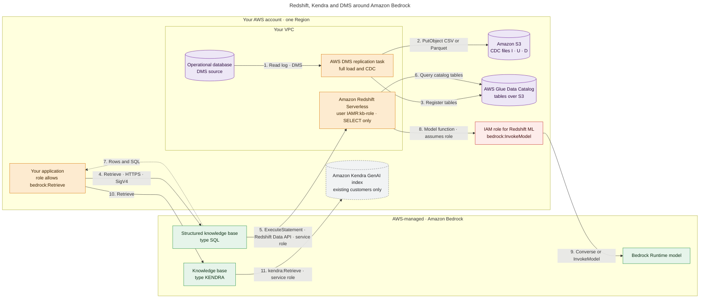

# Amazon Redshift, Amazon Kendra and AWS DMS

> **Level:** Intermediate · **Verified:** 2026-11-15 · **Feature status:** GA (Amazon Kendra: maintenance mode) · **Time:** ~25 min

Three services that often appear in the same diagram as Bedrock, with three very different
relationships to it. Amazon Redshift is a **native** partner in both directions: the query engine
of structured knowledge bases, and a caller of Bedrock models from SQL. Amazon Kendra is a native
retriever that is now **closed to new customers**. AWS DMS has **no** Bedrock integration — it is
plumbing that moves data to where Bedrock can use it.

## Learning objectives

After this chapter you can:

- Describe the two Redshift–Bedrock integrations and the identity each one uses.
- Configure a structured knowledge base on Redshift Serverless with Glue Data Catalog tables.
- Decide what to do with an Amazon Kendra GenAI index now that Kendra is in maintenance mode.
- Use AWS DMS change data capture to feed knowledge bases without pretending it is an integration.

## Prerequisites

- [Structured data retrieval and GraphRAG](../../01-amazon-bedrock/knowledge-bases/06-structured-data-and-graphrag.md) — the structured and Kendra knowledge base types in depth.
- [AWS Glue and AWS Lake Formation](../storage/02-glue-and-lake-formation.md)
- [Knowledge Bases overview: managed versus customer-managed](../../01-amazon-bedrock/knowledge-bases/01-knowledge-bases-overview.md)

## Concept in plain language

- **Redshift** is a warehouse of tables. Bedrock can *ask it questions* (it writes the SQL, Redshift
  runs it), and Redshift can *ask Bedrock* to summarise or classify the text in its rows.
- **Kendra** was AWS's managed search service; Bedrock could borrow its index as a knowledge base.
  It still works for existing users but takes no new ones.
- **DMS** is a moving van for database rows. It can deliver changes into S3, where a knowledge base
  can pick them up — but the van knows nothing about Bedrock.

## How it really works

### Redshift as the query engine of a structured knowledge base

A knowledge base of type `SQL` (`sqlKnowledgeBaseConfiguration.type` = `REDSHIFT`) uses a
**Redshift Serverless workgroup** or a **provisioned cluster** as its query engine, with tables in
Redshift databases or in the **AWS Glue Data Catalog**. Rows are never embedded: a sync ingests
schema metadata, and each question becomes SQL that Redshift runs. `GenerateQuery` returns the
SQL only (English questions, 2 requests per second); `Retrieve` returns rows; `RetrieveAndGenerate`
answers from at most 10 of them. The service role needs the Redshift Data API statement actions,
four `sqlworkbench:` actions, `bedrock:GenerateQuery` and a credentials action for the chosen
authentication (IAM, a database user, or a Secrets Manager secret — Serverless and Data Catalog
stores accept fewer methods). Inside Redshift the role becomes a user such as `IAMR:<role name>`
with `SELECT`-only grants.
Sources: [Set up your query engine and permissions](https://docs.aws.amazon.com/bedrock/latest/userguide/knowledge-base-prereq-structured.html),
[Create a structured knowledge base](https://docs.aws.amazon.com/bedrock/latest/userguide/knowledge-base-structured-create.html),
[Generate a query for structured data](https://docs.aws.amazon.com/bedrock/latest/userguide/knowledge-base-generate-query.html)

The full treatment — authentication matrix, query-generation context, response shapes, GraphRAG —
is in [Structured data retrieval and GraphRAG](../../01-amazon-bedrock/knowledge-bases/06-structured-data-and-graphrag.md);
the catalog and Lake Formation side is in [AWS Glue and AWS Lake Formation](../storage/02-glue-and-lake-formation.md).

### Redshift calling Bedrock: Redshift ML

`CREATE EXTERNAL MODEL … MODEL_TYPE BEDROCK` creates a SQL function that sends each input to a
Bedrock model. With `REQUEST_TYPE UNIFIED` (the default) the call uses the Converse interface and
optional `PROMPT` and `SUFFIX` text; `RAW` sends a model-native body and needs
`RESPONSE_TYPE SUPER`, which also returns token usage. The cluster or workgroup uses an IAM role
that Amazon Redshift can assume; the documentation attaches `AmazonBedrockFullAccess` to it. Creating
the model needs superuser rights or the `CREATE MODEL` privilege. If Bedrock throttles, AWS points
you to the `InvokeModel` quotas of the model.
Sources: [Redshift ML integration with Amazon Bedrock](https://docs.aws.amazon.com/redshift/latest/dg/machine-learning-br.html),
[CREATE EXTERNAL MODEL](https://docs.aws.amazon.com/redshift/latest/dg/r_create_external_model.html)

### Amazon Kendra

> [!IMPORTANT]
> **Status** — Amazon Kendra entered **maintenance mode on 2026-06-30** and has been **closed to new
> customers since 2026-07-30**. Existing customers keep full support, bug fixes and security
> updates, but no new features. AWS recommends migrating Kendra applications — and building new
> search applications — on **Amazon Bedrock Managed Knowledge Base**.
> Sources: [Amazon Kendra availability change](https://docs.aws.amazon.com/kendra/latest/dg/kendra-availability-change.html),
> [AWS service availability updates](https://aws.amazon.com/about-aws/whats-new/2026/06/aws-service-availability/)

A knowledge base of type `KENDRA` points at an existing **GenAI Enterprise Edition** index
(`kendraIndexArn`); the service role needs `kendra:Retrieve` and `kendra:DescribeIndex`, and the
data sources are Kendra's own. Whether an existing Kendra customer may still create a *new*
`KENDRA` knowledge base is **UNVERIFIED — REQUIRES DOCUMENTATION REVIEW** (register item U3; neither
the Kendra notice nor the Bedrock page says). The Bedrock page for this type now opens with "we
recommend Amazon Bedrock Managed Knowledge Base".
Sources: [Build a knowledge base with a Kendra GenAI index](https://docs.aws.amazon.com/bedrock/latest/userguide/knowledge-base-build-kendra-genai-index.html),
[Create a service role for Knowledge Bases](https://docs.aws.amazon.com/bedrock/latest/userguide/kb-permissions.html)

> [!WARNING]
> **Common mistake** — following the Kendra migration guide's statement that a Managed Knowledge
> Base offers "a Retrieve and Generate API". The Bedrock API reference says `RetrieveAndGenerate`
> "cannot be used with managed knowledge bases"; use `Retrieve` or `AgenticRetrieveStream`
> ([Agentic retrieval](../../01-amazon-bedrock/agentic-retrieval/01-agentic-retrieval.md)).

The migration guide is candid about gaps: a Managed Knowledge Base has 7 connectors against Kendra's
32+, and no query suggestions, faceted search, custom synonyms, spell checking or incremental
learning — each needs a workaround.

### AWS DMS: plumbing, not an integration

DMS replicates a source database into a target. With **Amazon S3 as the target**, a full load and
then change data capture (CDC) arrive as CSV or Parquet files whose first column marks the
operation (`I`, `U`, `D`), one folder per table; the target can also register tables in the AWS Glue
Data Catalog. From there, either a vector knowledge base ingests transformed documents, or a
structured knowledge base queries the catalog tables.
Source: [Using Amazon S3 as a target for AWS DMS](https://docs.aws.amazon.com/dms/latest/userguide/CHAP_Target.S3.html)

**DMS Schema Conversion** can use generative AI to convert code that rules cannot: an opt-in setting
("Use generative AI to convert schemas", off by default) for paths into PostgreSQL that uses cross-Region
inference; AWS describes it as using "large language models hosted on Amazon Bedrock". You configure
no Bedrock resource and call no Bedrock API — it is an AWS-managed use of Bedrock, not an
integration you build on.
Sources: [Converting database objects with generative AI](https://docs.aws.amazon.com/dms/latest/userguide/schema-conversion-convert.databaseobjects.html),
[Schema conversion settings](https://docs.aws.amazon.com/dms/latest/userguide/schema-conversion-settings.html),
[AWS News Blog, 2024-12-01](https://aws.amazon.com/blogs/aws/aws-data-migration-service-improves-database-schema-conversion-with-generative-ai/)

### Integration with Amazon Bedrock

| Interaction | Initiator (who calls whom) | Direction of data | Identity used | Network path |
|:--|:--|:--|:--|:--|
| Structured knowledge base sync (schema metadata) | You start it; Bedrock reads table and column definitions | Schema → Bedrock | Knowledge base service role; Redshift user `IAMR:<role>` (or database user / secret) | AWS-managed. Bedrock → Redshift Data API is **our reading** of the documented permissions |
| Structured query (`GenerateQuery`, `Retrieve`, `RetrieveAndGenerate`) | Your app calls Bedrock; Bedrock calls Redshift (`redshift-data:ExecuteStatement`) | Question → SQL → rows → Bedrock → app | Caller: `bedrock:Retrieve` and/or `GenerateQuery`; service role as above | Caller to `bedrock-agent-runtime`; Bedrock to Redshift as above |
| Redshift ML inference (`CREATE EXTERNAL MODEL`) | **Redshift** calls Bedrock for each row passed to the function | Row text → model; generated text or `SUPER` JSON → query result | IAM role attached to the cluster or namespace, assumable by Redshift, with Bedrock invoke permissions | From Redshift to the Bedrock endpoint (path not documented) |
| Kendra GenAI index as a knowledge base | Your app calls Bedrock; Bedrock calls `kendra:Retrieve` | Query → index; passages → Bedrock → app | Knowledge base service role: `kendra:Retrieve`, `kendra:DescribeIndex` | AWS-managed |
| DMS CDC into S3, then knowledge base ingestion | DMS writes S3; **your** event handling starts ingestion | Source rows → S3 files → (your transform) → knowledge base | DMS service role for S3; your function's role for `StartIngestionJob` | DMS replication instance in your VPC to S3. **No Bedrock integration** |
| DMS Schema Conversion with generative AI | DMS (AWS-managed) uses Bedrock internally | Source code objects → converted SQL | DMS migration project settings | AWS-managed, cross-Region inference. **Nothing to configure in Bedrock** |

## Architecture diagram



**What this shows** — DMS (1–3) only moves data; Bedrock never sees it. The structured knowledge
base (4–7) drives Redshift. Redshift ML (8–9) drives Bedrock. The Kendra path (10–11) still works
but is drawn dashed because the service is closed to new customers.

**Walkthrough**

1. DMS reads changes from the source database's log.
2. It writes full-load and CDC files to S3.
3. It can register the S3 tables in the Glue Data Catalog.
4. A question reaches the structured knowledge base.
5. Bedrock runs generated SQL through the Redshift Data API with its service role (**our reading**).
6. Redshift reads the catalog tables (Lake Formation grants apply — see the Glue chapter).
7. Rows and the SQL return.
8. An analyst's query calls a Redshift ML function, which uses the role attached to Redshift.
9. Redshift invokes the Bedrock model.
10. An existing Kendra customer queries a `KENDRA` knowledge base.
11. Bedrock retrieves passages from the Kendra index.

| Legend | Meaning |
|:--|:--|
| Solid / dashed arrow | Request / response |
| Cylinder | Data at rest |
| Grey dashed box | A service in maintenance mode |
| Inner box | Your VPC |

**Variations** — a provisioned Redshift cluster replaces the workgroup (with
`redshift:GetClusterCredentialsWithIAM` for IAM authentication). DMS can also feed a vector
knowledge base: S3 events start ingestion as in [Amazon S3 and Amazon S3 Vectors](../storage/01-amazon-s3-and-s3-vectors.md).

## Implementation details

1. **Structured knowledge base on catalog tables:** IAM authentication only; grant Lake Formation
   `Describe` and `Select`; create `IAMR:<role>` and grant `USAGE ON DATABASE awsdatacatalog`
   before the first sync ([Glue and Lake Formation](../storage/02-glue-and-lake-formation.md)).
2. **Curate the schema:** describe tables and columns in `generationContext`, add curated queries,
   and include only the tables a question may touch. AWS notes that inclusions and exclusions
   "aren't a substitute for guardrails".
3. **Redshift ML:** replace `AmazonBedrockFullAccess` with `bedrock:InvokeModel` on the model and
   inference-profile ARNs you use (academy recommendation), and keep the instruction in the
   model's `PROMPT` prefix so every call carries it.
4. **DMS to RAG:** CDC files are rows, not documents. Transform them (for example, one Markdown
   document and one metadata file per business entity) before a vector knowledge base ingests them,
   or keep them as tables for a structured knowledge base.
5. **Kendra:** plan the move. Inventory connectors and features without a Managed Knowledge Base
   equivalent, re-ingest into a Managed Knowledge Base, then switch callers.

> **Code status:** illustrative (syntax from the Redshift documentation; the model ID is a placeholder you must replace with a current ID) · **never run**

```sql
CREATE EXTERNAL MODEL ticket_summary
FUNCTION ticket_summary_func
IAM_ROLE default
MODEL_TYPE BEDROCK
SETTINGS (
  MODEL_ID '<bedrock-model-id>',
  PROMPT 'Summarise this support ticket in one sentence:');

SELECT ticket_id, ticket_summary_func(body) AS summary
FROM support.tickets
WHERE created_at > current_date - 1;
```

## Example

**A structured knowledge base on Redshift Serverless whose store is the Glue Data Catalog**, with
its service role and query-engine permissions. The catalog tables and Lake Formation grants come
from the [Glue and Lake Formation example](../storage/02-glue-and-lake-formation.md); the Redshift
database variant is the example in [Structured data retrieval and GraphRAG](../../01-amazon-bedrock/knowledge-bases/06-structured-data-and-graphrag.md).

> **Code status:** validated with `terraform fmt`, `terraform validate` and `tflint` (Terraform 1.17.2, `hashicorp/aws` 6.73.0, with a `versions.tf` that sets `required_version = ">= 1.11.0"` and `aws ~> 6.73`) · **never planned, applied or deployed**

```hcl
provider "aws" {
  region = var.region

  default_tags {
    tags = var.tags
  }
}

variable "region" {
  description = "Region of the knowledge base and the Redshift Serverless workgroup. Structured retrieval is offered in a subset of Regions."
  type        = string
  default     = "us-east-1"
}

variable "name_prefix" {
  description = "Prefix for resource names."
  type        = string
  default     = "academy-sql-kb"
}

variable "workgroup_arn" {
  description = "ARN of the existing Amazon Redshift Serverless workgroup used as the query engine."
  type        = string
  default     = "arn:aws:redshift-serverless:us-east-1:111122223333:workgroup/00000000-0000-0000-0000-000000000000"
}

variable "catalog_tables" {
  description = "Glue Data Catalog tables the knowledge base may query, as database.table (database.* for all)."
  type        = list(string)
  default     = ["sales_curated.orders"]
}

variable "tags" {
  description = "Tags applied through default_tags."
  type        = map(string)
  default     = {}
}

data "aws_caller_identity" "current" {}
data "aws_partition" "current" {}

locals {
  account_id = data.aws_caller_identity.current.account_id
  partition  = data.aws_partition.current.partition
}

# 1. Service role: Bedrock assumes it to read schema metadata, generate SQL and run it.
data "aws_iam_policy_document" "trust" {
  statement {
    actions = ["sts:AssumeRole"]

    principals {
      type        = "Service"
      identifiers = ["bedrock.amazonaws.com"]
    }

    condition {
      test     = "StringEquals"
      variable = "aws:SourceAccount"
      values   = [local.account_id]
    }

    condition {
      test     = "ArnLike"
      variable = "aws:SourceArn"
      values   = ["arn:${local.partition}:bedrock:${var.region}:${local.account_id}:knowledge-base/*"]
    }
  }
}

resource "aws_iam_role" "kb" {
  name               = "${var.name_prefix}-role"
  assume_role_policy = data.aws_iam_policy_document.trust.json
}

# 2. Query-engine permissions, as listed on the Bedrock structured-data prerequisites page.
data "aws_iam_policy_document" "query_engine" {
  statement {
    sid       = "RedshiftDataApiOwnStatements"
    actions   = ["redshift-data:GetStatementResult", "redshift-data:DescribeStatement", "redshift-data:CancelStatement"]
    resources = ["*"]

    condition {
      test     = "StringEquals"
      variable = "redshift-data:statement-owner-iam-userid"
      values   = ["$${aws:userid}"]
    }
  }

  statement {
    sid       = "RedshiftDataApiExecute"
    actions   = ["redshift-data:ExecuteStatement"]
    resources = [var.workgroup_arn]
  }

  statement {
    sid       = "RedshiftServerlessIamAuth"
    actions   = ["redshift-serverless:GetCredentials"]
    resources = [var.workgroup_arn]
  }

  statement {
    sid = "SqlGenerationContext"
    actions = [
      "sqlworkbench:GetSqlRecommendations",
      "sqlworkbench:PutSqlGenerationContext",
      "sqlworkbench:GetSqlGenerationContext",
      "sqlworkbench:DeleteSqlGenerationContext",
    ]
    resources = ["*"]
  }

  statement {
    sid       = "GenerateQuery"
    actions   = ["bedrock:GenerateQuery"]
    resources = ["*"]
  }
}

resource "aws_iam_role_policy" "query_engine" {
  name   = "redshift-query-engine"
  role   = aws_iam_role.kb.id
  policy = data.aws_iam_policy_document.query_engine.json
}

# 3. The structured knowledge base: Redshift Serverless as the engine, the Glue
#    Data Catalog as the store. No embeddings, no vector store, no ingestion of rows.
resource "aws_bedrockagent_knowledge_base" "sql" {
  name     = var.name_prefix
  role_arn = aws_iam_role.kb.arn

  knowledge_base_configuration {
    type = "SQL"

    sql_knowledge_base_configuration {
      type = "REDSHIFT"

      redshift_configuration {
        query_engine_configuration {
          type = "SERVERLESS"

          serverless_configuration {
            workgroup_arn = var.workgroup_arn

            auth_configuration {
              type = "IAM"
            }
          }
        }

        storage_configuration {
          type = "AWS_DATA_CATALOG"

          aws_data_catalog_configuration {
            table_names = var.catalog_tables
          }
        }

        query_generation_configuration {
          execution_timeout_seconds = 30
        }
      }
    }
  }

  depends_on = [aws_iam_role_policy.query_engine]
}

output "knowledge_base_id" {
  description = "Use with GenerateQuery, Retrieve or RetrieveAndGenerate."
  value       = aws_bedrockagent_knowledge_base.sql.id
}

output "redshift_database_user" {
  description = "Database user to create in Redshift before the first query: CREATE USER \"IAMR:<role name>\" WITH PASSWORD DISABLE;"
  value       = "IAMR:${aws_iam_role.kb.name}"
}
```

`$${aws:userid}` writes the IAM policy variable `${aws:userid}` literally, as the documented policy
requires. After `apply`, run the `CREATE USER` and `GRANT` statements, then sync.

> [!CAUTION]
> **Cost hazard** — Redshift Serverless bills RPU-hours per second (60-second minimum) whenever
> queries run; SQL generation is billed per request. Set a maximum RPU limit on test workgroups.

## Common mistakes

| Mistake | Symptom | Fix |
|:--|:--|:--|
| Granting the knowledge base user more than `SELECT` | Generated SQL could modify data | `SELECT` (and `USAGE`) only |
| Sync before `CREATE USER "IAMR:…"` and `GRANT` | Sync fails | Grant, then sync again |
| Non-English questions to `GenerateQuery` | Poor or failed SQL | Queries must be English |
| Expecting all rows in a `RetrieveAndGenerate` answer | Answer based on 10 rows | Aggregate in SQL, or use `Retrieve` |
| Row-by-row Redshift ML calls over a huge table | Throttling and cost | Filter first; use [batch inference](../../01-amazon-bedrock/inference/08-batch-inference.md) for bulk |
| Designing a new system on Kendra | Account cannot create an index | Managed Knowledge Base |
| Treating DMS CDC files as RAG documents | Chunks of comma-separated rows | Transform first, or query as tables |

## Security considerations

- **Text-to-SQL is code generation.** AWS: "Executing arbitrary SQL queries can be a security risk";
  use restricted roles, read-only access and sandboxing.
- **One database identity for all callers** of a structured knowledge base — no per-user row
  security; split knowledge bases by audience.
- **Redshift ML roles** reach Bedrock on behalf of every user who may run the function: limit
  `EXECUTE` on it and scope the role to models.
- **Kendra in maintenance** still receives security updates; keep its connectors' credentials in
  Secrets Manager and rotate them until you migrate.
- **DMS** moves raw operational data; encrypt the S3 target and restrict who can read CDC prefixes
  ([Data protection and privacy](../../06-security-governance/03-data-protection-and-privacy.md)).

## Cost considerations

| Service | Pricing dimensions |
|:--|:--|
| Redshift Serverless | RPU-hours, per second with a 60-second minimum, including queries on S3 data; storage per GB-month; a maximum RPU setting caps spend |
| Bedrock structured retrieval | Per request that generates SQL; plus model tokens for `RetrieveAndGenerate` |
| Redshift ML | Bedrock model usage for the rows passed to the function, plus Redshift compute |
| Kendra GenAI Enterprise index | Hourly base index (storage and query units) from creation to deletion, extra units, and a monthly connector fee |
| DMS | Replication instance hours (on demand) or DMS Serverless capacity (DCU) hours, storage beyond the included amount; S3 target storage |

Sources: [Amazon Redshift pricing](https://aws.amazon.com/redshift/pricing/),
[Redshift Serverless billing](https://docs.aws.amazon.com/redshift/latest/mgmt/serverless-billing.html),
[Amazon Bedrock pricing](https://aws.amazon.com/bedrock/pricing/),
[Amazon Kendra pricing](https://aws.amazon.com/kendra/pricing/),
[AWS DMS pricing](https://aws.amazon.com/dms/pricing/).

## Knowledge check

1. Which direction does each Redshift integration run, and which identity calls Bedrock in Redshift ML?
2. A new account wants enterprise search over SharePoint with generated answers. Why not Kendra, and what instead?
3. Why is DMS not listed as a Bedrock integration, and how can it still feed a knowledge base?
4. `RetrieveAndGenerate` on a structured knowledge base answers "how many orders last year?" wrongly though the SQL is right. What is a likely cause?

<details>
<summary>Answers</summary>

1. Structured retrieval: Bedrock calls Redshift with the knowledge base service role. Redshift ML: Redshift calls Bedrock with the IAM role attached to the cluster or namespace.
2. Kendra has been closed to new customers since 2026-07-30. Use a Managed Knowledge Base (SharePoint connector, agentic retrieval); generate answers with `AgenticRetrieveStream` or `Retrieve` plus a model call.
3. DMS has no Bedrock API, role or setting; it only writes data. Its S3 (or catalog) output becomes a knowledge base source through your ingestion trigger or a structured knowledge base.
4. If the SQL returned rows instead of an aggregate, only 10 rows reach the model; ask for (or curate) an aggregating query.

</details>

## Further reading

Official sources opened while writing this chapter:

- [Set up your query engine and permissions for a structured data store](https://docs.aws.amazon.com/bedrock/latest/userguide/knowledge-base-prereq-structured.html) and [Create a structured knowledge base](https://docs.aws.amazon.com/bedrock/latest/userguide/knowledge-base-structured-create.html).
- [Generate a query for structured data](https://docs.aws.amazon.com/bedrock/latest/userguide/knowledge-base-generate-query.html) — operation behaviour and limits.
- [Amazon Redshift ML integration with Amazon Bedrock](https://docs.aws.amazon.com/redshift/latest/dg/machine-learning-br.html) and [CREATE EXTERNAL MODEL](https://docs.aws.amazon.com/redshift/latest/dg/r_create_external_model.html).
- [Amazon Kendra availability change](https://docs.aws.amazon.com/kendra/latest/dg/kendra-availability-change.html), [AWS service availability updates](https://aws.amazon.com/about-aws/whats-new/2026/06/aws-service-availability/), [Kendra GenAI index knowledge bases](https://docs.aws.amazon.com/bedrock/latest/userguide/knowledge-base-build-kendra-genai-index.html).
- [Using Amazon S3 as a target for AWS DMS](https://docs.aws.amazon.com/dms/latest/userguide/CHAP_Target.S3.html), [DMS Schema Conversion with generative AI](https://docs.aws.amazon.com/dms/latest/userguide/schema-conversion-convert.databaseobjects.html), [Schema conversion settings](https://docs.aws.amazon.com/dms/latest/userguide/schema-conversion-settings.html).
- [Amazon Redshift pricing](https://aws.amazon.com/redshift/pricing/), [Redshift Serverless billing](https://docs.aws.amazon.com/redshift/latest/mgmt/serverless-billing.html), [Amazon Kendra pricing](https://aws.amazon.com/kendra/pricing/), [AWS DMS pricing](https://aws.amazon.com/dms/pricing/), [Amazon Bedrock pricing](https://aws.amazon.com/bedrock/pricing/).
- [Feature verification matrix](../../FEATURE-VERIFICATION.md) — register items for structured retrieval and Kendra (U3).
