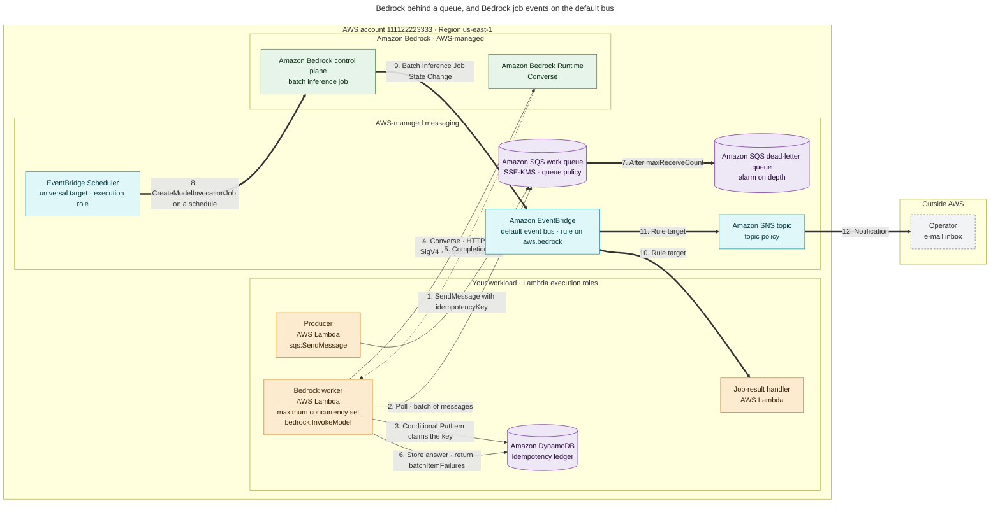

# EventBridge, SQS and SNS with Bedrock

> **Level:** Intermediate · **Verified:** 2026-11-15 · **Feature status:** n/a · **Time:** ~25 min

Amazon Bedrock tells EventBridge when a long-running job changes state, and almost everything else
in an event-driven generative AI system is your own code calling Bedrock from a queue. This chapter
shows exactly which events exist, how to put a queue in front of Bedrock quotas, and how to stop a
retried message from paying for — and changing — an answer twice.

## Learning objectives

After this chapter you can:

- List the Bedrock events that reach EventBridge natively, with their `detail-type`, and say which jobs emit none.
- Size an SQS-to-Lambda consumer so that it paces Bedrock calls instead of fighting quotas.
- Choose between a dead-letter queue, a partial batch response and a delayed retry for throttled calls.
- Design an idempotency key for a call whose output is different every time.
- Use EventBridge Scheduler, EventBridge Pipes and SNS where they add something, and know where they do not.

## Prerequisites

- [Amazon EventBridge, Amazon SQS and Amazon SNS](../../00-foundations/aws-fundamentals/03-eventbridge-sqs-sns.md) — buses, queues, topics, delivery semantics. Not repeated here.
- [The Converse API](../../01-amazon-bedrock/inference/01-converse-api.md) and [Batch inference](../../01-amazon-bedrock/inference/08-batch-inference.md).

## Concept in plain language

Think of Bedrock as a busy specialist with a fixed number of appointments per minute. Two things go
wrong if you send work straight at it: at peak times you are turned away (throttled), and if a
messenger gets lost and you send the same request again, the specialist charges you twice and may
give a different opinion the second time.

The fix is an office around the specialist. A **queue** is the waiting room that lets in only as many
people as there are appointments. A **ledger** records which requests already have an answer, so a
repeated request gets the recorded answer instead of a new appointment. And for work that takes
hours — training a model, a batch job — the specialist **phones you when it is done** (an event)
instead of you calling every five minutes.

## How it really works

### What Bedrock publishes to EventBridge

Bedrock events have `source` `aws.bedrock` and go to the **default event bus** of the account and
Region that ran the job, with **best-effort** delivery.

| `detail-type` | Emitted for | Notes |
|:--|:--|:--|
| `Model Customization Job State Change` | Fine-tuning and other customization jobs | `detail.jobStatus`, `jobArn`, `failureMessage`, output model ARN |
| `Batch Inference Job State Change` | `CreateModelInvocationJob` jobs | `detail.status`, `batchJobArn`, `batchModelId` |
| `Bedrock Data Automation Job Created` | `InvokeDataAutomationAsync` | Only if the request sets `notificationConfiguration.eventBridgeConfiguration.eventBridgeEnabled` |
| `Bedrock Data Automation Job Succeeded` | Same | `detail.job_id`, `job_status`, input object and output location |
| `Bedrock Data Automation Job Failed With Client Error` | Same | |
| `Bedrock Data Automation Job Failed With Service Error` | Same | |

Sources: [Amazon Bedrock events (EventBridge reference)](https://docs.aws.amazon.com/eventbridge/latest/ref/events-ref-bedrock.html),
[How EventBridge for Amazon Bedrock works](https://docs.aws.amazon.com/bedrock/latest/userguide/monitoring-eventbridge-how-it-works.html).
The Data Automation request field is in the AWS SDK model of `InvokeDataAutomationAsync`
(checked in botocore 1.44.3; see the [API operations reference](../../references/bedrock-api-operations.md))
and is used in the AWS sample
[sample-medicaid-form-processing-with-bedrock-data-automation](https://github.com/aws-samples/sample-medicaid-form-processing-with-bedrock-data-automation/blob/main/SampleMedicaidFormProcessingWithBDA.yaml).

> [!NOTE]
> **Documented fact** — "Amazon Bedrock emits events on a best-effort basis", and "there is no cost
> to receive AWS events from Amazon EventBridge." Bedrock API calls also reach EventBridge as
> `AWS API Call via CloudTrail` events (`eventSource` `bedrock.amazonaws.com`).
> Sources: [Monitor job state changes](https://docs.aws.amazon.com/bedrock/latest/userguide/monitoring-eventbridge.html),
> [Amazon Bedrock events](https://docs.aws.amazon.com/eventbridge/latest/ref/events-ref-bedrock.html)

**What does not emit a state-change event.** Knowledge base ingestion jobs have no native EventBridge
event: you poll `GetIngestionJob` until `status` is `COMPLETE`, or deliver the knowledge base's
`APPLICATION_LOGS` to CloudWatch Logs and react to `StartIngestionJob.StatusChanged` log entries with
a subscription filter ([Monitor knowledge bases using CloudWatch Logs](https://docs.aws.amazon.com/bedrock/latest/userguide/knowledge-bases-logging.html),
[Sync a managed knowledge base](https://docs.aws.amazon.com/bedrock/latest/userguide/kb-managed-sync.html)).
Synchronous inference (`Converse`, `InvokeModel`) produces no event either — the response is the result.

### Integration with Amazon Bedrock

| Interaction | Initiator | Direction of data | Identity used | Network path |
|:--|:--|:--|:--|:--|
| Job state-change event (customization, batch) | Amazon Bedrock | Bedrock → default event bus: job ARN, status, failure message — no prompts or outputs | None to configure; the rule's target needs a resource policy or a role trusted by `events.amazonaws.com` | Inside AWS |
| Data Automation job event | Bedrock Data Automation, only when enabled per request | BDA → default bus: job ID, status, S3 input and output locations | As above | Inside AWS |
| API call recorded and forwarded | AWS CloudTrail | CloudTrail → bus: caller, operation, parameters as logged | As above | Inside AWS |
| Queue consumer calls `Converse` | Your code (Lambda event source mapping) | Prompt out, completion back | Lambda execution role (`bedrock:InvokeModel`) | Public Regional endpoint, or the `bedrock-runtime` interface endpoint if the function is in a VPC |
| Scheduled job start (`StartIngestionJob`, `CreateModelInvocationJob`) | EventBridge Scheduler universal target | Scheduler → Bedrock control plane: job parameters; the response is not returned to you | Scheduler execution role trusted by `scheduler.amazonaws.com` | Inside AWS |
| Pipe enrichment that calls a model | EventBridge Pipes → Step Functions Express | Queue message → state machine → Bedrock → target | Pipe role; state machine execution role | Inside AWS |
| Fan-out of job notifications | Amazon SNS | Topic → queues, e-mail, chat | Topic policy; subscription | Inside AWS; e-mail leaves AWS |
| EventBridge rule invokes a model directly | **No native integration** | — | — | Bedrock is not in the list of Classic rule target types |
| SQS or SNS delivers to Bedrock | **No native integration** | — | — | A consumer you run must call Bedrock |

Rule targets: [Event bus targets](https://docs.aws.amazon.com/eventbridge/latest/userguide/eb-targets.html).
The Custom Event Bus lets a subscriber "invoke any supported AWS API action directly through a
universal target"; whether Bedrock actions are among them is **UNVERIFIED — REQUIRES DOCUMENTATION
REVIEW** (we found no list of supported actions for subscribers).

### SQS in front of Bedrock quotas

A queue converts a burst into a backlog; the **consumer's concurrency** sets the rate. Three numbers
decide whether that rate fits your quota.

| Setting | Where | What to know |
|:--|:--|:--|
| Maximum concurrency | Lambda SQS event source mapping, 2–1,000 | Caps concurrent invocations from one queue. Mutually exclusive with provisioned mode ([SQS scaling](https://docs.aws.amazon.com/lambda/latest/dg/services-sqs-scaling.html)) |
| Function timeout | Lambda | Must cover the slowest model call **plus** SDK retries, for every message in the batch |
| Visibility timeout | Queue | At least six times the function timeout for Lambda consumers — see the [foundations chapter](../../00-foundations/aws-fundamentals/03-eventbridge-sqs-sns.md) |

> [!NOTE]
> **Documented fact** — Bedrock throttling "is based on the upfront reservation of input tokens plus
> `max_tokens`", and `InvocationThrottles` "will depend on your retry settings in the SDK."
> Source: [Bedrock runtime metrics](https://docs.aws.amazon.com/bedrock/latest/userguide/monitoring-runtime-metrics.html)

**Our reading:** with concurrency *C* and an average call duration of *L* seconds, a consumer makes
about *C* × 60 / *L* calls per minute and reserves that many times (input tokens + `maxTokens`) of
tokens-per-minute quota. Lowering `maxTokens` to what you actually need raises the throughput you get
from the same quota. Quota mechanics are in
[Quotas, rate limits and throttling](../../08-cost-performance-and-reliability/05-quotas-rate-limits-and-throttling.md).

**Throttles are not poison messages.** Every failed attempt is a receive. With `maxReceiveCount` 5, a
sustained throttle moves healthy messages to the dead-letter queue after five tries. Either lower
concurrency until throttles stop, raise `maxReceiveCount`, or push the message back with a longer
`ChangeMessageVisibility` delay before reporting it as failed. Reserve the DLQ for messages that fail
for a reason that retrying cannot fix (validation errors, content blocked by a guardrail).

### SNS, Scheduler and Pipes

- **SNS** fans a job notification out to people and to several queues, each with its own consumer
  and quota budget. FIFO topics deliver only to SQS
  ([FIFO delivery](https://docs.aws.amazon.com/sns/latest/dg/fifo-message-delivery.html)).
- **EventBridge Scheduler** can start a sync or a job without code, for example with the universal
  target `arn:aws:scheduler:::aws-sdk:bedrockagent:startIngestionJob`. Actions whose names start with
  `invokeModel`, `retrieve`, `get` or `list` are on Scheduler's unsupported list
  ([Universal targets](https://docs.aws.amazon.com/scheduler/latest/UserGuide/managing-targets-universal.html)).
  Schedule *jobs*, not inference.
- **EventBridge Pipes** can enrich SQS messages with a Step Functions **Express** workflow — invoked
  synchronously, response at most 6 MB — that calls Bedrock before the target
  ([Pipes enrichment](https://docs.aws.amazon.com/eventbridge/latest/userguide/pipes-enrichment.html)).
  See [AWS Step Functions with Bedrock](02-step-functions.md).

### Idempotency when the answer is never the same twice

SQS standard queues, SNS and EventBridge all deliver **at least once**. For most systems a duplicate
wastes compute; for a model call it also **costs tokens and produces a different answer**. Retrying
"the same" request is not a no-op.

| Operation | Built-in idempotency token | Source |
|:--|:--|:--|
| `Converse`, `InvokeModel` | None | [API operations reference](../../references/bedrock-api-operations.md) |
| `CreateModelInvocationJob`, `CreateModelCustomizationJob` | `clientRequestToken` | Same |
| `StartIngestionJob`, `IngestKnowledgeBaseDocuments`, `InvokeDataAutomationAsync` | `clientToken` | Same |

For inference you build it yourself: a **stable key chosen by the producer** (an order ID plus a
prompt-template version, never a timestamp), a conditional write that claims the key, and a stored
result returned to every later duplicate. Put the key in Converse's `requestMetadata` too — it is
written to model invocation logs, so you can prove later which call answered which message
([Per-request metadata tagging](https://docs.aws.amazon.com/bedrock/latest/userguide/cost-mgmt-request-metadata.html)).
Job events need deduplication too: key on job ARN plus status.

## Architecture diagram



**What this shows** — two independent paths in one account and Region. The upper path is
synchronous inference paced by a queue: your code initiates every Bedrock call. The lower path is
asynchronous: Bedrock initiates the event, EventBridge routes it, and nothing polls.

**Walkthrough**

1. The producer sends a message that already carries a stable idempotency key.
2. Lambda's event source mapping polls the queue; maximum concurrency caps how many workers run.
3. The worker claims the key with a conditional write; a duplicate finds the key and stops here.
4. The worker calls `Converse` with its execution role and records the key in `requestMetadata`.
5. Bedrock returns the completion (or a throttling error).
6. The answer is stored against the key; failed messages are reported individually.
7. Messages that keep failing move to the dead-letter queue.
8. A schedule starts a batch inference job through a universal target.
9. Bedrock publishes the job's state changes to the default bus, best effort.
10. A rule sends final states to a handler that reads the results from S3.
11. The same rule also publishes to an SNS topic.
12. SNS notifies an operator.

**Legend** — solid arrow: request · dashed arrow: response · thick arrow: asynchronous delivery ·
cylinder: data at rest · grey dashed box: outside AWS · nested boxes: trust boundaries (your
workload, AWS-managed messaging, AWS-managed Bedrock).

**Variations** — Data Automation jobs publish to the same bus only when the request enables it.
Knowledge base ingestion publishes nothing: replace steps 8–10 with a scheduled `StartIngestionJob`
and a poller or a log subscription. With the [Custom Event Bus](../../00-foundations/aws-fundamentals/03-eventbridge-sqs-sns.md)
your own events can use subscribers, but AWS service events still arrive on the default bus. The
full pattern is [Diagram 23 — Event-driven GenAI architecture](../../diagrams/mermaid/23-event-driven-genai.md).

## Implementation details

1. **Start from the quota, not from the queue.** Find the model's requests-per-minute and
   tokens-per-minute quotas, decide `maxTokens`, then derive maximum concurrency. Lambda warns that
   reserved concurrency below the maximum concurrency can throttle messages, so set it at least as high.
2. **Keep batches small for long generations.** Batch size × slowest call must fit the function
   timeout. **Our reading:** a batch size of a few messages suits chat-length outputs; measure p99
   `InvocationLatency` before you choose.
3. **Make throttles cheap.** Configure SDK retries modestly (they consume function time and appear in
   `InvocationThrottles`), report the message as failed, and let the visibility timeout space retries.
4. **Separate "retry later" from "never works".** Validation errors and guardrail interventions go to
   a DLQ or an error table immediately; throttles and 5xx go back to the queue.
5. **Subscribe to job events with one rule** on `source` `aws.bedrock` and the detail types you need;
   filter final states in the pattern (for batch: `Completed`, `PartiallyCompleted`, `Failed`,
   `Expired`, `Stopped`).
6. **Treat event payloads as hints.** Delivery is best effort: on a final-state event, read the
   authoritative status with `GetModelInvocationJob` or `GetModelCustomizationJob`, and keep a slow
   reconciliation sweep for jobs whose final event never arrived.

> [!TIP]
> **Academy recommendation** — Use one queue per model (or per inference profile) when several
> models share a workload. Each queue then has its own concurrency cap that matches that model's
> quota, and a throttled model cannot starve the others. This is our design guidance, not an
> official AWS reference architecture.

## Example

**1. One rule for every Bedrock job event.** Use this pattern on the default bus.

> **Code status:** syntax-checked (JSON parse) · detail types copied from the EventBridge events reference · **never deployed**

```json
{
  "source": ["aws.bedrock"],
  "detail-type": [
    "Model Customization Job State Change",
    "Batch Inference Job State Change",
    "Bedrock Data Automation Job Succeeded",
    "Bedrock Data Automation Job Failed With Client Error",
    "Bedrock Data Automation Job Failed With Service Error"
  ]
}
```

**2. An idempotent SQS worker.** The producer chooses `idempotencyKey`; the worker claims it with an
expiring conditional write, calls `Converse`, stores the answer and acknowledges duplicates without a
model call. A throttle releases the claim and returns only that message to the queue. The event
source mapping must have `ReportBatchItemFailures` turned on.

> **Code status:** syntax-checked (`python -m py_compile`) · mock-tested with botocore `Stubber` (4 tests: first delivery, duplicate, throttle, live claim elsewhere; boto3 1.44.3) · **never deployed**

```python
"""Amazon SQS -> AWS Lambda -> Amazon Bedrock Converse, with an idempotency claim per message."""
import json
import os
import time

import boto3
from botocore.exceptions import ClientError

MODEL_ID = os.environ.get("MODEL_ID", "")            # confirm the current model or profile ID
TABLE = os.environ.get("IDEMPOTENCY_TABLE", "")
CLAIM_SECONDS = int(os.environ.get("CLAIM_SECONDS", "900"))  # keep below the visibility timeout

bedrock = boto3.client("bedrock-runtime")
ddb = boto3.client("dynamodb")


class AlreadyDone(Exception):
    """The key was completed earlier: acknowledge the message without calling the model."""


def claim(key: str, now: int) -> None:
    """Take an exclusive, expiring claim on the key, or raise."""
    try:
        ddb.put_item(
            TableName=TABLE,
            Item={"pk": {"S": key}, "state": {"S": "IN_PROGRESS"},
                  "expires_at": {"N": str(now + CLAIM_SECONDS)}},
            ConditionExpression="attribute_not_exists(pk) OR (#s = :p AND expires_at < :now)",
            ExpressionAttributeNames={"#s": "state"},
            ExpressionAttributeValues={":p": {"S": "IN_PROGRESS"}, ":now": {"N": str(now)}},
        )
    except ClientError as err:
        if err.response["Error"]["Code"] != "ConditionalCheckFailedException":
            raise
        item = ddb.get_item(TableName=TABLE, Key={"pk": {"S": key}}, ConsistentRead=True).get("Item", {})
        if item.get("state", {}).get("S") == "COMPLETE":
            raise AlreadyDone(key) from err
        raise  # another worker holds a live claim: retry later


def process(body: dict) -> str:
    key = body["idempotencyKey"]           # chosen by the producer, stable across retries
    claim(key, int(time.time()))
    try:
        response = bedrock.converse(
            modelId=MODEL_ID,
            messages=[{"role": "user", "content": [{"text": body["prompt"]}]}],
            inferenceConfig={"maxTokens": 512},
            requestMetadata={"idempotencyKey": key},   # appears in model invocation logs
        )
    except ClientError:
        ddb.delete_item(TableName=TABLE, Key={"pk": {"S": key}})  # release so a retry can run
        raise
    answer = response["output"]["message"]["content"][0]["text"]
    ddb.update_item(
        TableName=TABLE, Key={"pk": {"S": key}},
        UpdateExpression="SET #s = :c, answer = :a REMOVE expires_at",
        ExpressionAttributeNames={"#s": "state"},
        ExpressionAttributeValues={":c": {"S": "COMPLETE"}, ":a": {"S": answer}},
    )
    return answer


def handler(event, context):
    failures = []
    for record in event["Records"]:
        try:
            process(json.loads(record["body"]))
        except AlreadyDone:
            continue                                   # duplicate delivery: nothing to pay for
        except Exception:                              # throttled, claimed elsewhere, or a bug
            failures.append({"itemIdentifier": record["messageId"]})
    return {"batchItemFailures": failures}
```

The claim window is a trade-off: if a worker dies after the model answered but before the update,
the next delivery after `CLAIM_SECONDS` calls the model again. **Our reading:** no queue-based design
removes that window entirely; it only makes it small and visible.

## Common mistakes

> [!WARNING]
> **Common mistake** — Treating a Bedrock job event as the record of truth. Delivery is best effort
> and at least once: an event can be missing or arrive twice. Re-read the job, deduplicate on job ARN
> and status, and keep a reconciliation sweep.

| Mistake | Symptom | Fix |
|:--|:--|:--|
| Waiting for a knowledge base ingestion event | Nothing ever arrives | Poll `GetIngestionJob`, or subscribe to the knowledge base's application logs |
| Unbounded consumer concurrency | `InvocationThrottles` spikes with every backlog | Set maximum concurrency from the quota |
| Low `maxReceiveCount` while throttled | Valid messages in the DLQ | Fix the rate; raise `maxReceiveCount`; delay with `ChangeMessageVisibility` |
| Large `maxTokens` "just in case" | Throttling at low real token usage | Size `maxTokens` to the expected output |
| Idempotency key made of a timestamp or message ID that changes on republish | Duplicates are not detected | Derive the key from business identity |
| Forgetting to enable BDA notifications per request | No Data Automation events | Set `notificationConfiguration.eventBridgeConfiguration.eventBridgeEnabled` |
| Scheduling `InvokeModel` with Scheduler | The target is rejected | Schedule a job or a state machine instead |

## Security considerations

- **Events carry metadata, messages carry content.** Bedrock events contain ARNs, statuses and S3
  locations; your queue messages usually contain prompts. Encrypt queues and topics with KMS, and
  prefer an S3 reference over an inline document.
- **Scope who may send.** Queue and topic policies should name the sending service and its source ARN.
- **One role per hop.** The worker needs `bedrock:InvokeModel` on specific model or profile ARNs; the
  Scheduler role needs only the action it schedules; the job handler needs only read access to job
  results.
- **Do not put personal data in `requestMetadata`.** It is copied into invocation logs.
- **Private path.** VPC-attached workers reach Bedrock through the `bedrock-runtime` interface
  endpoint and SQS through its own endpoint — see
  [Private connectivity for Bedrock](../networking/01-private-connectivity-for-bedrock.md).

## Cost considerations

- Receiving AWS service events on EventBridge is free; SQS, SNS, Scheduler and Pipes bill per request
  or event — see the [foundations chapter](../../00-foundations/aws-fundamentals/03-eventbridge-sqs-sns.md).
- **Tokens dominate.** Every duplicate or retry that reaches Bedrock is billed per token; the
  idempotency ledger costs far less than one extra long completion.
- **Throttled retries are not free in time.** They hold Lambda duration and lengthen the backlog.
- **Batch instead of queueing** when the work can wait hours: batch inference is about half the
  on-demand price for supported models — see [Batch inference](../../01-amazon-bedrock/inference/08-batch-inference.md).

## Knowledge check

1. Which Bedrock jobs publish state-change events to EventBridge, and what must you do to get Data Automation events?
2. A worker with maximum concurrency 50 and `maxReceiveCount` 3 is throttled for ten minutes. What happens to the queue, and what do you change?
3. Why is `Converse` harder to make idempotent than `CreateModelInvocationJob`?
4. You want a knowledge base to sync every night and the operations team notified when it finishes. Which parts are native and which do you build?

<details>
<summary>Answers</summary>

1. Model customization jobs and batch inference jobs; Data Automation async jobs publish created, succeeded and two failure events only when the request enables EventBridge notifications.
2. Throttled messages are received repeatedly and land in the DLQ after three attempts although nothing is wrong with them. Lower concurrency (or `maxTokens`) until throttles stop, raise `maxReceiveCount`, and delay retries.
3. `Converse` has no idempotency token and returns a different answer each time, so you must claim a key and store the first answer; the job API accepts `clientRequestToken`.
4. Native: a Scheduler universal target calling `startIngestionJob`. Built by you: completion detection (poll `GetIngestionJob` or a subscription on the knowledge base's application logs) and the SNS publish.

</details>

## Further reading

Official sources opened while writing this chapter:

- [Monitor Amazon Bedrock job state changes using Amazon EventBridge](https://docs.aws.amazon.com/bedrock/latest/userguide/monitoring-eventbridge.html) — best-effort delivery, no cost.
- [How EventBridge for Amazon Bedrock works](https://docs.aws.amazon.com/bedrock/latest/userguide/monitoring-eventbridge-how-it-works.html) — sample events.
- [Amazon Bedrock events (EventBridge events reference)](https://docs.aws.amazon.com/eventbridge/latest/ref/events-ref-bedrock.html) — the six service events and CloudTrail-delivered events.
- [Event bus targets](https://docs.aws.amazon.com/eventbridge/latest/userguide/eb-targets.html) — Classic rule target types and the Custom Event Bus universal target.
- [Using universal targets in EventBridge Scheduler](https://docs.aws.amazon.com/scheduler/latest/UserGuide/managing-targets-universal.html) — ARN format and unsupported action prefixes.
- [Event enrichment in EventBridge Pipes](https://docs.aws.amazon.com/eventbridge/latest/userguide/pipes-enrichment.html) — Express workflows only, 6 MB response.
- [Configuring scaling behavior for SQS event source mappings](https://docs.aws.amazon.com/lambda/latest/dg/services-sqs-scaling.html) — maximum concurrency and provisioned mode.
- [Monitor bedrock-runtime inference using CloudWatch metrics](https://docs.aws.amazon.com/bedrock/latest/userguide/monitoring-runtime-metrics.html) — throttling based on input tokens plus `max_tokens`.
- [Per-request metadata tagging](https://docs.aws.amazon.com/bedrock/latest/userguide/cost-mgmt-request-metadata.html) — `requestMetadata` limits and where it appears.
- [Monitor knowledge bases using CloudWatch Logs](https://docs.aws.amazon.com/bedrock/latest/userguide/knowledge-bases-logging.html) and [Sync a managed knowledge base](https://docs.aws.amazon.com/bedrock/latest/userguide/kb-managed-sync.html) — ingestion status without events.
- [SNS FIFO topic delivery](https://docs.aws.amazon.com/sns/latest/dg/fifo-message-delivery.html) — SQS-only delivery.
