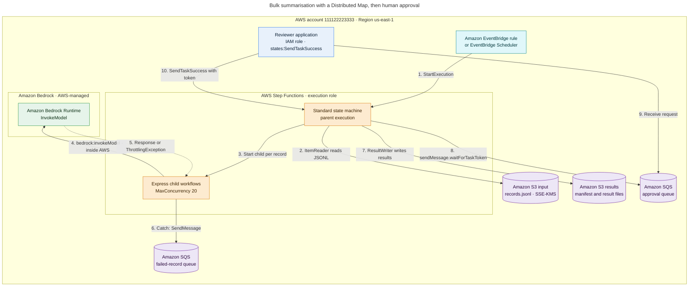

# AWS Step Functions with Bedrock

> **Level:** Intermediate · **Verified:** 2026-11-15 · **Feature status:** n/a · **Time:** ~25 min

AWS Step Functions is the workflow engine that can call Amazon Bedrock without any glue code. This
chapter separates what the **optimized** Bedrock integrations do from what the generic **AWS SDK**
integrations do, shows how to fan out bulk inference, pause for a human, survive throttling — and
when a Bedrock Flow or an agent is the better tool.

## Learning objectives

After this chapter you can:

- Name the optimized Bedrock and AgentCore integrations and the Bedrock operations the SDK integrations cannot call.
- Choose Standard or Express workflows for a given Bedrock workload.
- Run bulk inference with a Distributed Map and compare it with batch inference.
- Add a human approval step with a task token and retries that back off on throttling.
- Decide between Step Functions, Amazon Bedrock Flows and an agent.

## Prerequisites

- [EventBridge, SQS and SNS with Bedrock](01-eventbridge-sqs-sns.md) — idempotency and quotas.
- [InvokeModel and streaming APIs](../../01-amazon-bedrock/inference/02-invokemodel-and-streaming.md) and [Batch inference](../../01-amazon-bedrock/inference/08-batch-inference.md).

## Concept in plain language

A state machine is a recipe card that a kitchen follows exactly: step 1, then step 2, wait for the
oven, ask the head chef to taste, then serve. Step Functions keeps the card, remembers where every
dish is, retries a step that failed, and waits — for seconds or for months — without anyone standing
at the stove. A model call is just one step on the card.

The recipe is fixed in advance. That is the difference from an agent, which decides the next step
while cooking.

## How it really works

### Two ways to call Bedrock

| Integration | `Resource` in the Task state | Patterns | What to know |
|:--|:--|:--|:--|
| Optimized `InvokeModel` | `arn:aws:states:::bedrock:invokeModel` | Request Response | `Body` up to 256 KiB, not validated by Step Functions; or `Input.S3Uri` instead of `Body`; `Output.S3Uri` writes the response to S3 and returns a reference |
| Optimized `CreateModelCustomizationJob` | `arn:aws:states:::bedrock:createModelCustomizationJob`, with `.sync` | Request Response, Run a Job | `.sync` waits for the fine-tuning job; needs `iam:PassRole` on the customization role |
| Optimized AgentCore `InvokeHarness` | `arn:aws:states:::bedrockagentcore:invokeHarness` | Request Response only | 15-minute cap on the Task; Converse-shaped output with only the final assistant text; token usage summed over turns |
| AWS SDK, Bedrock Runtime | `arn:aws:states:::aws-sdk:bedrockruntime:converse` (and other actions) | Request Response | Not supported: `InvokeModelWithResponseStream`, `ConverseStream`, `InvokeModelWithBidirectionalStream` |
| AWS SDK, Agents runtime | `arn:aws:states:::aws-sdk:bedrockagentruntime:retrieve` | Request Response | Not supported: `AgenticRetrieveStream`, `InvokeAgent`, `InvokeFlow`, `InvokeInlineAgent`, `OptimizePrompt`, `RetrieveAndGenerateStream` |
| AWS SDK, control planes | `aws-sdk:bedrock:createModelInvocationJob`, `aws-sdk:bedrockagent:startIngestionJob` | Request Response | Use for jobs that have no optimized integration |
| AWS SDK, AgentCore | `aws-sdk:bedrockagentcore:invokeAgentRuntime` | Request Response | Not supported: `InvokeCodeInterpreter`, `InvokeAgentRuntimeCommand`, `InvokeHarness` (use the optimized one) |

Sources: [Invoke and customize Bedrock models with Step Functions](https://docs.aws.amazon.com/step-functions/latest/dg/connect-bedrock.html),
[Invoke an AgentCore harness](https://docs.aws.amazon.com/step-functions/latest/dg/connect-bedrockagentcore.html),
[AWS SDK integrations](https://docs.aws.amazon.com/step-functions/latest/dg/supported-services-awssdk.html).
The `.sync` resource name follows the documented camelCase convention for `Resource` values.

> [!NOTE]
> **Documented fact** — The optimized-integrations table lists Amazon Bedrock with Request Response
> (Standard and Express), Run a Job and Wait for Callback (Standard), and Amazon Bedrock AgentCore with
> Request Response only. The Bedrock integration page itself documents only Request Response and
> `.sync`; **our reading** is that callbacks are best built with an SQS, SNS or Lambda task, as below.
> Source: [Integrating optimized services](https://docs.aws.amazon.com/step-functions/latest/dg/integrate-optimized.html)

Two consequences matter in design. **Streaming is unavailable** to a state machine, so a user-facing
token stream needs your own compute. And **a flow cannot be invoked synchronously** from an SDK task
(`InvokeFlow` is unsupported); `StartFlowExecution` is not on the unsupported list, but flow executions
are themselves in preview.

### Integration with Amazon Bedrock

| Interaction | Initiator | Direction of data | Identity used | Network path |
|:--|:--|:--|:--|:--|
| `bedrock:invokeModel` task | Step Functions service | State input (or S3 object) → model; response → state output (or S3) | State machine execution role: `bedrock:InvokeModel` on the model or profile ARN; S3 access when `Input`/`Output` are used (our reading) | Inside AWS; your VPC is not involved |
| `createModelCustomizationJob.sync` | Step Functions, which then tracks the job | Job parameters → Bedrock; job status back | Execution role plus `iam:PassRole`; Bedrock then assumes the customization service role | Inside AWS |
| `invokeHarness` task | Step Functions | Messages → harness; final text and usage back | Execution role: `bedrock-agentcore:InvokeHarness`; tools run under the harness execution role | Inside AWS |
| SDK tasks (`converse`, `retrieve`, `startIngestionJob`, `createModelInvocationJob`) | Step Functions | Per API | Execution role; Step Functions cannot generate these policies for most SDK integrations | Inside AWS |
| Human approval | Your reviewer application | Decision → `SendTaskSuccess` or `SendTaskFailure` | The reviewer's role; tokens must come from the same account | Step Functions endpoint or its interface endpoint |
| Bedrock starts a workflow | **No native integration** | — | — | A job event reaches EventBridge, and a rule targets the state machine |
| Streaming response to a caller | **No native integration** | — | — | Streaming APIs are unsupported in SDK tasks |

IAM generation: [AWS Step Functions supports 200 AWS services (AWS News Blog)](https://aws.amazon.com/blogs/aws/now-aws-step-functions-supports-200-aws-services-to-enable-easier-workflow-automation/).
Callbacks: [Service integration patterns](https://docs.aws.amazon.com/step-functions/latest/dg/connect-to-resource.html).

### Standard or Express

| | Standard | Express |
|:--|:--|:--|
| Maximum duration | One year | Five minutes |
| Execution semantics | Exactly once (unless you add `Retry`) | Asynchronous: at least once · synchronous: at most once |
| `.sync` and `.waitForTaskToken` | Supported | Not supported |
| Distributed Map | Supported | Not supported |
| Billing | Per state transition | Per execution, duration and memory |

Source: [Choosing workflow type](https://docs.aws.amazon.com/step-functions/latest/dg/choosing-workflow-type.html).
The type cannot be changed after creation.

For Bedrock this means: a short chain of two or three model calls behind an API fits a **synchronous
Express** workflow; anything that waits for a job, a person or a Distributed Map is **Standard**.
Exactly-once covers *states*, not model output — a `Retry` re-invokes the model and gets a new answer.

### Bulk inference with a Distributed Map

A Distributed Map reads a dataset from S3 (`CSV`, `JSON`, `JSONL`, `PARQUET` or a manifest) and runs
each item as a child workflow. Without `MaxConcurrency` it runs up to **10,000** children in
parallel; `ToleratedFailurePercentage` or `ToleratedFailureCount` decide when the run fails, and
`ResultWriter` writes results to S3 ([Distributed Map](https://docs.aws.amazon.com/step-functions/latest/dg/state-map-distributed.html),
[ItemReader](https://docs.aws.amazon.com/step-functions/latest/dg/input-output-itemreader.html)).

| | Distributed Map + on-demand calls | [Batch inference](../../01-amazon-bedrock/inference/08-batch-inference.md) |
|:--|:--|:--|
| Price | On-demand token rates | About 50% lower for supported models |
| Completion | You control it; finishes when the items finish | Not guaranteed; 24 h default timeout, 168 h maximum |
| Pacing | `MaxConcurrency` against your on-demand quota | Bedrock schedules; on-demand traffic has priority |
| Per-item logic | Any states: guardrail, retrieval, validation, branching | One model call per record |
| Effect on live traffic | Shares quota with interactive callers | Separate batch quotas |

**Our reading:** use a Distributed Map when you need a deadline or per-item logic, and batch inference
when the cheapest tokens matter more than when they arrive. A state machine can also orchestrate a
batch job: submit with an SDK task, then wait for the `Batch Inference Job State Change` event to
release a task token.

### Throttling, retries and human approval

Retriers take `ErrorEquals`, `IntervalSeconds` (default 1), `MaxAttempts` (default 3), `BackoffRate`
(default 2.0), `MaxDelaySeconds` and `JitterStrategy` (`FULL` or `NONE`)
([Error handling](https://docs.aws.amazon.com/step-functions/latest/dg/concepts-error-handling.html)).
SDK integrations report errors as `ServiceName.ErrorName` — `BedrockRuntime.ThrottlingException`
([AWS SDK integrations](https://docs.aws.amazon.com/step-functions/latest/dg/supported-services-awssdk.html)).
The error names of the **optimized** Bedrock integration (`Bedrock.ThrottlingException` in community
examples) are **UNVERIFIED — REQUIRES DOCUMENTATION REVIEW**: we found no AWS page that lists them.
Read the `error` field of a failed task in the execution history before you rely on a name.

Retries multiply: 20 concurrent children × 6 attempts can produce 120 calls in a short window. Full
jitter spreads them; `MaxConcurrency` bounds them.

A callback task (`.waitForTaskToken`) pauses until someone calls `SendTaskSuccess` or
`SendTaskFailure` with the token, up to the one-year execution limit. Set `TimeoutSeconds` (or a
heartbeat) so a lost token does not hold an execution open
([Wait for a Callback](https://docs.aws.amazon.com/step-functions/latest/dg/connect-to-resource.html)).
The design of review queues is in [Human-in-the-loop workflows](../../09-advanced-topics/08-human-in-the-loop.md).

### Step Functions, Flows or an agent?

| Question | AWS Step Functions | Amazon Bedrock Flows | Agent on AgentCore |
|:--|:--|:--|:--|
| Who chooses the next step? | You, in ASL | You, in a node graph | The model, at run time |
| Longest run | One year (Standard) | `InvokeFlow` one hour; flow executions (preview) 24 h | Bounded by the Runtime session |
| Waiting for people or jobs | Task tokens, `.sync` | Not documented | Application-specific |
| Reaches other AWS services | 200+ through SDK integrations | Through nodes such as Lambda and knowledge bases | Through tools behind AgentCore Gateway |
| Bulk fan-out | Distributed Map | Not its purpose (our reading) | No |
| Built and owned by | Platform or application engineers | GenAI builders, visually or by API | Agent developers |

Sources: [Bedrock Flows](https://docs.aws.amazon.com/bedrock/latest/userguide/flows.html),
[Run flows asynchronously](https://docs.aws.amazon.com/bedrock/latest/userguide/flows-create-async.html),
[AgentCore harness](../../01-amazon-bedrock/agentcore/03-agentcore-harness.md).

> [!TIP]
> **Academy recommendation** — Put the deterministic, auditable outer process in Step Functions and
> call an agent (`invokeHarness`) or a flow only for the step that genuinely needs model-driven
> decisions. Agents Classic is in maintenance mode, so new designs should not call `InvokeAgent`.
> This is our design guidance, not an official AWS reference architecture. More in
> [Choosing between RAG, agents, flows and plain inference](../../09-advanced-topics/14-choosing-rag-agents-flows.md).

## Architecture diagram



**What this shows** — Step Functions is the only caller of Bedrock here, using its execution role from
inside AWS; no compute of yours touches the model. The parent workflow waits on a person without
running anything.

**Walkthrough**

1. A rule or a schedule starts the parent execution with bucket names, the model ID and queue URLs.
2. The Distributed Map reads the JSONL file from S3.
3. One Express child workflow starts per record, at most 20 at a time.
4. Each child calls the optimized `bedrock:invokeModel` integration.
5. Bedrock answers, or throttles; the retrier backs off with full jitter.
6. Records that still fail are sent to a queue for inspection, and count toward the failure tolerance.
7. The Map run writes its results and a manifest to S3.
8. The parent sends an approval request carrying the task token, then pauses.
9. A reviewer application reads the request.
10. The reviewer returns the decision with `SendTaskSuccess`; the workflow continues.

**Legend** — solid arrow: request · dashed arrow: response · cylinder: data at rest · nested boxes:
account, Step Functions and AWS-managed Bedrock trust zones.

**Variations** — For a single chain of calls behind an API, replace the parent with a synchronous
Express workflow. For the cheapest tokens, replace steps 2–7 with a batch inference job. For a step
that needs tools and reasoning, replace step 4 with `bedrockagentcore:invokeHarness`.

## Implementation details

1. **Pick the integration first.** Optimized `invokeModel` for model-native bodies and S3 offload;
   SDK `converse` for a model-agnostic request shape; SDK tasks for everything else.
2. **Keep payloads small.** Task, state and execution input and output are limited to 256 KiB
   ([Step Functions quotas](https://docs.aws.amazon.com/step-functions/latest/dg/service-quotas.html));
   pass S3 references, use `Input`/`Output` on `invokeModel`, and trim with `ResultSelector`.
3. **Write least-privilege roles by hand for SDK tasks**, scoped to model, profile, knowledge base and
   bucket ARNs. A Distributed Map also needs `states:StartExecution` on its own state machine.
4. **Make model IDs input, not code** — the example takes `modelId` from the execution input.
5. **Turn on logging and tracing.** Express workflows keep no history unless CloudWatch Logs logging is
   on; Step Functions supports X-Ray active tracing — see [AWS X-Ray, OpenTelemetry and ADOT](../observability/02-xray-opentelemetry-adot.md).

## Example

A Standard workflow that summarises every record of a JSONL file through the optimized integration,
sends failures to a queue, writes results to S3 and then waits for approval. The `Body` uses the
Anthropic Messages format of `InvokeModel`; change it for other providers.

> **Code status:** JSON-parsed · validated with `cfn-lint` 1.60.1 (rule E3601, structural ASL schema) inside an `AWS::StepFunctions::StateMachine` wrapper · the optimized-integration error names in `Retry` are **UNVERIFIED** · **never deployed**

```json
{
  "Comment": "Summarise every record of a JSONL file with Amazon Bedrock, then wait for a human to approve the run.",
  "StartAt": "SummariseRecords",
  "States": {
    "SummariseRecords": {
      "Type": "Map",
      "Label": "SummariseRecords",
      "ItemReader": {
        "Resource": "arn:aws:states:::s3:getObject",
        "ReaderConfig": { "InputType": "JSONL" },
        "Parameters": {
          "Bucket.$": "$.inputBucket",
          "Key.$": "$.inputKey"
        }
      },
      "ItemSelector": {
        "item.$": "$$.Map.Item.Value",
        "modelId.$": "$.modelId",
        "deadLetterQueueUrl.$": "$.deadLetterQueueUrl"
      },
      "MaxConcurrency": 20,
      "ToleratedFailurePercentage": 5,
      "ItemProcessor": {
        "ProcessorConfig": { "Mode": "DISTRIBUTED", "ExecutionType": "EXPRESS" },
        "StartAt": "InvokeModel",
        "States": {
          "InvokeModel": {
            "Type": "Task",
            "Resource": "arn:aws:states:::bedrock:invokeModel",
            "Parameters": {
              "ModelId.$": "$.modelId",
              "ContentType": "application/json",
              "Accept": "application/json",
              "Body": {
                "anthropic_version": "bedrock-2023-05-31",
                "max_tokens": 512,
                "messages": [
                  { "role": "user", "content.$": "States.Format('Summarise in three sentences: {}', $.item.text)" }
                ]
              }
            },
            "ResultSelector": { "summary.$": "$.Body.content[0].text" },
            "ResultPath": "$.result",
            "TimeoutSeconds": 120,
            "Retry": [
              {
                "ErrorEquals": ["Bedrock.ThrottlingException", "Bedrock.ServiceUnavailableException"],
                "IntervalSeconds": 2,
                "BackoffRate": 2.0,
                "MaxAttempts": 6,
                "MaxDelaySeconds": 60,
                "JitterStrategy": "FULL"
              },
              {
                "ErrorEquals": ["States.Timeout"],
                "IntervalSeconds": 5,
                "MaxAttempts": 1
              }
            ],
            "Catch": [
              { "ErrorEquals": ["States.ALL"], "ResultPath": "$.error", "Next": "RecordFailure" }
            ],
            "End": true
          },
          "RecordFailure": {
            "Type": "Task",
            "Resource": "arn:aws:states:::sqs:sendMessage",
            "Parameters": {
              "QueueUrl.$": "$.deadLetterQueueUrl",
              "MessageBody.$": "States.JsonToString($)"
            },
            "Next": "ItemFailed"
          },
          "ItemFailed": {
            "Type": "Fail",
            "Error": "ItemFailed",
            "Cause": "The record could not be summarised; it was sent to the dead-letter queue."
          }
        }
      },
      "ResultWriter": {
        "Resource": "arn:aws:states:::s3:putObject",
        "Parameters": {
          "Bucket.$": "$.outputBucket",
          "Prefix.$": "$.outputPrefix"
        }
      },
      "ResultPath": "$.mapRun",
      "Next": "RequestApproval"
    },
    "RequestApproval": {
      "Type": "Task",
      "Resource": "arn:aws:states:::sqs:sendMessage.waitForTaskToken",
      "Parameters": {
        "QueueUrl.$": "$.approvalQueueUrl",
        "MessageBody": {
          "resultLocation.$": "$.mapRun.ResultWriterDetails",
          "taskToken.$": "$$.Task.Token"
        }
      },
      "TimeoutSeconds": 259200,
      "ResultPath": "$.approval",
      "Next": "Approved"
    },
    "Approved": {
      "Type": "Choice",
      "Choices": [
        { "Variable": "$.approval.decision", "StringEquals": "APPROVE", "Next": "Publish" }
      ],
      "Default": "Rejected"
    },
    "Publish": { "Type": "Succeed" },
    "Rejected": { "Type": "Fail", "Error": "Rejected", "Cause": "A reviewer rejected the run." }
  }
}
```

Start it with input such as `{"inputBucket": "…", "inputKey": "records.jsonl", "modelId": "…",
"outputBucket": "…", "outputPrefix": "runs/", "deadLetterQueueUrl": "…", "approvalQueueUrl": "…"}`.
The reviewer calls `SendTaskSuccess` with `{"decision": "APPROVE"}` as output. Note that `RecordFailure`
ends in a `Fail` state on purpose: the record is preserved in the queue *and* counted against
`ToleratedFailurePercentage`.

> [!CAUTION]
> **Cost or security hazard** — Running this bills every model call at on-demand rates and every
> state transition. Try it in a sandbox account on a file of a few records, and delete the queues and
> results afterwards.

## Common mistakes

> [!WARNING]
> **Common mistake** — Leaving `MaxConcurrency` unset on a Distributed Map that calls Bedrock. It then
> starts up to 10,000 children, the model throttles, retries pile up, and interactive users of the
> same model are throttled too.

| Mistake | Symptom | Fix |
|:--|:--|:--|
| Passing whole documents through state | `States.DataLimitExceeded` | S3 references; `Input`/`Output` on `invokeModel` |
| Expecting `ConverseStream` from a task | Definition or runtime error | Stream from your own compute |
| Calling `InvokeFlow` from an SDK task | Unsupported operation | Lambda task, or flow executions where acceptable |
| Retrying on `States.ALL` | Validation errors retried and billed | Retry only throttling and transient errors |
| Callback task without a timeout | Executions open until the one-year limit | `TimeoutSeconds` or `HeartbeatSeconds` |
| Express workflow for approvals | `.waitForTaskToken` rejected | Standard workflow |

## Security considerations

- **The execution role is the Bedrock caller.** Scope `bedrock:InvokeModel` to specific model and
  inference profile ARNs; avoid the "full access" examples outside a sandbox.
- **Execution history holds prompts and answers.** Standard history is kept 90 days; log destinations
  keep what you send. Use `ResultSelector` to keep only what later states need, and choose log levels
  that exclude execution data where it is sensitive.
- **Task tokens are capabilities.** Anyone holding a token and `states:SendTaskSuccess` can complete
  the step; treat approval messages as sensitive.
- **Guardrails are not automatic.** An `invokeModel` task applies a guardrail only if the request
  names one — see [Amazon Bedrock Guardrails](../../01-amazon-bedrock/guardrails/01-guardrails.md).

## Cost considerations

- **Standard** bills state transitions — retries and Map children each add transitions. **Express**
  bills executions, duration and memory, so a slow model call costs Express duration
  ([Choosing workflow type](https://docs.aws.amazon.com/step-functions/latest/dg/choosing-workflow-type.html)).
- **No idle compute while waiting** for a callback or a `.sync` job.
- **Model tokens dominate**; a Distributed Map pays on-demand rates, batch inference about half.

## Knowledge check

1. Which Bedrock operations can the optimized integration call, and which integration would you use for `Converse` and for `Retrieve`?
2. A synchronous API must chain three model calls and return within seconds. Standard or Express, and why?
3. You must summarise two million records by Monday at the lowest cost. What do you choose, and what is the risk?
4. What would happen if the Distributed Map in the example had no `MaxConcurrency`?

<details>
<summary>Answers</summary>

1. `InvokeModel` and `CreateModelCustomizationJob` (with `.sync`), plus AgentCore `InvokeHarness`. `Converse` and `Retrieve` go through the AWS SDK integrations `bedrockruntime` and `bedrockagentruntime`.
2. Synchronous Express: under five minutes, invoked synchronously, billed by duration, and no callbacks are needed.
3. Batch inference (about half the price); completion is not guaranteed, so plan to re-submit unprocessed records or fall back to a Distributed Map before the deadline.
4. Up to 10,000 children would call the model at once, throttling would spike for this workflow and for everyone else using the model, and retries would multiply the load.

</details>

## Further reading

Official sources opened while writing this chapter:

- [Invoke and customize Amazon Bedrock models with Step Functions](https://docs.aws.amazon.com/step-functions/latest/dg/connect-bedrock.html) — optimized APIs, `Body`/`Input`/`Output`, IAM examples.
- [Invoke Amazon Bedrock AgentCore harness with Step Functions](https://docs.aws.amazon.com/step-functions/latest/dg/connect-bedrockagentcore.html) — `invokeHarness`, limits and response shape.
- [Integrating optimized services](https://docs.aws.amazon.com/step-functions/latest/dg/integrate-optimized.html) — integration patterns per service.
- [AWS SDK integrations](https://docs.aws.amazon.com/step-functions/latest/dg/supported-services-awssdk.html) — resource format, error naming, unsupported Bedrock operations.
- [Service integration patterns](https://docs.aws.amazon.com/step-functions/latest/dg/connect-to-resource.html) — Request Response, `.sync`, task tokens.
- [Choosing workflow type](https://docs.aws.amazon.com/step-functions/latest/dg/choosing-workflow-type.html) and [Step Functions quotas](https://docs.aws.amazon.com/step-functions/latest/dg/service-quotas.html).
- [Distributed Map](https://docs.aws.amazon.com/step-functions/latest/dg/state-map-distributed.html) and [ItemReader](https://docs.aws.amazon.com/step-functions/latest/dg/input-output-itemreader.html).
- [Handling errors in Step Functions workflows](https://docs.aws.amazon.com/step-functions/latest/dg/concepts-error-handling.html) — retrier fields and defaults.
- [Perform AI prompt-chaining with Amazon Bedrock](https://docs.aws.amazon.com/step-functions/latest/dg/sample-bedrock-prompt-chaining.html) — AWS sample project.
- [Build an end-to-end generative AI workflow with Amazon Bedrock Flows](https://docs.aws.amazon.com/bedrock/latest/userguide/flows.html) and [Run flows asynchronously](https://docs.aws.amazon.com/bedrock/latest/userguide/flows-create-async.html).
- [Now — AWS Step Functions supports 200 AWS services (AWS News Blog)](https://aws.amazon.com/blogs/aws/now-aws-step-functions-supports-200-aws-services-to-enable-easier-workflow-automation/) — IAM for SDK integrations.
