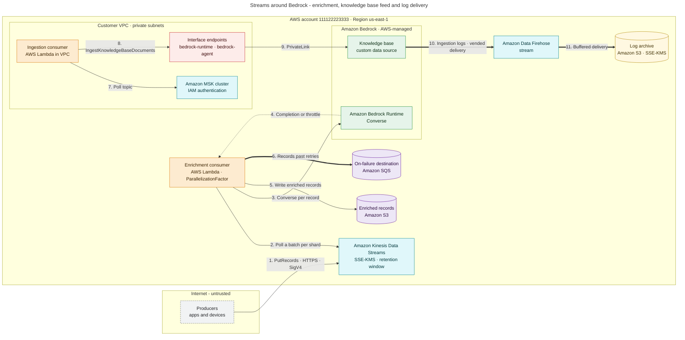

# Amazon Kinesis and Amazon MSK

> **Level:** Intermediate · **Verified:** 2026-11-15 · **Feature status:** n/a · **Time:** ~25 min

Streams meet Amazon Bedrock in four places: they feed knowledge bases, they carry records that a
model enriches, they deliver Bedrock's own logs to storage, and — with Amazon MSK — they are the event
backbone that everything else hangs off. Almost all of it is application code you write; this chapter
says exactly where AWS provides an integration and where it does not.

## Learning objectives

After this chapter you can:

- Feed a knowledge base from a stream with direct ingestion, and explain what a replay does.
- Build a stream consumer that calls Bedrock without losing data when the model throttles.
- Route Bedrock and AgentCore logs to Amazon S3 through Amazon Data Firehose.
- Describe the real-time vector embedding blueprint for Amazon MSK and its limits.
- Say which Kinesis and MSK integrations with Bedrock are native and which are patterns.

## Prerequisites

- [EventBridge, SQS and SNS with Bedrock](01-eventbridge-sqs-sns.md) — quotas, idempotency.
- [Ingestion, parsing and chunking](../../01-amazon-bedrock/knowledge-bases/04-ingestion-parsing-chunking.md) and [Managed Knowledge Base](../../01-amazon-bedrock/knowledge-bases/02-managed-knowledge-base.md).

## Concept in plain language

A queue is a pile of letters: whoever is free takes the next one, and the letter is gone once
handled. A **stream** is a conveyor belt in a factory: items stay on the belt for a fixed time, in
order, and several stations can each look at every item. If a station is slow, the belt does not stop
— items pile up in front of that station until they fall off the end.

That last property is what matters with Bedrock. A model call is a slow station with a speed limit.
When it throttles, your consumer falls behind; fall behind for longer than the stream's retention and
records are lost.

## How it really works

### Integration with Amazon Bedrock

| Interaction | Initiator | Direction of data | Identity used | Network path |
|:--|:--|:--|:--|:--|
| Stream records → knowledge base (direct ingestion) | Your consumer (Lambda event source mapping on Kinesis or MSK) | Records → `IngestKnowledgeBaseDocuments` → Bedrock parses, chunks, embeds and indexes asynchronously | Consumer execution role, allowed to call `IngestKnowledgeBaseDocuments` on the knowledge base | `bedrock-agent` endpoint, public or through an interface endpoint |
| Real-time enrichment | Your consumer (Lambda, or Managed Service for Apache Flink async I/O) | Record → `Converse`/`InvokeModel` → enriched record to a sink | Consumer's role (`bedrock:InvokeModel`) | `bedrock-runtime` endpoint, public or interface endpoint |
| MSK real-time vector embedding blueprint | A Managed Service for Apache Flink application that an AWS CloudFormation blueprint deploys in your account | MSK topic → Bedrock embedding model → OpenSearch index | IAM roles created by the stack; MSK IAM authentication only | VPC endpoints for Bedrock and OpenSearch created by the stack |
| Knowledge base ingestion logs → Firehose | Bedrock vended log delivery | Per-document ingestion events → Firehose stream → S3 or another destination | Configured by a principal with `bedrock:AllowVendedLogDeliveryForResource` | Inside AWS |
| AgentCore Memory and Gateway logs → Firehose | AgentCore vended log delivery | Application logs → Firehose | As above, on the AgentCore resource | Inside AWS |
| Model invocation logs → Firehose | **No direct destination** — a CloudWatch Logs subscription filter forwards them | Log events → Firehose (gzip) | Role used by the subscription | Inside AWS |
| Firehose transformation that calls a model | **No native integration** — your transformation Lambda may call Bedrock | Buffered records → Lambda → Bedrock | Lambda execution role | As for enrichment |
| Kinesis, Firehose or MSK as a Bedrock source or target | **No native integration** | — | — | — |

Sources: [Ingest changes directly into a knowledge base](https://docs.aws.amazon.com/bedrock/latest/userguide/kb-direct-ingestion.html),
[MSK vector embedding blueprints](https://docs.aws.amazon.com/msk/latest/developerguide/ai-vector-embedding-integration-learn-more.html),
[Blueprint FAQ](https://docs.aws.amazon.com/managed-flink/latest/java/troubleshooting-blueprints-FAQ.html),
[Monitor knowledge bases using CloudWatch Logs](https://docs.aws.amazon.com/bedrock/latest/userguide/knowledge-bases-logging.html),
[Model invocation logging](https://docs.aws.amazon.com/bedrock/latest/userguide/model-invocation-logging.html),
[Subscription filters](https://docs.aws.amazon.com/AmazonCloudWatch/latest/logs/SubscriptionFilters.html).
AgentCore log destinations are in [AgentCore Observability](../../01-amazon-bedrock/agentcore/07-agentcore-observability.md).

### Feeding a knowledge base from a stream

Knowledge bases with a **custom** or **S3** data source accept direct ingestion: you submit documents
with `IngestKnowledgeBaseDocuments` and they become retrievable without a sync. With a custom data
source, documents can be inline text, Base64 bytes or an S3 location; with an S3 data source, only S3
locations — and the next sync can overwrite what you ingested directly. Do not run a direct ingestion
and `StartIngestionJob` at the same time. A document identifier that already exists is **overwritten**,
which makes replays safe if the ID is derived from the record's business key
([Ingest documents directly](https://docs.aws.amazon.com/bedrock/latest/userguide/kb-direct-ingestion-add.html)).

> [!NOTE]
> **Documented fact** — The direct-ingestion page now opens with "For optimized retrieval accuracy and
> a managed experience, we recommend Amazon Bedrock Managed Knowledge Base." AWS's own streaming
> example uses Amazon MSK, a Lambda consumer and a custom connector.
> Sources: [Ingest changes directly](https://docs.aws.amazon.com/bedrock/latest/userguide/kb-direct-ingestion.html),
> [Stream ingest data from Kafka to Bedrock Knowledge Bases (AWS blog)](https://aws.amazon.com/blogs/machine-learning/stream-ingest-data-from-kafka-to-amazon-bedrock-knowledge-bases-using-custom-connectors/)

> [!WARNING]
> **Source conflict** — The user guide says the API ingests "up to 25 documents"; the AWS SDK model
> (botocore 1.44.3) limits the `documents` list to 10 items. The example below sends 10 per call.
> Sources: [Ingest documents directly](https://docs.aws.amazon.com/bedrock/latest/userguide/kb-direct-ingestion-add.html),
> [API operations reference](../../references/bedrock-api-operations.md)

The call is **asynchronous**: it returns a per-document status such as `STARTING`, and the document is
retrievable only once indexed. A Managed Knowledge Base example from AWS tracks each document until it
is queryable ([Multi-tenant agentic chat with Managed Knowledge Base](https://aws.amazon.com/blogs/machine-learning/build-multi-tenant-agentic-chat-applications-on-enterprise-data-with-amazon-bedrock-managed-knowledge-base/)).

### A Bedrock call inside a stream consumer

| Lambda event source mapping setting | Effect with a model call |
|:--|:--|
| `ParallelizationFactor` 1–10 | Concurrent batches per shard; concurrency ≈ shards × factor; order kept per partition key |
| Batch size and batching window | More records per invocation; total model time must fit the function timeout |
| `ReportBatchItemFailures` | Return the sequence number of the first failure; Lambda checkpoints at the lowest one and retries from there |
| `BisectBatchOnFunctionError` | Splits a failing batch to isolate a bad record; does not use up retries |
| `MaximumRetryAttempts`, `MaximumRecordAgeInSeconds` | Bound how long a failing record blocks its shard — **by default up to one week** |
| On-failure destination | SQS, SNS, S3 or Kafka receive records that exhausted retries |

Sources: [Using Lambda with Kinesis](https://docs.aws.amazon.com/lambda/latest/dg/with-kinesis.html),
[Partial batch response](https://docs.aws.amazon.com/lambda/latest/dg/services-kinesis-batchfailurereporting.html),
[On-failure destinations](https://docs.aws.amazon.com/lambda/latest/dg/kinesis-on-failure-destination.html).

**Back-pressure.** When Bedrock throttles, report the first unprocessed record: Lambda retries from it,
the shard waits, and `IteratorAge` grows. That is back-pressure working as intended — until the age
approaches the stream's retention. AWS advises keeping `GetRecords.IteratorAgeMilliseconds` below
about 50% of retention ([Monitoring serverless data analytics (AWS blog)](https://aws.amazon.com/blogs/compute/monitoring-and-troubleshooting-serverless-data-analytics-applications/)).
Raising `ParallelizationFactor` speeds you up only if the model quota has room; otherwise it converts
backlog into throttles.

**Batching the prompt.** **Our reading:** one model call per record is simplest; packing several short
records into one prompt cuts requests per minute but makes output parsing and partial failure harder.
Keep a stable record ID in the prompt and in `requestMetadata` either way.

**Flink.** In Managed Service for Apache Flink, async I/O sends many requests while waiting; its
*capacity* caps requests in flight, and when the cap is reached the operator applies back-pressure.
AWS's example uses `unorderedWait`, a 25,000 ms timeout and a capacity of 1,000
([Real-time streaming generative AI (AWS blog)](https://aws.amazon.com/blogs/big-data/build-a-real-time-streaming-generative-ai-application-using-amazon-bedrock-amazon-managed-service-for-apache-flink-and-amazon-kinesis-data-streams/)).
Set the capacity from the Bedrock quota, not from the cluster size.

### Firehose for logs

Firehose buffers records (up to 1,000 KB each) and delivers them to S3, Redshift, OpenSearch Service,
OpenSearch Serverless, Splunk, Apache Iceberg tables or HTTP endpoints
([What is Amazon Data Firehose?](https://docs.aws.amazon.com/firehose/latest/dev/what-is-this-service.html)).
Knowledge base ingestion logs and AgentCore application logs can name a Firehose stream directly as
their vended-log destination. Model invocation logs cannot: they go to CloudWatch Logs or S3, and a
subscription filter forwards CloudWatch Logs data to Firehose. A Firehose transformation Lambda may run
for at most 5 minutes per buffered batch ([Data transformation](https://docs.aws.amazon.com/firehose/latest/dev/data-transformation.html)),
which makes it a poor place for model calls.

### Amazon MSK as the backbone

MSK reaches Bedrock only through consumers: a Lambda event source mapping on a topic (the AWS streaming
ingestion example), EventBridge Pipes with an MSK source, or a Flink application. The **real-time vector
embedding blueprint** is the packaged option: a Flink application that reads MSK topics, calls a Bedrock
embedding model and writes to one OpenSearch index. Its FAQ lists constraints worth knowing: IAM
authentication to MSK only, MSK and OpenSearch in the same account and Region, no extra metadata
fields, and duplicates after a restart unless you set the starting offset
([Blueprint FAQ](https://docs.aws.amazon.com/managed-flink/latest/java/troubleshooting-blueprints-FAQ.html)).
It does not write to a Bedrock knowledge base.

## Architecture diagram



**What this shows** — every arrow into Bedrock starts at a consumer you run; the only arrow out of
Bedrock is log delivery. The streams themselves never talk to Bedrock.

**Walkthrough**

1. Producers write records to a Kinesis data stream, signed with their own credentials.
2. Lambda polls each shard and invokes the enrichment function with a batch.
3. The function calls `Converse` for each record.
4. Bedrock answers or throttles; on a throttle the function reports the first unprocessed record.
5. Enriched records are written to S3.
6. Records that exhaust retries or age out go to the on-failure destination.
7. A second function polls an MSK topic from inside the VPC.
8. It submits documents to the knowledge base through the interface endpoint.
9. PrivateLink carries the call to the Bedrock knowledge base service.
10. The knowledge base delivers per-document ingestion logs to Firehose.
11. Firehose buffers and writes them to a log archive bucket.

**Legend** — solid arrow: request · dashed arrow: response · thick arrow: asynchronous delivery ·
cylinder: data at rest · grey dashed box: outside AWS · red box: network control.

**Variations** — Replace step 3 with a Flink application using async I/O for higher throughput, or with
the MSK vector embedding blueprint when the target is OpenSearch rather than a knowledge base. Interface
endpoint names are in [Private connectivity for Bedrock](../networking/01-private-connectivity-for-bedrock.md).

## Implementation details

1. **Decide where a slow model call may block.** Ordering per partition key means a throttled record
   holds back the records behind it in that shard; that is usually right for enrichment.
2. **Bound the blocking.** Set `MaximumRetryAttempts` and `MaximumRecordAgeInSeconds`, add an on-failure
   destination, and enable `BisectBatchOnFunctionError`.
3. **Alarm on iterator age** in relation to retention, not as an absolute number.
4. **Derive document IDs from business keys** so replays overwrite instead of duplicating.
5. **Pick Firehose for archives, CloudWatch Logs for questions** — see
   [CloudWatch and Bedrock-specific observability](../observability/01-cloudwatch-and-bedrock-observability.md).

> [!TIP]
> **Academy recommendation** — Do not call a model synchronously from a Firehose transformation or from
> a hot-path stream consumer that must keep up with peak ingest. Land the records first, then enrich
> from a queue or a separate consumer whose concurrency you size from the Bedrock quota. This is our
> design guidance, not an official AWS reference architecture.

## Example

A Kinesis consumer that feeds a knowledge base's custom data source. Each record carries `docId`,
`text` and optional `attributes`. Calls carry 10 documents and an idempotency token derived from the
sequence numbers; on any failure the function checkpoints before the failed chunk. Enable
`ReportBatchItemFailures` on the event source mapping.

> **Code status:** syntax-checked (`python -m py_compile`) · mock-tested with botocore `Stubber` (4 tests: chunking, throttle checkpoint, malformed record, document shape; boto3 1.44.3, request shapes validated by botocore) · **never deployed**

```python
"""Amazon Kinesis Data Streams -> AWS Lambda -> knowledge base direct ingestion (custom data source)."""
import base64
import hashlib
import json
import os

import boto3
from botocore.exceptions import ClientError

KB_ID = os.environ.get("KNOWLEDGE_BASE_ID", "")
DS_ID = os.environ.get("DATA_SOURCE_ID", "")
DOCS_PER_CALL = 10   # SDK model allows 10 documents per request; the user guide says 25 - see the chapter

agent = boto3.client("bedrock-agent")


def to_document(payload: dict) -> dict:
    """One stream record -> one KnowledgeBaseDocument. The ID is stable, so a replay overwrites."""
    document = {
        "content": {
            "dataSourceType": "CUSTOM",
            "custom": {
                "customDocumentIdentifier": {"id": payload["docId"]},
                "sourceType": "IN_LINE",
                "inlineContent": {"type": "TEXT", "textContent": {"data": payload["text"]}},
            },
        }
    }
    if payload.get("attributes"):
        document["metadata"] = {
            "type": "IN_LINE_ATTRIBUTE",
            "inlineAttributes": [
                {"key": k, "value": {"type": "STRING", "stringValue": str(v)}}
                for k, v in payload["attributes"].items()
            ],
        }
    return document


def handler(event, context):
    records = event["Records"]
    for start in range(0, len(records), DOCS_PER_CALL):
        chunk = records[start:start + DOCS_PER_CALL]
        first_seq = chunk[0]["kinesis"]["sequenceNumber"]
        last_seq = chunk[-1]["kinesis"]["sequenceNumber"]
        try:
            documents = [to_document(json.loads(base64.b64decode(r["kinesis"]["data"]))) for r in chunk]
            agent.ingest_knowledge_base_documents(
                knowledgeBaseId=KB_ID,
                dataSourceId=DS_ID,
                documents=documents,
                # Same records -> same token, so a retried call is not ingested twice.
                clientToken=hashlib.sha256(f"{first_seq}-{last_seq}".encode()).hexdigest(),
            )
        except (ClientError, ValueError, KeyError):
            # Checkpoint before this chunk; Lambda retries from here (back-pressure on the shard).
            return {"batchItemFailures": [{"itemIdentifier": first_seq}]}
    return {"batchItemFailures": []}
```

A malformed record fails its chunk on every retry, so it is the event source mapping's
`MaximumRetryAttempts` and on-failure destination that eventually move it aside. For an MSK source the
event shape differs (`records` grouped by topic and partition, values Base64-encoded), as the AWS
streaming example shows.

## Common mistakes

> [!WARNING]
> **Common mistake** — Leaving the event source mapping at its defaults while the consumer calls a
> throttled model. One failing batch can then block its shard for up to a week, and records expire
> from the stream before anyone notices.

| Mistake | Symptom | Fix |
|:--|:--|:--|
| Random document IDs | Every replay adds duplicates to the knowledge base | IDs from business keys |
| Direct ingestion into an S3 data source without writing to S3 | Documents disappear after the next sync | Write the same change to S3, or use a custom data source |
| Raising `ParallelizationFactor` to fix lag while throttled | More throttles, same lag | Raise the quota or lower `maxTokens` first |
| Expecting invocation logs in Firehose directly | Delivery cannot be configured | Subscription filter from CloudWatch Logs |
| Model calls in a Firehose transformation | Transformation timeouts and delivery failures | Enrich downstream |
| Assuming the MSK blueprint feeds a knowledge base | Nothing appears in Bedrock | It writes to OpenSearch; use direct ingestion for a knowledge base |

## Security considerations

- **Streams hold content for their whole retention.** Encrypt Kinesis streams and MSK topics with KMS
  and keep retention as short as the replay requirement allows.
- **Ingestion is a write path into retrieval.** Anything a producer can put on the stream can end up in
  model context; validate and tag sources, and apply document-level access controls where the knowledge
  base supports them — see [Prompt injection, untrusted tool output and retrieval poisoning](../../06-security-governance/04-prompt-injection-and-untrusted-content.md).
- **Separate roles.** The enrichment role needs `bedrock:InvokeModel`; the ingestion role needs only the
  knowledge base document operations; neither needs both.
- **Log archives contain document paths and errors**; restrict the Firehose destination bucket.

## Cost considerations

- **Kinesis, MSK, Firehose and Flink** bill for their own capacity and throughput; see their pricing
  pages.
- **Model tokens** for enrichment are billed per call; batching records into one prompt changes the
  request count, not the token count, much.
- **Knowledge base ingestion** cost depends on the knowledge base type: a Managed Knowledge Base bills
  stored raw data and does not charge parsing and embedding separately; a customer-managed one bills
  embedding tokens and your vector store — see the [verification matrix](../../FEATURE-VERIFICATION.md).
- **Vended log delivery to Firehose** is billed per GB delivered, plus Firehose ingestion
  ([CloudWatch pricing](https://aws.amazon.com/cloudwatch/pricing/)).

## Knowledge check

1. Which streaming service can deliver directly to Amazon Bedrock without any code of yours?
2. A Kinesis consumer that calls `Converse` shows `IteratorAge` rising during business hours while `InvocationThrottles` is high. What is happening, and what are the two safe fixes?
3. Why does a stable document ID make direct ingestion from a stream safe to replay?
4. You need Bedrock model invocation logs in an S3 bucket in Parquet. Which services are involved?

<details>
<summary>Answers</summary>

1. None: Kinesis, Firehose and MSK have no Bedrock target. The MSK vector embedding blueprint is AWS-provided code (a Flink application) that runs in your account and writes to OpenSearch.
2. Throttled calls make the function report failures, so Lambda retries from the checkpoint and the shard falls behind. Raise the model quota or reduce `maxTokens` and concurrency per call; or move enrichment off the hot path. More parallelism alone adds throttles.
3. Ingesting an existing ID overwrites the document, so reprocessing a record replaces rather than duplicates it.
4. Model invocation logging writes gzipped JSON to S3 directly; no streaming service is needed. Convert afterwards — AWS documents that the S3 logs can be catalogued with AWS Glue and queried with Amazon Athena. Firehose enters only if you also send the logs to CloudWatch Logs and forward them with a subscription filter.

</details>

## Further reading

Official sources opened while writing this chapter:

- [Ingest changes directly into a knowledge base](https://docs.aws.amazon.com/bedrock/latest/userguide/kb-direct-ingestion.html) and [Ingest documents directly](https://docs.aws.amazon.com/bedrock/latest/userguide/kb-direct-ingestion-add.html) — custom and S3 data sources, overwrite behaviour, document limit.
- [Stream ingest data from Kafka to Amazon Bedrock Knowledge Bases using custom connectors (AWS blog)](https://aws.amazon.com/blogs/machine-learning/stream-ingest-data-from-kafka-to-amazon-bedrock-knowledge-bases-using-custom-connectors/) — MSK, Lambda and the custom connector.
- [Build multi-tenant agentic chat applications with Managed Knowledge Base (AWS blog)](https://aws.amazon.com/blogs/machine-learning/build-multi-tenant-agentic-chat-applications-on-enterprise-data-with-amazon-bedrock-managed-knowledge-base/) — asynchronous direct ingestion with status tracking.
- [Using Lambda with Kinesis](https://docs.aws.amazon.com/lambda/latest/dg/with-kinesis.html), [Partial batch response](https://docs.aws.amazon.com/lambda/latest/dg/services-kinesis-batchfailurereporting.html), [On-failure destinations](https://docs.aws.amazon.com/lambda/latest/dg/kinesis-on-failure-destination.html).
- [Monitoring and troubleshooting serverless data analytics applications (AWS blog)](https://aws.amazon.com/blogs/compute/monitoring-and-troubleshooting-serverless-data-analytics-applications/) — iterator age guidance.
- [Build a real-time streaming generative AI application (AWS blog)](https://aws.amazon.com/blogs/big-data/build-a-real-time-streaming-generative-ai-application-using-amazon-bedrock-amazon-managed-service-for-apache-flink-and-amazon-kinesis-data-streams/) — Flink async I/O with Bedrock.
- [MSK real-time vector embedding blueprints](https://docs.aws.amazon.com/msk/latest/developerguide/ai-vector-embedding-integration-learn-more.html) and [Blueprint FAQ](https://docs.aws.amazon.com/managed-flink/latest/java/troubleshooting-blueprints-FAQ.html).
- [What is Amazon Data Firehose?](https://docs.aws.amazon.com/firehose/latest/dev/what-is-this-service.html) and [Data transformation](https://docs.aws.amazon.com/firehose/latest/dev/data-transformation.html).
- [Monitor knowledge bases using CloudWatch Logs](https://docs.aws.amazon.com/bedrock/latest/userguide/knowledge-bases-logging.html) — Firehose as a log destination.
- [CloudWatch Logs subscription filters](https://docs.aws.amazon.com/AmazonCloudWatch/latest/logs/SubscriptionFilters.html) — Kinesis, Lambda, Firehose and OpenSearch destinations.
- [Model invocation logging](https://docs.aws.amazon.com/bedrock/latest/userguide/model-invocation-logging.html) — CloudWatch Logs and S3 destinations only.
