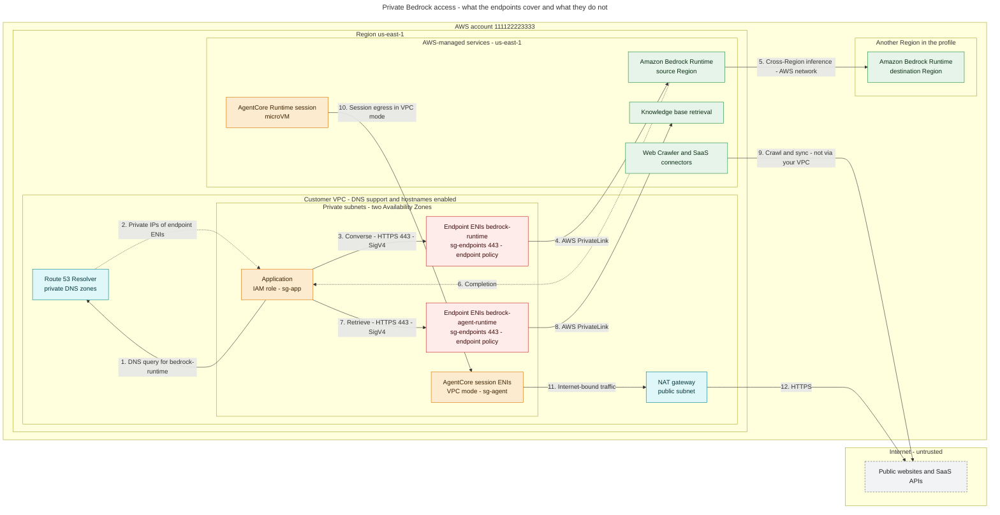

# Private connectivity for Bedrock: interface endpoints and PrivateLink

> **Level:** Intermediate · **Verified:** 2026-11-15 · **Feature status:** n/a · **Time:** ~25 min

[VPC endpoints and AWS PrivateLink](../../00-foundations/networking/03-vpc-endpoints-and-privatelink.md) explained the mechanism. This chapter applies it to the Bedrock family: which endpoint carries which API, how to write a genuinely restrictive endpoint policy, and which Bedrock features still reach the internet or another Region however private your VPC is.

## Learning objectives

After this chapter you can:

- Map each Bedrock and AgentCore namespace to its verified endpoint service name.
- Write a restrictive `bedrock-runtime` endpoint policy that works with cross-Region profiles.
- Configure security groups and private DNS for unchanged SDK code.
- List the features an interface endpoint cannot keep private, and why.
- Deploy and test `bedrock-runtime` and `bedrock-agent-runtime` endpoints with Terraform.

## Prerequisites

- [VPC endpoints and AWS PrivateLink](../../00-foundations/networking/03-vpc-endpoints-and-privatelink.md)
- [Endpoints, APIs and authentication](../../01-amazon-bedrock/overview/02-endpoints-apis-and-authentication.md)
- [Cross-Region inference: Geo and Global profiles](../../01-amazon-bedrock/inference/04-cross-region-inference.md)
- [AgentCore Runtime](../../01-amazon-bedrock/agentcore/02-agentcore-runtime.md) (networking section)

## Concept in plain language

An interface endpoint is a private corridor from your floor to the service's front desk. It protects every call **you** carry down it.

But some Bedrock features send their own staff out: a crawler visits public websites, a connector logs in to a software-as-a-service (SaaS) system, a cross-Region profile hands your request to a branch office in another city. Those trips start inside AWS, not in your VPC, so your corridor, its guard (security group) and its rulebook (endpoint policy) never see them. A private design lists them explicitly.

## How it really works

### Verified endpoint service names

Only names confirmed on an official page on 2026-11-15. `<region>` is a Region code.

| Service name | Carries | Private DNS name | Confirmed on |
|:--|:--|:--|:--|
| `com.amazonaws.<region>.bedrock` | Control plane | `bedrock.<region>.amazonaws.com` | Bedrock guide, PrivateLink list |
| `com.amazonaws.<region>.bedrock-runtime` | Runtime: Converse, InvokeModel and everything on that hostname | `bedrock-runtime.<region>.amazonaws.com` | Bedrock guide, PrivateLink list |
| `com.amazonaws.<region>.bedrock-mantle` | Mantle API | `bedrock-mantle.<region>.api.aws` | Bedrock guide only |
| `com.amazonaws.<region>.bedrock-agent` | "Agents build-time" API (knowledge bases, data sources, flows, prompts, Agents Classic) | `bedrock-agent.<region>.amazonaws.com` | Bedrock guide, PrivateLink list |
| `com.amazonaws.<region>.bedrock-agent-runtime` | "Agents runtime" API (`Retrieve`, `RetrieveAndGenerate`, `AgenticRetrieveStream`, `InvokeFlow`, `InvokeAgent`) | `bedrock-agent-runtime.<region>.amazonaws.com` | Bedrock guide, PrivateLink list |
| `…bedrock-fips`, `…bedrock-runtime-fips` | FIPS variants in us-east-1, us-east-2, us-west-2, ca-central-1, us-gov-east-1, us-gov-west-1 | Not stated | Bedrock guide only |
| `…bedrock-data-automation`, `…bedrock-data-automation-runtime`, and a `-fips` variant of each | Amazon Bedrock Data Automation | Not stated | PrivateLink list only |
| `com.amazonaws.<region>.bedrock-agentcore` | AgentCore data plane: Runtime, Memory, built-in tools, Identity, Web Search | `bedrock-agentcore.<region>.amazonaws.com` | AgentCore guide, PrivateLink list |
| `com.amazonaws.<region>.bedrock-agentcore-control` | AgentCore control plane | Not stated | AgentCore guide, PrivateLink list |
| `com.amazonaws.<region>.bedrock-agentcore.gateway` | AgentCore Gateway | `*.gateway.bedrock-agentcore.<region>.amazonaws.com` | AgentCore guide only |

Sources: [Bedrock interface endpoints](https://docs.aws.amazon.com/bedrock/latest/userguide/vpc-interface-endpoints.html), [AgentCore interface endpoints](https://docs.aws.amazon.com/bedrock-agentcore/latest/devguide/vpc-interface-endpoints.html), [AWS services that integrate with PrivateLink](https://docs.aws.amazon.com/vpc/latest/privatelink/aws-services-privatelink-support.html). The mapping of knowledge base and flow APIs to the two "Agents" endpoints is **our reading** of their namespaces.

> [!IMPORTANT]
> **Status** — The three sources disagree. The PrivateLink list omits `bedrock-mantle`, the Bedrock FIPS services and `bedrock-agentcore.gateway`; the Bedrock page omits Data Automation. The AgentCore page lists PrivateLink support for Runtime, Memory, built-in tools, Identity, Gateway, Evaluations and Optimization, Policy and Web Search — and **no AWS Agent Registry or Payments**, although the verification matrix says Registry has PrivateLink (tracked as P14). An endpoint service name for Registry is **UNVERIFIED — REQUIRES DOCUMENTATION REVIEW**. Before building, run `aws ec2 describe-vpc-endpoint-services` in your Region.

### Private DNS and the SDK

With private DNS on (and both VPC DNS attributes enabled), standard hostnames resolve to the endpoint and SDK code needs no change. Without it, pass the endpoint-specific URL (`https://vpce-id.bedrock-runtime.<region>.vpce.amazonaws.com`) as `endpoint_url`, as the Bedrock guide shows for boto3. Mantle uses the `api.aws` domain, so resolver rules written for `amazonaws.com` miss it.

### Endpoint policies for Bedrock

The default endpoint policy allows full access. A useful policy narrows three things:

1. **Principals** — `"Principal": "*"` with an `aws:PrincipalAccount` or `aws:PrincipalOrgID` condition. AgentCore callers using OAuth tokens are not IAM principals, so their statements keep `Principal: "*"` and restrict by resource.
2. **Actions** — `bedrock:InvokeModel` and `bedrock:InvokeModelWithResponseStream` (they also cover `Converse` and `ConverseStream`), plus `bedrock:ApplyGuardrail` if you use guardrails.
3. **Resources** — the inference profiles and their foundation models, with the model ARN allowed in **every** Region (`arn:aws:bedrock:*::foundation-model/…`): cross-Region profiles need the model in each destination Region, and Global profiles use an empty Region field.

> [!NOTE]
> **Documented fact** — "When you specify an inference profile in the `Resource` field … you must also specify the foundation model in each Region associated with it." An endpoint policy never grants anything: the caller's identity policy must allow the same action.
> Source: [Prerequisites for inference profiles](https://docs.aws.amazon.com/bedrock/latest/userguide/inference-profiles-prereq.html), [Endpoint policies](https://docs.aws.amazon.com/vpc/latest/privatelink/vpc-endpoints-access.html)

### Security groups

One security group for all Bedrock endpoint interfaces: inbound TCP 443 from the callers' security groups, nothing else; callers need outbound 443 to it.

### What still needs a public or cross-Region path

| Feature | What leaves your VPC or Region | Who opens the connection | What you control |
|:--|:--|:--|:--|
| Cross-Region inference (Geo and Global profiles) | Your prompt and completion travel to another Region of the profile; Global may use any commercial Region | Bedrock, after your request arrives in the source Region | "All data transmitted during cross-Region operations remains on the AWS network"; SCPs must allow the destination Regions (Global: `aws:RequestedRegion` = `unspecified`); CloudTrail records `additionalEventData.inferenceRegion` |
| Knowledge base Web Crawler | Requests to the websites you list | The Bedrock-managed crawler | Scope, rate and robots.txt. **Our reading:** no VPC option is documented, so it reaches only sites reachable from the internet. Customer-managed knowledge bases cannot add new Web Crawler connectors since 2026-09-30 |
| Third-party data source connectors (Confluence, SharePoint, Salesforce and others) | Calls to the SaaS API with the credentials in your secret | Bedrock, during sync | The secret and the SaaS-side permissions. **Our reading:** these calls do not pass through your VPC |
| Web Search tool (mantle) and AgentCore Web Search | Search and fetch against an AWS-hosted web index | Bedrock / AgentCore | The request to the endpoint can be private; the content is from the public web |
| AgentCore Runtime, Code Interpreter, Browser in **VPC** mode | Session egress through ENIs in your subnets | The session | No internet by default; a public subnet does not help; add a NAT gateway (Browser needs internet) or endpoints |
| The same tools in **PUBLIC** mode | Session egress to the internet | The session | Nothing in your VPC |
| AgentCore Gateway targets | Calls to public targets go over the internet; private targets through Amazon VPC Lattice | The gateway | Target choice, outbound credentials |
| Batch inference and model customization jobs | Job access to your Amazon S3 data | The job | An optional VPC configuration for the job |

Sources: [Cross-Region inference](https://docs.aws.amazon.com/bedrock/latest/userguide/cross-region-inference.html), [Web Crawler](https://docs.aws.amazon.com/bedrock/latest/userguide/webcrawl-data-source-connector.html), [AgentCore VPC](https://docs.aws.amazon.com/bedrock-agentcore/latest/devguide/agentcore-vpc.html), [Protect data with Amazon VPC](https://docs.aws.amazon.com/bedrock/latest/userguide/usingVPC.html), [AgentCore Gateway](../../01-amazon-bedrock/agentcore/04-agentcore-gateway.md).

### Integration with Amazon Bedrock

| Interaction | Initiator | Direction of data | Identity used | Network path |
|:--|:--|:--|:--|:--|
| Inference call | Your code | Prompt out, completion back | Caller's IAM role, filtered by the endpoint policy | Interface endpoint `bedrock-runtime` (PrivateLink) |
| Retrieval call | Your code | Query out, chunks or answer back | Caller's IAM role, filtered by the endpoint policy | Interface endpoint `bedrock-agent-runtime` |
| Infrastructure changes from a pipeline in the VPC | Your pipeline | Configuration out | Deployment role | Interface endpoints `bedrock`, `bedrock-agent`, `bedrock-agentcore-control` |
| Calls to an agent or gateway | Your code | Payload out, response or stream back | SigV4 role or OAuth token (endpoint policy `Principal: "*"` for OAuth) | `bedrock-agentcore` or `bedrock-agentcore.gateway` endpoint |
| AgentCore session reaching your resources | The session | Queries to your databases and APIs | Runtime execution role; ENIs created by `AWSServiceRoleForBedrockAgentCoreNetwork` | ENIs in your subnets |
| Cross-Region routing | Bedrock | Prompt and completion between Regions | Authorised in the source Region | AWS network, outside your VPC |
| Crawling and SaaS connectors | Bedrock | Documents into the knowledge base | Knowledge base service role and stored credentials | Outside your VPC (our reading) |

**No native integration:** an interface endpoint only carries requests that start in your network. Nothing Bedrock initiates — cross-Region hops, crawling, connector syncs — passes through it or is evaluated by its policy.

## Architecture diagram



**What this shows** — The endpoints cover requests the application makes (steps 1–8). Steps 5 and 9 start inside AWS-managed services and never touch your VPC. Steps 10–12: a VPC-mode AgentCore session uses your network, so it needs your NAT gateway for the internet.

**Walkthrough**

1. The SDK asks the VPC resolver for the standard `bedrock-runtime` hostname.
2. Private DNS answers with the endpoint's private addresses.
3. The signed request goes to the endpoint ENIs; their security group admits 443 from `sg-app`.
4. The endpoint policy is evaluated, then PrivateLink carries the request.
5. With a cross-Region profile, Bedrock may run the request in another Region, over the AWS network.
6. The completion returns on the same connection.
7. –8. Retrieval follows the same pattern through the `bedrock-agent-runtime` endpoint.
9. Crawler and connector syncs leave from the AWS-managed service.
10. –12. A VPC-mode session's internet traffic follows your routes: no NAT gateway, no internet.

**Legend** — solid: request · dashed: response · red: enforcement point · grey dashed: outside AWS · boxes: trust and network boundaries. **Variations:** an in-Region model ID (or an application profile built on one) removes step 5; Global profiles can choose any commercial Region; PUBLIC network mode moves steps 10–12 out of your VPC. The enterprise version is [diagram set 24](../../diagrams/mermaid/24-secure-private-enterprise-bedrock.md).

## Implementation details

1. **List every API the workload calls**, then pick endpoints from this table:

| Workload | Endpoints to create |
|:--|:--|
| Inference only | `bedrock-runtime` (`bedrock-mantle` only for mantle-only features) |
| RAG with knowledge bases | `bedrock-runtime`, `bedrock-agent-runtime` |
| Deploying Bedrock resources from inside the VPC | add `bedrock`, `bedrock-agent` |
| Calling AgentCore | `bedrock-agentcore`, `bedrock-agentcore.gateway`; `bedrock-agentcore-control` to manage resources |
| Supporting services | `logs`, `sts`, `kms`, `secretsmanager` as used; Amazon S3 gateway endpoint |

2. **Enable both VPC DNS attributes**, then create the endpoints with private DNS in two or more Availability Zones.
3. **Create one endpoint security group** with 443 from caller security groups only.
4. **Attach a restrictive policy** per endpoint (account or organization, actions, resources).
5. **Decide on cross-Region inference consciously.** To stay in one geography, deny Global profiles with the documented `aws:RequestedRegion` = `unspecified` pattern and use Geo or in-Region IDs.
6. **Document Bedrock-initiated paths** (crawler, connectors, cross-Region); VPC Flow Logs never show them.

> [!TIP]
> **Academy recommendation** — Pair the endpoint policy with an identity-side or SCP condition on `aws:SourceVpce` for Bedrock inference actions, so that the same role cannot call Bedrock from outside the VPC. Test it in a sandbox first: APIs such as `RetrieveAndGenerate` make `InvokeModel` calls on the caller's behalf ([documented for guardrail conditions](https://docs.aws.amazon.com/bedrock/latest/userguide/guardrails-permissions-id.html)), and **our reading** is that those inner calls do not carry your endpoint ID.
> This is our design guidance, not an official AWS reference architecture.

## Example

Two interface endpoints, one security group, restrictive policies, a precondition that refuses VPCs without DNS hostnames, and offline tests. A reusable module is planned in [`bedrock-private-endpoints`](../../04-infrastructure-as-code/terraform/modules/bedrock-private-endpoints/README.md).

> **Code status:** validated with `terraform fmt -check`, `terraform validate` and TFLint 0.66 (core rules), provider `hashicorp/aws` 6.73.0 · mock-tested: 3 `terraform test` runs pass · **never planned or applied against AWS**

`versions.tf`:

```hcl
terraform {
  required_version = ">= 1.11.0"

  required_providers {
    aws = {
      source  = "hashicorp/aws"
      version = "~> 6.73"
    }
  }
}

provider "aws" {
  region = var.aws_region

  default_tags {
    tags = var.tags
  }
}
```

`main.tf`:

```hcl
variable "aws_region" {
  description = "Region of the VPC and of the Bedrock endpoints."
  type        = string
  default     = "us-east-1"
}

variable "tags" {
  description = "Tags applied to every resource through the provider's default_tags."
  type        = map(string)
  default     = { Project = "bedrock-academy", Chapter = "private-connectivity" }
}

variable "vpc_id" {
  description = "VPC that receives the endpoints. Its DNS support and DNS hostnames attributes must be enabled."
  type        = string
}

variable "subnet_ids" {
  description = "One private subnet per Availability Zone, in at least two Availability Zones."
  type        = list(string)

  validation {
    condition     = length(var.subnet_ids) >= 2
    error_message = "Use at least two subnets in different Availability Zones."
  }
}

variable "client_security_group_ids" {
  description = "Security groups of the callers (functions, tasks, instances) allowed to reach the endpoints on 443."
  type        = list(string)
}

variable "allowed_foundation_model_ids" {
  description = "Foundation model IDs callers may invoke, directly or through a profile. Confirm current IDs in the Bedrock docs."
  type        = list(string)
}

variable "allowed_inference_profile_ids" {
  description = "System-defined (cross-Region) inference profile IDs callers may invoke from this Region."
  type        = list(string)
  default     = []
}

variable "allowed_knowledge_base_ids" {
  description = "Knowledge base IDs that callers may query through the bedrock-agent-runtime endpoint."
  type        = list(string)
  default     = []
}

data "aws_caller_identity" "current" {}
data "aws_partition" "current" {}
data "aws_region" "current" {}

data "aws_vpc" "this" {
  id = var.vpc_id
}

locals {
  account_id = data.aws_caller_identity.current.account_id
  partition  = data.aws_partition.current.partition
  region     = data.aws_region.current.region
  bedrock    = "arn:${local.partition}:bedrock"

  # Region "*" because a cross-Region profile may run the model in another Region,
  # and Global profiles reference the model with an empty Region field.
  model_arns = [for id in var.allowed_foundation_model_ids : "${local.bedrock}:*::foundation-model/${id}"]
  profile_arns = concat(
    [for id in var.allowed_inference_profile_ids : "${local.bedrock}:${local.region}:${local.account_id}:inference-profile/${id}"],
    ["${local.bedrock}:${local.region}:${local.account_id}:application-inference-profile/*"],
  )
  knowledge_base_arns = [for id in var.allowed_knowledge_base_ids : "${local.bedrock}:${local.region}:${local.account_id}:knowledge-base/${id}"]

  # Only principals of this account, only inference, only the listed models and profiles.
  runtime_policy = jsonencode({
    Version = "2012-10-17"
    Statement = [
      {
        Sid       = "InferenceForThisAccountOnly"
        Effect    = "Allow"
        Principal = "*"
        Action    = ["bedrock:InvokeModel", "bedrock:InvokeModelWithResponseStream"]
        Resource  = concat(local.model_arns, local.profile_arns)
        Condition = { StringEquals = { "aws:PrincipalAccount" = local.account_id } }
      },
      {
        Sid       = "GuardrailsOfThisAccount"
        Effect    = "Allow"
        Principal = "*"
        Action    = ["bedrock:ApplyGuardrail"]
        Resource  = ["${local.bedrock}:${local.region}:${local.account_id}:guardrail/*"]
        Condition = { StringEquals = { "aws:PrincipalAccount" = local.account_id } }
      },
    ]
  })

  # Only retrieval from the listed knowledge bases. Agents Classic and flows are not allowed here.
  agent_runtime_policy = jsonencode({
    Version = "2012-10-17"
    Statement = [
      {
        Sid       = "RetrievalForThisAccountOnly"
        Effect    = "Allow"
        Principal = "*"
        Action    = ["bedrock:Retrieve", "bedrock:RetrieveAndGenerate", "bedrock:AgenticRetrieveStream"]
        Resource  = length(local.knowledge_base_arns) > 0 ? local.knowledge_base_arns : ["${local.bedrock}:${local.region}:${local.account_id}:knowledge-base/none"]
        Condition = { StringEquals = { "aws:PrincipalAccount" = local.account_id } }
      },
    ]
  })

  endpoints = {
    "bedrock-runtime"       = local.runtime_policy
    "bedrock-agent-runtime" = local.agent_runtime_policy
  }
}

# One security group for the endpoint network interfaces: HTTPS in from the callers, nothing else.
resource "aws_security_group" "endpoints" {
  name_prefix = "bedrock-endpoints-"
  description = "Bedrock interface endpoints: HTTPS from approved callers only"
  vpc_id      = var.vpc_id
}

resource "aws_vpc_security_group_ingress_rule" "https_from_clients" {
  for_each = toset(var.client_security_group_ids)

  security_group_id            = aws_security_group.endpoints.id
  description                  = "HTTPS from an approved caller security group"
  ip_protocol                  = "tcp"
  from_port                    = 443
  to_port                      = 443
  referenced_security_group_id = each.value
}

resource "aws_vpc_endpoint" "bedrock" {
  for_each = local.endpoints

  vpc_id              = var.vpc_id
  service_name        = "com.amazonaws.${local.region}.${each.key}"
  vpc_endpoint_type   = "Interface"
  private_dns_enabled = true
  subnet_ids          = var.subnet_ids
  security_group_ids  = [aws_security_group.endpoints.id]
  policy              = each.value

  tags = { Name = "${each.key}-endpoint" }

  lifecycle {
    precondition {
      condition     = data.aws_vpc.this.enable_dns_support && data.aws_vpc.this.enable_dns_hostnames
      error_message = "Private DNS needs both enableDnsSupport and enableDnsHostnames on the VPC."
    }
  }
}

output "endpoint_ids" {
  description = "Interface endpoint IDs, keyed by Bedrock service."
  value       = { for k, ep in aws_vpc_endpoint.bedrock : k => ep.id }
}

output "endpoint_security_group_id" {
  description = "Security group attached to the endpoint network interfaces."
  value       = aws_security_group.endpoints.id
}
```

`tests/endpoints.tftest.hcl` — runs offline with a mock provider:

```hcl
mock_provider "aws" {
  mock_data "aws_caller_identity" {
    defaults = { account_id = "111122223333" }
  }
  mock_data "aws_partition" {
    defaults = { partition = "aws" }
  }
  mock_data "aws_region" {
    defaults = { region = "us-east-1" }
  }
  mock_data "aws_vpc" {
    defaults = { enable_dns_support = true, enable_dns_hostnames = true }
  }
}

variables {
  vpc_id                        = "vpc-0example"
  subnet_ids                    = ["subnet-0aaa", "subnet-0bbb"]
  client_security_group_ids     = ["sg-0app"]
  allowed_foundation_model_ids  = ["example-model-id"]
  allowed_inference_profile_ids = ["us.example-model-id"]
  allowed_knowledge_base_ids    = ["KBEXAMPLE01"]
}

run "creates_two_private_endpoints_with_restrictive_policies" {
  command = plan

  assert {
    condition     = aws_vpc_endpoint.bedrock["bedrock-runtime"].service_name == "com.amazonaws.us-east-1.bedrock-runtime"
    error_message = "Runtime endpoint must use the Regional bedrock-runtime service name."
  }

  assert {
    condition     = alltrue([for ep in aws_vpc_endpoint.bedrock : ep.private_dns_enabled && ep.vpc_endpoint_type == "Interface"])
    error_message = "Both endpoints must be interface endpoints with private DNS."
  }

  assert {
    condition     = jsondecode(aws_vpc_endpoint.bedrock["bedrock-runtime"].policy).Statement[0].Condition.StringEquals["aws:PrincipalAccount"] == "111122223333"
    error_message = "The runtime endpoint policy must restrict callers to this account."
  }

  assert {
    condition     = contains(jsondecode(aws_vpc_endpoint.bedrock["bedrock-runtime"].policy).Statement[0].Resource, "arn:aws:bedrock:*::foundation-model/example-model-id")
    error_message = "Foundation models must be allowed in every Region for cross-Region profiles."
  }

  assert {
    condition     = jsondecode(aws_vpc_endpoint.bedrock["bedrock-agent-runtime"].policy).Statement[0].Resource == ["arn:aws:bedrock:us-east-1:111122223333:knowledge-base/KBEXAMPLE01"]
    error_message = "The agent-runtime endpoint must allow only the listed knowledge bases."
  }

  assert {
    condition     = length(aws_vpc_security_group_ingress_rule.https_from_clients) == 1 && aws_vpc_security_group_ingress_rule.https_from_clients["sg-0app"].from_port == 443
    error_message = "Only HTTPS from the caller security group may reach the endpoints."
  }
}

run "rejects_a_single_subnet" {
  command = plan

  variables {
    subnet_ids = ["subnet-0aaa"]
  }

  expect_failures = [var.subnet_ids]
}

run "rejects_a_vpc_without_dns_hostnames" {
  command = plan

  override_data {
    target = data.aws_vpc.this
    values = { enable_dns_support = true, enable_dns_hostnames = false }
  }

  expect_failures = [aws_vpc_endpoint.bedrock]
}
```

If you apply this in a sandbox account, the two endpoints bill hourly in each Availability Zone from the moment they exist; run `terraform destroy` when you are done.

## Common mistakes

> [!WARNING]
> **Common mistake** — Scoping the endpoint policy to `arn:aws:bedrock:us-east-1::foundation-model/…` and then switching the application to a `us.` or `global.` profile. Requests that Bedrock routes to another Region are denied. Use `*` for the Region of foundation-model ARNs and list the profile ARN.

| Mistake | Symptom | Fix |
|:--|:--|:--|
| Only `bedrock-runtime` created for a RAG application | `Retrieve` times out from isolated subnets | Add `bedrock-agent-runtime` |
| Endpoint policy names IAM principals, callers use OAuth for AgentCore | AgentCore calls rejected at the endpoint | `Principal: "*"` on those statements; restrict by resource |
| Expecting the endpoint to keep a crawler or SaaS connector private | Data-flow review finds unexpected internet paths | Record Bedrock-initiated paths separately and review them on their own terms |
| Assuming "private endpoint" means "data stays in this Region" | Requests processed elsewhere through a Global profile | Choose Geo or in-Region IDs; enforce with SCPs |
| AgentCore Runtime in VPC mode in a public subnet | No internet, image pulls fail | Private subnets with NAT gateway or ECR, S3 and Logs endpoints |
| Prompt management ARN used as `modelId` behind a tight policy | `AccessDenied` | Also allow `bedrock:RenderPrompt` on the prompt ARN |

## Security considerations

- **Two independent controls.** Security groups decide who connects; endpoint policies decide what they may do. IAM must still allow the call.
- **Restrict endpoint creation.** A new endpoint with the default policy is a new unrestricted path; limit `ec2:CreateVpcEndpoint` and policy changes.
- **Data residency is not a network property.** Cross-Region inference keeps data on the AWS network but may process it in another Region; see [Cross-Region considerations and data residency](../../09-advanced-topics/11-cross-region-and-data-residency.md).
- **Logs remain the audit trail.** Calls through an endpoint appear in AWS CloudTrail as usual; see [AWS CloudTrail for Bedrock](../security/05-cloudtrail-for-bedrock.md). Organisation-wide enforcement is in [Network security and private access](../../06-security-governance/05-network-security-and-private-access.md).

## Cost considerations

- Each interface endpoint is billed for every hour it is provisioned **in each Availability Zone**, plus data processing at $0.01 per GB for the first petabyte per Region per month ([AWS PrivateLink pricing](https://aws.amazon.com/privatelink/pricing/)).
- Four endpoints in three Availability Zones are twelve billable network interfaces per VPC; centralising endpoints in a shared VPC reduces that ([Pattern: secure private enterprise Bedrock](../../03-architecture-patterns/private-enterprise/README.md)).
- A NAT gateway that remains for other traffic is billed in addition to the endpoints.

## Knowledge check

1. An isolated-subnet application calls `Converse` with a Global profile through a private endpoint. Does data leave the Region? Does it cross the public internet?
2. Your endpoint policy allows `bedrock:InvokeModel` only on `arn:aws:bedrock:us-east-1::foundation-model/*`. What breaks with a `us.` profile, and how do you fix it?
3. A reviewer asks you to "route the web crawler through our inspection VPC". Your answer?
4. Why does a VPC-mode AgentCore Runtime need a NAT gateway for the Browser tool despite a `bedrock-agentcore` endpoint?

<details>
<summary>Answers</summary>

1. It may leave the Region (Global profiles route to any commercial Region) but does not traverse the public internet: AWS documents that cross-Region traffic stays on the AWS network.
2. Requests routed to other Regions of the profile are denied. Allow the profile ARN and the model ARN with Region `*`.
3. Endpoints cannot do it: the AWS-managed service starts the crawl. Control scope, filters and robots.txt, or move the content to Amazon S3.
4. The endpoint carries calls **to** AgentCore; the Browser's traffic **from** the session follows your subnet routes, which have no internet without a NAT gateway.

</details>

## Further reading

Official sources opened while writing this chapter:

- [Use interface VPC endpoints with Amazon Bedrock](https://docs.aws.amazon.com/bedrock/latest/userguide/vpc-interface-endpoints.html) — service names, DNS names, example policies, `endpoint_url` usage.
- [Use interface VPC endpoints with Amazon Bedrock AgentCore](https://docs.aws.amazon.com/bedrock-agentcore/latest/devguide/vpc-interface-endpoints.html) — three AgentCore services, PrivateLink support table, OAuth caveat.
- [AWS services that integrate with AWS PrivateLink](https://docs.aws.amazon.com/vpc/latest/privatelink/aws-services-privatelink-support.html) — service name list.
- [Control access to VPC endpoints using endpoint policies](https://docs.aws.amazon.com/vpc/latest/privatelink/vpc-endpoints-access.html) — policy rules.
- [Prerequisites for inference profiles](https://docs.aws.amazon.com/bedrock/latest/userguide/inference-profiles-prereq.html) — model ARNs in every Region, Global ARN format, `unspecified` Region.
- [Route model inference requests across AWS Regions](https://docs.aws.amazon.com/bedrock/latest/userguide/cross-region-inference.html) — AWS network, SCP requirements, CloudTrail field.
- [Configure AgentCore Runtime and tools for VPC](https://docs.aws.amazon.com/bedrock-agentcore/latest/devguide/agentcore-vpc.html) — VPC mode egress, NAT, supported Availability Zones.
- [Crawl web pages for your knowledge base](https://docs.aws.amazon.com/bedrock/latest/userguide/webcrawl-data-source-connector.html) — crawler behaviour and the 2026-09-30 connector change.
- [Protect your data using Amazon VPC and AWS PrivateLink](https://docs.aws.amazon.com/bedrock/latest/userguide/usingVPC.html) — VPC options for jobs.
- [AWS PrivateLink pricing](https://aws.amazon.com/privatelink/pricing/) — hourly and per-GB charges.
- [Terraform `aws_vpc_endpoint`](https://raw.githubusercontent.com/hashicorp/terraform-provider-aws/main/website/docs/r/vpc_endpoint.html.markdown) — resource arguments.
