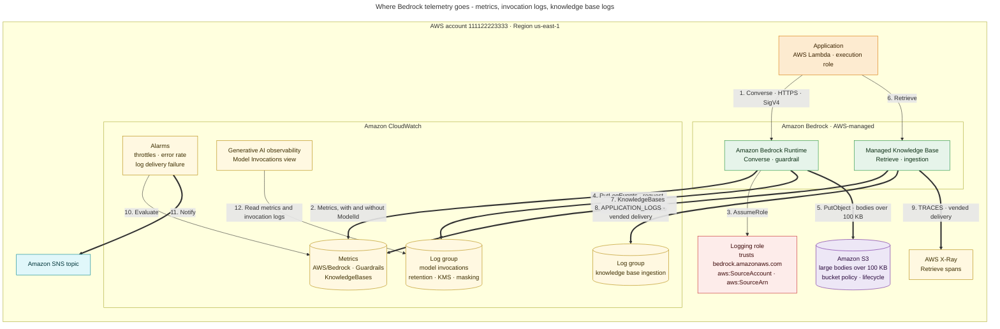

# CloudWatch and Bedrock-specific observability

> **Level:** Intermediate · **Verified:** 2026-11-15 · **Feature status:** GA · **Time:** ~30 min

Amazon Bedrock publishes metrics to five CloudWatch namespaces, writes full request and response
logs only if you ask it to, and delivers knowledge base logs through a different mechanism again. This
chapter maps every Bedrock signal to the question it answers and where it is stored, and ends with
validated Terraform for model invocation logging and the alarms worth having.

## Learning objectives

After this chapter you can:

- Name the Bedrock metric namespaces, their key metrics and dimensions, and what each does not cover.
- Configure model invocation logging, and explain its contents, destinations, size rules and limits.
- Find guardrail, knowledge base and agent telemetry, and know which needs extra permissions.
- Use CloudWatch generative AI observability, and choose alarms that catch real failures.
- Estimate what drives the cost of Bedrock logs.

## Prerequisites

- [Amazon CloudWatch and AWS CloudTrail](../../00-foundations/aws-fundamentals/04-cloudwatch-cloudtrail.md) — metrics, logs, alarms, trails.
- [Endpoints, APIs and authentication](../../01-amazon-bedrock/overview/02-endpoints-apis-and-authentication.md) — `bedrock-runtime` versus `bedrock-mantle`.
- [AgentCore Observability](../../01-amazon-bedrock/agentcore/07-agentcore-observability.md) — agent traces; not repeated here.

## Concept in plain language

A restaurant keeps three kinds of record. The **till roll** counts orders, waiting times and refused
customers — cheap, always on, no detail (metrics). The **order book** holds every order and what was
served — detailed, sensitive, and only kept if someone decides to keep it (invocation logs). The
**kitchen log** says which ingredient was missing when a dish failed (knowledge base and agent logs).

A good manager knows which record answers which question, and never tries to rebuild the order book
from the till roll.

## How it really works

### Metric namespaces

| Namespace | Published for | Key metrics | Dimensions |
|:--|:--|:--|:--|
| `AWS/Bedrock` | `bedrock-runtime`: Converse, ConverseStream, InvokeModel, InvokeModelWithResponseStream, and the OpenAI-compatible Responses and Chat Completions APIs | `Invocations`, `InvocationLatency`, `InvocationClientErrors`, `InvocationServerErrors`, `InvocationThrottles`, `InputTokenCount`, `OutputTokenCount`, `TimeToFirstToken`, `EstimatedTPMQuotaUsage`, `CacheReadInputTokenCount`, `CacheWriteInputTokenCount`, `LegacyModelInvocations`, `OutputImageCount` | `ModelId`; `ModelId` + `ContextWindow` (long-context billing only); `ModelId` + `ImageSize` + `BucketedStepSize` |
| `AWS/BedrockMantle` | `bedrock-mantle`: Responses, Chat Completions, Anthropic Messages | `Inferences`, `InferenceClientErrors`, `TotalInputTokens`, `TotalOutputTokens`, `InputTokens`, `OutputTokens` | Account (none), `Project`, `Model`, `Project` + `Model` |
| `AWS/Bedrock/Guardrails` | `ApplyGuardrail` requests; Automated Reasoning checks | `Invocations`, `InvocationLatency`, errors, `InvocationThrottles`, `InvocationsIntervened`, `TextUnitCount`, `FindingCounts`, `TotalFindings` | `Operation`, `GuardrailContentSource`, `GuardrailPolicyType`, `GuardrailArn` + `GuardrailVersion` |
| `AWS/Bedrock/KnowledgeBases` | Managed Knowledge Base: `Retrieve`, `AgenticRetrieveStream`; storage | `Invocations`, `ClientErrors`, `ServerErrors`, `Throttles`, `TotalIterationCount`, `RawDataSize` | `Operation`, `KnowledgeBaseId` |
| `AWS/Bedrock/Agents` | Agents Classic: `InvokeAgent`, `InvokeInlineAgent` | `InvocationCount`, `TotalTime`, `TTFT`, `ModelLatency`, model invocation errors and throttles, token counts | `Operation`, `ModelId`, `AgentAliasArn` |

Sources: [Bedrock runtime metrics](https://docs.aws.amazon.com/bedrock/latest/userguide/monitoring-runtime-metrics.html),
[bedrock-mantle metrics](https://docs.aws.amazon.com/bedrock/latest/userguide/monitoring-mantle-metrics.html),
[Guardrails metrics](https://docs.aws.amazon.com/bedrock/latest/userguide/monitoring-guardrails-cw-metrics.html),
[Managed knowledge base observability](https://docs.aws.amazon.com/bedrock/latest/userguide/kb-managed-observability.html),
[Agents metrics](https://docs.aws.amazon.com/bedrock/latest/userguide/monitoring-agents-cw-metrics.html).
AgentCore uses `AWS/Bedrock-AgentCore` and `bedrock-agentcore` — see [AgentCore Observability](../../01-amazon-bedrock/agentcore/07-agentcore-observability.md).

Details that change how you build dashboards:

- `Invocations` excludes throttled requests and requests rejected in validation; `InvocationClientErrors`
  includes requests rejected for exceeding a service quota, which are **not** counted as throttles.
- Runtime metrics are published **with and without** `ModelId`; a request that fails before the model
  is known has no `ModelId`, so per-model filters undercount errors.
- `EstimatedTPMQuotaUsage` is an approximation; throttling uses the upfront reservation of input
  tokens plus `max_tokens`. AWS says not to use it as the sole capacity indicator.
- `bedrock-mantle` publishes **no latency and no throttle metrics**; `InferenceClientErrors` excludes
  HTTP 429. Track 429s in your application. Dashboards on `AWS/Bedrock` do not see mantle traffic.
- Knowledge base metrics are published with the **knowledge base service role** (for `Retrieve`) or the
  caller's credentials, and only if that identity has `cloudwatch:PutMetricData` for the namespace —
  best effort. Agents Classic metrics have the same requirement on the agent's service role.

> [!IMPORTANT]
> **Status** — `AWS/BedrockMantle` metrics launched on 2026-06-01. Agents Classic, whose metrics are in
> `AWS/Bedrock/Agents`, is in maintenance mode.
> Sources: [What's New, 2026-06-01](https://aws.amazon.com/about-aws/whats-new/2026/06/amazon-bedrock-supports-cloudwatch-metrics-bedrock-mantle-endpoint/),
> [Feature verification matrix](../../FEATURE-VERIFICATION.md)

### Model invocation logging

| Property | Value |
|:--|:--|
| Default | Disabled; one configuration per account and Region |
| Captured operations | `Converse`, `ConverseStream`, `InvokeModel`, `InvokeModelWithResponseStream`, plus Responses and Chat Completions on `bedrock-runtime` |
| Not captured | Anything on `bedrock-mantle` |
| Destinations | CloudWatch Logs, Amazon S3, or both — same account and Region only |
| Record | `schemaType`, `timestamp`, `accountId`, `region`, `requestId`, `operation`, `modelId`, `identity.arn`, optional `requestMetadata`, input body and `inputTokenCount`, output body and `outputTokenCount` |
| Size rule | Bodies up to 100 KB inline; larger bodies and binary data go to S3 as separate objects referenced from the record |
| Modalities | Text, image, embedding, video — selected per configuration |
| Health metrics | `ModelInvocationLogs{CloudWatch,S3}Delivery{Success,Failure}`, `ModelInvocationLargeDataS3Delivery{Success,Failure}` in `AWS/Bedrock` |

Sources: [Model invocation logging](https://docs.aws.amazon.com/bedrock/latest/userguide/model-invocation-logging.html),
[Bedrock runtime metrics](https://docs.aws.amazon.com/bedrock/latest/userguide/monitoring-runtime-metrics.html).

> [!NOTE]
> **Documented fact** — "Model invocation logging is only supported for calls made through the
> `bedrock-runtime` endpoint… Calls made through other endpoints, such as the same APIs on
> `bedrock-mantle`, are not currently captured by invocation logging." For mantle traffic, log at your
> application tier.
> Source: [Model invocation logging](https://docs.aws.amazon.com/bedrock/latest/userguide/model-invocation-logging.html)

`identity.arn` is captured automatically, so token usage per caller is one Logs Insights query away;
`requestMetadata` adds up to 16 caller-chosen key-value pairs per request
([Per-request metadata tagging](https://docs.aws.amazon.com/bedrock/latest/userguide/cost-mgmt-request-metadata.html)).

### Integration with Amazon Bedrock

| Interaction | Initiator | Direction of data | Identity used | Network path |
|:--|:--|:--|:--|:--|
| Runtime, mantle and guardrail metrics | Amazon Bedrock | Bedrock → CloudWatch metrics; counts and timings only | None to configure | Inside AWS |
| Managed knowledge base and Agents Classic metrics | Amazon Bedrock, using the service role or the caller's credentials | Bedrock → CloudWatch metrics | That identity needs `cloudwatch:PutMetricData` for the namespace | Inside AWS |
| Invocation logs → CloudWatch Logs | Amazon Bedrock | Full request and response bodies plus metadata → your log group | Your role, trusted by `bedrock.amazonaws.com`, allowed `logs:CreateLogStream` and `logs:PutLogEvents` | Inside AWS |
| Invocation logs → S3 (and large data) | Amazon Bedrock | Gzipped JSON batches and large objects → your bucket | Bucket policy for `bedrock.amazonaws.com` with `aws:SourceAccount` and `aws:SourceArn`; KMS key policy if SSE-KMS | Inside AWS |
| Knowledge base `APPLICATION_LOGS` and `TRACES` | Bedrock vended log delivery | Per-document ingestion events → CloudWatch Logs, S3 or Firehose; `Retrieve` spans → X-Ray (managed knowledge base only) | Delivery created by a principal with `bedrock:AllowVendedLogDeliveryForResource` | Inside AWS |
| Generative AI observability views | You, in the console | CloudWatch reads metrics, invocation logs and spans | Your IAM permissions | Console |
| Invocation logging for `bedrock-mantle` | **No native integration** | — | — | Log in your application |
| CloudWatch acting on Bedrock | **No native integration** | Alarms notify; they do not change Bedrock | — | — |

Knowledge base logs: [Monitor knowledge bases using CloudWatch Logs](https://docs.aws.amazon.com/bedrock/latest/userguide/knowledge-bases-logging.html)
(not supported for structured data stores or Kendra GenAI indexes) and
[Managed knowledge base observability](https://docs.aws.amazon.com/bedrock/latest/userguide/kb-managed-observability.html).

### CloudWatch generative AI observability

CloudWatch's generative AI observability has two pre-built views. **Model Invocations** shows
invocation counts, latency, token counts by model, requests grouped by input size, throttles and
errors, plus a table of individual requests with their input and output — the table requires model
invocation logging to CloudWatch Logs. **Amazon Bedrock AgentCore agents** shows agents, sessions,
traces and spans ([Generative AI observability](https://docs.aws.amazon.com/AmazonCloudWatch/latest/monitoring/GenAI-observability.html),
[Model Invocations](https://docs.aws.amazon.com/AmazonCloudWatch/latest/monitoring/model-invocations.html)).

### Question → signal → where it lives

| Question | Signal | Where it lives |
|:--|:--|:--|
| Is any model being throttled? | `InvocationThrottles`, no dimension | `AWS/Bedrock` |
| Is a mantle application being throttled? | HTTP 429 counts | Your application's metrics — not published by Bedrock |
| Is the model slower, or are answers longer? | `InvocationLatency` beside `OutputTokenCount`; `TimeToFirstToken` for streams | `AWS/Bedrock` |
| How close are we to the tokens-per-minute quota? | `InvocationThrottles` first; `EstimatedTPMQuotaUsage` as a hint | `AWS/Bedrock` |
| Is prompt caching paying off? | `CacheReadInputTokenCount` against `CacheWriteInputTokenCount` | `AWS/Bedrock` |
| Is anything still calling a legacy model? | `LegacyModelInvocations` | `AWS/Bedrock` |
| Which caller or team used the tokens? | `identity.arn`, `requestMetadata` | Invocation logs |
| What exactly was asked and answered in request X? | The log record with that `requestId`; large bodies in S3 | Invocation logs |
| Which guardrail policy blocks most? | `InvocationsIntervened` by `GuardrailPolicyType` | `AWS/Bedrock/Guardrails` |
| Why was a document never retrieved? | Per-document status in ingestion logs | Knowledge base log destination |
| Is the managed knowledge base throttling? | `Throttles` by `Operation` and `KnowledgeBaseId` | `AWS/Bedrock/KnowledgeBases` |
| Is invocation logging itself failing? | `ModelInvocationLogsCloudWatchDeliveryFailure` | `AWS/Bedrock` |
| Which project spent tokens on mantle? | `TotalInputTokens`, `TotalOutputTokens` by `Project` | `AWS/BedrockMantle` |
| Who changed a guardrail or called a model? | Management and data events | CloudTrail — see [AWS CloudTrail for Bedrock](../security/05-cloudtrail-for-bedrock.md) |
| What did the agent do, step by step? | Spans | AgentCore Observability |

## Architecture diagram



**What this shows** — Bedrock is the initiator of every telemetry flow; your application emits none of
it. Metrics are always on; invocation logs and knowledge base logs exist only because you configured a
destination and an identity.

**Walkthrough**

1. The application calls `Converse` (with a guardrail, if configured).
2. Bedrock publishes runtime and guardrail metrics.
3. With invocation logging on, Bedrock assumes your logging role.
4. It writes the request, the response and metadata to your log group.
5. Bodies over 100 KB and binary data go to the large-data bucket.
6. The application calls `Retrieve` on a managed knowledge base.
7. Bedrock publishes knowledge base metrics with the knowledge base's service role.
8. Ingestion jobs deliver per-document logs to the configured destination.
9. With a `TRACES` delivery, `Retrieve` spans go to X-Ray.
10. Alarms evaluate the metrics.
11. An alarm notifies through SNS.
12. The Model Invocations view reads the metrics and the invocation log group.

**Legend** — solid arrow: request or read · thick arrow: asynchronous telemetry · cylinder: telemetry
at rest · red box: security control.

**Variations** — With an S3 destination instead of CloudWatch Logs, step 4 writes gzipped batches to
S3 and the console view has no request table. `bedrock-mantle` traffic produces step 2 (in
`AWS/BedrockMantle`) and nothing else. The production picture is
[Diagram 29 — Production monitoring and incident response](../../diagrams/mermaid/29-production-monitoring-and-incident-response.md).

## Implementation details

1. **Decide what you are allowed to keep.** Invocation logs contain full prompts and answers. Agree
   retention and access with your data owners before enabling them — see
   [Logging, audit and compliance evidence](../../06-security-governance/07-logging-audit-and-compliance.md).
2. **Choose modalities explicitly.** The Terraform provider defaults all four delivery flags to `true`.
3. **CloudWatch Logs for questions, S3 for archives.** The console view and Logs Insights need
   CloudWatch Logs; S3 is cheaper to keep and queryable with Athena. Both can be on.
4. **Manage the configuration from one place.** There is one per account and Region; two Terraform
   configurations would overwrite each other.
5. **Grant `cloudwatch:PutMetricData`** to knowledge base service roles and callers, or the managed
   knowledge base metrics silently do not appear.
6. **Alarm on the logging pipeline**, not only on the model.

> [!TIP]
> **Academy recommendation** — Alarms worth having on day one: any `InvocationThrottles` in 3 of 5
> minutes (all models); a server-error rate above a few percent; any
> `ModelInvocationLogsCloudWatchDeliveryFailure`; p99 `TimeToFirstToken` per model for chat; any
> `LegacyModelInvocations`; managed knowledge base `Throttles` and `ServerErrors`; and an
> anomaly-detection alarm on guardrail `InvocationsIntervened`. Thresholds are ours. This is our design
> guidance, not an official AWS reference architecture.

## Example

Model invocation logging to CloudWatch Logs with an S3 bucket for large bodies, plus three alarms.
Model IDs do not appear: the alarms deliberately watch all models.

> **Code status:** validated with `terraform fmt -check`, `terraform validate` (Terraform 1.17.2, `hashicorp/aws` 6.73.0, with a `versions.tf` that sets `required_version = ">= 1.11.0"` and `~> 6.73`) and TFLint 0.66.0 · mock-tested with `terraform test` and `mock_provider` (3 runs pass) · **never planned or applied against AWS** · **never deployed**

```hcl
# Model invocation logging for one account and Region, plus three alarms.
# Only one logging configuration exists per account and Region: manage it from one place only.

provider "aws" {
  region = var.region

  default_tags {
    tags = var.tags
  }
}

variable "region" {
  description = "Region whose bedrock-runtime traffic is logged. Invocation logging is per Region."
  type        = string
  default     = "us-east-1"
}

variable "name_prefix" {
  description = "Prefix for resource names."
  type        = string
  default     = "genai"
}

variable "log_retention_days" {
  description = "Retention of the invocation log group. Prompts and completions are sensitive: keep it short."
  type        = number
  default     = 30
}

variable "log_kms_key_arn" {
  description = "Optional customer managed KMS key for the log group. Its key policy must allow CloudWatch Logs to use it."
  type        = string
  default     = null
}

variable "large_data_bucket_name" {
  description = "Name of the S3 bucket created for request and response bodies larger than 100 KB and for binary data."
  type        = string
}

variable "large_data_prefix" {
  description = "Key prefix for large-data objects."
  type        = string
  default     = "bedrock-large-data"
}

variable "large_data_retention_days" {
  description = "Days after which large-data objects expire."
  type        = number
  default     = 30
}

variable "log_image_embedding_video" {
  description = "Also log image, embedding and video data. The provider defaults all four modalities to true."
  type        = bool
  default     = false
}

variable "server_error_rate_percent" {
  description = "Alarm threshold for InvocationServerErrors as a percentage of Invocations."
  type        = number
  default     = 5
}

variable "alarm_topic_arn" {
  description = "ARN of an existing Amazon SNS topic that receives alarm notifications."
  type        = string
}

variable "tags" {
  description = "Tags applied to every taggable resource through default_tags."
  type        = map(string)
  default     = {}
}

data "aws_caller_identity" "current" {}
data "aws_partition" "current" {}
data "aws_region" "current" {}

locals {
  account_id         = data.aws_caller_identity.current.account_id
  bedrock_source_arn = "arn:${data.aws_partition.current.partition}:bedrock:${data.aws_region.current.region}:${local.account_id}:*"
}

# 1. CloudWatch Logs destination and the role Bedrock assumes to write to it.
resource "aws_cloudwatch_log_group" "invocations" {
  name              = "/${var.name_prefix}/bedrock/model-invocations"
  retention_in_days = var.log_retention_days
  kms_key_id        = var.log_kms_key_arn
}

data "aws_iam_policy_document" "bedrock_trust" {
  statement {
    actions = ["sts:AssumeRole"]

    principals {
      type        = "Service"
      identifiers = ["bedrock.amazonaws.com"]
    }

    condition {
      test     = "StringEquals"
      variable = "aws:SourceAccount"
      values   = [local.account_id]
    }

    condition {
      test     = "ArnLike"
      variable = "aws:SourceArn"
      values   = [local.bedrock_source_arn]
    }
  }
}

resource "aws_iam_role" "invocation_logging" {
  name               = "${var.name_prefix}-bedrock-invocation-logging"
  assume_role_policy = data.aws_iam_policy_document.bedrock_trust.json
}

data "aws_iam_policy_document" "write_invocation_logs" {
  statement {
    actions   = ["logs:CreateLogStream", "logs:PutLogEvents"]
    resources = ["${aws_cloudwatch_log_group.invocations.arn}:log-stream:aws/bedrock/modelinvocations"]
  }
}

resource "aws_iam_role_policy" "write_invocation_logs" {
  name   = "write-model-invocation-logs"
  role   = aws_iam_role.invocation_logging.id
  policy = data.aws_iam_policy_document.write_invocation_logs.json
}

# 2. S3 bucket for bodies over 100 KB and binary data. ACLs must be disabled for the bucket policy to apply.
resource "aws_s3_bucket" "large_data" {
  bucket = var.large_data_bucket_name
}

resource "aws_s3_bucket_ownership_controls" "large_data" {
  bucket = aws_s3_bucket.large_data.id

  rule {
    object_ownership = "BucketOwnerEnforced"
  }
}

resource "aws_s3_bucket_public_access_block" "large_data" {
  bucket                  = aws_s3_bucket.large_data.id
  block_public_acls       = true
  block_public_policy     = true
  ignore_public_acls      = true
  restrict_public_buckets = true
}

resource "aws_s3_bucket_server_side_encryption_configuration" "large_data" {
  bucket = aws_s3_bucket.large_data.id

  rule {
    apply_server_side_encryption_by_default {
      sse_algorithm = "AES256"
    }
  }
}

resource "aws_s3_bucket_lifecycle_configuration" "large_data" {
  bucket = aws_s3_bucket.large_data.id

  rule {
    id     = "expire-large-data"
    status = "Enabled"

    filter {
      prefix = "${var.large_data_prefix}/"
    }

    expiration {
      days = var.large_data_retention_days
    }
  }
}

data "aws_iam_policy_document" "large_data_bucket" {
  statement {
    sid       = "AmazonBedrockLogsWrite"
    actions   = ["s3:PutObject"]
    resources = ["${aws_s3_bucket.large_data.arn}/${var.large_data_prefix}/*"]

    principals {
      type        = "Service"
      identifiers = ["bedrock.amazonaws.com"]
    }

    condition {
      test     = "StringEquals"
      variable = "aws:SourceAccount"
      values   = [local.account_id]
    }

    condition {
      test     = "ArnLike"
      variable = "aws:SourceArn"
      values   = [local.bedrock_source_arn]
    }
  }

  statement {
    sid       = "DenyInsecureTransport"
    effect    = "Deny"
    actions   = ["s3:*"]
    resources = [aws_s3_bucket.large_data.arn, "${aws_s3_bucket.large_data.arn}/*"]

    principals {
      type        = "*"
      identifiers = ["*"]
    }

    condition {
      test     = "Bool"
      variable = "aws:SecureTransport"
      values   = ["false"]
    }
  }
}

resource "aws_s3_bucket_policy" "large_data" {
  bucket = aws_s3_bucket.large_data.id
  policy = data.aws_iam_policy_document.large_data_bucket.json

  depends_on = [aws_s3_bucket_ownership_controls.large_data, aws_s3_bucket_public_access_block.large_data]
}

# 3. The logging configuration itself.
resource "aws_bedrock_model_invocation_logging_configuration" "this" {
  logging_config {
    text_data_delivery_enabled      = true
    image_data_delivery_enabled     = var.log_image_embedding_video
    embedding_data_delivery_enabled = var.log_image_embedding_video
    video_data_delivery_enabled     = var.log_image_embedding_video

    cloudwatch_config {
      log_group_name = aws_cloudwatch_log_group.invocations.name
      role_arn       = aws_iam_role.invocation_logging.arn

      large_data_delivery_s3_config {
        bucket_name = aws_s3_bucket.large_data.id
        key_prefix  = var.large_data_prefix
      }
    }
  }

  depends_on = [aws_iam_role_policy.write_invocation_logs, aws_s3_bucket_policy.large_data]
}

# 4. Alarms. No ModelId dimension: some failures are published without it.
resource "aws_cloudwatch_metric_alarm" "throttles" {
  alarm_name          = "${var.name_prefix}-bedrock-throttles"
  alarm_description   = "bedrock-runtime throttled requests in 3 of the last 5 minutes (all models)."
  namespace           = "AWS/Bedrock"
  metric_name         = "InvocationThrottles"
  statistic           = "Sum"
  period              = 60
  evaluation_periods  = 5
  datapoints_to_alarm = 3
  threshold           = 0
  comparison_operator = "GreaterThanThreshold"
  treat_missing_data  = "notBreaching"
  alarm_actions       = [var.alarm_topic_arn]
}

resource "aws_cloudwatch_metric_alarm" "server_error_rate" {
  alarm_name          = "${var.name_prefix}-bedrock-server-error-rate"
  alarm_description   = "InvocationServerErrors above the threshold percentage of Invocations (all models)."
  evaluation_periods  = 5
  datapoints_to_alarm = 3
  threshold           = var.server_error_rate_percent
  comparison_operator = "GreaterThanThreshold"
  treat_missing_data  = "notBreaching"
  alarm_actions       = [var.alarm_topic_arn]

  metric_query {
    id          = "rate"
    expression  = "IF(invocations > 0, 100 * errors / invocations, 0)"
    label       = "Server error rate (%)"
    return_data = true
  }

  metric_query {
    id = "errors"

    metric {
      namespace   = "AWS/Bedrock"
      metric_name = "InvocationServerErrors"
      period      = 60
      stat        = "Sum"
    }
  }

  metric_query {
    id = "invocations"

    metric {
      namespace   = "AWS/Bedrock"
      metric_name = "Invocations"
      period      = 60
      stat        = "Sum"
    }
  }
}

resource "aws_cloudwatch_metric_alarm" "log_delivery_failure" {
  alarm_name          = "${var.name_prefix}-bedrock-invocation-log-delivery-failure"
  alarm_description   = "Bedrock could not deliver model invocation logs to CloudWatch Logs."
  namespace           = "AWS/Bedrock"
  metric_name         = "ModelInvocationLogsCloudWatchDeliveryFailure"
  statistic           = "Sum"
  period              = 300
  evaluation_periods  = 1
  threshold           = 0
  comparison_operator = "GreaterThanThreshold"
  treat_missing_data  = "notBreaching"
  alarm_actions       = [var.alarm_topic_arn]
}

output "log_group_name" {
  description = "Log group that receives model invocation logs. Query it with CloudWatch Logs Insights."
  value       = aws_cloudwatch_log_group.invocations.name
}

output "logging_role_arn" {
  description = "Role that Amazon Bedrock assumes to write invocation logs."
  value       = aws_iam_role.invocation_logging.arn
}

output "alarm_arns" {
  description = "ARNs of the three alarms."
  value = [
    aws_cloudwatch_metric_alarm.throttles.arn,
    aws_cloudwatch_metric_alarm.server_error_rate.arn,
    aws_cloudwatch_metric_alarm.log_delivery_failure.arn,
  ]
}
```

The bucket policy follows the documented S3 destination policy; that page scopes it to the
`AWSLogs/<account>/BedrockModelInvocationLogs/` path of an S3 destination, and **our reading** is that
large-data objects need write access under their own prefix, as above. Using SSE-KMS instead of SSE-S3
also needs the documented `kms:GenerateDataKey` grant to `bedrock.amazonaws.com` in the key policy.

A Logs Insights query for token usage per team, using `requestMetadata` set by the caller:

> **Code status:** illustrative · field names from the documented log record · **never deployed**

```text
filter ispresent(requestMetadata.team)
| stats sum(input.inputTokenCount) as inTokens,
        sum(output.outputTokenCount) as outTokens,
        count(*) as calls
  by requestMetadata.team, modelId
| sort inTokens desc
```

> [!CAUTION]
> **Cost or security hazard** — Applying this starts recording every prompt and answer in the Region.
> Apply it only in a sandbox account first, confirm who can read the log group, and run
> `terraform destroy` when you finish.

## Common mistakes

> [!WARNING]
> **Common mistake** — Moving an application to `bedrock-mantle` and keeping the old dashboards. Metrics
> move to `AWS/BedrockMantle` with different names, latency and throttles disappear, and invocation
> logging stops capturing the traffic.

| Mistake | Symptom | Fix |
|:--|:--|:--|
| Error alarms filtered by `ModelId` | Errors undercounted | Alarm on the metric without dimensions |
| Reading `Invocations` as total demand | Throttled demand is invisible | Add `InvocationThrottles` |
| Two stacks manage invocation logging | Settings flip after each apply | One owner per account and Region |
| Bucket with ACLs enabled | S3 delivery fails | Object ownership `BucketOwnerEnforced` |
| No `PutMetricData` on the knowledge base role | `AWS/Bedrock/KnowledgeBases` is empty | Grant it with the namespace condition |
| Default modalities in Terraform | Image and video data logged unexpectedly | Set the four flags explicitly |
| Logs kept for ever | Storage cost and exposure grow | Retention on the log group, lifecycle on S3 |

## Security considerations

- **Invocation logs are the most sensitive data in the system.** Encrypt the log group with a KMS key,
  restrict `logs:GetLogEvents` and Logs Insights access, and consider a CloudWatch Logs data protection
  policy: it masks matching data at every egress point and only principals with `logs:Unmask` see the
  original ([Masking sensitive log data](https://docs.aws.amazon.com/AmazonCloudWatch/latest/logs/mask-sensitive-log-data.html)).
- **Confused deputy.** Keep `aws:SourceAccount` and `aws:SourceArn` on the role trust and bucket policy.
- **Same account and Region only.** Only destinations in the account and Region of the configuration
  are supported; to centralise, replicate or forward from the workload account.
- **No personal data in `requestMetadata`**; it is stored in every log record.

## Cost considerations

- **Bedrock metrics** — metrics that AWS services publish are free in CloudWatch, and the managed
  knowledge base page says so explicitly; alarms, dashboards and API reads are billed by CloudWatch.
- **Invocation logs** — CloudWatch Logs bills ingestion per GB (the Standard and Essentials classes
  differ only in ingestion price), storage per GB-month and Logs Insights per GB scanned; masking is
  charged separately. Volume ≈ calls × (prompt + answer), so RAG prompts with long context dominate
  ([CloudWatch pricing](https://aws.amazon.com/cloudwatch/pricing/), [Log classes](https://docs.aws.amazon.com/AmazonCloudWatch/latest/logs/CloudWatch_Logs_Log_Classes.html)).
- **Vended logs** (knowledge base, AgentCore) use tiered vended-log pricing per destination.
- **What makes the bill grow:** logging every modality, long retention, broad Logs Insights queries,
  and duplicate delivery to both CloudWatch Logs and S3 without a reason.

## Knowledge check

1. A dashboard filtered to one `ModelId` shows no client errors, but users see errors. Why?
2. Your team moves a chatbot to the Responses API on `bedrock-mantle`. What happens to metrics and invocation logs?
3. Which metric tells you that invocation logging itself has stopped working, and in which namespace?
4. A managed knowledge base shows no metrics at all. What do you check first?

<details>
<summary>Answers</summary>

1. Requests that fail before Bedrock knows the target model are published without the `ModelId` dimension; query without dimensions.
2. Metrics move to `AWS/BedrockMantle` (`Inferences`, `TotalInputTokens`…, no latency or throttle metrics) and invocation logging no longer captures the calls; log in the application.
3. `ModelInvocationLogsCloudWatchDeliveryFailure` (or the S3 and large-data variants) in `AWS/Bedrock`.
4. Whether the knowledge base service role and the calling identities have `cloudwatch:PutMetricData` for the `AWS/Bedrock/KnowledgeBases` namespace; publishing is best effort and silent without it.

</details>

## Further reading

Official sources opened while writing this chapter:

- [Monitor bedrock-runtime inference using CloudWatch metrics](https://docs.aws.amazon.com/bedrock/latest/userguide/monitoring-runtime-metrics.html) — metrics, dimensions, logging delivery metrics.
- [Monitor bedrock-mantle inference using CloudWatch metrics](https://docs.aws.amazon.com/bedrock/latest/userguide/monitoring-mantle-metrics.html) and the [launch announcement](https://aws.amazon.com/about-aws/whats-new/2026/06/amazon-bedrock-supports-cloudwatch-metrics-bedrock-mantle-endpoint/).
- [Monitor model invocation using CloudWatch Logs and Amazon S3](https://docs.aws.amazon.com/bedrock/latest/userguide/model-invocation-logging.html) — setup, record format, size rules.
- [Per-request metadata tagging](https://docs.aws.amazon.com/bedrock/latest/userguide/cost-mgmt-request-metadata.html) — `requestMetadata`.
- [Monitor Amazon Bedrock Guardrails using CloudWatch metrics](https://docs.aws.amazon.com/bedrock/latest/userguide/monitoring-guardrails-cw-metrics.html).
- [Monitor Amazon Bedrock Agents using CloudWatch metrics](https://docs.aws.amazon.com/bedrock/latest/userguide/monitoring-agents-cw-metrics.html).
- [Observability for managed knowledge bases](https://docs.aws.amazon.com/bedrock/latest/userguide/kb-managed-observability.html) and [Monitor knowledge bases using CloudWatch Logs](https://docs.aws.amazon.com/bedrock/latest/userguide/knowledge-bases-logging.html).
- [Generative AI observability](https://docs.aws.amazon.com/AmazonCloudWatch/latest/monitoring/GenAI-observability.html) and [Model Invocations](https://docs.aws.amazon.com/AmazonCloudWatch/latest/monitoring/model-invocations.html).
- [Help protect sensitive log data with masking](https://docs.aws.amazon.com/AmazonCloudWatch/latest/logs/mask-sensitive-log-data.html) and [Log classes](https://docs.aws.amazon.com/AmazonCloudWatch/latest/logs/CloudWatch_Logs_Log_Classes.html).
- [Amazon CloudWatch pricing](https://aws.amazon.com/cloudwatch/pricing/) — logs, vended logs and alarms.
- [Terraform `aws_bedrock_model_invocation_logging_configuration`](https://raw.githubusercontent.com/hashicorp/terraform-provider-aws/main/website/docs/r/bedrock_model_invocation_logging_configuration.html.markdown) — arguments, defaults and the one-configuration-per-Region note.
