# AWS X-Ray, OpenTelemetry and ADOT

> **Level:** Intermediate · **Verified:** 2026-11-15 · **Feature status:** GA · **Time:** ~25 min

Distributed tracing on AWS now means OpenTelemetry: you instrument with OpenTelemetry or the AWS
Distro for OpenTelemetry (ADOT), and AWS X-Ray and CloudWatch store and search the spans. This chapter
explains that shift, the GenAI conventions for model-call spans, how traces cross agents and tools,
and how to sample without leaking prompts into your traces.

> [!IMPORTANT]
> **Status** — The X-Ray **service** is fully supported. The X-Ray **SDKs and daemon** entered
> maintenance mode on 2026-02-25: security fixes only, no new features. AWS recommends OpenTelemetry
> instrumentation and the CloudWatch agent or an OpenTelemetry Collector instead of the daemon. An
> earlier notice (2025-08-22) named 2027-02-25 as end of support; the current timeline page, updated
> 2025-11-26, gives maintenance mode with no end date. Since 2026-10-30 the OTLP traces endpoint also
> accepts an X-Ray API key (bearer token) instead of SigV4.
> Sources: [SDK and daemon support timeline](https://docs.aws.amazon.com/xray/latest/devguide/xray-sdk-daemon-timeline.html),
> [Migrating to OpenTelemetry](https://docs.aws.amazon.com/xray/latest/devguide/xray-sdk-migration.html),
> [X-Ray document history](https://docs.aws.amazon.com/xray/latest/devguide/document-history.html),
> [AWS X-Ray SDKs/Daemon migration (AWS blog)](https://aws.amazon.com/blogs/mt/aws-x-ray-sdks-daemon-migration-to-opentelemetry/)

## Learning objectives

After this chapter you can:

- Describe today's X-Ray: the OTLP endpoint, Transaction Search, Application Signals and the SDK transition.
- Explain spans, context propagation, exporters and collectors, and the GenAI semantic conventions.
- Choose an ADOT path for Lambda, containers and AgentCore Runtime.
- Keep one trace across a caller, an agent, its tools and its model calls — and know where it breaks.
- Set sampling and content capture so traces stay affordable and free of personal data.

## Prerequisites

- [CloudWatch and Bedrock-specific observability](01-cloudwatch-and-bedrock-observability.md) — metrics and invocation logs.
- [AgentCore Observability](../../01-amazon-bedrock/agentcore/07-agentcore-observability.md) — AgentCore's signals, log groups and setup; not repeated here.

## Concept in plain language

A trace is a parcel-tracking number. Every depot that handles the parcel scans it and records how long
it stayed (a **span**). The tracking number travels on a label stuck to the parcel (**context
propagation**); a depot that peels the label off starts a new, unconnected history. Tracking every
parcel in full detail is expensive, so you decide which ones to follow closely (**sampling**).

OpenTelemetry is the agreed label format and scanner design. ADOT is AWS's distribution of those
scanners, pre-set for AWS. X-Ray and CloudWatch are the head office where the scans are stored and
searched.

## How it really works

### X-Ray today

| Piece | What it is now |
|:--|:--|
| OTLP traces endpoint | `https://xray.<Region>.amazonaws.com/v1/traces`: HTTP only (no gRPC), up to 5 MB uncompressed and 10,000 spans per request, 200 KB per span |
| Transaction Search | Ingests **all** spans as structured logs in the `aws/spans` log group (traces up to 10,000 spans) and indexes a chosen percentage as trace summaries — 1% at no charge. Enabled per account with `UpdateTraceSegmentDestination` and `UpdateIndexingRule`; about 10 minutes until spans are searchable |
| Application Signals | Application performance views built from those spans; enabled for Lambda in one click |
| Generative AI observability | CloudWatch views for model invocations and AgentCore agents |
| X-Ray SDKs and daemon | Maintenance mode — migrate |

Sources: [OTLP endpoints](https://docs.aws.amazon.com/AmazonCloudWatch/latest/monitoring/CloudWatch-OTLPEndpoint.html),
[Transaction Search](https://docs.aws.amazon.com/AmazonCloudWatch/latest/monitoring/CloudWatch-Transaction-Search.html),
[Enable Transaction Search](https://docs.aws.amazon.com/AmazonCloudWatch/latest/monitoring/Enable-TransactionSearch.html).
Transaction Search is the prerequisite for OTLP traces and for AgentCore traces; the Terraform for it is
in the [AgentCore Observability](../../01-amazon-bedrock/agentcore/07-agentcore-observability.md) chapter.

### OpenTelemetry in one table

| Concept | Meaning |
|:--|:--|
| Signals | Traces, metrics and logs |
| Span | One timed operation with a parent, a kind (`CLIENT`, `SERVER`…), attributes, events and a status |
| Resource attributes | Who emitted it: `service.name`, environment, host |
| Context propagation | Passing trace ID and parent span ID between processes — W3C `traceparent` and `tracestate`, plus `baggage` for key-value context; AWS also accepts `X-Amzn-Trace-Id` |
| Instrumentation | Automatic (a wrapper or agent patches libraries) or manual (you create spans) |
| Exporter | Sends telemetry, for example over OTLP/HTTP |
| Collector | A process that receives, batches, filters and forwards telemetry; the CloudWatch agent is built on it |
| Sampler | Decides which traces are recorded |

### GenAI semantic conventions

The OpenTelemetry GenAI conventions now live in their own repository and are still at **Development**
stability, so attribute names can change. The parts you need for Bedrock:

| Attribute or rule | Value |
|:--|:--|
| `gen_ai.provider.name` | `aws.bedrock` — required |
| `gen_ai.operation.name` | For example `chat` — required |
| Span name and kind | `{gen_ai.operation.name} {gen_ai.request.model}`; `CLIENT` |
| Request and usage | `gen_ai.request.model`, `gen_ai.request.max_tokens`, `gen_ai.usage.input_tokens`, `gen_ai.usage.output_tokens`, cache-read and cache-write token counts, `gen_ai.response.finish_reasons` |
| Bedrock-specific | `aws.bedrock.guardrail.id`, `aws.bedrock.knowledge_base.id` |
| Content | `gen_ai.input.messages`, `gen_ai.output.messages`, `gen_ai.system_instructions` — **Opt-In**; `*_ref` variants point to external storage instead |

Sources: [GenAI conventions have moved](https://opentelemetry.io/docs/specs/semconv/gen-ai/gen-ai-spans/),
[AWS Bedrock conventions](https://github.com/open-telemetry/semantic-conventions-genai/blob/main/docs/gen-ai/aws-bedrock.md).

Implementations lag the specification. The Python botocore instrumentation creates GenAI spans and
events for `Converse`, `ConverseStream`, `InvokeModel` and `InvokeModelWithResponseStream`, records
message content only when `OTEL_INSTRUMENTATION_GENAI_CAPTURE_MESSAGE_CONTENT` is `true`, and still
uses the older `gen_ai.system` attribute in its Bedrock events
([`bedrock.py`](https://github.com/open-telemetry/opentelemetry-python-contrib/blob/a4285851/instrumentation/opentelemetry-instrumentation-botocore/src/opentelemetry/instrumentation/botocore/extensions/bedrock.py),
[`bedrock_utils.py`](https://github.com/open-telemetry/opentelemetry-python-contrib/blob/main/instrumentation/opentelemetry-instrumentation-botocore/src/opentelemetry/instrumentation/botocore/extensions/bedrock_utils.py),
[package description](https://pypi.org/project/opentelemetry-instrumentation-botocore/)).
Query on both names during the transition.

### ADOT paths

| Where the code runs | Path |
|:--|:--|
| AWS Lambda | Enable Application Signals, or add the ADOT layer yourself: it sets `AWS_LAMBDA_EXEC_WRAPPER=/opt/otel-instrument`, needs the `CloudWatchLambdaApplicationSignalsExecutionRolePolicy`, and conflicts with X-Ray SDK instrumentation left in the code ([Lambda and Application Signals](https://docs.aws.amazon.com/lambda/latest/dg/monitoring-application-signals.html)) |
| ECS, EKS, EC2 | CloudWatch agent with an `opentelemetry` section (OTLP on 4317/4318), the recommended path; or an upstream collector exporting with `otlphttp` and the `sigv4auth` extension ([CloudWatch agent for OTLP](https://docs.aws.amazon.com/AmazonCloudWatch/latest/monitoring/CloudWatch-OTLPCloudWatchAgent.html)) |
| No collector | ADOT SDK straight to the OTLP endpoints — metrics and traces only in the comparison table ([Getting started](https://docs.aws.amazon.com/AmazonCloudWatch/latest/monitoring/CloudWatch-OTLPGettingStarted.html)) |
| AgentCore Runtime | `aws-opentelemetry-distro` started with `opentelemetry-instrument`; Runtime supplies the configuration; `DISABLE_ADOT_OBSERVABILITY=true` hands control back to you ([AgentCore Observability](../../01-amazon-bedrock/agentcore/07-agentcore-observability.md)) |

### Integration with Amazon Bedrock

| Interaction | Initiator | Direction of data | Identity used | Network path |
|:--|:--|:--|:--|:--|
| Client span around a Bedrock call | Your instrumented code (ADOT or OpenTelemetry botocore instrumentation) | Span attributes (content only if opted in) → collector or OTLP endpoint | Your compute's role (for Lambda, the Application Signals managed policy) | OTLP/HTTP to `xray.<Region>.amazonaws.com`, via a collector or directly |
| Bedrock Runtime emits its own spans | **No native integration** — Bedrock Runtime is not among X-Ray's integrated services; the trace ends at your client span | — | — | — |
| Managed knowledge base `Retrieve` spans | Bedrock vended delivery, log type `TRACES`, destination type `XRAY` | Retrieve spans → X-Ray | Delivery created by a principal with `bedrock:AllowVendedLogDeliveryForResource` | Inside AWS |
| AgentCore service and agent spans | AgentCore Runtime, Gateway, Memory and your ADOT-instrumented agent | Spans → Transaction Search | Agent execution role (`logs:PutResourcePolicy` for the per-agent span destination) | Inside AWS for Runtime-hosted agents |
| Trace context into an agent | Your caller | `traceparent`, `tracestate`, `baggage`, `X-Amzn-Trace-Id`, session ID header on `InvokeAgentRuntime` | Caller's SigV4 or OAuth identity | HTTPS |
| Spans into CloudWatch Logs | X-Ray, under Transaction Search | Spans → `aws/spans` | CloudWatch Logs resource policy for `xray.amazonaws.com`, scoped by `aws:SourceArn` and `aws:SourceAccount` | Inside AWS |

Sources: [X-Ray integrated services](https://docs.aws.amazon.com/xray/latest/devguide/xray-services.html),
[AgentCore and X-Ray](https://docs.aws.amazon.com/xray/latest/devguide/xray-services-agentcore.html),
[Managed knowledge base observability](https://docs.aws.amazon.com/bedrock/latest/userguide/kb-managed-observability.html),
[InvokeAgentRuntime](https://docs.aws.amazon.com/bedrock-agentcore/latest/APIReference/API_InvokeAgentRuntime.html).

### Propagation through agents and tools

A trace survives only where every hop forwards the context:

- **Into AgentCore Runtime**: send `traceparent` (or `X-Amzn-Trace-Id`) and the
  `X-Amzn-Bedrock-AgentCore-Runtime-Session-Id` header; self-hosted agents put `session.id` in OTEL
  baggage ([Add observability](https://docs.aws.amazon.com/bedrock-agentcore/latest/devguide/observability-configure.html)).
- **Through messaging**: EventBridge, SNS and SQS propagate the X-Ray trace header passively, so a
  consumer can continue the trace; Step Functions supports active tracing
  ([X-Ray integrated services](https://docs.aws.amazon.com/xray/latest/devguide/xray-services.html)).
- **To a model**: the trace stops at your client span. To join it to the invocation log record, send
  the trace ID in `requestMetadata` — AWS suggests trace identifiers there "only when you need to trace
  individual calls" ([Per-request metadata tagging](https://docs.aws.amazon.com/bedrock/latest/userguide/cost-mgmt-request-metadata.html)).
- **To tools**: instrumented tools (an ADOT-layered Lambda behind AgentCore Gateway, an HTTP MCP server
  that reads `traceparent`) continue the trace; anything that drops headers starts a new one.

## Architecture diagram

```mermaid
---
title: One trace across a caller, an agent, its tools and Bedrock
---
flowchart LR
    subgraph internet["Internet - untrusted"]
        client["Client application<br/>sends traceparent"]:::client
    end
    subgraph account["AWS account 111122223333 · Region us-east-1"]
        api["API handler<br/>AWS Lambda · ADOT layer<br/>/opt/otel-instrument"]:::compute
        subgraph agentcore["Amazon Bedrock AgentCore · AWS-managed"]
            agent["Agent on AgentCore Runtime<br/>ADOT auto-instrumentation"]:::compute
            gateway["AgentCore Gateway<br/>tracing enabled"]:::edge
        end
        tool["Tool<br/>AWS Lambda · ADOT layer"]:::compute
        subgraph bedrock["Amazon Bedrock · AWS-managed"]
            runtime["Amazon Bedrock Runtime<br/>no service spans"]:::ai
            kb["Managed Knowledge Base<br/>TRACES delivery"]:::ai
        end
        subgraph cw["Amazon CloudWatch and AWS X-Ray"]
            otlp["X-Ray OTLP endpoint<br/>SigV4 or X-Ray API key"]:::obs
            spans[("aws/spans or per-agent log group<br/>Transaction Search · masking · KMS")]:::obs
            summaries[("Indexed trace summaries<br/>1% by default")]:::obs
            views["Application Signals and<br/>generative AI observability"]:::obs
        end
    end

    client -- "1. HTTPS · traceparent" --> api
    api -- "2. InvokeAgentRuntime · traceparent · session ID" --> agent
    agent -- "3. Converse · client span only" --> runtime
    agent -- "4. Tool call · trace context" --> gateway
    gateway -- "5. Invoke target" --> tool
    agent -- "6. Retrieve" --> kb
    api == "7. Spans · OTLP/HTTP" ==> otlp
    agent == "8. Spans · OTLP/HTTP" ==> otlp
    tool == "9. Spans" ==> otlp
    kb == "10. Retrieve spans · vended delivery" ==> otlp
    otlp == "11. All spans as structured logs" ==> spans
    spans == "12. Indexed percentage" ==> summaries
    views -- "13. Search and trace views" --> spans

    classDef client   fill:#E8F1FB,stroke:#1F6FEB,color:#0B1F33
    classDef edge     fill:#E0F7FA,stroke:#00838F,color:#00363A
    classDef compute  fill:#FDEBD0,stroke:#D97706,color:#3B2300
    classDef ai       fill:#E6F4EA,stroke:#1E8E3E,color:#0B2E13
    classDef obs      fill:#FFF8E1,stroke:#B28704,color:#3D2E00
```



**What this shows** — one trace ID travels from the client through the API, the agent and the tool.
Bedrock Runtime contributes no spans of its own; the managed knowledge base contributes `Retrieve`
spans only because a `TRACES` delivery is configured.

**Walkthrough**

1. The client sends a request with a W3C `traceparent` header.
2. The API handler (auto-instrumented) calls the agent and forwards the context and a session ID.
3. The agent calls `Converse`; its span records model, tokens and finish reason.
4. The agent calls a tool through AgentCore Gateway, passing the trace context.
5. Gateway invokes the Lambda target, which continues the trace.
6. The agent calls `Retrieve` on a managed knowledge base.
7. The API handler exports spans over OTLP/HTTP.
8. The agent exports spans (Runtime supplies the configuration).
9. The tool exports spans.
10. The knowledge base delivers `Retrieve` spans to X-Ray.
11. Transaction Search stores every span as a structured log.
12. A percentage of spans is indexed as trace summaries.
13. Application Signals and the generative AI views read the spans.

**Legend** — solid arrow: request · thick arrow: asynchronous telemetry · cylinder: telemetry at rest ·
nested boxes: trust zones.

**Variations** — A self-hosted agent replaces the Runtime box and sets the OTEL environment itself. A
non-AWS backend receives the same spans if you set `DISABLE_ADOT_OBSERVABILITY=true` and configure your
own exporter. Full detail: [diagram set 16](../../diagrams/mermaid/16-agentcore-observability.md).

## Implementation details

1. **Enable Transaction Search first**, once per account and Region; without it, OTLP traces and
   AgentCore traces have nowhere to go.
2. **Remove X-Ray SDK code** when adding the ADOT layer to a Lambda function.
3. **Pick a sampling point.** X-Ray sampling is parent-based: the first instrumented service decides.
   The default rule records the first request each second and 5% of the rest
   ([Sampling rules](https://docs.aws.amazon.com/xray/latest/devguide/xray-console-sampling.html)).
   Under Transaction Search you can ingest everything and sample at indexing instead.
4. **Name services consistently** (`service.name`), and never put secrets in resource attributes.
5. **Keep content capture off by default**; turn it on per environment, behind a data-protection policy.

> [!TIP]
> **Academy recommendation** — Treat token counts and finish reasons as span attributes (cheap and
> always useful) and prompts and answers as invocation-log data (governed, retained separately), joined
> by a trace ID in `requestMetadata`. This is our design guidance, not an official AWS reference
> architecture. Operating it is covered in [Observability and tracing for GenAI](../../09-advanced-topics/12-observability-and-tracing.md).

## Example

**1. A `Converse` call as a GenAI span.** Attributes follow the conventions; content is recorded only
when `CAPTURE_GENAI_CONTENT=true`; the trace ID is sent as request metadata so the invocation log
record can be joined to the trace. With auto-instrumentation you usually get a similar span for free —
use manual spans for what the instrumentation does not record.

> **Code status:** syntax-checked (`python -m py_compile`) · mock-tested (4 tests) with the OpenTelemetry SDK 1.45.2 in-memory span exporter and botocore `Stubber` (boto3 1.44.3) · **never deployed**

```python
"""A Converse call wrapped in an OpenTelemetry span that follows the GenAI semantic conventions."""
import json
import os

import boto3
from opentelemetry import trace

tracer = trace.get_tracer("example.bedrock.client")
bedrock = boto3.client("bedrock-runtime")

# Message content is opt-in in the conventions; keep it off unless policy allows it.
CAPTURE_CONTENT = os.environ.get("CAPTURE_GENAI_CONTENT", "false").lower() == "true"


def converse(model_id: str, prompt: str, max_tokens: int = 512) -> str:
    with tracer.start_as_current_span(f"chat {model_id}", kind=trace.SpanKind.CLIENT) as span:
        span.set_attribute("gen_ai.operation.name", "chat")
        span.set_attribute("gen_ai.provider.name", "aws.bedrock")
        span.set_attribute("gen_ai.request.model", model_id)
        span.set_attribute("gen_ai.request.max_tokens", max_tokens)
        if CAPTURE_CONTENT:
            span.set_attribute("gen_ai.input.messages",
                               json.dumps([{"role": "user", "parts": [{"type": "text", "content": prompt}]}]))

        trace_id = format(span.get_span_context().trace_id, "032x")
        try:
            response = bedrock.converse(
                modelId=model_id,
                messages=[{"role": "user", "content": [{"text": prompt}]}],
                inferenceConfig={"maxTokens": max_tokens},
                requestMetadata={"traceId": trace_id},   # joins the invocation log record to this trace
            )
        except Exception as err:
            span.set_attribute("error.type", type(err).__name__)
            span.set_status(trace.Status(trace.StatusCode.ERROR))
            raise

        usage = response["usage"]
        span.set_attribute("gen_ai.usage.input_tokens", usage["inputTokens"])
        span.set_attribute("gen_ai.usage.output_tokens", usage["outputTokens"])
        span.set_attribute("gen_ai.response.finish_reasons", [response["stopReason"]])
        text = response["output"]["message"]["content"][0]["text"]
        if CAPTURE_CONTENT:
            span.set_attribute("gen_ai.output.messages",
                               json.dumps([{"role": "assistant", "parts": [{"type": "text", "content": text}]}]))
        return text
```

**2. A collector traces pipeline** to the X-Ray OTLP endpoint, in the form the CloudWatch documentation
uses (an upstream collector needs the `sigv4auth` extension; the CloudWatch agent configures signing
itself). Replace the Region.

> **Code status:** syntax-checked (YAML parse) · adapted from the AWS documentation · **never deployed**

```yaml
receivers:
  otlp:
    protocols:
      http:
        endpoint: 0.0.0.0:4318

processors:
  batch: {}

exporters:
  otlphttp:
    traces_endpoint: https://xray.us-east-1.amazonaws.com/v1/traces
    auth:
      authenticator: sigv4auth

extensions:
  sigv4auth:
    region: us-east-1
    service: xray

service:
  extensions: [sigv4auth]
  pipelines:
    traces:
      receivers: [otlp]
      processors: [batch]
      exporters: [otlphttp]
```

## Common mistakes

> [!WARNING]
> **Common mistake** — Expecting a span from Bedrock itself. Bedrock Runtime adds nothing to your
> trace; latency inside the model is one opaque client span. Compare it with `InvocationLatency` and
> `TimeToFirstToken` in `AWS/Bedrock` to tell network time from model time.

| Mistake | Symptom | Fix |
|:--|:--|:--|
| Transaction Search not enabled | OTLP export succeeds but no traces appear | Enable it; allow about 10 minutes |
| X-Ray SDK and ADOT layer together | Duplicate or broken traces | Remove the SDK instrumentation |
| gRPC exporter to the CloudWatch endpoint | Connection failures | OTLP over HTTP |
| Sampling rule on a downstream service | The rule never applies | Set it on the root service |
| Content capture on in production by default | Prompts and personal data in spans | Opt-in per environment, with masking |
| Querying only `gen_ai.provider.name` | Spans from older instrumentation missing | Also query `gen_ai.system` |

## Security considerations

- **Spans are data.** With content capture, spans hold prompts, tool inputs and answers. Apply a
  CloudWatch Logs data protection policy (Transaction Search supports masking), restrict who can read
  `aws/spans` or per-agent log groups, and encrypt `aws/spans` with a customer managed key — chosen
  when Transaction Search creates the group
  ([Enable Transaction Search](https://docs.aws.amazon.com/AmazonCloudWatch/latest/monitoring/Enable-TransactionSearch.html)).
- **Baggage travels everywhere.** Everything in `baggage` reaches every downstream service; put
  identifiers there, never tokens or personal data.
- **Bearer tokens for OTLP** suit workloads outside AWS; inside AWS prefer SigV4 with a role.
- **Telemetry is not audit.** CloudTrail remains the record of who called which API — see
  [AWS CloudTrail for Bedrock](../security/05-cloudtrail-for-bedrock.md).

## Cost considerations

- Transaction Search bills span ingestion through CloudWatch, plus each span indexed beyond the free
  1% ([Enable Transaction Search](https://docs.aws.amazon.com/AmazonCloudWatch/latest/monitoring/Enable-TransactionSearch.html),
  [CloudWatch pricing](https://aws.amazon.com/cloudwatch/pricing/)).
- **What makes it grow:** spans per request (agents make many), attributes per span — message content
  above all — and the indexing percentage. The AgentCore pricing example is discussed in
  [AgentCore Observability](../../01-amazon-bedrock/agentcore/07-agentcore-observability.md).

## Knowledge check

1. What changed for X-Ray on 2026-02-25, and what keeps working?
2. A trace shows the API and the agent but nothing inside the `Converse` call. Is something broken?
3. Why might a strict sampling rule on your tool service never take effect?
4. Where should the text of prompts live: spans, invocation logs, or both? Argue one way.

<details>
<summary>Answers</summary>

1. The X-Ray SDKs and daemon entered maintenance mode (security fixes only). The X-Ray service, its console and APIs keep working and accept traces from existing SDKs; new work should use OpenTelemetry or ADOT.
2. No. Bedrock Runtime emits no spans; the client span with model, token and finish-reason attributes is all you get.
3. Sampling is parent-based: the root service already decided, and downstream services follow that decision.
4. One defensible answer: invocation logs, which are governed and retained separately and can be masked, joined to traces through `requestMetadata`; spans keep counts and identifiers. Spans with opt-in content are acceptable in development.

</details>

## Further reading

Official sources opened while writing this chapter:

- [X-Ray SDK and daemon support timeline](https://docs.aws.amazon.com/xray/latest/devguide/xray-sdk-daemon-timeline.html), [Migrating to OpenTelemetry](https://docs.aws.amazon.com/xray/latest/devguide/xray-sdk-migration.html), [X-Ray document history](https://docs.aws.amazon.com/xray/latest/devguide/document-history.html).
- [AWS X-Ray SDKs/Daemon migration to OpenTelemetry (AWS Cloud Operations blog)](https://aws.amazon.com/blogs/mt/aws-x-ray-sdks-daemon-migration-to-opentelemetry/).
- [Integrating X-Ray with other AWS services](https://docs.aws.amazon.com/xray/latest/devguide/xray-services.html) and [Amazon Bedrock AgentCore and X-Ray](https://docs.aws.amazon.com/xray/latest/devguide/xray-services-agentcore.html).
- [Configuring sampling rules](https://docs.aws.amazon.com/xray/latest/devguide/xray-console-sampling.html).
- [Transaction Search](https://docs.aws.amazon.com/AmazonCloudWatch/latest/monitoring/CloudWatch-Transaction-Search.html) and [Enable Transaction Search](https://docs.aws.amazon.com/AmazonCloudWatch/latest/monitoring/Enable-TransactionSearch.html).
- [OTLP endpoints](https://docs.aws.amazon.com/AmazonCloudWatch/latest/monitoring/CloudWatch-OTLPEndpoint.html), [Getting started with OpenTelemetry in CloudWatch](https://docs.aws.amazon.com/AmazonCloudWatch/latest/monitoring/CloudWatch-OTLPGettingStarted.html), [CloudWatch agent for OTLP](https://docs.aws.amazon.com/AmazonCloudWatch/latest/monitoring/CloudWatch-OTLPCloudWatchAgent.html).
- [Monitoring Lambda with Application Signals](https://docs.aws.amazon.com/lambda/latest/dg/monitoring-application-signals.html).
- [Add observability to your AgentCore resources](https://docs.aws.amazon.com/bedrock-agentcore/latest/devguide/observability-configure.html) and [InvokeAgentRuntime](https://docs.aws.amazon.com/bedrock-agentcore/latest/APIReference/API_InvokeAgentRuntime.html) — trace headers.
- [Observability for managed knowledge bases](https://docs.aws.amazon.com/bedrock/latest/userguide/kb-managed-observability.html) — `TRACES` delivery to X-Ray.
- [Per-request metadata tagging](https://docs.aws.amazon.com/bedrock/latest/userguide/cost-mgmt-request-metadata.html).
- [OpenTelemetry: GenAI semantic conventions have moved](https://opentelemetry.io/docs/specs/semconv/gen-ai/gen-ai-spans/) and [Semantic conventions for AWS Bedrock](https://github.com/open-telemetry/semantic-conventions-genai/blob/main/docs/gen-ai/aws-bedrock.md).
- [OpenTelemetry Python botocore Bedrock extension](https://github.com/open-telemetry/opentelemetry-python-contrib/blob/main/instrumentation/opentelemetry-instrumentation-botocore/src/opentelemetry/instrumentation/botocore/extensions/bedrock_utils.py) — content-capture switch.
