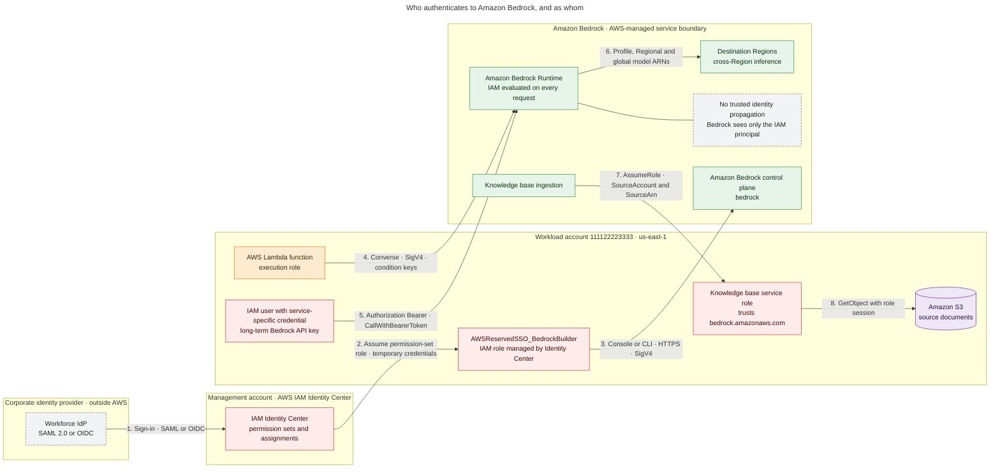

# IAM and IAM Identity Center for Bedrock

> **Level:** Intermediate · **Verified:** 2026-11-15 · **Feature status:** GA · **Time:** ~30 min

Every Amazon Bedrock and AgentCore call is authorised by IAM, so IAM is where you decide which people and workloads may use which models, through which inference profiles, with which guardrail and at which service tier. This chapter is the practical reference: actions, resource types, condition keys, managed policies, service roles, API keys and workforce access through IAM Identity Center.

## Learning objectives

After this chapter you can:

- Name the Bedrock resource types an `InvokeModel` permission can target and write a policy against the right ARN.
- Use `bedrock:InferenceProfileArn`, `bedrock:GuardrailIdentifier`, `bedrock:ServiceTier` and `aws:RequestedRegion` correctly, including with Global cross-Region inference.
- Choose between the AWS managed policies for Bedrock, Bedrock Mantle and AgentCore, and explain what changed in 2025–2026.
- Control Bedrock API keys with `CallWithBearerToken` and the IAM credential actions.
- Design builder, operator and auditor access with IAM Identity Center permission sets, and explain why trusted identity propagation does not reach Bedrock.

## Prerequisites

- [IAM fundamentals: principals, policies and evaluation](../../00-foundations/security/01-iam-fundamentals.md)
- [IAM roles, trust policies and cross-account access](../../00-foundations/security/02-iam-roles-and-trust.md)
- [Endpoints, APIs and authentication](../../01-amazon-bedrock/overview/02-endpoints-apis-and-authentication.md)
- [Model access and subscriptions](../../01-amazon-bedrock/overview/03-model-access-and-subscriptions.md)

## Concept in plain language

Think of Bedrock as a workshop of expensive machines with a badge reader on each. Your badge says which machines you may switch on (actions and resources) and under which conditions — "only inside the safety cage" (a guardrail), "only on standard power" (a service tier), "only in this building" (a Region).

People do not carry permanent badges. They sign in at reception (IAM Identity Center), which hands them a day badge for one role in one account. Machines that need to fetch materials on their own — a knowledge base reading your documents — get their own badge (a service role) that only lets them do that one job. The reader on the Bedrock machine sees the badge, never the person behind it.

## How it really works

**Actions and prefixes.** Bedrock uses the `bedrock:` prefix for the control plane, `bedrock-runtime`, knowledge bases, flows and Agents Classic. The `bedrock-mantle` endpoint uses `bedrock-mantle:`, AgentCore uses `bedrock-agentcore:`, and the Web Search tool uses `bedrock-websearch:` — see [Endpoints, APIs and authentication](../../01-amazon-bedrock/overview/02-endpoints-apis-and-authentication.md). Converse and ConverseStream have no actions of their own; they are authorised as `bedrock:InvokeModel` and `bedrock:InvokeModelWithResponseStream`.

**Resource types an inference call can target.** The Service Authorization Reference lists twelve required resource types for `bedrock:InvokeModel`. The ones you will write most often:

| Resource type | ARN pattern | Note |
|:--|:--|:--|
| `foundation-model` | `arn:${Partition}:bedrock:${Region}::foundation-model/${ResourceId}` | No account ID. Global profiles also need the Region-less form `arn:aws:bedrock:::foundation-model/…` |
| `inference-profile` | `arn:${Partition}:bedrock:${Region}:${Account}:inference-profile/${ResourceId}` | System-defined Geo and Global profiles |
| `application-inference-profile` | `…:application-inference-profile/${ResourceId}` | Supports `aws:ResourceTag` |
| `provisioned-model`, `custom-model-deployment`, `imported-model` | `…:provisioned-model/…` and so on | Not covered by foundation-model ARNs |
| `prompt-router`, `default-prompt-router` | `…:prompt-router/…`, `…:default-prompt-router/…` | Intelligent prompt routing |
| `project` | `…:project/${ResourceId}` | Responses API on `bedrock-runtime` checks `project/default` too |
| `async-invoke`, `bedrock-marketplace-model-endpoint`, `system-tool` | see the reference | `system-tool` ARNs have no Region |

Other resource types you will meet: `guardrail` and `guardrail-profile` (for `ApplyGuardrail`), `knowledge-base`, `agent-alias`, `flow-alias`, `prompt` and `prompt-version`, `model-invocation-job`. Source: [Actions, resources, and condition keys for Amazon Bedrock](https://docs.aws.amazon.com/service-authorization/latest/reference/list_amazonbedrock.html).

**Condition keys.** Read on 2026-11-15 from the same reference:

| Key | Type | What it filters | Typical use |
|:--|:--|:--|:--|
| `bedrock:InferenceProfileArn` | ARN | The inference profile a model is reached through | Allow a foundation model only via an approved profile |
| `bedrock:GuardrailIdentifier` | ARN | `GuardrailArn` or `GuardrailArn:NumericVersion` on the request | Deny inference without the required guardrail |
| `bedrock:ServiceTier` | String | `reserved`, `priority`, `default`, `flex` | Block the priority tier for cost, or flex for latency |
| `bedrock:PromptRouterArn` | ARN | The prompt router used | Force calls through a router |
| `bedrock:ModelArn`, `bedrock:ProjectArn` | ARN | Model and project of a stateful (Responses API) invocation | Scope stored-response access |
| `bedrock:BearerTokenType` | String | `SHORT_TERM` or `LONG_TERM` API key | Used with `bedrock:CallWithBearerToken` |
| `bedrock:DataRetentionMode` | String | The data retention mode | Data-retention governance |
| `bedrock:InlineAgentName` | String | Inline agent name | Agents Classic only |
| `bedrock:ThirdPartyKnowledgeBaseCredentialsSecretArn` | ARN | Secrets Manager secret of a third-party vector store | Used with `bedrock:AssociateThirdPartyKnowledgeBase` |

`InvokeModel` accepts the first five rows' keys; `InvokeModelWithResponseStream` accepts them except `bedrock:ModelArn` and `bedrock:ProjectArn`. The reference spells `bedrock:BearerTokenType`, the User Guide `bedrock:bearerTokenType`; condition key names are not case-sensitive ([policy checks reference](https://docs.aws.amazon.com/IAM/latest/UserGuide/access-analyzer-reference-policy-checks.html)).

> [!NOTE]
> **Documented fact** — For a Global cross-Region inference profile, Amazon Bedrock evaluates authorisation three times: on the inference profile, on the foundation model in the source Region, and on the Region-agnostic ARN `arn:aws:bedrock:::foundation-model/…`, for which `aws:RequestedRegion` is `unspecified`. `bedrock:InferenceProfileArn` is populated for the two foundation-model evaluations but not for the profile evaluation. A deny on `"aws:RequestedRegion": "us-west-2"` therefore does not stop Global routing to us-west-2.
> Source: [Global cross-Region inference](https://docs.aws.amazon.com/bedrock/latest/userguide/global-cross-region-inference.html)

For Geo profiles the rule is different — every destination Region must be allowed — and both cases are worked through in [Cross-Region inference](../../01-amazon-bedrock/inference/04-cross-region-inference.md).

**Guardrail enforcement has limits.** A role carrying a `bedrock:GuardrailIdentifier` deny should not also call `RetrieveAndGenerate`, `InvokeAgent` or `InvokeInlineAgent`: those APIs make internal `InvokeModel` calls without the guardrail and are denied ([Enforce specific guardrails](https://docs.aws.amazon.com/bedrock/latest/userguide/guardrails-permissions-id.html)). Organisation-wide enforcement uses Amazon Bedrock policies in AWS Organizations; see [AWS Organizations and AWS Control Tower](../../00-foundations/aws-fundamentals/05-organizations-control-tower.md).

### AWS managed policies and their 2025–2026 changes

| Policy | Grants | Changes since 2025 (date) |
|:--|:--|:--|
| `AmazonBedrockFullAccess` | `bedrock:*` on `*`, `iam:PassRole` only for roles with `AmazonBedrock` in the name, Marketplace subscribe only via Bedrock (`aws:CalledViaLast`), SageMaker AI for Bedrock Marketplace | Access to all serverless foundation models by default (2025-07-14) |
| `AmazonBedrockReadOnly` | Read-only on Bedrock resources | No change listed after 2024-12-04 |
| `AmazonBedrockLimitedAccess` | Core Bedrock actions including API-key use, invoking models on all resources, Marketplace subscribe via Bedrock | New (2025-06-13); `bedrock:CancelInvoke` added, `bedrock:DeleteInvoke` deliberately excluded (2026-08-13) |
| `AmazonBedrockMarketplaceAccess` | Bedrock Marketplace endpoints on SageMaker AI | New (2025-06-13) |
| `AmazonBedrockMantleFullAccess`, `…ReadOnly`, `…InferenceAccess` | `bedrock-mantle` actions; the last two include `CallWithBearerToken` | All new (2025-12-03) |
| `BedrockAgentCoreFullAccess` | All `bedrock-agentcore` actions plus related IAM, KMS, Secrets Manager, S3, CloudWatch, ECR | Service-linked role creation (2025-09 and 2025-10); `bedrock:InvokeModel*` for Evaluations (2025-12-02); Runtime Instances service-linked role (2026-08-07); KMS grants for Policy engines (2026-09-01) |

Sources: [Bedrock managed policies](https://docs.aws.amazon.com/bedrock/latest/userguide/security-iam-awsmanpol.html), [AgentCore managed policies](https://docs.aws.amazon.com/bedrock-agentcore/latest/devguide/security-iam-awsmanpol.html).

### Service roles, API keys and workforce identity

- **Bedrock uses service roles, not service-linked roles.** Knowledge bases, batch inference, customization, evaluation and invocation logging to CloudWatch Logs each assume a role you pass; the trust policies are tabulated in [IAM roles, trust policies and cross-account access](../../00-foundations/security/02-iam-roles-and-trust.md). AgentCore, by contrast, uses service-linked roles for networking, runtime identity and Runtime Instances.
- **API keys map back to IAM.** A short-term key inherits the generating principal's permissions; a long-term key is a service-specific credential on an IAM user. Using either needs `bedrock:CallWithBearerToken` (or `bedrock-mantle:CallWithBearerToken`) in addition to the action itself. You cannot prevent the generation of short-term keys, only their use ([API key permissions](https://docs.aws.amazon.com/bedrock/latest/userguide/api-keys-permissions.html)).
- **IAM Identity Center** assigns a permission set to a user or group in an account; Identity Center then creates a role named `AWSReservedSSO_<permission-set>_<suffix>` there. Bedrock authorises that role ([permission sets](https://docs.aws.amazon.com/singlesignon/latest/userguide/permissionsetsconcept.html)).

> [!IMPORTANT]
> **Status** — Amazon Bedrock and AgentCore are **not** in the list of AWS managed applications that integrate with IAM Identity Center, so there is no native trusted identity propagation to Bedrock. Amazon SageMaker Unified Studio is on the list and does support it. Bedrock sees the IAM role; to carry a user identity into an agent, use AgentCore Identity with your identity provider's tokens.
> Source: [AWS managed applications that you can use with IAM Identity Center](https://docs.aws.amazon.com/singlesignon/latest/userguide/awsapps-that-work-with-identity-center.html)

### Integration with Amazon Bedrock

| Interaction | Initiator | Direction of data | Identity used | Network path |
|:--|:--|:--|:--|:--|
| 1–2. Workforce sign-in and role assumption | Person, through the identity provider | Assertion to Identity Center; temporary credentials back | Identity Center user, then the `AWSReservedSSO_*` role | Public Identity Center endpoints |
| 3. Console or CLI call to the Bedrock control plane | Person | Configuration in, resource details out | Permission-set role (SigV4) | Public endpoint or `com.amazonaws.region.bedrock` interface endpoint |
| 4. Inference with SigV4 | Your code | Prompt in, completion out | Execution role (temporary credentials); condition keys evaluated | Public Regional endpoint or interface VPC endpoint |
| 5. Inference with an API key | Your code | As 4 | IAM principal behind the key, plus `CallWithBearerToken` | As 4 |
| 6. Cross-Region routing | Amazon Bedrock | Prompt and completion between source and destination Region | Caller's role, evaluated against profile and model ARNs | AWS network, not the internet |
| 7–8. Service role for ingestion | Amazon Bedrock | Documents from your bucket into Bedrock | Service role trusted by `bedrock.amazonaws.com` | Inside the AWS-managed service |
| — Trusted identity propagation | — | **No native integration** | Bedrock never receives the Identity Center user | — |

## Architecture diagram



**What this shows** — The four kinds of identity that reach Bedrock — a person through an Identity Center role, a workload role, an API-key holder, and Bedrock itself through a service role — each evaluated by IAM as an IAM principal. This is our drawing, not an official AWS diagram.

**Walkthrough**

1. A person signs in to IAM Identity Center through the corporate identity provider.
2. Identity Center lets the person assume the role it created for the permission set in the workload account.
3. The person works in the Bedrock console or CLI; IAM authorises the `AWSReservedSSO_*` role, not the person.
4. A Lambda function calls Converse with its execution role. IAM evaluates `bedrock:InvokeModel` on the target ARN and any condition keys on the request.
5. A client sends a long-term API key. IAM authorises the IAM user behind it and requires `bedrock:CallWithBearerToken`.
6. For a cross-Region profile, Bedrock evaluates the profile and model ARNs before routing to a destination Region.
7. For ingestion, Bedrock assumes the knowledge base's service role; the trust policy's source conditions must match.
8. The role session reads the documents its permissions policy allows.

**Legend** — solid arrow: request · plain line: annotation · cylinder: data store · red: identities and roles · dashed grey: outside your control · boxes: trust boundaries.

**Variations** — AgentCore Runtime replaces arrow 7 with its execution role trusted by `bedrock-agentcore.amazonaws.com`. Calls to `bedrock-mantle` follow arrows 4–5 with `bedrock-mantle:` actions. A short-term key in arrow 5 maps to the role session that generated it, not to an IAM user.

## Implementation details

1. **Workload roles first.** Use the tested [bedrock-invocation-role module](../../04-infrastructure-as-code/terraform/modules/bedrock-invocation-role/README.md): it grants named models in named Regions, adds the Region-less ARNs for Global profiles, and can require a profile and a guardrail. Its README lists the documented rules it encodes.
2. **Keep managed policies for people.** `AmazonBedrockFullAccess` grants `bedrock:*` on `*` and `AmazonBedrockLimitedAccess` invokes on all resources — acceptable in sandboxes, not for production roles.
3. **Restrict tiers and keys with denies.** `bedrock:ServiceTier` accepts `reserved`, `priority`, `default` and `flex`; AWS's own example denies all four to force the system default ([identity-based policy examples](https://docs.aws.amazon.com/bedrock/latest/userguide/security_iam_id-based-policy-examples-agent.html)).
4. **Treat API keys as an exception.** Deny `iam:CreateServiceSpecificCredential` for most principals; where long-term keys are allowed, cap `iam:ServiceSpecificCredentialAgeDays` and scope `iam:ServiceSpecificCredentialServiceName` to `bedrock.amazonaws.com` ([API keys](https://docs.aws.amazon.com/bedrock/latest/userguide/api-keys.html)).
5. **AgentCore Identity tokens.** `BedrockAgentCoreFullAccess` includes `GetWorkloadAccessTokenForUserId`, which trusts a caller-supplied user ID; AWS recommends denying it in production in favour of `GetWorkloadAccessTokenForJWT` ([AgentCore Runtime permissions](https://docs.aws.amazon.com/bedrock-agentcore/latest/devguide/runtime-permissions.html)).
6. **Reference permission-set roles by pattern.** Re-assigning a permission set recreates its role with a new suffix, breaking policies that named the old ARN; match `aws:PrincipalArn` with `ArnLike` on `AWSReservedSSO_<name>_*` ([referencing permission sets](https://docs.aws.amazon.com/singlesignon/latest/userguide/referencingpermissionsets.html)).

**Permission sets for a Bedrock platform**

> [!TIP]
> **Academy recommendation** — Three permission sets cover most teams. This is our design guidance, not an official AWS reference architecture.

| Permission set | Assign in | Policies | Explicitly denied |
|:--|:--|:--|:--|
| Builder | Sandbox and development accounts | `AmazonBedrockLimitedAccess`; `iam:PassRole` on named Bedrock service roles; AgentCore actions scoped by tag | Long-term API keys, `priority` tier, Global profiles where residency matters, `iam:CreateServiceSpecificCredential` |
| Operator | All workload accounts | `AmazonBedrockReadOnly`; guardrail and invocation-logging configuration; CloudWatch read | `bedrock:InvokeModel*` in production (operators change configuration, workloads invoke) |
| Auditor | Log archive and audit accounts, read-only elsewhere | `AmazonBedrockReadOnly`, the AWS job-function `SecurityAudit` policy, CloudTrail and Config read | Any write action; reading invocation-log contents unless the audit requires it |

## Example

A Builder permission set in Terraform: the AWS managed baseline plus an inline policy of denies. Variables carry the Identity Center instance, the group and the account; nothing is hard-coded.

> **Code status:** validated with `terraform validate` (Terraform 1.17.2, provider `hashicorp/aws` 6.73.0) · **never planned or applied against AWS**

```hcl
variable "sso_instance_arn" {
  description = "ARN of the IAM Identity Center instance."
  type        = string
}

variable "builder_group_id" {
  description = "Identity store group ID of the Bedrock builders."
  type        = string
}

variable "target_account_id" {
  description = "Development account that receives the permission set."
  type        = string
}

data "aws_partition" "current" {}

resource "aws_ssoadmin_permission_set" "bedrock_builder" {
  name             = "BedrockBuilder"
  description      = "Build and test Amazon Bedrock applications in development accounts"
  instance_arn     = var.sso_instance_arn
  session_duration = "PT4H"
}

resource "aws_ssoadmin_managed_policy_attachment" "builder_baseline" {
  instance_arn       = var.sso_instance_arn
  permission_set_arn = aws_ssoadmin_permission_set.bedrock_builder.arn
  managed_policy_arn = "arn:${data.aws_partition.current.partition}:iam::aws:policy/AmazonBedrockLimitedAccess"
}

resource "aws_ssoadmin_permission_set_inline_policy" "builder_denies" {
  instance_arn       = var.sso_instance_arn
  permission_set_arn = aws_ssoadmin_permission_set.bedrock_builder.arn
  inline_policy = jsonencode({
    Version = "2012-10-17"
    Statement = [
      {
        Sid      = "NoLongTermApiKeys"
        Effect   = "Deny"
        Action   = ["iam:CreateServiceSpecificCredential"]
        Resource = "*"
      },
      {
        Sid      = "NoLongTermKeyUseOnRuntime"
        Effect   = "Deny"
        Action   = ["bedrock:CallWithBearerToken"]
        Resource = "*"
        Condition = {
          StringEquals = { "bedrock:BearerTokenType" = "LONG_TERM" }
        }
      },
      {
        Sid      = "NoLongTermKeyUseOnMantle"
        Effect   = "Deny"
        Action   = ["bedrock-mantle:CallWithBearerToken"]
        Resource = "*"
        Condition = {
          StringEquals = { "bedrock-mantle:bearerTokenType" = "LONG_TERM" }
        }
      },
      {
        Sid      = "NoPriorityTierInDevelopment"
        Effect   = "Deny"
        Action   = ["bedrock:InvokeModel", "bedrock:InvokeModelWithResponseStream"]
        Resource = "*"
        Condition = {
          StringEquals = { "bedrock:ServiceTier" = ["priority", "reserved"] }
        }
      },
      {
        Sid      = "NoGlobalCrossRegionInference"
        Effect   = "Deny"
        Action   = ["bedrock:*"]
        Resource = "*"
        Condition = {
          StringEquals = { "aws:RequestedRegion" = "unspecified" }
          ArnLike      = { "bedrock:InferenceProfileArn" = "arn:${data.aws_partition.current.partition}:bedrock:*:*:inference-profile/global.*" }
        }
      }
    ]
  })
}

resource "aws_ssoadmin_account_assignment" "builders_in_dev" {
  instance_arn       = var.sso_instance_arn
  permission_set_arn = aws_ssoadmin_permission_set.bedrock_builder.arn
  principal_id       = var.builder_group_id
  principal_type     = "GROUP"
  target_id          = var.target_account_id
  target_type        = "AWS_ACCOUNT"
}
```

The last deny is AWS's documented SCP for disabling Global cross-Region inference, applied here to one permission set. Remove it where Global profiles are approved.

## Common mistakes

> [!WARNING]
> **Common mistake** — Writing a Region-deny with `"aws:RequestedRegion": ["us-east-1"]` and expecting it to keep Global inference in us-east-1. The global model evaluation carries `unspecified`, so the deny either blocks Global profiles completely (with `StringNotEquals`) or never matches them (with `StringEquals` on a Region name). Decide explicitly, then test with a `global.` profile ID.

| Mistake | Symptom | Fix |
|:--|:--|:--|
| Policy grants the inference profile but not the foundation-model ARNs in its destination Regions | `AccessDeniedException` naming an unexpected Region | Grant every destination Region, or the Region-less ARN for Global |
| `bedrock:GuardrailIdentifier` deny on a role that also calls `RetrieveAndGenerate` | Retrieval calls denied although a guardrail is passed | Use separate roles, or guardrails configured on the feature |
| Denying only `bedrock:CallWithBearerToken` | API keys still work on `bedrock-mantle` | Deny `bedrock-mantle:CallWithBearerToken` too |
| `AmazonBedrockFullAccess` on an application role | Any model, tier and feature can be used | Use the invocation-role module and named ARNs |
| Key policy naming an `AWSReservedSSO_*` role ARN | Access lost after re-assignment | `aws:PrincipalArn` with `ArnLike` and a wildcard suffix, plus a break-glass IAM role |
| Expecting the Identity Center user name in Bedrock authorisation | No user attribute to write policies on | Authorise roles; carry user identity with AgentCore Identity |

## Security considerations

- Explicit denies in permission sets and SCPs are the only controls a workload cannot widen; keep tier, Region and key rules there.
- Monitor credential creation: `CreateServiceSpecificCredential` is an IAM API call recorded by CloudTrail, and a long-term key is a long-lived bearer secret attached to an IAM user.
- API keys are passed as authorisation headers and are not logged in CloudTrail; the call itself is ([API keys](https://docs.aws.amazon.com/bedrock/latest/userguide/api-keys.html)). See [AWS CloudTrail for Bedrock](05-cloudtrail-for-bedrock.md).
- Scope `iam:PassRole` to named service roles with `iam:PassedToService`, as the managed policies themselves do.
- Least privilege for agents goes further in [Identity, least privilege and IAM isolation for agents](../../06-security-governance/02-identity-and-least-privilege.md).

## Cost considerations

- IAM, IAM Identity Center and AWS STS have no additional charge ([What is IAM?](https://docs.aws.amazon.com/IAM/latest/UserGuide/introduction.html)).
- IAM is a strong cost control: `bedrock:ServiceTier` stops the priority tier (about 75% above default, per the [feature register](../../FEATURE-VERIFICATION.md)) and named model ARNs stop expensive models.
- A leaked credential becomes an inference bill; GuardDuty AI Protection detects this pattern — see [GuardDuty, Security Hub, AWS Config and Macie](04-guardduty-security-hub-config-macie.md).

## Knowledge check

1. A role may invoke `arn:aws:bedrock:us-east-1::foundation-model/<id>` and the `global.` profile in us-east-1. Global calls fail. What is missing?
2. Your SCP denies everything where `aws:RequestedRegion` is not in `["eu-west-1","eu-central-1"]`. Which inference profiles still work?
3. What would happen if you deleted every assignment of the Operator permission set and re-assigned it the next day?

<details>
<summary>Answers</summary>

1. An allow on the Region-agnostic ARN `arn:aws:bedrock:::foundation-model/<id>`, conditioned on `aws:RequestedRegion` `unspecified` (and ideally on `bedrock:InferenceProfileArn`). Global inference evaluates that ARN on every call.
2. Geo profiles whose destination Regions are all in that list, and in-Region model IDs. Global profiles fail because `unspecified` is not listed.
3. Identity Center deletes and recreates the role with a new suffix; any policy that named the old role ARN no longer matches.

</details>

## Further reading

Official sources opened while writing this chapter:

- [Actions, resources, and condition keys for Amazon Bedrock](https://docs.aws.amazon.com/service-authorization/latest/reference/list_amazonbedrock.html) — actions, resource types, condition keys.
- [How Amazon Bedrock works with IAM](https://docs.aws.amazon.com/bedrock/latest/userguide/security_iam_service-with-iam.html) — supported IAM features, service roles.
- [AWS managed policies for Amazon Bedrock](https://docs.aws.amazon.com/bedrock/latest/userguide/security-iam-awsmanpol.html) — policy contents and update history.
- [AWS managed policies for AgentCore](https://docs.aws.amazon.com/bedrock-agentcore/latest/devguide/security-iam-awsmanpol.html) — `BedrockAgentCoreFullAccess` and its updates.
- [Global cross-Region inference](https://docs.aws.amazon.com/bedrock/latest/userguide/global-cross-region-inference.html) — three-part policy, `unspecified`, disabling Global routing.
- [Prerequisites for inference profiles](https://docs.aws.amazon.com/bedrock/latest/userguide/inference-profiles-prereq.html) — `bedrock:InferenceProfileArn`.
- [Enforce specific guardrails](https://docs.aws.amazon.com/bedrock/latest/userguide/guardrails-permissions-id.html) — `bedrock:GuardrailIdentifier` and its limitations.
- [Identity-based policy examples (service tiers)](https://docs.aws.amazon.com/bedrock/latest/userguide/security_iam_id-based-policy-examples-agent.html) — `bedrock:ServiceTier` deny example.
- [API keys](https://docs.aws.amazon.com/bedrock/latest/userguide/api-keys.html) and [Control permissions for API keys](https://docs.aws.amazon.com/bedrock/latest/userguide/api-keys-permissions.html) — key types, `CallWithBearerToken`, IAM credential conditions.
- [IAM Permissions for AgentCore Runtime](https://docs.aws.amazon.com/bedrock-agentcore/latest/devguide/runtime-permissions.html) — workload access token guidance.
- [Manage AWS accounts with permission sets](https://docs.aws.amazon.com/singlesignon/latest/userguide/permissionsetsconcept.html) and [Referencing permission sets](https://docs.aws.amazon.com/singlesignon/latest/userguide/referencingpermissionsets.html) — roles created by Identity Center.
- [AWS managed applications that you can use with IAM Identity Center](https://docs.aws.amazon.com/singlesignon/latest/userguide/awsapps-that-work-with-identity-center.html) and [Trusted identity propagation overview](https://docs.aws.amazon.com/singlesignon/latest/userguide/trustedidentitypropagation-overview.html) — which services support propagation.
- [IAM Access Analyzer policy checks](https://docs.aws.amazon.com/IAM/latest/UserGuide/access-analyzer-reference-policy-checks.html) — condition key names are not case-sensitive.
- [What is IAM?](https://docs.aws.amazon.com/IAM/latest/UserGuide/introduction.html) — cost statement.
