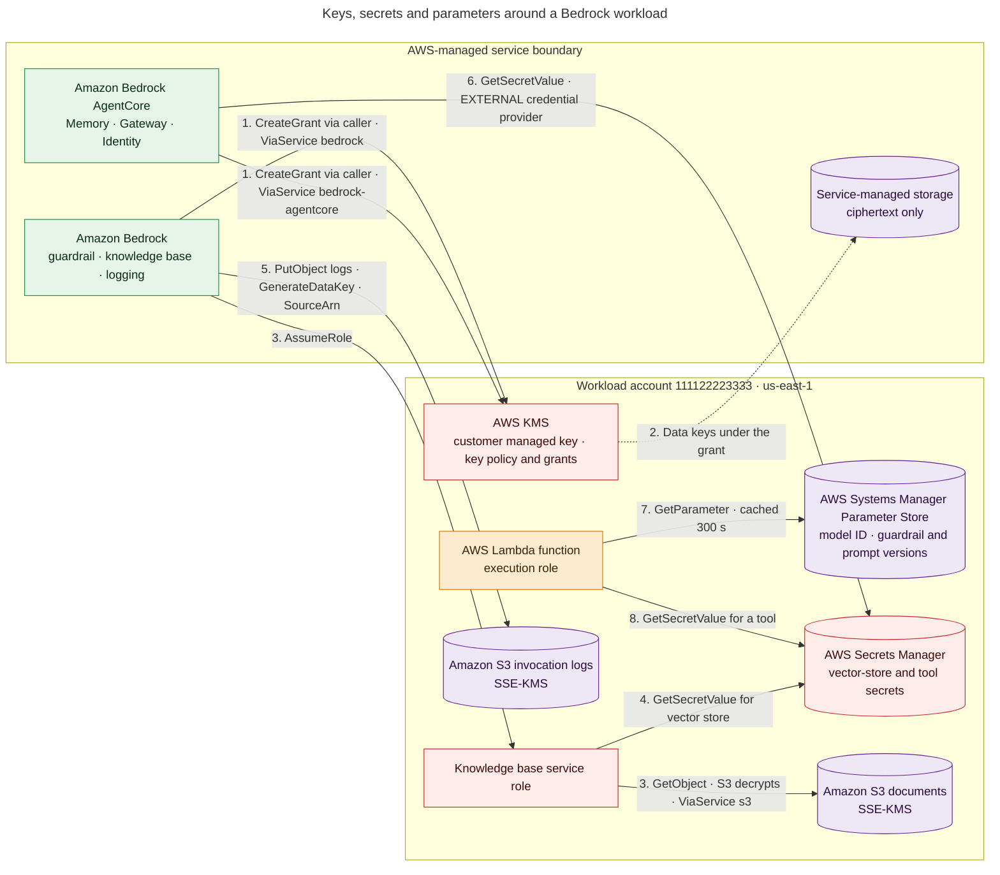

# AWS KMS, Secrets Manager and Parameter Store

> **Level:** Intermediate · **Verified:** 2026-11-15 · **Feature status:** GA · **Time:** ~30 min

Three services keep the sensitive parts of a Bedrock workload out of code: AWS KMS holds the keys that encrypt what Bedrock and AgentCore store, AWS Secrets Manager holds the credentials for vector stores, connectors and tools, and Parameter Store holds the non-secret configuration — model IDs, profile ARNs, guardrail and prompt versions. This chapter says which resources accept your key, what the key policy must contain, and what never belongs in a prompt or an environment variable.

## Learning objectives

After this chapter you can:

- List the Bedrock and AgentCore resources that accept a customer managed key, with the request field that sets it.
- Write the key-policy statements for the three documented patterns: creator plus grant, service principal, and access through Amazon S3.
- Decide which credentials Bedrock reads from Secrets Manager itself and which your code must read.
- Store model and prompt configuration in Parameter Store and explain the caching consequence.
- Recognise data that must never be placed in a prompt, a log field, an encryption context or an environment variable.

## Prerequisites

- [AWS KMS and encryption](../../00-foundations/security/04-kms-encryption.md) — key types, envelope encryption, grants and encryption context. This chapter builds on it and does not repeat it.
- [Resource-based policies](../../00-foundations/security/03-resource-policies.md)
- [IAM and IAM Identity Center for Bedrock](01-iam-and-identity-center.md)

## Concept in plain language

A building has three cupboards. The **key safe** (KMS) never hands out its master keys; it only locks and unlocks smaller keys for people on its list. The **locked cabinet** (Secrets Manager) holds passwords that someone must actually read — the database password a knowledge base needs. The **notice board** (Parameter Store) holds facts everyone may read but nobody should hard-code: which model the chatbot uses this week.

Bedrock itself opens the key safe and, for a few features, the locked cabinet. It never reads the notice board — that is your application's job.

## How it really works

**Defaults.** Bedrock encrypts custom models and knowledge base resources with AWS owned keys unless you name a key, and AgentCore stores data in DynamoDB and S3 encrypted with AWS owned keys by default. AgentCore documents that gateway names, target names, tool names and gateway CloudWatch logs are not encrypted by default ([AgentCore data encryption](https://docs.aws.amazon.com/bedrock-agentcore/latest/devguide/data-encryption.html)).

**Which resources accept a customer managed key.** Request fields come from the AWS SDK models (botocore 1.44.3) through [our generated API reference](../../references/bedrock-api-operations.md); Terraform arguments from the [provider schema](../../references/terraform-aws-provider-bedrock.md).

| Resource | Request field | Terraform 6.73.0 | Documented key behaviour |
|:--|:--|:--|:--|
| Custom model (customization job) | `customModelKmsKeyId` | `aws_bedrock_custom_model.custom_model_kms_key_id` | Long-lived grant, retired with the model — see the [foundations chapter](../../00-foundations/security/04-kms-encryption.md) |
| Imported model, copied model | `importedModelKmsKeyId`, `modelKmsKeyId` | ❌ | Creator needs `CreateGrant`, `DescribeKey`, `GenerateDataKey`, `Decrypt` |
| Guardrail | `kmsKeyId` (create and update) | `aws_bedrock_guardrail.kms_key_arn` | Creators: four actions above; users at inference: `kms:Decrypt` |
| Automated Reasoning policy | `kmsKeyId` | ❌ | — |
| Evaluation job | `customerEncryptionKeyId` | `aws_bedrock_evaluation_job.customer_encryption_key_id` | — |
| Agents Classic, flow, prompt | `customerEncryptionKeyArn` | `aws_bedrockagent_agent`, `_flow`, `_prompt` `.customer_encryption_key_arn` | — |
| Retrieval instruction | `customerEncryptionKeyArn` | ❌ | Fixed at creation; AWS managed keys not supported; encryption context `aws:bedrock:retrieval-instruction:account-id` and `…:id` |
| Managed Knowledge Base | nested in the managed configuration | `…managed_knowledge_base_configuration.server_side_encryption_configuration.kms_key_arn` | One key for transient and stored data; grant retired on deletion; service role needs no key permission |
| Customer-managed KB ingestion | `serverSideEncryptionConfiguration` on the data source | `aws_bedrockagent_data_source.server_side_encryption_configuration` | Service role needs `GenerateDataKey`, `Decrypt` |
| Agent session | `encryptionKeyArn` on `CreateSession` | ❌ | — |
| Data Automation project, blueprint, library | `encryptionConfiguration` | `kms_key_id`, `kms_encryption_context` | Service role needs `CreateGrant` and `DescribeKey` too |
| AgentCore Memory | `encryptionKeyArn` | `aws_bedrockagentcore_memory.encryption_key_arn` | Caller needs `CreateGrant`, `Decrypt`, `DescribeKey`, `GenerateDataKey*`, `ReEncrypt*` via `bedrock-agentcore` |
| AgentCore Gateway | `kmsKeyArn` (create and update) | `aws_bedrockagentcore_gateway.kms_key_arn` | Gateway service role: `CreateGrant`, `DescribeKey`, `Decrypt`, `GenerateDataKey` |
| AgentCore Identity token vault | `kmsConfiguration` on `SetTokenVaultCMK` | `aws_bedrockagentcore_token_vault_cmk` | Single-Region symmetric key, by ARN; vault ARN in the encryption context |
| AgentCore Policy engine | `encryptionKeyArn` | `aws_bedrockagentcore_policy_engine.encryption_key_arn` | Cannot be added or changed later; two grants constrained by `aws:bedrock-agentcore-policy:policy-engine-arn` |
| AgentCore Evaluations, Optimization, Payments, Registry | `kmsKeyArn` / `encryptionConfiguration` on evaluators, datasets, configuration bundles, payment managers, registries | `aws_bedrockagentcore_evaluator.kms_key_arn` | Key behaviour not researched — **UNVERIFIED — REQUIRES DOCUMENTATION REVIEW** |

> [!IMPORTANT]
> **Status** — AgentCore Runtime has no key field in `CreateAgentRuntime` in the SDK model, and the AgentCore encryption page lists only Memory and Gateway (with the token vault and Policy engine on their own pages). An AWS Prescriptive Guidance page nevertheless suggests customer managed keys for Runtime session data. Whether Runtime accepts a customer managed key is **UNVERIFIED — REQUIRES DOCUMENTATION REVIEW**.
> Sources: [AgentCore data encryption](https://docs.aws.amazon.com/bedrock-agentcore/latest/devguide/data-encryption.html), [Security reference architecture for generative AI](https://docs.aws.amazon.com/prescriptive-guidance/latest/security-reference-architecture-generative-ai/gen-auto-agents.html)

**Three key-policy patterns.** Almost every statement Bedrock needs is one of these:

| Pattern | Principal in the key policy | Actions | Conditions | Examples |
|:--|:--|:--|:--|:--|
| A. Creator plus grant | The role that creates the resource | `CreateGrant`, `GenerateDataKey`, `Decrypt`, often `DescribeKey` | `kms:ViaService` = `bedrock.<region>.amazonaws.com` or `bedrock-agentcore.<region>.amazonaws.com`; Managed KB adds `kms:GrantOperations` | Guardrail, custom model, Managed KB, Memory, Policy engine |
| B. Service principal | `bedrock.amazonaws.com` | `GenerateDataKey` (log delivery) or `Decrypt` (content review) | `aws:SourceAccount`, `aws:SourceArn`; encryption context where documented | Invocation logs in an SSE-KMS bucket; retrieval-instruction review |
| C. Through Amazon S3 | The Bedrock service role | `Decrypt` to read, `GenerateDataKey` to write | `kms:ViaService` = `s3.<region>.amazonaws.com` | Knowledge base data sources, batch input and output |

> [!NOTE]
> **Documented fact** — When you create a Policy engine with a customer managed key, AgentCore calls `kms:CreateGrant` with *your* identity through a forward access session, so the key policy must allow `kms:CreateGrant` for your account principal, not a service principal. If access to the key is later revoked, all authorisation decisions for that engine are denied.
> Source: [Policy engine encryption](https://docs.aws.amazon.com/bedrock-agentcore/latest/devguide/policy-encryption.html)

**Secrets Manager: who reads the secret.**

| Secret | Read by | Identity and permission | Source |
|:--|:--|:--|:--|
| Vector store credentials (Aurora/RDS, and the third-party stores still documented) | Amazon Bedrock | KB service role: `secretsmanager:GetSecretValue`; `kms:Decrypt` if the secret uses a customer managed key | [KB service role](https://docs.aws.amazon.com/bedrock/latest/userguide/kb-permissions.html), [KB encryption](https://docs.aws.amazon.com/bedrock/latest/userguide/encryption-kb.html) |
| Third-party vector store association | Amazon Bedrock | `bedrock:AssociateThirdPartyKnowledgeBase` conditioned on `bedrock:ThirdPartyKnowledgeBaseCredentialsSecretArn` | [KB prerequisites](https://docs.aws.amazon.com/bedrock/latest/userguide/kb-create-security.html) |
| Amazon Redshift query engine (structured retrieval) | Amazon Bedrock | Service role: `secretsmanager:GetSecretValue` | [Structured data prerequisites](https://docs.aws.amazon.com/bedrock/latest/userguide/knowledge-base-prereq-structured.html) |
| AgentCore Identity API keys and OAuth client secrets | AgentCore Identity | `MANAGED`: AgentCore creates the secret in your account. `EXTERNAL`: you reference your own secret and grant the service `GetSecretValue` (and `kms:Decrypt`) | [CreateApiKeyCredentialProvider](https://docs.aws.amazon.com/bedrock-agentcore-control/latest/APIReference/API_CreateApiKeyCredentialProvider.html), [AWS ML blog](https://aws.amazon.com/blogs/machine-learning/reference-your-own-aws-secrets-manager-secrets-in-amazon-bedrock-agentcore-identity/) |
| A tool's credential in your own Lambda function | Your code | Execution role: `GetSecretValue` on that secret ARN | [Lambda and Secrets Manager](https://docs.aws.amazon.com/lambda/latest/dg/with-secrets-manager.html) |

Customer-managed knowledge bases can no longer add new Confluence, SharePoint, Salesforce or Web Crawler connectors (the [feature register](../../FEATURE-VERIFICATION.md) records 2026-09-30); existing connectors keep their credential secrets.

**Parameter Store.** There is **no native integration** between Bedrock and Parameter Store: nothing in Bedrock reads a parameter. Your code reads it. Standard parameters hold up to 4 KB, 10,000 per account and Region, at no additional charge; advanced parameters hold 8 KB, 100,000, support policies and cross-account sharing, and are charged ([parameter tiers](https://docs.aws.amazon.com/systems-manager/latest/userguide/parameter-store-advanced-parameters.html)). The AWS Parameters and Secrets Lambda Extension caches values for 300 seconds by default and does not detect changes before the TTL expires ([Parameter Store in Lambda](https://docs.aws.amazon.com/systems-manager/latest/userguide/ps-integration-lambda-extensions.html)).

### Integration with Amazon Bedrock

| Interaction | Initiator | Direction of data | Identity used | Network path |
|:--|:--|:--|:--|:--|
| 1. Create a resource with a customer managed key; service creates a grant | You, then Bedrock or AgentCore on your behalf | Key ARN in; grant created in AWS KMS | Your role (forward access session, `kms:ViaService`) | Bedrock or AgentCore to AWS KMS inside AWS |
| 2. Encrypt and decrypt stored data | Bedrock or AgentCore | Data keys from AWS KMS to the service; ciphertext in AWS-managed storage | Grant to the service | Inside AWS |
| 3. Read documents encrypted with SSE-KMS | Amazon S3, for the service role | Plaintext data key to Amazon S3; documents to Bedrock | KB service role, `kms:ViaService` = S3 | Inside AWS |
| 4. Read a vector-store or Redshift secret | Amazon Bedrock | Credential from Secrets Manager to Bedrock | KB service role | Inside AWS |
| 5. Deliver invocation logs to an SSE-KMS bucket | Amazon Bedrock | Log objects to your bucket | `bedrock.amazonaws.com`, `aws:SourceArn` | Inside AWS |
| 6. Read an EXTERNAL credential-provider secret | AgentCore Identity | API key or client secret to the token vault | AgentCore service principal named in the secret's resource policy | Inside AWS |
| 7. Read model ID, profile ARN, guardrail and prompt version | Your code — **no native integration** | Parameter values to your function | Execution role, `ssm:GetParameter` | Public endpoint or `ssm` interface endpoint |
| 8. Read a tool credential | Your code — **no native integration** | Secret to your function | Execution role, `secretsmanager:GetSecretValue` | Public endpoint or `secretsmanager` interface endpoint |

## Architecture diagram



**What this shows** — Which side reaches for which cupboard. Bedrock and AgentCore use your KMS key through grants and read some secrets with their roles; your function alone reads Parameter Store and the secrets of tools it calls. The flows to AWS KMS are a conceptual model assembled from the encryption pages, not a documented call trace.

**Walkthrough**

1. Creating a guardrail, managed knowledge base, Memory or Policy engine with your key makes the service create a grant, authorised as you through the service.
2. The service then generates and decrypts data keys under that grant; only ciphertext rests in service-managed storage.
3. During ingestion, the knowledge base's service role reads documents; Amazon S3 calls AWS KMS, so the condition is `kms:ViaService` for S3.
4. For a vector store with database credentials, the same role reads the secret.
5. Bedrock writes invocation logs as its service principal and needs `kms:GenerateDataKey` on the bucket's key.
6. For an `EXTERNAL` credential provider, AgentCore Identity reads your secret, as permitted by the secret's resource policy.
7. Your function reads the model ID and versions from Parameter Store through the extension's cache.
8. Your function reads a tool credential from Secrets Manager.

**Legend** — solid arrow: request · dashed arrow: response · cylinder: data store · red: keys, secrets and roles · boxes: trust boundaries.

**Variations** — Agents Classic, flows, prompts and evaluation jobs follow step 1. Customer-managed knowledge bases with OpenSearch Serverless or S3 Vectors pass your key to that store when Bedrock creates it. A bucket encrypted with SSE-S3 removes steps 3 and 5's key permissions entirely.

## Implementation details

1. **Name the key at creation.** Several resources cannot change keys later: retrieval instructions and Policy engines document this explicitly. Plan the key per data classification first.
2. **Keep the account statement in every key policy** and add the creator role with `kms:ViaService`. Never give a Bedrock service role `kms:*`.
3. **Constrain grants.** The managed knowledge base example limits `kms:GrantOperations`; AgentCore Policy constrains grants with encryption context. Treat `kms:CreateGrant` like permission to change the key policy.
4. **Prefer `EXTERNAL` secrets for AgentCore Identity** when your organisation enforces customer managed keys, rotation or tags on secrets. AgentCore reads the rotated value on its next read.
5. **Store pointers, not prompts, in Parameter Store.** The prompt lives in [Prompt management](../../01-amazon-bedrock/prompt-management/01-prompt-management.md); the parameter holds the prompt ARN and version, so a rollout is a parameter change plus one cache TTL.
6. **Lower the extension TTL during rollouts** (`SSM_PARAMETER_STORE_TTL`), or accept up to five minutes of mixed versions.

**What must never go where**

| Never put… | …in | Why (documented behaviour) |
|:--|:--|:--|
| Secrets, credentials, API keys | A prompt or system prompt | Invocation logging records full request and response bodies ([invocation logging](https://docs.aws.amazon.com/bedrock/latest/userguide/model-invocation-logging.html)); injected instructions can make the model repeat context — see [Prompt injection and untrusted content](../../06-security-governance/04-prompt-injection-and-untrusted-content.md) |
| Secrets or personal data | `requestMetadata` (runtime) or `metadata` on `bedrock-mantle` | Logged in invocation logs; mantle `metadata` is logged verbatim in CloudTrail data events ([mantle CloudTrail](https://docs.aws.amazon.com/bedrock/latest/userguide/logging-cloudtrail-mantle.html)) |
| Any sensitive value | An encryption context | Appears in plaintext in CloudTrail |
| Personal data | Gateway, target and tool names; JWT `sub` claims | Names are not encrypted by default; the `sub` claim is logged in Gateway data events |
| Plaintext secrets, including long-term Bedrock API keys | Lambda environment variables, AgentCore Runtime `environmentVariables` | Visible to anyone who can read the configuration ([AWS Compute Blog](https://aws.amazon.com/blogs/compute/securely-retrieving-secrets-with-aws-lambda/)) |
| Secret values | Terraform arguments that are stored in state | Use write-only arguments such as `secret_string_wo`, or set the value outside Terraform |

## Example

A key that protects a guardrail and an AgentCore Memory, a secret encrypted with it, and two parameters. Role ARNs and the model ID are variables.

> **Code status:** validated with `terraform validate` (Terraform 1.17.2, provider `hashicorp/aws` 6.73.0) · **never planned or applied against AWS**

```hcl
variable "builder_role_arn" {
  description = "Role that creates guardrails and memories."
  type        = string
}

variable "app_role_arn" {
  description = "Execution role that invokes models with the guardrail."
  type        = string
}

variable "model_id" {
  description = "Model or inference profile ID. Confirm the current ID in the model catalog."
  type        = string
}

data "aws_caller_identity" "current" {}
data "aws_region" "current" {}
data "aws_partition" "current" {}

locals {
  account_root = "arn:${data.aws_partition.current.partition}:iam::${data.aws_caller_identity.current.account_id}:root"
}

resource "aws_kms_key" "genai" {
  description             = "Bedrock guardrail, AgentCore Memory and workload secrets"
  enable_key_rotation     = true
  deletion_window_in_days = 30
  policy = jsonencode({
    Version = "2012-10-17"
    Statement = [
      {
        Sid       = "EnableIamPoliciesForThisAccount"
        Effect    = "Allow"
        Principal = { AWS = local.account_root }
        Action    = "kms:*"
        Resource  = "*"
      },
      {
        Sid       = "PermissionsForGuardrailCreators"
        Effect    = "Allow"
        Principal = { AWS = var.builder_role_arn }
        Action    = ["kms:Decrypt", "kms:GenerateDataKey", "kms:DescribeKey", "kms:CreateGrant"]
        Resource  = "*"
      },
      {
        Sid       = "PermissionsForGuardrailUsers"
        Effect    = "Allow"
        Principal = { AWS = var.app_role_arn }
        Action    = "kms:Decrypt"
        Resource  = "*"
      },
      {
        Sid       = "AgentCoreMemoryThroughTheServiceOnly"
        Effect    = "Allow"
        Principal = { AWS = var.builder_role_arn }
        Action = [
          "kms:CreateGrant", "kms:Decrypt", "kms:DescribeKey",
          "kms:GenerateDataKey", "kms:GenerateDataKeyWithoutPlaintext", "kms:ReEncrypt*"
        ]
        Resource = "*"
        Condition = {
          StringEquals = { "kms:ViaService" = "bedrock-agentcore.${data.aws_region.current.region}.amazonaws.com" }
        }
      }
    ]
  })
}

resource "aws_bedrockagentcore_memory" "support" {
  name                  = "support_memory"
  event_expiry_duration = 30
  encryption_key_arn    = aws_kms_key.genai.arn
}

resource "aws_secretsmanager_secret" "tool_api_key" {
  name        = "genai/tools/ticketing-api-key"
  description = "Read by the ticketing tool Lambda function; value set outside Terraform"
  kms_key_id  = aws_kms_key.genai.arn
}

resource "aws_ssm_parameter" "model_id" {
  name  = "/genai/support/model-id"
  type  = "String"
  tier  = "Standard"
  value = var.model_id
}

resource "aws_ssm_parameter" "prompt_version" {
  name  = "/genai/support/prompt-version"
  type  = "String"
  tier  = "Standard"
  value = "1"
}
```

The function side reads both parameters through the extension, as AWS documents, and never logs the values it reads.

> **Code status:** syntax-checked (`python -m py_compile`) · illustrative · no AWS calls were made · **never deployed**

```python
"""Read Bedrock configuration from Parameter Store through the Lambda extension cache."""
import json
import os
import urllib.parse
import urllib.request

import boto3

PORT = os.environ.get("PARAMETERS_SECRETS_EXTENSION_HTTP_PORT", "2773")
runtime = boto3.client("bedrock-runtime")


def _parameter(name: str) -> str:
    token = boto3.Session().get_credentials().get_frozen_credentials().token
    url = f"http://localhost:{PORT}/systemsmanager/parameters/get?name={urllib.parse.quote(name, safe='')}"
    request = urllib.request.Request(url, headers={"X-Aws-Parameters-Secrets-Token": token})
    with urllib.request.urlopen(request, timeout=2) as response:
        return json.load(response)["Parameter"]["Value"]


def handler(event, context):
    model_id = _parameter("/genai/support/model-id")
    reply = runtime.converse(
        modelId=model_id,
        messages=[{"role": "user", "content": [{"text": event["question"]}]}],
    )
    return {"answer": reply["output"]["message"]["content"][0]["text"]}
```

## Common mistakes

> [!WARNING]
> **Common mistake** — Encrypting a knowledge base's source bucket with a customer managed key and granting the service role only S3 permissions. Ingestion fails with an S3-flavoured access error. Add `kms:Decrypt` on the key with `kms:ViaService` set to the S3 endpoint.

| Mistake | Symptom | Fix |
|:--|:--|:--|
| Key policy grants `kms:CreateGrant` only to a service principal for a Policy engine | Creation fails | Grant your account principal; AgentCore uses your identity |
| Alias passed where an ARN is required (retrieval instructions, token vault) | Validation error | Pass the key ARN |
| Multi-Region or asymmetric key for the token vault | Rejected | Single-Region symmetric key |
| Disabling a key "temporarily" | Guardrails, Memory or retrieval instructions stop working; Policy denies every decision | Treat the key as production infrastructure |
| Model ID in an environment variable | Changing the model needs a deployment | Parameter Store plus a short cache TTL |
| Relying on Security Hub `[Bedrock.1]` for a managed knowledge base | No finding at all | The control skips managed KB data sources; check that key yourself — see [chapter 4](04-guardduty-security-hub-config-macie.md) |

## Security considerations

- Every use of a customer managed key is a KMS event in CloudTrail; Bedrock's grant creation appears with `invokedBy` = `bedrock.amazonaws.com` ([KB encryption](https://docs.aws.amazon.com/bedrock/latest/userguide/encryption-kb.html)). See [AWS CloudTrail for Bedrock](05-cloudtrail-for-bedrock.md).
- Revoking a key or grant is your kill switch for stored data; test it before you rely on it.
- Secrets Manager resource policies decide who else may read a credential; use them for `EXTERNAL` AgentCore secrets.
- Encryption at rest does not stop an authorised caller from reading plaintext; IAM still decides that — see [Data protection, privacy and data leakage prevention](../../06-security-governance/03-data-protection-and-privacy.md).

## Cost considerations

- AWS KMS: $1 per customer managed key per month and request charges — figures and rotation charges are in the [foundations chapter](../../00-foundations/security/04-kms-encryption.md). Retrieval instructions do not cache data keys, so every read is a `Decrypt`.
- Secrets Manager: $0.40 per secret per month and $0.05 per 10,000 API calls, from the pricing examples ([pricing](https://aws.amazon.com/secrets-manager/pricing/)).
- Parameter Store standard parameters have no additional charge; advanced parameters are charged.
- The Lambda extension cache reduces both Secrets Manager and Parameter Store calls.

## Knowledge check

1. A managed knowledge base was created with your key. Its service role has no KMS permission. Will ingestion work?
2. Your security team requires every AgentCore credential to be encrypted with a customer managed key. Which credential-provider option meets that, and what must the secret's policy allow?
3. What would happen if you moved the model ID from Parameter Store into the system prompt "so the model knows what it is"?

<details>
<summary>Answers</summary>

1. Yes. For managed knowledge bases the key policy permissions belong to the identity that creates the knowledge base; Bedrock uses a grant, and the documentation states the service role needs none.
2. `EXTERNAL` secrets that you create with your key; the secret's resource policy must allow the AgentCore Identity service to call `GetSecretValue`, and the key must allow it `kms:Decrypt`.
3. The application could no longer choose the model from it — Bedrock never reads prompts as configuration — and the value would be logged with every invocation. Configuration belongs in parameters, not prompts.

</details>

## Further reading

Official sources opened while writing this chapter:

- [Data encryption (Amazon Bedrock)](https://docs.aws.amazon.com/bedrock/latest/userguide/data-encryption.html) — resources that accept a KMS key.
- [Encryption of knowledge base resources](https://docs.aws.amazon.com/bedrock/latest/userguide/encryption-kb.html) — managed KB key policy, retrieval instructions, S3 and Secrets Manager decryption.
- [Customer managed key for guardrails](https://docs.aws.amazon.com/bedrock/latest/userguide/guardrails-permissions-kms.html) — creator and user statements.
- [Using customer managed key for imported models](https://docs.aws.amazon.com/bedrock/latest/userguide/import-model-using-cmk.html) — grant behaviour.
- [AgentCore data encryption](https://docs.aws.amazon.com/bedrock-agentcore/latest/devguide/data-encryption.html), [Memory encryption](https://docs.aws.amazon.com/bedrock-agentcore/latest/devguide/storage-encryption.html), [Gateway encryption](https://docs.aws.amazon.com/bedrock-agentcore/latest/devguide/gateway-encryption.html), [Identity data encryption](https://docs.aws.amazon.com/bedrock-agentcore/latest/devguide/identity-data-encryption.html), [Policy engine encryption](https://docs.aws.amazon.com/bedrock-agentcore/latest/devguide/policy-encryption.html).
- [Create a service role for Knowledge Bases](https://docs.aws.amazon.com/bedrock/latest/userguide/kb-permissions.html), [KB prerequisites for third-party stores](https://docs.aws.amazon.com/bedrock/latest/userguide/kb-create-security.html), [Structured data prerequisites](https://docs.aws.amazon.com/bedrock/latest/userguide/knowledge-base-prereq-structured.html).
- [CreateApiKeyCredentialProvider](https://docs.aws.amazon.com/bedrock-agentcore-control/latest/APIReference/API_CreateApiKeyCredentialProvider.html) and [Reference your own Secrets Manager secrets in AgentCore Identity](https://aws.amazon.com/blogs/machine-learning/reference-your-own-aws-secrets-manager-secrets-in-amazon-bedrock-agentcore-identity/).
- [Security reference architecture for generative AI — agents](https://docs.aws.amazon.com/prescriptive-guidance/latest/security-reference-architecture-generative-ai/gen-auto-agents.html).
- [Use Secrets Manager secrets in Lambda functions](https://docs.aws.amazon.com/lambda/latest/dg/with-secrets-manager.html) and [Using Parameter Store parameters in Lambda functions](https://docs.aws.amazon.com/systems-manager/latest/userguide/ps-integration-lambda-extensions.html) — extension caching and headers.
- [Choosing parameter tiers](https://docs.aws.amazon.com/systems-manager/latest/userguide/parameter-store-advanced-parameters.html) — limits and charges.
- [Model invocation logging](https://docs.aws.amazon.com/bedrock/latest/userguide/model-invocation-logging.html) and [bedrock-mantle CloudTrail logging](https://docs.aws.amazon.com/bedrock/latest/userguide/logging-cloudtrail-mantle.html) — what is recorded.
- [Securely retrieving secrets with AWS Lambda](https://aws.amazon.com/blogs/compute/securely-retrieving-secrets-with-aws-lambda/) — environment variables guidance.
- [AWS Secrets Manager pricing](https://aws.amazon.com/secrets-manager/pricing/).
