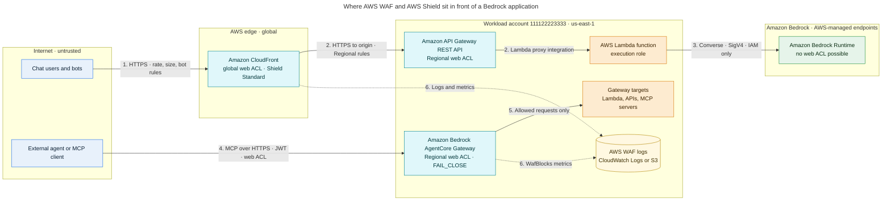

# AWS WAF and AWS Shield

> **Level:** Intermediate · **Verified:** 2026-11-15 · **Feature status:** GA · **Time:** ~25 min

AWS WAF and AWS Shield protect the doors *you* open to the internet — CloudFront, API Gateway, Application Load Balancer, AppSync and, since mid-2026, AgentCore Gateway. They do not sit in front of the Bedrock inference endpoints, and they cannot read the meaning of a prompt. This chapter shows where they help a Bedrock application (abuse, cost spikes, bots, DDoS) and where they cannot.

## Learning objectives

After this chapter you can:

- List the resources a web ACL can protect and explain why the Bedrock endpoints are not among them.
- Use rate-based rules and body-size rules as a cost and abuse guard for a chat API.
- Choose AWS Managed Rules and Bot Control settings for a generative-AI front end, and avoid the 8 KB body rule trap.
- Compare Shield Standard and Shield Advanced for a Bedrock application.
- Explain why WAF is not a prompt-injection control and what to use instead.

## Prerequisites

- [API Gateway, CloudFront and Application Load Balancer](../compute/04-api-gateway-cloudfront-alb.md)
- [AgentCore Gateway](../../01-amazon-bedrock/agentcore/04-agentcore-gateway.md)
- [IAM and IAM Identity Center for Bedrock](01-iam-and-identity-center.md)

## Concept in plain language

Your chatbot is a shop whose clerk phones a supplier (Bedrock) for every answer. AWS WAF is the doorman at *your* front door: he turns away known troublemakers, people arriving too fast and anyone carrying an oversized parcel. AWS Shield is crowd control on the street outside.

Neither stands in the back room, and the doorman never hears the customer's question — he cannot tell a polite request from a cleverly worded trick.

## How it really works

**What a web ACL can be attached to.** A web ACL ("protection pack" in the new console) is global for Amazon CloudFront (created in us-east-1) or Regional for: Amazon API Gateway REST APIs, Application Load Balancers, AWS AppSync GraphQL APIs, Amazon Cognito user pools, AWS App Runner services, **Amazon Bedrock AgentCore Gateway**, AWS Verified Access instances and AWS Amplify. Each resource takes at most one web ACL ([resources you can protect](https://docs.aws.amazon.com/waf/latest/developerguide/how-aws-waf-works-resources.html)). The AWS SDK model (botocore 1.44.3) lists `AGENTCORE_GATEWAY` among the `wafv2` resource types.

> [!IMPORTANT]
> **Status** — AWS WAF support for AgentCore Gateway became generally available on 2026-06-29, in all Regions where both services exist. It applies one Regional web ACL per gateway, to every target behind it. The `bedrock-runtime`, `bedrock-mantle` and AgentCore Runtime endpoints are **not** WAF-protectable resources: there is **no native integration** between AWS WAF and model inference.
> Sources: [What's New, 2026-06-29](https://aws.amazon.com/about-aws/whats-new/2026/06/aws-waf-amazon-bedrock-agentcore/), [Protecting your gateway with AWS WAF](https://docs.aws.amazon.com/bedrock-agentcore/latest/devguide/gateway-waf.html)

**AgentCore Gateway specifics.** Only Regional web ACLs; the gateway must be `READY`; association needs `wafv2:` and `bedrock-agentcore:Gateway*WebACL` permissions. If AWS WAF is unreachable, `wafConfiguration` on `UpdateGateway` decides: `FAIL_CLOSE` (default) or `FAIL_OPEN`. Blocked MCP requests get JSON-RPC error `-32002`, HTTP targets 403; metrics `WafBlocks`, `WafFailOpens` and `WafFailCloses` appear in `AWS/Bedrock-AgentCore`; at most 100 associations per account ([gateway WAF page](https://docs.aws.amazon.com/bedrock-agentcore/latest/devguide/gateway-waf.html)). Terraform 6.73.0 can associate the web ACL but has no gateway argument for the failure mode.

**Body inspection limits.** For ALB and AppSync, WAF inspects the first 8 KB of a body, fixed. For CloudFront, API Gateway, Cognito, App Runner, Verified Access and AgentCore Gateway the default is 16 KB, raisable to 64 KB (at extra cost). Beyond the limit, each rule's *oversize handling* decides: `Continue`, `Match` or `No match`. Headers and cookies: first 8 KB and 200 entries ([oversize components](https://docs.aws.amazon.com/waf/latest/developerguide/web-request-body-inspection.html)). A chat request with conversation history easily exceeds 8 KB.

> [!WARNING]
> **Common mistake** — Adding the Core rule set (`AWSManagedRulesCommonRuleSet`) to a chat API unchanged. Its `SizeRestrictions_BODY` rule blocks any body over 8 KB (8,192 bytes), so long prompts and multi-turn conversations fail with 403 while short tests pass. Override that rule to Count and enforce your own size limit instead.
> Source: [Baseline rule groups](https://docs.aws.amazon.com/waf/latest/developerguide/aws-managed-rule-groups-baseline.html)

**Rate-based rules as a cost guard.** A rate-based rule counts matching requests over an evaluation window of 60, 120, 300 (default) or 600 seconds; the lowest limit is 10; aggregation can be by IP, forwarded IP, or custom keys such as a header, cookie or label namespace; a scope-down statement narrows what is counted ([settings](https://docs.aws.amazon.com/waf/latest/developerguide/waf-rule-statement-type-rate-based-high-level-settings.html), [aggregation](https://docs.aws.amazon.com/waf/latest/developerguide/waf-rule-statement-type-rate-based-aggregation-options.html)). WAF counts *requests*, not tokens: one request can cost a fraction of a cent or many dollars. Pair it with a body-size rule (which caps input tokens per request) and with per-user quotas in your application.

**Bot Control and AI bots.** Bot Control's `CategoryAI` rule blocks AI bots, verified ones included. Version 4.0 (2025-11-20) added Web Bot Auth, which allows cryptographically verified agents and labels AgentCore agents — CloudFront only; an AI activity dashboard followed on 2026-02-24 ([Bot Control rule group](https://docs.aws.amazon.com/waf/latest/developerguide/aws-managed-rule-groups-bot.html), [managed rules changelog](https://docs.aws.amazon.com/waf/latest/developerguide/aws-managed-rule-groups-changelog.html), [What's New](https://aws.amazon.com/about-aws/whats-new/2026/02/aws-waf-ai-activity-dashboard/)). These rules concern AI bots as *clients* of your site, not prompt content.

**No prompt-injection rule group.** The AWS Managed Rules list read on 2026-11-15 has baseline groups (Core rule set, Admin protection, Known bad inputs), use-case groups (SQL, Linux, POSIX, Windows, PHP, WordPress), IP reputation groups, Fraud Control (ATP, ACFP), Bot Control and the anti-DDoS group — none for prompt injection or LLM-specific threats ([rule groups list](https://docs.aws.amazon.com/waf/latest/developerguide/aws-managed-rule-groups-list.html)).

**Shield.**

| | Shield Standard | Shield Advanced |
|:--|:--|:--|
| Cost | No additional charge, always on | $3,000 per month per payer account (organisation), 1-year commitment, plus data-transfer-out usage fees |
| Protects | All AWS customers against common network- and transport-layer attacks; most complete for Route 53, CloudFront and Global Accelerator | Resources you add on EC2, ELB, CloudFront, Global Accelerator and Route 53 |
| Layer 7 | — | Anti-DDoS managed rule group; automatic application-layer mitigation (150 WCUs in the web ACL) |
| AWS WAF | Charged normally | Standard WAF charges included for protected resources up to 50 billion requests a month; Bot Control, CAPTCHA and extra body inspection still charged |
| Prerequisite | — | Business or Enterprise Support |

Sources: [Shield pricing](https://aws.amazon.com/shield/pricing/), [Shield Standard](https://docs.aws.amazon.com/waf/latest/developerguide/ddos-standard-summary.html), [Shield Advanced](https://docs.aws.amazon.com/waf/latest/developerguide/ddos-advanced-summary.html).

### Integration with Amazon Bedrock

| Interaction | Initiator | Direction of data | Identity used | Network path |
|:--|:--|:--|:--|:--|
| 1. Chat request to CloudFront, evaluated by a global web ACL; Shield Standard at the edge | Client | Prompt in, response out | End-user token checked by your app, not by WAF | Internet to edge location |
| 2. Forward to API Gateway, evaluated by a Regional web ACL | CloudFront | Prompt to your Region | Origin configuration | AWS network |
| 3. Your function calls Bedrock | Your code | Prompt to the model | Execution role (SigV4) | Public or interface VPC endpoint — **no WAF on this hop** |
| 4. MCP call to AgentCore Gateway, evaluated by its web ACL | Agent or MCP client | Tool request in | JWT or SigV4 at the gateway; WAF sees only the request | Internet or PrivateLink to the gateway |
| 5. Gateway routes allowed requests to targets | AgentCore Gateway | Tool input to Lambda, APIs, MCP servers | Gateway service role or credential provider | AWS network or outbound internet |
| 6. WAF logs and metrics | AWS WAF and AgentCore | Request metadata to CloudWatch Logs or Amazon S3; metrics | Service | Inside AWS |
| — Prompt-content inspection | — | **No native capability**: WAF matches strings and sizes, not intent | — | — |

## Architecture diagram



**What this shows** — Web ACLs on the three doors you own and none on Bedrock's endpoint: whatever WAF stops costs no tokens; whatever it allows reaches the model unchanged. This is our drawing, not an official AWS diagram.

**Walkthrough**

1. A user's chat request reaches CloudFront; the global web ACL applies size, rate and bot rules, and Shield Standard absorbs network-layer floods.
2. CloudFront forwards to API Gateway, whose Regional web ACL can apply rules that need Regional context.
3. The Lambda function calls Bedrock with SigV4. Only IAM, quotas and Guardrails apply here.
4. An external agent calls an AgentCore Gateway; its web ACL evaluates every inbound request before routing.
5. Only allowed requests reach the targets.
6. Both web ACLs produce logs and metrics; the gateway adds its own WAF metrics.

**Legend** — solid arrow: request · dashed arrow: telemetry · cylinder: log store · boxes: trust boundaries.

**Variations** — An ALB front end gets the fixed 8 KB body limit. AppSync gets the same. Without CloudFront, Shield Advanced cannot protect an API Gateway REST API directly; **our reading** of the Shield pricing page's resource list is that CloudFront in front is the route to Shield Advanced protection.

## Implementation details

1. **Put a size rule first.** A `size_constraint_statement` on the body with oversize handling `MATCH` blocks prompts above your limit; keep the limit at or below the inspection limit of the resource.
2. **Override `SizeRestrictions_BODY` to Count** in the Core rule set so your own limit applies.
3. **Scope rate limits to the expensive paths** (`/chat`, `/agent`) and aggregate on the caller's identity where possible, for example a header carrying a tenant or API-key ID, with IP as a fallback.
4. **Run new rules in Count mode first.** AWS recommends testing in Count before Block, and the AgentCore page repeats it for gateways.
5. **Keep `FAIL_CLOSE` on AgentCore gateways** unless availability truly outranks inspection; alarm on `WafFailOpens`.
6. **Log** to CloudWatch Logs or S3 and correlate the gateway request ID with WAF logs to find the blocking rule.

> [!TIP]
> **Academy recommendation** — Treat WAF as three cheap filters in front of an expensive service: size (input tokens), rate (call volume) and reputation (who is calling). Leave meaning to Guardrails and authorisation to IAM and AgentCore Policy. This is our design guidance, not an official AWS reference architecture.

## Example

A Regional web ACL for a chat API and an AgentCore gateway: a body-size cap, a per-IP rate limit on `/chat`, and two AWS Managed Rules groups with the 8 KB body rule counted, not blocked.

> **Code status:** validated with `terraform validate` (Terraform 1.17.2, provider `hashicorp/aws` 6.73.0) · **never planned or applied against AWS**

```hcl
variable "api_stage_arn" {
  description = "ARN of the API Gateway REST API stage that fronts the chat function."
  type        = string
}

variable "agentcore_gateway_arn" {
  description = "ARN of an AgentCore gateway to protect, or null."
  type        = string
  default     = null
}

variable "max_body_bytes" {
  description = "Largest request body accepted; at most 16384 unless the web ACL raises the inspection limit."
  type        = number
  default     = 12288
}

variable "chat_requests_per_5_minutes" {
  description = "Requests allowed per client IP to /chat in a 300-second window."
  type        = number
  default     = 300
}

resource "aws_wafv2_web_acl" "genai_front_door" {
  name  = "genai-front-door"
  scope = "REGIONAL"

  default_action {
    allow {}
  }

  rule {
    name     = "BlockOversizePrompts"
    priority = 0
    action {
      block {}
    }
    statement {
      size_constraint_statement {
        comparison_operator = "GT"
        size                = var.max_body_bytes
        field_to_match {
          body {
            oversize_handling = "MATCH"
          }
        }
        text_transformation {
          priority = 0
          type     = "NONE"
        }
      }
    }
    visibility_config {
      cloudwatch_metrics_enabled = true
      metric_name                = "BlockOversizePrompts"
      sampled_requests_enabled   = true
    }
  }

  rule {
    name     = "RateLimitChatPerIp"
    priority = 1
    action {
      block {}
    }
    statement {
      rate_based_statement {
        limit                 = var.chat_requests_per_5_minutes
        evaluation_window_sec = 300
        aggregate_key_type    = "IP"
        scope_down_statement {
          byte_match_statement {
            search_string         = "/chat"
            positional_constraint = "STARTS_WITH"
            field_to_match {
              uri_path {}
            }
            text_transformation {
              priority = 0
              type     = "NONE"
            }
          }
        }
      }
    }
    visibility_config {
      cloudwatch_metrics_enabled = true
      metric_name                = "RateLimitChatPerIp"
      sampled_requests_enabled   = true
    }
  }

  rule {
    name     = "AWSManagedRulesCommonRuleSet"
    priority = 2
    override_action {
      none {}
    }
    statement {
      managed_rule_group_statement {
        name        = "AWSManagedRulesCommonRuleSet"
        vendor_name = "AWS"
        rule_action_override {
          name = "SizeRestrictions_BODY"
          action_to_use {
            count {}
          }
        }
      }
    }
    visibility_config {
      cloudwatch_metrics_enabled = true
      metric_name                = "CommonRuleSet"
      sampled_requests_enabled   = true
    }
  }

  rule {
    name     = "AWSManagedRulesKnownBadInputsRuleSet"
    priority = 3
    override_action {
      none {}
    }
    statement {
      managed_rule_group_statement {
        name        = "AWSManagedRulesKnownBadInputsRuleSet"
        vendor_name = "AWS"
      }
    }
    visibility_config {
      cloudwatch_metrics_enabled = true
      metric_name                = "KnownBadInputs"
      sampled_requests_enabled   = true
    }
  }

  visibility_config {
    cloudwatch_metrics_enabled = true
    metric_name                = "genai-front-door"
    sampled_requests_enabled   = true
  }
}

resource "aws_wafv2_web_acl_association" "chat_api" {
  resource_arn = var.api_stage_arn
  web_acl_arn  = aws_wafv2_web_acl.genai_front_door.arn
}

resource "aws_wafv2_web_acl_association" "agentcore_gateway" {
  count        = var.agentcore_gateway_arn == null ? 0 : 1
  resource_arn = var.agentcore_gateway_arn
  web_acl_arn  = aws_wafv2_web_acl.genai_front_door.arn
}
```

> [!CAUTION]
> **Cost or security hazard** — Applying this creates billable resources (web ACL, rules, per-request charges). A rate limit that is too low blocks real users; deploy in a sandbox and in Count mode first, and remove the web ACL when you finish testing.

## Common mistakes

| Mistake | Symptom | Fix |
|:--|:--|:--|
| Core rule set unchanged on a chat API | 403 on long prompts only | Count `SizeRestrictions_BODY`; add your own size rule |
| Body-size rule above the inspection limit with `Continue` | Huge prompts pass uninspected | `oversize_handling = "MATCH"` and a limit below the inspection size |
| Expecting WAF to stop jailbreaks | Encoded or paraphrased attacks pass | Guardrails prompt-attack filter and least-privilege tools |
| Rate limiting only by IP behind a corporate proxy | Whole offices throttled together | Aggregate on a header carrying the caller ID |
| CloudFront web ACL for an AgentCore gateway | Association rejected | Regional web ACL in the gateway's Region |
| `FAIL_OPEN` without an alarm | Silent loss of inspection | Alarm on `WafFailOpens` |

## Security considerations

- **WAF cannot defend against prompt injection.** It sees bytes, not intent; size limits cap what it inspects; and indirect injection arrives in retrieved documents, tool results and web pages that never pass your web ACL. Defences are layered: Guardrails prompt-attack filters, privilege separation for tools, AgentCore Policy on tool calls and human approval — see [Prompt injection, untrusted tool output and retrieval poisoning](../../06-security-governance/04-prompt-injection-and-untrusted-content.md). GuardDuty AI Protection reports direct prompt injection that a guardrail detected ([chapter 4](04-guardduty-security-hub-config-macie.md)).
- WAF does not authenticate users. Keep API Gateway authorisers or gateway JWT authorisers; Security Hub control `[BedrockAgentCore.2]` flags gateways without inbound authorisation.

## Cost considerations

- AWS WAF pay-as-you-go: per web ACL, per rule (each rule group or managed rule group you add is charged $1 per month), and per million requests; the pricing examples use $5 per web ACL, $1 per rule and $0.60 per million requests. Extra body inspection beyond the default costs $0.30 per million requests per additional 16 KB ([WAF pricing](https://aws.amazon.com/waf/pricing/)).
- Bot Control: Common includes the first 10 million requests a month, Targeted the first 1 million; beyond that it is charged.
- Shield Advanced: $3,000 per month per payer account plus data transfer out; it includes standard WAF charges for protected resources.
- The saving is the point: a blocked 60 KB prompt costs a WAF request fee, not a model invocation.

## Knowledge check

1. Why can you not attach a web ACL to `bedrock-runtime`, and what is the nearest place to filter traffic to it?
2. Your chat API sits behind an ALB. Users with long conversations get 403. Name two causes.
3. What would happen to a request blocked by the web ACL on an AgentCore gateway with an MCP target?

<details>
<summary>Answers</summary>

1. It is an AWS-managed endpoint, not a resource type AWS WAF can associate with. Filter at your own front door (CloudFront, API Gateway, ALB) before your code calls Bedrock; inside AWS, IAM and Guardrails apply.
2. The Core rule set's `SizeRestrictions_BODY` rule (over 8 KB), or your own size rule with `MATCH` oversize handling, because ALB inspection is fixed at 8 KB.
3. The gateway returns a JSON-RPC error `-32002` ("Authorization error - Request forbidden") and does not forward the request to the target.

</details>

## Further reading

Official sources opened while writing this chapter:

- [Resources that you can protect with AWS WAF](https://docs.aws.amazon.com/waf/latest/developerguide/how-aws-waf-works-resources.html) and [Associating protection with an AWS resource](https://docs.aws.amazon.com/waf/latest/developerguide/web-acl-associating-aws-resource.html).
- [Protecting your gateway with AWS WAF](https://docs.aws.amazon.com/bedrock-agentcore/latest/devguide/gateway-waf.html) and [WafConfiguration](https://docs.aws.amazon.com/bedrock-agentcore-control/latest/APIReference/API_WafConfiguration.html).
- [AWS WAF adds support for Amazon Bedrock AgentCore Gateway](https://aws.amazon.com/about-aws/whats-new/2026/06/aws-waf-amazon-bedrock-agentcore/) — GA announcement.
- [Oversize web request components](https://docs.aws.amazon.com/waf/latest/developerguide/web-request-body-inspection.html) — body, header and cookie limits.
- [Rate-based rule settings](https://docs.aws.amazon.com/waf/latest/developerguide/waf-rule-statement-type-rate-based-high-level-settings.html) and [aggregation options](https://docs.aws.amazon.com/waf/latest/developerguide/waf-rule-statement-type-rate-based-aggregation-options.html).
- [AWS Managed Rules list](https://docs.aws.amazon.com/waf/latest/developerguide/aws-managed-rule-groups-list.html), [baseline rule groups](https://docs.aws.amazon.com/waf/latest/developerguide/aws-managed-rule-groups-baseline.html), [Bot Control rule group](https://docs.aws.amazon.com/waf/latest/developerguide/aws-managed-rule-groups-bot.html), [changelog](https://docs.aws.amazon.com/waf/latest/developerguide/aws-managed-rule-groups-changelog.html) and [managed rule group pricing note](https://docs.aws.amazon.com/waf/latest/developerguide/waf-managed-rule-groups.html).
- [AWS WAF AI activity dashboard](https://aws.amazon.com/about-aws/whats-new/2026/02/aws-waf-ai-activity-dashboard/) and [Web Bot Auth support](https://aws.amazon.com/about-aws/whats-new/2025/11/aws-waf-web-bot-auth-support/).
- [AWS Shield Standard overview](https://docs.aws.amazon.com/waf/latest/developerguide/ddos-standard-summary.html), [AWS Shield Advanced overview](https://docs.aws.amazon.com/waf/latest/developerguide/ddos-advanced-summary.html) and [Shield pricing](https://aws.amazon.com/shield/pricing/).
- [AWS WAF pricing](https://aws.amazon.com/waf/pricing/).
