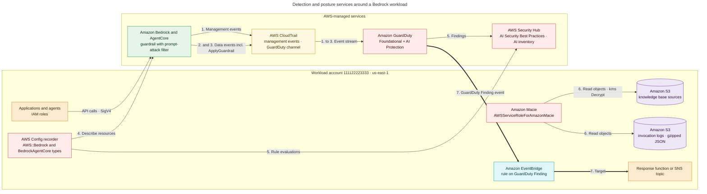

# GuardDuty, Security Hub, AWS Config and Macie

> **Level:** Intermediate · **Verified:** 2026-11-15 · **Feature status:** GA · **Time:** ~30 min

Four AWS security services watch a Bedrock workload from the outside: Amazon GuardDuty looks for threats in API activity, AWS Config records how resources are configured, AWS Security Hub turns that configuration into pass/fail controls, and Amazon Macie looks for sensitive data in Amazon S3. Their Bedrock coverage grew fast in 2026, so this chapter lists only what is documented today, with exact identifiers.

## Learning objectives

After this chapter you can:

- Name the GuardDuty findings that involve Bedrock and say which protection plan and data each needs.
- List the Security Hub CSPM controls and AWS Config managed rules for Bedrock and AgentCore, and what they do not check.
- Say which Bedrock and AgentCore resource types AWS Config records.
- Point Macie at the S3 buckets that feed knowledge bases and hold invocation logs, and explain what Macie cannot see.
- Route findings to an automated response.

## Prerequisites

- [Amazon CloudWatch and AWS CloudTrail](../../00-foundations/aws-fundamentals/04-cloudwatch-cloudtrail.md)
- [AWS Organizations and AWS Control Tower](../../00-foundations/aws-fundamentals/05-organizations-control-tower.md)
- [AWS KMS, Secrets Manager and Parameter Store](02-kms-secrets-manager-parameter-store.md)

## Concept in plain language

A building has a **security guard** who watches the cameras for odd behaviour (GuardDuty), a **surveyor** who writes down how every room is built (AWS Config), an **inspector** who checks that record against the building code and posts a scorecard (Security Hub), and a **records officer** who opens the filing cabinets to see whether confidential papers are lying around (Macie).

None of them works inside the Bedrock machine room. The guard watches the door log; the surveyor reads the room's blueprint; the records officer only opens cabinets that are yours.

## How it really works

### Amazon GuardDuty

| Finding type | Plan and data source | Default severity | What it means |
|:--|:--|:--|:--|
| `DefenseEvasion:IAMUser/BedrockLoggingDisabled` | Foundational; CloudTrail management events | Medium | Model invocation logging was disabled |
| `Impact:IAMUser/AnomalousModelInvocation` | AI Protection; CloudTrail management and data events | Low | An identity invoked a model in a way that deviates from its baseline (API, model, IP and ASN, user agent) |
| `Impact:IAMUser/CostHarvesting` | AI Protection | Low | Token volumes far above the identity's baseline, correlated with other unusual signals |
| `Impact:IAMUser/PromptInjection.Direct` | AI Protection; needs a guardrail with a prompt-attack filter | Low | A Bedrock guardrail intervened on a high-confidence prompt attack |

The three AI Protection findings have resource type `AccessKey` and carry `resource.modelDetails` or `resource.bedrockGuardrailDetails` ([AI Protection finding types](https://docs.aws.amazon.com/guardduty/latest/ug/findings-ai-protection.html), [IAM finding types](https://docs.aws.amazon.com/guardduty/latest/ug/guardduty_finding-types-iam.html)).

> [!IMPORTANT]
> **Status** — GuardDuty AI Protection became generally available on 2026-07-14 with a 30-day free trial. When enabled, GuardDuty creates a CloudTrail **service-linked channel** in each monitored account that streams data events for Amazon Bedrock, Amazon Bedrock AgentCore and Amazon SageMaker AI to GuardDuty; you need no trail and cannot change the channel's selectors. It is charged per GB of data events analysed. The detector feature name in the AWS SDK model is `AI_PROTECTION`.
> Sources: [What's New, 2026-07-14](https://aws.amazon.com/about-aws/whats-new/2026/07/amazon-guardduty-ai-protection-aws/), [GuardDuty AI Protection](https://docs.aws.amazon.com/guardduty/latest/ug/ai-protection.html)

The foundational plan also analyses Bedrock management events for patterns such as unusual removal of guardrails or a changed training-data source, and Lambda Protection covers network threats from the Lambda functions behind Bedrock agents ([AI Protection page](https://docs.aws.amazon.com/guardduty/latest/ug/ai-protection.html)). The prompt-injection finding exists only where a guardrail evaluates traffic, so AWS advises enforcing a prompt-attack guardrail organisation-wide with Amazon Bedrock policies.

### AWS Security Hub (CSPM controls and AI inventory)

| Control | Resource type | AWS Config rule | Severity |
|:--|:--|:--|:--|
| `[Bedrock.1]` Data sources encrypted with customer managed KMS keys | `AWS::Bedrock::DataSource` | `bedrock-data-source-encryption-enabled` | Medium |
| `[BedrockAgentCore.1]` Runtimes configured with VPC network mode | `AWS::BedrockAgentCore::Runtime` | `bedrockagentcore-runtime-private-network-required` | High |
| `[BedrockAgentCore.2]` Gateways require inbound authorisation | `AWS::BedrockAgentCore::Gateway` | `bedrockagentcore-gateway-authorizer-enabled` | High |
| `[BedrockAgentCore.3]` Memory encrypted with customer managed keys | `AWS::BedrockAgentCore::Memory` | `bedrock-agentcore-memory-encryption-enabled` | Medium |
| `[BedrockAgentCore.4]` Gateway encrypted with customer managed keys | `AWS::BedrockAgentCore::Gateway` | `bedrockagentcore-gateway-encryption-enabled` | Medium |
| `[BedrockAgentCore.5]` Custom browsers not in public network mode | `AWS::BedrockAgentCore::BrowserCustom` | `bedrockagentcore-browsercustom-network-mode-not-public` | High |
| `[BedrockAgentCore.6]` Custom browsers record sessions to S3 | `AWS::BedrockAgentCore::BrowserCustom` | `bedrockagentcore-browsercustom-recording-enabled` | Medium |
| `[BedrockAgentCore.7]` Custom code interpreters use a private network | `AWS::BedrockAgentCore::CodeInterpreterCustom` | `bedrockagentcore-codeinterpreter-networkmode-check` | — |

Sources: [Bedrock controls](https://docs.aws.amazon.com/securityhub/latest/userguide/bedrock-controls.html), [AgentCore controls](https://docs.aws.amazon.com/securityhub/latest/userguide/bedrockagentcore-controls.html), [controls reference](https://docs.aws.amazon.com/securityhub/latest/userguide/securityhub-controls-reference.html).

Two scoping notes from the control pages: `[Bedrock.1]` skips data sources of a **managed** knowledge base, and `[BedrockAgentCore.1]` skips runtimes backed by a capacity provider. All eight belong to the **AI Security Best Practices** standard, `arn:aws:securityhub:region::standards/ai-security-best-practices/v/1.0.0`, alongside SageMaker controls ([standard](https://docs.aws.amazon.com/securityhub/latest/userguide/standards-ai-security.html)). Security Hub's AI inventory (GA 2026-07-14, Essentials plan, no additional cost) catalogues Bedrock, SageMaker and AgentCore assets from AWS Config and correlates them with GuardDuty findings ([AWS Security Blog](https://aws.amazon.com/blogs/security/security-hub-adds-ai-workload-protection-and-multicloud-support-for-microsoft-azure/)).

### AWS Config

**Resource types recorded** (read on 2026-11-15 from [Supported resource types](https://docs.aws.amazon.com/config/latest/developerguide/resource-config-reference.html)):

| Service | Resource types |
|:--|:--|
| Amazon Bedrock | `ApplicationInferenceProfile`, `AutomatedReasoningPolicy`, `AutomatedReasoningPolicyVersion`, `Blueprint`, `DataAutomationProject`, `DataSource`, `EnforcedGuardrailConfiguration`, `Flow`, `FlowAlias`, `FlowVersion`, `Guardrail`, `KnowledgeBase`, `Prompt`, `PromptVersion` (all `AWS::Bedrock::…`) |
| Amazon Bedrock AgentCore | `ApiKeyCredentialProvider`, `BrowserCustom`, `CodeInterpreterCustom`, `Evaluator`, `Gateway`, `GatewayTarget`, `Memory`, `OAuth2CredentialProvider`, `OnlineEvaluationConfig`, `PaymentManager`, `Policy`, `PolicyEngine`, `Runtime`, `RuntimeEndpoint`, `TokenVault`, `WorkloadIdentity` (all `AWS::BedrockAgentCore::…`) |

Deletion of `AWS::Bedrock::DataSource` can take up to 120 hours, and of `AWS::BedrockAgentCore::Memory` up to 360 hours, to appear in AWS Config. The 2026-10-07 announcement of 77 new resource types also names `AWS::BedrockAgentCore::PaymentConnector`, which the reference table did not list when read — check both ([What's New, 2026-10](https://aws.amazon.com/about-aws/whats-new/2026/10/aws-config-new-resource-types/)).

**Managed rules.** The 2026-07-09 announcement lists nine Bedrock identifiers: the eight rules behind the controls above plus `BEDROCK_AGENTCORE_MEMORY_EVENT_EXPIRY_DURATION`, which flags AgentCore Memory whose event expiry is below `minEventExpiryDuration` (default 7 days; 15 Regions) ([What's New, 2026-07-09](https://aws.amazon.com/about-aws/whats-new/2026/07/aws-config-additional-managed-rules/), [rule page](https://docs.aws.amazon.com/config/latest/developerguide/bedrock-agentcore-memory-event-expiry-duration.html)). The **Security and Governance Best Practices for Amazon Bedrock** conformance pack (2026-03-20) applies 76 rules, mostly to the infrastructure around Bedrock — OpenSearch, S3, Secrets Manager, API Gateway, RDS ([conformance pack](https://docs.aws.amazon.com/config/latest/developerguide/security-and-governance-best-practices-for-amazon-bedrock.html), [template](https://github.com/awslabs/aws-config-rules/blob/master/aws-config-conformance-packs/Security-and-Governance-Best-Practices-for-Amazon-Bedrock.yaml)).

**Our reading:** none of these managed rules evaluates guardrail policy content, model invocation logging or model access, and AWS Config lists no resource type for the invocation-logging configuration. Check those with a custom rule or the GuardDuty logging finding.

### Amazon Macie

There is **no native integration** between Macie and Bedrock. Macie analyses objects in S3 *general purpose* buckets in supported storage classes and formats — including PDF, Word, Excel, CSV, JSON, JSON Lines, text and gzip/ZIP archives — but not images, audio or video, not S3 directory buckets, and not S3 Glacier Deep Archive ([supported storage](https://docs.aws.amazon.com/macie/latest/user/discovery-supported-storage.html)). Invocation logs delivered to S3 are gzipped JSON, which Macie can read ([invocation logging](https://docs.aws.amazon.com/bedrock/latest/userguide/model-invocation-logging.html)). Objects encrypted with a customer managed key are analysed only if the key policy lets `AWSServiceRoleForAmazonMacie` call `kms:Decrypt`; otherwise Macie reports metadata only ([encrypted objects](https://docs.aws.amazon.com/macie/latest/user/discovery-supported-encryption-types.html)).

### Integration with Amazon Bedrock

| Interaction | Initiator | Direction of data | Identity used | Network path |
|:--|:--|:--|:--|:--|
| 1. Bedrock and AgentCore API calls recorded as management events and analysed | GuardDuty (independent stream) | CloudTrail events to GuardDuty | GuardDuty service | Inside AWS |
| 2. Data events streamed by the AI Protection channel | GuardDuty | Bedrock, AgentCore and SageMaker AI data events to GuardDuty | CloudTrail service-linked channel | Inside AWS |
| 3. Guardrail intervention becomes a finding | Bedrock Guardrails, then GuardDuty | `ApplyGuardrail` data event to GuardDuty | Same channel | Inside AWS |
| 4. Resource configuration recorded and evaluated | AWS Config | Configuration items for `AWS::Bedrock::*` and `AWS::BedrockAgentCore::*` | Config service-linked role or recorder role | Inside AWS |
| 5. Controls and findings aggregated | Security Hub | Config evaluations and GuardDuty findings to Security Hub | Service integration | Inside AWS |
| 6. Sensitive-data discovery on knowledge-base and log buckets | Macie | Object contents read by Macie, findings out | `AWSServiceRoleForAmazonMacie` (+ `kms:Decrypt`) | Inside AWS — **no Bedrock involvement** |
| 7. Findings routed to response | EventBridge | Finding JSON to Lambda, SNS or ticketing | EventBridge rule and target permissions | Inside AWS |
| — Prompt content analysis by these services | — | **None**: GuardDuty sees guardrail *outcomes* and call metadata, not prompts | — | — |

## Architecture diagram



**What this shows** — Each service attaches to a different evidence source: GuardDuty to CloudTrail, Config to resource configuration, Macie to your S3 objects, and Security Hub to the other two's results. None of them sits in the request path of an inference call. Our drawing; the channel and recorder internals are a conceptual model.

**Walkthrough**

1. Bedrock and AgentCore API calls produce management events that GuardDuty analyses, including the change that disables invocation logging.
2. With AI Protection, GuardDuty's service-linked channel also receives data events.
3. A guardrail that blocks a prompt attack produces an `ApplyGuardrail` data event, which becomes `Impact:IAMUser/PromptInjection.Direct`.
4. AWS Config records Bedrock and AgentCore resource configurations.
5. Security Hub evaluates controls on Config results and collects GuardDuty findings.
6. Macie samples or scans the objects in the buckets you select.
7. EventBridge matches `GuardDuty Finding` events and calls your response.

**Legend** — solid arrow: request or read · thick arrow: asynchronous event · cylinder: data store · boxes: trust boundaries.

**Variations** — In an organisation, a delegated administrator account enables GuardDuty, Security Hub, Config aggregation and Macie for all members. In Regions without Bedrock Guardrails, the prompt-injection finding is unavailable; in Regions without Bedrock, AI Protection covers SageMaker AI only.

## Implementation details

1. **Enable GuardDuty in every supported Region**, as AWS recommends ([GuardDuty Regions](https://docs.aws.amazon.com/guardduty/latest/ug/guardduty_regions.html)), and turn on AI Protection in the Regions that run Bedrock or AgentCore.
2. **Enforce a prompt-attack guardrail** before expecting prompt-injection findings; an application that never attaches a guardrail produces none.
3. **Turn on the AI Security Best Practices standard** in Security Hub CSPM and record `AWS::Bedrock::*` and `AWS::BedrockAgentCore::*` types in AWS Config (recording all types includes new ones automatically).
4. **Point Macie at named buckets**: knowledge-base sources, batch input and output, invocation logs. Add the Macie role to their key policies.
5. **Cover the gaps yourself**: a custom Config rule or a scheduled check for `GetModelInvocationLoggingConfiguration`, and EventBridge on the logging-disabled finding.

> [!TIP]
> **Academy recommendation** — Wire `Impact:IAMUser/CostHarvesting` to the same on-call path as a budget alarm. A stolen key spends money before it steals data. This is our design guidance, not an official AWS reference architecture.

## Example

Turn on AI Protection, subscribe to the AI Security Best Practices standard, add one extra Config rule, and route the four Bedrock-related GuardDuty findings to a topic. Assumes GuardDuty, Security Hub and an AWS Config recorder are already enabled.

> **Code status:** validated with `terraform validate` (Terraform 1.17.2, provider `hashicorp/aws` 6.73.0) · event pattern syntax-checked (JSON parse) · **never planned or applied against AWS**

```hcl
variable "guardduty_detector_id" {
  description = "ID of the existing GuardDuty detector in this Region."
  type        = string
}

variable "alerts_topic_arn" {
  description = "SNS topic that receives Bedrock security findings."
  type        = string
}

data "aws_partition" "current" {}
data "aws_region" "current" {}

resource "aws_guardduty_detector_feature" "ai_protection" {
  detector_id = var.guardduty_detector_id
  name        = "AI_PROTECTION"
  status      = "ENABLED"
}

resource "aws_securityhub_standards_subscription" "ai_security" {
  standards_arn = "arn:${data.aws_partition.current.partition}:securityhub:${data.aws_region.current.region}::standards/ai-security-best-practices/v/1.0.0"
}

resource "aws_config_config_rule" "memory_event_expiry" {
  name = "bedrock-agentcore-memory-event-expiry-duration"
  source {
    owner             = "AWS"
    source_identifier = "BEDROCK_AGENTCORE_MEMORY_EVENT_EXPIRY_DURATION"
  }
  input_parameters = jsonencode({ minEventExpiryDuration = "30" })
}

resource "aws_cloudwatch_event_rule" "bedrock_findings" {
  name          = "guardduty-bedrock-findings"
  description   = "GuardDuty findings about Amazon Bedrock usage"
  event_pattern = file("${path.module}/bedrock-findings-pattern.json")
}

resource "aws_cloudwatch_event_target" "to_topic" {
  rule = aws_cloudwatch_event_rule.bedrock_findings.name
  arn  = var.alerts_topic_arn
}
```

`bedrock-findings-pattern.json`:

```json
{
  "source": ["aws.guardduty"],
  "detail-type": ["GuardDuty Finding"],
  "detail": {
    "type": [
      "DefenseEvasion:IAMUser/BedrockLoggingDisabled",
      "Impact:IAMUser/AnomalousModelInvocation",
      "Impact:IAMUser/CostHarvesting",
      "Impact:IAMUser/PromptInjection.Direct"
    ]
  }
}
```

The SNS topic's access policy must allow `events.amazonaws.com` to publish.

## Common mistakes

| Mistake | Symptom | Fix |
|:--|:--|:--|
| Enabling AI Protection but no guardrail with a prompt-attack filter | Never a `PromptInjection.Direct` finding | Enforce the guardrail account- or organisation-wide |
| Reading `[Bedrock.1]` "passed" as "knowledge bases encrypted" | Managed knowledge bases are not evaluated | Check managed KB keys separately |
| Macie job on a bucket encrypted with a customer managed key | Objects reported as unclassifiable or metadata only | Allow the Macie service-linked role `kms:Decrypt` |
| Expecting Macie to scan S3 Vectors or a managed knowledge base | No coverage | Scan the source buckets you own |
| Expecting AWS Config to flag disabled invocation logging | No rule exists | GuardDuty `BedrockLoggingDisabled` plus a custom check |
| Expecting a deleted Memory to vanish from Config at once | Stale configuration item | Deletion recording can take up to 360 hours |

> [!WARNING]
> **Common mistake** — Treating GuardDuty's prompt-injection finding as a prompt-injection *defence*. It reports what a guardrail already blocked; indirect injection that no guardrail detected produces nothing. See [Prompt injection, untrusted tool output and retrieval poisoning](../../06-security-governance/04-prompt-injection-and-untrusted-content.md).

## Security considerations

- The findings and Macie results contain identities, model IDs and sample data locations; restrict who reads them.
- AI Protection's channel works without a trail; your own audit trail still needs one — see [AWS CloudTrail for Bedrock](05-cloudtrail-for-bedrock.md).
- Invocation-log buckets hold full prompts and responses; Macie findings on them are expected and should drive retention and access decisions ([Data protection, privacy and data leakage prevention](../../06-security-governance/03-data-protection-and-privacy.md)).
- Collect evidence for audits as described in [Logging, audit and compliance evidence](../../06-security-governance/07-logging-audit-and-compliance.md).

## Cost considerations

- GuardDuty AI Protection: per GB of data events analysed, after a 30-day trial; the service-linked channel itself adds no CloudTrail charge ([AI Protection](https://docs.aws.amazon.com/guardduty/latest/ug/ai-protection.html)). Figures are on the GuardDuty pricing page — **UNVERIFIED — REQUIRES DOCUMENTATION REVIEW** (page not opened).
- Security Hub CSPM controls and AWS Config charge per evaluation and per configuration item; AI inventory is included in the Essentials plan at no additional cost.
- Macie charges for buckets monitored and data inspected; limit jobs to the buckets that matter. Per-GB rates were not opened — **UNVERIFIED — REQUIRES DOCUMENTATION REVIEW**.

## Knowledge check

1. A stolen access key is used to call Converse 50,000 times overnight from a new IP address. Which GuardDuty findings could fire, and what must be enabled?
2. Your auditor asks for proof that every knowledge base is encrypted with a customer managed key. Is `[Bedrock.1]` enough?
3. What would happen if Macie scanned an invocation-log bucket encrypted with a key whose policy omits the Macie role?

<details>
<summary>Answers</summary>

1. `Impact:IAMUser/AnomalousModelInvocation` and possibly `Impact:IAMUser/CostHarvesting`; both need the AI Protection plan in that Region.
2. No. It covers data sources of customer-managed knowledge bases only, and checks the data source's key, not the vector store's. Managed knowledge bases need a separate check.
3. Macie could report only metadata for those objects; it could not decrypt and inspect their content.

</details>

## Further reading

Official sources opened while writing this chapter:

- [GuardDuty AI Protection](https://docs.aws.amazon.com/guardduty/latest/ug/ai-protection.html), [AI Protection finding types](https://docs.aws.amazon.com/guardduty/latest/ug/findings-ai-protection.html), [IAM finding types](https://docs.aws.amazon.com/guardduty/latest/ug/guardduty_finding-types-iam.html), [active finding types](https://docs.aws.amazon.com/guardduty/latest/ug/guardduty_finding-types-active.html).
- [Introducing Amazon GuardDuty AI Protection](https://aws.amazon.com/about-aws/whats-new/2026/07/amazon-guardduty-ai-protection-aws/) and [Security Hub adds AI workload protection](https://aws.amazon.com/blogs/security/security-hub-adds-ai-workload-protection-and-multicloud-support-for-microsoft-azure/).
- [GuardDuty Regions and endpoints](https://docs.aws.amazon.com/guardduty/latest/ug/guardduty_regions.html) — enable in all supported Regions.
- [Processing GuardDuty findings with EventBridge](https://docs.aws.amazon.com/guardduty/latest/ug/guardduty_findings_eventbridge.html) — event format.
- [Security Hub CSPM controls for Amazon Bedrock](https://docs.aws.amazon.com/securityhub/latest/userguide/bedrock-controls.html), [for AgentCore](https://docs.aws.amazon.com/securityhub/latest/userguide/bedrockagentcore-controls.html), [AI Security Best Practices standard](https://docs.aws.amazon.com/securityhub/latest/userguide/standards-ai-security.html), [controls reference](https://docs.aws.amazon.com/securityhub/latest/userguide/securityhub-controls-reference.html).
- [AWS Config supported resource types](https://docs.aws.amazon.com/config/latest/developerguide/resource-config-reference.html), [AWS Config document history](https://docs.aws.amazon.com/config/latest/developerguide/DocumentHistory.html), [191 additional managed rules](https://aws.amazon.com/about-aws/whats-new/2026/07/aws-config-additional-managed-rules/), [77 new resource types](https://aws.amazon.com/about-aws/whats-new/2026/10/aws-config-new-resource-types/), [bedrock-agentcore-memory-event-expiry-duration](https://docs.aws.amazon.com/config/latest/developerguide/bedrock-agentcore-memory-event-expiry-duration.html), [Bedrock conformance pack](https://docs.aws.amazon.com/config/latest/developerguide/security-and-governance-best-practices-for-amazon-bedrock.html).
- [Macie supported storage classes and formats](https://docs.aws.amazon.com/macie/latest/user/discovery-supported-storage.html), [Analyzing encrypted S3 objects](https://docs.aws.amazon.com/macie/latest/user/discovery-supported-encryption-types.html).
- [Model invocation logging](https://docs.aws.amazon.com/bedrock/latest/userguide/model-invocation-logging.html) — S3 log format.
