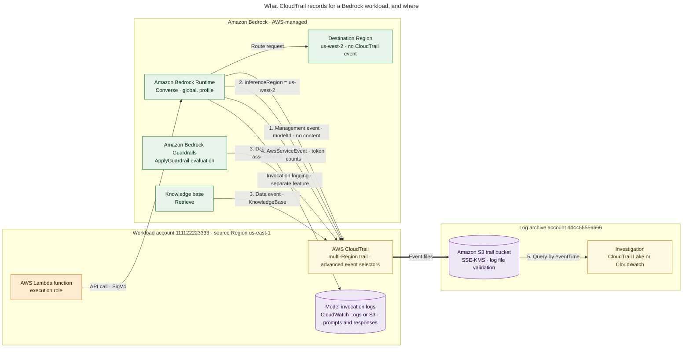

# AWS CloudTrail for Bedrock

> **Level:** Intermediate · **Verified:** 2026-11-15 · **Feature status:** GA · **Time:** ~30 min

AWS CloudTrail answers "who called which Bedrock or AgentCore API, when, from where, and was it allowed?" It does not answer "what did the user ask and what did the model say" — that is model invocation logging. This chapter shows which calls are recorded by default and which need data-event selectors, what a record contains, how cross-Region inference appears, how to query it, and which audit question belongs to which log.

## Learning objectives

After this chapter you can:

- Classify Bedrock, `bedrock-mantle` and AgentCore operations as management or data events, and name the `resources.type` values for advanced event selectors.
- Read a Bedrock CloudTrail record, including `inferenceRegion`, stream-completion events and guardrail assessments.
- Configure a trail that keeps management events and adds only the Bedrock data events you need.
- Query Bedrock activity with CloudTrail Lake, knowing its 2026 availability change.
- Choose between CloudTrail, model invocation logging and CloudWatch for a given audit question.

## Prerequisites

- [Amazon CloudWatch and AWS CloudTrail](../../00-foundations/aws-fundamentals/04-cloudwatch-cloudtrail.md) — event types, trails and event history.
- [Endpoints, APIs and authentication](../../01-amazon-bedrock/overview/02-endpoints-apis-and-authentication.md)
- [Cross-Region inference: Geo and Global profiles](../../01-amazon-bedrock/inference/04-cross-region-inference.md)

## Concept in plain language

CloudTrail is the visitors' book at reception: name, time, which door, whether the guard let them in. It never records the conversation inside the room. Model invocation logging is the recording of that conversation, switched off unless you turn it on. Some rooms are so busy that the visitors' book only records them if you ask (data events), and those pages cost extra.

## How it really works

**Event classification** (read on 2026-11-15):

| Endpoint or feature | Management events (logged by default) | Data events (advanced selectors, charged) | `resources.type` for data events |
|:--|:--|:--|:--|
| `bedrock` control plane | All operations, including model access, guardrail and logging configuration | — | — |
| `bedrock-runtime` | `InvokeModel`, `InvokeModelWithResponseStream`, `Converse`, `ConverseStream`, `ListAsyncInvokes` | `InvokeModelWithBidirectionalStream`, `StartAsyncInvoke`, `GetAsyncInvoke` | `AWS::Bedrock::Model`, `AWS::Bedrock::AsyncInvoke` |
| Guardrails | Create, update, delete | `ApplyGuardrail`, **including evaluations made during model invocation** | `AWS::Bedrock::Guardrail` |
| Knowledge bases | Create, data sources, ingestion | `Retrieve`, `RetrieveAndGenerate` | `AWS::Bedrock::KnowledgeBase` |
| Agents Classic | Agent management | `InvokeAgent`, `InvokeInlineAgent` | `AWS::Bedrock::AgentAlias`, `AWS::Bedrock::InlineAgent` |
| Flows, prompts | Management | `InvokeFlow`; `RenderPrompt` (permission-only) | `AWS::Bedrock::FlowAlias`, `AWS::Bedrock::FlowExecution`; see the conflict note below |
| `bedrock-mantle` | `ListModels`, `GetModel`, fine-tuning jobs, Projects | `CreateInference` (Responses, Chat Completions, embeddings, Messages), `GetInference`, `CancelInference`, `DeleteInference`, `CountTokens`, files | `AWS::BedrockMantle::Project` (the only value) |
| AgentCore Gateway | Gateway and target management | `InvokeGateway` | `AWS::BedrockAgentCore::Gateway` |
| AgentCore Runtime and harness | Control-plane operations (for the harness: `CreateHarness`, `UpdateHarness`, `DeleteHarness`, `GetHarness`, `ListHarnesses`) | `InvokeAgentRuntime`, `InvokeAgentRuntimeCommand`, `InvokeAgentRuntimeCommandShell` | `AWS::BedrockAgentCore::Runtime` (harness events too) |

Sources: [Bedrock CloudTrail](https://docs.aws.amazon.com/bedrock/latest/userguide/logging-using-cloudtrail.html), [bedrock-mantle CloudTrail](https://docs.aws.amazon.com/bedrock/latest/userguide/logging-cloudtrail-mantle.html), [Gateway event types](https://docs.aws.amazon.com/bedrock-agentcore/latest/devguide/gateway-event-types.html), [harness operations](https://docs.aws.amazon.com/bedrock-agentcore/latest/devguide/harness-operations.html).

The CloudTrail User Guide's data-event table also lists these types — for Bedrock (prefix `AWS::Bedrock::`): AutomatedReasoningPolicy, AutomatedReasoningPolicyVersion, Blueprint, DataAutomationInvocation, DataAutomationProfile, DataAutomationProject, Session and Tool; for AgentCore (prefix `AWS::BedrockAgentCore::`): Browser, BrowserCustom, BrowserProfile, CodeInterpreter, CodeInterpreterCustom, Memory, RuntimeEndpoint, WorkloadIdentity, WorkloadIdentityDirectory, TokenVault, APIKeyCredentialProvider, OAuth2CredentialProvider, Evaluator, Dataset, BatchEvaluate, ABTest, AgentInsightStore, Recommendation, Policy, PolicyEngine, Registry, Payments, CapacityProvider and WebSearch; and `AWS::BedrockWebSearch::Tool` ([logging data events](https://docs.aws.amazon.com/awscloudtrail/latest/userguide/logging-data-events-with-cloudtrail.html)). Which operations each AgentCore type covers was not checked per service.

> [!IMPORTANT]
> **Status** — Two classification gaps: the Bedrock CloudTrail page tells you to select `AWS::Bedrock::Prompt` for `RenderPrompt`, while the CloudTrail table lists the "Bedrock prompt" data event as `AWS::Bedrock::PromptVersion` — a source conflict. And neither page names the event category of `AgenticRetrieveStream` — **UNVERIFIED — REQUIRES DOCUMENTATION REVIEW**; test with a trail that records `AWS::Bedrock::KnowledgeBase` data events.

**What a record contains.** For runtime inference: `userIdentity`, `sourceIPAddress`, `userAgent`, `eventSource` `bedrock.amazonaws.com`, `requestParameters` with the `modelId`, `responseElements` `null`, and `tlsDetails.clientProvidedHostHeader` showing the endpoint called ([Bedrock CloudTrail](https://docs.aws.amazon.com/bedrock/latest/userguide/logging-using-cloudtrail.html)). **Our reading:** the documented example carries no prompt or completion text, so CloudTrail is not a record of content. Three further details matter:

- **Stream-completion events.** After `InvokeModelWithResponseStream` or `ConverseStream`, Bedrock records a second event with `eventType` `AwsServiceEvent`, carrying `inputTokens`, `outputTokens` and `inferenceRegion` under `serviceEventDetails.AdditionalEventData.additionalEntries`, linked by `parentRequestId`. It is not an API call and is not evaluated by IAM; count invocations only where `eventType` is `AwsApiCall`.
- **Guardrail data events** carry the combined `action` and an `assessments` list (filter types, confidence, actions) but do not say which guardrail produced each assessment; enforced guardrails appear as `ENFORCED` in `guardrailIdentifier`.
- **API keys are not logged**; the call is ([API keys](https://docs.aws.amazon.com/bedrock/latest/userguide/api-keys.html)). On `bedrock-mantle`, every event's `requestParameters` adds `callWithBearerToken` and `bearerTokenType`, and customer `metadata` is logged verbatim.

> [!NOTE]
> **Documented fact** — CloudTrail logs all cross-Region inference requests in your **source** Region; the `additionalEventData.inferenceRegion` field says where the request was processed. For Global profiles, CloudWatch and CloudTrail also record in the source Region.
> Sources: [Cross-Region inference](https://docs.aws.amazon.com/bedrock/latest/userguide/cross-region-inference.html), [Global cross-Region inference](https://docs.aws.amazon.com/bedrock/latest/userguide/global-cross-region-inference.html)

**AgentCore Gateway data events** are different: callers authenticate with JWTs, so identity is captured as JWT claims such as `sub` instead of `userIdentity`; errors are inside `responseElements`; events go only to the resource owner's account ([Gateway event types](https://docs.aws.amazon.com/bedrock-agentcore/latest/devguide/gateway-event-types.html)).

**CloudTrail Lake.** Lake queries are Trino SQL `SELECT` statements over an event data store; always bound `eventTime` to limit scanned data ([Lake queries](https://docs.aws.amazon.com/awscloudtrail/latest/userguide/cloudtrail-lake-queries.html), [SQL constraints](https://docs.aws.amazon.com/awscloudtrail/latest/userguide/query-limitations.html)).

> [!IMPORTANT]
> **Status** — CloudTrail Lake has been closed to new customers since 2026-05-31; existing customers continue, and AWS recommends Amazon CloudWatch for new work. Trails, Insights and aggregated events are unaffected.
> Source: [CloudTrail Lake availability change](https://docs.aws.amazon.com/awscloudtrail/latest/userguide/cloudtrail-lake-service-availability-change.html)

### Integration with Amazon Bedrock

| Interaction | Initiator | Direction of data | Identity used | Network path |
|:--|:--|:--|:--|:--|
| 1. Runtime inference and control-plane calls recorded as management events | CloudTrail, automatically | Call metadata (no content) from Bedrock to CloudTrail in the source Region | The caller's identity is recorded | Inside AWS |
| 2. Cross-Region processing annotated | Bedrock | `inferenceRegion` added to the source-Region event | — | Inside AWS; no event in the destination Region |
| 3. Data events for guardrails, knowledge bases, mantle and AgentCore | CloudTrail, per advanced selectors | Event files to your S3 bucket (optionally CloudWatch Logs) | Trail's bucket policy and KMS key | Inside AWS |
| 4. Stream-completion events | Bedrock | Token counts as `AwsServiceEvent` | Same identity fields as the call | Inside AWS |
| 5. Query and investigate | Auditor or SIEM | Events out of S3, Lake or CloudWatch | Auditor's role | Public or interface endpoints |
| 6. GuardDuty AI Protection channel | GuardDuty | Data events to GuardDuty only — **not to your trail** | Service-linked channel | Inside AWS |
| — Prompt and response content | — | **Not in CloudTrail**; use model invocation logging (runtime only) | — | — |

## Architecture diagram



**What this shows** — One Converse call through a Global profile produces events only in the source Region: a management event annotated with the processing Region, a guardrail data event if selected, and a stream-completion event for streaming calls. Prompt content goes only to invocation logs, a separate feature. Our drawing, not an official AWS diagram.

**Walkthrough**

1. The runtime call is recorded as a management event with the caller, model ID and endpoint, but no content.
2. Because the request ran elsewhere, the event carries `additionalEventData.inferenceRegion`.
3. Guardrail evaluations and knowledge base retrievals appear only if the trail selects those data event types.
4. Streaming calls add an `AwsServiceEvent` with token counts.
5. Investigators query the archived events, bounded by time.

**Legend** — solid arrow: request or record · thick arrow: asynchronous delivery · cylinder: data store · boxes: account and trust boundaries.

**Variations** — `bedrock-mantle` inference is a data event (`AWS::BedrockMantle::Project`): without a selector the trail shows no inference at all. AgentCore Gateway events identify callers by JWT claims. GuardDuty AI Protection reads data events through its own channel and does not populate your trail.

## Implementation details

1. **One organisation trail, all Regions**, delivered to a log archive account with SSE-KMS and log file validation — Security Hub's `CloudTrail.1`, `.2` and `.4` controls check these properties ([controls reference](https://docs.aws.amazon.com/securityhub/latest/userguide/securityhub-controls-reference.html)).
2. **Advanced event selectors replace the trail's default selectors**, so include an explicit management-event selector when you add data events, or the trail silently stops recording management events ([AWS MDAA documentation](https://github.com/aws/modern-data-architecture-accelerator/blob/main/packages/apps/ai/bedrock-agentcore-runtime-app/README.md)).
3. **Select narrowly.** One `resources.type` per selector; filter further with `resources.ARN` or `eventName`.
4. **Decide content logging separately.** Enable [model invocation logging](https://docs.aws.amazon.com/bedrock/latest/userguide/model-invocation-logging.html) where content evidence is required; it covers `bedrock-runtime` only, including its OpenAI-compatible APIs.
5. **Alert on configuration changes**: `DeleteModelInvocationLoggingConfiguration`, guardrail updates, `CreateServiceSpecificCredential`. GuardDuty raises `DefenseEvasion:IAMUser/BedrockLoggingDisabled` for the first ([chapter 4](04-guardduty-security-hub-config-macie.md)).

**Audit question → where the answer is**

| Audit question | CloudTrail | Model invocation logging | CloudWatch |
|:--|:--|:--|:--|
| Who invoked which model, when, from which IP, through which endpoint? | ✅ management event (runtime); data event (mantle) | ✅ identity and model per request | ❌ |
| What exactly was asked and answered? | ❌ | ✅ bodies up to 100 KB inline, larger in S3 | ❌ |
| Which Region processed a cross-Region request? | ✅ `inferenceRegion` | See [Cross-Region inference](../../01-amazon-bedrock/inference/04-cross-region-inference.md) | ❌ |
| How many tokens did one principal use? | Streaming calls only (stream-completion events) | ✅ token counts with identity | Per model, not per principal — see [CloudWatch and Bedrock observability](../observability/01-cloudwatch-and-bedrock-observability.md) |
| Who disabled logging or changed a guardrail? | ✅ management events | ❌ | ❌ |
| Did a guardrail intervene, and with which filter? | ✅ `ApplyGuardrail` data events | ✅ in the logged response | Guardrail metrics |
| Was a call denied by IAM or an SCP? | ✅ `errorCode` on the event | ❌ | ❌ |
| Is latency or throttling getting worse? | ❌ | ❌ | ✅ metrics and alarms |
| Which tools did an agent call through a gateway? | ✅ `InvokeGateway` data events | ❌ | AgentCore observability — see [AgentCore Observability](../../01-amazon-bedrock/agentcore/07-agentcore-observability.md) |

## Example

A trail that keeps all management events and adds guardrail, knowledge base, mantle and AgentCore Runtime and Gateway data events.

> **Code status:** validated with `terraform validate` (Terraform 1.17.2, provider `hashicorp/aws` 6.73.0) · **never planned or applied against AWS**

```hcl
variable "trail_bucket_name" {
  description = "S3 bucket in the log archive account; its policy must allow CloudTrail delivery."
  type        = string
}

variable "trail_kms_key_arn" {
  description = "Customer managed key for trail log files."
  type        = string
}

locals {
  bedrock_data_event_types = [
    "AWS::Bedrock::Guardrail",
    "AWS::Bedrock::KnowledgeBase",
    "AWS::BedrockMantle::Project",
    "AWS::BedrockAgentCore::Runtime",
    "AWS::BedrockAgentCore::Gateway",
  ]
}

resource "aws_cloudtrail" "genai_audit" {
  name                          = "genai-audit"
  s3_bucket_name                = var.trail_bucket_name
  kms_key_id                    = var.trail_kms_key_arn
  is_multi_region_trail         = true
  include_global_service_events = true
  enable_log_file_validation    = true

  advanced_event_selector {
    name = "All management events"
    field_selector {
      field  = "eventCategory"
      equals = ["Management"]
    }
  }

  dynamic "advanced_event_selector" {
    for_each = toset(local.bedrock_data_event_types)
    content {
      name = "Data events for ${advanced_event_selector.value}"
      field_selector {
        field  = "eventCategory"
        equals = ["Data"]
      }
      field_selector {
        field  = "resources.type"
        equals = [advanced_event_selector.value]
      }
    }
  }
}
```

> [!CAUTION]
> **Cost or security hazard** — Data events are charged per event, and guardrail evaluations during inference produce one per invocation. Try the selectors in a sandbox, watch the volume for a day, then narrow with `resources.ARN` or remove them.

A CloudTrail Lake query (existing Lake customers) that lists who invoked models in the last week, and where the requests ran. Replace `<event-data-store-id>` with your event data store ID.

> **Code status:** illustrative · not executed (no event data store in the build environment) · **never deployed**

```sql
SELECT
    userIdentity.arn                                   AS caller,
    element_at(requestParameters, 'modelId')           AS model_id,
    element_at(additionalEventData, 'inferenceRegion') AS inference_region,
    count(*)                                           AS invocations
FROM <event-data-store-id>
WHERE eventTime >= '2026-11-08 00:00:00'
  AND eventTime <  '2026-11-15 00:00:00'
  AND eventSource = 'bedrock.amazonaws.com'
  AND eventType = 'AwsApiCall'
  AND eventName IN ('InvokeModel', 'InvokeModelWithResponseStream', 'Converse', 'ConverseStream')
GROUP BY 1, 2, 3
ORDER BY invocations DESC
```

## Common mistakes

> [!WARNING]
> **Common mistake** — Looking for the prompt that caused an incident in CloudTrail. CloudTrail records that a call happened and who made it; the content is only in model invocation logs, if they were on at the time, and never for `bedrock-mantle` traffic.

| Mistake | Symptom | Fix |
|:--|:--|:--|
| Advanced selectors added without a management selector | Management events disappear from the trail | Add an explicit `eventCategory = Management` selector |
| Counting `AwsServiceEvent` records as calls | Invocation counts doubled for streaming | Filter `eventType = 'AwsApiCall'` |
| Detective rules filtering on `bedrock.amazonaws.com` only | Mantle activity invisible | Add `bedrock-mantle.amazonaws.com` and the mantle data events |
| Searching the destination Region for cross-Region calls | Nothing found | Search the source Region; read `inferenceRegion` |
| Attributing a guardrail assessment by list position | Wrong guardrail blamed | The event has no per-assessment attribution; use the guardrail trace |
| Looking for `InvokeAgentRuntime` in event history | Not there | Data events never appear in event history; read the trail |
| Planning a new CloudTrail Lake deployment | Account cannot onboard | Use trails plus CloudWatch or Athena |

## Security considerations

- Store trails in a separate log archive account; the trail bucket and key policies are the perimeter of your evidence ([Logging, audit and compliance evidence](../../06-security-governance/07-logging-audit-and-compliance.md)).
- Mantle `metadata` and Gateway JWT `sub` claims are logged as sent: keep secrets and personal data out of them.
- CloudTrail is not real time; for detection use GuardDuty and EventBridge ([chapter 4](04-guardduty-security-hub-config-macie.md)).
- Invocation logs hold content and need stricter access than CloudTrail ([AWS KMS, Secrets Manager and Parameter Store](02-kms-secrets-manager-parameter-store.md)).

## Cost considerations

- Event history (90 days of management events) and one trail copy of management events: no charge. Additional management copies: $2.00 per 100,000 events; data events: $0.10 per 100,000; delivery to CloudWatch Logs: $0.25 per GB plus ingestion ([CloudTrail pricing](https://aws.amazon.com/cloudtrail/pricing/)).
- Runtime inference is a free management event; the same inference on `bedrock-mantle` is a paid data event.
- CloudTrail Lake (existing customers): $0.75 per GB ingested on one-year retention pricing, plus per-GB scanning — bound every query by `eventTime`.

## Knowledge check

1. A team moves from Converse on `bedrock-runtime` to the Responses API on `bedrock-mantle`. The security dashboard shows inference dropping to zero. Why?
2. Your trail records `AWS::Bedrock::Guardrail` data events. A model call with an enforced organisation guardrail is blocked. What will the event show in `guardrailIdentifier`, and can you tell which guardrail blocked it?
3. What would happen if you added an advanced selector for `AWS::Bedrock::KnowledgeBase` to an existing trail and nothing else?

<details>
<summary>Answers</summary>

1. Mantle inference (`CreateInference`) is a data event for `AWS::BedrockMantle::Project`, not recorded by default, and its `eventSource` is `bedrock-mantle.amazonaws.com`.
2. `ENFORCED`. The `resources` list names the guardrails in scope, but the assessments are not attributed to a specific guardrail.
3. Advanced selectors replace the default selectors, so the trail would record knowledge base data events and stop recording management events.

</details>

## Further reading

Official sources opened while writing this chapter:

- [Monitor Amazon Bedrock API calls using CloudTrail](https://docs.aws.amazon.com/bedrock/latest/userguide/logging-using-cloudtrail.html) — classification, selectors, record examples, stream-completion and guardrail events.
- [Monitor bedrock-mantle API calls using CloudTrail](https://docs.aws.amazon.com/bedrock/latest/userguide/logging-cloudtrail-mantle.html) — mantle management and data events.
- [Logging data events (CloudTrail User Guide)](https://docs.aws.amazon.com/awscloudtrail/latest/userguide/logging-data-events-with-cloudtrail.html) — resource types table.
- [Gateway CloudTrail event types](https://docs.aws.amazon.com/bedrock-agentcore/latest/devguide/gateway-event-types.html), [Enable Gateway data events](https://docs.aws.amazon.com/bedrock-agentcore/latest/devguide/enabling-cloudtrail-data-event-logging.html), [Harness operations](https://docs.aws.amazon.com/bedrock-agentcore/latest/devguide/harness-operations.html).
- [Increase throughput with cross-Region inference](https://docs.aws.amazon.com/bedrock/latest/userguide/cross-region-inference.html) and [Global cross-Region inference](https://docs.aws.amazon.com/bedrock/latest/userguide/global-cross-region-inference.html) — source-Region logging and `inferenceRegion`.
- [Model invocation logging](https://docs.aws.amazon.com/bedrock/latest/userguide/model-invocation-logging.html) — content logging, runtime-only scope.
- [API keys](https://docs.aws.amazon.com/bedrock/latest/userguide/api-keys.html) — keys are not logged.
- [CloudTrail Lake queries](https://docs.aws.amazon.com/awscloudtrail/latest/userguide/cloudtrail-lake-queries.html), [SQL constraints](https://docs.aws.amazon.com/awscloudtrail/latest/userguide/query-limitations.html), [Lake availability change](https://docs.aws.amazon.com/awscloudtrail/latest/userguide/cloudtrail-lake-service-availability-change.html).
- [AWS CloudTrail pricing](https://aws.amazon.com/cloudtrail/pricing/).
- [Security Hub controls reference](https://docs.aws.amazon.com/securityhub/latest/userguide/securityhub-controls-reference.html) — CloudTrail controls.
- [Bedrock AgentCore Runtime app (AWS MDAA)](https://github.com/aws/modern-data-architecture-accelerator/blob/main/packages/apps/ai/bedrock-agentcore-runtime-app/README.md) — selector replacement behaviour, Runtime data events.
