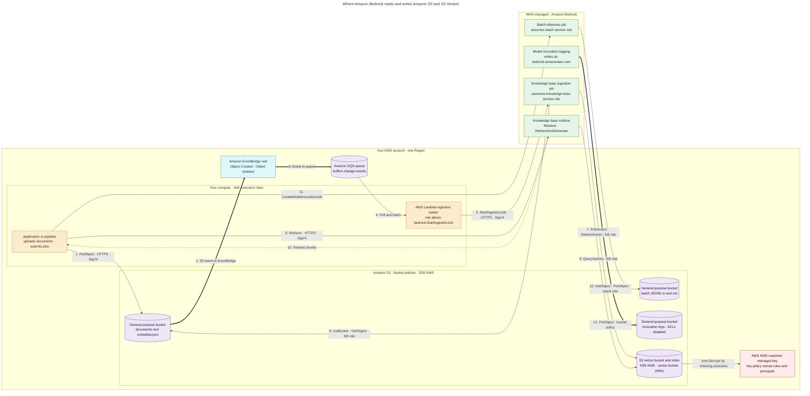

# Amazon S3 and Amazon S3 Vectors

> **Level:** Intermediate · **Verified:** 2026-11-15 · **Feature status:** GA · **Time:** ~30 min

Amazon S3 is where Amazon Bedrock reads and writes data in bulk: knowledge base documents, batch
inference files, invocation logs, training and evaluation datasets, and Data Automation results.
Amazon S3 Vectors is a separate bucket type that a customer-managed knowledge base can use as its
vector store. This chapter maps every one of those interactions — who calls whom, with which
identity — and shows how to secure them.

## Learning objectives

After this chapter you can:

- List the Bedrock features that read from or write to Amazon S3 and say which identity each one uses.
- Write the bucket policy and KMS key policy for a feature that writes as a service principal, and the role policy for one that uses a service role.
- Explain how a knowledge base uses an S3 vector bucket and index, and quote the limits that shape the design.
- Build event-driven ingestion from S3 change events, within the ingestion quotas.
- Decide when S3 Vectors is the right vector store and when it is not.

## Prerequisites

- [Amazon S3, AWS Lambda and Amazon API Gateway](../../00-foundations/aws-fundamentals/02-s3-lambda-api-gateway.md)
- [Resource-based policies](../../00-foundations/security/03-resource-policies.md) and [AWS KMS and encryption](../../00-foundations/security/04-kms-encryption.md)
- [Customer-managed knowledge bases and vector stores](../../01-amazon-bedrock/knowledge-bases/03-customer-managed-knowledge-bases.md) and [Ingestion, parsing and chunking](../../01-amazon-bedrock/knowledge-bases/04-ingestion-parsing-chunking.md)

## Concept in plain language

Think of Bedrock as a contractor who works in your warehouse (S3). Some jobs come with a **badge
you issue** — a service role: the contractor wears it to open the shelves you allowed. Other jobs
are **deliveries to your loading dock**: Bedrock drops log files off under its own name, so the
dock door (the bucket policy) must say who may deliver. A few jobs use **your own badge** — the
identity that started the job.

S3 Vectors is a second kind of warehouse built for one product: lists of numbers (vectors) that
you search by "closest to this one". It is cheap to store in and you pay per search, which suits
large collections that are not queried every second.

## How it really works

### Three ways Bedrock gets into a bucket

| Access model | How it is authorised | Features that use it |
|:--|:--|:--|
| **Service role** | A role you pass in the request (`roleArn`); trust policy for `bedrock.amazonaws.com`; S3 and KMS permissions on the role | Knowledge base ingestion, batch inference, model customization, model evaluation |
| **Service principal** | Bedrock writes as `bedrock.amazonaws.com`; the **bucket policy** and **key policy** allow it, narrowed by `aws:SourceAccount` and `aws:SourceArn` | Model invocation logging |
| **Calling identity** | The IAM principal that submitted the job needs the S3 permissions itself | Advanced Prompt Optimization (documented); Data Automation (see the note below) |

> [!NOTE]
> **Documented fact** — "If a feature uses a service role, you must configure the permissions such
> that the service role, rather than the user's IAM identity, has access to the S3 data." A bucket
> in another account additionally needs a bucket policy for that identity.
> Source: [Configure access to Amazon S3 buckets](https://docs.aws.amazon.com/bedrock/latest/userguide/s3-bucket-access.html)

`InvokeDataAutomationAsync` has no role parameter (request members: `inputConfiguration`,
`outputConfiguration`, `dataAutomationProfileArn` and optional settings, per the SDK model in the
[API operations reference](../../references/bedrock-api-operations.md)). Which identity Bedrock
Data Automation uses to read the input object and write the output is
**UNVERIFIED — REQUIRES DOCUMENTATION REVIEW**: the
[API reference](https://docs.aws.amazon.com/bedrock/latest/APIReference/API_data-automation-runtime_InvokeDataAutomationAsync.html)
and [Using the Data Automation API](https://docs.aws.amazon.com/bedrock/latest/userguide/bda-using-api.html)
pages read for this chapter do not say.

### Integration with Amazon Bedrock

| Interaction | Initiator (who calls whom) | Direction of data | Identity used | Network path |
|:--|:--|:--|:--|:--|
| Knowledge base sync from an S3 data source (`StartIngestionJob`) | You start the job; Bedrock then calls S3 | Documents and `.metadata.json` files: S3 → Bedrock | Knowledge base service role: `s3:ListBucket`, `s3:GetObject`; `kms:Decrypt` with `kms:ViaService` = `s3.<region>.amazonaws.com` | Inside the AWS-managed service to the Regional S3 endpoint; your VPC is not involved. Bucket in the knowledge base's Region |
| Multimodal storage destination | Bedrock calls S3 during ingestion | Extracted images: Bedrock → S3; returned as references at query time | Knowledge base service role: `s3:PutObject`, `s3:GetObject`, `s3:DeleteObject`, `s3:ListBucket` | AWS-managed |
| S3 Vectors as the vector store | Bedrock calls `s3vectors` during ingestion and retrieval | Vectors, chunk text, metadata: Bedrock → index (`PutVectors`, `DeleteVectors`); results: index → Bedrock (`QueryVectors`) | Knowledge base service role (`s3vectors:*Vectors`, `GetIndex` on the index ARN); optional vector bucket policy; KMS key policy for `indexing.s3vectors.amazonaws.com` | AWS-managed; vector buckets always block public access |
| Batch inference (`CreateModelInvocationJob`) | You submit; Bedrock calls S3 | JSONL records: S3 → Bedrock; results and manifest: Bedrock → S3 | Batch service role: `s3:GetObject`, `s3:PutObject`, `s3:ListBucket`; `kms:Decrypt` / `kms:GenerateDataKey` via S3 | AWS-managed, or through network interfaces in your subnets when the job sets `vpcConfig` |
| Model invocation logging | Bedrock calls S3 after each `bedrock-runtime` call | Prompts, responses, metadata: Bedrock → S3 | **No role**: the bucket policy allows `bedrock.amazonaws.com` `s3:PutObject`; the key policy allows `kms:GenerateDataKey` | AWS-managed; bucket in the same account and Region |
| Model customization (`CreateModelCustomizationJob`) | You submit; Bedrock calls S3 | Training and validation data: S3 → Bedrock; output files: Bedrock → S3 | Customization service role (`s3:GetObject`, `s3:ListBucket`; `s3:PutObject` on output) | AWS-managed, or your VPC with `vpcConfig` |
| Model evaluation (`CreateEvaluationJob`) | You submit; Bedrock calls S3 | Prompt dataset: S3 → Bedrock; results: Bedrock → S3 | Evaluation service role. Human-based jobs created in the console need a CORS rule on the output bucket | AWS-managed |
| Bedrock Data Automation (`InvokeDataAutomationAsync`) | Your code calls Bedrock; Bedrock reads and writes S3 | File: S3 → Bedrock; extraction results: Bedrock → S3; optional EventBridge notification | **UNVERIFIED** (no role parameter; see above) | AWS-managed |
| S3 change events → ingestion | S3 emits events; **your** code calls `StartIngestionJob` | Event: S3 → EventBridge → your queue or function | Your function's execution role (`bedrock:StartIngestionJob`) | Your compute to the `bedrock-agent` endpoint (public or interface endpoint). **No native S3-event trigger exists** |

Sources: [Create a service role for Knowledge Bases](https://docs.aws.amazon.com/bedrock/latest/userguide/kb-permissions.html),
[Batch inference service role](https://docs.aws.amazon.com/bedrock/latest/userguide/batch-iam-sr.html),
[Model invocation logging](https://docs.aws.amazon.com/bedrock/latest/userguide/model-invocation-logging.html),
[Model customization service role](https://docs.aws.amazon.com/bedrock/latest/userguide/model-customization-iam-role.html),
[Evaluation service roles](https://docs.aws.amazon.com/bedrock/latest/userguide/model-evaluation-security-service-roles.html),
[CORS for human evaluation](https://docs.aws.amazon.com/bedrock/latest/userguide/model-evaluation-security-cors.html),
[Advanced Prompt Optimization prerequisites](https://docs.aws.amazon.com/bedrock/latest/userguide/advanced-prompt-optimization-prereqs.html),
[Using S3 Vectors with Knowledge Bases](https://docs.aws.amazon.com/AmazonS3/latest/userguide/s3-vectors-bedrock-kb.html).
The feature chapters go deeper: [Batch inference](../../01-amazon-bedrock/inference/08-batch-inference.md),
[Model customization](../../01-amazon-bedrock/foundation-models/03-model-customization.md),
[Model and RAG evaluation](../../01-amazon-bedrock/model-evaluation/01-model-evaluation.md),
[Amazon Bedrock Data Automation](../../01-amazon-bedrock/data-automation/01-bedrock-data-automation.md).

> [!IMPORTANT]
> **Status** — Model invocation logging captures only `bedrock-runtime` calls (including the
> OpenAI-compatible APIs on that endpoint); calls to `bedrock-mantle` are not captured. Logging is
> off by default. Source: [Model invocation logging](https://docs.aws.amazon.com/bedrock/latest/userguide/model-invocation-logging.html)

### Amazon S3 Vectors

S3 Vectors has its own namespace (`s3vectors`) and three resources: a **vector bucket**, **vector
indexes** inside it, and **vectors** (a key, the float values, and metadata) inside an index.
Writes are strongly consistent; queries take under a second when infrequent and "as low as 100
milliseconds" when frequent. Block Public Access is always on and cannot be disabled.
Source: [What is Amazon S3 Vectors?](https://docs.aws.amazon.com/AmazonS3/latest/userguide/s3-vectors.html)

| Limit (per the S3 User Guide) | Value |
|:--|--:|
| Vector buckets per Region per account | 10,000 |
| Vector indexes per vector bucket | 10,000 |
| Vectors per index | up to 2 billion |
| Dimensions | 1–4,096 |
| Metadata per vector (filterable + non-filterable) / filterable only | 40 KB / 2 KB |
| Metadata keys per vector / non-filterable keys per index | 50 / 10 |
| `PutVectors` + `DeleteVectors` requests per second per index | up to 1,000 |
| Vectors per `PutVectors` call / top-K per `QueryVectors` | 500 / 10,000 |

Source: [S3 Vectors limitations and restrictions](https://docs.aws.amazon.com/AmazonS3/latest/userguide/s3-vectors-limitations.html)

**Fixed at creation.** An index's name, dimension, distance metric (`Cosine` or `Euclidean`) and
non-filterable keys cannot change. A bucket's encryption (SSE-S3 by default, or SSE-KMS with a
key given by full ARN) cannot change either; an index may override it at creation.
Sources: [Vector indexes](https://docs.aws.amazon.com/AmazonS3/latest/userguide/s3-vectors-indexes.html),
[S3 Vectors encryption](https://docs.aws.amazon.com/AmazonS3/latest/userguide/s3-vectors-data-encryption.html)

> [!IMPORTANT]
> **Status** — Indexes now have an **index mode**. Vector buckets created on or after
> **2026-09-30** default to `ENHANCED` (pre-filtering, higher recall on filtered queries, up to
> 100 filter constraints, `$startsWith`), and their indexes cannot use `CLASSIC`. Older buckets
> default to `CLASSIC`, where filtered queries may return fewer than top-K results;
> `UpdateIndexMode` moves an index. The Terraform resource `aws_s3vectors_index` in provider 6.73.0
> has no index-mode argument. Source: [Vector indexes — index mode](https://docs.aws.amazon.com/AmazonS3/latest/userguide/s3-vectors-indexes.html),
> [Metadata filtering](https://docs.aws.amazon.com/AmazonS3/latest/userguide/s3-vectors-metadata-filtering.html)

**How a knowledge base uses it.** Bedrock writes each chunk as one vector and stores the chunk text
and its own bookkeeping as metadata, so the index needs `AMAZON_BEDROCK_TEXT` and
`AMAZON_BEDROCK_METADATA` declared non-filterable. Through a knowledge base you get up to **1 KB
of custom metadata and 35 keys per vector**; an ingestion job fails when a vector exceeds that.
Search is **semantic only** (no hybrid), vectors are **float32 only**, and hierarchical chunking —
or the table-and-figure context that parsing attaches — can exceed the metadata limit.
Source: [Prerequisites for a vector store you created — S3 Vectors tab](https://docs.aws.amazon.com/bedrock/latest/userguide/knowledge-base-setup.html)

The [customer-managed knowledge base chapter](../../01-amazon-bedrock/knowledge-bases/03-customer-managed-knowledge-bases.md)
lists `startsWith` as unsupported on S3 Vectors. S3 Vectors itself now supports `$startsWith` on
`ENHANCED` indexes; whether a knowledge base `Retrieve` filter with `startsWith` reaches it is
**UNVERIFIED — REQUIRES DOCUMENTATION REVIEW** (the Bedrock pages read for this chapter do not
mention index modes).

## Architecture diagram



**What this shows** — every data store is in your account and every Bedrock component is in the
AWS-managed boundary. Each arrow that crosses the boundary names the identity it uses: a service
role you created (6, 7, 9, 12), the Bedrock service principal admitted by a bucket policy (13), or
your own execution role (5). Nothing on the Bedrock side has a network interface in your VPC.

**Walkthrough**

1. Your application writes a document (and its optional metadata file) to the documents bucket.
2. With EventBridge notifications enabled on the bucket, S3 sends an `Object Created` event.
3. A rule matches events for that bucket and puts them on an SQS queue.
4. A starter function drains the queue in batches — many file changes become one sync.
5. It calls `StartIngestionJob` with its own role. This is your code; Bedrock has no built-in S3 trigger.
6. The ingestion job lists and reads changed objects with the knowledge base service role.
7. It writes vectors for new or changed chunks and deletes vectors of removed documents.
8. A user question arrives at the runtime endpoint.
9. Bedrock embeds the question and calls `QueryVectors` with the same service role.
10. Ranked chunks with their S3 source locations return to the application.
11. A batch job is submitted with a service role and two S3 locations.
12. The batch job reads JSONL input and writes results with that role.
13. After each `bedrock-runtime` call, logging delivers records under its own service principal.

| Legend | Meaning |
|:--|:--|
| Solid arrow | Request or write |
| Dashed arrow | Response |
| Thick arrow | Asynchronous event or delivery |
| Cylinder | Data at rest |
| Outer boxes | Your account versus the AWS-managed Bedrock boundary |
| Red box | Security control (KMS key) |

**Variations** — a Managed Knowledge Base reads the same S3 bucket but stores vectors in
AWS-managed storage, not S3 Vectors, and offers sync schedules (`daily`, `weekly`, `monthly`), so
steps 2–5 become optional ([Managed Knowledge Base](../../01-amazon-bedrock/knowledge-bases/02-managed-knowledge-base.md)).
With OpenSearch Serverless or Aurora, steps 7 and 9 go to those stores instead
([OpenSearch](../databases/01-opensearch.md), [Aurora](../databases/02-aurora-pgvector-and-rds.md)).
A batch job with `vpcConfig` reaches S3 from network interfaces in your subnets.
The full ingestion picture is [diagram set 6](../../diagrams/mermaid/06-knowledge-base-ingestion-pipeline.md).

## Implementation details

### Bucket policies and KMS for Bedrock

1. **Service-role features (knowledge bases, batch, customization, evaluation).** Grant S3 actions
   on the role, scoped to buckets and prefixes, with `aws:ResourceAccount`. A same-account bucket
   needs no bucket policy. For SSE-KMS, give the role `kms:Decrypt` (read) and
   `kms:GenerateDataKey` (write) with `kms:ViaService` = `s3.<region>.amazonaws.com` — the call
   to KMS is made by S3, not by Bedrock. A missing key permission on a batch job is reported as
   an S3 `GetObject`/`PutObject` validation failure, minutes after submission.
2. **Invocation logging.** The bucket policy admits `bedrock.amazonaws.com` to
   `<prefix>/AWSLogs/<account>/BedrockModelInvocationLogs/*`, conditioned on `aws:SourceAccount`
   and `aws:SourceArn`; ACLs must be disabled for the policy to take effect. With SSE-KMS, the key
   policy allows the same principal `kms:GenerateDataKey`.
3. **Cross-account S3 data source.** The knowledge base role needs the permissions, **and** the
   bucket owner's bucket policy (and key policy) must name it; the data source records the
   `bucketOwnerAccountId`.
4. **S3 Vectors with a customer managed key.** The key policy must allow
   `indexing.s3vectors.amazonaws.com` `kms:Decrypt` (background index maintenance); principals that
   read or write vectors need `kms:Decrypt`, and creating the bucket needs `kms:GenerateDataKey`.
   With a custom service role, AWS also advises a vector bucket policy that restricts the bucket
   and index to that role.

Sources: [KB service role](https://docs.aws.amazon.com/bedrock/latest/userguide/kb-permissions.html),
[Batch service role](https://docs.aws.amazon.com/bedrock/latest/userguide/batch-iam-sr.html),
[Model invocation logging](https://docs.aws.amazon.com/bedrock/latest/userguide/model-invocation-logging.html),
[S3 Vectors encryption](https://docs.aws.amazon.com/AmazonS3/latest/userguide/s3-vectors-data-encryption.html),
[Using S3 Vectors with Knowledge Bases](https://docs.aws.amazon.com/AmazonS3/latest/userguide/s3-vectors-bedrock-kb.html).
Background: [AWS KMS, Secrets Manager and Parameter Store](../security/02-kms-secrets-manager-parameter-store.md).

### S3 events as an ingestion trigger

A sync is incremental — unchanged documents are skipped — but it is a job over the whole data
source, and the quotas are tight: `StartIngestionJob` allows 0.1 requests per second and one
job per data source and per knowledge base at a time (see
[Ingestion, parsing and chunking](../../01-amazon-bedrock/knowledge-bases/04-ingestion-parsing-chunking.md)).
One job per uploaded object therefore fails under load. AWS's own sample design routes S3 events
through EventBridge, buffers them in SQS and orchestrates syncs with Step Functions and a DynamoDB
change log, "while respecting service quotas and rate limits".
Source: [Build and deploy an automatic sync solution for Amazon Bedrock Knowledge Bases](https://aws.amazon.com/blogs/machine-learning/build-and-deploy-an-automatic-sync-solution-for-amazon-bedrock-knowledge-bases/)

> [!TIP]
> **Academy recommendation** — Debounce: start at most one sync per data source per window (for
> example, five minutes) and only when no job is running; check with `ListIngestionJobs`. For a
> single document that must be searchable at once, use `IngestKnowledgeBaseDocuments` instead —
> but never while a sync is running. This is our design guidance, not an official AWS reference
> architecture. More patterns: [EventBridge, SQS and SNS with Bedrock](../messaging/01-eventbridge-sqs-sns.md).

### When S3 Vectors fits — and when it does not

| Choose S3 Vectors when | Choose something else when |
|:--|:--|
| The corpus is large and queried occasionally (sub-second is acceptable) | You need hybrid (keyword + semantic) search — OpenSearch Serverless or Aurora |
| You want no capacity to size and no idle cost | You need binary vectors — only the OpenSearch stores support them |
| Metadata per chunk is small (≤ 1 KB custom, ≤ 35 keys) | You need rich per-chunk metadata or hierarchical chunking with large parents |
| One index per knowledge base is acceptable | Other applications must write to the same index — Bedrock assumes it is the only writer |

Wider comparison: [Vector store selection](../../09-advanced-topics/02-vector-store-selection.md).
S3 Vectors also integrates with OpenSearch: an index snapshot can be exported to OpenSearch
Serverless for high-QPS search ([What is S3 Vectors?](https://docs.aws.amazon.com/AmazonS3/latest/userguide/s3-vectors.html)).

## Example

**An encrypted S3 vector index locked to the knowledge base role, an invocation-log bucket, and a
documents bucket that announces changes to EventBridge.** Pair it with the knowledge base resource
in [Customer-managed knowledge bases](../../01-amazon-bedrock/knowledge-bases/03-customer-managed-knowledge-bases.md),
passing `vector_index_arn` as `s3_vectors_configuration.index_arn`.

> **Code status:** validated with `terraform fmt`, `terraform validate` and `tflint` (Terraform 1.17.2, `hashicorp/aws` 6.73.0, with a `versions.tf` that sets `required_version = ">= 1.11.0"` and `aws ~> 6.73`) · **never planned, applied or deployed**

```hcl
provider "aws" {
  region = var.region

  default_tags {
    tags = var.tags
  }
}

variable "region" {
  description = "Region for every resource. Bedrock, the buckets and the vector index must be in the same Region."
  type        = string
  default     = "us-east-1"
}

variable "name_prefix" {
  description = "Lowercase prefix for resource names; it is used in bucket names."
  type        = string
  default     = "academy-s3"
}

variable "knowledge_base_role_arn" {
  description = "ARN of the knowledge base service role that may read and write the vector index (created with the knowledge base)."
  type        = string
  default     = "arn:aws:iam::111122223333:role/academy-kb-service-role"
}

variable "embedding_dimensions" {
  description = "Must equal the dimensions of the embedding model the knowledge base uses."
  type        = number
  default     = 1024
}

variable "tags" {
  description = "Tags applied through default_tags."
  type        = map(string)
  default     = {}
}

data "aws_caller_identity" "current" {}
data "aws_partition" "current" {}

locals {
  account_id = data.aws_caller_identity.current.account_id
  partition  = data.aws_partition.current.partition
}

# ---------------------------------------------------------------------------
# 1. Customer managed key for the vector bucket. S3 Vectors needs the full key
#    ARN, and its indexing service principal needs kms:Decrypt.
# ---------------------------------------------------------------------------
data "aws_iam_policy_document" "vectors_key" {
  statement {
    sid       = "KeyAdministrationByThisAccount"
    actions   = ["kms:*"]
    resources = ["*"]

    principals {
      type        = "AWS"
      identifiers = ["arn:${local.partition}:iam::${local.account_id}:root"]
    }
  }

  statement {
    sid       = "AllowS3VectorsIndexing"
    actions   = ["kms:Decrypt"]
    resources = ["*"]

    principals {
      type        = "Service"
      identifiers = ["indexing.s3vectors.amazonaws.com"]
    }

    condition {
      test     = "StringEquals"
      variable = "aws:SourceAccount"
      values   = [local.account_id]
    }

    condition {
      test     = "ArnLike"
      variable = "aws:SourceArn"
      values   = ["arn:${local.partition}:s3vectors:${var.region}:${local.account_id}:bucket/*"]
    }

    condition {
      test     = "ForAnyValue:StringEquals"
      variable = "kms:EncryptionContextKeys"
      values   = ["aws:s3vectors:arn", "aws:s3vectors:resource-id"]
    }
  }

  statement {
    sid       = "AllowKnowledgeBaseRoleThroughS3Vectors"
    actions   = ["kms:Decrypt", "kms:GenerateDataKey"]
    resources = ["*"]

    principals {
      type        = "AWS"
      identifiers = [var.knowledge_base_role_arn]
    }

    condition {
      test     = "StringEquals"
      variable = "kms:ViaService"
      values   = ["s3vectors.${var.region}.amazonaws.com"]
    }
  }
}

resource "aws_kms_key" "vectors" {
  description         = "${var.name_prefix} vector bucket key"
  enable_key_rotation = true
  policy              = data.aws_iam_policy_document.vectors_key.json
}

# ---------------------------------------------------------------------------
# 2. Vector bucket and index. Encryption, dimension, metric and non-filterable
#    keys are fixed at creation.
# ---------------------------------------------------------------------------
resource "aws_s3vectors_vector_bucket" "kb" {
  vector_bucket_name = "${var.name_prefix}-vectors-${local.account_id}"

  encryption_configuration {
    sse_type    = "aws:kms"
    kms_key_arn = aws_kms_key.vectors.arn
  }
}

resource "aws_s3vectors_index" "kb" {
  index_name         = "${var.name_prefix}-index"
  vector_bucket_name = aws_s3vectors_vector_bucket.kb.vector_bucket_name
  data_type          = "float32"
  dimension          = var.embedding_dimensions
  distance_metric    = "cosine"

  metadata_configuration {
    non_filterable_metadata_keys = ["AMAZON_BEDROCK_TEXT", "AMAZON_BEDROCK_METADATA"]
  }
}

# Only the knowledge base role may touch vectors in this bucket.
data "aws_iam_policy_document" "vector_bucket" {
  statement {
    sid    = "DenyVectorDataAccessExceptKnowledgeBaseRole"
    effect = "Deny"
    actions = [
      "s3vectors:PutVectors",
      "s3vectors:GetVectors",
      "s3vectors:DeleteVectors",
      "s3vectors:QueryVectors",
      "s3vectors:ListVectors",
    ]
    resources = ["${aws_s3vectors_vector_bucket.kb.vector_bucket_arn}/index/*"]

    principals {
      type        = "AWS"
      identifiers = ["*"]
    }

    condition {
      test     = "ArnNotEquals"
      variable = "aws:PrincipalArn"
      values   = [var.knowledge_base_role_arn]
    }
  }
}

resource "aws_s3vectors_vector_bucket_policy" "kb" {
  vector_bucket_arn = aws_s3vectors_vector_bucket.kb.vector_bucket_arn
  policy            = data.aws_iam_policy_document.vector_bucket.json
}

# ---------------------------------------------------------------------------
# 3. Invocation log bucket: Bedrock writes with its service principal, so the
#    bucket policy (not a role) grants the write.
# ---------------------------------------------------------------------------
resource "aws_s3_bucket" "invocation_logs" {
  bucket = "${var.name_prefix}-invocation-logs-${local.account_id}"
}

resource "aws_s3_bucket_ownership_controls" "invocation_logs" {
  bucket = aws_s3_bucket.invocation_logs.id

  rule {
    object_ownership = "BucketOwnerEnforced"
  }
}

resource "aws_s3_bucket_public_access_block" "invocation_logs" {
  bucket                  = aws_s3_bucket.invocation_logs.id
  block_public_acls       = true
  block_public_policy     = true
  ignore_public_acls      = true
  restrict_public_buckets = true
}

data "aws_iam_policy_document" "invocation_logs" {
  statement {
    sid       = "AmazonBedrockLogsWrite"
    actions   = ["s3:PutObject"]
    resources = ["${aws_s3_bucket.invocation_logs.arn}/bedrock/AWSLogs/${local.account_id}/BedrockModelInvocationLogs/*"]

    principals {
      type        = "Service"
      identifiers = ["bedrock.amazonaws.com"]
    }

    condition {
      test     = "StringEquals"
      variable = "aws:SourceAccount"
      values   = [local.account_id]
    }

    condition {
      test     = "ArnLike"
      variable = "aws:SourceArn"
      values   = ["arn:${local.partition}:bedrock:${var.region}:${local.account_id}:*"]
    }
  }
}

resource "aws_s3_bucket_policy" "invocation_logs" {
  bucket = aws_s3_bucket.invocation_logs.id
  policy = data.aws_iam_policy_document.invocation_logs.json
}

resource "aws_bedrock_model_invocation_logging_configuration" "this" {
  logging_config {
    text_data_delivery_enabled      = true
    image_data_delivery_enabled     = false
    embedding_data_delivery_enabled = false
    video_data_delivery_enabled     = false

    s3_config {
      bucket_name = aws_s3_bucket.invocation_logs.id
      key_prefix  = "bedrock"
    }
  }

  depends_on = [aws_s3_bucket_policy.invocation_logs]
}

# ---------------------------------------------------------------------------
# 4. Documents bucket that announces changes to EventBridge. A rule buffers
#    Object Created / Object Deleted events in SQS for an ingestion starter.
# ---------------------------------------------------------------------------
resource "aws_s3_bucket" "documents" {
  bucket = "${var.name_prefix}-documents-${local.account_id}"
}

resource "aws_s3_bucket_public_access_block" "documents" {
  bucket                  = aws_s3_bucket.documents.id
  block_public_acls       = true
  block_public_policy     = true
  ignore_public_acls      = true
  restrict_public_buckets = true
}

resource "aws_s3_bucket_notification" "documents" {
  bucket      = aws_s3_bucket.documents.id
  eventbridge = true
}

resource "aws_sqs_queue" "ingestion_requests" {
  name                      = "${var.name_prefix}-ingestion-requests"
  message_retention_seconds = 86400
  sqs_managed_sse_enabled   = true
}

resource "aws_cloudwatch_event_rule" "document_changed" {
  name        = "${var.name_prefix}-document-changed"
  description = "Objects created or deleted in the knowledge base documents bucket"

  event_pattern = jsonencode({
    source      = ["aws.s3"]
    detail-type = ["Object Created", "Object Deleted"]
    detail = {
      bucket = { name = [aws_s3_bucket.documents.id] }
    }
  })
}

resource "aws_cloudwatch_event_target" "to_queue" {
  rule = aws_cloudwatch_event_rule.document_changed.name
  arn  = aws_sqs_queue.ingestion_requests.arn
}

data "aws_iam_policy_document" "ingestion_queue" {
  statement {
    sid       = "AllowEventBridgeRule"
    actions   = ["sqs:SendMessage"]
    resources = [aws_sqs_queue.ingestion_requests.arn]

    principals {
      type        = "Service"
      identifiers = ["events.amazonaws.com"]
    }

    condition {
      test     = "ArnEquals"
      variable = "aws:SourceArn"
      values   = [aws_cloudwatch_event_rule.document_changed.arn]
    }
  }
}

resource "aws_sqs_queue_policy" "ingestion_requests" {
  queue_url = aws_sqs_queue.ingestion_requests.id
  policy    = data.aws_iam_policy_document.ingestion_queue.json
}

output "vector_index_arn" {
  description = "Pass as s3_vectors_configuration.index_arn when you create the knowledge base."
  value       = aws_s3vectors_index.kb.index_arn
}

output "ingestion_queue_url" {
  description = "Queue that an ingestion starter (Lambda or Step Functions) drains before calling StartIngestionJob."
  value       = aws_sqs_queue.ingestion_requests.id
}
```

Notes on the example:

- The vector bucket policy denies vector data actions to every principal except the knowledge base
  role. Administrators can still manage the bucket and index; tighten further if needed.
- `BucketOwnerEnforced` disables ACLs on the log bucket, which logging requires.
- The queue only buffers events; the function that drains it and calls `StartIngestionJob` is
  covered in [AWS Lambda with Bedrock](../compute/01-lambda.md).
- A reusable version of the vector store lives in the planned module
  [knowledge-base-s3-vectors](../../04-infrastructure-as-code/terraform/modules/knowledge-base-s3-vectors/README.md).

> [!CAUTION]
> **Cost hazard** — applying this in a sandbox creates a KMS key (monthly charge), S3 storage, SQS
> requests, and invocation logs that grow with every model call. Destroy the stack and empty the
> buckets when you finish. Nothing in this repository has been applied to an AWS account.

## Common mistakes

> [!WARNING]
> **Common mistake** — giving the knowledge base role `s3:GetObject` on a whole bucket "to keep it
> simple". Data source operations do not pass a role, so anyone allowed to edit data sources can
> point ingestion at any prefix the role can read and then read it back through `Retrieve`.
> Source: [Create a service role for Knowledge Bases](https://docs.aws.amazon.com/bedrock/latest/userguide/kb-permissions.html)

| Mistake | Symptom | Fix |
|:--|:--|:--|
| One `StartIngestionJob` per uploaded file | Throttling and conflict errors; missed changes | Buffer events and debounce, as above |
| SSE-KMS bucket, key permission missing on the batch role | Job accepted, then fails with an S3 `GetObject`/`PutObject` message | Add `kms:Decrypt` / `kms:GenerateDataKey` via S3 |
| Log bucket with ACLs enabled or in another Region | Logging configuration fails or no logs arrive | Same account and Region; `BucketOwnerEnforced` |
| Index without `AMAZON_BEDROCK_TEXT` / `AMAZON_BEDROCK_METADATA` as non-filterable | Ingestion exception: metadata over the filterable limit | Recreate the index; the keys are fixed at creation |
| Key alias instead of key ARN for S3 Vectors | Bucket creation rejected | Use the full key ARN |
| Expecting hybrid search from an S3 Vectors knowledge base | Keyword-heavy questions retrieve poorly | Choose OpenSearch Serverless or Aurora |
| Human evaluation job without CORS on the output bucket | Annotators cannot see prompts | Add the documented CORS rule |

## Security considerations

- **Least privilege per feature.** One role per knowledge base or job type, scoped to prefixes; the
  trust policy carries `aws:SourceAccount` and an `aws:SourceArn` for that resource type.
- **Confused deputy.** Bucket and key policies that admit `bedrock.amazonaws.com` must condition on
  `aws:SourceAccount` and `aws:SourceArn`.
- **Logs are sensitive data.** Invocation logs contain full prompts and responses; Converse image
  and document inputs are written to S3. Treat the log bucket like the source data
  ([Data protection and privacy](../../06-security-governance/03-data-protection-and-privacy.md)).
- **Encryption.** S3 Vectors encryption is fixed at bucket creation — decide on SSE-KMS first.
- **Network.** Bedrock-side S3 access stays inside AWS. Your own uploads and API calls can stay
  private through S3 gateway endpoints and Bedrock interface endpoints
  ([Private connectivity for Bedrock](../networking/01-private-connectivity-for-bedrock.md)).
- **Poisoned documents.** Anyone who can write to the documents bucket can influence answers
  ([Prompt injection and retrieval poisoning](../../06-security-governance/04-prompt-injection-and-untrusted-content.md)).

## Cost considerations

- **General purpose buckets:** storage, requests and data transfer as usual; batch and logging add
  objects at volume. Lifecycle rules on log and batch-output prefixes keep this bounded.
- **S3 Vectors** has three meters: **PUT** per logical GB uploaded (vector data, key and all
  metadata; minimum 128 KB per request), **storage** per logical GB-month, and **queries** — a
  per-request fee, a per-TB "data processed" charge computed from the size of the **whole index
  queried**, and a per-GB data-returned charge. Non-filterable metadata is excluded from data
  processed, which is one more reason Bedrock's text key is non-filterable.
  Source: [Amazon S3 pricing — S3 Vectors](https://aws.amazon.com/s3/pricing/)
- **Our reading:** because each query is billed on the index size, cost grows with
  *queries × index size*. Many small indexes (for example, one per tenant) query cheaper than one
  giant index; high-QPS workloads may be cheaper on OpenSearch.
- **KMS:** customer managed keys add a monthly charge and per-request charges for every S3 data key
  operation. See [Pricing model and cost drivers](../../08-cost-performance-and-reliability/01-pricing-model-and-cost-drivers.md).

## Knowledge check

1. A batch job fails ten minutes after submission with a message that Bedrock cannot validate `GetObject` on the input bucket. The role has `s3:GetObject`. What do you check next?
2. Why does the invocation-log bucket need a bucket policy while the knowledge base documents bucket in the same account does not?
3. You upload 2,000 files in a minute and a Lambda function calls `StartIngestionJob` for each. What happens, and what should the design be?
4. A team wants keyword and semantic search over 50 million chunks with a rich metadata schema. Is S3 Vectors a good store for this knowledge base?
5. What breaks if the vector bucket uses SSE-KMS but the key policy does not allow `indexing.s3vectors.amazonaws.com`?

<details>
<summary>Answers</summary>

1. The KMS key. If the bucket uses SSE-KMS, the role needs `kms:Decrypt` (and `kms:GenerateDataKey` for output) via S3; the error message mentions S3, not KMS.
2. Logging writes as the `bedrock.amazonaws.com` service principal, which needs a resource-policy grant. Ingestion uses a service role in your account, and a same-account bucket needs only the role's identity policy.
3. Most calls are throttled (0.1 requests per second) or conflict with the running job (one job per data source). Buffer events and start one sync per data source per window, or use direct ingestion for urgent single documents.
4. Not on its own: S3 Vectors is semantic-only and allows 1 KB of custom metadata and 35 keys per vector through a knowledge base. OpenSearch Serverless or Aurora fit better.
5. S3 Vectors cannot decrypt data for background index maintenance, so the index cannot be maintained; the key policy must grant that principal `kms:Decrypt`.

</details>

## Further reading

Official sources opened while writing this chapter:

- [Configure access to Amazon S3 buckets](https://docs.aws.amazon.com/bedrock/latest/userguide/s3-bucket-access.html) — service role versus identity, cross-account buckets.
- [Create a service role for Amazon Bedrock Knowledge Bases](https://docs.aws.amazon.com/bedrock/latest/userguide/kb-permissions.html) — S3, S3 Vectors, multimodal storage and KMS statements.
- [Prerequisites for using a vector store you created](https://docs.aws.amazon.com/bedrock/latest/userguide/knowledge-base-setup.html) — the S3 Vectors tab and its limits.
- [Using S3 Vectors with Amazon Bedrock Knowledge Bases](https://docs.aws.amazon.com/AmazonS3/latest/userguide/s3-vectors-bedrock-kb.html) — integration and limitations.
- [What is Amazon S3 Vectors?](https://docs.aws.amazon.com/AmazonS3/latest/userguide/s3-vectors.html), [Vector indexes](https://docs.aws.amazon.com/AmazonS3/latest/userguide/s3-vectors-indexes.html), [Metadata filtering](https://docs.aws.amazon.com/AmazonS3/latest/userguide/s3-vectors-metadata-filtering.html), [Limitations](https://docs.aws.amazon.com/AmazonS3/latest/userguide/s3-vectors-limitations.html), [Encryption](https://docs.aws.amazon.com/AmazonS3/latest/userguide/s3-vectors-data-encryption.html).
- [Monitor model invocation using CloudWatch Logs and Amazon S3](https://docs.aws.amazon.com/bedrock/latest/userguide/model-invocation-logging.html) — bucket and key policies, log format.
- [Create a custom service role for batch inference](https://docs.aws.amazon.com/bedrock/latest/userguide/batch-iam-sr.html) — S3 and KMS permissions and the misleading error.
- [Create a service role for model customization](https://docs.aws.amazon.com/bedrock/latest/userguide/model-customization-iam-role.html) — training and output buckets.
- [Service role requirements for model evaluation jobs](https://docs.aws.amazon.com/bedrock/latest/userguide/model-evaluation-security-service-roles.html) and [CORS permissions](https://docs.aws.amazon.com/bedrock/latest/userguide/model-evaluation-security-cors.html).
- [Advanced Prompt Optimization prerequisites](https://docs.aws.amazon.com/bedrock/latest/userguide/advanced-prompt-optimization-prereqs.html) — calling-identity access to S3.
- [InvokeDataAutomationAsync](https://docs.aws.amazon.com/bedrock/latest/APIReference/API_data-automation-runtime_InvokeDataAutomationAsync.html) and [Using the Data Automation API](https://docs.aws.amazon.com/bedrock/latest/userguide/bda-using-api.html).
- [Build and deploy an automatic sync solution for Amazon Bedrock Knowledge Bases](https://aws.amazon.com/blogs/machine-learning/build-and-deploy-an-automatic-sync-solution-for-amazon-bedrock-knowledge-bases/) — AWS's event-driven sync design.
- [Amazon S3 pricing](https://aws.amazon.com/s3/pricing/) — S3 Vectors meters.
- Terraform: [`aws_s3vectors_vector_bucket`](https://raw.githubusercontent.com/hashicorp/terraform-provider-aws/main/website/docs/r/s3vectors_vector_bucket.html.markdown), [`aws_s3vectors_index`](https://raw.githubusercontent.com/hashicorp/terraform-provider-aws/main/website/docs/r/s3vectors_index.html.markdown), [`aws_s3vectors_vector_bucket_policy`](https://raw.githubusercontent.com/hashicorp/terraform-provider-aws/main/website/docs/r/s3vectors_vector_bucket_policy.html.markdown).
- [Feature verification matrix](../../FEATURE-VERIFICATION.md) — the academy's register.
