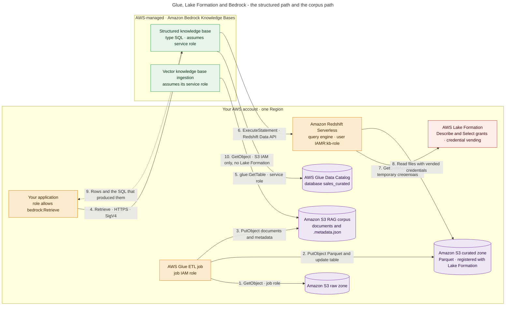

# AWS Glue and AWS Lake Formation

> **Level:** Intermediate · **Verified:** 2026-11-15 · **Feature status:** GA · **Time:** ~20 min

AWS Glue prepares and catalogues data; AWS Lake Formation decides who may read catalogued tables.
Amazon Bedrock meets them in exactly one native place — a **structured knowledge base** whose data
store is the AWS Glue Data Catalog — and otherwise only through pipelines you build. This chapter
draws that line precisely.

## Learning objectives

After this chapter you can:

- Explain where the Glue Data Catalog and Lake Formation take part in a Bedrock structured knowledge base, and which identity reads what.
- Grant a knowledge base service role the IAM, Lake Formation and Redshift permissions it needs, and no more.
- Use Glue jobs to prepare a RAG corpus, and say why that is not a Bedrock integration.
- State what Lake Formation does **not** protect when a vector knowledge base reads the same S3 data.

## Prerequisites

- [Structured data retrieval and GraphRAG](../../01-amazon-bedrock/knowledge-bases/06-structured-data-and-graphrag.md) — the structured knowledge base itself.
- [Amazon S3 and Amazon S3 Vectors](01-amazon-s3-and-s3-vectors.md)
- [IAM roles, trust policies and cross-account access](../../00-foundations/security/02-iam-roles-and-trust.md)

## Concept in plain language

A data lake is a library of files. The **Glue Data Catalog** is its card index: for each table, the
columns and where the files live. **Glue jobs** are the staff who clean and shelve new material.
**Lake Formation** is the reading-room desk: it checks your library card before handing out the
books a table points to.

Bedrock's structured knowledge base reads the card index, writes SQL, and asks Amazon Redshift to
fetch the rows — and Redshift goes through the desk. A *vector* knowledge base, by contrast, walks
straight into the stacks with its own key (S3 permissions): the desk never sees it.

## How it really works

### The one native path: Data Catalog as a structured data store

A knowledge base of type `SQL` uses Amazon Redshift as its query engine and one of two stores:
Redshift databases, or **AWS Glue Data Catalog (AWS Lake Formation)** tables, listed as
`database.table` or `database.*`. The Data Catalog store supports **IAM authentication only**. The
service role needs four things: Glue read actions on the catalog, database and tables;
`lakeformation:GetDataAccess` ("without this permission, queries to the knowledge base will fail");
Lake Formation **Describe** and **Select** grants on the databases and tables; and a Redshift user
`IAMR:<role name>` with `USAGE` on the `awsdatacatalog` database. S3 read and KMS decrypt may be
needed for the underlying files. AWS warns twice not to grant `CREATE`, `UPDATE` or `DELETE`.
Sources: [Set up your query engine and permissions](https://docs.aws.amazon.com/bedrock/latest/userguide/knowledge-base-prereq-structured.html),
[Create a structured knowledge base](https://docs.aws.amazon.com/bedrock/latest/userguide/knowledge-base-structured-create.html)

> [!NOTE]
> **Documented fact** — When an integrated service requests data at a location registered with
> Lake Formation, Lake Formation supplies temporary credentials; principals need Lake Formation
> data permissions **and** `lakeformation:GetDataAccess`. "The Lake Formation permissions model
> doesn't prevent access to Amazon S3 locations through the Amazon S3 API or console if you have
> access to them through IAM or Amazon S3 policies."
> Source: [Underlying data access control](https://docs.aws.amazon.com/lake-formation/latest/dg/access-control-underlying-data.html)

### Integration with Amazon Bedrock

| Interaction | Initiator (who calls whom) | Direction of data | Identity used | Network path |
|:--|:--|:--|:--|:--|
| Schema sync of a structured knowledge base (`StartIngestionJob`) | You start it; Bedrock reads table and column metadata | Catalog metadata → Bedrock. Rows are never copied or embedded | Knowledge base service role: `glue:GetDatabase(s)`, `GetTable(s)`, `GetPartition(s)`, `SearchTables`; Lake Formation `Describe` and `Select` grants | AWS-managed |
| Question to SQL (`GenerateQuery`, or inside `Retrieve` / `RetrieveAndGenerate`) | Your application calls Bedrock | Question and schema → generated SQL | Caller: `bedrock:GenerateQuery` or `bedrock:Retrieve`; service role: `bedrock:GenerateQuery`, `sqlworkbench:*SqlGenerationContext`, `GetSqlRecommendations` | Your caller to `bedrock-agent-runtime` (public or interface endpoint); generation is AWS-managed |
| SQL execution over catalog tables | Bedrock calls the Redshift Data API; Redshift resolves `awsdatacatalog`, asks Lake Formation for credentials and reads the files | Rows: S3 → Redshift → Bedrock → caller | Service role mapped to Redshift user `IAMR:<role>`; Lake Formation `Select`; `lakeformation:GetDataAccess` | Bedrock → Redshift Data API: **our reading**, the path is not documented ([Structured data retrieval](../../01-amazon-bedrock/knowledge-bases/06-structured-data-and-graphrag.md)). Redshift → S3 inside AWS |
| Vector knowledge base reading files under a Lake Formation–registered prefix | Bedrock ingestion job calls S3 | Files → Bedrock → vector store | Knowledge base service role's **S3** permissions. **No Lake Formation integration**: grants, tags and filters are not consulted | AWS-managed to S3 |
| Glue ETL job preparing a RAG corpus | Glue runs your script; the script may call Bedrock | Raw data → cleaned documents and `.metadata.json` → S3 | The Glue job's IAM role (`bedrock:InvokeModel` only if your script calls a model) | Job to S3; to Bedrock through the public endpoint or an interface endpoint if the job runs in your VPC (**our reading**). **No native integration** |
| Cataloguing Bedrock outputs (invocation logs, batch results) | A Glue crawler or your DDL reads S3 | S3 objects → catalog tables → Athena | Crawler or analyst role | Inside AWS. **No Bedrock involvement**; the logging page notes the S3 log data "can be catalogued for ETL using AWS Glue" |

Additional sources: [Generate a query for structured data](https://docs.aws.amazon.com/bedrock/latest/userguide/knowledge-base-generate-query.html),
[Model invocation logging](https://docs.aws.amazon.com/bedrock/latest/userguide/model-invocation-logging.html).

**Where there is no integration.** A Managed Knowledge Base has no structured or catalog store
([Knowledge Bases overview](../../01-amazon-bedrock/knowledge-bases/01-knowledge-bases-overview.md)).
No knowledge base data source connector reads Glue tables as documents. Lake Formation tag-based
access and data filters do not follow content into a vector store, and a vector knowledge base
gives every caller with `bedrock:Retrieve` the same view. Whether Lake Formation **row- or
cell-level data filters** on the service role's grant are enforced on structured-knowledge-base
queries is **UNVERIFIED — REQUIRES DOCUMENTATION REVIEW** (the Bedrock prerequisites page mentions
only `Describe` and `Select`).

> [!TIP]
> **Academy recommendation** — Give a structured knowledge base a **curated** database: a handful
> of well-named tables with column comments, not the raw lake. Comments become schema context for
> text-to-SQL, and a narrow grant limits what a prompt-injected query could read. This is our
> design guidance, not an official AWS reference architecture.

### Glue for RAG data preparation

Glue's part in unstructured RAG is ordinary data engineering: extract text from operational
exports, remove duplicates and boilerplate, split very large files, and write one document plus one
`<name>.metadata.json` per object into the knowledge base bucket. Metadata files are the only
channel for attributes you want to filter on later
([Ingestion, parsing and chunking](../../01-amazon-bedrock/knowledge-bases/04-ingestion-parsing-chunking.md)).
**Our reading:** keep parsing and chunking in Bedrock unless you need a transformation it cannot
do — the knowledge base then re-processes only changed documents, while a Glue rewrite of every
object forces a full re-embed.

## Architecture diagram



**What this shows** — two paths from the same data platform into Bedrock. The structured path goes
through Redshift and Lake Formation; the corpus path goes straight to S3 with IAM.

**Walkthrough**

1. A Glue job reads raw exports with its own role.
2. It writes curated Parquet files and updates the catalog table.
3. It writes cleaned documents and their metadata files for a vector knowledge base.
4. A user question reaches the structured knowledge base.
5. Bedrock reads table metadata from the catalog with the service role.
6. The generated SQL runs through the Redshift Data API as `IAMR:<role>` (**our reading** of the documented permissions).
7. Redshift asks Lake Formation for temporary credentials for the registered location.
8. Redshift reads only what the `Select` grant allows.
9. Rows (and the SQL) return; `RetrieveAndGenerate` would add a model answer.
10. A vector ingestion job reads the corpus with plain S3 permissions — Lake Formation is not involved.

| Legend | Meaning |
|:--|:--|
| Solid / dashed arrow | Request or write / response |
| Cylinder | Data at rest |
| Red box | Access-control service |
| Outer boxes | Your account / the AWS-managed Bedrock boundary |

**Variations** — with a Redshift **database** as the store (no catalog), steps 5, 7 and 8 become
Redshift `GRANT SELECT` checks; that variant is the example in
[Structured data retrieval and GraphRAG](../../01-amazon-bedrock/knowledge-bases/06-structured-data-and-graphrag.md).
A provisioned cluster replaces `redshift-serverless:GetCredentials` with
`redshift:GetClusterCredentialsWithIAM`. Redshift's own side is covered in
[Amazon Redshift, Amazon Kendra and AWS DMS](../databases/04-redshift-kendra-dms.md).

## Implementation details

1. **Register the location** that holds the table files with Lake Formation; otherwise Lake
   Formation has nothing to vend and S3 permissions decide.
2. **Grant in Lake Formation**: `DESCRIBE` on the database, `DESCRIBE` and `SELECT` on each table
   — to the knowledge base service role, not to end users.
3. **Grant in IAM**: Glue read actions on catalog, database and tables, and
   `lakeformation:GetDataAccess` on `*` (the action takes no resource ARN in the documented policy).
4. **Grant in Redshift**: create `IAMR:<role name>` and grant `USAGE ON DATABASE awsdatacatalog`
   **before the first sync** — a console-created role that syncs first gets a user without rights
   and the sync fails.
5. **List tables** in `aws_data_catalog_configuration.table_names` (`database.table`); a wildcard
   (`database.*`) also exposes tables added later.
6. **Re-sync after schema changes** so Bedrock's view of the columns matches the catalog.

> **Code status:** illustrative (copied from the documentation; run in Redshift query editor v2) · **never deployed**

```sql
CREATE USER "IAMR:academy-structured-kb-role" WITH PASSWORD DISABLE;
GRANT USAGE ON DATABASE awsdatacatalog TO "IAMR:academy-structured-kb-role";
```

## Example

**A curated catalog table and the Lake Formation and IAM grants a structured knowledge base needs.**
The knowledge base resource itself (`sql_knowledge_base_configuration` with
`storage_configuration { type = "AWS_DATA_CATALOG" }`) is in
[Amazon Redshift, Amazon Kendra and AWS DMS](../databases/04-redshift-kendra-dms.md).

> **Code status:** validated with `terraform fmt`, `terraform validate` and `tflint` (Terraform 1.17.2, `hashicorp/aws` 6.73.0, with a `versions.tf` that sets `required_version = ">= 1.11.0"` and `aws ~> 6.73`) · **never planned, applied or deployed**

```hcl
provider "aws" {
  region = var.region

  default_tags {
    tags = var.tags
  }
}

variable "region" {
  description = "Region of the Data Catalog, the data bucket and the knowledge base."
  type        = string
  default     = "us-east-1"
}

variable "knowledge_base_role_name" {
  description = "Name of the existing service role of the structured (SQL) knowledge base."
  type        = string
  default     = "academy-structured-kb-role"
}

variable "data_bucket_name" {
  description = "Existing S3 bucket that holds the curated Parquet files."
  type        = string
  default     = "academy-curated-data-111122223333"
}

variable "database_name" {
  description = "Glue Data Catalog database that the knowledge base may query."
  type        = string
  default     = "sales_curated"
}

variable "tags" {
  description = "Tags applied through default_tags."
  type        = map(string)
  default     = {}
}

data "aws_caller_identity" "current" {}
data "aws_partition" "current" {}

data "aws_iam_role" "kb" {
  name = var.knowledge_base_role_name
}

locals {
  account_id = data.aws_caller_identity.current.account_id
  partition  = data.aws_partition.current.partition
  bucket_arn = "arn:${local.partition}:s3:::${var.data_bucket_name}"
}

# 1. Register the curated prefix with Lake Formation so that Lake Formation,
#    not bucket-wide IAM grants, vends credentials to integrated engines.
resource "aws_lakeformation_resource" "curated" {
  arn                     = "${local.bucket_arn}/curated"
  use_service_linked_role = true
}

# 2. A catalog database and one table that the knowledge base may describe and read.
resource "aws_glue_catalog_database" "sales" {
  name        = var.database_name
  description = "Curated sales tables exposed to a Bedrock structured knowledge base"
}

resource "aws_glue_catalog_table" "orders" {
  name          = "orders"
  database_name = aws_glue_catalog_database.sales.name
  table_type    = "EXTERNAL_TABLE"
  description   = "One row per order. Column comments help text-to-SQL."

  parameters = {
    classification = "parquet"
  }

  storage_descriptor {
    location      = "s3://${var.data_bucket_name}/curated/orders/"
    input_format  = "org.apache.hadoop.hive.ql.io.parquet.MapredParquetInputFormat"
    output_format = "org.apache.hadoop.hive.ql.io.parquet.MapredParquetOutputFormat"

    ser_de_info {
      serialization_library = "org.apache.hadoop.hive.ql.io.parquet.serde.ParquetHiveSerDe"
    }

    columns {
      name    = "order_id"
      type    = "string"
      comment = "Unique order identifier"
    }

    columns {
      name    = "order_date"
      type    = "date"
      comment = "Calendar date the order was placed (UTC)"
    }

    columns {
      name    = "region"
      type    = "string"
      comment = "Sales region code, for example EMEA"
    }

    columns {
      name    = "amount_eur"
      type    = "decimal(12,2)"
      comment = "Order total in euros, after discounts"
    }
  }
}

# 3. Lake Formation grants for the knowledge base role: DESCRIBE on the database,
#    DESCRIBE and SELECT on the table. Never CREATE, ALTER, INSERT or DELETE.
resource "aws_lakeformation_permissions" "kb_database" {
  principal   = data.aws_iam_role.kb.arn
  permissions = ["DESCRIBE"]

  database {
    name = aws_glue_catalog_database.sales.name
  }
}

resource "aws_lakeformation_permissions" "kb_table" {
  principal   = data.aws_iam_role.kb.arn
  permissions = ["DESCRIBE", "SELECT"]

  table {
    database_name = aws_glue_catalog_database.sales.name
    name          = aws_glue_catalog_table.orders.name
  }
}

# 4. IAM side of the same grant, as listed in the Bedrock prerequisites page:
#    catalog reads plus lakeformation:GetDataAccess.
data "aws_iam_policy_document" "kb_catalog_access" {
  statement {
    sid = "ReadCatalogMetadata"
    actions = [
      "glue:GetDatabases",
      "glue:GetDatabase",
      "glue:GetTables",
      "glue:GetTable",
      "glue:GetPartitions",
      "glue:GetPartition",
      "glue:SearchTables",
    ]
    resources = [
      "arn:${local.partition}:glue:${var.region}:${local.account_id}:catalog",
      "arn:${local.partition}:glue:${var.region}:${local.account_id}:database/${aws_glue_catalog_database.sales.name}",
      "arn:${local.partition}:glue:${var.region}:${local.account_id}:table/${aws_glue_catalog_database.sales.name}/*",
    ]
  }

  statement {
    sid       = "LakeFormationCredentialVending"
    actions   = ["lakeformation:GetDataAccess"]
    resources = ["*"]
  }
}

resource "aws_iam_role_policy" "kb_catalog_access" {
  name   = "glue-catalog-and-lake-formation"
  role   = data.aws_iam_role.kb.name
  policy = data.aws_iam_policy_document.kb_catalog_access.json
}

output "table_name_for_knowledge_base" {
  description = "Value for aws_data_catalog_configuration.table_names (database.table)."
  value       = "${aws_glue_catalog_database.sales.name}.${aws_glue_catalog_table.orders.name}"
}
```

The role is looked up, not created, because the knowledge base owns it. In a real account the
Terraform principal must be a Lake Formation administrator (or hold grantable permissions) for the
two `aws_lakeformation_permissions` resources to apply.

> [!CAUTION]
> **Cost hazard** — the catalog objects are free at this scale, but the Redshift Serverless
> workgroup that answers queries bills while it runs. Destroy test resources when you finish.

## Common mistakes

> [!WARNING]
> **Common mistake** — assuming Lake Formation protects the same files when a *vector* knowledge
> base ingests them. It does not: the ingestion job uses S3 permissions, and the Lake Formation
> documentation says its model "doesn't prevent access … through the Amazon S3 API".

| Mistake | Symptom | Fix |
|:--|:--|:--|
| `lakeformation:GetDataAccess` missing from the role | Queries fail with an authorization error | Add the statement to the service role |
| First sync before `CREATE USER "IAMR:…"` and `GRANT` | Sync fails although the user now exists | Grant, then sync again |
| Granting `ALL` or `ALTER` in Lake Formation | Generated SQL could change data | `DESCRIBE` and `SELECT` only |
| Secrets Manager authentication with a catalog store | Not supported | Use IAM authentication |
| Raw-lake database with cryptic column names | Wrong or failing SQL | Curated tables with comments; add `generationContext` descriptions |

## Security considerations

- **Text-to-SQL runs generated code.** AWS calls arbitrary SQL "a security risk"; keep the grant
  read-only and narrow ([Structured data retrieval](../../01-amazon-bedrock/knowledge-bases/06-structured-data-and-graphrag.md)).
- **One identity for all callers.** Every query runs as `IAMR:<service role>`, so per-user rows
  cannot apply. Use one knowledge base per audience.
- **Two permission systems.** Review IAM *and* Lake Formation grants for the role; either can open data.
- **KMS.** If the files or the catalog are encrypted with your key, the role needs `kms:Decrypt`.
- **Glue job roles** that call Bedrock are application identities — scope `bedrock:InvokeModel`
  to model ARNs ([IAM and IAM Identity Center for Bedrock](../security/01-iam-and-identity-center.md)).

## Cost considerations

- **Glue:** ETL jobs and crawlers bill per DPU-hour by the second; the Data Catalog is free up to
  one million objects and one million accesses a month ([AWS Glue pricing](https://aws.amazon.com/glue/pricing/)).
- **Lake Formation:** creating permissions and their use by integrated services cost nothing; the
  services underneath bill as usual ([AWS Lake Formation pricing](https://aws.amazon.com/lake-formation/pricing/)).
- **Bedrock:** SQL generation is billed per request for structured knowledge bases; `RetrieveAndGenerate`
  adds model tokens ([Amazon Bedrock pricing](https://aws.amazon.com/bedrock/pricing/)).
- **Redshift** compute for every executed query is usually the largest line — see
  [Amazon Redshift, Amazon Kendra and AWS DMS](../databases/04-redshift-kendra-dms.md).

## Knowledge check

1. A security team registers the corpus bucket with Lake Formation and revokes `SELECT` from the vector knowledge base role. Does ingestion stop?
2. Which four grants does a structured knowledge base role need to query a catalog table?
3. Why should a structured knowledge base point at a curated database rather than the raw lake?
4. Your Glue job embeds chunks with `InvokeModel` and writes them to OpenSearch. Is that a Bedrock integration with Glue?

<details>
<summary>Answers</summary>

1. No. Ingestion reads the files with S3 IAM permissions, which Lake Formation does not block; remove the role's S3 access instead.
2. IAM Glue read actions; `lakeformation:GetDataAccess`; Lake Formation `Describe` and `Select`; and Redshift `USAGE` on `awsdatacatalog` for `IAMR:<role>`.
3. Clear names and comments improve the generated SQL, and a narrow read-only grant limits what any generated query can touch.
4. No. It is your code calling Bedrock with the job role — you own retries, quotas and the index (a self-managed pipeline, not a knowledge base).

</details>

## Further reading

Official sources opened while writing this chapter:

- [Set up your query engine and permissions for a structured data store](https://docs.aws.amazon.com/bedrock/latest/userguide/knowledge-base-prereq-structured.html) — Glue, Lake Formation and Redshift grants.
- [Create a knowledge base by connecting to a structured data store](https://docs.aws.amazon.com/bedrock/latest/userguide/knowledge-base-structured-create.html) — `AWS_DATA_CATALOG` configuration and query-generation context.
- [Generate a query for structured data](https://docs.aws.amazon.com/bedrock/latest/userguide/knowledge-base-generate-query.html) — `GenerateQuery`, `Retrieve`, `RetrieveAndGenerate` behaviour.
- [Underlying data access control](https://docs.aws.amazon.com/lake-formation/latest/dg/access-control-underlying-data.html) — registration, credential vending, `GetDataAccess`, the S3 API caveat.
- [Monitor model invocation using CloudWatch Logs and Amazon S3](https://docs.aws.amazon.com/bedrock/latest/userguide/model-invocation-logging.html) — log data in S3 for Glue and Athena.
- [AWS Glue pricing](https://aws.amazon.com/glue/pricing/), [AWS Lake Formation pricing](https://aws.amazon.com/lake-formation/pricing/) and [Amazon Bedrock pricing](https://aws.amazon.com/bedrock/pricing/).
- [Feature verification matrix](../../FEATURE-VERIFICATION.md) — register rows for structured retrieval.
