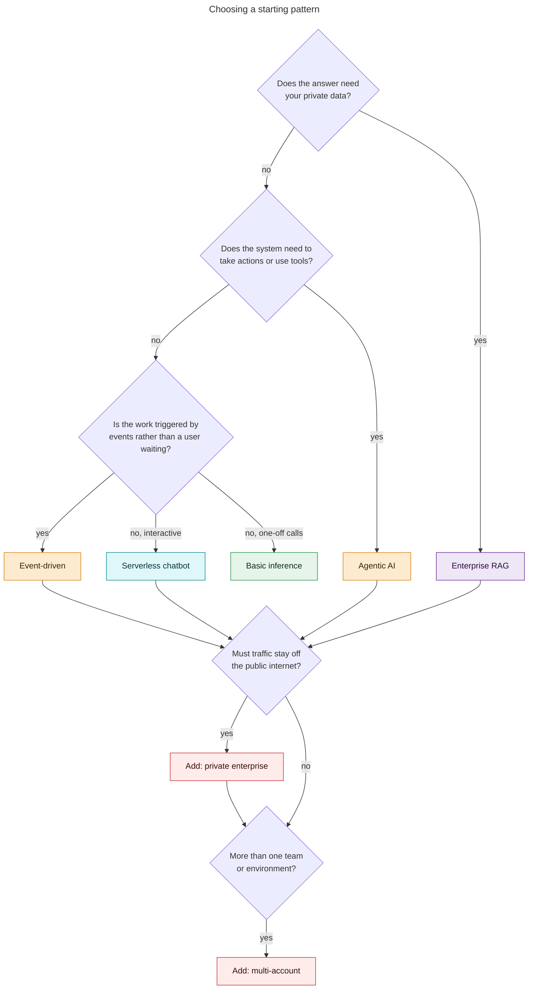

# Architecture patterns

> **Level:** Intermediate · **Verified:** 2026-11-15 · **Time:** about 3 days at 2 hours a day

Seven reference patterns. Each one is documented the same way: a conceptual diagram, a detailed
implementation diagram, a sequence diagram, a written explanation, and a practical example that
points at one of the [projects](../05-practical-projects/README.md).

[Academy home](../README.md) · [Diagram index](../diagrams/diagram-index.md) · Previous: [Related AWS services](../02-related-aws-services/README.md) · Next: [Infrastructure as Code](../04-infrastructure-as-code/README.md)

> [!IMPORTANT]
> **Status** — These are the academy's designs, built from documented service behaviour. They are
> **not official AWS reference architectures**. For AWS's own, see the
> [AWS Architecture Center](https://aws.amazon.com/architecture/) and the
> [AWS Solutions Library](https://aws.amazon.com/solutions/).

## Which pattern do you need?

The patterns compose: private networking and multi-account are layers you add to any of the
others, not alternatives to them.

## The patterns

| Pattern | Use it when | Numbered diagram set | Project |
|:--|:--|:--|:--|
| [Basic inference](basic-inference/README.md) | You need a model call with the right identity, logging and limits | [3](../diagrams/mermaid/03-model-inference-lifecycle.md), [4](../diagrams/mermaid/04-converse-api-application.md) | [A](../05-practical-projects/project-01-basic-inference/README.md) |
| [Serverless chatbot](serverless/README.md) | Interactive chat over HTTP with conversation state | [22](../diagrams/mermaid/22-serverless-enterprise-chatbot.md) | [B](../05-practical-projects/project-02-serverless-chatbot/README.md) |
| [Enterprise RAG](enterprise-rag/README.md) | Answers must be grounded in your documents with citations | [5](../diagrams/mermaid/05-enterprise-rag.md)–[9](../diagrams/mermaid/09-agentic-retrieval.md) | [C](../05-practical-projects/project-03-enterprise-rag/README.md) |
| [Agentic AI](agentic-ai/README.md) | The system plans, calls tools and keeps memory | [12](../diagrams/mermaid/12-agentcore-architecture.md)–[16](../diagrams/mermaid/16-agentcore-observability.md) | [D](../05-practical-projects/project-04-agentic-ai/README.md) |
| [Event-driven](event-driven/README.md) | Work arrives as events: documents, messages, schedules | [23](../diagrams/mermaid/23-event-driven-genai.md) | — |
| [Private enterprise](private-enterprise/README.md) | No public endpoints, customer managed keys, full audit trail | [24](../diagrams/mermaid/24-secure-private-enterprise-bedrock.md) | [E](../05-practical-projects/project-05-private-genai/README.md) |
| [Multi-account](multi-account/README.md) | Many teams and environments share one governed platform | [25](../diagrams/mermaid/25-multi-account-aws.md), [30](../diagrams/mermaid/30-enterprise-end-to-end-genai-reference.md) | [F](../05-practical-projects/project-06-multi-account-platform/README.md) |

## Chapters

<!-- TOC:START — generated by scripts/build-nav.py; do not edit by hand -->
| # | Chapter | Group | Status |
|--:|:--|:--|:-:|
| 1 | [Pattern: basic model inference](basic-inference/README.md) | Basic inference | 🚧 planned |
| 2 | [Pattern: serverless enterprise chatbot](serverless/README.md) | Serverless | 🚧 planned |
| 3 | [Pattern: enterprise RAG](enterprise-rag/README.md) | Enterprise RAG | 🚧 planned |
| 4 | [Pattern: agentic AI](agentic-ai/README.md) | Agentic AI | 🚧 planned |
| 5 | [Pattern: event-driven generative AI](event-driven/README.md) | Event-driven | 🚧 planned |
| 6 | [Pattern: secure private enterprise Bedrock](private-enterprise/README.md) | Private enterprise | 🚧 planned |
| 7 | [Pattern: multi-account generative AI platform](multi-account/README.md) | Multi-account | 🚧 planned |
<!-- TOC:END -->
