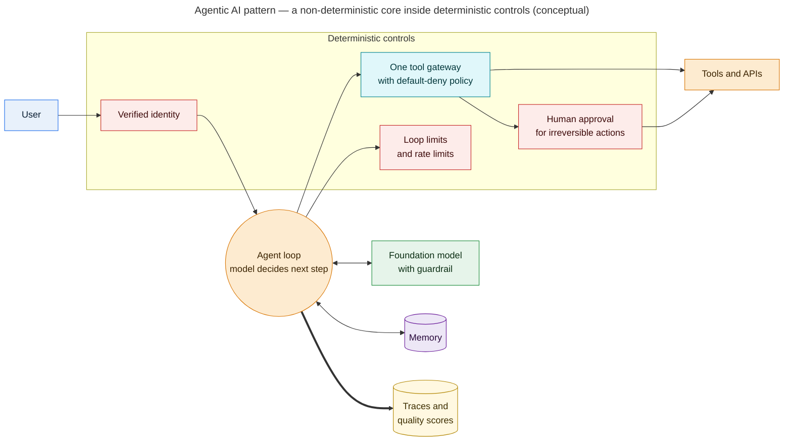
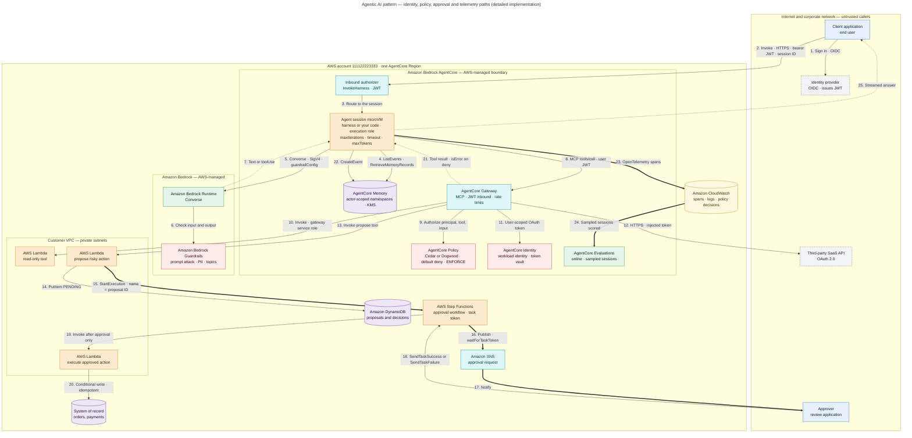
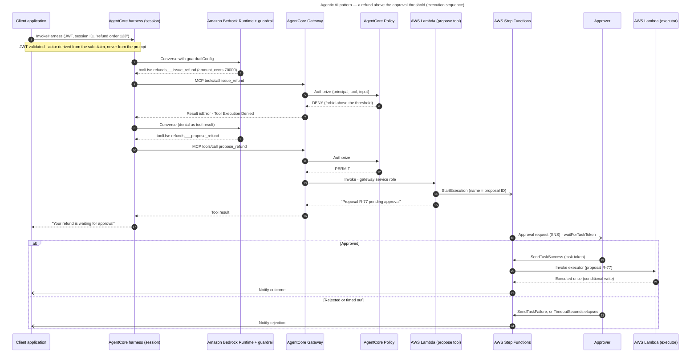

# Pattern: agentic AI

> **Level:** Advanced · **Verified:** 2026-11-15 · **Feature status:** GA (Amazon Bedrock AgentCore) · Maintenance mode (Agents Classic, legacy variation only) · **Time:** ~35 min

An agent chooses its next step at run time: which tool, with which arguments, how many times. This pattern runs that non-deterministic decision-maker on Amazon Bedrock AgentCore and surrounds it with deterministic controls — verified identity, one tool gateway, default-deny policy, guardrails, human approval for irreversible actions, hard limits, tracing and continuous evaluation — so that a wrong or manipulated decision cannot become a wrong action on its own.

> [!IMPORTANT]
> **Status** — This is the **academy's design**, assembled from documented AgentCore behaviour. It is
> **not an official AWS reference architecture**. AWS's own design guidance is
> [Agentic AI patterns and workflows on AWS](https://docs.aws.amazon.com/prescriptive-guidance/latest/agentic-ai-patterns/introduction.html)
> (AWS Prescriptive Guidance). Amazon Bedrock Agents Classic is in maintenance mode and closed to new
> customers since 2026-07-30, so it appears here only as a legacy variation
> ([maintenance mode](https://docs.aws.amazon.com/bedrock/latest/userguide/agents-classic-maintenance-mode.html);
> [ADR-008](../../ARCHITECTURE-DECISIONS.md#adr-008-new-agent-work-targets-agentcore)).

## Learning objectives

After this chapter you can:

- Explain which parts of an agentic system are non-deterministic and which controls around them are deterministic.
- Lay out an agent on AgentCore Runtime or the harness with tools behind AgentCore Gateway, workload identity, outbound OAuth, Memory and Policy.
- Design a human-approval path for risky actions that the agent cannot bypass.
- Name the failure modes, quotas and cost drivers of the pattern, and when not to use it.
- Choose between a single agent, a supervisor with specialists, and the legacy Agents Classic variation.

## Prerequisites

- [Agentic AI, tool calling and multi-agent architectures](../../00-foundations/generative-ai-fundamentals/06-agents-tool-calling-multi-agent.md)
- [AgentCore overview](../../01-amazon-bedrock/agentcore/01-agentcore-overview.md), then skim [Runtime](../../01-amazon-bedrock/agentcore/02-agentcore-runtime.md), [harness](../../01-amazon-bedrock/agentcore/03-agentcore-harness.md), [Gateway](../../01-amazon-bedrock/agentcore/04-agentcore-gateway.md), [Identity](../../01-amazon-bedrock/agentcore/05-agentcore-identity.md) and [Policy](../../01-amazon-bedrock/agentcore/09-agentcore-policy.md)
- [Amazon Bedrock Guardrails](../../01-amazon-bedrock/guardrails/01-guardrails.md)

## Concept in plain language

Think of a capable new employee who works fast but sometimes misreads instructions and can be fooled by a forged memo. You would not hand them the company chequebook. You give them a badge that says who they work for, a front desk through which every request to other departments must pass, a rule book that the desk checks, a manager who signs off on anything expensive, and a camera so you can review their work later.

The agent is that employee. AgentCore supplies the badge (Identity), the front desk (Gateway), the rule book (Policy), the office (Runtime or the harness), the notebook (Memory) and the camera (Observability and Evaluations). Your job is to make sure every risky path goes through the desk and the manager.

## How it really works

### Problem

A model in a tool-calling loop decides at run time which tool to call and with what arguments. Tool results, retrieved documents and recalled memories enter its context, and any of them can carry instructions. The loop has no natural end. Unit tests cannot cover the space of decisions. The agent usually acts for a user, so a mistake is made with that user's authority.

### Forces

| Force | Pulls towards | Pulls against |
|:--|:--|:--|
| Flexibility | Many tools, broad instructions, long loops | Predictability and auditability |
| Delegated authority | Acting with the user's own credentials | Reuse of one powerful service identity |
| Untrusted content | Reading web pages, documents, tool output | Keeping instructions and data apart |
| Latency and cost | Fewer checks, fewer model calls | Every control adds a hop or a person |
| Quality you cannot unit-test | Sampling and scoring real sessions | Shipping on the strength of a demo |

### Solution: deterministic controls around a non-deterministic core

**The model proposes; deterministic components dispose.** Every action leaves the agent through one gateway, where an authorization decision is made outside the agent's code. Irreversible actions are not tools the agent can execute: the agent can only *propose* them, and a workflow executes them after a person approves. Every loop is bounded, every step is traced, and quality is scored continuously.

> [!NOTE]
> **Documented fact** — AgentCore Policy "intercepts all agent traffic through Amazon Bedrock AgentCore
> Gateways and evaluates each request against defined policies in the policy engine before allowing tool
> access"; enforcement happens "at the boundary outside of agent's code". Dogwood policies can add
> session-aware temporal conditions, "for example, requiring that an approval was granted before a
> transfer".
> Source: [Policy in Amazon Bedrock AgentCore](https://docs.aws.amazon.com/bedrock-agentcore/latest/devguide/policy.html)

The layers below follow [ADR-015](../../ARCHITECTURE-DECISIONS.md#adr-015-security-controls-are-layered-and-none-is-trusted-alone): none is trusted alone.

| Layer | Control | Deterministic? | Stops | Still gets through |
|:--|:--|:-:|:--|:--|
| Caller identity | JWT authorizer on the harness or runtime and on the gateway | Yes | Anonymous and expired callers | An authorized user with a malicious prompt |
| Content | Amazon Bedrock Guardrails on each model call (prompt attack, PII, denied topics) | No — scores | Many injection attempts and harmful output | Novel injections; harmful *actions* phrased politely |
| Tool authorization | AgentCore Policy on the gateway, default deny, `ENFORCE` | Yes | Tools and arguments outside the user's rights | A permitted tool used for a wrong but permitted purpose |
| Credentials | AgentCore Identity token vault; gateway service role | Yes | Secrets in prompts or agent code; one user's token used for another | Misuse inside the granted scope |
| Irreversible actions | Propose-only tools; execution after human approval | Human | High-impact wrong actions | Approval fatigue |
| Bounds | Harness `maxIterations`, `timeoutSeconds`, `maxTokens`; gateway rate limits | Yes | Runaway loops and bills | Gateway rate limits fail open |
| Detection | Traces, policy-decision metrics, online evaluation | After the fact | Nothing in real time | — |

### Component roles

| Component | Role in the pattern | Control it contributes |
|:--|:--|:--|
| AgentCore harness or Runtime | Runs the loop in an isolated microVM per session | Execution role; loop limits (harness); inbound JWT |
| Amazon Bedrock Runtime | Model inference (`Converse`) | Guardrail on every call; IAM scoped to model ARNs |
| AgentCore Gateway | The only path from agent to tools (MCP) | Inbound JWT; service role as upper bound; rate limits |
| AgentCore Policy | Decides each tool call: principal, tool, arguments, session history | Default deny; `forbid` wins; `LOG_ONLY` for shadow tests |
| AgentCore Identity | Workload identity; OAuth tokens and API keys for targets | Per-user token binding; secrets never reach the agent |
| AgentCore Memory | Conversation events and long-term records per actor | Namespaces derived from the verified user |
| Tool functions (AWS Lambda) | Read-only tools and *propose* tools | Their own least-privilege roles |
| AWS Step Functions | Approval workflow with a task token, then execution | Execution happens outside the agent, after a decision |
| Amazon CloudWatch, AgentCore Evaluations | Traces, metrics, sampled quality scores | Alarms on denials, errors and score drops |

### When not to use this pattern

- **The steps are known in advance.** A workflow is cheaper, faster and auditable: [AWS Step Functions with Bedrock](../../02-related-aws-services/messaging/02-step-functions.md) or [Bedrock Flows](../../01-amazon-bedrock/flows/01-bedrock-flows.md). See [Choosing between RAG, agents, flows and plain inference](../../09-advanced-topics/14-choosing-rag-agents-flows.md).
- **You only need answers from documents.** Use [Enterprise RAG](../enterprise-rag/README.md) or [agentic retrieval](../../01-amazon-bedrock/agentic-retrieval/01-agentic-retrieval.md).
- **One model call is enough.** Use [Basic inference](../basic-inference/README.md).
- **A strict sub-second latency budget.** Each loop iteration is another model call.
- **No wrong action is tolerable and nobody can review.** Do not automate the action.
- **Your Region lacks a service you need.** The harness and Memory are in 16 of 22 AgentCore Regions ([register](../../FEATURE-VERIFICATION.md#b1-agentcore--regions)).

## Architecture diagram

### A. Conceptual view

**What this shows** — The agent loop and the model are the only non-deterministic parts. Everything the agent does to the outside world passes through the gateway; anything irreversible also passes through a person. The thick arrow is telemetry.

### B. Detailed implementation view

**Legend**

| Mark | Meaning |
|:--|:--|
| Solid / dashed / thick arrow | Request or write · response · asynchronous event or telemetry |
| Cylinder | Data at rest |
| Red node | Security control · teal: entry point · orange: compute · green: model or managed AI · grey dashed: outside your account |
| Nested boxes | Trust and network boundaries |

**What this shows** — Three paths leave the agent session, and all three go through the gateway: a read-only tool, a third-party API with a token bound to this user, and a *propose* tool. The propose tool cannot change anything except the proposals table; the change itself is made by an executor that only the approval workflow can invoke. Telemetry flows to CloudWatch and is sampled by online evaluation.

**Walkthrough**

1. The user signs in with the identity provider and receives a JWT.
2. The client invokes the harness (or a runtime) with the bearer token and a session ID it maps to this user.
3. AgentCore validates the token and routes the call to the session's microVM.
4. The agent loads recent events and long-term records for this actor.
5. The agent calls the model with a guardrail configured on the request.
6. The guardrail screens the prompt and the completion.
7. The model returns text or a tool request.
8. Tool requests go to the gateway over MCP, carrying the user's identity.
9. The policy engine decides on principal, tool name and arguments; with no matching `permit` the answer is deny.
10. Read-only tools are invoked with the gateway's service role.
11. For a user-delegated API, the gateway obtains this user's token from the vault.
12. The gateway calls the third-party API with that token; the agent never sees it.
13. A risky request reaches only the propose tool.
14. The proposal is stored as `PENDING` with the user, arguments and session.
15. An approval workflow starts; its execution name is the proposal ID, so a duplicate start cannot create a second execution.
16. The workflow pauses on a task token and publishes an approval request.
17. The approver is notified.
18. The approver's application returns the decision with the task token.
19. Only on approval does the workflow invoke the executor.
20. The executor writes to the system of record with a condition on the proposal ID.
21. Tool results — including denials, marked `isError` — return to the agent.
22. The turn is saved to Memory.
23. Spans and logs are exported to CloudWatch.
24. Online evaluation scores a sample of sessions.
25. The answer streams back to the user.

### C. Sequence view

**Steps and failure paths**

- **1.** A missing or invalid JWT ends the request before any model call. A prompt cannot change who the actor is.
- **2–3.** If the guardrail intervenes, the model returns the guardrail's message and no tool is requested.
- **4–7.** The forbidden call never reaches a target. The denial is a tool result, so the agent can explain it; alarm on a spike in `DenyDecisions` (see [AgentCore Observability](../../01-amazon-bedrock/agentcore/07-agentcore-observability.md)).
- **8–17.** The only permitted path changes nothing except a proposal. If the Lambda function is retried, a Standard workflow treats `StartExecution` with the same name and input as idempotent, so no second approval workflow starts ([StartExecution](https://docs.aws.amazon.com/step-functions/latest/apireference/API_StartExecution.html)).
- **18–24.** In our design a task without a decision times out (`TimeoutSeconds`) and the workflow rejects the proposal. The executor is not a gateway target, so no prompt can reach it.

## Implementation details

### Data flow and direction

| # | From → To | Data | Direction | Authentication |
|--:|:--|:--|:--|:--|
| 2 | Client → AgentCore | User message, session ID | In | Bearer JWT |
| 4, 22 | Session ↔ Memory | Events and records for this actor | Both | Execution role (SigV4) |
| 5–7 | Session ↔ Bedrock Runtime | Prompt, tool definitions ↔ completion | Both | Execution role |
| 8, 21 | Session ↔ Gateway | Tool name and arguments ↔ result | Both | User JWT (propagated) |
| 10–13 | Gateway → targets | Arguments; user token for SaaS | Out | Service role, vault token |
| 15–19 | Lambda → Step Functions → executor | Proposal ID only | Out | Function and workflow roles |
| 23–24 | Session → CloudWatch → Evaluations | Spans, logs, scores | Out | Execution role; evaluation service role |

### Trust boundaries

| Zone | Contains | Crossing control |
|:--|:--|:--|
| Internet and corporate network | Users, approver, identity provider, SaaS | JWT inbound; OAuth outbound from the vault |
| AgentCore (AWS-managed) | Session microVM, Gateway, Policy, Identity, Memory | IAM roles you own; per-session microVM isolation |
| Your VPC | Tool and executor functions | Security groups; reachable only by the gateway role or the workflow |
| Your account, regional services | DynamoDB, Step Functions, SNS, CloudWatch | Resource policies; customer managed keys |

### Human approval: three mechanisms

| Mechanism | How it works | Use it for |
|:--|:--|:--|
| **Propose, then execute out of band** (academy design, built from documented Step Functions task tokens) | The agent's only tool for the action records a proposal; a workflow executes after `SendTaskSuccess` | Irreversible or financial actions |
| Harness **inline function** (documented) | "The harness pauses when the tool is called and returns the call to your code"; you return the result in a later `InvokeHarness` call with the same session | Approval inside the chat, by the same user |
| **Dogwood temporal policy** (documented) | A `permit` that requires an earlier approval tool response in the same policy session | Enforcing order of steps at the gateway |

Sources: [Harness tools](https://docs.aws.amazon.com/bedrock-agentcore/latest/devguide/harness-tools.html), [Policy](https://docs.aws.amazon.com/bedrock-agentcore/latest/devguide/policy.html), [Step Functions integration patterns](https://docs.aws.amazon.com/step-functions/latest/dg/connect-to-resource.html).

> [!WARNING]
> **Common mistake** — Treating an inline-function result as proof that a human approved. AWS states that
> an `after_tool_call` event for an inline function "does not attest that the client performed the
> external action represented by that result". Authenticate the caller and validate the result.
> Source: [Harness lifecycle hooks](https://docs.aws.amazon.com/bedrock-agentcore/latest/devguide/harness-lifecycle-hooks.html)

### Failure modes

| Failure | How it shows | Containment |
|:--|:--|:--|
| Prompt injection through a tool result or document | Agent requests an out-of-scope tool | Policy denies in `ENFORCE`; guardrail prompt-attack filter; propose-only tools |
| Runaway loop | Stop reason `max_iterations_exceeded` or `timeout_exceeded` | Explicit harness limits; token budget alarms |
| Policy too strict or too loose after a change | Every call denied (default deny), or unexpected permits | Shadow-test the new rule in `LOG_ONLY`; alarm on decision metrics |
| Policy removed or set to `LOG_ONLY` | All tool calls succeed | Restrict `bedrock-agentcore:UpdateGateway` ([enforcement modes](https://docs.aws.amazon.com/bedrock-agentcore/latest/devguide/policy-enforcement-modes.html)) |
| Expired consent or client secret | `ResourceAccessTokenFetchFailures` | Alarm; re-consent flow |
| Throttling | 429 from Runtime or the model | Back off; request quota increases; cross-Region inference profiles |
| Approval never arrives | Workflow waits | `TimeoutSeconds` on the task; default reject |
| Duplicate execution | Two refunds | Proposal ID as execution name and as write condition |
| Memory poisoning | Instruction recalled in a later session | Actor-scoped namespaces; treat records as data |
| Session reused by another user | Cross-user context | Map session IDs to users server-side; AgentCore does not check ownership |
| Quality drift after a model or prompt change | Online evaluation scores drop | Alarms on score metrics; A/B test before rollout |

### Scaling

| Limit (per account and Region unless stated) | Default | Source |
|:--|:--|:--|
| Active session workloads | 5,000 in us-east-1 and us-west-2; 2,500 elsewhere | [AgentCore quotas](https://docs.aws.amazon.com/bedrock-agentcore/latest/devguide/bedrock-agentcore-limits.html) |
| New Runtime sessions | 25 TPS, shared across endpoints | Same page |
| Data-plane requests (`InvokeAgentRuntime` and others) | 1,000 TPS, shared | Same page |
| Synchronous request / maximum session | 15 minutes / 8 hours (microVMs) | Same page |
| Harness | Bound by the Runtime quotas | Same page |
| Memory `CreateEvent` / `RetrieveMemoryRecords` | 200 / 30 per second | Same page |
| Gateway tool calls and connections | See [AgentCore Gateway](../../01-amazon-bedrock/agentcore/04-agentcore-gateway.md#11-scaling-considerations) | — |
| Model tokens per minute | Reserved as input tokens plus `max_tokens` per request | [Runtime metrics](https://docs.aws.amazon.com/bedrock/latest/userguide/monitoring-runtime-metrics.html) |

**Our reading:** the first limit you meet is usually the model's tokens-per-minute quota, because one user turn makes several model calls. Lower `maxTokens` and narrow the tool list before asking for more quota.

### Build order

1. Identity first: identity provider, JWT authorizers on the harness and gateway, user-to-session mapping in your client.
2. Gateway with read-only targets; policy engine attached in `LOG_ONLY`.
3. Agent on the harness with explicit model, system prompt, `allowedTools` and limits; guardrail on the model.
4. Write `permit` rules; run them in `LOG_ONLY` against real traffic; switch the engine to `ENFORCE`.
5. Add propose tools and the approval workflow; never register the executor as a gateway target.
6. Memory with actor-scoped namespaces; observability; online evaluation and alarms.

## Variations

| Variation | What changes | Read |
|:--|:--|:--|
| **Runtime with your own code** instead of the harness | You own the loop in any framework; limits and validation of input are yours | [Harness or Runtime decision table](../../01-amazon-bedrock/agentcore/03-agentcore-harness.md#decision-table-harness-or-runtime-with-your-own-framework) |
| **Supervisor and specialists** | Specialists exposed as MCP tools behind a tools gateway (agent-as-tool), or as A2A peers behind a separate gateway; policy on each gateway. AWS rates managed multi-agent routing as "Limited" | [Diagram 11-D](../../diagrams/mermaid/11-multi-agent-collaboration.md#agentcore-based-equivalent), [Agent orchestration patterns](../../09-advanced-topics/07-agent-orchestration-patterns.md) |
| **Harness subagents** | The built-in `subagent` tool delegates to "a fresh child agent"; it is not a separately configured harness | [Harness tools](https://docs.aws.amazon.com/bedrock-agentcore/latest/devguide/harness-tools.html) |
| **Approval in the chat** | Inline function plus a `before_tool_call` Lambda hook that can deny the call | [AgentCore harness](../../01-amazon-bedrock/agentcore/03-agentcore-harness.md) |
| **Agent as one step of a workflow** | Step Functions `invokeHarness` task (Request Response only, 15-minute cap); the outer process stays deterministic | [Step Functions with Bedrock](../../02-related-aws-services/messaging/02-step-functions.md) |
| **Private enterprise** | VPC network mode; interface endpoints for `bedrock-agentcore`, the gateway and `bedrock-runtime` | [Private enterprise pattern](../private-enterprise/README.md) |
| **Agent hosted outside AgentCore** | Your own containers; Gateway, Identity, Memory and Observability still usable | [Runtime: when not to use it](../../01-amazon-bedrock/agentcore/02-agentcore-runtime.md#4-when-not-to-use-it) |
| **Retrieval only** | No tools that act; use agentic retrieval on a Managed Knowledge Base | [Agentic retrieval](../../01-amazon-bedrock/agentic-retrieval/01-agentic-retrieval.md) |
| **Legacy: Agents Classic** | Action groups, return of control, `InvokeAgent`; existing accounts only, no new features. Accounts without activity in the previous 12 months get HTTP 403 on `CreateAgent` | [Agents Classic versus AgentCore, and migrating](../../01-amazon-bedrock/agents/03-agents-classic-vs-agentcore.md) |

## Example

[Project D: agentic application on AgentCore](../../05-practical-projects/project-04-agentic-ai/README.md) implements this pattern with Terraform and AWS CDK: an agent on AgentCore, tools behind a gateway, identity and memory. Start with its README.

Until the project is published, the validated pieces are in the chapters' working examples:

| Piece of the pattern | Validated example |
|:--|:--|
| Agent runtime and endpoint | [AgentCore Runtime](../../01-amazon-bedrock/agentcore/02-agentcore-runtime.md#13-working-example) |
| Harness with explicit limits | [AgentCore harness](../../01-amazon-bedrock/agentcore/03-agentcore-harness.md#13-working-example) |
| Gateway and Lambda target | [AgentCore Gateway](../../01-amazon-bedrock/agentcore/04-agentcore-gateway.md#13-working-example) |
| OAuth credential provider | [AgentCore Identity](../../01-amazon-bedrock/agentcore/05-agentcore-identity.md#13-working-example) |
| Policy engine, `permit` and `forbid` rules | [AgentCore Policy](../../01-amazon-bedrock/agentcore/09-agentcore-policy.md#13-working-example) |
| Memory with strategies | [AgentCore Memory](../../01-amazon-bedrock/agentcore/06-agentcore-memory.md#13-working-example) |
| Online evaluation | [AgentCore Evaluations and Optimization](../../01-amazon-bedrock/agentcore/10-agentcore-evaluations-and-optimization.md#13-working-example) |
| Task-token approval | [AWS Step Functions with Bedrock](../../02-related-aws-services/messaging/02-step-functions.md#example) |

The full picture of each service is in diagram sets [12](../../diagrams/mermaid/12-agentcore-architecture.md), [13](../../diagrams/mermaid/13-agentcore-runtime-and-tool-execution.md), [14](../../diagrams/mermaid/14-agentcore-gateway-and-identity.md), [15](../../diagrams/mermaid/15-agentcore-memory.md) and [16](../../diagrams/mermaid/16-agentcore-observability.md).

## Common mistakes

| Mistake | Symptom | Fix |
|:--|:--|:--|
| Giving the agent the "execute" tool and relying on the system prompt to ask first | An injected instruction executes the action | Propose-only tools; executor outside the gateway |
| Attaching the policy engine in `ENFORCE` before any `permit` exists | Every tool call denied | Start in `LOG_ONLY`, then enforce |
| SigV4 callers when tools need per-user tokens | No user-scoped OAuth; a shared identity acts for everyone | JWT inbound on the harness or runtime |
| Actor ID or memory namespace taken from the request body | One user reads another's memory | Derive from the verified token |
| `allowedTools: ["*"]` in production | Shell and file tools available to the model | List the selectors the agent needs |
| Treating gateway rate limits as a control | Requests pass when limits cannot be evaluated | Use Policy for security; rate limits for fairness |
| No alarms on denials or evaluation scores | Attacks and regressions go unnoticed | Alarm on decision metrics and score metrics |

## Security considerations

- **Least privilege per hop.** The execution role can invoke the model and the gateway, nothing else; the gateway role reaches only its targets; the executor's role is the only one that can write to the system of record.
- **Protect the controls.** Whoever holds `bedrock-agentcore:UpdateGateway` can switch Policy to `LOG_ONLY` or remove it ([enforcement modes](https://docs.aws.amazon.com/bedrock-agentcore/latest/devguide/policy-enforcement-modes.html)); treat it like an administrator permission.
- **Validate everything a caller can override.** Harness callers can override model, tools and skills per call, and `additionalParams` are passed to the provider unchanged ([harness security](https://docs.aws.amazon.com/bedrock-agentcore/latest/devguide/harness-security.html)). Build `InvokeHarness` requests server-side.
- **Withhold `bedrock-agentcore:InvokeAgentRuntimeCommand`** unless operators need it: `allowedTools` does not limit it.
- **Untrusted content stays data.** Tool output, documents and memory records can carry instructions; see [Prompt injection, untrusted tool output and retrieval poisoning](../../06-security-governance/04-prompt-injection-and-untrusted-content.md). AWS places prompt-injection prevention with the customer ([prompt injection security](https://docs.aws.amazon.com/bedrock/latest/userguide/prompt-injection.html)).
- **Audit.** Policy decisions, CloudTrail management events and model invocation logs together reconstruct who asked for what.

## Cost considerations

| Driver | Why it grows | Lever |
|:--|:--|:--|
| Model tokens | Every loop iteration resends history and tool definitions; the harness's built-in tool set adds about 3,000 input tokens per request ([harness tools](https://docs.aws.amazon.com/bedrock-agentcore/latest/devguide/harness-tools.html)) | Narrow `allowedTools`; prompt caching; iteration and token caps |
| Runtime compute | Billed per second until the session ends, including idle time | Shorter idle timeout |
| Gateway and Policy | Per tool call and per authorization request | Fewer, coarser tools |
| Memory | Events, stored records, retrievals | Retrieve only when needed; set expiry |
| Evaluations and CloudWatch | Judge-model tokens; log ingestion | Sample online evaluation; log retention |
| Human approval | Reviewer time | Thresholds so only real risks reach a person |

Pricing dimensions per service are in the [register](../../FEATURE-VERIFICATION.md#b-amazon-bedrock-agentcore) and each AgentCore chapter's pricing section. AgentCore per-unit prices are partly **UNVERIFIED** (register item U9).

## Knowledge check

1. The system prompt says "always ask before refunding". Why is that not a control, and what replaces it in this pattern?
2. A new `forbid` rule must go live without breaking production. How do you roll it out?
3. Your backend calls `InvokeHarness` with SigV4 on behalf of logged-in users, and a CRM tool needs each user's OAuth token. What breaks and what must change?
4. An approver approves, the executor times out, and Step Functions retries it. How do you make sure the refund happens once?
5. When would you choose a Step Functions workflow with one `invokeHarness` step over a free-running agent?

Answers

1. The prompt is input to a non-deterministic model and can be overridden by injected text. The agent gets only a propose tool, Policy denies the direct action, and execution happens after human approval outside the gateway.
2. Add it as a policy in `LOG_ONLY` mode while the engine enforces the others, watch the decision metrics on real traffic, then switch the policy to `ACTIVE`.
3. With SigV4 callers the harness does not propagate per-user identity, so user-scoped tokens in the vault cannot be used. Configure a JWT authorizer and invoke with the user's bearer token.
4. Use the proposal ID as the idempotency key: the executor's write is conditional on that proposal not having been executed, and the workflow execution name is the proposal ID.
5. When the overall process is known and must be auditable, and only one step needs model-driven decisions.

## Further reading

Official sources opened while writing this chapter:

- [Policy in Amazon Bedrock AgentCore](https://docs.aws.amazon.com/bedrock-agentcore/latest/devguide/policy.html) — interception at the gateway, Cedar and Dogwood, temporal approval conditions.
- [Policy enforcement modes](https://docs.aws.amazon.com/bedrock-agentcore/latest/devguide/policy-enforcement-modes.html) — `LOG_ONLY`, `ENFORCE` and the `UpdateGateway` permission.
- [Harness tools](https://docs.aws.amazon.com/bedrock-agentcore/latest/devguide/harness-tools.html) — inline functions for human-in-the-loop, `allowedTools`, subagents, token overhead.
- [Harness lifecycle hooks](https://docs.aws.amazon.com/bedrock-agentcore/latest/devguide/harness-lifecycle-hooks.html) — `before_tool_call` deny decisions and inline-function caveats.
- [Harness security and access controls](https://docs.aws.amazon.com/bedrock-agentcore/latest/devguide/harness-security.html) — trust boundary, per-user identity with JWT, caller overrides.
- [Add rate limits to a gateway](https://docs.aws.amazon.com/bedrock-agentcore/latest/devguide/gateway-rate-limits.html) — fail-open behaviour.
- [Create online evaluation](https://docs.aws.amazon.com/bedrock-agentcore/latest/devguide/create-online-evaluations.html) — continuous scoring of live traffic.
- [Quotas for Amazon Bedrock AgentCore](https://docs.aws.amazon.com/bedrock-agentcore/latest/devguide/bedrock-agentcore-limits.html) — Runtime, harness and Memory quotas.
- [What is Amazon Bedrock AgentCore?](https://docs.aws.amazon.com/bedrock-agentcore/latest/devguide/what-is-bedrock-agentcore.html) — the services used here.
- [Amazon Bedrock Agents Classic maintenance mode](https://docs.aws.amazon.com/bedrock/latest/userguide/agents-classic-maintenance-mode.html) — status and the Classic-to-AgentCore mapping.
- [Discover service integration patterns in Step Functions](https://docs.aws.amazon.com/step-functions/latest/dg/connect-to-resource.html) — task tokens; AgentCore supports Request Response only.
- [StartExecution](https://docs.aws.amazon.com/step-functions/latest/apireference/API_StartExecution.html) — idempotent for Standard workflows with the same name and input.
- [Monitor bedrock-runtime inference using CloudWatch metrics](https://docs.aws.amazon.com/bedrock/latest/userguide/monitoring-runtime-metrics.html) — throttling based on input tokens plus `max_tokens`.
- [Prompt injection security](https://docs.aws.amazon.com/bedrock/latest/userguide/prompt-injection.html) — the customer's responsibility.
- [Agentic AI patterns and workflows on AWS](https://docs.aws.amazon.com/prescriptive-guidance/latest/agentic-ai-patterns/introduction.html) — AWS Prescriptive Guidance.
