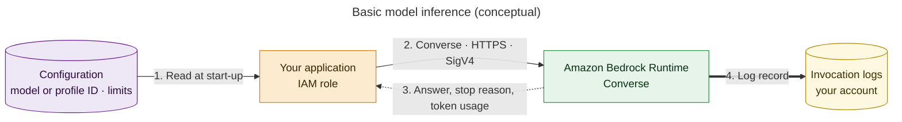
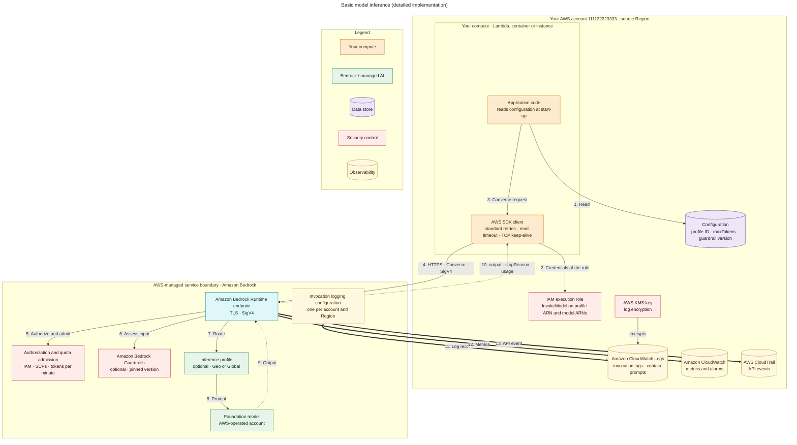
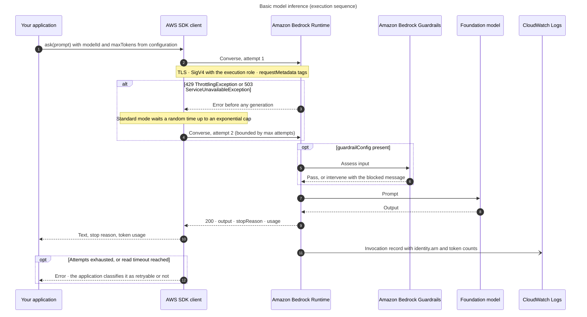

# Pattern: basic model inference

> **Level:** Intermediate · **Verified:** 2026-11-15 · **Feature status:** n/a (pattern built on GA features) · **Time:** ~30 min

The smallest production-worthy way to call a foundation model on Amazon Bedrock: one caller, one
least-privilege role, the model ID as configuration, invocation logging on, and bounded retries
and timeouts. Every other pattern in this section is built on top of it.

> [!IMPORTANT]
> **Status** — This is the academy's design, assembled from documented service behaviour. It is
> **not an official AWS reference architecture**. We did not find an AWS reference architecture
> for a single inference call; the official pages we built it from are listed in
> [Further reading](#further-reading). For AWS's own architectures, see the
> [AWS Architecture Center](https://aws.amazon.com/architecture/).

## Learning objectives

After this chapter you can:

- Explain the problem this pattern solves and the forces that shape it.
- Scope an IAM role to one inference profile and the models it can route to.
- Configure retries, timeouts and `maxTokens` so that a call fails fast and predictably.
- Turn on model invocation logging and say what the logs contain and who may read them.
- Decide when to add cross-Region inference or a guardrail, and when to choose another pattern.

## Prerequisites

- [The Converse API](../../01-amazon-bedrock/inference/01-converse-api.md)
- [Cross-Region inference: Geo and Global profiles](../../01-amazon-bedrock/inference/04-cross-region-inference.md)
- [IAM roles, trust policies and cross-account access](../../00-foundations/security/02-iam-roles-and-trust.md)
- [AWS Lambda with Bedrock](../../02-related-aws-services/compute/01-lambda.md) (if your caller is a function)

## Concept in plain language

Calling a model is like phoning an expert who charges by the word. You want the call to come from
an authorised line (an IAM role), to name the right expert without hard-wiring their number into
your code (the model ID as configuration), to have a recording for audit (invocation logs), and to
hang up politely and try again later if the line is busy (retries with backoff), without waiting
on hold forever (timeouts) or letting the expert talk for an hour (`maxTokens`).

**The problem.** A first call to Bedrock usually works with an administrator's credentials, a
hard-coded model ID and default SDK settings. In production the same code fails in ways that are
hard to see: access denied after a model is retired, throttling at modest traffic, requests that
hang behind a network device, and no record of what was sent.

### Conceptual view



**What this shows** — Four things and nothing else: configuration tells the application which
model to call, the call is signed with the application's own role, the answer comes back with
its token usage, and Bedrock writes a log record into your account.

## How it really works

### Forces

| Force | Documented behaviour | Consequence for the design |
|:--|:--|:--|
| Models are retired | Models move through Active, Legacy and End-of-life ([model lifecycle](../../01-amazon-bedrock/foundation-models/02-model-lifecycle-and-selection.md)) | The model or profile ID is configuration ([ADR-010](../../ARCHITECTURE-DECISIONS.md#adr-010-model-and-inference-profile-ids-are-always-configuration)) |
| Quotas are per model and per Region | Tokens-per-minute quotas (on-demand and cross-Region counted separately), a cross-model tokens-per-day quota, and requests per minute for some models; shared by every API that calls the model ([runtime quotas](https://docs.aws.amazon.com/bedrock/latest/userguide/quotas-runtime.html)) | Size `maxTokens`, retry 429s, and plan quota before launch |
| Two kinds of "busy" | HTTP 429 `ThrottlingException` is your account quota; HTTP 503 is service capacity and "not related to your account-level quotas" ([error codes](https://docs.aws.amazon.com/bedrock/latest/userguide/troubleshooting-api-error-codes.html)) | Retry both with backoff and jitter; only quota requests fix 429s |
| Generations are slow and variable | Long generations exceed short read timeouts; idle connections through NAT gateways, interface endpoints and Network Load Balancers are dropped after 350 seconds ([error codes](https://docs.aws.amazon.com/bedrock/latest/userguide/troubleshooting-api-error-codes.html)) | Explicit read timeout, TCP keep-alive in the SDK **and** the operating system |
| Prompts are sensitive | Invocation logs contain full request and response bodies ([invocation logging](https://docs.aws.amazon.com/bedrock/latest/userguide/model-invocation-logging.html)) | Encrypt the destination; restrict who reads it |

### The solution

The pattern has five parts, all inside one account and one source Region.

1. **A caller with its own role.** The role allows `bedrock:InvokeModel` on the inference profile
   **and** on the foundation model in every Region the profile can route to; a
   `bedrock:InferenceProfileArn` condition makes the models reachable only through that profile.
   Add `bedrock:InvokeModelWithResponseStream` only if you stream.
2. **Configuration.** Model or profile ID, `maxTokens`, timeouts and guardrail version are read
   at start-up, never compiled in.
3. **A tuned SDK client.** Standard retry mode with bounded attempts, a read timeout below the
   caller's own deadline, and TCP keep-alive.
4. **Converse on `bedrock-runtime`** ([ADR-007](../../ARCHITECTURE-DECISIONS.md#adr-007-converse-on-bedrock-runtime-is-the-default-inference-api-in-examples)),
   with `requestMetadata` tags so each log record names the application.
5. **Model invocation logging** to CloudWatch Logs or Amazon S3, plus CloudTrail and CloudWatch
   metrics for who called what and how often.

> [!NOTE]
> **Documented fact** — Model invocation logging is disabled by default. Destinations must be in
> the same account and Region. It captures `Converse`, `ConverseStream`, `InvokeModel` and
> `InvokeModelWithResponseStream` on the `bedrock-runtime` endpoint only — calls through
> `bedrock-mantle` are not captured. Each record carries `identity.arn`, token counts and the
> caller-supplied `requestMetadata`; bodies over 100 KB go to S3.
> Source: [Monitor model invocation using CloudWatch Logs and Amazon S3](https://docs.aws.amazon.com/bedrock/latest/userguide/model-invocation-logging.html)

### Component roles

| Component | Role | Security control |
|:--|:--|:--|
| Your compute (Lambda, container, instance) | Builds the request, enforces its own deadline | Execution role; no long-lived keys |
| Configuration | Holds model or profile ID, limits, guardrail version | Change control like code; no secrets in it |
| IAM role | Signs the request (SigV4) | Scoped to the profile ARN and its model ARNs |
| Amazon Bedrock Runtime | Authorizes, admits against quota, runs the model | IAM, service control policies, quotas |
| Inference profile (optional) | Routes to a destination Region | Destinations must be allowed by IAM and SCPs |
| Amazon Bedrock Guardrails (optional) | Screens input and output | Pinned guardrail version; `bedrock:ApplyGuardrail` |
| Invocation logs | Full records for audit and debugging | KMS key, narrow read access, retention |
| AWS CloudTrail, Amazon CloudWatch | Who called which model; latency, throttles, tokens | Organisation trail; alarms |

### Trust boundaries and data flow

| Boundary | What crosses it | Direction | Control |
|:--|:--|:--|:--|
| Your compute → Bedrock endpoint | Prompt, parameters | Outbound, TLS | SigV4 with the role; endpoint policy if private |
| Bedrock → destination Region (profile only) | Prompt and output | Inside the AWS network | IAM and SCPs on every destination |
| Bedrock → your log destination | Prompt and output copies | Asynchronous | Bedrock service principal limited by `aws:SourceAccount` and `aws:SourceArn` |
| Model provider | Nothing | — | Models run in AWS-operated accounts that providers cannot access ([Converse API](../../01-amazon-bedrock/inference/01-converse-api.md#5-internal-architecture)) |

### When not to use this pattern

- The user holds a **conversation** over HTTP → [Serverless chatbot](../serverless/README.md).
- Answers must come from **your documents** → [Enterprise RAG](../enterprise-rag/README.md).
- The model must **call tools or plan** → [Agentic AI](../agentic-ai/README.md).
- Work arrives as **events** or in bulk → [Event-driven](../event-driven/README.md) or [batch inference](../../01-amazon-bedrock/inference/08-batch-inference.md).
- You are porting **OpenAI or Anthropic SDK code** → [compatible APIs](../../01-amazon-bedrock/inference/03-openai-and-anthropic-compatible-apis.md).

## Architecture diagram

### Detailed implementation view



**What this shows** — Everything you own sits in your account: the code, its configuration, its
role and every record. Bedrock decides whether to admit the call, optionally screens it, routes it
and writes the records back to you.

**Walkthrough**

1. The application reads the profile ID and limits once, at start-up.
2. The SDK obtains temporary credentials of the execution role.
3. –4. The client sends `Converse` over TLS, signed with SigV4.
5. Bedrock evaluates IAM and SCPs for the profile and every candidate model ARN, then deducts input
   tokens plus `maxTokens` from the quota; a 429 means the call was not admitted.
6. With `guardrailConfig`, the guardrail assesses the input (and later the output).
7. –9. The profile routes the prompt to a destination Region; without a profile the model runs
   in the source Region.
10. The response carries `output`, `stopReason`, `usage` and `metrics`.
11. If logging is configured, Bedrock writes a record to the log group, encrypted with your key.
12. –13. Metrics and CloudTrail events land in the source Region.

**Legend** — solid: request · dashed: response · thick: asynchronous record · cylinder: data or
records at rest · nested boxes: account and AWS-managed boundary. Full lifecycle detail:
[diagram set 3](../../diagrams/mermaid/03-model-inference-lifecycle.md).

### Sequence view



Steps 1–2: one logical call may be several HTTP attempts; the SDK, not your code, waits between
them. Steps 3–5: errors here cost no generation, so they are safe to retry. Steps 6–7: a
guardrail block returns a normal 200 with `stopReason` `guardrail_intervened`. Steps 8–11: the
answer returns with token usage, which you log and meter. Step 12: the log record is
asynchronous. Steps 13–14: a read timeout is the dangerous case — the model may have finished and
billed, so a blind retry can pay twice.

## Implementation details

Configure in the order a builder meets each setting:

1. **Pick the target.** Use a system-defined inference profile ID as `modelId` where the model is
   offered through one; resolve its destination models with the Terraform data source
   `aws_bedrock_inference_profile` (see [Example](#example)).
2. **Scope the role.** Profile ARN plus each destination model ARN, conditioned on
   `bedrock:InferenceProfileArn`; for Global profiles also the Region-less model ARN.
3. **Bound the work.** `maxTokens` near the real need; the read timeout below the caller's
   deadline (for example below the function timeout behind a 29-second front door); a handful of
   attempts.
4. **Turn on logging** once per account and Region; decide who owns it in a shared account.
5. **Alarm** on throttles, server errors and token usage.

> [!NOTE]
> **Documented fact** — In standard retry mode the SDKs use exponential backoff with full jitter,
> a retry quota (token bucket) that stops retrying during sustained failures, a default of three
> attempts, a 50 ms base delay for transient errors and 1,000 ms for throttling, capped at 20
> seconds. The page notes that this 2026 behaviour currently requires opting in with
> `AWS_NEW_RETRIES_2026=true`; without it your SDK uses its pre-2026 retry behaviour.
> Source: [Retry behavior](https://docs.aws.amazon.com/sdkref/latest/guide/feature-retry-behavior.html)

### Failure modes

| Failure | Signal | Response |
|:--|:--|:--|
| Model retired or ID wrong | 404 `ResourceNotFoundException` | Change configuration and the IAM scope together |
| Role missing a destination Region | 403 `AccessDeniedException` naming an unexpected Region | Add that Region's model ARN; check SCPs |
| Quota exceeded | 429 `ThrottlingException` | Backoff; smaller `maxTokens`; quota increase; profile |
| Capacity | 503 `ServiceUnavailableException`, or 529 `overloaded_error` | Backoff with jitter; cross-Region profile; another Region |
| Output cut off | `stopReason` `max_tokens` | Raise the limit or continue the turn |
| Content blocked | `stopReason` `guardrail_intervened` | Show the blocked message; do not retry |
| Hung connection after idle | Reset or a very slow first call | TCP keep-alive in SDK and OS below 350 s |
| Read timeout | Client error, model possibly finished | Retry only if the caller still waits; stream long answers |

### Scaling

Throughput is bounded by the model's quota in the source Region, not by your compute. Admission
deducts input tokens plus `maxTokens`, so oversized `maxTokens` throttles early; details in
[Quotas, rate limits and throttling](../../08-cost-performance-and-reliability/05-quotas-rate-limits-and-throttling.md).
Beyond quota, the levers are cross-Region profiles (their own quota family), [service tiers](../../01-amazon-bedrock/inference/06-service-tiers.md)
and [Provisioned Throughput](../../01-amazon-bedrock/inference/07-provisioned-throughput.md).

## Variations

| Variation | What changes | Read |
|:--|:--|:--|
| **Cross-Region inference for resilience** | `modelId` becomes a Geo or Global profile ID; IAM lists every destination model; processing may leave the source Region; Global costs about 10% less and can route to any commercial Region | [Cross-Region inference](../../01-amazon-bedrock/inference/04-cross-region-inference.md), [diagram set 21](../../diagrams/mermaid/21-cross-region-inference.md), [data residency](../../09-advanced-topics/11-cross-region-and-data-residency.md) |
| **Guardrail** | Add `guardrailConfig` with a pinned version and `bedrock:ApplyGuardrail`; make it mandatory with an IAM deny on `bedrock:GuardrailIdentifier` or an enforced configuration | [Guardrails](../../01-amazon-bedrock/guardrails/01-guardrails.md), [enforcement](../../01-amazon-bedrock/guardrails/02-automated-reasoning-and-enforcement.md) |
| Streaming | `ConverseStream`; grant `bedrock:InvokeModelWithResponseStream` | [Streaming APIs](../../01-amazon-bedrock/inference/02-invokemodel-and-streaming.md) |
| Cost attribution | An application inference profile per application or tenant | [Application inference profiles](../../01-amazon-bedrock/inference/05-application-inference-profiles.md) |
| Private network path | Interface endpoint for `bedrock-runtime` with an endpoint policy | [Private enterprise](../private-enterprise/README.md) |
| Model fallback | A second profile or model in configuration, tried on 503 or 404 | [Model routing and fallback](../../09-advanced-topics/10-model-routing-and-fallback.md) |

> [!TIP]
> **Academy recommendation** — Treat a Geo profile as the default target when your residency
> rules allow the geography, and keep a single-Region model ID only where processing must stay in
> one Region. Do not add application-level Region failover until you have measured 503s; the
> profile already spreads load. This is our design guidance, not an official AWS reference
> architecture.

## Example

The matching project is [Project A: basic Bedrock model inference](../../05-practical-projects/project-01-basic-inference/README.md).
The role comes from the academy module
[`bedrock-invocation-role`](../../04-infrastructure-as-code/terraform/modules/bedrock-invocation-role/README.md).

**Infrastructure** — the role and the logging configuration, with the profile's destination
models looked up from AWS instead of typed in.

> **Code status:** `terraform fmt` ✅ · `terraform validate` ✅ (provider 6.73.0) · TFLint ✅ · `terraform test` ✅ 3 runs with a mock provider (Geo profile, Global profile, logging-role trust) · **never planned or applied against AWS**

```hcl
data "aws_caller_identity" "current" {}

# 1. Resolve the profile's destination models from AWS instead of hard-coding them.
data "aws_bedrock_inference_profile" "this" {
  inference_profile_id = var.inference_profile_id
}

locals {
  # Model ARNs look like arn:aws:bedrock:<region>::foundation-model/<model-id>;
  # Global profiles also return a Region-less ARN (empty Region field).
  model_arns    = [for m in data.aws_bedrock_inference_profile.this.models : m.model_arn]
  model_regions = distinct([for a in local.model_arns : split(":", a)[3] if split(":", a)[3] != ""])
  model_ids     = distinct([for a in local.model_arns : split("/", a)[1]])
  is_global     = anytrue([for a in local.model_arns : split(":", a)[3] == ""])
}

# 2. Least-privilege caller role: this profile, its models, nothing else.
module "caller_role" {
  source = "../../../04-infrastructure-as-code/terraform/modules/bedrock-invocation-role"

  name                           = "basic-inference-caller"
  trusted_services               = [var.caller_service]
  foundation_model_ids           = local.model_ids
  model_regions                  = local.model_regions
  inference_profile_arns         = [data.aws_bedrock_inference_profile.this.inference_profile_arn]
  restrict_to_inference_profiles = true
  allow_global_inference         = local.is_global
  allow_streaming                = false # Converse only; set true for ConverseStream
}

# 3. Model invocation logging: one configuration per account and Region.
resource "aws_cloudwatch_log_group" "invocations" {
  name              = "/bedrock/model-invocations"
  retention_in_days = var.log_retention_days
  kms_key_id        = var.log_kms_key_arn
}

resource "aws_iam_role" "bedrock_logging" {
  name = "bedrock-invocation-logging"
  assume_role_policy = jsonencode({
    Version = "2012-10-17"
    Statement = [{
      Effect    = "Allow"
      Principal = { Service = "bedrock.amazonaws.com" }
      Action    = "sts:AssumeRole"
      Condition = {
        StringEquals = { "aws:SourceAccount" = data.aws_caller_identity.current.account_id }
        ArnLike      = { "aws:SourceArn" = "arn:aws:bedrock:${var.region}:${data.aws_caller_identity.current.account_id}:*" }
      }
    }]
  })
}

resource "aws_iam_role_policy" "bedrock_logging" {
  name = "write-invocation-logs"
  role = aws_iam_role.bedrock_logging.id
  policy = jsonencode({
    Version = "2012-10-17"
    Statement = [{
      Effect   = "Allow"
      Action   = ["logs:CreateLogStream", "logs:PutLogEvents"]
      Resource = "${aws_cloudwatch_log_group.invocations.arn}:log-stream:aws/bedrock/modelinvocations"
    }]
  })
}

resource "aws_bedrock_model_invocation_logging_configuration" "this" {
  logging_config {
    text_data_delivery_enabled      = true
    image_data_delivery_enabled     = false
    embedding_data_delivery_enabled = false
    video_data_delivery_enabled     = false

    cloudwatch_config {
      log_group_name = aws_cloudwatch_log_group.invocations.name
      role_arn       = aws_iam_role.bedrock_logging.arn
    }
  }

  depends_on = [aws_iam_role_policy.bedrock_logging]
}
```

The variables are `region`, `inference_profile_id` (confirm the current ID on the model card),
`caller_service`, `log_kms_key_arn` (its key policy must allow CloudWatch Logs) and
`log_retention_days`. The trust condition and the log-stream name follow the invocation logging
page.

**Application** — one well-behaved call. The model ID, limits and timeouts are configuration.

> **Code status:** `py_compile` ✅ · stub-tested with botocore `Stubber` (boto3 1.44.3: success with limits and metadata, guardrail intervention, throttling, access denied) · **never run against AWS**

```python
"""Basic inference pattern: one well-behaved Converse call."""
import boto3
from botocore.config import Config
from botocore.exceptions import ClientError

NOT_RETRYABLE = {"ValidationException", "AccessDeniedException", "ResourceNotFoundException"}


class InferenceError(Exception):
    """Raised with the error code and whether a later retry could succeed."""

    def __init__(self, code: str, retryable: bool):
        super().__init__(code)
        self.code, self.retryable = code, retryable


def make_client(region: str, read_timeout: int = 60, max_attempts: int = 3):
    """One client per process: bounded retries, explicit timeouts, TCP keep-alive."""
    config = Config(
        retries={"mode": "standard", "total_max_attempts": max_attempts},
        connect_timeout=5,
        read_timeout=read_timeout,  # keep it below the caller's own deadline
        tcp_keepalive=True,  # also lower the OS keep-alive interval below 350 s
    )
    return boto3.client("bedrock-runtime", region_name=region, config=config)


def ask(client, prompt: str, *, model_id: str, max_tokens: int, app: str,
        guardrail_id: str | None = None, guardrail_version: str | None = None) -> dict:
    """Send one prompt. Returns text, stop reason and token usage."""
    request = {
        "modelId": model_id,  # model ID, inference profile ID or ARN: configuration
        "messages": [{"role": "user", "content": [{"text": prompt}]}],
        "inferenceConfig": {"maxTokens": max_tokens},  # bounds latency, cost and quota deduction
        "requestMetadata": {"application": app},  # appears in model invocation logs
    }
    if guardrail_id:  # optional; pin a published version, not the working draft
        request["guardrailConfig"] = {"guardrailIdentifier": guardrail_id,
                                      "guardrailVersion": guardrail_version}
    try:
        response = client.converse(**request)
    except ClientError as err:  # raised after the SDK's own retries are exhausted
        code = err.response["Error"]["Code"]
        raise InferenceError(code, retryable=code not in NOT_RETRYABLE) from err
    content = response["output"]["message"]["content"]
    return {
        "text": "".join(block.get("text", "") for block in content),
        "stop_reason": response["stopReason"],  # end_turn, max_tokens, guardrail_intervened ...
        "usage": response["usage"],
    }
```

The tool-use loop and streaming reassembly are in the
[Converse API working example](../../01-amazon-bedrock/inference/01-converse-api.md#13-working-example).

## Common mistakes

> [!WARNING]
> **Common mistake** — Granting the inference profile but not the foundation model in every
> destination Region. The call fails with access denied only when routing picks the missing
> Region, so it looks intermittent. Derive the Regions from the profile, as in the example.

| Mistake | Symptom | Fix |
|:--|:--|:--|
| Model ID as a literal in code | Outage when the model reaches end of life | Configuration plus an IAM change in the same release |
| `bedrock:InvokeModel` on `*` | Any model, any Region, any cost | Profile and model ARNs only |
| Default read timeout behind a shorter front door | Client sees a timeout while the generation continues and bills | Read timeout below the caller's deadline |
| Retrying in your code **and** in the SDK | Retry storms multiply load | One retry layer, bounded |
| Logging prompts in application logs too | Sensitive text in several places | Rely on invocation logs; log token counts only |
| Logging turned on in a shared account by one team | Every team's prompts land in one group | Platform team owns the account-level configuration |

## Security considerations

- **Identity** — one role per application; no IAM users or long-lived keys. Bedrock API keys
  exist ([Endpoints, APIs and authentication](../../01-amazon-bedrock/overview/02-endpoints-apis-and-authentication.md)),
  but the academy uses roles in production designs.
- **Least privilege** — profile and model ARNs, `InferenceProfileArn` condition; deny Global
  routing with `aws:RequestedRegion` = `unspecified` when residency requires it
  ([inference profile prerequisites](https://docs.aws.amazon.com/bedrock/latest/userguide/inference-profiles-prereq.html)).
- **Logs are data** — KMS-encrypted, retention set, readable by a small audit role; see
  [Logging, audit and compliance evidence](../../06-security-governance/07-logging-audit-and-compliance.md).
- **Layering** — a guardrail is one layer, never the only one
  ([ADR-015](../../ARCHITECTURE-DECISIONS.md#adr-015-security-controls-are-layered-and-none-is-trusted-alone)).

## Cost considerations

| Driver | Grows with | Guard |
|:--|:--|:--|
| Input and output tokens | Prompt size, `maxTokens`, model choice, service tier | Right-size the model; cap `maxTokens`; [prompt caching](../../01-amazon-bedrock/prompt-caching/01-prompt-caching.md) |
| Retries after timeouts | Short read timeouts on long answers | Retry only errors that happened before generation |
| Guardrail assessment | Text assessed per call, per policy | Assess only what needs it |
| Invocation logs | Prompt and response size × volume × retention | Retention policy; S3 for long-term |
| Global vs Geo profile | — | Global is about 10% cheaper where residency allows |

Pricing dimensions are explained in [Pricing model and cost drivers](../../08-cost-performance-and-reliability/01-pricing-model-and-cost-drivers.md).

## Knowledge check

1. Your function calls a `us.` profile and fails with access denied once in every few requests. What is the most likely cause?
2. Why is a 429 safe to retry, and why is a client-side read timeout not always safe to retry?
3. A teammate wants `maxTokens` set to the model's maximum "just in case". What goes wrong?
4. Which calls does model invocation logging capture, and which does it miss?
5. When would you not use this pattern even though you only need one model call?

<details>
<summary>Answers</summary>

1. The role allows the profile but not the foundation model in one of its destination Regions; requests routed there are denied.
2. A 429 means the request was not admitted, so nothing was generated or billed. After a read timeout the model may have finished and billed; a retry can pay twice.
3. Admission deducts input plus `maxTokens`, so quota runs out early and the app throttles at low traffic; long answers also cost more and run past timeouts.
4. `Converse`, `ConverseStream`, `InvokeModel` and `InvokeModelWithResponseStream` on `bedrock-runtime`; calls through `bedrock-mantle` are not captured.
5. When the work is bulk or offline (batch inference), event-driven, needs your documents (RAG), or needs tools (agentic).

</details>

## Further reading

Official sources opened while writing this chapter:

- [Monitor model invocation using CloudWatch Logs and Amazon S3](https://docs.aws.amazon.com/bedrock/latest/userguide/model-invocation-logging.html) — destinations, captured operations, record format, trust policy.
- [Troubleshooting Amazon Bedrock API error codes](https://docs.aws.amazon.com/bedrock/latest/userguide/troubleshooting-api-error-codes.html) — 429 versus 503 and 529, backoff with jitter, the 350-second idle timeout.
- [Retry behavior (AWS SDKs and Tools)](https://docs.aws.amazon.com/sdkref/latest/guide/feature-retry-behavior.html) — retry modes, backoff formula, retry quota.
- [Quotas for the bedrock-runtime endpoint](https://docs.aws.amazon.com/bedrock/latest/userguide/quotas-runtime.html) — per-model token and request quotas.
- [Prerequisites for inference profiles](https://docs.aws.amazon.com/bedrock/latest/userguide/inference-profiles-prereq.html) — IAM for profiles, `bedrock:InferenceProfileArn`, denying Global routing.
- [AWS Architecture Center](https://aws.amazon.com/architecture/) — AWS's own reference architectures.
