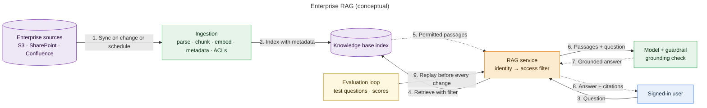
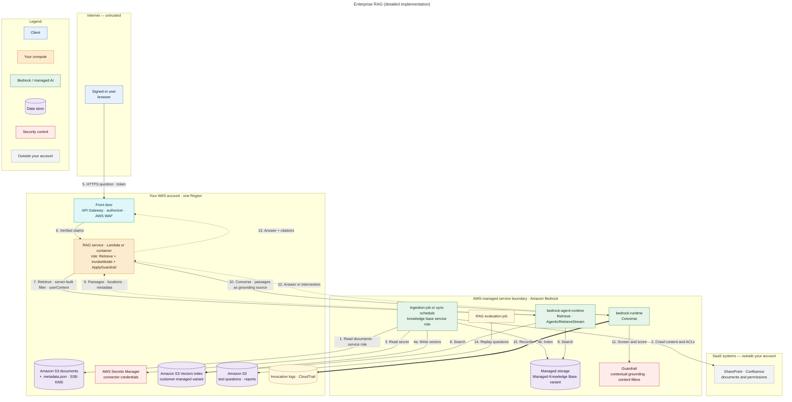
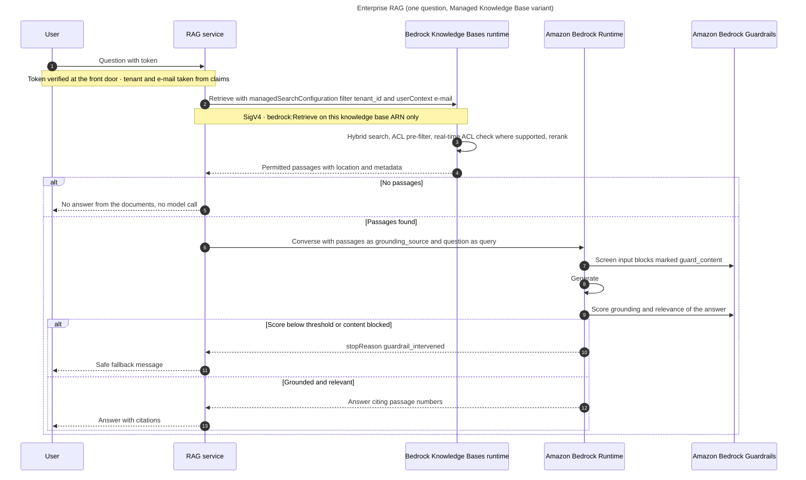

# Pattern: enterprise RAG

> **Level:** Advanced · **Verified:** 2026-11-15 · **Feature status:** n/a (pattern built on GA features) · **Time:** ~45 min

Answers grounded in your organisation's documents, limited to what the asking user may see, with
citations, a check that the answer really comes from the sources, and a measurement loop that
tells you when quality drops. It is retrieval-augmented generation (RAG) with the enterprise
concerns — permissions, tenants, freshness, evaluation — designed in from the start.

> [!IMPORTANT]
> **Status** — This is the academy's design, not an official AWS reference architecture. AWS's own
> material on the topic includes [Retrieval Augmented Generation options and architectures on AWS](https://docs.aws.amazon.com/prescriptive-guidance/latest/retrieval-augmented-generation-options/introduction.html)
> (AWS Prescriptive Guidance, written before Managed Knowledge Base existed),
> [Multi-tenant RAG with Amazon Bedrock Knowledge Bases](https://aws.amazon.com/blogs/machine-learning/multi-tenant-rag-with-amazon-bedrock-knowledge-bases/)
> and [Secure multi-tenant RAG with Amazon Bedrock and Verified Permissions](https://aws.amazon.com/blogs/architecture/secure-multi-tenant-rag-with-amazon-bedrock-and-verified-permissions/).

## Learning objectives

After this chapter you can:

- Draw the ingestion path and the query path of an enterprise RAG system and name every identity on them.
- Choose between a Managed Knowledge Base and a customer-managed one for a given requirement.
- Enforce tenant and document permissions without trusting the client, and say where each mechanism stops.
- Add citations and a contextual grounding check, and explain what each proves.
- Set up an evaluation loop and a freshness strategy, and recognise when RAG is the wrong tool.

## Prerequisites

- [Retrieval-augmented generation (RAG)](../../00-foundations/generative-ai-fundamentals/04-rag-fundamentals.md)
- [Knowledge Bases overview: managed versus customer-managed](../../01-amazon-bedrock/knowledge-bases/01-knowledge-bases-overview.md)
- [Retrieval, reranking and metadata filtering](../../01-amazon-bedrock/knowledge-bases/05-retrieval-reranking-filtering.md)
- [Amazon Bedrock Guardrails](../../01-amazon-bedrock/guardrails/01-guardrails.md)
- [Pattern: serverless enterprise chatbot](../serverless/README.md) — the usual front end

## Concept in plain language

A model writing about your company is like a new hire answering customer letters: capable, but it
only knows what you hand it. RAG hands it the right pages from the company library for each
letter. In an enterprise the library has locked rooms (permissions), several clients' archives
(tenants), new editions every day (freshness), and an auditor who wants every claim footnoted
(citations) and spot-checked (evaluation).

**The problem.** "Chat with our documents" demos retrieve from everything, answer fluently and
cite nothing. In production that leaks restricted documents, mixes up customers, repeats last
year's policy and states things no document says — and nobody notices until a user complains.

### Conceptual view



**What this shows** — Two paths share one index: ingestion writes it, queries read it through a
filter built from the user's identity. A third loop replays known questions so that a change to
chunking, model or prompt is measured before users see it.

## How it really works

### Forces

| Force | Documented behaviour | Consequence |
|:--|:--|:--|
| Two knowledge base types | AWS recommends Managed Knowledge Base; `RetrieveAndGenerate` works only on customer-managed ones; agentic retrieval only on managed ones; managed is in nine Regions ([overview](../../01-amazon-bedrock/knowledge-bases/01-knowledge-bases-overview.md)) | Pick per requirement; the project ships both ([ADR-009](../../ARCHITECTURE-DECISIONS.md#adr-009-the-rag-project-ships-two-knowledge-base-variants)) |
| SaaS connectors moved | Since 2026-09-30 no **new** Confluence, SharePoint, Salesforce or Web Crawler connectors on customer-managed knowledge bases ([data source connectors](https://docs.aws.amazon.com/bedrock/latest/userguide/data-source-connectors.html)) | SaaS sources point to the managed type |
| Document ACLs are not authorization | Managed ACL awareness "provides ACL-aware filtering, not a security boundary"; it trusts the identity you pass ([ACL awareness](https://docs.aws.amazon.com/bedrock/latest/userguide/kb-managed-acl.html)) | Authenticate upstream; derive identity on the server |
| Shared indexes are logical isolation | A metadata filter is "filter-level (logical) isolation, not IAM-enforced"; for a compliance boundary between customers AWS's architecture blog advises a knowledge base per tenant ([AWS Architecture Blog](https://aws.amazon.com/blogs/architecture/secure-multi-tenant-rag-with-amazon-bedrock-and-verified-permissions/)) | Silo for hard boundaries, filters inside a tenant |
| Fluent answers can be ungrounded | Contextual grounding scores grounding and relevance against a source and a query, thresholds 0–0.99 ([contextual grounding](https://docs.aws.amazon.com/bedrock/latest/userguide/guardrails-contextual-grounding-check.html)) | Pass retrieved passages as the grounding source |
| Retrieved text is untrusted | Guardrails attached to `RetrieveAndGenerate` assess only the input and the generated response ([retrieval chapter](../../01-amazon-bedrock/knowledge-bases/05-retrieval-reranking-filtering.md)) | Screen passages yourself, or with `guard_content` qualifiers |

### The solution

**Ingestion path.** Sources are connected as data sources; ingestion parses, chunks and embeds
each document and stores vectors with **metadata** (tenant, classification, department) and, on a
Managed Knowledge Base, **ACLs** crawled from the source. Freshness comes from sync schedules
(managed), event- or schedule-triggered `StartIngestionJob`, or `IngestKnowledgeBaseDocuments`
for a document that must be searchable now ([ingestion chapter](../../01-amazon-bedrock/knowledge-bases/04-ingestion-parsing-chunking.md)).

**Query path.** The RAG service authenticates the user, builds the access filter **on the
server** from verified claims, retrieves, and then generates — either with its own `Converse` call
carrying a guardrail with contextual grounding (shown in the [Example](#example)), or with a
one-call API: `AgenticRetrieveStream` with `maxAgentIteration` 1 on a Managed Knowledge Base, or
`RetrieveAndGenerate` on a customer-managed one. It returns the answer with citations that point
at the source documents.

**Evaluation loop.** A curated question set, with reference answers where you have them, is
replayed through Amazon Bedrock RAG evaluation before every change and on a schedule.

### The two variants (ADR-009)

| Concern | Managed Knowledge Base | Customer-managed (Amazon S3 Vectors in Project C) |
|:--|:--|:--|
| Storage, embedding, reranking | AWS-operated; hybrid search always on; managed reranker | Your vector store and embedding model; your search and reranker choices |
| New SaaS connectors | Yes | No (S3 and Custom only) |
| Document-level ACLs | Yes, per data source, decided at creation (`userContext.userId` = e-mail) | No — "available to anyone with `bedrock:Retrieve`" |
| Metadata filter on `Retrieve` | `managedSearchConfiguration.filter` (no `startsWith`, `stringContains`) | `vectorSearchConfiguration.filter` (S3 Vectors: no `startsWith`, `stringContains`) |
| One-call answer with citations | `AgenticRetrieveStream` (guardrail: `CUSTOM` planner model, `BLOCK` only) | `RetrieveAndGenerate` / `RetrieveAndGenerateStream` |
| Source link for a citation | `GetDocumentContent` pre-signed URL (expires after 5 minutes) | The S3 location in the result |
| Choose it when | SaaS sources, per-user permissions, minimal operations, Region on the list | Region not on the list, own embedding or store, GraphRAG or SQL |

Details and sources: [Managed Knowledge Base](../../01-amazon-bedrock/knowledge-bases/02-managed-knowledge-base.md),
[Customer-managed knowledge bases](../../01-amazon-bedrock/knowledge-bases/03-customer-managed-knowledge-bases.md),
[Agentic retrieval](../../01-amazon-bedrock/agentic-retrieval/01-agentic-retrieval.md).

### Trust boundaries and data flow

| Boundary | Crosses it | Direction | Control |
|:--|:--|:--|:--|
| Source systems → Bedrock ingestion | Documents, permissions | Inbound to the index | Knowledge base service role; connector secret in AWS Secrets Manager |
| User → RAG service | Question, token | Inbound | Authentication at the front door |
| RAG service → `bedrock-agent-runtime` | Query, filter, user context | Outbound | `bedrock:Retrieve` on named knowledge base ARNs only |
| Index → RAG service | Passages | Inbound, **untrusted** | Guardrail screening; prompt that treats passages as data |
| RAG service → `bedrock-runtime` | Passages, question | Outbound | Guardrail with contextual grounding; profile-scoped role |

### When not to use this pattern

- The knowledge is small and stable enough to fit in the prompt → long context with [prompt caching](../../01-amazon-bedrock/prompt-caching/01-prompt-caching.md); compare in [RAG versus fine-tuning versus long-context](../../09-advanced-topics/01-rag-vs-fine-tuning-vs-long-context.md).
- You need a **style or format**, not facts → [fine-tuning](../../01-amazon-bedrock/foundation-models/03-model-customization.md).
- Questions are **aggregations over tables** ("total refunds by region") → [structured data retrieval](../../01-amazon-bedrock/knowledge-bases/06-structured-data-and-graphrag.md).
- The assistant must **act**, not only answer → [Agentic AI](../agentic-ai/README.md) with retrieval as a tool.
- You cannot state who may see which document → fix that first; RAG will expose the gap.

## Architecture diagram

### Detailed implementation view



**What this shows** — Both variants on one page: steps 4a and 8 (right) are the customer-managed
store in your account; 4b and 8 (left) are managed storage inside the Bedrock boundary. Only the
RAG service talks to the runtime endpoints, and only with a filter it built itself.

**Walkthrough**

1. –4. Ingestion reads S3 objects and their metadata files, or crawls a SaaS source with
   credentials from Secrets Manager (managed variant), then writes vectors to your S3 vector
   index (customer-managed) or to managed storage.
5. –6. The user's question arrives with a token; the front door verifies it.
7. The RAG service calls `Retrieve` with the tenant filter and, on the managed variant, the
   user's e-mail in `userContext`.
8. –9. Search runs against the right store; passages return with their source locations.
10. –12. `Converse` receives the passages marked as the grounding source; the guardrail screens
    them and scores the answer.
13. The answer goes back with citations for the passages it actually used.
14. An evaluation job replays the test set (see [Implementation details](#implementation-details)).
15. Invocation logs and CloudTrail record every call.

**Legend** — solid: request or write · dashed: response · thick: asynchronous record · dashed
grey box: outside your account. Pipeline detail: [diagram sets 6](../../diagrams/mermaid/06-knowledge-base-ingestion-pipeline.md),
[7](../../diagrams/mermaid/07-knowledge-base-retrieval-pipeline.md),
[8](../../diagrams/mermaid/08-managed-knowledge-base.md) and
[9](../../diagrams/mermaid/09-agentic-retrieval.md); the whole system in
[diagram set 5](../../diagrams/mermaid/05-enterprise-rag.md).

### Sequence view



Steps 2–4: the filter and the user context come from verified claims, never from the request
body; ACL evaluation fails closed, so a missing `userContext` returns nothing from ACL-enabled
sources. Steps 5–6: an empty result is answered without a model call — cheaper and honest.
Steps 7–10: the grounding check needs the model's answer, so it runs on the output only.
Steps 11–14: an intervention is a normal response, not an error; log it, because a rising rate
signals stale or missing documents.

## Implementation details

1. **Decide the variant per requirement**, using the table above; deciding ACLs and the embedding
   type later means recreating the knowledge base.
2. **Design metadata before the first ingestion** — `tenant_id` on every document; a document
   without it must not be ingested.
3. **Build the filter on the server**: tenant condition first, user choices joined with `andAll`.
4. **Ground every answer**: number the passages, mark them `grounding_source`, require `[n]`
   citations, and return only the sources actually cited. A grounding threshold of 0.7 is AWS's
   suggested starting point for conversational use on the Standard tier.
5. **Freshness**: managed sync schedules (daily, weekly, monthly) or a scheduled
   `StartIngestionJob` (one job per data source at a time); `IngestKnowledgeBaseDocuments` for
   urgent single documents. Permission changes reach the managed index at the next sync, sooner for
   connectors with real-time ACL checks; group membership in very large groups can lag after a sync
   ([ACL awareness](https://docs.aws.amazon.com/bedrock/latest/userguide/kb-managed-acl.html)).
6. **Evaluate**: retrieve-only jobs score context relevance and coverage; retrieve-and-generate
   jobs add faithfulness and citation precision and coverage
   ([Model and RAG evaluation](../../01-amazon-bedrock/model-evaluation/01-model-evaluation.md)).

> [!NOTE]
> **Documented fact** — RAG evaluation jobs come in two types, retrieve only and retrieve and
> generate, and either can evaluate a Bedrock knowledge base or "bring your own inference response
> data from an external RAG source". **Our reading:** the second option is how you evaluate a
> service that answers through `AgenticRetrieveStream` or your own `Converse` call — run the
> questions through your service and submit its outputs.
> Source: [Evaluate the performance of RAG sources](https://docs.aws.amazon.com/bedrock/latest/userguide/evaluation-kb.html)

### Multitenancy

| Model | How | Isolation | Use it for |
|:--|:--|:--|:--|
| Silo | Knowledge base (and bucket, key, store) per tenant | IAM-enforced; per-tenant KMS key and freshness | Separate customers with a compliance boundary |
| Pool | One knowledge base; `tenant_id` metadata; server-side filter | Logical; fails open if the filter code is wrong | Departments inside one organisation |
| Bridge | Shared knowledge base, per-tenant indexes or data sources | Between the two | Many small tenants with a few large ones |

Source of the silo/pool/bridge model: [Multi-tenant RAG with Amazon Bedrock Knowledge Bases](https://aws.amazon.com/blogs/machine-learning/multi-tenant-rag-with-amazon-bedrock-knowledge-bases/).
More in [Multitenant RAG](../../09-advanced-topics/06-multitenant-rag.md).

> [!TIP]
> **Academy recommendation** — Combine the layers: silo between customers, server-built metadata
> filters inside a customer, and Managed Knowledge Base ACLs for per-document permissions that
> already exist in the source system. Make every layer deny by default: no claim, no filter, no
> results. This is our design guidance, not an official AWS reference architecture.

### Failure modes

| Failure | Signal | Response |
|:--|:--|:--|
| ACL source without `userContext` | Zero results, no error | Always pass the verified e-mail |
| Filter bug | Another tenant's passage appears | Tests that assert the filter; silo for hard boundaries |
| Stale index | Answers quote old policy; grounding passes | Sync schedule, freshness metric, document dates in metadata |
| Ungrounded answer | `guardrail_intervened` with a grounding trace | Fallback message; inspect retrieval |
| Poisoned document | Instructions inside a passage | Screen passages; treat them as data; restrict who can write sources |
| Ingestion job already running | `StartIngestionJob` refused | Queue the trigger; one job at a time |
| Throttling | 429 on `Retrieve` or `AgenticRetrieveStream` (300 per minute per account) | Backoff; quota increase; cache frequent answers |

### Scaling

Query throughput is bounded by the runtime quotas of the knowledge base APIs and of the
generation model; ingestion by one job per data source at a time. Managed storage scales itself;
a customer-managed store scales by its own rules. Sharding tenants across knowledge bases (silo)
also spreads load.

## Variations

| Variation | What changes |
|:--|:--|
| **One call instead of two** | `AgenticRetrieveStream` (`maxAgentIteration` 1) or `RetrieveAndGenerate` returns answer and citations; you lose control of the prompt and of guardrail qualifiers |
| **Agentic retrieval** | `maxAgentIteration` 2–5 plans sub-queries across up to five knowledge bases; more latency and calls; see [diagram set 9](../../diagrams/mermaid/09-agentic-retrieval.md) |
| **Externalised authorization** | Amazon Verified Permissions decides which filter a user gets (Cedar policies), as in the AWS Architecture Blog post above |
| **Retrieval as an agent tool** | The Managed Knowledge Base becomes an AgentCore Gateway target; see [Agentic AI](../agentic-ai/README.md) |
| **Private** | Interface endpoints for `bedrock-agent-runtime` and `bedrock-runtime`; see [Private enterprise](../private-enterprise/README.md) |
| **Event-driven freshness** | A scheduler or pipeline step starts ingestion after uploads; see [Event-driven](../event-driven/README.md) |

## Example

The matching project is [Project C: enterprise RAG with Knowledge Bases](../../05-practical-projects/project-03-enterprise-rag/README.md),
which deploys both variants with the modules
[`knowledge-base-s3-vectors`](../../04-infrastructure-as-code/terraform/modules/knowledge-base-s3-vectors/README.md) and
[`managed-knowledge-base`](../../04-infrastructure-as-code/terraform/modules/managed-knowledge-base/README.md).
The query path below works with either variant.

> **Code status:** `py_compile` ✅ · stub-tested with botocore `Stubber` (boto3 1.44.3: filter construction, `Retrieve` on both variants, citations limited to cited passages, guardrail intervention) · **never run against AWS**

```python
"""Enterprise RAG pattern: permission-aware retrieval, then a grounded, guarded answer.

`claims` are the verified token claims of the caller (from the authorizer), never request
fields. Knowledge base IDs, model IDs and guardrail IDs are configuration.
"""


def access_filter(claims: dict, user_filter: dict | None = None) -> dict:
    """Server-side metadata filter: tenant first, then anything the user chose."""
    tenant = {"equals": {"key": "tenant_id", "value": claims["tenant_id"]}}
    return {"andAll": [tenant, user_filter]} if user_filter else tenant


def retrieve(agent_runtime, kb_id: str, question: str, claims: dict, *, managed: bool,
             k: int = 5, user_filter: dict | None = None) -> list:
    """Retrieve from either knowledge base type with the access filter applied."""
    search = {"numberOfResults": k, "filter": access_filter(claims, user_filter)}
    request = {"knowledgeBaseId": kb_id, "retrievalQuery": {"text": question}}
    if managed:
        request["retrievalConfiguration"] = {"managedSearchConfiguration": search}
        request["userContext"] = {"userId": claims["email"]}  # document ACLs, if enabled
    else:
        request["retrievalConfiguration"] = {"vectorSearchConfiguration": search}
    return agent_runtime.retrieve(**request)["retrievalResults"]


def grounded_answer(runtime, question: str, results: list, *, model_id: str,
                    guardrail_id: str, guardrail_version: str, max_tokens: int = 800) -> dict:
    """Answer only from numbered passages; the guardrail scores grounding and relevance."""
    passages = "\n\n".join(f"[{n}] {r['content']['text']}" for n, r in enumerate(results, 1))
    response = runtime.converse(
        modelId=model_id,
        system=[{"text": "Answer only from the numbered passages. Cite them as [n]. "
                         "If they do not contain the answer, say so."}],
        messages=[{"role": "user", "content": [
            # grounding_source + guard_content: the reference for the grounding check,
            # and also screened by the guardrail's other policies (retrieved text is untrusted).
            {"guardContent": {"text": {"text": passages,
                                       "qualifiers": ["grounding_source", "guard_content"]}}},
            {"guardContent": {"text": {"text": question, "qualifiers": ["query", "guard_content"]}}},
        ]}],
        inferenceConfig={"maxTokens": max_tokens},
        guardrailConfig={"guardrailIdentifier": guardrail_id,
                         "guardrailVersion": guardrail_version, "trace": "enabled"},
    )
    text = "".join(b.get("text", "") for b in response["output"]["message"]["content"])
    cited = sorted({n for n in range(1, len(results) + 1) if f"[{n}]" in text})
    return {
        "answer": text,
        "stop_reason": response["stopReason"],  # guardrail_intervened = blocked, e.g. ungrounded
        "citations": [results[n - 1]["location"] for n in cited],  # only passages really cited
    }
```

> [!NOTE]
> **Documented fact** — With the Converse API, a `guardContent` block qualified `grounding_source`
> or `query` is used only by the contextual grounding check; adding `guard_content` to the
> qualifiers makes the other guardrail policies evaluate it too. The check needs the model's
> answer, so it runs on the output only. Contextual grounding accepts up to 100,000 characters of
> source, 1,000 of query and 5,000 of response.
> Source: [Use contextual grounding check](https://docs.aws.amazon.com/bedrock/latest/userguide/guardrails-contextual-grounding-check.html)

## Common mistakes

> [!WARNING]
> **Common mistake** — Accepting `tenant_id` or the user's e-mail from the request body because
> "the front end already knows it". Anyone can then read any tenant's documents with one edited
> request. Take both from verified token claims.

| Mistake | Symptom | Fix |
|:--|:--|:--|
| Treating ACL filtering as authorization | A caller sets any e-mail and reads as that user | Authenticate upstream; restrict who may call `Retrieve` |
| `RetrieveAndGenerate` on a managed knowledge base | The API rejects it | `AgenticRetrieveStream` or `Retrieve` + `Converse` |
| Returning every retrieved passage as a citation | Citations that do not support the text | Cite only what the answer references |
| Answers longer than 5,000 characters with grounding on | Grounding cannot score the whole answer | Cap `maxTokens`; split long answers |
| No evaluation baseline | A chunking change silently lowers quality | Baseline scores; compare before release |
| Documents uploaded without metadata | They match no tenant, or every tenant | Reject at upload; test the ingestion |

## Security considerations

- **Least privilege** — `bedrock:Retrieve` on named knowledge base ARNs (it is the per-knowledge-base
  control even for `AgenticRetrieveStream`); model and guardrail scoped as in
  [basic inference](../basic-inference/README.md).
- **Source permissions** — whoever can write to a source can write instructions into answers;
  control writers as tightly as readers. See
  [retrieval poisoning](../../06-security-governance/04-prompt-injection-and-untrusted-content.md).
- **Encryption** — customer managed keys on the document bucket, vector store and knowledge base;
  connector credentials in Secrets Manager.
- **Logs** — invocation logs contain passages and answers; protect them like the sources.
- **Layering** — identity, filter, ACL, guardrail and evaluation each catch a different failure
  ([ADR-015](../../ARCHITECTURE-DECISIONS.md#adr-015-security-controls-are-layered-and-none-is-trusted-alone)).

## Cost considerations

| Driver | Grows with | Guard |
|:--|:--|:--|
| Generation tokens | Passages × length × questions | Fewer, better passages (reranking); `maxTokens` |
| Retrieval | Calls; agentic iterations (Managed: per 1,000 calls, plus underlying retrieves) | `maxAgentIteration` 1 unless planning helps |
| Storage | Managed: raw GB-month; customer-managed: your vector store | Ingest only what users need |
| Embedding and parsing (customer-managed) | Re-ingestion volume | Incremental sync; avoid full re-ingests |
| Guardrail | Source + query + response characters for grounding, plus other policies | Ground only final answers |
| Evaluation | Judge-model tokens per test question | Right-sized test set; schedule |

Rates are on the [Amazon Bedrock pricing page](https://aws.amazon.com/bedrock/pricing/); the
dimensions per variant are in the [Knowledge Bases overview](../../01-amazon-bedrock/knowledge-bases/01-knowledge-bases-overview.md).

## Knowledge check

1. A customer requires that no other customer's data can ever be returned, even with a software bug. Which multitenancy model do you choose, and why is a metadata filter not enough?
2. Your Managed Knowledge Base returns nothing for one user and works for others. Name two likely causes.
3. Why does the example mark passages `grounding_source` **and** `guard_content`?
4. The grounding check passes, yet the answer quotes last year's policy. What failed, and what fixes it?
5. How do you evaluate a service that answers through `AgenticRetrieveStream`?

<details>
<summary>Answers</summary>

1. Silo: a knowledge base (and key) per customer, separated by IAM. A filter is logical isolation that fails open if the code that builds it is wrong.
2. No or wrong `userContext` e-mail (ACL evaluation fails closed), or permissions not yet synced or propagated (large groups lag; non-real-time connectors update at the next sync).
3. `grounding_source` makes them the reference for the grounding score; `guard_content` also subjects them to the other guardrail policies, because retrieved text is untrusted.
4. Freshness: the answer is grounded in a stale document. Re-sync on change, keep document dates in metadata, and monitor index age.
5. Run the test questions through the service and submit its outputs to a RAG evaluation job as your own inference responses.

</details>

## Further reading

Official sources opened while writing this chapter:

- [Access Control Lists awareness enablement](https://docs.aws.amazon.com/bedrock/latest/userguide/kb-managed-acl.html) — ACL model, connectors with real-time checks, freshness of permissions.
- [Connect a data source to your knowledge base](https://docs.aws.amazon.com/bedrock/latest/userguide/data-source-connectors.html) — the 2026-09-30 connector change.
- [Use contextual grounding check to filter hallucinations](https://docs.aws.amazon.com/bedrock/latest/userguide/guardrails-contextual-grounding-check.html) — scores, thresholds, tiers, qualifiers.
- [Evaluate the performance of RAG sources](https://docs.aws.amazon.com/bedrock/latest/userguide/evaluation-kb.html) — job types and bring-your-own responses.
- [Multi-tenant RAG with Amazon Bedrock Knowledge Bases](https://aws.amazon.com/blogs/machine-learning/multi-tenant-rag-with-amazon-bedrock-knowledge-bases/) — silo, pool and bridge.
- [Secure multi-tenant RAG with Amazon Bedrock and Verified Permissions](https://aws.amazon.com/blogs/architecture/secure-multi-tenant-rag-with-amazon-bedrock-and-verified-permissions/) — logical versus IAM-enforced isolation.
- [Retrieval Augmented Generation options and architectures on AWS](https://docs.aws.amazon.com/prescriptive-guidance/latest/retrieval-augmented-generation-options/introduction.html) and [Knowledge bases for Amazon Bedrock](https://docs.aws.amazon.com/prescriptive-guidance/latest/retrieval-augmented-generation-options/rag-fully-managed-bedrock.html) — AWS Prescriptive Guidance (predates Managed Knowledge Base).
