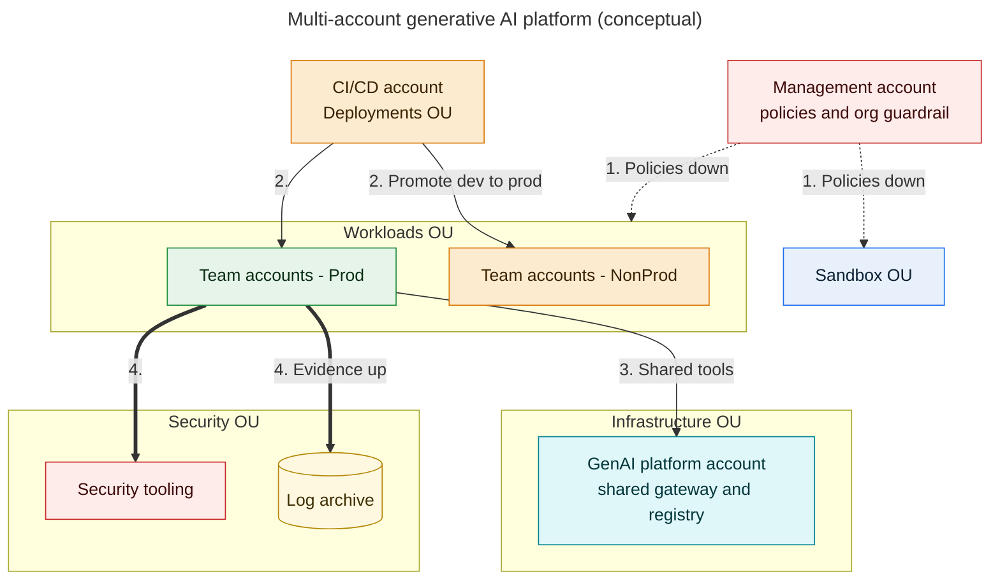
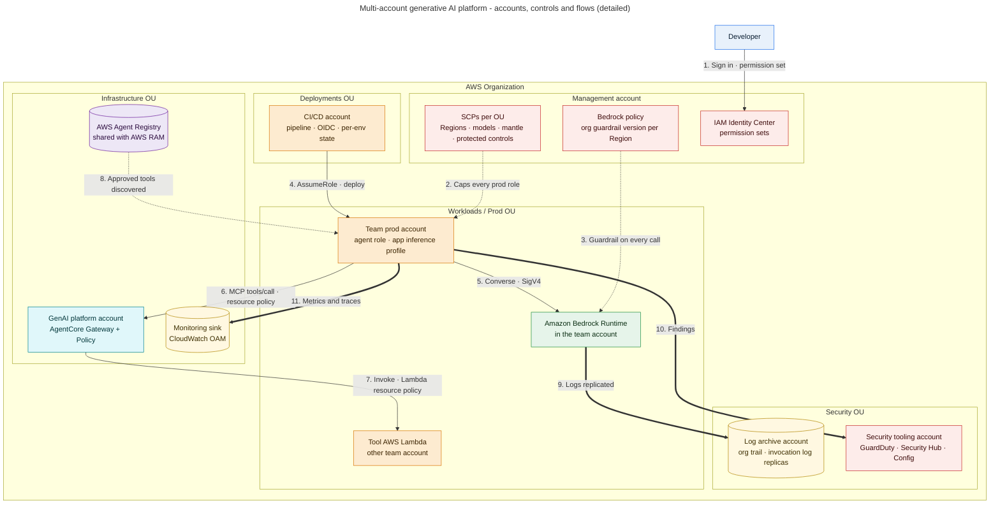
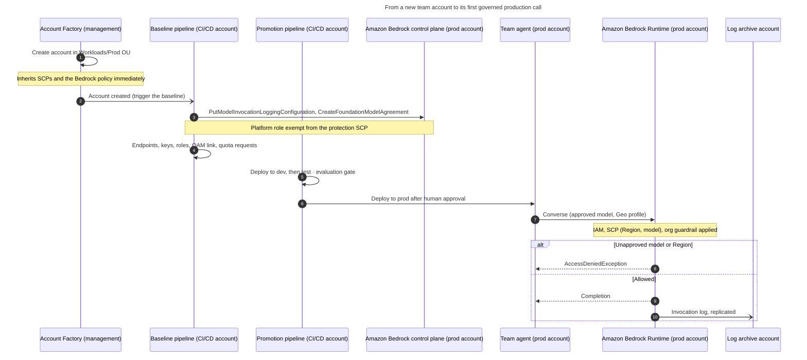

# Pattern: multi-account generative AI platform

> **Level:** Advanced · **Verified:** 2026-11-15 · **Feature status:** n/a · **Time:** ~50 min

This pattern shows how many teams and environments share one governed generative AI platform on AWS: organizational units with different rules, organisation-wide guardrails, a shared platform account for the things worth sharing, per-team accounts for everything that needs its own quota and blast radius, centralised logging and security tooling, cost allocation, and a pipeline that promotes changes from development to production.

> [!IMPORTANT]
> **Status** — This is the academy's design, not an official AWS reference architecture. It follows the OU model of AWS's whitepaper [Organizing your AWS environment using multiple accounts](https://docs.aws.amazon.com/whitepapers/latest/organizing-your-aws-environment/recommended-ous-and-accounts.html) and the Generative AI OU of the [AWS Security Reference Architecture for AI](https://docs.aws.amazon.com/prescriptive-guidance/latest/security-reference-architecture-generative-ai/gen-ai-sra.html), and differs from the latter where noted.

## Learning objectives

After this chapter you can:

- Lay out OUs and accounts for a generative AI platform, and justify each boundary.
- Choose which controls belong at which OU: SCPs for Regions, models and cross-Region inference; Amazon Bedrock policies for guardrails; RCPs for the data around Bedrock.
- Decide what a shared platform account should own (AgentCore Gateway, AWS Agent Registry, guardrail definitions, model access) and what stays in team accounts.
- Plan per-account quotas, cost allocation and account baselines, including what CloudFormation StackSets cannot deploy.
- Describe a controlled promotion path from development to production.

## Prerequisites

- [AWS Organizations and AWS Control Tower](../../00-foundations/aws-fundamentals/05-organizations-control-tower.md) — OUs, SCPs, RCPs, landing zone, Account Factory.
- [IAM roles, trust policies and cross-account access](../../00-foundations/security/02-iam-roles-and-trust.md) and [IAM and IAM Identity Center for Bedrock](../../02-related-aws-services/security/01-iam-and-identity-center.md).
- [Model access and subscriptions](../../01-amazon-bedrock/overview/03-model-access-and-subscriptions.md), [Cross-Region inference](../../01-amazon-bedrock/inference/04-cross-region-inference.md) and [guardrail enforcement](../../01-amazon-bedrock/guardrails/02-automated-reasoning-and-enforcement.md).
- [Pattern: secure private enterprise Bedrock](../private-enterprise/README.md) — the per-account network and logging layer this pattern replicates.

## Concept in plain language

Think of an airport. The airport authority (the platform team) runs the control tower, security screening, runways and the shared baggage system. Each airline (product team) has its own terminal space, its own staff, its own budget and its own number of take-off slots. Airlines cannot change the screening rules or switch off the cameras, but they choose their own routes within the authority's rules. A new airline gets a fully fitted terminal on day one, not an empty room.

In AWS terms: accounts are terminals, OUs are groups of terminals with the same rules, SCPs and Amazon Bedrock policies are the authority's rules, the platform account runs shared services, and the log archive and security tooling accounts are the cameras nobody else can touch.

## How it really works

### Problem and forces

**Problem.** Ten teams want Amazon Bedrock. Without structure each one picks its own models, Regions, guardrails and logging; one team's load test throttles another's production; nobody can say who spent what; and an auditor gets ten different answers.

| Force | Pulls towards | Pulls against |
|:--|:--|:--|
| Isolation (blast radius, quotas, cost) | One account per team per environment ([ADR-013](../../ARCHITECTURE-DECISIONS.md#adr-013-one-aws-account-per-environment)) | More accounts to baseline and govern |
| Reuse | Shared gateway, registry, guardrails | Cross-account permissions, shared-fate outages |
| Central safety | Organisation-enforced guardrails, model allow-lists | Teams needing new models quickly |
| Speed of experimentation | A loose sandbox | Data and cost leaking out of the sandbox |

### Solution: OUs and accounts

| OU | Accounts | Purpose | Source of the idea |
|:--|:--|:--|:--|
| (management account) | Management | Organizations, Control Tower, IAM Identity Center, the **organisation guardrail** (it must live here) | Org chapter; [enforcements](https://docs.aws.amazon.com/bedrock/latest/userguide/guardrails-enforcements.html) |
| Security | Log archive; Security tooling (audit) | Organisation trail, replicated invocation logs; delegated administrator for GuardDuty, Security Hub, AWS Config aggregation | Whitepaper Security OU |
| Infrastructure | Network; **GenAI platform** | Endpoint hub and Transit Gateway; shared AgentCore Gateway, AWS Agent Registry, evaluation tooling, CloudWatch monitoring account | Whitepaper Infrastructure OU; SRA "Shared Services" |
| Deployments | CI/CD | Pipelines that deploy into every workload account | Whitepaper Deployments OU |
| Workloads / NonProd | `team-dev`, `team-test` per team | Development and test | Whitepaper Workloads OU; SRA separates GenAI accounts by SDLC environment |
| Workloads / Prod | `team-prod` per team | Production inference, knowledge bases, agents | As above |
| Sandbox | One per person or squad | Experiments, wider model list, no production data | Whitepaper Sandbox OU |
| Policy Staging | Test accounts | Try SCP, RCP and Bedrock-policy changes first | Whitepaper Policy Staging OU |

> [!NOTE]
> **Documented fact** — The AWS SRA for AI extends the Workloads OU with a Generative AI OU containing an Application account and a Generative AI account, and suggests separate Generative AI accounts per SDLC environment "to control team access, isolate resources, track costs separately, and prevent development issues from affecting production".
> Source: [AWS SRA for AI](https://docs.aws.amazon.com/prescriptive-guidance/latest/security-reference-architecture-generative-ai/gen-ai-sra.html)

**Where we differ:** the SRA's guide assumes a single Generative AI account called by application accounts. The academy keeps inference **inside each team's account** by default, because quotas are per account and Region ([quotas](https://docs.aws.amazon.com/bedrock/latest/userguide/quotas.html)) and Bedrock models accept no resource-based policy — a central inference account means every team assumes one role there and shares one quota pool.

### Controls by OU

| Control | Mechanism | Prod | NonProd | Sandbox |
|:--|:--|:-:|:-:|:-:|
| Bedrock only in approved Regions, with an exception for approved Geo profiles | SCP on `aws:RequestedRegion` and `bedrock:InferenceProfileArn` | ✅ | ✅ | ✅ wider list |
| Deny Global cross-Region profiles | Same SCP (`unspecified` not allowed) | ✅ | ✅ | optional |
| Approved models only (deny-by-default) | SCP `NotResource` list of foundation-model ARNs | ✅ short list | ✅ | ✅ longer list |
| Organisation guardrail on every inference call | Amazon Bedrock policy (`BEDROCK_POLICY`) attached to the OU | ✅ | ✅ | ✅ |
| Request must name a guardrail | SCP `Null` on `bedrock:GuardrailIdentifier` | optional | — | — |
| No `bedrock-mantle` (not logged, not guarded) | SCP | ✅ | ✅ | — |
| Logging, enforcement and model agreements changeable only by the platform pipeline | SCP on `aws:PrincipalArn` | ✅ | ✅ | ✅ |
| Only organisation identities on S3, KMS, Secrets Manager | RCP | ✅ | ✅ | ✅ |
| Detective checks (AI Security Best Practices standard, AWS Config) | Security Hub, Control Tower detective controls | ✅ | ✅ | ✅ |

The SCP mechanics are explained in [Cross-Region inference](../../01-amazon-bedrock/inference/04-cross-region-inference.md) and [Model access and subscriptions](../../01-amazon-bedrock/overview/03-model-access-and-subscriptions.md); the example below generates them per environment.

> [!NOTE]
> **Documented fact** — Amazon Bedrock policies are declarative: Organizations resolves the attachments an account inherits into **one effective policy** — "it is not a union of every attachment in the tree" — and you confirm it with `DescribeEffectivePolicy`. At runtime, the organisation, account and request guardrails are then all applied, with the most restrictive control winning. The guardrail is per Region and must not contain an Automated Reasoning policy.
> Source: [Guardrails enforcements](https://docs.aws.amazon.com/bedrock/latest/userguide/guardrails-enforcements.html), [Amazon Bedrock policies](https://docs.aws.amazon.com/organizations/latest/userguide/orgs_manage_policies_bedrock.html)

### Identity: IAM Identity Center permission sets

People sign in once and receive a role per account; Bedrock sees the `AWSReservedSSO_*` role, not the person ([IAM and IAM Identity Center for Bedrock](../../02-related-aws-services/security/01-iam-and-identity-center.md)).

| Permission set (academy names) | Assigned in | Can do |
|:--|:--|:--|
| `GenAIPlatformAdmin` | GenAI platform, Network | Operate shared services; never workload data |
| `GenAIDeveloper` | Sandbox (broad), NonProd (read, invoke approved models) | Build and experiment; deploy only through the pipeline outside Sandbox |
| `GenAIOperator` | Prod | Read-only plus CloudWatch; no data-plane access to knowledge bases |
| `SecurityAuditor` | Security tooling, Log archive | Read findings and logs; decrypt invocation logs |
| `BreakGlass` | All | Emergency only; alarmed in CloudTrail |

Workloads in Prod change only through pipeline roles assumed with OIDC ([ADR-014](../../ARCHITECTURE-DECISIONS.md#adr-014-pipelines-use-oidc-and-pin-actions-by-commit-sha)).

### Shared platform account versus team accounts

| Capability | In the GenAI platform account | In each team account | Cross-account mechanism (documented) |
|:--|:--|:--|:--|
| Enterprise tools (HR lookup, ticketing) | One AgentCore Gateway with AgentCore Policy | Team-only tools | Gateway resource-based policy names the team roles; Lambda targets in other accounts need a Lambda resource policy for the gateway role |
| Shared agents | AgentCore Runtime | Callers | Resource-based policies on **both** the runtime and its endpoint |
| Catalogue of agents and tools | AWS Agent Registry, one per environment | Publishers and consumers | AWS RAM sharing; auto-detection through an Organizations delegated administrator ([Registry](../../01-amazon-bedrock/agentcore/11-agentcore-registry.md)) |
| Guardrail definitions | Authored here, deployed by pipeline to the management account | Team guardrails (applied in addition) | Guardrail resource policy with `aws:PrincipalOrgID` |
| Model access | Approval list and EULA review | **Model agreements**, which exist per account and model | Baseline pipeline creates them |
| Inference, knowledge bases, agent memory | — | ✅ | — (quota and data isolation) |
| Monitoring | CloudWatch monitoring account (OAM sink) | Source accounts (OAM links) | [AgentCore Observability](../../01-amazon-bedrock/agentcore/07-agentcore-observability.md) |

> [!NOTE]
> **Documented fact** — AgentCore resource-based policies control who can invoke and manage Runtime, Gateway and Memory resources; for cross-account `InvokeAgentRuntime`, both the agent runtime and the agent endpoint need a policy that allows the caller. OAuth-authorised resources need `"Principal": "*"`, narrowed with conditions such as `aws:SourceVpc`.
> Source: [Resource-based policies for Amazon Bedrock AgentCore](https://docs.aws.amazon.com/bedrock-agentcore/latest/devguide/resource-based-policies.html)

> [!IMPORTANT]
> **Status** — Source conflict: the developer guide lists Runtime, Gateway and Memory; the `PutResourcePolicy` API reference says the feature "is currently available only for AgentCore Runtime and Gateway". Treat Memory resource policies as **UNVERIFIED — REQUIRES DOCUMENTATION REVIEW**.
> Source: [PutResourcePolicy](https://docs.aws.amazon.com/bedrock-agentcore-control/latest/APIReference/API_PutResourcePolicy.html)

### Quotas, cost and baselines

- **Quotas** are per account, per Region and per endpoint; defaults "might be updated depending on regional factors, account age, usage history…", and increases "aren't granted automatically" ([quotas](https://docs.aws.amazon.com/bedrock/latest/userguide/quotas.html)). A newly vended production account can start with lower limits: request increases as part of vending, not on launch day. Details: [Quotas, rate limits and throttling](../../08-cost-performance-and-reliability/05-quotas-rate-limits-and-throttling.md).
- **Cost allocation** layers: the account first; then the mechanisms in the table below.
- **Baselines** come from Control Tower Account Factory (or AFT) plus a pipeline. CloudFormation StackSets with service-managed permissions deploy automatically to new accounts in an OU ([Nested stacks and StackSets](../../04-infrastructure-as-code/cloudformation/03-nested-stacks-and-stacksets.md)), but CloudFormation has **no resource type** for model invocation logging or model agreements on the verification date ([verification matrix](../../FEATURE-VERIFICATION.md)); Terraform has both. Use StackSets for what CloudFormation covers and a Terraform baseline pipeline for the rest.

| Cost question | Mechanism | APIs listed by AWS | Source |
|:--|:--|:--|:--|
| Which team or environment? | Separate accounts | Everything | Consolidated billing |
| Which application? | Application inference profile tags | InvokeModel, Converse, Chat Completions (`bedrock-runtime`) — another page says Chat Completions is not supported, see [Application inference profiles](../../01-amazon-bedrock/inference/05-application-inference-profiles.md) | [Track usage and costs](https://docs.aws.amazon.com/bedrock/latest/userguide/cost-management.html) |
| Which user or team role? | IAM principal attribution | InvokeModel, Converse, Chat Completions, Responses | As above |
| Which project? | Projects and Workspaces tags | Responses, Chat Completions, Anthropic Messages on `bedrock-mantle` — unavailable where the SCP denies mantle | As above |
| Which prompt or experiment? | Per-request metadata, read from invocation logs | InvokeModel, InvokeModelWithResponseStream, Converse, ConverseStream | As above |

### Controlled promotion

1. Code, prompts and configuration (model IDs, guardrail versions — [ADR-010](../../ARCHITECTURE-DECISIONS.md#adr-010-model-and-inference-profile-ids-are-always-configuration)) live in one repository.
2. The CI/CD account's pipeline deploys the same artefact to `team-dev`, then `team-test`, then `team-prod`, assuming a deploy role in each through OIDC, with one state per environment ([ADR-011](../../ARCHITECTURE-DECISIONS.md#adr-011-terraform-state-in-s3-with-native-locking-one-state-per-environment)).
3. Gates between stages: static analysis, policy checks, an evaluation run ([Model and RAG evaluation](../../01-amazon-bedrock/model-evaluation/01-model-evaluation.md)), and a human approval for Prod.
4. Organisation changes (SCPs, Bedrock policies, new guardrail versions) take the same path one level up: Policy Staging → NonProd → Prod OUs.

Detail: [Environments, isolation and controlled promotion](../../04-infrastructure-as-code/maintenance/03-environments-and-promotion.md) and [From developer change to drift detection](../../07-devops-and-cicd/01-pipeline-overview.md).

### Data flow and trust boundaries

Data flows in four directions, each crossing an account boundary on purpose: **policies down** (management → OUs → accounts), **evidence up** (every account → log archive and security tooling, one way), **deployments across** (CI/CD → workload accounts, through assumed roles) and **shared calls sideways** (team agent → platform gateway → tool, through resource policies). Every account is a trust boundary; the management, log archive and security tooling accounts are boundaries workload roles never cross.

### Failure modes

| Failure | Symptom | Mitigation |
|:--|:--|:--|
| SCP attached to the root untested | Organisation-wide `AccessDenied` | Policy Staging OU first; CloudTrail review |
| Wrong guardrail ARN in a Bedrock policy | "non-enforcement of safeguards, and the inability to use the models" in attached accounts | Validate ARNs in CI; check `DescribeEffectivePolicy` |
| Member roles lack `bedrock:ApplyGuardrail` on the organisation guardrail | All inference in the account fails | Grant it in the baseline before attaching |
| No model agreement in a new account, and app roles cannot subscribe | Calls succeed briefly, then `AccessDeniedException` | Baseline creates agreements with the platform role |
| New account with low default quotas | Throttling at launch | Quota requests during vending |
| SCP grows past 10,240 characters with a long model list | Policy update rejected | Generate and size-check it in CI (example below) |
| Shared gateway outage | Every team's agents lose enterprise tools | One gateway per domain or per environment; Gateway quotas are 100 targets and 1,000 tools per target ([matrix](../../FEATURE-VERIFICATION.md)) |

### When not to use it

- **One team, one application** — a single account per environment with the [private pattern](../private-enterprise/README.md) is enough.
- **No platform team to own it** — an unowned shared gateway or registry is a liability; start with per-team accounts and organisation policies only.
- **Hard tenant isolation between legal entities** — separate organisations, not OUs.
- **A short proof of concept** — use the Sandbox OU of an existing organisation instead.

## Architecture diagram

### Conceptual view



**What this shows** — The four directions of the pattern: policies down, deployments across, shared calls sideways, evidence up.

### Detailed implementation view



**What this shows** — Every arrow that crosses an account boundary uses a named mechanism: an SCP or Bedrock policy (2, 3), an assumed role (4), a resource-based policy (6, 7), AWS RAM (8) or a one-way delivery (9–11). Inference (5) stays in the team account.

**Walkthrough**

1. A developer signs in once and receives the role their permission set defines in each assigned account.
2. The OU's SCPs cap every role in the production account, including administrators.
3. The organisation's Bedrock policy applies the guardrail version for this Region to every inference call.
4. The pipeline assumes the deploy role and applies the same artefact it tested in NonProd.
5. The agent calls Bedrock in its own account, against its own quota, through its application inference profile.
6. For an enterprise tool, the agent calls the shared gateway; the gateway's resource policy names the team's role.
7. The gateway invokes a Lambda tool in another account; that function's resource policy names the gateway role.
8. The agent discovers approved tools in the registry shared with its account.
9. –11. Invocation logs, security findings and telemetry flow one way into the Security and Infrastructure OUs.

**Legend** — solid: request · dashed: policy applied or discovery · thick: asynchronous delivery · cylinder: data store · nested boxes: OUs and accounts. The full set is [diagram set 25](../../diagrams/mermaid/25-multi-account-aws.md); the composed enterprise view is [diagram set 30](../../diagrams/mermaid/30-enterprise-end-to-end-genai-reference.md).

### Sequence view



Steps 1–2: controls apply before anything runs in the account. Steps 3–4: the baseline does what StackSets cannot (invocation logging and model agreements). Steps 5–6: the artefact is the one tested earlier; only configuration differs. Steps 7–10: a denial is an SCP or IAM decision visible in CloudTrail; a guardrail intervention returns the organisation's blocked message; the log reaches the log archive asynchronously.

## Implementation details

1. **Land the organisation** with Control Tower; create the OUs in the table; keep the management account empty except for governance and the organisation guardrail.
2. **Register delegated administrators**: Security tooling for GuardDuty, Security Hub and Config; the GenAI platform account for AWS Agent Registry auto-detection.
3. **Write the SCPs as code** (example below), attach to Policy Staging, then NonProd, then Prod.
4. **Enable `BEDROCK_POLICY`**, create the guardrail and a numbered version in the management account per Region, add resource policies, and grant `bedrock:ApplyGuardrail` in member baselines before attaching ([guardrail enforcement](../../01-amazon-bedrock/guardrails/02-automated-reasoning-and-enforcement.md)).
5. **Define permission sets** and assign groups per OU.
6. **Build the account baseline**: invocation logging with replication ([private pattern](../private-enterprise/README.md)), model agreements, endpoints, keys, deploy roles, OAM link, budgets, quota requests.
7. **Stand up shared services** in the platform account: one gateway and one registry per environment, with resource policies scoped by `aws:PrincipalOrgID` or OU path.
8. **Wire cost allocation**: activate the cost allocation tags for inference profiles and projects.
9. **Build the promotion pipeline**; see [Multi-account and multi-Region deployments](../../04-infrastructure-as-code/maintenance/06-multi-account-multi-region.md).

## Variations

| Variation | What changes |
|:--|:--|
| Central inference account (SRA style) | Application accounts assume a role in one Generative AI account; one quota pool and one invocation log; per-team cost needs IAM principal attribution or profiles |
| No Control Tower | Organizations, StackSets and Terraform do the same; detective controls come from AWS Config conformance packs and Security Hub |
| Terraform-only baselines (AFT) | Account Factory for Terraform runs the baseline pipeline from its own management account |
| Multiple Regions | One Bedrock policy entry and guardrail per Region; the Region SCP lists them; replicate the gateway per Region |
| Sandbox with `bedrock-mantle` and Global profiles | Drop those SCP statements in Sandbox only; never put production data there |
| Regulated OU | Add the network-perimeter SCP from the private pattern and require a request guardrail |
| Team-owned gateways only | No shared gateway; the registry still gives a single catalogue |

## Example

[Project F: multi-account enterprise GenAI platform](../../05-practical-projects/project-06-multi-account-platform/README.md) (planned) builds this pattern. The fragment below is its organisation-policy core: one SCP per environment, generated from variables, size-checked and attached to OUs. The organisation guardrail is the Terraform in [Automated Reasoning checks and guardrail enforcement](../../01-amazon-bedrock/guardrails/02-automated-reasoning-and-enforcement.md).

> **Code status:** validated with `terraform fmt -check`, `terraform validate` and TFLint 0.66 (core rules), provider `hashicorp/aws` 6.73.0 · mock-tested: 5 `terraform test` runs pass · **never planned or applied against AWS or a real organization**

`versions.tf`:

```hcl
terraform {
  required_version = ">= 1.11.0"

  required_providers {
    aws = {
      source  = "hashicorp/aws"
      version = "~> 6.73"
    }
  }
}

# Run in the management account or an Organizations delegated administrator for policy management.
provider "aws" {
  region = var.aws_region

  default_tags {
    tags = var.tags
  }
}
```

`variables.tf`:

```hcl
variable "aws_region" {
  description = "Region for the provider. AWS Organizations is a global service; this only sets the API endpoint."
  type        = string
  default     = "us-east-1"
}

variable "tags" {
  description = "Tags applied to every resource through the provider's default_tags."
  type        = map(string)
  default     = { Project = "bedrock-academy", Pattern = "multi-account" }
}

variable "allowed_regions" {
  description = "Regions where Bedrock may be called directly. Include every destination Region of the Geo profiles you allow, or list their prefixes below."
  type        = list(string)
  default     = ["us-east-1", "us-west-2"]
}

variable "platform_role_patterns" {
  description = "IAM role name patterns (wildcards allowed) of the platform team's pipeline roles, exempt from the control-protection statement."
  type        = list(string)
  default     = ["platform-genai-*"]
}

variable "environments" {
  description = "One SCP per environment, attached to the listed OU or account IDs."
  type = map(object({
    target_ids                   = list(string)
    allowed_model_ids            = list(string)
    allowed_geo_profile_prefixes = optional(list(string), [])
    allow_global_profiles        = optional(bool, false)
    require_request_guardrail    = optional(bool, false)
    deny_bedrock_mantle          = optional(bool, true)
  }))

  validation {
    condition = alltrue(flatten([
      for env in values(var.environments) : [
        for id in env.target_ids : can(regex("^(r-[0-9a-z]{4,32}|ou-[0-9a-z]{4,32}-[a-z0-9]{8,32}|[0-9]{12})$", id))
      ]
    ]))
    error_message = "Every target ID must be a root (r-...), an OU (ou-...-...) or a 12-digit account ID."
  }

  validation {
    condition     = alltrue([for env in values(var.environments) : length(env.allowed_model_ids) > 0])
    error_message = "Each environment needs at least one approved model ID (deny-by-default otherwise blocks all inference)."
  }
}
```

`main.tf`:

```hcl
data "aws_partition" "current" {}

locals {
  partition = data.aws_partition.current.partition
  bedrock   = "arn:${local.partition}:bedrock"
  invoke    = ["bedrock:InvokeModel", "bedrock:InvokeModelWithResponseStream"]

  platform_role_arns = [for p in var.platform_role_patterns : "arn:${local.partition}:iam::*:role/${p}"]

  scp = {
    for name, env in var.environments : name => {
      Version = "2012-10-17"
      Statement = concat(
        [
          {
            # Region restriction that still lets approved cross-Region profiles route.
            # Global profiles evaluate with aws:RequestedRegion = "unspecified", so they are denied
            # here unless their prefix ("global.") is added through allow_global_profiles.
            Sid      = "DenyBedrockOutsideApprovedRegions"
            Effect   = "Deny"
            Action   = "bedrock:*"
            Resource = "*"
            Condition = merge(
              { StringNotEquals = { "aws:RequestedRegion" = var.allowed_regions } },
              length(env.allowed_geo_profile_prefixes) + (env.allow_global_profiles ? 1 : 0) == 0 ? {} : {
                ArnNotLike = {
                  "bedrock:InferenceProfileArn" = [
                    for p in concat(env.allowed_geo_profile_prefixes, env.allow_global_profiles ? ["global."] : []) :
                    "${local.bedrock}:*:*:inference-profile/${p}*"
                  ]
                }
              }
            )
          },
          {
            # Deny-by-default model list. Profiles are let through as resources because Bedrock also
            # authorises the underlying foundation-model ARN, which must be on this list.
            Sid    = "DenyUnapprovedFoundationModels"
            Effect = "Deny"
            Action = local.invoke
            NotResource = concat(
              [for id in env.allowed_model_ids : "${local.bedrock}:*::foundation-model/${id}"],
              ["${local.bedrock}:*:*:inference-profile/*", "${local.bedrock}:*:*:application-inference-profile/*"]
            )
          },
          {
            # Only the platform pipeline may change logging, enforcement or model agreements.
            Sid    = "ProtectPlatformControls"
            Effect = "Deny"
            Action = [
              "bedrock:PutModelInvocationLoggingConfiguration",
              "bedrock:DeleteModelInvocationLoggingConfiguration",
              "bedrock:PutEnforcedGuardrailConfiguration",
              "bedrock:DeleteEnforcedGuardrailConfiguration",
              "bedrock:CreateFoundationModelAgreement",
              "bedrock:DeleteFoundationModelAgreement",
              "aws-marketplace:Subscribe",
              "aws-marketplace:Unsubscribe",
            ]
            Resource  = "*"
            Condition = { ArnNotLike = { "aws:PrincipalArn" = local.platform_role_arns } }
          },
        ],
        env.require_request_guardrail ? [{
          # AWS's published pattern. Do not combine with roles that call RetrieveAndGenerate or agents.
          Sid       = "DenyInferenceWithoutGuardrail"
          Effect    = "Deny"
          Action    = local.invoke
          Resource  = "*"
          Condition = { Null = { "bedrock:GuardrailIdentifier" = "true" } }
        }] : [],
        env.deny_bedrock_mantle ? [{
          # Invocation logging and guardrails do not cover bedrock-mantle.
          Sid      = "DenyBedrockMantle"
          Effect   = "Deny"
          Action   = "bedrock-mantle:*"
          Resource = "*"
        }] : [],
      )
    }
  }

  attachments = merge([
    for name, env in var.environments : {
      for id in env.target_ids : "${name}/${id}" => { environment = name, target_id = id }
    }
  ]...)
}

resource "aws_organizations_policy" "genai_baseline" {
  for_each = local.scp

  name        = "genai-baseline-${each.key}"
  description = "Bedrock Regions, approved models and protected controls for ${each.key}."
  type        = "SERVICE_CONTROL_POLICY"
  content     = jsonencode(each.value)

  lifecycle {
    precondition {
      condition     = length(jsonencode(each.value)) <= 10240
      error_message = "An SCP may not exceed 10,240 characters. Split the policy or shorten the model list."
    }
  }
}

resource "aws_organizations_policy_attachment" "genai_baseline" {
  for_each = local.attachments

  policy_id = aws_organizations_policy.genai_baseline[each.value.environment].id
  target_id = each.value.target_id
}
```

`outputs.tf`:

```hcl
output "policy_ids" {
  description = "SCP IDs keyed by environment."
  value       = { for k, p in aws_organizations_policy.genai_baseline : k => p.id }
}

output "policy_sizes" {
  description = "Characters used by each SCP (maximum 10,240)."
  value       = { for k, v in local.scp : k => length(jsonencode(v)) }
}
```

`tests/scp.tftest.hcl` (two of the five runs shown; the others check the no-profile case, the guardrail statement and an empty model list):

```hcl
mock_provider "aws" {
  mock_data "aws_partition" {
    defaults = { partition = "aws" }
  }
}

variables {
  environments = {
    prod = {
      target_ids                   = ["ou-exam-prod1234"]
      allowed_model_ids            = ["example.approved-model-v1:0"]
      allowed_geo_profile_prefixes = ["us."]
    }
    sandbox = {
      target_ids            = ["ou-exam-sbox1234", "444455556666"]
      allowed_model_ids     = ["example.approved-model-v1:0", "example.experimental-model-v1:0"]
      allow_global_profiles = true
      deny_bedrock_mantle   = false
    }
  }
}

run "prod_is_strict_and_sandbox_is_looser" {
  command = plan

  assert {
    condition     = length(jsondecode(aws_organizations_policy.genai_baseline["prod"].content).Statement) == 4
    error_message = "Prod: Regions, models, protected controls and mantle deny."
  }

  assert {
    condition     = length(jsondecode(aws_organizations_policy.genai_baseline["sandbox"].content).Statement) == 3
    error_message = "Sandbox keeps bedrock-mantle available."
  }

  assert {
    condition     = jsondecode(aws_organizations_policy.genai_baseline["prod"].content).Statement[0].Condition.ArnNotLike["bedrock:InferenceProfileArn"] == ["arn:aws:bedrock:*:*:inference-profile/us.*"]
    error_message = "Prod allows only US Geo profiles to route outside the listed Regions."
  }

  assert {
    condition     = contains(jsondecode(aws_organizations_policy.genai_baseline["prod"].content).Statement[1].NotResource, "arn:aws:bedrock:*::foundation-model/example.approved-model-v1:0")
    error_message = "The approved model must be excluded from the deny."
  }

  assert {
    condition     = length(aws_organizations_policy_attachment.genai_baseline) == 3
    error_message = "One attachment per environment and target."
  }
}

run "rejects_bad_target_id" {
  command = plan

  variables {
    environments = {
      prod = {
        target_ids        = ["production"]
        allowed_model_ids = ["example.approved-model-v1:0"]
      }
    }
  }

  expect_failures = [var.environments]
}
```

Model IDs are placeholders: confirm current IDs, and the destination Regions of each Geo profile, in the Bedrock documentation before use. Attach to a Policy Staging OU first; SCPs carry no charge, but a wrong one stops every workload under it.

## Common mistakes

> [!WARNING]
> **Common mistake** — Expecting a Bedrock policy at the root and another at the Prod OU to both apply. They are resolved into one effective policy per account by inheritance operators; check the result with `DescribeEffectivePolicy`. Different guardrails at *different layers* (organisation, account, request) are the ones that combine.

| Mistake | Symptom | Fix |
|:--|:--|:--|
| Running the platform's shared services in the management account | SCPs and RCPs do not apply to them | Use the GenAI platform account |
| Baseline built only with StackSets | No invocation logging, no model agreements in new accounts | Add a Terraform or API step for what CloudFormation lacks |
| One shared inference account "for simplicity" | One team's batch job throttles everyone | Inference per team account; share only tools and catalogues |
| Developers given the same permission set in Sandbox and Prod | Console changes in production | Separate permission sets per OU |
| Forgetting `aws-marketplace:Subscribe` for the platform role | Agreements fail in new accounts | Exempt the platform role in the protection SCP and grant it in IAM |

## Security considerations

- **The management account is the least restricted account** and now holds the organisation guardrail. Deploy that guardrail only from the pipeline; give no person standing access.
- **Shared services are shared fate and shared attack surface.** Scope gateway and runtime resource policies by `aws:PrincipalOrgID` or OU path, and keep AgentCore Policy in enforce mode on shared gateways ([AgentCore Policy](../../01-amazon-bedrock/agentcore/09-agentcore-policy.md)).
- **Evidence flows one way.** No workload role can read or delete in the log archive or security tooling accounts.
- **Sandbox is not production-light.** Block production data sources from Sandbox with RCPs and bucket policies.
- Governance practice: [Governance at scale](../../06-security-governance/06-governance-at-scale.md).

## Cost considerations

| Driver | Grows with |
|:--|:--|
| Organizations, Control Tower | No additional charge; you pay for the AWS Config, CloudTrail, S3 and other services they configure ([Org chapter](../../00-foundations/aws-fundamentals/05-organizations-control-tower.md)) |
| Per-account baseline | Number of accounts × (Config recording, keys, endpoints, log storage) |
| Enforced organisation guardrail | Every inference call in every attached account |
| Shared AgentCore Gateway and Registry | Gateway operations and searches; registry records and calls ([AgentCore pricing dimensions](../../FEATURE-VERIFICATION.md)) |
| Cross-account observability | CloudWatch rates for the shared telemetry |

The account boundary is also the cheapest cost-allocation mechanism: spend by account needs no tagging discipline at all.

## Knowledge check

1. A team asks for a central "Bedrock account" that every application calls. Give one benefit and two costs.
2. You attach a Bedrock policy with guardrail A at the root and one with guardrail B at the Prod OU. Which guardrail applies in a Prod account?
3. Why can't a CloudFormation StackSet alone baseline a new Bedrock account in this pattern?
4. A team's agent in `team-prod` must call a tool exposed by the platform gateway, and the tool is a Lambda function in a third account. Which policies must allow the calls?
5. A newly vended Prod account is throttled on launch day although the same workload ran fine in test. What is the likely cause?

<details>
<summary>Answers</summary>

1. Benefit: one place for logging and model governance. Costs: one shared quota pool, so teams throttle each other; and per-team cost needs extra attribution because the account no longer separates it.
2. The one that survives inheritance resolution into the account's single effective policy — depending on the inheritance operators, not both. Check with `DescribeEffectivePolicy`.
3. CloudFormation has no resource type for model invocation logging or model agreements on the verification date; those need Terraform or API calls.
4. The team role's identity policy and the gateway's resource-based policy for the call to the gateway; the gateway role's identity policy and the Lambda function's resource-based policy for the call to the tool.
5. Quotas are per account and Region, and defaults for a new account can be lower and are not increased automatically; request increases during vending.

</details>

## Further reading

Official sources opened while writing this chapter:

- [Recommended OUs and accounts](https://docs.aws.amazon.com/whitepapers/latest/organizing-your-aws-environment/recommended-ous-and-accounts.html) — Security, Infrastructure, Workloads, Sandbox, Deployments and Policy Staging OUs.
- [AWS SRA for AI](https://docs.aws.amazon.com/prescriptive-guidance/latest/security-reference-architecture-generative-ai/gen-ai-sra.html) — the Generative AI OU and its design considerations.
- [Guardrails enforcements](https://docs.aws.amazon.com/bedrock/latest/userguide/guardrails-enforcements.html) and [Amazon Bedrock policies](https://docs.aws.amazon.com/organizations/latest/userguide/orgs_manage_policies_bedrock.html) — organisation-level enforcement and effective policies.
- [Cross-Region inference](https://docs.aws.amazon.com/bedrock/latest/userguide/cross-region-inference.html) — SCP requirements for Geo and Global profiles.
- [Resource-based policies for AgentCore](https://docs.aws.amazon.com/bedrock-agentcore/latest/devguide/resource-based-policies.html) and [PutResourcePolicy](https://docs.aws.amazon.com/bedrock-agentcore-control/latest/APIReference/API_PutResourcePolicy.html) — cross-account runtime and gateway access.
- [Set up permissions for AgentCore Gateway](https://docs.aws.amazon.com/bedrock-agentcore/latest/devguide/gateway-prerequisites-permissions.html) — Lambda targets in another account.
- [Quotas for Amazon Bedrock](https://docs.aws.amazon.com/bedrock/latest/userguide/quotas.html) — per-account quotas, separate per endpoint, not increased automatically.
- [Track usage and costs in Amazon Bedrock](https://docs.aws.amazon.com/bedrock/latest/userguide/cost-management.html) — the five cost attribution mechanisms.
- [Resource control policies](https://docs.aws.amazon.com/organizations/latest/userguide/orgs_manage_policies_rcps.html) — supported services.
