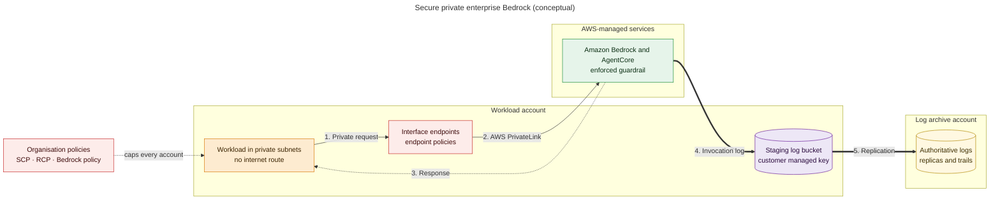
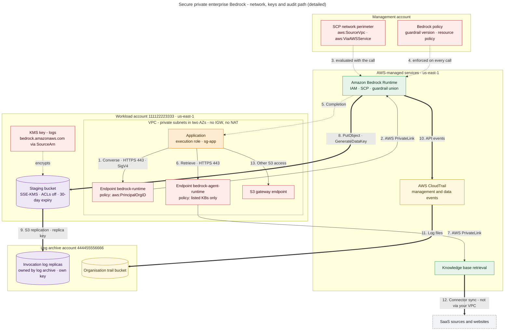
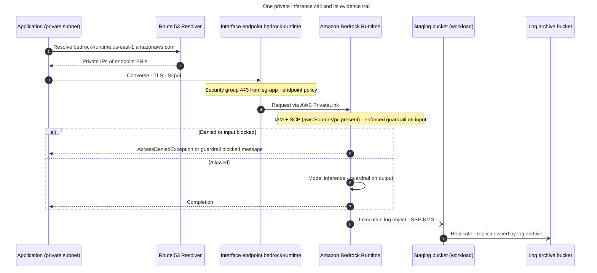

# Pattern: secure private enterprise Bedrock

> **Level:** Advanced · **Verified:** 2026-11-15 · **Feature status:** n/a · **Time:** ~45 min

This pattern is a layer you add to any other pattern in this section: workloads in private subnets with no internet route, every Bedrock and AgentCore call over an interface endpoint, customer managed keys, invocation logs kept in a separate log archive account, enforced guardrails and a data perimeter. It also names, explicitly, the features that leave your network however private the VPC is.

> [!IMPORTANT]
> **Status** — This is the academy's design, assembled from documented service behaviour. It is **not an official AWS reference architecture**. AWS's own guidance for the same problem is the [AWS Security Reference Architecture for AI](https://docs.aws.amazon.com/prescriptive-guidance/latest/security-reference-architecture-generative-ai/gen-ai-sra.html) and the IAM guide's [data perimeters](https://docs.aws.amazon.com/IAM/latest/UserGuide/access_policies_data-perimeters.html) page.

## Learning objectives

After this chapter you can:

- Design a workload network with no internet egress that still reaches every Bedrock and AgentCore API it calls.
- Combine endpoint policies, SCPs, RCPs and resource policies into a data perimeter, and say which threat each one stops.
- Deliver model invocation logs to a log archive account despite the documented same-account rule.
- List the features that still use a non-private path, and decide for each whether to accept, contain or disable it.
- Explain the failure modes and cost drivers of a private design before you build it.

## Prerequisites

- [Private connectivity for Bedrock: interface endpoints and PrivateLink](../../02-related-aws-services/networking/01-private-connectivity-for-bedrock.md) — endpoint names, endpoint policies, Bedrock-initiated paths. This pattern builds on it and does not repeat it.
- [AWS KMS and encryption](../../00-foundations/security/04-kms-encryption.md) and [AWS CloudTrail for Bedrock](../../02-related-aws-services/security/05-cloudtrail-for-bedrock.md).
- [Automated Reasoning checks and guardrail enforcement](../../01-amazon-bedrock/guardrails/02-automated-reasoning-and-enforcement.md).
- [AWS Organizations and AWS Control Tower](../../00-foundations/aws-fundamentals/05-organizations-control-tower.md) — SCPs and RCPs.
- One application pattern to make private, for example [Pattern: enterprise RAG](../enterprise-rag/README.md).

## Concept in plain language

Picture a bank's trading floor. The room has no windows: nobody can shout to the street (private subnets, no internet route). Every outside service the traders need is reached through its own guarded door with a rule sheet on it (an interface endpoint with an endpoint policy). Every document is sealed with the bank's own seal (a customer managed key). A copy of every conversation is couriered to the auditor's building across the road, which floor staff cannot enter (the log archive account). Head office rules say staff may only use these services from this floor (an SCP network perimeter), and a compliance officer checks every message for forbidden content whether or not the trader asked (an enforced guardrail).

Some services still send their own couriers out of the building: a web crawler, a SaaS connector, a request routed to another Region. Those trips start inside AWS, not on your floor. A private design writes them down and decides about each one.

## How it really works

### Problem and forces

**Problem.** A regulated workload must show that prompts, documents and completions do not cross the public internet, are encrypted under keys the company controls, and are attributable to a caller in a log the workload team cannot alter — and that a misconfigured team cannot quietly bypass any of it.

| Force | Pulls towards | Pulls against |
|:--|:--|:--|
| Privacy | Interface endpoints, no NAT gateway | Features that must reach the web or SaaS |
| Auditability | Full-content invocation logs | A new store of sensitive prompts to protect |
| Central control | Organisation policies, enforced guardrails | Team autonomy, blast radius of a bad policy |
| Isolation | Endpoints in every VPC | Endpoint cost per Availability Zone per VPC |
| Throughput and price | Cross-Region inference profiles | Processing in another Region |

### Solution: five layers, none trusted alone

Following [ADR-015](../../ARCHITECTURE-DECISIONS.md#adr-015-security-controls-are-layered-and-none-is-trusted-alone), the pattern stacks independent controls.

| Layer | Components | Threat it addresses | What still gets through |
|:--|:--|:--|:--|
| Network | Private subnets, interface endpoints, endpoint policies, security groups | Exfiltration over the internet; calls from unknown networks | Anything a stolen credential can do from inside the VPC |
| Identity and perimeter | Least-privilege roles, SCP network perimeter, RCPs, endpoint policy `aws:PrincipalOrgID` | Use of your credentials elsewhere; foreign principals on your data | An authorised role misusing its own permissions |
| Data protection | Customer managed keys per purpose, TLS-only bucket policies | Readable data at rest; key misuse | Plaintext in memory and in the model call |
| Content safety | Organisation-enforced guardrail, AgentCore Policy for tools | Harmful content, prompt attacks, unsafe tool calls | Novel attacks the filters miss |
| Audit | Invocation logs replicated to the log archive, CloudTrail management and data events | Undetected misuse; tampering with evidence | Calls on endpoints logging does not cover (see below) |

### Component roles

| Component | Account | Role in this pattern | Security control |
|:--|:--|:--|:--|
| Workload (Lambda, containers, AgentCore Runtime in VPC mode) | Workload | Calls Bedrock and AgentCore | Execution role; security group; principal tag `dp:include:network` |
| Interface endpoints `bedrock-runtime`, `bedrock-agent-runtime`, `bedrock-agentcore`, `bedrock-agentcore.gateway` | Workload or shared network | Private path for data-plane calls | Endpoint policy; security group 443 from callers only |
| Interface endpoints `bedrock`, `bedrock-agent`, `bedrock-agentcore-control` | Workload | Only if pipelines deploy from inside the VPC | Endpoint policy limited to the deployment role |
| Supporting endpoints: STS, CloudWatch Logs, KMS, Secrets Manager, Amazon ECR; S3 gateway endpoint | Workload | Everything else the workload and its agents need | Endpoint policies |
| Route 53 Resolver private DNS | Workload or shared network | Standard hostnames resolve to endpoint addresses | Remember `bedrock-mantle` and AWS Agent Registry use the `api.aws` domain |
| Customer managed keys | Workload; log archive | Encrypt logs, knowledge bases, guardrails, AgentCore Memory | Key policies with `aws:SourceAccount` and `aws:SourceArn` |
| Staging log bucket | Workload | Receives invocation logs (Bedrock can deliver only here) | Bucket policy for `bedrock.amazonaws.com`; ACLs disabled; short lifecycle |
| Log archive bucket | Log archive | Holds the replicated, authoritative copy | Replicas owned by the log archive; its own key |
| Organisation trail with data-event selectors | Management → log archive | API evidence, including `ApplyGuardrail` and `Retrieve` data events | Log file validation; SSE-KMS |
| Enforced guardrail (`BEDROCK_POLICY`) | Management | Applied to every inference call in the attached accounts | Numbered version; resource policy with `aws:PrincipalOrgID` |
| SCPs and RCPs | Management | Network and identity perimeter | Tested in a policy staging OU first |

Endpoint service names are verified in [Private connectivity for Bedrock](../../02-related-aws-services/networking/01-private-connectivity-for-bedrock.md) and, for AgentCore, on the [AgentCore interface endpoints](https://docs.aws.amazon.com/bedrock-agentcore/latest/devguide/vpc-interface-endpoints.html) page; registry endpoints are in [AWS Agent Registry](../../01-amazon-bedrock/agentcore/11-agentcore-registry.md).

> [!NOTE]
> **Documented fact** — Model invocation logging supports CloudWatch Logs and Amazon S3, but "only destinations from the same account and Region are supported". It covers only calls made through `bedrock-runtime` (including its OpenAI-compatible APIs); calls through `bedrock-mantle` "are not currently captured". The bucket ACL must be disabled for the bucket policy to take effect.
> Source: [Monitor model invocation using CloudWatch Logs and Amazon S3](https://docs.aws.amazon.com/bedrock/latest/userguide/model-invocation-logging.html)

That rule shapes the logging design: Bedrock writes to a staging bucket in the workload account, and **S3 cross-account replication** copies each object to the log archive. For SSE-KMS objects the destination key's owner must grant the source account use of the key, and replicas can be made owned by the destination account ([cross-account replication](https://docs.aws.amazon.com/AmazonS3/latest/userguide/replication-walkthrough-2.html)). A delete in the source is not replicated as a version delete, which protects the archive.

### Data flow and direction

1. **Request** — workload → private DNS → endpoint ENI (security group, endpoint policy) → AWS PrivateLink → Bedrock Runtime. IAM, SCPs and the enforced guardrail are evaluated in the service.
2. **Response** — the completion returns on the same connection.
3. **Content log** — Bedrock → staging bucket (service principal, SSE-KMS) → replication → log archive. One direction only; nothing reads back.
4. **API evidence** — Bedrock and AgentCore → CloudTrail in the source Region → organisation trail bucket in the log archive.
5. **Service-initiated paths** — connector syncs, crawls and cross-Region routing start inside AWS and never enter your VPC (table below).

### Trust boundaries

| Boundary | Inside | Enforced by |
|:--|:--|:--|
| Workload VPC | Your compute and endpoint ENIs | Route tables (no internet gateway, no NAT), security groups |
| Workload account | Roles, keys, staging bucket | IAM, SCPs, RCPs |
| AWS-managed service | Bedrock, AgentCore, model providers' models | Endpoint policies, IAM evaluation, guardrails |
| Log archive account | Authoritative logs and trails | Separate account; workload roles have no access |
| Outside AWS | SaaS sources, websites, external identity providers | Nothing in your VPC — only scope and credentials |

### Features that still need a non-private path

| Feature | What leaves, and to where | Decision the academy recommends |
|:--|:--|:--|
| Geographic cross-Region inference | Prompt and completion to another Region of the geography, on the AWS network | **Accept** if the geography meets residency rules; CloudTrail records `additionalEventData.inferenceRegion` |
| Global cross-Region inference | To any supported commercial Region | **Disable** for regulated data (SCP, see [Pattern: multi-account](../multi-account/README.md)) |
| Knowledge base Web Crawler; SaaS connectors (SharePoint, Confluence and others) | Bedrock calls the website or SaaS API from the service side | **Contain**: least-privilege SaaS credentials in Secrets Manager; or land content in Amazon S3 yourself |
| Web Search tool (`bedrock-mantle`) and AgentCore Web Search | Queries against an AWS-hosted web index; content comes from the public web | **Disable** with an SCP on `bedrock-websearch:*` unless approved |
| `bedrock-mantle` (Projects, background inference, mantle-only models) | Private endpoint exists, but neither invocation logging nor guardrails cover it | **Disable** in production with an SCP on `bedrock-mantle:*` |
| AgentCore Browser; Gateway targets on the internet; external MCP servers and OAuth providers | Session or gateway traffic to the internet | **Contain**: VPC mode with a NAT gateway in a dedicated egress path and Network Firewall-style filtering, or keep tools private behind VPC Lattice targets |
| Workforce sign-in (IAM Identity Center) | Browser to public sign-in endpoints | **Accept**; protect with your identity provider's controls |
| Automated Reasoning checks; AWS Agent Registry semantic search | Processed with cross-Region inference inside the geography | **Accept** or avoid the feature |

Sources: [Private connectivity for Bedrock](../../02-related-aws-services/networking/01-private-connectivity-for-bedrock.md), [cross-Region inference](https://docs.aws.amazon.com/bedrock/latest/userguide/cross-region-inference.html), [model invocation logging](https://docs.aws.amazon.com/bedrock/latest/userguide/model-invocation-logging.html), [guardrail enforcement](../../01-amazon-bedrock/guardrails/02-automated-reasoning-and-enforcement.md), [AWS Agent Registry](../../01-amazon-bedrock/agentcore/11-agentcore-registry.md).

### Failure modes

| Failure | Symptom | Mitigation |
|:--|:--|:--|
| Private DNS disabled, or on-premises resolvers not forwarding | Timeouts (no NAT) or `AccessDenied` from the network-perimeter SCP | Enable private DNS; Route 53 Resolver inbound endpoints for on-premises callers |
| Endpoint policy scoped to one Region's model ARN while a Geo profile is used | `AccessDenied` on routed requests | Model ARNs with Region `*` plus the profile ARN |
| Network-perimeter SCP without an `aws:ViaAWSService` exception | Features that call other services on your behalf fail | Keep the `BoolIfExists` exception; test each API |
| Missing `bedrock:ApplyGuardrail` on the organisation guardrail | Every inference call in the account fails | Grant it in the baseline role policies before attaching the policy |
| Destination key policy or bucket policy missing in the log archive | Logs stay in staging only and expire | Alarm on replication failures; test with a synthetic call |
| One endpoint subnet's Availability Zone impaired | Partial errors | Endpoints in at least two Availability Zones |

### Scaling

Interface endpoints do not change Bedrock capacity: quotas are per account and Region and separate for `bedrock-runtime` and `bedrock-mantle` ([quotas](https://docs.aws.amazon.com/bedrock/latest/userguide/quotas.html)). What grows with traffic is log volume (bodies up to 100 KB inline, larger ones as separate objects), CloudTrail data events and endpoint data processing. With many VPCs, centralise endpoints in a shared network VPC. **Our reading:** `aws:SourceVpc` then names the endpoint VPC, not the caller's VPC, so perimeter policies list the hub VPC.

### When not to use it

- **Prototypes and sandboxes** — the friction and the hourly endpoint cost buy little; use the [basic pattern](../basic-inference/README.md) with logging.
- **Data residency is the real requirement** — private endpoints do not keep processing in one Region; choose in-Region or Geo model IDs ([cross-Region and data residency](../../09-advanced-topics/11-cross-region-and-data-residency.md)).
- **The core feature is web-facing** (crawling, web search, browsing) — the pattern can only contain those paths, not make them private.
- **You need mantle-only features with full content logging** — not possible on the verification date.

## Architecture diagram

### Conceptual view



**What this shows** — The workload talks to Bedrock only through endpoints; Bedrock writes the content log in the workload account because it must, and replication moves the authoritative copy to an account the workload cannot touch. Organisation policies sit above every account.

### Detailed implementation view



**What this shows** — Three accounts and one AWS-managed boundary. Only edges 1, 6 and 13 start in your VPC; everything else starts inside AWS.

**Walkthrough**

1. The application calls `Converse`; private DNS resolves the standard hostname to the endpoint ENIs.
2. The endpoint policy admits only principals of the organisation and approved models; PrivateLink carries the call.
3. The SCP network perimeter is evaluated with the request: a tagged role calling from outside the approved VPCs is denied.
4. The organisation guardrail is applied whether or not the request names one.
5. The completion returns on the same connection.
6. –7. Retrieval follows the same pattern through its own endpoint, restricted to listed knowledge bases.
8. Bedrock writes the invocation log as `bedrock.amazonaws.com`, using the logs key.
9. Replication copies each object to the log archive and hands ownership to it.
10. –11. API activity, including `ApplyGuardrail` and `Retrieve` data events, goes to the organisation trail.
12. Connector syncs leave from the managed service — a documented non-private path.
13. Ordinary S3 access uses the gateway endpoint.

**Legend** — solid: request · dashed: response or policy applied · thick: asynchronous delivery · cylinder: data at rest · red: security control · grey dashed: outside AWS · nested boxes: account and network boundaries. The full set, with AgentCore and perimeter policy views, is [diagram set 24](../../diagrams/mermaid/24-secure-private-enterprise-bedrock.md).

### Sequence view



Steps 1–2: without private DNS the SDK would resolve the public address and, with no NAT gateway, time out. Steps 5–7: denials and guardrail interventions are themselves logged (CloudTrail `errorCode`; guardrail data events). Steps 10–11 are asynchronous; a replication failure leaves the log in staging until it expires, so alarm on it.

## Implementation details

1. **Inventory the APIs** each workload calls and map them to endpoints with the table in [Private connectivity for Bedrock](../../02-related-aws-services/networking/01-private-connectivity-for-bedrock.md). Include supporting services (STS, KMS, CloudWatch Logs, Secrets Manager, ECR for agent images).
2. **Build the network**: private subnets in at least two Availability Zones, no internet gateway or NAT gateway on their route tables, both VPC DNS attributes on. Module: [`bedrock-private-endpoints`](../../04-infrastructure-as-code/terraform/modules/bedrock-private-endpoints/README.md) (planned).
3. **Write endpoint policies** that name the organisation (`aws:PrincipalOrgID`), the actions and the resources. AgentCore callers that use OAuth are not IAM principals and need `Principal: "*"` statements restricted by resource.
4. **Create keys per purpose** — logs, knowledge base, guardrail, AgentCore Memory — so that a key policy grants one service one job. AWS's SRA recommends a customer managed key for guardrails ([SRA for AI](https://docs.aws.amazon.com/prescriptive-guidance/latest/security-reference-architecture-generative-ai/gen-ai-sra.html)).
5. **Turn on invocation logging** to the staging bucket and replicate to the log archive (example below; module [`bedrock-invocation-logging`](../../04-infrastructure-as-code/terraform/modules/bedrock-invocation-logging/README.md), planned).
6. **Add CloudTrail data-event selectors** for guardrails, knowledge bases and AgentCore, keeping an explicit management-event selector ([AWS CloudTrail for Bedrock](../../02-related-aws-services/security/05-cloudtrail-for-bedrock.md)).
7. **Enforce the guardrail** from the organisation with a numbered version and resource policies ([guardrail enforcement](../../01-amazon-bedrock/guardrails/02-automated-reasoning-and-enforcement.md)).
8. **Attach the perimeter**: the network-perimeter SCP and the identity-perimeter RCP below, first to a policy staging OU.
9. **Decide each non-private path** from the table above and deny what you do not accept.
10. **Prove it**: from a host outside the VPC, a tagged role must get `AccessDenied`; from inside, the same call must succeed; a synthetic call must appear in the log archive.

## Variations

| Variation | What changes |
|:--|:--|
| Shared endpoint VPC (hub and spoke) | Endpoints and private hosted zones live in a network account; workload VPCs reach them over AWS Transit Gateway. Fewer endpoint-hours; perimeter policies name the hub VPC |
| On-premises callers | Direct Connect or Site-to-Site VPN plus Route 53 Resolver inbound endpoints; add `aws:SourceIp` ranges to the perimeter if callers do not use the endpoints |
| Agents on AgentCore Runtime in VPC mode | Session ENIs in your subnets; add `bedrock-agentcore` and `bedrock-agentcore.gateway` endpoints; tools that need the internet need a contained egress path |
| CloudWatch Logs as the log destination | Same-account log group; centralise with CloudWatch cross-account observability or subscriptions instead of S3 replication |
| Single account (no log archive yet) | Same design without replication; protect the bucket with an SCP that denies deletes to workload roles |
| FIPS endpoints | `bedrock-fips` and `bedrock-runtime-fips` endpoint services in the Regions listed on the Bedrock endpoint page |
| In-Region model IDs only | No cross-Region path at all; check the model is offered in-Region |

## Example

[Project E: secure private enterprise GenAI](../../05-practical-projects/project-05-private-genai/README.md) (planned) implements this pattern end to end. The two fragments below are the pieces specific to this pattern.

### Invocation logs into a log archive account (Terraform)

> **Code status:** validated with `terraform fmt -check`, `terraform validate` and TFLint 0.66 (core rules), provider `hashicorp/aws` 6.73.0 · mock-tested: 3 `terraform test` runs pass · **never planned or applied against AWS**

`versions.tf` declares `required_version = ">= 1.11.0"`, `hashicorp/aws` `~> 6.73` and a provider with `default_tags`, exactly as in [Private connectivity for Bedrock](../../02-related-aws-services/networking/01-private-connectivity-for-bedrock.md).

`variables.tf`:

```hcl
variable "aws_region" {
  description = "Region of the workload. Invocation logging is configured per account and Region."
  type        = string
  default     = "us-east-1"
}

variable "tags" {
  description = "Tags applied to every resource through the provider's default_tags."
  type        = map(string)
  default     = { Project = "bedrock-academy", Pattern = "private-enterprise" }
}

variable "log_bucket_name" {
  description = "Name of the staging bucket in THIS account. Bedrock can only deliver to a bucket in the same account and Region."
  type        = string
}

variable "log_archive_account_id" {
  description = "Account ID of the log archive account that receives the replicas."
  type        = string

  validation {
    condition     = can(regex("^[0-9]{12}$", var.log_archive_account_id))
    error_message = "log_archive_account_id must be a 12-digit AWS account ID."
  }
}

variable "log_archive_bucket_arn" {
  description = "ARN of the versioned, SSE-KMS destination bucket in the log archive account."
  type        = string
}

variable "log_archive_kms_key_arn" {
  description = "ARN of the customer managed key that encrypts the destination bucket (owned by the log archive account)."
  type        = string
}

variable "staging_retention_days" {
  description = "Days to keep the local copy after replication. The log archive copy is the record."
  type        = number
  default     = 30
}
```

`main.tf`:

```hcl
data "aws_caller_identity" "current" {}
data "aws_partition" "current" {}
data "aws_region" "current" {}

locals {
  account_id  = data.aws_caller_identity.current.account_id
  partition   = data.aws_partition.current.partition
  region      = data.aws_region.current.region
  bedrock_arn = "arn:${local.partition}:bedrock:${local.region}:${local.account_id}:*"
  log_prefix  = "AWSLogs/${local.account_id}/BedrockModelInvocationLogs/"

  # Confused-deputy protection for the Bedrock service principal, as documented.
  bedrock_source = {
    StringEquals = { "aws:SourceAccount" = local.account_id }
    ArnLike      = { "aws:SourceArn" = local.bedrock_arn }
  }
}

# Customer managed key for the staging bucket. Bedrock may only generate data keys for this account's logs.
resource "aws_kms_key" "invocation_logs" {
  description             = "Bedrock model invocation logs (staging copy before replication)"
  enable_key_rotation     = true
  deletion_window_in_days = 30

  policy = jsonencode({
    Version = "2012-10-17"
    Statement = [
      {
        Sid       = "AccountAdministration"
        Effect    = "Allow"
        Principal = { AWS = "arn:${local.partition}:iam::${local.account_id}:root" }
        Action    = "kms:*"
        Resource  = "*"
      },
      {
        Sid       = "BedrockWritesInvocationLogs"
        Effect    = "Allow"
        Principal = { Service = "bedrock.amazonaws.com" }
        Action    = "kms:GenerateDataKey"
        Resource  = "*"
        Condition = local.bedrock_source
      },
    ]
  })
}

resource "aws_s3_bucket" "invocation_logs" {
  bucket = var.log_bucket_name
}

# Bedrock requires ACLs to be disabled for its bucket policy to take effect.
resource "aws_s3_bucket_ownership_controls" "invocation_logs" {
  bucket = aws_s3_bucket.invocation_logs.id
  rule {
    object_ownership = "BucketOwnerEnforced"
  }
}

resource "aws_s3_bucket_public_access_block" "invocation_logs" {
  bucket                  = aws_s3_bucket.invocation_logs.id
  block_public_acls       = true
  block_public_policy     = true
  ignore_public_acls      = true
  restrict_public_buckets = true
}

# Replication needs versioning on the source (and the destination).
resource "aws_s3_bucket_versioning" "invocation_logs" {
  bucket = aws_s3_bucket.invocation_logs.id
  versioning_configuration {
    status = "Enabled"
  }
}

resource "aws_s3_bucket_server_side_encryption_configuration" "invocation_logs" {
  bucket = aws_s3_bucket.invocation_logs.id
  rule {
    apply_server_side_encryption_by_default {
      sse_algorithm     = "aws:kms"
      kms_master_key_id = aws_kms_key.invocation_logs.arn
    }
    bucket_key_enabled = true
  }
}

resource "aws_s3_bucket_lifecycle_configuration" "invocation_logs" {
  bucket = aws_s3_bucket.invocation_logs.id
  rule {
    id     = "expire-staging-copy"
    status = "Enabled"
    filter {}
    expiration {
      days = var.staging_retention_days
    }
    noncurrent_version_expiration {
      noncurrent_days = 1
    }
  }
}

resource "aws_s3_bucket_policy" "invocation_logs" {
  bucket = aws_s3_bucket.invocation_logs.id
  policy = jsonencode({
    Version = "2012-10-17"
    Statement = [
      {
        Sid       = "AmazonBedrockLogsWrite"
        Effect    = "Allow"
        Principal = { Service = "bedrock.amazonaws.com" }
        Action    = "s3:PutObject"
        Resource  = "${aws_s3_bucket.invocation_logs.arn}/${local.log_prefix}*"
        Condition = local.bedrock_source
      },
      {
        Sid       = "DenyInsecureTransport"
        Effect    = "Deny"
        Principal = "*"
        Action    = "s3:*"
        Resource  = [aws_s3_bucket.invocation_logs.arn, "${aws_s3_bucket.invocation_logs.arn}/*"]
        Condition = { Bool = { "aws:SecureTransport" = "false" } }
      },
    ]
  })

  depends_on = [aws_s3_bucket_ownership_controls.invocation_logs]
}

# Account-and-Region setting: every bedrock-runtime call in this account and Region is logged.
resource "aws_bedrock_model_invocation_logging_configuration" "this" {
  logging_config {
    text_data_delivery_enabled      = true
    image_data_delivery_enabled     = true
    embedding_data_delivery_enabled = false
    video_data_delivery_enabled     = false

    s3_config {
      bucket_name = aws_s3_bucket.invocation_logs.id
    }
  }

  depends_on = [aws_s3_bucket_policy.invocation_logs, aws_kms_key.invocation_logs]
}

# Replication role: reads the staging bucket, writes replicas into the log archive account.
resource "aws_iam_role" "replication" {
  name_prefix = "bedrock-log-replication-"
  assume_role_policy = jsonencode({
    Version = "2012-10-17"
    Statement = [{
      Effect    = "Allow"
      Principal = { Service = "s3.amazonaws.com" }
      Action    = "sts:AssumeRole"
      Condition = { StringEquals = { "aws:SourceAccount" = local.account_id } }
    }]
  })
}

resource "aws_iam_role_policy" "replication" {
  role = aws_iam_role.replication.id
  policy = jsonencode({
    Version = "2012-10-17"
    Statement = [
      {
        Sid      = "ReadSource"
        Effect   = "Allow"
        Action   = ["s3:GetReplicationConfiguration", "s3:ListBucket"]
        Resource = aws_s3_bucket.invocation_logs.arn
      },
      {
        Sid      = "ReadSourceVersions"
        Effect   = "Allow"
        Action   = ["s3:GetObjectVersionForReplication", "s3:GetObjectVersionAcl", "s3:GetObjectVersionTagging"]
        Resource = "${aws_s3_bucket.invocation_logs.arn}/*"
      },
      {
        Sid      = "WriteReplicas"
        Effect   = "Allow"
        Action   = ["s3:ReplicateObject", "s3:ReplicateTags", "s3:ObjectOwnerOverrideToBucketOwner"]
        Resource = "${var.log_archive_bucket_arn}/*"
      },
      {
        Sid      = "DecryptSource"
        Effect   = "Allow"
        Action   = "kms:Decrypt"
        Resource = aws_kms_key.invocation_logs.arn
      },
      {
        Sid      = "EncryptDestination"
        Effect   = "Allow"
        Action   = ["kms:Encrypt", "kms:GenerateDataKey"]
        Resource = var.log_archive_kms_key_arn
      },
    ]
  })
}

resource "aws_s3_bucket_replication_configuration" "to_log_archive" {
  bucket = aws_s3_bucket.invocation_logs.id
  role   = aws_iam_role.replication.arn

  rule {
    id     = "invocation-logs-to-log-archive"
    status = "Enabled"

    filter {
      prefix = local.log_prefix
    }

    delete_marker_replication {
      status = "Disabled"
    }

    source_selection_criteria {
      sse_kms_encrypted_objects {
        status = "Enabled"
      }
    }

    destination {
      bucket  = var.log_archive_bucket_arn
      account = var.log_archive_account_id

      # Replicas belong to the log archive account, not to the workload account.
      access_control_translation {
        owner = "Destination"
      }

      encryption_configuration {
        replica_kms_key_id = var.log_archive_kms_key_arn
      }
    }
  }

  depends_on = [aws_s3_bucket_versioning.invocation_logs]

  lifecycle {
    precondition {
      condition     = var.log_archive_account_id != local.account_id
      error_message = "The log archive must be a different account from the workload account."
    }
  }
}
```

`outputs.tf`:

```hcl
output "invocation_log_bucket" {
  description = "Staging bucket that Bedrock writes to in this account."
  value       = aws_s3_bucket.invocation_logs.id
}

output "replication_role_arn" {
  description = "Give this ARN to the log archive team: their bucket policy and key policy must trust it."
  value       = aws_iam_role.replication.arn
}

output "log_archive_bucket_policy_statements" {
  description = "Statements the log archive account adds to its destination bucket policy."
  value = jsonencode([
    {
      Sid       = "AllowReplicationFromWorkload${local.account_id}"
      Effect    = "Allow"
      Principal = { AWS = aws_iam_role.replication.arn }
      Action    = ["s3:ReplicateObject", "s3:ReplicateTags", "s3:ObjectOwnerOverrideToBucketOwner"]
      Resource  = "${var.log_archive_bucket_arn}/*"
    },
    {
      Sid       = "AllowVersioningCheckFromWorkload${local.account_id}"
      Effect    = "Allow"
      Principal = { AWS = aws_iam_role.replication.arn }
      Action    = ["s3:GetBucketVersioning", "s3:PutBucketVersioning"]
      Resource  = var.log_archive_bucket_arn
    },
  ])
}
```

`tests/logging.tftest.hcl` — offline, with a mock provider:

```hcl
mock_provider "aws" {
  mock_data "aws_caller_identity" {
    defaults = { account_id = "111122223333" }
  }
  mock_data "aws_partition" {
    defaults = { partition = "aws" }
  }
  mock_data "aws_region" {
    defaults = { region = "us-east-1" }
  }
  mock_resource "aws_s3_bucket" {
    defaults = { id = "example-bedrock-invocation-logs", arn = "arn:aws:s3:::example-bedrock-invocation-logs" }
  }
  mock_resource "aws_kms_key" {
    defaults = { arn = "arn:aws:kms:us-east-1:111122223333:key/11111111-2222-3333-4444-555555555555" }
  }
  mock_resource "aws_iam_role" {
    defaults = { arn = "arn:aws:iam::111122223333:role/bedrock-log-replication-example" }
  }
}

variables {
  log_bucket_name         = "example-bedrock-invocation-logs"
  log_archive_account_id  = "444455556666"
  log_archive_bucket_arn  = "arn:aws:s3:::example-log-archive-bedrock"
  log_archive_kms_key_arn = "arn:aws:kms:us-east-1:444455556666:key/66666666-7777-8888-9999-000000000000"
}

run "logs_stay_in_account_then_replicate_to_log_archive" {
  command = apply

  assert {
    condition     = aws_bedrock_model_invocation_logging_configuration.this.logging_config[0].s3_config[0].bucket_name == "example-bedrock-invocation-logs"
    error_message = "Bedrock must deliver to the same-account staging bucket."
  }

  assert {
    condition     = jsondecode(aws_s3_bucket_policy.invocation_logs.policy).Statement[0].Condition.StringEquals["aws:SourceAccount"] == "111122223333"
    error_message = "The Bedrock write statement must be scoped to this account."
  }

  assert {
    condition     = jsondecode(aws_s3_bucket_policy.invocation_logs.policy).Statement[0].Resource == "arn:aws:s3:::example-bedrock-invocation-logs/AWSLogs/111122223333/BedrockModelInvocationLogs/*"
    error_message = "Bedrock may write only under its documented prefix."
  }

  assert {
    condition     = aws_s3_bucket_replication_configuration.to_log_archive.rule[0].destination[0].account == "444455556666" && aws_s3_bucket_replication_configuration.to_log_archive.rule[0].destination[0].access_control_translation[0].owner == "Destination"
    error_message = "Replicas must be owned by the log archive account."
  }

  assert {
    condition     = aws_kms_key.invocation_logs.enable_key_rotation
    error_message = "The customer managed key must rotate."
  }

  assert {
    condition     = aws_s3_bucket_ownership_controls.invocation_logs.rule[0].object_ownership == "BucketOwnerEnforced"
    error_message = "ACLs must be disabled for the Bedrock bucket policy to apply."
  }
}

run "rejects_log_archive_equal_to_workload_account" {
  command = plan

  variables {
    log_archive_account_id = "111122223333"
  }

  expect_failures = [aws_s3_bucket_replication_configuration.to_log_archive]
}

run "rejects_malformed_account_id" {
  command = plan

  variables {
    log_archive_account_id = "log-archive"
  }

  expect_failures = [var.log_archive_account_id]
}
```

The log archive account needs the mirror image: a versioned bucket whose policy contains the `log_archive_bucket_policy_statements` output, and a key policy that lets the replication role call `kms:Encrypt` and `kms:GenerateDataKey`. If you apply this in a sandbox, the key and the logs bill monthly, and the logs contain full prompts; run `terraform destroy` when you are done.

### Perimeter policies (SCP and RCP)

> **Code status:** syntax-checked (JSON parse) · adapted from the [AWS data perimeter policy examples](https://raw.githubusercontent.com/aws-samples/data-perimeter-policy-examples/main/service_control_policies/network_perimeter_sourcevpc_scp.json) · **never attached to a real organization**

A network-perimeter SCP for production OUs. It applies only to roles tagged `dp:include:network = true`, as AWS's sample does, so that you can opt workloads in one at a time.

```json
{
  "Version": "2012-10-17",
  "Statement": [
    {
      "Sid": "BedrockDataPlaneOnlyFromApprovedVpcs",
      "Effect": "Deny",
      "Action": [
        "bedrock:InvokeModel",
        "bedrock:InvokeModelWithResponseStream",
        "bedrock:ApplyGuardrail",
        "bedrock:Retrieve",
        "bedrock:RetrieveAndGenerate",
        "bedrock:AgenticRetrieveStream",
        "bedrock-agentcore:InvokeAgentRuntime"
      ],
      "Resource": "*",
      "Condition": {
        "StringNotEqualsIfExists": {
          "aws:SourceVpc": ["vpc-0example1workload", "vpc-0example2endpointhub"]
        },
        "BoolIfExists": { "aws:ViaAWSService": "false" },
        "StringEquals": { "aws:PrincipalTag/dp:include:network": "true" }
      }
    },
    {
      "Sid": "NoUnloggedOrWebFacingEndpoints",
      "Effect": "Deny",
      "Action": ["bedrock-mantle:*", "bedrock-websearch:*"],
      "Resource": "*"
    }
  ]
}
```

An identity-perimeter RCP for the data around Bedrock. Amazon Bedrock and AgentCore are **not** in the list of services that support RCPs on the verification date; Amazon S3, AWS KMS, Secrets Manager, CloudWatch Logs, AWS STS and OpenSearch Serverless are ([RCP services](https://docs.aws.amazon.com/organizations/latest/userguide/orgs_manage_policies_rcps.html)). The second statement is the confused-deputy guard: AWS service principals such as `bedrock.amazonaws.com` may act only on behalf of your organisation.

```json
{
  "Version": "2012-10-17",
  "Statement": [
    {
      "Sid": "OnlyOrgIdentitiesOnGenAiData",
      "Effect": "Deny",
      "Principal": "*",
      "Action": ["s3:*", "kms:*", "secretsmanager:*", "logs:*", "aoss:*"],
      "Resource": "*",
      "Condition": {
        "StringNotEqualsIfExists": { "aws:PrincipalOrgID": "o-exampleorgid" },
        "BoolIfExists": { "aws:PrincipalIsAWSService": "false" }
      }
    },
    {
      "Sid": "ServicesOnlyOnBehalfOfTheOrg",
      "Effect": "Deny",
      "Principal": "*",
      "Action": ["s3:*", "kms:*", "secretsmanager:*", "logs:*", "aoss:*"],
      "Resource": "*",
      "Condition": {
        "StringNotEqualsIfExists": { "aws:SourceOrgID": "o-exampleorgid" },
        "Null": { "aws:SourceAccount": "false" },
        "Bool": { "aws:PrincipalIsAWSService": "true" }
      }
    }
  ]
}
```

> [!WARNING]
> **Common mistake** — Assuming the network perimeter covers Bedrock's own follow-on calls. **Our reading:** when `RetrieveAndGenerate` or an agent calls a model on your behalf, the inner call does not carry your VPC; the `aws:ViaAWSService` exception is what keeps it working. Whether destination-Region evaluations of a cross-Region profile carry `aws:SourceVpc` is **UNVERIFIED — REQUIRES DOCUMENTATION REVIEW** (looked on the cross-Region inference, data perimeter and Bedrock endpoint pages). Test both in a sandbox OU before production.

## Common mistakes

| Mistake | Symptom | Fix |
|:--|:--|:--|
| Pointing invocation logging at the log archive bucket directly | Configuration rejected | Same-account staging bucket plus replication |
| Leaving `bedrock-mantle` open in a "fully logged" account | Calls with no invocation log and no guardrail | Deny `bedrock-mantle:*` unless a reviewed exception exists |
| Treating "private" as "in-Region" | Processing in other Regions through profiles | Choose Geo or in-Region IDs; deny Global profiles |
| Opening a NAT gateway "temporarily" for one tool | Every workload in the subnet regains internet egress | Separate egress subnets and routes for the one component that needs them |
| Expecting VPC Flow Logs to show crawler or connector traffic | Nothing appears | Document Bedrock-initiated paths separately |
| Granting the log archive team's key to workload roles | Workload can read the evidence | Only the replication role may encrypt; only auditors may decrypt |

## Security considerations

- **Logs are now the most sensitive store you own.** They hold full prompts and completions. Restrict decrypt on the log archive key to an auditor role, consider S3 Object Lock for retention, and scan with Macie if your policy requires it ([GuardDuty, Security Hub, AWS Config and Macie](../../02-related-aws-services/security/04-guardduty-security-hub-config-macie.md)).
- **Protect the controls themselves.** Deny changes to logging configuration, enforced guardrails, endpoint policies and `ec2:CreateVpcEndpoint` to everyone but the platform pipeline; GuardDuty reports invocation logging being disabled.
- **Endpoint policies are a ceiling, not a grant.** IAM must still allow each call; keep both narrow.
- **Detect drift.** Security Hub's AI Security Best Practices controls check VPC mode for AgentCore runtimes and customer managed keys for knowledge base data sources, Memory and gateways.
- **Ownership:** see [Network security and private access](../../06-security-governance/05-network-security-and-private-access.md) and [Logging, audit and compliance evidence](../../06-security-governance/07-logging-audit-and-compliance.md).

## Cost considerations

| Driver | Unit | Grows with |
|:--|:--|:--|
| Interface endpoints | Per endpoint per Availability Zone per hour, plus $0.01 per GB for the first PB processed per Region per month ([PrivateLink pricing](https://aws.amazon.com/privatelink/pricing/)) | Number of endpoint types × Availability Zones × VPCs |
| Invocation log storage, replication and KMS requests | Per GB-month, per request | Tokens per call, images, retention period |
| CloudTrail data events | Per event delivered | `ApplyGuardrail`, `Retrieve` and AgentCore call volume |
| Enforced guardrail | Per text unit per safeguard | Every inference call in attached accounts, including ones that already had a guardrail |
| Contained egress (NAT gateway, firewall) | Per hour and per GB | Only where a tool needs the internet |

Centralising endpoints in a hub VPC is the largest single saving; logging only text, not images, the second.

## Knowledge check

1. Your auditor wants invocation logs written straight into the log archive account. What do you tell them, and what do you build instead?
2. A tagged application role calls `Converse` from a developer laptop with valid credentials. Which control stops it, and what does the caller see?
3. A team enables the Web Search tool for a production agent. Which two documented gaps make this incompatible with the pattern?
4. Why does the RCP not mention `bedrock:*`?
5. You move endpoints to a shared hub VPC. What must change in the SCP?

<details>
<summary>Answers</summary>

1. Bedrock supports only destinations in the same account and Region. Deliver to a staging bucket and replicate to the log archive with replicas owned by the destination.
2. The network-perimeter SCP: the request has no `aws:SourceVpc` from an approved VPC, so the deny applies; the caller gets `AccessDeniedException`, recorded in CloudTrail.
3. It runs on `bedrock-mantle`, which invocation logging and guardrails do not cover, and it brings public-web content into the session.
4. Amazon Bedrock is not on the list of services that support RCPs; the RCP protects the S3, KMS, Secrets Manager, CloudWatch Logs and OpenSearch Serverless resources around it.
5. List the hub VPC in `aws:SourceVpc`: the key names the VPC of the endpoint the request travels through.

</details>

## Further reading

Official sources opened while writing this chapter:

- [AWS SRA for AI](https://docs.aws.amazon.com/prescriptive-guidance/latest/security-reference-architecture-generative-ai/gen-ai-sra.html) — AWS's own multi-account security guidance for generative AI; customer managed keys for guardrails.
- [Establish permissions guardrails using data perimeters](https://docs.aws.amazon.com/IAM/latest/UserGuide/access_policies_data-perimeters.html) — identity, resource and network perimeters and their condition keys.
- [Resource control policies](https://docs.aws.amazon.com/organizations/latest/userguide/orgs_manage_policies_rcps.html) — supported services; what RCPs never restrict.
- [Data perimeter policy examples](https://raw.githubusercontent.com/aws-samples/data-perimeter-policy-examples/main/resource_control_policies/identity_perimeter_rcp.json) — the AWS sample the RCP and SCP above are adapted from.
- [Use interface VPC endpoints with Amazon Bedrock](https://docs.aws.amazon.com/bedrock/latest/userguide/vpc-interface-endpoints.html) — service names, FIPS endpoints, endpoint policies.
- [Use interface VPC endpoints with AgentCore](https://docs.aws.amazon.com/bedrock-agentcore/latest/devguide/vpc-interface-endpoints.html) — three endpoints; OAuth callers need `Principal: "*"`.
- [Model invocation logging](https://docs.aws.amazon.com/bedrock/latest/userguide/model-invocation-logging.html) — same-account destinations, runtime only, bucket and key policies.
- [Configuring replication for buckets in different accounts](https://docs.aws.amazon.com/AmazonS3/latest/userguide/replication-walkthrough-2.html) — destination bucket policy, KMS grants, replica ownership.
- [Cross-Region inference](https://docs.aws.amazon.com/bedrock/latest/userguide/cross-region-inference.html) — AWS network, SCP requirements, `inferenceRegion` in CloudTrail.
- [Guardrails enforcements](https://docs.aws.amazon.com/bedrock/latest/userguide/guardrails-enforcements.html) and [Amazon Bedrock policies](https://docs.aws.amazon.com/organizations/latest/userguide/orgs_manage_policies_bedrock.html) — organisation-level guardrail enforcement.
- [Quotas for Amazon Bedrock](https://docs.aws.amazon.com/bedrock/latest/userguide/quotas.html) — per-account quotas, separate per endpoint.
- [AWS PrivateLink pricing](https://aws.amazon.com/privatelink/pricing/) — hourly per Availability Zone and per-GB charges.
