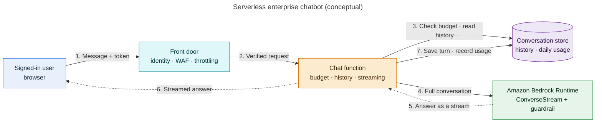
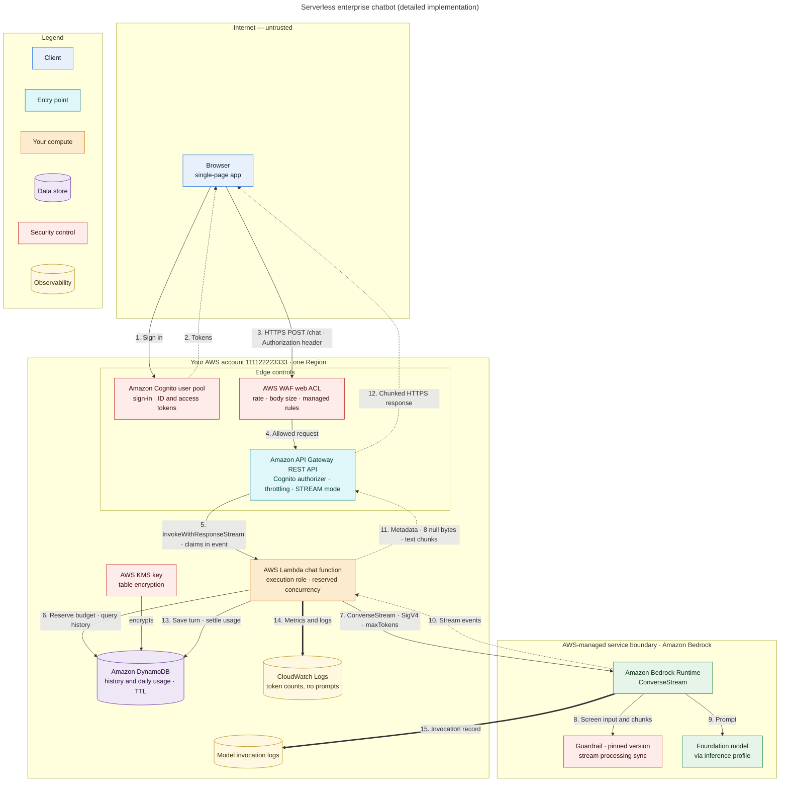
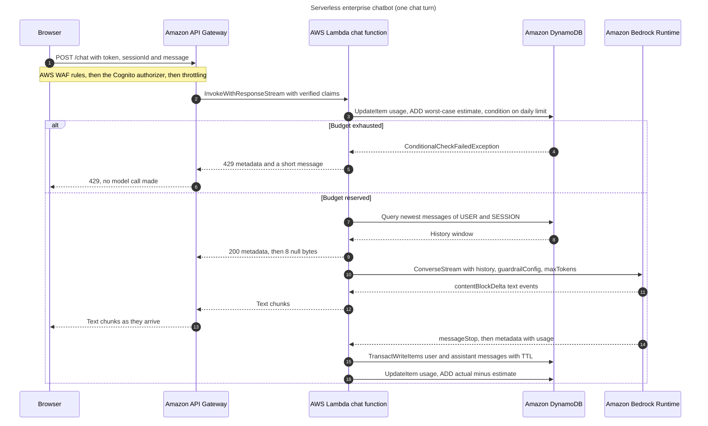

# Pattern: serverless enterprise chatbot

> **Level:** Intermediate · **Verified:** 2026-11-15 · **Feature status:** n/a (pattern built on GA features) · **Time:** ~40 min

An authenticated chat service that streams model answers to a browser, keeps each user's
conversation, screens content with a guardrail and cannot run up an unbounded bill — with no
servers to manage. It adds state, streaming, identity and cost guards to
[basic inference](../basic-inference/README.md).

> [!IMPORTANT]
> **Status** — This is the academy's design, not an official AWS reference architecture. AWS's own
> closest implementation is the [Generative AI Application Builder on AWS](https://docs.aws.amazon.com/solutions/generative-ai-application-builder-on-aws/)
> solution (CloudFront, Cognito, an API Gateway **WebSocket** API, Amazon SQS, Lambda, DynamoDB,
> AWS WAF). AWS has announced that the solution **will be retired on 2027-02-28**; existing
> deployments keep running, but new deployments through its template end on that date.
> Source: [solution page](https://docs.aws.amazon.com/solutions/generative-ai-application-builder-on-aws/), [architecture overview](https://docs.aws.amazon.com/solutions/latest/generative-ai-application-builder-on-aws/architecture-overview.html)

## Learning objectives

After this chapter you can:

- Explain why a chatbot on a stateless model needs its own conversation store, and design one.
- Choose a streaming front door — API Gateway REST in `STREAM` mode, a Lambda function URL or a
  Lambda Web Function — from documented limits.
- Place authentication, AWS WAF, throttling, a guardrail and a per-user token budget, and say
  which threat or cost each one addresses.
- Predict how cost grows with conversation length, and bound it.
- Recognise when a chatbot should not be built this way.

## Prerequisites

- [Pattern: basic model inference](../basic-inference/README.md)
- [AWS Lambda with Bedrock](../../02-related-aws-services/compute/01-lambda.md)
- [API Gateway, CloudFront and Application Load Balancer](../../02-related-aws-services/compute/04-api-gateway-cloudfront-alb.md) — the front-door comparison this pattern relies on
- [Amazon DynamoDB](../../02-related-aws-services/databases/03-dynamodb.md)
- [AWS WAF and AWS Shield](../../02-related-aws-services/security/03-waf-and-shield.md)
- [Amazon Bedrock Guardrails](../../01-amazon-bedrock/guardrails/01-guardrails.md)
- [Diagram set 4 — Converse API application](../../diagrams/mermaid/04-converse-api-application.md)

## Concept in plain language

The model has no memory: every turn, you hand it the whole conversation again. Picture a help
desk whose expert forgets you when you hang up, so a receptionist keeps your file, reads it out at
every call, relays the answer as it is spoken, and stops taking your calls once you have used
today's allowance. This pattern builds the receptionist.

**The problem.** Employees need a chat assistant that knows who they are, remembers the
conversation, shows the answer while it is written, refuses harmful content, survives abusive
traffic and costs something predictable — without servers to run.

### Conceptual view



**What this shows** — The model is a function of what you send it; all memory and all limits live
in your account. The function reads state before the call and writes it after.

## How it really works

### Forces

| Force | Documented behaviour | Consequence |
|:--|:--|:--|
| The model is stateless | Bedrock does not store what you send to Converse ([Converse API](../../01-amazon-bedrock/inference/01-converse-api.md)) | Your store holds history; every turn re-sends it |
| Users expect tokens as they arrive | API Gateway response streaming works **only for REST APIs**, for up to 15 minutes, with a 5-minute idle timeout on Regional endpoints (30 seconds on edge-optimized) ([response streaming](https://docs.aws.amazon.com/apigateway/latest/developerguide/response-transfer-mode.html)) | REST API in `STREAM` mode, or a function URL or Web Function |
| Buffered calls have a ceiling | REST integration timeout 50 ms–29 s by default ([REST API quotas](https://docs.aws.amazon.com/apigateway/latest/developerguide/api-gateway-execution-service-limits-table.html)) | Long answers need streaming or an asynchronous design |
| Lambda streams natively only on Node.js | Python needs a custom runtime or the Lambda Web Adapter; streamed responses can reach 200 MB ([Lambda streaming](https://docs.aws.amazon.com/lambda/latest/dg/configuration-response-streaming.html)) | Runtime choice is an architecture decision |
| A dropped client does not stop the bill | Streamed responses are not interrupted when the client disconnects and the full duration is billed ([Lambda streaming](https://docs.aws.amazon.com/lambda/latest/dg/configuration-response-streaming.html)) | `maxTokens` and the function timeout are cost controls |
| One request can cost cents or dollars | AWS WAF counts requests, not tokens ([WAF chapter](../../02-related-aws-services/security/03-waf-and-shield.md)) | A per-user token budget in the application |

### The solution

| Component | Role | Security control |
|:--|:--|:--|
| Amazon Cognito user pool | Signs users in and issues tokens | Your password, MFA and federation policy |
| AWS WAF Regional web ACL | Drops floods, oversized bodies and known-bad requests before they cost anything | Rate-based rule, body-size rule, managed rule groups |
| Amazon API Gateway REST API | Validates the token (`COGNITO_USER_POOLS` authorizer), throttles, streams | Stage and method throttling; `STREAM` transfer mode on `POST /chat` |
| AWS Lambda chat function | Budget check, history window, `ConverseStream`, stream relay, persistence | Execution role scoped to one profile, one guardrail, one table; reserved concurrency |
| Amazon DynamoDB table | Conversation items and per-user daily usage counters | Customer managed KMS key; TTL; keys that start with the user ID |
| Amazon Bedrock Runtime + guardrail | Generates and screens | Pinned guardrail version; IAM-enforced guardrail if mandatory |
| CloudWatch, invocation logs, CloudTrail | Latency, errors, tokens, audit | Application logs carry token counts, never prompts |

> [!NOTE]
> **Documented fact** — In `STREAM` mode API Gateway calls Lambda with `InvokeWithResponseStream`
> through the URI `arn:aws:apigateway:{region}:lambda:path/2021-11-15/functions/{function-arn}/response-streaming-invocations`.
> The function must first write a JSON metadata object (`statusCode`, `headers`), then a delimiter
> of 8 null bytes within the first 16 KB, then the payload. Endpoint caching, content encoding and
> VTL response transformation are not available in this mode, and streaming incurs its own charge.
> Sources: [Lambda proxy integration with response streaming](https://docs.aws.amazon.com/apigateway/latest/developerguide/response-transfer-mode-lambda.html), [response streaming](https://docs.aws.amazon.com/apigateway/latest/developerguide/response-transfer-mode.html)

### Trust boundaries and data flow

| Boundary | Crosses it | Direction | Control |
|:--|:--|:--|:--|
| Internet → AWS WAF and API Gateway | Message, token | Inbound | TLS; WAF rules; authorizer; throttling |
| API Gateway → function | Event with verified claims | Inbound | Lambda resource policy for `apigateway.amazonaws.com` scoped to the API |
| Function → DynamoDB | History, usage | Both | Execution role; KMS |
| Function → Bedrock | System prompt, history, new message | Outbound | SigV4; profile and guardrail scoping |
| Function → client | Answer chunks | Outbound, streamed | Guardrail stream mode decides what may leave before screening |

> [!TIP]
> **Academy recommendation** — Take the user ID only from the claims the authorizer verified, and
> make it the first part of every DynamoDB key. A session ID sent by the browser is then useless
> to anyone else, because it is always read under the caller's own user ID. This is our design
> guidance, not an official AWS reference architecture.

### When not to use this pattern

- Answers must come from **company documents** → add [Enterprise RAG](../enterprise-rag/README.md) behind the same front door.
- The assistant **acts** (tickets, refunds, multi-step tools) → [Agentic AI](../agentic-ai/README.md) on AgentCore.
- Turns regularly run **longer than the 15-minute stream limit**, or need **voice and two-way streaming** → an asynchronous or WebSocket design (see [Variations](#variations)).
- **No public endpoint** is allowed → [Private enterprise](../private-enterprise/README.md); note that function URLs cannot stream from inside a VPC.
- Steady, heavy traffic that waits mostly on I/O → compare [Lambda Web Functions or containers](#variations) on cost.

## Architecture diagram

### Detailed implementation view



**What this shows** — Three edge controls stand between the internet and anything that costs
money; the function owns every decision about state and spend; Bedrock only ever sees a request
that passed all of them.

**Walkthrough**

1. –3. The user signs in, then posts the message with the token in the `Authorization` header.
4. AWS WAF applies rate, size and managed rules; blocked requests never reach the API.
5. The authorizer validates the token, throttling applies, and API Gateway invokes the function
   with `InvokeWithResponseStream`.
6. The function reserves a worst-case token estimate and reads the newest messages.
7. –12. `ConverseStream` runs with history, guardrail and bounded `maxTokens`; text deltas are
   relayed after the metadata prelude and delimiter.
13. The completed turn is written in one transaction; the reservation becomes the real usage.
14. –15. Token counts go to CloudWatch; Bedrock writes its invocation record.

**Legend** — solid: request or write · dashed: response or stream · thick: asynchronous record ·
cylinder: data at rest · nested boxes: trust boundaries. Streaming mechanics and every failure
branch are in [diagram set 22](../../diagrams/mermaid/22-serverless-enterprise-chatbot.md).

### Sequence view



Steps 3–7: the cheap checks run **before** the function commits to a 200 — once the metadata
prelude is sent, the status code can no longer change. Steps 8–14: everything after the prelude
must report errors in-band, in the body. Steps 15–17: the turn is saved only when the stream
completed; a half answer is never stored as if it were whole.

## Implementation details

1. **Table design** (background in [Amazon DynamoDB](../../02-related-aws-services/databases/03-dynamodb.md)). One table; partition key `USER#<user>#SESSION#<session>` for messages and
   `USER#<user>` for daily usage; a numeric `expires_at` attribute as the TTL. DynamoDB deletes
   expired items "typically within a few days" without consuming write throughput, so also filter
   expired items in queries if retention is a legal requirement
   ([DynamoDB TTL](https://docs.aws.amazon.com/amazondynamodb/latest/developerguide/TTL.html)).
2. **History window.** Read the newest *n* messages and start on a user turn; summarize or trim
   beyond that ([Converse stop reasons](../../01-amazon-bedrock/inference/01-converse-api.md#stop-reasons)).
3. **Budget.** Reserve `input estimate + maxTokens` with a conditional update; settle to the real
   `usage` afterwards.
4. **Stream relay.** Write the prelude only after the budget and history steps succeed.
5. **Guardrail stream mode.** `sync` scans chunks before release (more latency); `async` releases
   immediately and cannot mask
   ([guardrails — streaming](../../01-amazon-bedrock/guardrails/01-guardrails.md#streaming)).
6. **Time budget.** `maxTokens` and the function timeout bound the stream; the stream itself is
   capped at 15 minutes with a 5-minute idle timeout.

> [!IMPORTANT]
> **Status** — AWS's streaming example sets the integration timeout to 90,000 ms. Whether the
> integration timeout still bounds the time to the first byte (the metadata prelude) in `STREAM`
> mode is **UNVERIFIED — REQUIRES DOCUMENTATION REVIEW**: the response streaming pages say streaming
> lets you exceed the 29-second limit, but do not say how the two settings interact. Send the
> prelude early. Source: [Configure a Lambda proxy integration with response streaming](https://docs.aws.amazon.com/apigateway/latest/developerguide/response-streaming-lambda-configure.html)

### Failure modes

| Failure | Where | Result for the user | Design response |
|:--|:--|:--|:--|
| Flood or oversized body | AWS WAF | 403 | Rate-based and size rules |
| Missing or expired token | Authorizer | 401 | Client refreshes the token |
| Burst above stage limits | API Gateway | 429 | Client backoff |
| Daily budget used | Function, before Bedrock | 429 with a message | Conditional update |
| Bedrock 429 or 503 before the stream | Function | Short retry, then an error | Bounded SDK retries; profile |
| Guardrail blocks the input | Bedrock | The guardrail's blocked message | Show it; nothing else to do |
| Error event mid-stream | Bedrock stream | Partial answer marked incomplete | Do not save the turn |
| Client disconnects | Network | — | Lambda keeps running and billing; `maxTokens` caps it |
| Write fails after streaming | DynamoDB | Answer shown, not remembered | Retry the idempotent transaction |
| Conversation too long | Model | `model_context_window_exceeded` | Trim or summarize the window |

### Scaling

Each streaming turn holds one Lambda execution environment for its whole duration, so
concurrency ≈ turns per second × average turn length. Function URLs scale only with the
function's concurrency (1,000 concurrent executions per Region by default), while API Gateway adds
throttling of 10,000 requests per second with a 5,000 burst by default
([HTTP invoke options](https://docs.aws.amazon.com/lambda/latest/dg/furls-http-invoke-decision.html)).
In practice the model's tokens-per-minute quota binds first; set reserved concurrency so the
function cannot exceed it
([AWS Lambda with Bedrock](../../02-related-aws-services/compute/01-lambda.md#implementation-details)).

## Variations

| Variation | What changes | Trade-off |
|:--|:--|:--|
| **Lambda function URL** with `RESPONSE_STREAM` behind Amazon CloudFront | Origin access control requires auth type `AWS_IAM`; clients must send `x-amz-content-sha256` for `POST`; validate the user's token in the function; AWS WAF on CloudFront | Fewer moving parts; no Cognito authorizer, no stage throttling; cannot stream inside a VPC ([CloudFront OAC for function URLs](https://docs.aws.amazon.com/AmazonCloudFront/latest/DeveloperGuide/private-content-restricting-access-to-lambda.html), [function URL auth](https://docs.aws.amazon.com/lambda/latest/dg/urls-auth.html)) |
| **Lambda Web Functions** (GA 2026-10-12) | Your Node.js HTTP server streams natively; many requests per environment; active-CPU billing; per-endpoint rate limit and `maxEnvironments`; CloudFront for AWS WAF and custom domains | Node.js 24 on Arm64 only, five Regions at launch; concurrency-safe code required ([Web Functions](https://docs.aws.amazon.com/lambda/latest/dg/web-functions.html), [launch post](https://aws.amazon.com/blogs/aws/announcing-aws-lambda-web-functions-for-fast-consistent-web-app-performance-anywhere/)) |
| Buffered (no streaming) | Ordinary Lambda proxy; any runtime | User waits for the whole answer; 29-second integration ceiling |
| WebSocket API + Amazon SQS + Lambda | The AWS solution's shape: the function posts results back to the connection | Long-running turns; more components and connection state |
| Server-side conversation state | OpenAI-compatible Responses API stores the conversation | Retention moves to Bedrock; see [compatible APIs](../../01-amazon-bedrock/inference/03-openai-and-anthropic-compatible-apis.md) |
| Mandatory guardrail | IAM deny on `bedrock:GuardrailIdentifier`, or an enforced configuration | The function cannot forget it ([enforcement](../../01-amazon-bedrock/guardrails/02-automated-reasoning-and-enforcement.md)) |
| Private | VPC-attached function, interface endpoints, private API | See [Private enterprise](../private-enterprise/README.md) |

## Example

The matching project is [Project B: serverless chatbot with API Gateway and Lambda](../../05-practical-projects/project-02-serverless-chatbot/README.md).

**State and budget** — the part of the function that is the same whatever the runtime.

> **Code status:** `py_compile` ✅ · stub-tested with botocore `Stubber` (boto3 1.44.3: history order and window, budget reserved, budget exceeded, settle, atomic idempotent turn write) · **never run against AWS**

```python
"""Conversation state and a per-user token budget in DynamoDB.

  pk = USER#<user>#SESSION#<session>  sk = MSG#<turn start ms>#<n>   one message (TTL)
  pk = USER#<user>                    sk = USAGE#<yyyy-mm-dd>         tokens today (TTL)
The user ID always comes from the verified token claims, never from the request body.
"""
import json
import time

from botocore.exceptions import ClientError


class BudgetExceeded(Exception):
    """The user has no token budget left today; answer 429 without calling Bedrock."""


def load_history(ddb, table: str, user: str, session: str, max_messages: int) -> list:
    """Return the newest messages, oldest first, in Converse shape."""
    page = ddb.query(
        TableName=table,
        KeyConditionExpression="pk = :pk AND begins_with(sk, :msg)",
        ExpressionAttributeValues={":pk": {"S": f"USER#{user}#SESSION#{session}"},
                                   ":msg": {"S": "MSG#"}},
        ScanIndexForward=False,  # newest first, so Limit keeps the latest turns
        Limit=max_messages,
    )
    items = list(reversed(page["Items"]))
    messages = [{"role": i["role"]["S"], "content": json.loads(i["content"]["S"])} for i in items]
    while messages and messages[0]["role"] != "user":  # start the window on a user turn
        messages.pop(0)
    return messages


def reserve_budget(ddb, table: str, user: str, day: str, estimate: int, daily_limit: int) -> None:
    """Atomically add the worst-case token estimate, or refuse if it would exceed the limit."""
    if estimate > daily_limit:
        raise BudgetExceeded(user)
    try:
        ddb.update_item(
            TableName=table,
            Key={"pk": {"S": f"USER#{user}"}, "sk": {"S": f"USAGE#{day}"}},
            UpdateExpression="ADD tokens :est SET expires_at = if_not_exists(expires_at, :exp)",
            ConditionExpression="attribute_not_exists(tokens) OR tokens <= :room",
            ExpressionAttributeValues={
                ":est": {"N": str(estimate)},
                ":room": {"N": str(daily_limit - estimate)},
                ":exp": {"N": str(int(time.time()) + 2 * 86400)},
            },
        )
    except ClientError as err:
        if err.response["Error"]["Code"] == "ConditionalCheckFailedException":
            raise BudgetExceeded(user) from err
        raise


def settle_budget(ddb, table: str, user: str, day: str, estimate: int, actual: int) -> None:
    """Replace the reservation with the tokens Bedrock reported in usage."""
    ddb.update_item(
        TableName=table,
        Key={"pk": {"S": f"USER#{user}"}, "sk": {"S": f"USAGE#{day}"}},
        UpdateExpression="ADD tokens :delta",
        ExpressionAttributeValues={":delta": {"N": str(actual - estimate)}},
    )


def append_turn(ddb, table: str, user: str, session: str, user_msg: dict, assistant_msg: dict,
                ttl_days: int, turn_started_ms: int) -> None:
    """Write both messages of a completed turn in one transaction; never a half turn.

    Pass the time the turn started, so a retried write targets the same keys.
    """
    expires = str(turn_started_ms // 1000 + ttl_days * 86400)
    pk = {"S": f"USER#{user}#SESSION#{session}"}
    items = []
    for n, message in enumerate((user_msg, assistant_msg)):
        items.append({"Put": {
            "TableName": table,
            "Item": {"pk": pk, "sk": {"S": f"MSG#{turn_started_ms:013d}#{n}"},
                     "role": {"S": message["role"]},
                     "content": {"S": json.dumps(message["content"])},
                     "expires_at": {"N": expires}},
            "ConditionExpression": "attribute_not_exists(sk)",  # idempotent on retry
        }})
    ddb.transact_write_items(TransactItems=items)
```

**Front door and table** — the streaming integration, throttling, AWS WAF association and the
encrypted, expiring table. The function, user pool, web ACL and KMS key are inputs.

> **Code status:** `terraform fmt` ✅ · `terraform validate` ✅ (provider 6.73.0) · TFLint ✅ · `terraform test` ✅ 3 runs with a mock provider (`STREAM` mode and URI, Cognito authorization, TTL and KMS, throttling) · **never planned or applied against AWS**

```hcl
resource "aws_dynamodb_table" "chat" {
  name                        = "chat-conversations"
  billing_mode                = "PAY_PER_REQUEST"
  hash_key                    = "pk"
  range_key                   = "sk"
  deletion_protection_enabled = true

  attribute {
    name = "pk"
    type = "S"
  }
  attribute {
    name = "sk"
    type = "S"
  }

  ttl { # messages and daily usage counters expire on their own
    attribute_name = "expires_at"
    enabled        = true
  }

  server_side_encryption {
    enabled     = true
    kms_key_arn = var.table_kms_key_arn
  }

  point_in_time_recovery {
    enabled = true
  }
}

resource "aws_api_gateway_rest_api" "chat" {
  name = "chat"
  endpoint_configuration {
    types = ["REGIONAL"]
  }
}

resource "aws_api_gateway_authorizer" "cognito" {
  name          = "cognito"
  rest_api_id   = aws_api_gateway_rest_api.chat.id
  type          = "COGNITO_USER_POOLS"
  provider_arns = [var.cognito_user_pool_arn]
}

resource "aws_api_gateway_resource" "chat" {
  rest_api_id = aws_api_gateway_rest_api.chat.id
  parent_id   = aws_api_gateway_rest_api.chat.root_resource_id
  path_part   = "chat"
}

resource "aws_api_gateway_method" "post_chat" {
  rest_api_id   = aws_api_gateway_rest_api.chat.id
  resource_id   = aws_api_gateway_resource.chat.id
  http_method   = "POST"
  authorization = "COGNITO_USER_POOLS"
  authorizer_id = aws_api_gateway_authorizer.cognito.id
}

resource "aws_api_gateway_integration" "post_chat" {
  rest_api_id             = aws_api_gateway_rest_api.chat.id
  resource_id             = aws_api_gateway_resource.chat.id
  http_method             = aws_api_gateway_method.post_chat.http_method
  type                    = "AWS_PROXY"
  integration_http_method = "POST"
  # STREAM mode needs the InvokeWithResponseStream path, not the usual .../invocations.
  uri                    = "arn:aws:apigateway:${var.region}:lambda:path/2021-11-15/functions/${var.chat_function_arn}/response-streaming-invocations"
  response_transfer_mode = "STREAM"
}

resource "aws_lambda_permission" "api_invoke" {
  statement_id  = "AllowChatApiInvoke"
  action        = "lambda:InvokeFunction"
  function_name = var.chat_function_arn
  principal     = "apigateway.amazonaws.com"
  source_arn    = "${aws_api_gateway_rest_api.chat.execution_arn}/*/POST/chat"
}

resource "aws_api_gateway_deployment" "chat" {
  rest_api_id = aws_api_gateway_rest_api.chat.id
  triggers = {
    redeploy = sha1(jsonencode([aws_api_gateway_method.post_chat, aws_api_gateway_integration.post_chat]))
  }
  lifecycle {
    create_before_destroy = true
  }
}

resource "aws_api_gateway_stage" "prod" {
  rest_api_id   = aws_api_gateway_rest_api.chat.id
  deployment_id = aws_api_gateway_deployment.chat.id
  stage_name    = "prod"
}

# Cost guard 1: a ceiling on requests per second for the chat method.
resource "aws_api_gateway_method_settings" "chat" {
  rest_api_id = aws_api_gateway_rest_api.chat.id
  stage_name  = aws_api_gateway_stage.prod.stage_name
  method_path = "chat/POST"
  settings {
    throttling_rate_limit  = var.stage_rate_limit
    throttling_burst_limit = var.stage_burst_limit
    metrics_enabled        = true
  }
}

# Cost guard 2: AWS WAF in front of the stage (rate-based and body-size rules live in the web ACL).
resource "aws_wafv2_web_acl_association" "chat" {
  resource_arn = aws_api_gateway_stage.prod.arn
  web_acl_arn  = var.web_acl_arn
}
```

The execution role for the function comes from the
[`bedrock-invocation-role`](../../04-infrastructure-as-code/terraform/modules/bedrock-invocation-role/README.md)
module with `allow_streaming = true` and `required_guardrail_arn_pattern` set, plus the DynamoDB
read and write actions this code uses, on this table only.

## Common mistakes

> [!WARNING]
> **Common mistake** — Choosing an HTTP API because it is cheaper, then discovering that response
> streaming "is only supported for REST APIs" and that HTTP APIs are not among the resources an
> AWS WAF web ACL can protect ([AWS WAF and AWS Shield](../../02-related-aws-services/security/03-waf-and-shield.md)).
> Pick the front door from the streaming and WAF requirements first.

| Mistake | Symptom | Fix |
|:--|:--|:--|
| Session ID from the request used as the whole key | One user can read another's history | User ID from claims as the key prefix |
| Integration left on the `.../invocations` URI in `STREAM` mode | 500 or an unsupported configuration | Use `.../response-streaming-invocations` |
| Prelude written before the budget check | A 200 that then fails | Check, then write the prelude |
| Whole history sent every turn | Cost and latency rise each turn | Window, summarize, cache the system prompt |
| Prompts in application logs | Sensitive data outside the controlled log | Log token counts and IDs only |
| No reserved concurrency | A spike exhausts the model quota for every other app | Reserve concurrency below the quota |

## Security considerations

- **Identity** — tokens validated at the gateway; the function trusts only the claims in the
  event ([Cognito authorizer](https://docs.aws.amazon.com/apigateway/latest/developerguide/apigateway-integrate-with-cognito.html)).
- **Layers** — AWS WAF limits volume and size but cannot read meaning; the guardrail screens
  content; neither stands alone ([ADR-015](../../ARCHITECTURE-DECISIONS.md#adr-015-security-controls-are-layered-and-none-is-trusted-alone)).
- **Prompt injection** — user text is untrusted; a function with no tools limits the blast radius
  ([prompt injection](../../06-security-governance/04-prompt-injection-and-untrusted-content.md)).
- **Data** — history is personal data: KMS key, TTL, deletion on request, no prompts in logs.
- **`async` guardrail streaming** releases unscreened chunks; use `sync` where that is unacceptable.

## Cost considerations

| Driver | Why it grows | Guard |
|:--|:--|:--|
| Bedrock input tokens | Turn *k* re-sends the previous turns; **our reading:** total input over a conversation grows roughly with the square of its length | History window, summaries, [prompt caching](../../01-amazon-bedrock/prompt-caching/01-prompt-caching.md) |
| Bedrock output tokens | Long answers | `maxTokens` per turn |
| Guardrail text units | Input and output screened every turn | Screen the newest message with `guardContent` |
| Lambda duration | Billed while waiting on the model, even after the client leaves | `maxTokens`, function timeout |
| API Gateway | Requests plus a streaming charge | Stage throttling |
| AWS WAF | Web ACL, rules, requests | Keep rule groups relevant |
| DynamoDB | Reads of the window, writes per turn, storage | TTL; small window |

The per-user daily budget turns the unbounded driver (tokens) into a number you choose. A worked
estimate is in [Lab 7: estimate the cost of a chatbot](../../labs/lab-07-estimate-chatbot-cost.md).

## Knowledge check

1. Why must the function finish the budget check before it writes the streaming prelude?
2. A user closes the browser tab mid-answer. What keeps running, what is billed, and what limits it?
3. Your team picked an HTTP API. Which two requirements of this pattern can it not meet?
4. Why is the user ID from the token claims part of every DynamoDB key?
5. When would you choose a Lambda Web Function over a REST API and an Event Function?

<details>
<summary>Answers</summary>

1. Once the metadata and delimiter are sent, the status code is fixed at 200; a later refusal can only be reported inside the body.
2. The function and the model generation keep running; the full Lambda duration and all generated tokens are billed. `maxTokens` and the function timeout bound it.
3. Response streaming (REST APIs only) and an AWS WAF association.
4. So a guessed or stolen session ID cannot read anyone else's history: every query is scoped to the caller.
5. Steady traffic that spends most of its time waiting on the model, in a supported Region, with Node.js code that is safe for concurrent requests — and you accept CloudFront for AWS WAF.

</details>

## Further reading

Official sources opened while writing this chapter:

- [Stream the integration response for your proxy integrations](https://docs.aws.amazon.com/apigateway/latest/developerguide/response-transfer-mode.html) — limits and unsupported features of `STREAM` mode.
- [Set up a Lambda proxy integration with payload response streaming](https://docs.aws.amazon.com/apigateway/latest/developerguide/response-transfer-mode-lambda.html) and [configure it](https://docs.aws.amazon.com/apigateway/latest/developerguide/response-streaming-lambda-configure.html) — URI, output format, example.
- [Quotas for configuring and running a REST API](https://docs.aws.amazon.com/apigateway/latest/developerguide/api-gateway-execution-service-limits-table.html) — integration timeout.
- [Control access to REST APIs using Amazon Cognito user pools](https://docs.aws.amazon.com/apigateway/latest/developerguide/apigateway-integrate-with-cognito.html) — the authorizer.
- [Response streaming for Lambda Event Functions](https://docs.aws.amazon.com/lambda/latest/dg/configuration-response-streaming.html) — runtimes, billing, VPC limits.
- [Select a method to invoke your Lambda Event Function using an HTTP request](https://docs.aws.amazon.com/lambda/latest/dg/furls-http-invoke-decision.html) — function URLs versus API Gateway.
- [Control access to Lambda function URLs](https://docs.aws.amazon.com/lambda/latest/dg/urls-auth.html) and [CloudFront origin access control for function URLs](https://docs.aws.amazon.com/AmazonCloudFront/latest/DeveloperGuide/private-content-restricting-access-to-lambda.html).
- [AWS Lambda Web Functions](https://docs.aws.amazon.com/lambda/latest/dg/web-functions.html) and the [launch announcement](https://aws.amazon.com/blogs/aws/announcing-aws-lambda-web-functions-for-fast-consistent-web-app-performance-anywhere/).
- [Using time to live in DynamoDB](https://docs.aws.amazon.com/amazondynamodb/latest/developerguide/TTL.html) — expiry semantics.
- [Generative AI Application Builder on AWS](https://docs.aws.amazon.com/solutions/generative-ai-application-builder-on-aws/) and its [architecture overview](https://docs.aws.amazon.com/solutions/latest/generative-ai-application-builder-on-aws/architecture-overview.html) — AWS's reference implementation and its retirement notice.
