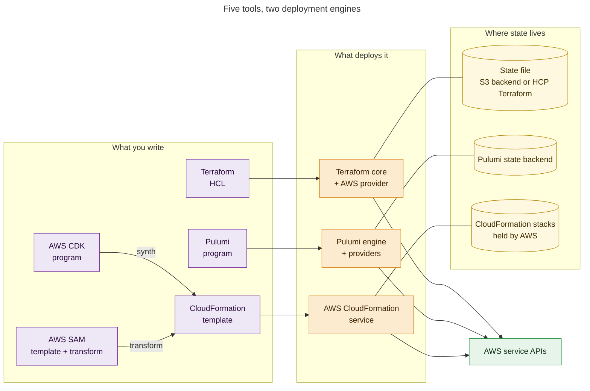

# Infrastructure as Code

> **Level:** Intermediate · **Verified:** 2026-11-15 · **Time:** about 5 days at 2 hours a day
>
> Terraform 1.17.2 · `hashicorp/aws` 6.73.0 · `aws-cdk-lib` 2.277.0 · AWS CDK CLI 2.1148.1

How to provision everything in this course — and how to keep that code healthy for years. The
section starts with the ideas every tool shares, then goes deep on Terraform, AWS CDK and
CloudFormation, covers AWS SAM and Pulumi, and ends with the maintenance practices that matter
more than the choice of tool.

[Academy home](../README.md) · [Generated Terraform reference](../references/terraform-aws-provider-bedrock.md) · [Generated CDK / CloudFormation reference](../references/cdk-and-cloudformation-bedrock.md) · Previous: [Architecture patterns](../03-architecture-patterns/README.md) · Next: [Practical projects](../05-practical-projects/README.md)

## How the tools relate

The CDK and SAM both end in a CloudFormation template, so everything you learn about
CloudFormation — change sets, drift, hooks, rollback — applies to them too.

## Reading order

| Step | Group | What you get |
|--:|:--|:--|
| 1 | [IaC concepts and comparison](comparison/README.md) | Declarative vs imperative, state, dependency graphs, drift, idempotency; the tools compared; how to choose |
| 2 | [Terraform](terraform/README.md) | Providers to testing, plus what the AWS provider covers for Bedrock |
| 3 | [AWS CDK](aws-cdk/README.md) | Constructs to deployment, plus what L1, L2 and alpha constructs exist for Bedrock |
| 4 | [CloudFormation](cloudformation/README.md) | Templates to hooks and Guard, plus the Bedrock resource types |
| 5 | [AWS SAM](aws-sam/README.md) and [Pulumi](pulumi/README.md) | Where each fits |
| 6 | [Maintenance and engineering excellence](maintenance/README.md) | The change lifecycle, versioning, environments, secrets, policy as code, upgrades, multi-account |

## Reusable code in this section

| Path | What it is | Checked with |
|:--|:--|:--|
| [`terraform/modules/`](terraform/modules/) | Reusable Terraform modules for Bedrock building blocks | `terraform validate`, `terraform test` with mock providers |
| [`aws-cdk/construct-library/`](aws-cdk/construct-library/) | A small TypeScript construct library | `tsc`, Jest assertions |
| [`aws-cdk/examples/`](aws-cdk/examples/README.md) | Worked CDK app used by the CDK chapters: Bedrock stacks, a custom Aspect, cdk-nag 3 wiring, CDK Pipelines | `tsc`, Jest (incl. a snapshot), `cdk synth`, `cfn-lint` |
| [`cloudformation/templates/`](cloudformation/templates/) | Example CloudFormation templates | `cfn-lint` |
| [`maintenance/environments/`](maintenance/environments/) | Development, test, staging and production configuration with isolated state | `terraform validate` |

> [!NOTE]
> **Documented fact** — What each tool supports for Bedrock is taken from the tools themselves,
> not from memory: the Terraform table from the provider's schema and the CDK / CloudFormation
> table from the installed library. See [references](../references/README.md).

## Chapters

<!-- TOC:START — generated by scripts/build-nav.py; do not edit by hand -->
| # | Chapter | Group | Status |
|--:|:--|:--|:-:|
| 1 | [IaC concepts: declarative versus imperative, state, graphs, drift and idempotency](comparison/01-iac-concepts.md) | IaC concepts and comparison | 🚧 planned |
| 2 | [Terraform, AWS CDK, CloudFormation, SAM and Pulumi compared](comparison/02-tool-comparison.md) | IaC concepts and comparison | 🚧 planned |
| 3 | [Choosing an IaC tool](comparison/03-choosing-an-iac-tool.md) | IaC concepts and comparison | 🚧 planned |
| 4 | [Providers, resources and data sources](terraform/01-providers-resources-data-sources.md) | Terraform | 🚧 planned |
| 5 | [Variables, outputs and locals](terraform/02-variables-outputs-locals.md) | Terraform | 🚧 planned |
| 6 | [Modules](terraform/03-modules.md) | Terraform | 🚧 planned |
| 7 | [State, remote backends and state locking](terraform/04-state-backends-locking.md) | Terraform | 🚧 planned |
| 8 | [Workspaces and environment strategies](terraform/05-environments-and-workspaces.md) | Terraform | 🚧 planned |
| 9 | [for_each, count and dynamic blocks](terraform/06-for-each-count-dynamic.md) | Terraform | 🚧 planned |
| 10 | [Lifecycle rules, import, moved and removed blocks](terraform/07-lifecycle-import-moved-removed.md) | Terraform | 🚧 planned |
| 11 | [Plan, apply and drift detection](terraform/08-plan-apply-drift.md) | Terraform | 🚧 planned |
| 12 | [Testing and version pinning](terraform/09-testing-and-version-pinning.md) | Terraform | 🚧 planned |
| 13 | [Terraform coverage for Amazon Bedrock](terraform/10-terraform-for-bedrock.md) | Terraform | 🚧 planned |
| 14 | [Apps, stacks and constructs](aws-cdk/01-apps-stacks-constructs.md) | AWS CDK | 🚧 planned |
| 15 | [L1, L2 and L3 constructs](aws-cdk/02-l1-l2-l3-constructs.md) | AWS CDK | 🚧 planned |
| 16 | [Synthesis and CloudFormation templates](aws-cdk/03-synthesis-and-cloudformation.md) | AWS CDK | 🚧 planned |
| 17 | [Context and environment configuration](aws-cdk/04-context-and-environments.md) | AWS CDK | 🚧 planned |
| 18 | [Permissions and Aspects](aws-cdk/05-permissions-and-aspects.md) | AWS CDK | 🚧 planned |
| 19 | [Bootstrap and deployment](aws-cdk/06-bootstrap-and-deployment.md) | AWS CDK | 🚧 planned |
| 20 | [Testing CDK applications](aws-cdk/07-testing.md) | AWS CDK | 🚧 planned |
| 21 | [Reusable construct libraries](aws-cdk/08-construct-libraries.md) | AWS CDK | 🚧 planned |
| 22 | [CDK coverage for Amazon Bedrock](aws-cdk/09-cdk-for-bedrock.md) | AWS CDK | 🚧 planned |
| 23 | [Template anatomy: parameters, mappings, conditions, resources and outputs](cloudformation/01-template-anatomy.md) | AWS CloudFormation | 🚧 planned |
| 24 | [Intrinsic functions](cloudformation/02-intrinsic-functions.md) | AWS CloudFormation | 🚧 planned |
| 25 | [Nested stacks and StackSets](cloudformation/03-nested-stacks-and-stacksets.md) | AWS CloudFormation | 🚧 planned |
| 26 | [Change sets and drift detection](cloudformation/04-change-sets-and-drift.md) | AWS CloudFormation | 🚧 planned |
| 27 | [Hooks and CloudFormation Guard](cloudformation/05-hooks-and-guard.md) | AWS CloudFormation | 🚧 planned |
| 28 | [CloudFormation modules and reuse](cloudformation/06-modules-and-reuse.md) | AWS CloudFormation | 🚧 planned |
| 29 | [CloudFormation coverage for Amazon Bedrock](cloudformation/07-cloudformation-for-bedrock.md) | AWS CloudFormation | 🚧 planned |
| 30 | [AWS SAM](aws-sam/01-aws-sam.md) | AWS SAM | 🚧 planned |
| 31 | [Pulumi](pulumi/01-pulumi.md) | Pulumi | 🚧 planned |
| 32 | [The infrastructure change lifecycle](maintenance/01-lifecycle-workflow.md) | IaC maintenance and engineering excellence | 🚧 planned |
| 33 | [Module and construct versioning](maintenance/02-module-and-construct-versioning.md) | IaC maintenance and engineering excellence | 🚧 planned |
| 34 | [Environments, isolation and controlled promotion](maintenance/03-environments-and-promotion.md) | IaC maintenance and engineering excellence | 🚧 planned |
| 35 | [Secrets management and policy as code](maintenance/04-secrets-and-policy-as-code.md) | IaC maintenance and engineering excellence | 🚧 planned |
| 36 | [Version upgrades, refactoring and importing existing resources](maintenance/05-upgrades-refactoring-import.md) | IaC maintenance and engineering excellence | 🚧 planned |
| 37 | [Multi-account and multi-Region deployments](maintenance/06-multi-account-multi-region.md) | IaC maintenance and engineering excellence | 🚧 planned |
<!-- TOC:END -->
