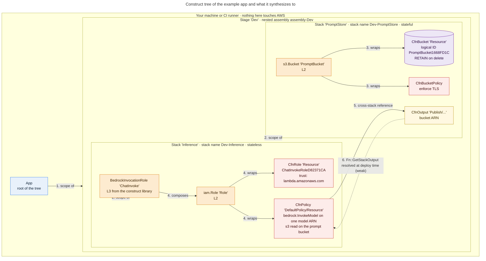

# Apps, stacks and constructs

> **Level:** Intermediate · **Verified:** 2026-11-15 · **Feature status:** n/a · **Time:** ~30 min
>
> AWS CDK CLI 2.1148.1 · `aws-cdk-lib` 2.277.0 · TypeScript 7.0.2

An AWS CDK program builds a tree of objects called constructs and turns that tree into
CloudFormation templates. Where a construct sits in the tree decides its CloudFormation logical
ID, which stack it is deployed with and how it references resources in other stacks, so this
chapter is the foundation for every Bedrock stack you write with the CDK.

## Learning objectives

After this chapter you can:

- Explain the construct tree (App → Stage → Stack → construct) and what `scope`, `id` and `props` do.
- Predict the logical ID that a construct path produces, and explain why renaming or moving a construct replaces the resource.
- Choose stack boundaries for a Bedrock application and say what a cross-stack reference synthesizes to (strong or weak).
- Find your way around the project that `cdk init app --language typescript` creates with CDK CLI 2.1148.1.

## Prerequisites

- [IaC concepts: declarative versus imperative, state, graphs, drift and idempotency](../comparison/01-iac-concepts.md)
- [Template anatomy: parameters, mappings, conditions, resources and outputs](../cloudformation/01-template-anatomy.md)
- [IAM roles, trust policies and cross-account access](../../00-foundations/security/02-iam-roles-and-trust.md)
- Reading TypeScript classes and constructors.

## Concept in plain language

Think of a CDK app as a set of nested folders. The **App** is the drive. A **Stage** is a
folder per copy of your application, such as `Dev` or `Prod`. A **Stack** is a parcel that is
shipped and unpacked as one unit. **Constructs** are the items inside the parcel; some are
single items (an IAM role), some are kits that contain several items.

Every item's name only has to be unique inside its folder; the full path makes it unique
everywhere, and CloudFormation identifies each resource by a name derived from that path. Move or
rename an item and CloudFormation sees a new item and throws the old one away.

## How it really works

### The four kinds of node in the tree

| Node | What it is | What it becomes |
|:--|:--|:--|
| `App` | The root of the tree; the only construct that can be the root | A cloud assembly in `cdk.out` |
| `Stage` | A group of stacks that are configured to deploy together, usually one per environment | A nested cloud assembly, `cdk.out/assembly-<Stage>/` |
| `Stack` | The smallest unit of deployment | One CloudFormation template and one CloudFormation stack |
| Construct | Anything else: L1 (`Cfn*`), L2 and L3 constructs, and your own classes | Zero, one or many CloudFormation resources |

> [!NOTE]
> **Documented fact** — "All constructs that represent AWS resources must be defined, directly or
> indirectly, within the scope of a `Stack` construct", and `App` "is the only construct that can be used as the root".
> Source: [AWS CDK apps](https://docs.aws.amazon.com/cdk/v2/guide/apps.html)

Every construct constructor takes the same three arguments
([constructs](https://docs.aws.amazon.com/cdk/v2/guide/constructs.html)):

| Argument | Meaning | Rule of thumb |
|:--|:--|:--|
| `scope` | The parent in the tree | Almost always `this` |
| `id` | A name unique within that scope | Choose it as if it were permanent |
| `props` | The configuration object | Typed, `readonly`, with defaults |

Each construct exposes its place in the tree through `node`: `node.id`, `node.path` (for example
`Dev/PromptStore/PromptBucket`), `node.scope`, `node.children` and `node.root`
([apps](https://docs.aws.amazon.com/cdk/v2/guide/apps.html)).

### From construct path to logical ID

The CDK generates each resource's CloudFormation logical ID from its path.

> [!NOTE]
> **Documented fact** — The CDK concatenates the path components below the stack, makes them
> readable, and appends an 8-character hash of the full path. A component named `Default` is
> removed entirely; `Resource` is hidden from the readable part but still hashed; a component
> that repeats the end of its predecessor is skipped; a direct child of the stack uses its ID
> without a hash.
> Source: [Identifiers and the AWS CDK](https://docs.aws.amazon.com/cdk/v2/guide/identifiers.html)

These are the IDs the example in this chapter produced with `aws-cdk-lib` 2.277.0:

| Construct path | Logical ID |
|:--|:--|
| `Dev/PromptStore/PromptBucket/Resource` | `PromptBucket1668FD1C` |
| `Dev/Inference/ChatInvoke/Role/Resource` | `ChatInvokeRoleD82371CA` |
| `Dev/Inference/ChatInvoke/Role/DefaultPolicy/Resource` | `ChatInvokeRoleDefaultPolicy5C6F4E62` |
| An L1 created directly in a stack with ID `ChatGuardrail` ([next chapter](02-l1-l2-l3-constructs.md)) | `ChatGuardrail` |

The stage name is not part of the logical ID; it becomes part of the **stack name**
(`Dev-PromptStore`). The same code therefore produces identical logical IDs in every stage.

> [!NOTE]
> **Documented fact** — "Changing the logical ID of a resource results in the resource being
> replaced with a new one at the next deployment." AWS recommends unit tests that assert the
> logical IDs of stateful resources stay static.
> Source: [Best practices](https://docs.aws.amazon.com/cdk/v2/guide/best-practices.html)

### Stack boundaries

AWS's guidance is to keep resources in one stack unless deployment requirements say otherwise,
to separate stateful from stateless resources (and turn on termination protection for the
stateful stack), and to model reusable units as constructs, not stacks
([best practices](https://docs.aws.amazon.com/cdk/v2/guide/best-practices.html)). The
`aws-cdk-lib` README adds that a stack is limited to 500 resources and that "`Stack`s are not a
unit of reuse" ([aws-cdk-lib module](https://docs.aws.amazon.com/cdk/api/v2/docs/aws-cdk-lib-readme.html)).

For a Bedrock workload that usually means: buckets, vector stores, AgentCore Memory and
knowledge bases in a stateful stack; IAM roles, functions, guardrail versions and AgentCore
Runtime endpoints in a stateless one.

### Cross-stack references: strong and weak

Pass a construct from one stack to another through props and the CDK writes the plumbing. What
it writes depends on the reference **strength**:

| Strength | Same account and Region | Coupling |
|:--|:--|:--|
| Strong | `Export` in the producer, `Fn::ImportValue` in the consumer | CloudFormation refuses to delete an export that is imported |
| Weak | Plain `Output` in the producer, `Fn::GetStackOutput` in the consumer | None; the producer can be deleted, and the consumer fails on its next update |
| Both | Export kept, consumer already reads `Fn::GetStackOutput` | Transitional, for migrating strong to weak |

> [!IMPORTANT]
> **Status** — `Fn::GetStackOutput` was announced on 2026-05-14; CDK cross-account and
> cross-Region references now use it automatically. The library default is still **strong**,
> but `cdk init` with CLI 2.1148.1 writes `"@aws-cdk/core:defaultCrossStackReferences": "weak"`
> into `cdk.json` (`cdk flags` reports recommended value `weak`, default `strong`).
> Sources: [What's New](https://aws.amazon.com/about-aws/whats-new/2026/05/aws-cloudformation-cdk-stack/),
> [Fn::GetStackOutput](https://docs.aws.amazon.com/AWSCloudFormation/latest/TemplateReference/intrinsic-function-reference-getstackoutput.html),
> [aws-cdk-lib module — Reference strength](https://docs.aws.amazon.com/cdk/api/v2/docs/aws-cdk-lib-readme.html)

Either way the CDK records a deployment dependency (`Dev/Inference` depends on `Dev/PromptStore`
in `manifest.json`). The intrinsic functions are compared in
[Intrinsic functions](../cloudformation/02-intrinsic-functions.md).

### The project the official template creates

`cdk init app --language typescript` (CLI 2.1148.1, run offline with `--generate-only`) wrote:

| Path | Content |
|:--|:--|
| `bin/<name>.ts` | Creates the `App` and one stack; imports from `aws-cdk-lib/core`; no `app.synth()` call, because the app synthesizes automatically when the CLI runs it |
| `lib/<name>-stack.ts` | The stack class |
| `test/<name>.test.ts` | A commented-out Jest test using `aws-cdk-lib/assertions` |
| `cdk.json` | `"app": "npx tsc && npx tsx bin/<name>.ts"`, a `watch` block and a `context` block with 89 feature flags |
| `package.json` | `aws-cdk` 2.1148.1, `typescript` `~7.0.2`, `tsx`, Jest 30, `@swc/jest`; `aws-cdk-lib` `^2.275.0`, `constructs` `^10.5.0` |
| `tsconfig.json` | `"noEmit": true`, `NodeNext` modules, strict mode |
| `jest.config.js` | `@swc/jest` transform and `aws-cdk-lib/testhelpers/jest-autoclean` |
| `AGENTS.md` | Instructions for coding agents: read the service READMEs in `node_modules/aws-cdk-lib`, and ask before `cdk deploy` |
| `README.md`, `.gitignore`, `.npmignore` | `.gitignore` excludes `cdk.out` and generated `*.js` / `*.d.ts` |

The developer guide's [projects page](https://docs.aws.amazon.com/cdk/v2/guide/projects.html)
shows an older layout and notes that it "may vary across versions"; the installed template is the
authority. The academy pins `aws-cdk-lib` exactly instead of using the template's caret range
([conventions](../../templates/CONVENTIONS.md#7-code)).

## Architecture diagram



**What this shows** — The construct tree of the example below, as recorded in `cdk.out/tree.json`.
Higher-level constructs wrap the L1 constructs that become CloudFormation resources; the IDs on
the path from the stack down to an L1 decide its logical ID. The policy in one stack refers to the
bucket in another, so the producing stack publishes an output and the consumer reads it.

**Walkthrough**

1. `App` is the root and the scope of the `Dev` stage.
2. The stage is the scope of two stacks; their stack names get the `Dev-` prefix.
3. The `Bucket` L2 creates two L1 children: the bucket (`Resource`) and its bucket policy.
4. The L3 `BedrockInvocationRole` composes an `iam.Role`, which wraps a `CfnRole` and a default `CfnPolicy`.
5. The policy needs the bucket ARN from the other stack; the CDK adds an output to the producer and a dependency between the stacks.
6. With the `weak` setting the consumer reads the output with `Fn::GetStackOutput` when CloudFormation deploys it.

| Legend | Meaning |
|:--|:--|
| Blue | What you run: the app |
| Orange | L2 and L3 constructs (no CloudFormation resource of their own) |
| Purple cylinder, red | L1 resources: data and IAM |
| Yellow | Stack output |
| Solid arrow | Parent–child relationship or reference; dashed arrow: value returned at deploy time |
| Nested boxes | Machine, stage, stack |

**Variations** — With `"@aws-cdk/core:defaultCrossStackReferences": "strong"` (the library
default) the producer gets an `Export` and the consumer uses `Fn::ImportValue`. Across Regions
or accounts, see the reference-strength table in the
[aws-cdk-lib module README](https://docs.aws.amazon.com/cdk/api/v2/docs/aws-cdk-lib-readme.html).
Diagram set [28](../../diagrams/mermaid/28-cdk-and-cloudformation-synthesis.md) follows the same
tree through synthesis and deployment.

## Implementation details

1. **Name constructs like database columns.** PascalCase nouns that describe the role
   (`PromptBucket`, `ChatInvoke`), never names that encode a temporary detail.
2. **Pass constructs, not names, between stacks.** Type the prop as an interface such as
   `s3.IBucket`. The `grants` property lives on the `Bucket` class, not on `IBucket`, so for an
   interface use the Grants class: `s3.BucketGrants.fromBucket(bucket).read(role)`.
3. **Use generated physical names**; a hard-coded `bucketName` blocks replacements
   ([best practices](https://docs.aws.amazon.com/cdk/v2/guide/best-practices.html)).
4. **Protect stateful resources twice:** a `RETAIN` removal policy, and a unit test that pins the logical ID.
5. **Refactor with `Default`.** When you wrap an existing resource in a new construct, give the
   inner construct the ID `Default` and the logical ID stays the same
   ([identifiers](https://docs.aws.amazon.com/cdk/v2/guide/identifiers.html)). Larger moves are
   covered in [Version upgrades, refactoring and importing existing resources](../maintenance/05-upgrades-refactoring-import.md).
6. **Run `cdk diff` before every deployment.** Renaming `PromptBucket` to `Prompts` in the
   example and diffing against the previous template (offline, with `--template`) prints:

```text
Resources
[-] AWS::S3::Bucket PromptBucket1668FD1C orphan
[-] AWS::S3::BucketPolicy PromptBucketPolicy2A2229F1 destroy
[+] AWS::S3::Bucket PromptStore/Prompts Prompts037647B5
[+] AWS::S3::BucketPolicy PromptStore/Prompts/Policy PromptsPolicyA659286E
```

> [!TIP]
> **Academy recommendation** — Treat a construct ID like a primary key: once a stack is deployed,
> changing it is a migration, not a rename. Keep the CDK app and stack layout in one place
> (`bin/` and one `Stage` class) so that reviewers see every stack boundary at a glance.
> This is our design guidance, not an official AWS reference architecture.

## Example

A stage with a stateful prompt-store stack and a stateless inference stack that uses the
academy's L3 [`BedrockInvocationRole`](construct-library/lib/bedrock-invocation-role.ts)
(copied into the project's `lib/`).

> **Code status:** validated — `tsc` (TypeScript 7.0.2) and `cdk synth --quiet --no-version-reporting --no-path-metadata` (CLI 2.1148.1, `aws-cdk-lib` 2.277.0, `cdk.json` with the template's 89 feature flags) in a scratch project that copies the [construct library](construct-library/README.md) toolchain · mock-tested — Jest 30, 3 tests · `cdk diff --template` run offline · **never deployed**

```ts
// lib/prompt-store-stack.ts
import { RemovalPolicy, Stack, StackProps } from 'aws-cdk-lib';
import * as s3 from 'aws-cdk-lib/aws-s3';
import { Construct } from 'constructs';

/** Stateful stack: holds the prompt templates the application reads at run time. */
export class PromptStoreStack extends Stack {
  public readonly promptBucket: s3.Bucket;

  constructor(scope: Construct, id: string, props?: StackProps) {
    super(scope, id, props);

    // The construct ID 'PromptBucket' feeds the logical ID. Never rename it once deployed.
    this.promptBucket = new s3.Bucket(this, 'PromptBucket', {
      encryption: s3.BucketEncryption.S3_MANAGED,
      blockPublicAccess: s3.BlockPublicAccess.BLOCK_ALL,
      enforceSSL: true,
      versioned: true,
      removalPolicy: RemovalPolicy.RETAIN,
    });
  }
}
```

```ts
// lib/inference-stack.ts
import { Stack, StackProps } from 'aws-cdk-lib';
import * as iam from 'aws-cdk-lib/aws-iam';
import * as s3 from 'aws-cdk-lib/aws-s3';
import { Construct } from 'constructs';
import { BedrockInvocationRole } from './bedrock-invocation-role'; // copied from the academy construct library

export interface InferenceStackProps extends StackProps {
  /** Foundation model ID. Confirm current IDs in the Amazon Bedrock model catalog. */
  readonly modelId: string;
  /** The bucket that holds prompt templates (passed in from another stack). */
  readonly promptBucket: s3.IBucket;
}

/** Stateless stack: the identity that calls Amazon Bedrock. */
export class InferenceStack extends Stack {
  public readonly invokeRole: iam.Role;

  constructor(scope: Construct, id: string, props: InferenceStackProps) {
    super(scope, id, props);

    const invoke = new BedrockInvocationRole(this, 'ChatInvoke', {
      assumedBy: new iam.ServicePrincipal('lambda.amazonaws.com'),
      foundationModelIds: [props.modelId],
    });

    // A reference to a resource in another stack: the CDK wires the cross-stack reference.
    s3.BucketGrants.fromBucket(props.promptBucket).read(invoke.role);

    this.invokeRole = invoke.role;
  }
}
```

```ts
// lib/chat-stage.ts
import { Stage, StageProps } from 'aws-cdk-lib';
import { Construct } from 'constructs';
import { InferenceStack } from './inference-stack';
import { PromptStoreStack } from './prompt-store-stack';

export interface ChatStageProps extends StageProps {
  readonly modelId: string;
}

/** One deployable copy of the application: a stateful stack and a stateless stack. */
export class ChatStage extends Stage {
  constructor(scope: Construct, id: string, props: ChatStageProps) {
    super(scope, id, props);

    const store = new PromptStoreStack(this, 'PromptStore');
    new InferenceStack(this, 'Inference', {
      modelId: props.modelId,
      promptBucket: store.promptBucket,
    });
  }
}
```

```ts
// bin/app.ts   (cdk.json: "app": "npx tsx bin/app.ts")
import { App } from 'aws-cdk-lib';
import { ChatStage } from '../lib/chat-stage';

const app = new App();

// Placeholder model ID: replace it with a current ID from the Amazon Bedrock model catalog.
const modelId = app.node.tryGetContext('modelId') ?? 'example.model-a-v1:0';

new ChatStage(app, 'Dev', { modelId });
```

```ts
// test/chat-stage.test.ts
import { App, Stack } from 'aws-cdk-lib';
import { Template } from 'aws-cdk-lib/assertions';
import { ChatStage } from '../lib/chat-stage';

function synthStage() {
  const app = new App();
  const stage = new ChatStage(app, 'Dev', { modelId: 'example.model-a-v1:0' });
  app.synth(); // cross-stack references and stack dependencies are resolved during synthesis
  const stacks = stage.node.children.filter(Stack.isStack);
  return { stage, stacks };
}

test('the stage contains two stacks with stage-prefixed names', () => {
  const { stacks } = synthStage();
  expect(stacks.map((s) => s.stackName)).toEqual(['Dev-PromptStore', 'Dev-Inference']);
});

test('the prompt bucket keeps its logical ID', () => {
  const { stacks } = synthStage();
  const template = Template.fromStack(stacks[0]);
  // If this fails, a refactoring changed the construct path and the bucket would be replaced.
  expect(Object.keys(template.findResources('AWS::S3::Bucket'))).toEqual(['PromptBucket1668FD1C']);
});

test('the inference stack depends on the prompt store stack', () => {
  const { stacks } = synthStage();
  const [store, inference] = stacks;
  expect(inference.dependencies).toContain(store);
});
```

The consumer's policy statement in `cdk.out/assembly-Dev/DevInference6843ABEE.template.json`
(weak reference, from the `cdk.json` flag):

```json
{
  "Action": ["s3:GetBucket*", "s3:GetObject*", "s3:List*"],
  "Effect": "Allow",
  "Resource": [
    { "Fn::GetStackOutput": {
        "StackName": "Dev-PromptStore",
        "Region": { "Ref": "AWS::Region" },
        "OutputName": "PublishOutputFnGetAttPromptBucket1668FD1CArn01D6BF59" } },
    "... the same output joined with /*"
  ]
}
```

Synthesized with `-c @aws-cdk/core:defaultCrossStackReferences=strong`, the same statement uses
`{ "Fn::ImportValue": "Dev-PromptStore:ExportsOutputFnGetAttPromptBucket1668FD1CArnF22CB57E" }`
and the producer declares a matching `Export`.

To deploy in your own sandbox account (never done for this repository), bootstrap the
environment, run `npx cdk deploy 'Dev/*'`, and remove it with `npx cdk destroy 'Dev/*'`; the
bucket is retained by design and must be emptied and deleted by hand. See
[Bootstrap and deployment](06-bootstrap-and-deployment.md).

## Common mistakes

> [!WARNING]
> **Common mistake** — Wrapping existing resources in a new construct "to tidy up". The path
> changes, so every logical ID below it changes, and CloudFormation creates new resources and
> deletes (or orphans) the old ones. `cdk diff` shows it as `[-]` and `[+]` pairs.

| Mistake | Symptom | Fix |
|:--|:--|:--|
| Renaming a construct ID or moving it under another scope | Replacement in `cdk diff`; data in the old bucket stays behind in an orphaned resource | Keep IDs stable; use `Default` when wrapping; pin logical IDs in tests |
| Using a `Stack` as the unit of reuse | Library users cannot choose where resources go; stacks multiply | Ship reusable units as `Construct` subclasses; compose them in stacks |
| Removing a resource that another stack imports with a strong reference | `Export ... cannot be deleted as it is in use by ...` | Weaken the reference first (both, then weak), deploy, then remove |
| Assuming a weak reference is safe to break | The consumer's next update fails because the output is gone | Protect producer stacks; change both stacks together |
| Expecting `stack.dependencies` before synthesis | The list is empty in a unit test | Call `app.synth()` (or `Template.fromStack`) first |
| Passing a scope other than `this` | Construct IDs clash in someone else's scope | Pass `this`; let the parent decide placement ([apps](https://docs.aws.amazon.com/cdk/v2/guide/apps.html)) |

> [!CAUTION]
> **Cost or security hazard** — A pull request in the `aws/aws-cdk` repository reports that the
> first deployment after switching references from strong to `both` can plan **replacement** of
> existing resources, including stateful ones, because the consumer's value is only known while
> the change set executes. The report is not yet reflected in the developer guide. Run
> `cdk diff` with credentials (a real change set) before such a migration.
> Source: [aws/aws-cdk pull request 38871](https://github.com/aws/aws-cdk/pull/38871)

## Security considerations

- A stack boundary is a blast-radius boundary. Keep the role that can call Amazon Bedrock in a
  stateless stack that you can redeploy freely, and put data in a stateful stack with
  termination protection.
- Cross-stack references carry ARNs, not permissions; review the consumer's grants in the
  "IAM Statement Changes" table of `cdk diff`.
- `Fn::GetStackOutput` has no referential integrity; AWS recommends stack policies, deletion
  protection or IAM policies to stop referenced stacks from being deleted
  ([Fn::GetStackOutput](https://docs.aws.amazon.com/AWSCloudFormation/latest/TemplateReference/intrinsic-function-reference-getstackoutput.html)).
- Keep the template's `AGENTS.md` instruction that coding agents ask before `cdk deploy`.

## Cost considerations

- Building the tree and synthesizing run on your machine and create nothing in AWS. Charges
  start with the resources CloudFormation creates when you deploy.
- Resources with a `RETAIN` removal policy, and resources orphaned by a rename, keep costing
  money after the stack forgets them. Search for them after refactors.

## Knowledge check

1. A colleague moves the `PromptBucket` construct into a new `PromptStorage` construct and gives it the ID `Bucket`. What happens at the next deployment, and how could they have avoided it?
2. Two stages, `Dev` and `Prod`, instantiate the same `ChatStage`. Do the bucket logical IDs differ between the two templates? Do the stack names?
3. Your `cdk.json` has no `defaultCrossStackReferences` entry. What does the consumer stack use to read the bucket ARN, and what happens if you later delete the bucket from the producer?
4. Why does `test/chat-stage.test.ts` call `app.synth()` before checking `inference.dependencies`?

<details>
<summary>Answers</summary>

1. The path becomes `.../PromptStorage/Bucket/Resource`, so the logical ID changes: CloudFormation creates a new bucket and orphans (with `RETAIN`) or deletes the old one. Naming the inner construct `Default` keeps the original logical ID.
2. The logical IDs are identical (the stage is not part of them); the stack names differ (`Dev-PromptStore`, `Prod-PromptStore`).
3. Without the entry the library default, strong, applies: an `Export` and `Fn::ImportValue`. CloudFormation refuses to remove the export while the consumer imports it — the "deadly embrace" — until you weaken the reference.
4. Cross-stack references, and the stack dependencies they create, are resolved during synthesis; before that the list is empty.

</details>

## Further reading

Official sources opened while writing this chapter:

- [AWS CDK apps](https://docs.aws.amazon.com/cdk/v2/guide/apps.html) — the construct tree and the `node` API.
- [AWS CDK constructs](https://docs.aws.amazon.com/cdk/v2/guide/constructs.html) — scope, id, props; construct levels.
- [Introduction to AWS CDK stacks](https://docs.aws.amazon.com/cdk/v2/guide/stacks.html) and [stages](https://docs.aws.amazon.com/cdk/v2/guide/stages.html) — the stack API and nested cloud assemblies.
- [Identifiers and the AWS CDK](https://docs.aws.amazon.com/cdk/v2/guide/identifiers.html) — paths, unique IDs, logical IDs and the `Default` rule.
- [Best practices](https://docs.aws.amazon.com/cdk/v2/guide/best-practices.html) — stack boundaries, logical IDs, generated names.
- [AWS CDK projects](https://docs.aws.amazon.com/cdk/v2/guide/projects.html) — project layout (older than the installed template).
- [aws-cdk-lib module README](https://docs.aws.amazon.com/cdk/api/v2/docs/aws-cdk-lib-readme.html) — stacks and stages, reference strength, the deadly embrace.
- [Fn::GetStackOutput](https://docs.aws.amazon.com/AWSCloudFormation/latest/TemplateReference/intrinsic-function-reference-getstackoutput.html) and the [announcement](https://aws.amazon.com/about-aws/whats-new/2026/05/aws-cloudformation-cdk-stack/) — weak references.
- [aws/aws-cdk pull request 38871](https://github.com/aws/aws-cdk/pull/38871) — reported replacement risk when migrating reference strength.
- Installed sources: `aws-cdk/lib/init-templates/app/typescript/` (CLI 2.1148.1) and `aws-cdk-lib/README.md` (2.277.0).
