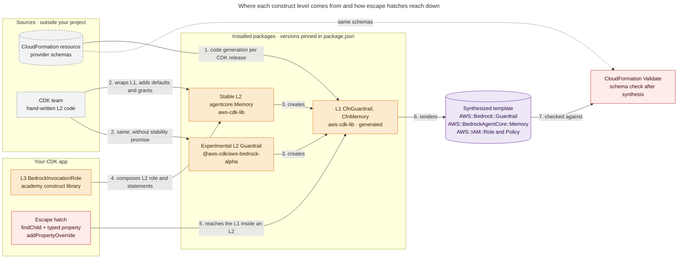

# L1, L2 and L3 constructs

> **Level:** Intermediate · **Verified:** 2026-11-15 · **Feature status:** n/a · **Time:** ~30 min
>
> `aws-cdk-lib` 2.277.0 · `@aws-cdk/aws-bedrock-alpha` 2.277.0-alpha.0 · AWS CDK CLI 2.1148.1

Constructs come in three levels of abstraction. For Amazon Bedrock the levels are unusually
uneven: AgentCore has stable L2 constructs, most of Bedrock has only L1 constructs, and the
guardrail, knowledge base, prompt and agent L2s live in an experimental package. This chapter
shows each level with a Bedrock resource and the escape hatches that connect them.

## Learning objectives

After this chapter you can:

- Distinguish L1, L2 and L3 constructs and name what each level offers for Bedrock and AgentCore in `aws-cdk-lib` 2.277.0.
- Explain how L1 constructs are generated from the CloudFormation schema, and what that means for property names, validation and new features.
- Reach the L1 inside an L2 and change it with a typed property or a raw override.
- Decide when an experimental `-alpha` module is acceptable, and pin it correctly.

## Prerequisites

- [Apps, stacks and constructs](01-apps-stacks-constructs.md)
- [Template anatomy](../cloudformation/01-template-anatomy.md)
- Background on the resources used here: [AgentCore Memory](../../01-amazon-bedrock/agentcore/06-agentcore-memory.md) and [Amazon Bedrock Guardrails](../../01-amazon-bedrock/guardrails/01-guardrails.md).

## Concept in plain language

Think of furniture. An **L1** construct is a pile of numbered parts that exactly matches the
manufacturer's parts list: complete, but you assemble and check everything yourself. An **L2**
is a flat-pack kit with sensible defaults, pre-drilled holes and a manual. An **L3** is a fitted
kitchen: several kits combined into a room that does one job.

When a kit lacks a part you need, you open the box and add the part by hand. In the CDK that is
an **escape hatch**: reaching the L1 inside an L2 and setting a property directly.

## How it really works

### The three levels

| Level | Also called | Maps to | You get | Source |
|:--|:--|:--|:--|:--|
| L1 | CFN resources, `Cfn*` classes | Exactly one CloudFormation resource | Every property CloudFormation has, nothing more | Generated |
| L2 | Curated constructs | Usually one resource plus helpers | Defaults, validation, generated roles, `grant*` methods, metrics | Written by the CDK team; stable or experimental |
| L3 | Patterns | Several resources | A whole use case behind a few props | AWS, third parties, your team |

> [!NOTE]
> **Documented fact** — L1 constructs "are generated from the AWS CloudFormation resource
> specification. If a resource exists in AWS CloudFormation, it'll be available in the AWS CDK as an
> L1 construct. New resources or properties may take up to a week to become available."
> Source: [AWS CDK constructs](https://docs.aws.amazon.com/cdk/v2/guide/constructs.html)

Because L1s are generated, they mirror the CloudFormation schema: `CfnGuardrail` has
`name`, `blockedInputMessaging` and `contentPolicyConfig` (the CloudFormation names in
camelCase), attributes such as `attrGuardrailArn` (rendered as `Fn::GetAtt`) and the constant
`CfnGuardrail.CFN_RESOURCE_TYPE_NAME === 'AWS::Bedrock::Guardrail'`. Enumerated values like
`'HIGH'` are plain strings. The versioning policy also marks generated L1 code as "external":
it can change in backward-incompatible ways to match the service
([versioning and stability](https://docs.aws.amazon.com/cdk/v2/guide/versioning.html)).

Since the compiler cannot check those strings, the built-in **CloudFormation Validate** plugin
checks every synthesized template against the resource schemas. With the flag that new projects
get, `@aws-cdk/core:validateAgainstDefaultRules`, a guardrail named `bad name!` fails `cdk synth`
with `Name: 'bad name!' does not match pattern '^[0-9a-zA-Z-_]+$'` (rule `F3031`). Details are in
[Synthesis and CloudFormation templates](03-synthesis-and-cloudformation.md).

### What exists for Bedrock in 2.277.0

Counts come from the installed library ([generated reference](../../references/cdk-and-cloudformation-bedrock.md)).
The AWS Agent Registry module is not in that generated reference, and the verification matrix
still lists the Registry as having no CloudFormation or CDK support; the installed 2.277.0
package does contain its two L1 types.

| Module | L1 types | L2 resource constructs | Stability |
|:--|--:|:--|:--|
| `aws-cdk-lib/aws-bedrock` | 23 | None. Only `FoundationModel` and `ProvisionedModel` helpers that reference existing models | Stable |
| `aws-cdk-lib/aws-bedrockagentcore` | 27 | 14, for example `Runtime`, `Gateway`, `Memory`, `Policy`, `Evaluator` | Stable |
| `aws-cdk-lib/aws-agentregistry` | 2 (`CfnRegistry`, `CfnRegistryRecord` for `AWS::AgentRegistry::Registry` and `RegistryRecord`) | None | Stable (L1 only) |
| `@aws-cdk/aws-bedrock-alpha` | — | `Agent`, `AgentAlias`, `ApplicationInferenceProfile`, `Guardrail`, `GuardrailVersion`, `KnowledgeBase`, `Prompt`, `PromptVersion` | Experimental |

> [!IMPORTANT]
> **Status** — The AgentCore L2s are stable (graduated into `aws-cdk-lib` in 2.255.0). The Bedrock
> L2s for agents, knowledge bases, guardrails and prompts are experimental. The alpha `Agent` and
> `AgentAlias` build Amazon Bedrock Agents Classic, which is in maintenance mode and closed to
> new customers since 2026-07-30. The Bedrock L2s in `@cdklabs/generative-ai-cdk-constructs`
> are deprecated.
> Sources: [feature verification matrix](../../FEATURE-VERIFICATION.md#c-infrastructure-as-code-tooling), [Agents Classic maintenance mode](https://docs.aws.amazon.com/bedrock/latest/userguide/agents-classic-maintenance-mode.html)

### Stable and experimental modules

> [!NOTE]
> **Documented fact** — Stable APIs in `aws-cdk-lib` are not removed before the next major
> version. New L2s for a service are first published in a separate package with an "Alpha"
> suffix whose version "matches the first version of `aws-cdk-lib` it is compatible with, with an
> `alpha` sub-version"; alpha APIs can change in any release.
> Source: [AWS CDK versioning and stability](https://docs.aws.amazon.com/cdk/v2/guide/versioning.html)

The installed `@aws-cdk/aws-bedrock-alpha` is `2.277.0-alpha.0` with a peer dependency on
`aws-cdk-lib` `^2.277.0`. The CDK CLI has a separate version line (2.1148.1 here): since
February 2025 the rule is "CLI release date ≥ library release date"
([CLI and library split](https://aws.amazon.com/blogs/opensource/aws-cdk-is-splitting-construct-library-and-cli/)).

### Escape hatches, from gentle to raw

| Technique | When | Checked by the compiler? |
|:--|:--|:--|
| Use the L1 directly | No L2 exists (most of `aws-bedrock`) | Yes |
| Mixins and Grants classes (Facades) on an L1 | An L2 feature you want on an L1, where the service module offers one | Yes |
| `node.defaultChild` or `node.findChild(id)`, cast to the `Cfn*` class, set a property | The L2 does not expose a CloudFormation property | Yes |
| `addPropertyOverride('Path.To.Property', value)` | The property is newer than your L1 typings | No — use CloudFormation (PascalCase) names |
| `addOverride`, `addPropertyDeletionOverride` | Change or delete anything in the resource fragment | No |
| `new CfnResource(this, id, { type, properties })` | The resource type is not in the bundled specification yet | No |

Sources: [Customize constructs from the AWS Construct Library](https://docs.aws.amazon.com/cdk/v2/guide/cfn-layer.html),
[AWS CDK constructs](https://docs.aws.amazon.com/cdk/v2/guide/constructs.html). In 2.277.0 the
`aws-bedrock` and `aws-bedrockagentcore` modules ship no Mixins or Grants classes; the alpha
package ships knowledge-base Mixins.

> [!WARNING]
> **Common mistake** — `node.defaultChild` returns only a child whose ID is `Resource` or
> `Default`. The AgentCore `Memory` L2 calls its L1 child `Memory` and the alpha `Guardrail` calls
> it `MyGuardrail`, so `defaultChild` is `undefined` and the next line throws
> `TypeError: Cannot set properties of undefined`. Read `node.children` or `cdk.out/tree.json`
> and use `node.findChild(id)`.

## Architecture diagram



**What this shows** — Only L1 constructs produce CloudFormation resources. L2 and L3 constructs
are code that creates L1s with good defaults. Escape hatches skip the abstraction and edit the
L1, and the schema that generated the L1 is the same one that validates the template.

**Walkthrough**

1. Each `aws-cdk-lib` release generates the `Cfn*` classes from the CloudFormation schemas it bundles.
2. The CDK team writes L2s; stable ones ship in `aws-cdk-lib`, experimental ones in an `-alpha` package.
3. An L2 creates one or more L1 children (plus roles and policies it needs).
4. An L3, such as the academy's `BedrockInvocationRole`, composes L2s.
5. An escape hatch sets an L1 property that no L2 prop exposes.
6. L1s render into the template.
7. After synthesis the template is checked against the schemas; a typo in a raw override is caught here, not by the compiler.

| Legend | Meaning |
|:--|:--|
| Orange | Construct code |
| Red | Escape hatch and validation |
| Purple cylinder | Generated artefacts |
| Grey dashed | Outside your project |

**Variations** — A resource type that is newer than the bundled schema has no L1 yet; use
`CfnResource` with the type name, or wait for the next `aws-cdk-lib` release. Diagram set
[28](../../diagrams/mermaid/28-cdk-and-cloudformation-synthesis.md) continues from the template to deployment.

## Implementation details

1. **Follow ADR-012:** a stable L2 when one exists, otherwise the L1; alpha constructs only in
   clearly labelled code ([ADR-012](../../ARCHITECTURE-DECISIONS.md#adr-012-cdk-in-typescript-stable-constructs-first)).
2. **Wire L1 attributes, not strings.** `guardrail.attrGuardrailArn` becomes
   `{ "Fn::GetAtt": ["ChatGuardrail", "GuardrailArn"] }` and creates the dependency for you.
3. **Prefer typed escape hatches.** Setting `cfnMemory.namespaceKeys` is type-checked; a raw
   override is not. If you must override, use the PascalCase CloudFormation name.
4. **Overrides win.** In the example, the L2 sets `Description` and the raw override replaces it
   in the template. Write a test so that a later L2 change does not silently fight your override.
5. **Pin alpha modules exactly** (`"@aws-cdk/aws-bedrock-alpha": "2.277.0-alpha.0"`) and
   upgrade them together with `aws-cdk-lib`; read the release notes for breaking changes.
6. **Do not use enumerated model constants** such as those in `FoundationModelIdentifier` for
   inference; model IDs are configuration ([ADR-010](../../ARCHITECTURE-DECISIONS.md#adr-010-model-and-inference-profile-ids-are-always-configuration)).

What the two guardrail levels put into the template (from `cdk synth`):

| Property | L1 `CfnGuardrail` | Alpha L2 `Guardrail` |
|:--|:--|:--|
| `FiltersConfig[].InputAction` / `OutputAction` | Omitted (service default) | `BLOCK` / `BLOCK` |
| `FiltersConfig[].InputEnabled` / `OutputEnabled` | Omitted | `true` / `true` |
| `ContentFiltersTierConfig` | Omitted | `{ "TierName": "CLASSIC" }` |
| Logical ID | `ChatGuardrail` (direct child of the stack) | `ChatGuardrailMyGuardrailA02C2157` |

## Example

One stack with each level: an L1 guardrail, the stable AgentCore `Memory` L2 with an escape
hatch, and the academy's L3 [`BedrockInvocationRole`](construct-library/lib/bedrock-invocation-role.ts)
wired to both. The experimental guardrail sits in its own, labelled stack.

> **Code status:** validated — `tsc` (TypeScript 7.0.2) and `cdk synth --quiet --no-version-reporting --no-path-metadata` (CLI 2.1148.1, `aws-cdk-lib` 2.277.0, `@aws-cdk/aws-bedrock-alpha` 2.277.0-alpha.0) in a scratch project with the [construct library](construct-library/README.md) toolchain · mock-tested — Jest 30, 4 tests · **never deployed**

```ts
// lib/levels-stack.ts
import { Duration, Stack, StackProps } from 'aws-cdk-lib';
import * as agentcore from 'aws-cdk-lib/aws-bedrockagentcore';
import * as bedrock from 'aws-cdk-lib/aws-bedrock';
import * as iam from 'aws-cdk-lib/aws-iam';
import { Construct } from 'constructs';
import { BedrockInvocationRole } from './bedrock-invocation-role'; // L3, copied from the academy construct library

export interface LevelsStackProps extends StackProps {
  /** Foundation model ID. Confirm current IDs in the Amazon Bedrock model catalog. */
  readonly modelId: string;
}

export class LevelsStack extends Stack {
  constructor(scope: Construct, id: string, props: LevelsStackProps) {
    super(scope, id, props);

    // L1: one-to-one with AWS::Bedrock::Guardrail. Property names are the CloudFormation names
    // in camelCase. Values such as 'HIGH' are plain strings: the compiler cannot check them, the
    // built-in CloudFormation Validate plugin checks them against the schema after synthesis.
    const guardrail = new bedrock.CfnGuardrail(this, 'ChatGuardrail', {
      name: 'chat-guardrail',
      blockedInputMessaging: 'Sorry, I cannot help with that request.',
      blockedOutputsMessaging: 'Sorry, I cannot provide that response.',
      contentPolicyConfig: {
        filtersConfig: [
          { type: 'HATE', inputStrength: 'HIGH', outputStrength: 'HIGH' },
          { type: 'VIOLENCE', inputStrength: 'HIGH', outputStrength: 'HIGH' },
          { type: 'PROMPT_ATTACK', inputStrength: 'HIGH', outputStrength: 'NONE' }, // evaluates user input
        ],
      },
    });

    // Stable L2 from aws-cdk-lib: defaults, validation, a generated execution role and grant methods.
    const memory = new agentcore.Memory(this, 'ChatMemory', {
      description: 'Short-term and summarized conversation memory',
      expirationDuration: Duration.days(30),
      memoryStrategies: [agentcore.MemoryStrategy.usingBuiltInSummarization()],
    });

    // Escape hatch: the L2 wraps a CfnMemory. NamespaceKeys exists on the L1 but is not a prop
    // of the L2 in aws-cdk-lib 2.277.0, so set it on the L1 directly (typed) ...
    // node.defaultChild only finds a child named 'Resource' or 'Default'; this L2 names its
    // L1 child 'Memory', so look it up by ID (check node.children or cdk.out/tree.json).
    const cfnMemory = memory.node.findChild('Memory') as agentcore.CfnMemory;
    cfnMemory.namespaceKeys = [{ key: 'tenantid' }];
    // ... or, for a property the typings do not know yet, with a raw override (untyped, PascalCase).
    cfnMemory.addPropertyOverride('Description', 'Conversation memory (managed by CDK)');

    // L3: a pattern that composes an IAM role and several policy statements.
    const invoke = new BedrockInvocationRole(this, 'ChatInvoke', {
      assumedBy: new iam.ServicePrincipal('lambda.amazonaws.com'),
      foundationModelIds: [props.modelId],
      guardrailArns: [guardrail.attrGuardrailArn],
    });

    // L2 grant method: adds the AgentCore Memory data-plane permissions to the L3's role.
    memory.grantWrite(invoke.role);
  }
}
```

```ts
// lib/alpha-guardrail-stack.ts
// EXPERIMENTAL: @aws-cdk/aws-bedrock-alpha 2.277.0-alpha.0. The API can change in any release.
import * as bedrock from '@aws-cdk/aws-bedrock-alpha';
import { Stack, StackProps } from 'aws-cdk-lib';
import { Construct } from 'constructs';

export class AlphaGuardrailStack extends Stack {
  public readonly guardrail: bedrock.Guardrail;

  constructor(scope: Construct, id: string, props?: StackProps) {
    super(scope, id, props);

    this.guardrail = new bedrock.Guardrail(this, 'ChatGuardrail', {
      guardrailName: 'chat-guardrail-alpha',
      blockedInputMessaging: 'Sorry, I cannot help with that request.',
      blockedOutputsMessaging: 'Sorry, I cannot provide that response.',
    });
    this.guardrail.addContentFilter({
      type: bedrock.ContentFilterType.HATE,
      inputStrength: bedrock.ContentFilterStrength.HIGH,
      outputStrength: bedrock.ContentFilterStrength.HIGH,
    });
  }
}
```

```ts
// bin/app.ts
import { App } from 'aws-cdk-lib';
import { AlphaGuardrailStack } from '../lib/alpha-guardrail-stack';
import { LevelsStack } from '../lib/levels-stack';

const app = new App();
const modelId = app.node.tryGetContext('modelId') ?? 'example.model-a-v1:0'; // placeholder
new LevelsStack(app, 'ConstructLevels', { modelId });
new AlphaGuardrailStack(app, 'AlphaGuardrail');
```

```ts
// test/levels.test.ts
import { App } from 'aws-cdk-lib';
import { Match, Template } from 'aws-cdk-lib/assertions';
import * as agentcore from 'aws-cdk-lib/aws-bedrockagentcore';
import * as bedrock from 'aws-cdk-lib/aws-bedrock';
import { AlphaGuardrailStack } from '../lib/alpha-guardrail-stack';
import { LevelsStack } from '../lib/levels-stack';

const modelId = 'example.model-a-v1:0';

test('the L1 maps one-to-one to AWS::Bedrock::Guardrail', () => {
  expect(bedrock.CfnGuardrail.CFN_RESOURCE_TYPE_NAME).toBe('AWS::Bedrock::Guardrail');
  const template = Template.fromStack(new LevelsStack(new App(), 'Levels', { modelId }));
  template.hasResourceProperties('AWS::Bedrock::Guardrail', {
    Name: 'chat-guardrail',
    ContentPolicyConfig: { FiltersConfig: Match.arrayWith([Match.objectLike({ Type: 'PROMPT_ATTACK', OutputStrength: 'NONE' })]) },
  });
});

test('the escape hatch reaches the L1 inside the Memory L2', () => {
  const stack = new LevelsStack(new App(), 'Levels', { modelId });
  const memory = stack.node.findChild('ChatMemory') as agentcore.Memory;
  // In aws-cdk-lib 2.277.0 the L1 child is called 'Memory', so defaultChild is undefined.
  expect(memory.node.defaultChild).toBeUndefined();
  Template.fromStack(stack).hasResourceProperties('AWS::BedrockAgentCore::Memory', {
    NamespaceKeys: [{ Key: 'tenantid' }],
    Description: 'Conversation memory (managed by CDK)', // the raw override wins over the L2 prop
    EventExpiryDuration: 30,
  });
});

test('the L3 role gets ApplyGuardrail on the L1 guardrail and CreateEvent from the L2 grant', () => {
  const template = Template.fromStack(new LevelsStack(new App(), 'Levels', { modelId }));
  template.hasResourceProperties('AWS::IAM::Policy', {
    PolicyDocument: {
      Statement: Match.arrayWith([
        Match.objectLike({ Sid: 'ApplyGuardrails', Resource: { 'Fn::GetAtt': ['ChatGuardrail', 'GuardrailArn'] } }),
        Match.objectLike({ Action: 'bedrock-agentcore:CreateEvent' }),
      ]),
    },
  });
});

test('the alpha L2 fills in defaults the L1 leaves to CloudFormation', () => {
  const template = Template.fromStack(new AlphaGuardrailStack(new App(), 'Alpha'));
  template.hasResourceProperties('AWS::Bedrock::Guardrail', {
    ContentPolicyConfig: {
      ContentFiltersTierConfig: { TierName: 'CLASSIC' },
      FiltersConfig: [Match.objectLike({ Type: 'HATE', InputAction: 'BLOCK', InputEnabled: true })],
    },
  });
});
```

The memory resource as synthesized — the L2 generated the name, execution role and strategy;
the escape hatch added `NamespaceKeys` and replaced `Description`:

```json
"ChatMemory81EC3481": {
  "Type": "AWS::BedrockAgentCore::Memory",
  "Properties": {
    "Description": "Conversation memory (managed by CDK)",
    "EventExpiryDuration": 30,
    "MemoryExecutionRoleArn": { "Fn::GetAtt": ["ChatMemoryServiceRole132E324B", "Arn"] },
    "MemoryStrategies": [{ "SummaryMemoryStrategy": {
      "Name": "summary_builtin_cdkGen0001",
      "Namespaces": ["/strategies/{memoryStrategyId}/actors/{actorId}/sessions/{sessionId}"] } }],
    "Name": "ConstructLevelsChatMemoryC7B99C08",
    "NamespaceKeys": [{ "Key": "tenantid" }]
  }
}
```

Note the logical ID: the path `ChatMemory/Memory` is shortened to `ChatMemory…` because a
component that repeats the end of its predecessor is skipped
([identifiers](https://docs.aws.amazon.com/cdk/v2/guide/identifiers.html)).

## Common mistakes

| Mistake | Symptom | Fix |
|:--|:--|:--|
| `node.defaultChild` on an L2 whose L1 is not called `Resource` | `TypeError: Cannot set properties of undefined` during synthesis | `node.findChild('<id>')`; check `node.children` first |
| Raw override with a camelCase name | `ERROR description: Additional properties are not allowed ... Did you mean 'Description'?` (CloudFormation Validate) | Use PascalCase in `addPropertyOverride`, or the typed L1 property |
| `@aws-cdk/aws-bedrock-alpha` version different from `aws-cdk-lib` | Peer-dependency errors, or type errors between the two packages | Pin both; upgrade them in the same change |
| Starting a new agent with the alpha `Agent` L2 | You build on Agents Classic, closed to new customers | Use AgentCore L2s ([ADR-008](../../ARCHITECTURE-DECISIONS.md#adr-008-new-agent-work-targets-agentcore)) |
| Wrapping an L1 in a hand-written "L2" with no tests | Overrides and defaults drift apart silently | Test the synthesized template, as in [Testing CDK applications](07-testing.md) |
| Expecting the compiler to catch invalid enum strings in an L1 | Wrong value reaches CloudFormation, or synth fails only with the validation flag | Keep `validateAgainstDefaultRules` on; add unit tests |

## Security considerations

- L2 grant methods and L3 patterns generate least-privilege statements for you; an L1 grants nothing. With L1s you write every IAM statement — see [Permissions and Aspects](05-permissions-and-aspects.md).
- An L2 may create IAM roles you did not ask for (the `Memory` L2 creates a service role). Review them in `cdk diff` and give them a permissions boundary where your organisation requires one.
- Escape hatches bypass the L2's validation. Re-check security-relevant properties (encryption keys, policies) after an override.
- An alpha module is code from the CDK repository like the rest of the library, but its API can change; pin it so that an upgrade cannot change a security default without a review.

## Cost considerations

- The level you choose does not change what AWS charges for: the same `AWS::Bedrock::Guardrail` costs the same whichever construct created it.
- L2 defaults and L3 patterns can create extra resources you did not write yourself, such as customer managed KMS keys, log groups or buckets, some of which are billable. Read the construct's README section and the synthesized template before deploying.
- The guardrail filter switches `InputEnabled` and `OutputEnabled` decide what is evaluated; the CloudFormation reference states that you aren't charged for a disabled evaluation ([ContentFilterConfig](https://docs.aws.amazon.com/AWSCloudFormation/latest/TemplateReference/aws-properties-bedrock-guardrail-contentfilterconfig.html)). The alpha L2 writes both as `true`; set them deliberately rather than inheriting a default.

## Knowledge check

1. CloudFormation adds a new property to `AWS::Bedrock::Guardrail` today. What are your options in a CDK app on `aws-cdk-lib` 2.277.0, and which one is type-checked?
2. You write `(memory.node.defaultChild as agentcore.CfnMemory).description = '...'`. What happens, and why?
3. Why does the academy keep the alpha guardrail in its own stack and file?
4. The L1 example leaves `InputAction` unset, while the alpha L2 writes `BLOCK`. Which is "more correct"?

<details>
<summary>Answers</summary>

1. Upgrade `aws-cdk-lib` when the regenerated L1 includes it (type-checked), or use `addPropertyOverride` with the PascalCase name now (not type-checked, but caught by schema validation if the name is wrong).
2. `defaultChild` is `undefined` because the L1 child is named `Memory`, so synthesis fails with a `TypeError`. Use `memory.node.findChild('Memory')`.
3. The experimental API can break on any upgrade; isolating it keeps the blast radius of an upgrade small and makes the dependency obvious in review (ADR-012).
4. Neither is wrong: the L1 relies on the service default, the L2 makes the choice explicit in the template. Explicit values are easier to review and diff.

</details>

## Further reading

Official sources opened while writing this chapter:

- [AWS CDK constructs](https://docs.aws.amazon.com/cdk/v2/guide/constructs.html) — the three levels, Mixins.
- [Customize constructs from the AWS Construct Library](https://docs.aws.amazon.com/cdk/v2/guide/cfn-layer.html) — Mixins, Facades, escape hatches, raw overrides, `CfnResource`.
- [AWS CDK versioning and stability](https://docs.aws.amazon.com/cdk/v2/guide/versioning.html) — stable, `Beta`, alpha modules; L1 "external" stability.
- [AWS CDK is splitting Construct Library and CLI](https://aws.amazon.com/blogs/opensource/aws-cdk-is-splitting-construct-library-and-cli/) — version lines and compatibility rule.
- [Identifiers and the AWS CDK](https://docs.aws.amazon.com/cdk/v2/guide/identifiers.html) — how the L1 child ID shapes the logical ID.
- [AWS::Bedrock::Guardrail](https://docs.aws.amazon.com/AWSCloudFormation/latest/TemplateReference/aws-resource-bedrock-guardrail.html) and [ContentFilterConfig](https://docs.aws.amazon.com/AWSCloudFormation/latest/TemplateReference/aws-properties-bedrock-guardrail-contentfilterconfig.html) — the schema the L1 mirrors.
- [Detect prompt attacks with Amazon Bedrock Guardrails](https://docs.aws.amazon.com/bedrock/latest/userguide/guardrails-prompt-attack.html) — the prompt attack filter.
- [Validate templates with cloudformation-validate](https://docs.aws.amazon.com/AWSCloudFormation/latest/UserGuide/cloudformation-validate.html) — the checks the CDK runs after synthesis.
- [Agents Classic maintenance mode](https://docs.aws.amazon.com/bedrock/latest/userguide/agents-classic-maintenance-mode.html) — why the alpha `Agent` is not for new work.
- Installed sources: `aws-cdk-lib/aws-bedrockagentcore/README.md`, `aws-cdk-lib/aws-bedrock/README.md`, `@aws-cdk/aws-bedrock-alpha/README.md` and their typings.
